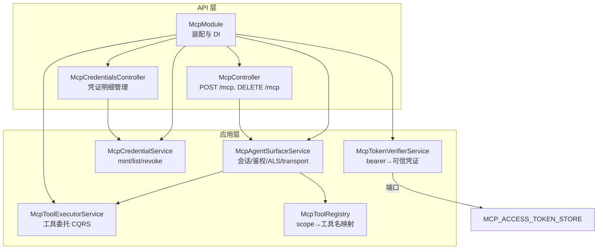
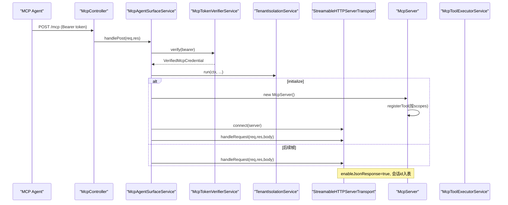
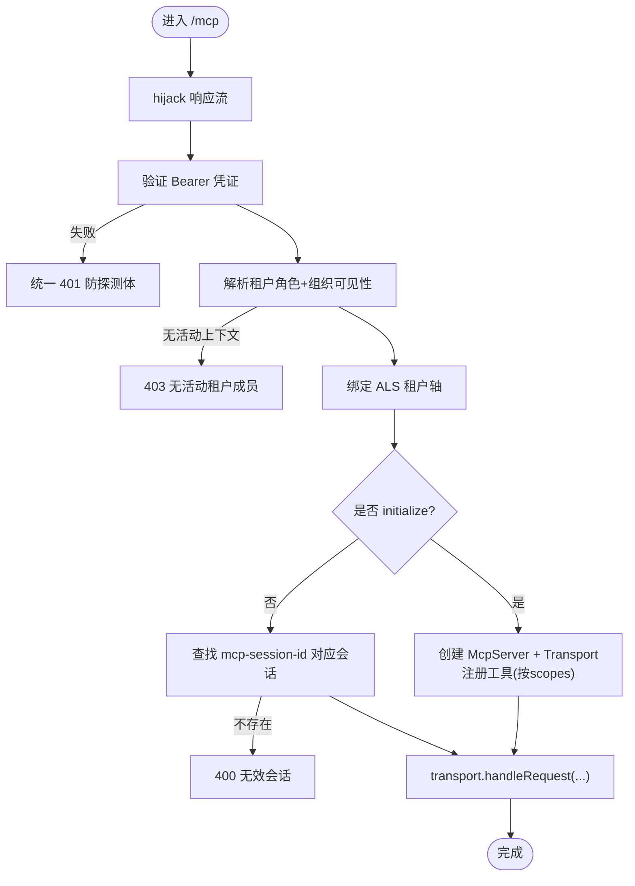
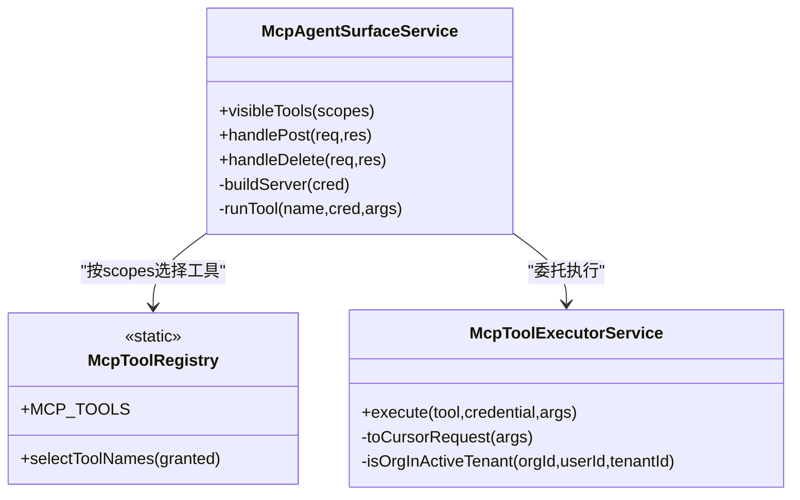
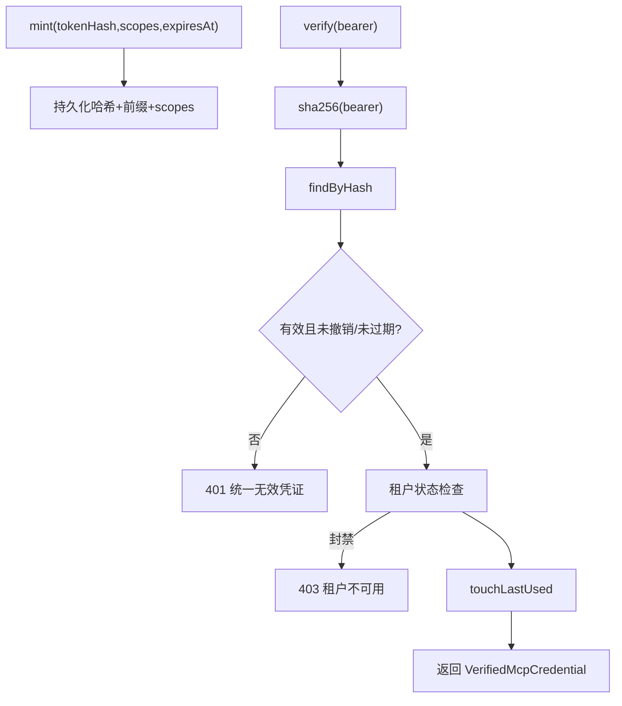
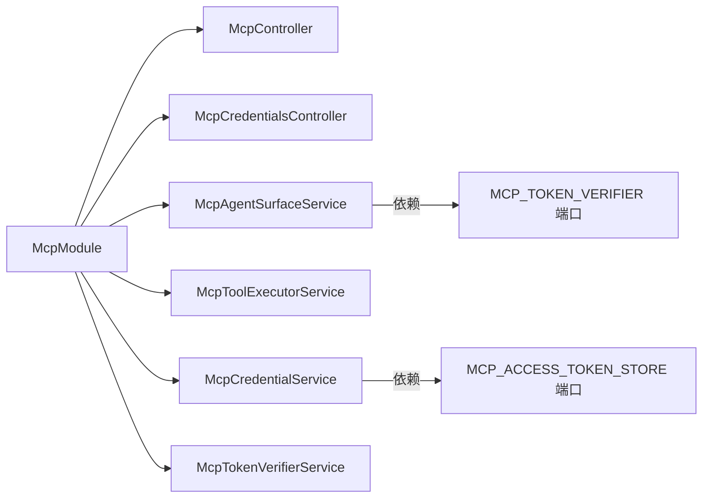
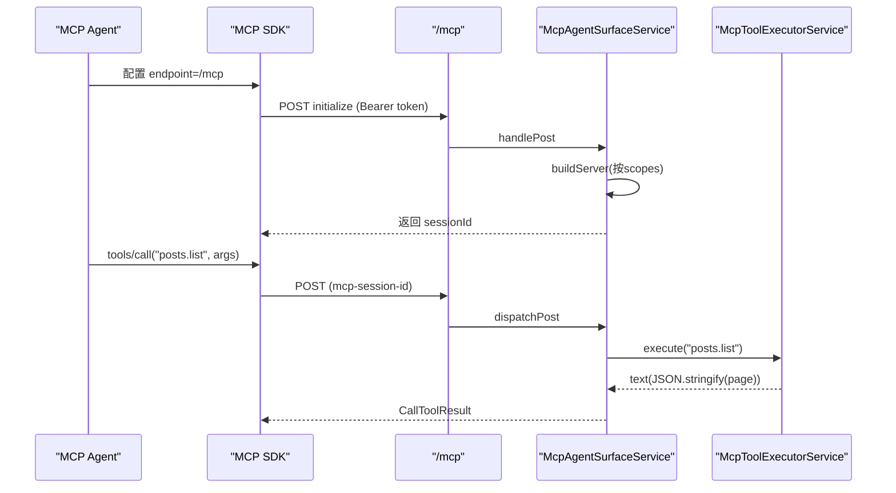

# MCP 工具集成

<cite>
**本文引用的文件**   
- [mcp.controller.ts](file://apps/api/src/features/mcp/api/mcp.controller.ts)
- [mcp.module.ts](file://apps/api/src/features/mcp/api/mcp.module.ts)
- [mcp-agent-surface.service.ts](file://apps/api/src/features/mcp/application/mcp-agent-surface.service.ts)
- [mcp-tool-executor.service.ts](file://apps/api/src/features/mcp/application/mcp-tool-executor.service.ts)
- [mcp-tool-registry.ts](file://apps/api/src/features/mcp/application/mcp-tool-registry.ts)
- [mcp-token-verifier.service.ts](file://apps/api/src/features/mcp/application/mcp-token-verifier.service.ts)
- [mcp-credential.service.ts](file://apps/api/src/features/mcp/application/mcp-credential.service.ts)
- [mcp-token-verifier.port.ts](file://apps/api/src/modules/auth/application/ports/mcp-token-verifier.port.ts)
- [mcp-access-token-store.port.ts](file://apps/api/src/modules/auth/application/ports/mcp-access-token-store.port.ts)
</cite>

## 目录
1. [引言](#引言)
2. [项目结构](#项目结构)
3. [核心组件](#核心组件)
4. [架构总览](#架构总览)
5. [详细组件分析](#详细组件分析)
6. [依赖关系分析](#依赖关系分析)
7. [性能与容量特性](#性能与容量特性)
8. [安全机制](#安全机制)
9. [MCP Agent 接入与调用流程](#mcp-agent-接入与调用流程)
10. [错误处理与调试](#错误处理与调试)
11. [结论](#结论)

## 引言
本仓库为 SaaS 多租户 NestJS 应用，新增 MCP（Model Context Protocol）Agent 工具面：通过官方 `@modelcontextprotocol/sdk` 暴露 `/mcp` 端点，使用 Streamable HTTP 协议承载 JSON-RPC；以 bearer 服务凭证鉴权，按租户作用域、角色与 scope 授权控制工具可见性与可调用性。工具薄壳复用既有 CQRS 查询与命令，导出 `tenant.directory`、`posts.list`、`workspace.create` 等能力，实现“零第二套业务逻辑”的 MCP 工具导出。

## 项目结构
MCP 相关代码集中在 `apps/api/src/features/mcp`，分为 API 层与应用层：
- API 层：`/mcp` 消费端点、凭证明细管理控制器、模块装配。
- 应用层：会话网关、工具执行器、凭证铸造/列表/撤销、token 校验、工具注册表。

**图表来源**
- [mcp.controller.ts:1-44](file://apps/api/src/features/mcp/api/mcp.controller.ts#L1-L44)
- [mcp.module.ts:1-34](file://apps/api/src/features/mcp/api/mcp.module.ts#L1-L34)
- [mcp-agent-surface.service.ts:1-384](file://apps/api/src/features/mcp/application/mcp-agent-surface.service.ts#L1-L384)
- [mcp-tool-executor.service.ts:1-167](file://apps/api/src/features/mcp/application/mcp-tool-executor.service.ts#L1-L167)
- [mcp-tool-registry.ts:1-36](file://apps/api/src/features/mcp/application/mcp-tool-registry.ts#L1-L36)
- [mcp-token-verifier.service.ts:1-81](file://apps/api/src/features/mcp/application/mcp-token-verifier.service.ts#L1-L81)
- [mcp-credential.service.ts:1-98](file://apps/api/src/features/mcp/application/mcp-credential.service.ts#L1-L98)

**章节来源**
- [mcp.controller.ts:1-44](file://apps/api/src/features/mcp/api/mcp.controller.ts#L1-L44)
- [mcp.module.ts:1-34](file://apps/api/src/features/mcp/api/mcp.module.ts#L1-L34)

## 核心组件
- McpController：薄控制器，接管 Fastify 请求/响应，绕过全局信封拦截器，将请求交给 `McpAgentSurfaceService`。
- McpAgentSurfaceService：MCP 会话网关，负责 bearer 校验、租户作用域解析、ALS 绑定、Streamable HTTP transport 生命周期与会话缓存。
- McpToolExecutorService：工具执行壳，按工具名委派到既有 CQRS 查询/命令，返回 MCP 文本回执。
- McpTokenVerifierService：bearer token 校验，统一失败码，联动租户状态。
- McpCredentialService：凭证 mint/list/revoke，明文仅一次性回显，哈希落库。
- McpToolRegistry：静态工具清单与 scope 筛选函数，空 scope 集 = 零工具（deny-by-default）。

**章节来源**
- [mcp.controller.ts:6-18](file://apps/api/src/features/mcp/api/mcp.controller.ts#L6-L18)
- [mcp-agent-surface.service.ts:66-93](file://apps/api/src/features/mcp/application/mcp-agent-surface.service.ts#L66-L93)
- [mcp-tool-executor.service.ts:34-49](file://apps/api/src/features/mcp/application/mcp-tool-executor.service.ts#L34-L49)
- [mcp-token-verifier.service.ts:14-32](file://apps/api/src/features/mcp/application/mcp-token-verifier.service.ts#L14-L32)
- [mcp-credential.service.ts:23-31](file://apps/api/src/features/mcp/application/mcp-credential.service.ts#L23-L31)
- [mcp-tool-registry.ts:1-17](file://apps/api/src/features/mcp/application/mcp-tool-registry.ts#L1-L17)

## 架构总览
MCP 消费面采用“薄控制器 + 应用服务 + SDK transport”的分层：
- 入站：Fastify 接收 POST/DELETE `/mcp`，控制器直接 hijack 响应并交由服务处理。
- 鉴权：每请求重验 bearer → 校验 token 有效性、租户封禁状态 → 解析租户角色与组织可见性 → 程序化绑定 ALS。
- 会话：initialize 建立 `McpServer` 与 `StreamableHTTPServerTransport`，后续帧复用；进程内 LRU 会话表 + TTL 惰性回收。
- 工具：按凭证 scopes 动态注册工具；调用时经执行器委托 CQRS，结果序列化为 MCP 文本回执。

**图表来源**
- [mcp.controller.ts:24-42](file://apps/api/src/features/mcp/api/mcp.controller.ts#L24-L42)
- [mcp-agent-surface.service.ts:120-207](file://apps/api/src/features/mcp/application/mcp-agent-surface.service.ts#L120-L207)
- [mcp-token-verifier.service.ts:40-67](file://apps/api/src/features/mcp/application/mcp-token-verifier.service.ts#L40-L67)

## 详细组件分析

### /mcp 端点与 Streamable HTTP
- 路径：全局前缀 + 版本 + `mcp`（默认 `/api/v1/mcp`）。
- 方法：POST（JSON-RPC 入口）、DELETE（终止会话）。GET 在 `enableJsonResponse` 形下未启用。
- 行为：控制器 `@Public()` 豁免全局三墙；`reply.hijack()` 后直写原生响应，避免全局 TransformInterceptor 信封干扰。
- 会话头：客户端需在非 initialize 帧携带 `mcp-session-id`，服务端据此复用 transport。

**图表来源**
- [mcp-controller.ts:6-18](file://apps/api/src/features/mcp/api/mcp.controller.ts#L6-L18)
- [mcp-agent-surface.service.ts:120-207](file://apps/api/src/features/mcp/application/mcp-agent-surface.service.ts#L120-L207)

**章节来源**
- [mcp.controller.ts:6-18](file://apps/api/src/features/mcp/api/mcp.controller.ts#L6-L18)
- [mcp.controller.ts:24-42](file://apps/api/src/features/mcp/api/mcp.controller.ts#L24-L42)
- [mcp-agent-surface.service.ts:120-207](file://apps/api/src/features/mcp/application/mcp-agent-surface.service.ts#L120-L207)

### 工具薄壳与既有服务复用
- 工具注册：`buildServer` 根据 `selectToolNames(cred.scopes)` 动态注册工具；空 scope 集 = 零工具。
- 工具元数据：描述与 inputSchema（zod）由 `TOOL_META` 提供，SDK 侧用于 tools/list 展示与参数校验。
- 工具执行：`runTool` 捕获异常，折成 MCP `isError` 回执；具体逻辑委托 `McpToolExecutorService.execute`。
- 执行器策略：
  - `tenant.directory`：调用既有 `ListTenantDirectoryQuery`，返回可见租户及组织列表。
  - `posts.list`：要求活动租户存在，调用 `ListPostsQuery`，分页游标参数收敛。
  - `workspace.create`：先校验 `organizationId` 属于活动租户且用户可见，再走权限检查 `create Workspace`，最后嵌套 ALS 补 `organizationId` 后派发 `CreateWorkspaceCommand`。

**图表来源**
- [mcp-agent-surface.service.ts:223-254](file://apps/api/src/features/mcp/application/mcp-agent-surface.service.ts#L223-L254)
- [mcp-tool-executor.service.ts:67-127](file://apps/api/src/features/mcp/application/mcp-tool-executor.service.ts#L67-L127)
- [mcp-tool-registry.ts:18-35](file://apps/api/src/features/mcp/application/mcp-tool-registry.ts#L18-L35)

**章节来源**
- [mcp-agent-surface.service.ts:223-254](file://apps/api/src/features/mcp/application/mcp-agent-surface.service.ts#L223-L254)
- [mcp-tool-executor.service.ts:67-127](file://apps/api/src/features/mcp/application/mcp-tool-executor.service.ts#L67-L127)
- [mcp-tool-registry.ts:18-35](file://apps/api/src/features/mcp/application/mcp-tool-registry.ts#L18-L35)

### 工具定义与输入约束
- `tenant.directory`：列出凭证所有者可见的租户及其组织（id/name/slug/status），无需额外参数。
- `posts.list`：列出当前租户下的帖子，支持 cursor 分页；limit 范围 [1,100]，缺省 20。
- `workspace.create`：在活动租户的组织下创建工作区；必填 name、slug、organizationId，后者必须属于凭证活动租户且用户可见。

**章节来源**
- [mcp-agent-surface.service.ts:43-64](file://apps/api/src/features/mcp/application/mcp-agent-surface.service.ts#L43-L64)
- [mcp-tool-executor.service.ts:72-127](file://apps/api/src/features/mcp/application/mcp-tool-executor.service.ts#L72-L127)

### 凭证管理与 Token 校验
- 凭证铸造：生成 `mcp_` 前缀明文 token（一次性回显），存储 sha256 哈希与前缀，记录 scopes、过期时间。
- 列表/撤销：按属主 userId 过滤，撤销幂等，跨租/不可见均 404（不泄露存在性）。
- Token 校验：按 sha256 查找行，判断撤销/过期；若租户被封禁则 403；成功则刷 lastUsedAt。

**图表来源**
- [mcp-credential.service.ts:36-69](file://apps/api/src/features/mcp/application/mcp-credential.service.ts#L36-L69)
- [mcp-token-verifier.service.ts:40-67](file://apps/api/src/features/mcp/application/mcp-token-verifier.service.ts#L40-L67)

**章节来源**
- [mcp-credential.service.ts:36-69](file://apps/api/src/features/mcp/application/mcp-credential.service.ts#L36-L69)
- [mcp-token-verifier.service.ts:40-67](file://apps/api/src/features/mcp/application/mcp-token-verifier.service.ts#L40-L67)

## 依赖关系分析
- McpModule 装配控制器与服务，注入 CqrsModule，并通过 Symbol token 暴露 `MCP_TOKEN_VERIFIER`，供属主侧 e2e 消费而零 features import。
- 消费面依赖：
  - `MCP_TOKEN_VERIFIER`：bearer 校验。
  - `TENANT_SCOPE_RESOLVER`：角色与组织可见性解析。
  - `TenantIsolationService`：程序化 ALS 绑定。
  - `McpToolExecutorService`：CQRS 委派。
- 端口隔离：凭证持久化通过 `MCP_ACCESS_TOKEN_STORE` 端口访问 auth 属主实体，features 不直接触 entity/em。

**图表来源**
- [mcp.module.ts:20-33](file://apps/api/src/features/mcp/api/mcp.module.ts#L20-L33)
- [mcp-token-verifier.port.ts:1-42](file://apps/api/src/modules/auth/application/ports/mcp-token-verifier.port.ts#L1-L42)
- [mcp-access-token-store.port.ts:1-78](file://apps/api/src/modules/auth/application/ports/mcp-access-token-store.port.ts#L1-L78)

**章节来源**
- [mcp.module.ts:11-19](file://apps/api/src/features/mcp/api/mcp.module.ts#L11-L19)
- [mcp-token-verifier.port.ts:1-42](file://apps/api/src/modules/auth/application/ports/mcp-token-verifier.port.ts#L1-L42)
- [mcp-access-token-store.port.ts:45-77](file://apps/api/src/modules/auth/application/ports/mcp-access-token-store.port.ts#L45-L77)

## 性能与容量特性
- 会话缓存：进程内 Map 维护活跃会话，LRU 逐出 + 闲置 TTL（默认 30 分钟）惰性回收；上限默认 128。
- 工具注册：每次 initialize 新建 `McpServer` 并按 scopes 注册工具，避免跨会话污染。
- 校验成本：每次 verify 约 2 次 DB 往返 + 租户状态读；换撤销/封禁即时生效，无缓存窗口。
- 工具调用：执行器直接委派 CQRS，无二次判据；`posts.list` 限制页宽上限防止大页拉爆。

**章节来源**
- [mcp-agent-surface.service.ts:96-102](file://apps/api/src/features/mcp/application/mcp-agent-surface.service.ts#L96-L102)
- [mcp-agent-surface.service.ts:293-341](file://apps/api/src/features/mcp/application/mcp-agent-surface.service.ts#L293-L341)
- [mcp-token-verifier.service.ts:26-29](file://apps/api/src/features/mcp/application/mcp-token-verifier.service.ts#L26-L29)
- [mcp-tool-executor.service.ts:29-32](file://apps/api/src/features/mcp/application/mcp-tool-executor.service.ts#L29-L32)

## 安全机制
- deny-by-default：
  - 工具可见性：凭证 scopes 为空集时，`selectToolNames` 返回空数组，server 不注册任何工具。
  - 租户作用域：无活动租户成员资格 → 403 fail-closed。
  - 组织归属：`workspace.create` 强制校验 organizationId 属于活动租户且用户可见，跨租或不存在同回执。
- 凭证安全：
  - bearer 明文永不落库，仅存 sha256 哈希；前缀仅用于辨认。
  - 无效/撤销/过期统一 401，不区分原因；租户封禁 403。
- 会话安全：
  - 会话条目绑定 tenantId；后续请求若 tenantId 不匹配视为无会话（400），防跨租冒用。
  - GET 通道在 `enableJsonResponse` 形下未启用，仅 POST/DELETE。
- 错误体：
  - 所有 JSON 错误经 `writeError` 补齐标准字段（timestamp/path/requestId 等），与 REST 过滤器共享单源。

**章节来源**
- [mcp-tool-registry.ts:27-35](file://apps/api/src/features/mcp/application/mcp-tool-registry.ts#L27-L35)
- [mcp-agent-surface.service.ts:131-141](file://apps/api/src/features/mcp/application/mcp-agent-surface.service.ts#L131-L141)
- [mcp-tool-executor.service.ts:88-127](file://apps/api/src/features/mcp/application/mcp-tool-executor.service.ts#L88-L127)
- [mcp-token-verifier.service.ts:18-32](file://apps/api/src/features/mcp/application/mcp-token-verifier.service.ts#L18-L32)
- [mcp-agent-surface.service.ts:361-382](file://apps/api/src/features/mcp/application/mcp-agent-surface.service.ts#L361-L382)

## MCP Agent 接入与调用流程
- 接入步骤：
  1. 通过凭证明细接口（`McpCredentialsController`）mint 一个 MCP 服务凭证，获得明文 token 与 scopes。
  2. 使用官方 MCP SDK 连接 `/mcp`，首次 POST 发送 initialize，服务端返回会话 id。
  3. 后续调用携带 `mcp-session-id` 头，调用已注册工具（如 `tenant.directory`、`posts.list`、`workspace.create`）。
- 工具调用流程：
  - SDK 发起 tools/call，服务端 `McpAgentSurfaceService.runTool` 捕获异常并返回 `isError` 回执。
  - 执行器委派 CQRS，返回文本回执（JSON 字符串），由 SDK 反序列化为结构化结果。

**图表来源**
- [mcp-agent-surface.service.ts:223-254](file://apps/api/src/features/mcp/application/mcp-agent-surface.service.ts#L223-L254)
- [mcp-tool-executor.service.ts:67-87](file://apps/api/src/features/mcp/application/mcp-tool-executor.service.ts#L67-L87)

**章节来源**
- [mcp-agent-surface.service.ts:223-254](file://apps/api/src/features/mcp/application/mcp-agent-surface.service.ts#L223-L254)
- [mcp-tool-executor.service.ts:67-87](file://apps/api/src/features/mcp/application/mcp-tool-executor.service.ts#L67-L87)

## 错误处理与调试
- 认证错误：
  - 无效/撤销/过期凭证：401，errorCode 统一，message 防探测。
  - 租户封禁：403，errorCode 明确。
  - 无活动租户成员：403，提示无活动租户上下文。
- 会话错误：
  - 非 initialize 帧缺失或会话不匹配：400，不透露会话是否存在。
  - 终止会话失败：500，日志告警。
- 工具错误：
  - 执行器抛异常：折成 `isError=true` 回执，HttpException 透状态码与消息，其他异常记录警告日志。
- 调试建议：
  - 使用 curl 或 MCP SDK 客户端打印 headers（Authorization、mcp-session-id）与 body。
  - 观察服务端日志中 `mcp session`、`mcp tool`、`mcp transport` 相关告警。
  - 确认凭证 scopes 包含所需工具的 requiredScope（read/write）。

**章节来源**
- [mcp-token-verifier.service.ts:40-79](file://apps/api/src/features/mcp/application/mcp-token-verifier.service.ts#L40-L79)
- [mcp-agent-surface.service.ts:144-168](file://apps/api/src/features/mcp/application/mcp-agent-surface.service.ts#L144-L168)
- [mcp-agent-surface.service.ts:241-254](file://apps/api/src/features/mcp/application/mcp-agent-surface.service.ts#L241-L254)
- [mcp-agent-surface.service.ts:347-382](file://apps/api/src/features/mcp/application/mcp-agent-surface.service.ts#L347-L382)

## 结论
本项目通过 MCP SDK 的 Streamable HTTP 协议，将既有 SaaS 业务能力以工具形式暴露给 AI Agent。鉴权链路严格遵循 deny-by-default：空 scope 集即零工具，无活动租户即拒绝，组织归属与权限双重校验确保写操作安全。工具薄壳复用 CQRS，避免重复业务逻辑；会话与错误处理兼顾可用性与可观测性。该设计为后续扩展更多 MCP 工具提供了清晰、安全的扩展点。