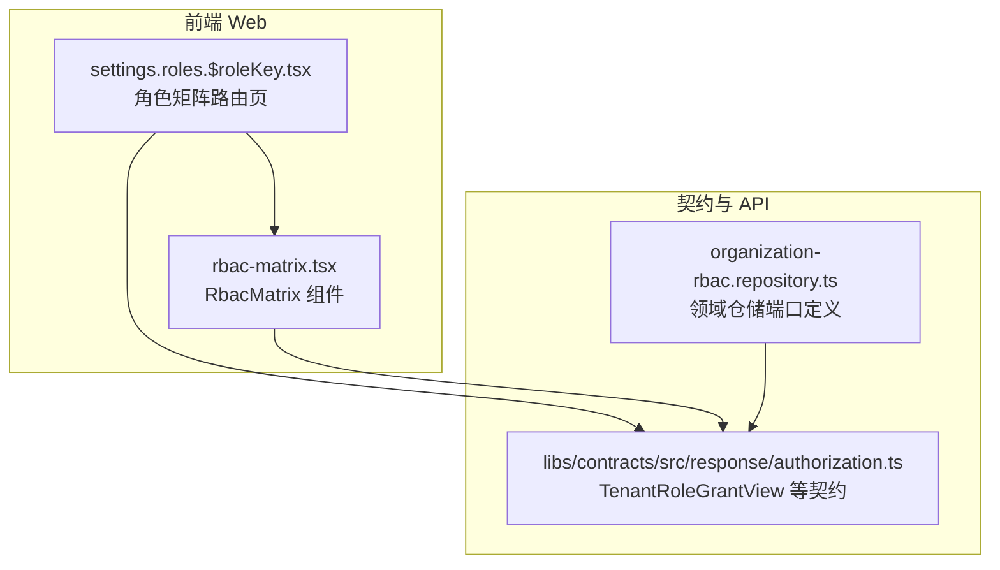
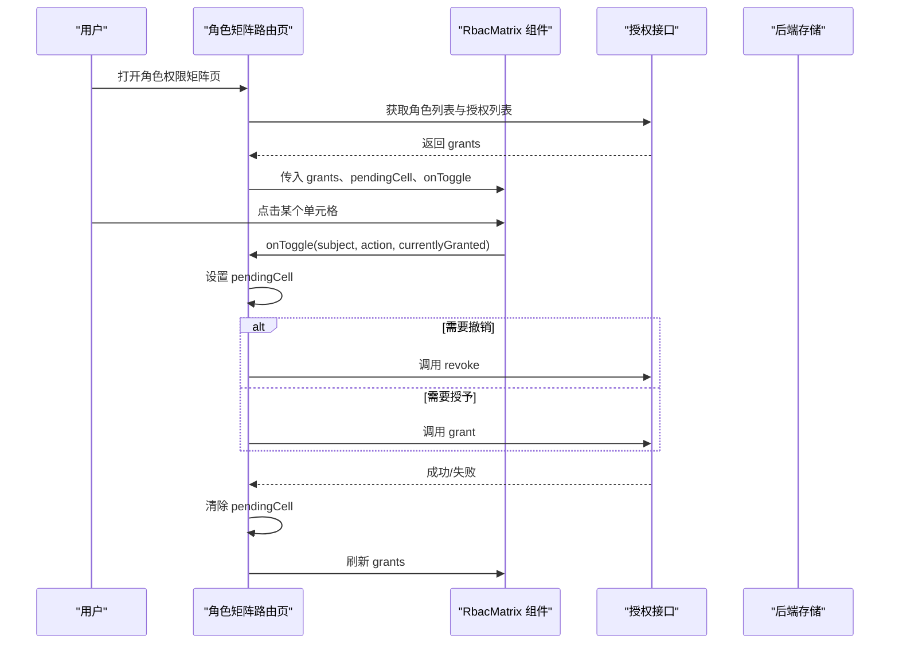
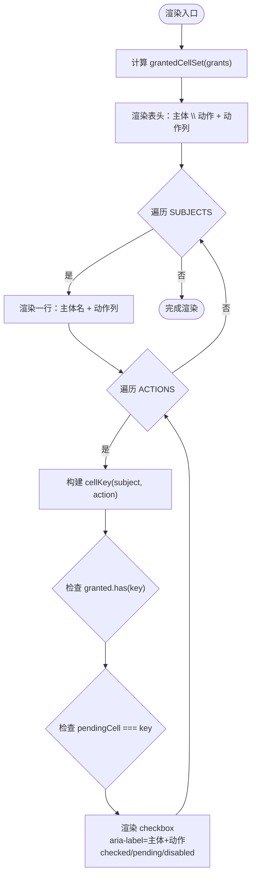
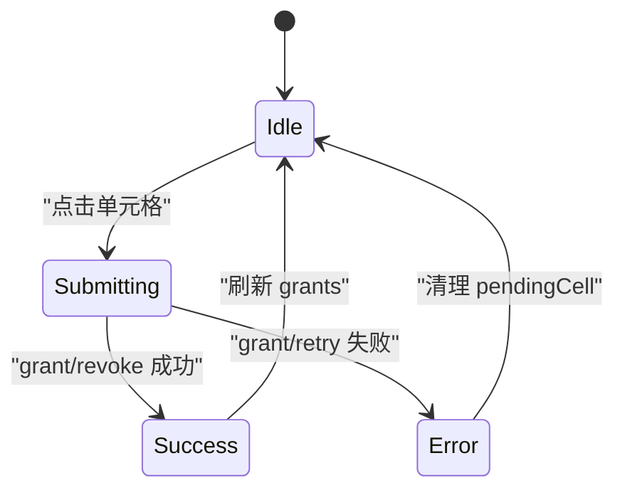
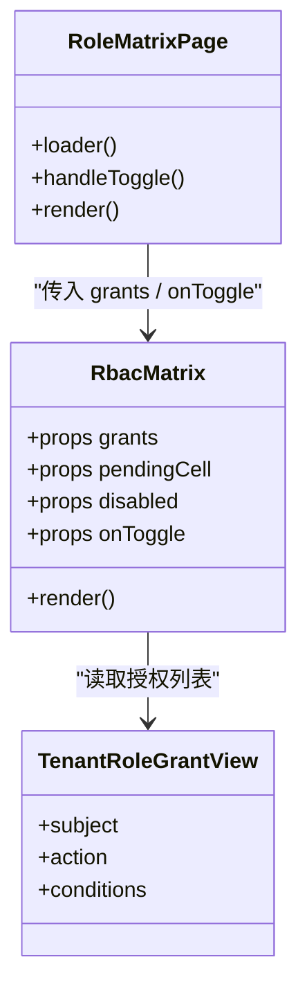
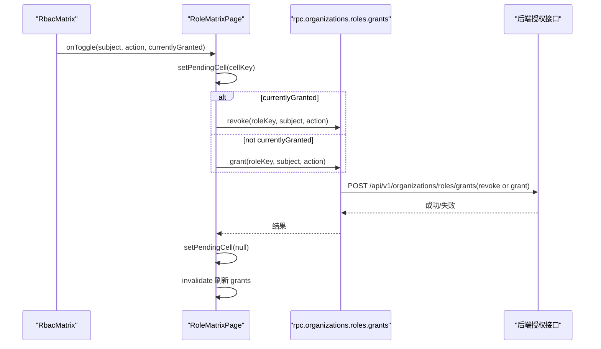

# RBAC 权限矩阵组件

<cite>
**本文引用的文件**   
- [apps/web/src/components/rbac-matrix.tsx](file://apps/web/src/components/rbac-matrix.tsx)
- [apps/web/src/components/rbac-matrix.test.tsx](file://apps/web/src/components/rbac-matrix.test.tsx)
- [apps/web/src/routes/settings.roles.$roleKey.tsx](file://apps/web/src/routes/settings.roles.$roleKey.tsx)
- [libs/contracts/src/response/authorization.ts](file://libs/contracts/src/response/authorization.ts)
- [apps/api/src/modules/authorization/domain/repositories/organization-rbac.repository.ts](file://apps/api/src/modules/authorization/domain/repositories/organization-rbac.repository.ts)
</cite>

## 目录
1. [简介](#简介)
2. [项目结构定位](#项目结构定位)
3. [核心组件与数据模型](#核心组件与数据模型)
4. [架构总览](#架构总览)
5. [详细组件分析](#详细组件分析)
6. [依赖关系分析](#依赖关系分析)
7. [性能与渲染特性](#性能与渲染特性)
8. [可访问性与键盘导航](#可访问性与键盘导航)
9. [配置项、列定义与回调](#配置项列定义与回调)
10. [集成示例：从数据绑定到保存流程](#集成示例从数据绑定到保存流程)
11. [故障排查](#故障排查)
12. [结论](#结论)

## 简介
RBAC 权限矩阵组件用于在角色管理界面中，以“主体 × 动作”的表格形式可视化并编辑租户角色的授权。该组件聚焦于整行（whole-subject）授权：当某条授权记录的 `conditions` 为 `null` 时，对应单元格视为勾选；若 `conditions` 非空，则属于实例级条件授权，不在本矩阵中呈现。

组件职责边界清晰：
- 不直接发起网络请求。
- 不维护全局状态。
- 通过受控属性接收已授予授权列表，并通过 `onToggle` 回调向上报告用户交互。
- 使用后端契约类型约束前端枚举词汇，保证前后端枚举变更在编译期暴露差异。

## 项目结构定位
权限矩阵位于前端 Web 应用的组件层，并由角色设置路由页面消费。

**图表来源**
- [apps/web/src/routes/settings.roles.$roleKey.tsx:1-122](file://apps/web/src/routes/settings.roles.$roleKey.tsx#L1-L122)
- [apps/web/src/components/rbac-matrix.tsx:1-129](file://apps/web/src/components/rbac-matrix.tsx#L1-L129)
- [libs/contracts/src/response/authorization.ts:1-50](file://libs/contracts/src/response/authorization.ts#L1-L50)
- [apps/api/src/modules/authorization/domain/repositories/organization-rbac.repository.ts:1-198](file://apps/api/src/modules/authorization/domain/repositories/organization-rbac.repository.ts#L1-L198)

**章节来源**
- [apps/web/src/routes/settings.roles.$roleKey.tsx:1-122](file://apps/web/src/routes/settings.roles.$roleKey.tsx#L1-L122)
- [apps/web/src/components/rbac-matrix.tsx:1-129](file://apps/web/src/components/rbac-matrix.tsx#L1-L129)

## 核心组件与数据模型

### RbacMatrix 组件
RbacMatrix 是一个受控表格组件，负责：
- 渲染 6 个主体 × 5 个动作的 30 个单元格。
- 根据 `grants` 计算每个单元格的勾选状态。
- 将用户点击事件转换为 `onToggle(subject, action, currentlyGranted)` 回调。
- 支持整表禁用和单个单元格 pending 态。

关键导出：
- `AuthorizationSubject`、`AuthorizationAction`：由后端契约类型推导，确保枚举值一致。
- `SUBJECTS`、`ACTIONS`：当前矩阵使用的主体与动作集合。
- `cellKey`：生成唯一键，格式为 `subject:action`。
- `grantedCellSet`：将授权列表转为已勾选单元格集合。
- `RbacMatrix`：UI 组件。

**章节来源**
- [apps/web/src/components/rbac-matrix.tsx:14-82](file://apps/web/src/components/rbac-matrix.tsx#L14-L82)
- [apps/web/src/components/rbac-matrix.tsx:84-128](file://apps/web/src/components/rbac-matrix.tsx#L84-L128)

### TenantRoleGrantView 数据模型
`TenantRoleGrantView` 表示一条角色授权记录，包含：
- `subject`：资源主体，如组织、成员、邀请、工作区、角色、授权。
- `action`：动作，如新建、查看、修改、删除、取消。
- `conditions`：ABAC 条件对象或 `null`。`null` 表示整主体授权，即矩阵中的勾选态。

该类型由 Zod schema 定义，并在 API 响应侧保持同形，形成前后端类型锁。

**章节来源**
- [libs/contracts/src/response/authorization.ts:23-37](file://libs/contracts/src/response/authorization.ts#L23-L37)
- [apps/api/src/modules/authorization/domain/repositories/organization-rbac.repository.ts:24-40](file://apps/api/src/modules/authorization/domain/repositories/organization-rbac.repository.ts#L24-L40)

## 架构总览
权限矩阵的数据流遵循“只读展示 + 单向回调”的模式：

**图表来源**
- [apps/web/src/routes/settings.roles.$roleKey.tsx:52-121](file://apps/web/src/routes/settings.roles.$roleKey.tsx#L52-L121)
- [apps/web/src/components/rbac-matrix.tsx:84-128](file://apps/web/src/components/rbac-matrix.tsx#L84-L128)

## 详细组件分析

### 表格结构与渲染逻辑
矩阵采用 HTML `<table>` 结构：
- 表头：第一列为“主体 \ 动作”，后续列为各动作标签。
- 表体：每行一个主体，每列一个动作。
- 单元格：使用原生 checkbox 表示授权状态。

渲染关键点：
- 主体与动作来自固定数组，便于扩展与维护。
- 每个单元格使用 `cellKey(subject, action)` 作为稳定 key。
- 勾选状态由 `grantedCellSet(grants)` 计算，仅统计 `conditions == null` 的记录。
- pending 态通过 `pendingCell === cellKey` 判断，命中单元格禁用。

**图表来源**
- [apps/web/src/components/rbac-matrix.tsx:84-128](file://apps/web/src/components/rbac-matrix.tsx#L84-L128)

**章节来源**
- [apps/web/src/components/rbac-matrix.tsx:84-128](file://apps/web/src/components/rbac-matrix.tsx#L84-L128)

### 交互操作：勾选、批量与实时更新
- 勾选/取消：点击单元格触发 `onToggle(subject, action, currentlyGranted)`。
- 批量操作：组件本身不提供批量勾选能力；可在上层路由页封装批量按钮，循环调用 `onToggle` 或调用批量接口。
- 实时更新：路由页在每次 toggle 后调用 grant/revoke，成功后重新加载授权列表，从而更新矩阵显示。

防连点机制：
- 提交期间将 `pendingCell` 设为当前单元格 key。
- 组件检测到 `pendingCell` 命中时禁用对应 checkbox，避免竞态。

**章节来源**
- [apps/web/src/routes/settings.roles.$roleKey.tsx:65-103](file://apps/web/src/routes/settings.roles.$roleKey.tsx#L65-L103)
- [apps/web/src/components/rbac-matrix.tsx:106-122](file://apps/web/src/components/rbac-matrix.tsx#L106-L122)

### 权限数据的获取与处理
路由页 loader 执行以下流程：
1. 校验会话。
2. 获取角色列表，按 `roleKey` 匹配当前角色。
3. 获取授权列表 `grants`。
4. 将 `grants` 传给 `RbacMatrix`。

数据处理要点：
- `grants` 是 `TenantRoleGrantView[]`，包含 subject、action、conditions。
- 组件内部仅关注 `conditions == null` 的行，将其映射为勾选态。
- instance-level conditions 行不参与勾选判定，也不在矩阵中呈现。

**章节来源**
- [apps/web/src/routes/settings.roles.$roleKey.tsx:24-48](file://apps/web/src/routes/settings.roles.$roleKey.tsx#L24-L48)
- [apps/web/src/components/rbac-matrix.tsx:59-69](file://apps/web/src/components/rbac-matrix.tsx#L59-L69)

### 状态同步与冲突解决
- 状态源：后端授权列表。
- 本地临时状态：`pendingCell` 表示正在提交的单元格。
- 冲突解决：
  - 提交前禁用目标单元格，防止重复提交。
  - finally 块中清理 `pendingCell`，恢复交互。
  - 成功后刷新授权列表，使 UI 与后端一致。

**图表来源**
- [apps/web/src/routes/settings.roles.$roleKey.tsx:65-103](file://apps/web/src/routes/settings.roles.$roleKey.tsx#L65-L103)

**章节来源**
- [apps/web/src/routes/settings.roles.$roleKey.tsx:65-103](file://apps/web/src/routes/settings.roles.$roleKey.tsx#L65-L103)

## 依赖关系分析

**图表来源**
- [apps/web/src/components/rbac-matrix.tsx:71-128](file://apps/web/src/components/rbac-matrix.tsx#L71-L128)
- [apps/web/src/routes/settings.roles.$roleKey.tsx:52-121](file://apps/web/src/routes/settings.roles.$roleKey.tsx#L52-L121)
- [libs/contracts/src/response/authorization.ts:31-37](file://libs/contracts/src/response/authorization.ts#L31-L37)

**章节来源**
- [apps/web/src/components/rbac-matrix.tsx:71-128](file://apps/web/src/components/rbac-matrix.tsx#L71-L128)
- [apps/web/src/routes/settings.roles.$roleKey.tsx:52-121](file://apps/web/src/routes/settings.roles.$roleKey.tsx#L52-L121)
- [libs/contracts/src/response/authorization.ts:31-37](file://libs/contracts/src/response/authorization.ts#L31-L37)

## 性能与渲染特性
- 网格规模固定为 6×5 = 30 单元格，渲染开销低。
- 使用 `Set<string>` 缓存已勾选键集合，查找复杂度 O(1)。
- 每个单元格使用稳定 key，减少 React 重渲染成本。
- pending 态仅禁用单个单元格，不影响其他单元格交互。

优化建议：
- 如需扩展更多主体或动作，考虑虚拟滚动或分页，但当前规模无需。
- 可将 `SUBJECT_LABELS`、`ACTION_LABELS` 国际化，避免硬编码文本。

[本节为通用性能讨论，不直接分析具体代码文件]

## 可访问性与键盘导航
- 每个单元格使用原生 `<input type="checkbox">`，天然支持键盘 Tab 导航与空格切换。
- 提供 `aria-label`，值为“主体 动作”，便于屏幕阅读器朗读。
- 禁用态通过 `disabled` 控制，符合无障碍语义。

注意事项：
- 当前未添加 ARIA 描述说明整表用途，可在外层容器增加 `aria-describedby` 或标题辅助信息。
- 建议在表格头部增加 `scope="col"` 与 `scope="row"`，提升表格可读性。

**章节来源**
- [apps/web/src/components/rbac-matrix.tsx:112-119](file://apps/web/src/components/rbac-matrix.tsx#L112-L119)

## 配置项、列定义与回调

### 组件属性
- `grants`：当前角色的授权列表，类型为 `readonly TenantRoleGrantView[]`。
- `pendingCell`：当前正在提交的单元格键，类型为 `string | null`。
- `disabled`：是否禁用整表，类型为 `boolean`。
- `onToggle`：单元格切换回调，签名为 `(subject, action, currentlyGranted) => void`。

### 列定义
- 主体列：由 `SUBJECTS` 数组决定，包含组织、成员、邀请、工作区、角色、授权。
- 动作列：由 `ACTIONS` 数组决定，包含新建、查看、修改、删除、取消。
- 标签映射：`SUBJECT_LABELS`、`ACTION_LABELS` 提供中文显示名称。

### 回调处理
- `onToggle` 由上层路由页实现，负责调用 grant/revoke 接口。
- 回调参数包含：
  - `subject`：被操作的主体。
  - `action`：被操作的动。
  - `currentlyGranted`：当前是否已授予，用于决定调用 grant 还是 revoke。

**章节来源**
- [apps/web/src/components/rbac-matrix.tsx:20-57](file://apps/web/src/components/rbac-matrix.tsx#L20-L57)
- [apps/web/src/components/rbac-matrix.tsx:71-82](file://apps/web/src/components/rbac-matrix.tsx#L71-L82)
- [apps/web/src/routes/settings.roles.$roleKey.tsx:65-103](file://apps/web/src/routes/settings.roles.$roleKey.tsx#L65-L103)

## 集成示例：从数据绑定到保存流程

### 数据绑定
- 路由页 loader 获取 `grants` 并传递给 `RbacMatrix`。
- 组件内部通过 `grantedCellSet` 将 `grants` 转为勾选集合。

### 用户界面交互
- 用户点击单元格，组件调用 `onToggle(subject, action, currentlyGranted)`。
- 路由页设置 `pendingCell`，调用 grant 或 revoke 接口。
- 成功后刷新授权列表，失败则展示错误信息。

### 权限保存流程

**图表来源**
- [apps/web/src/routes/settings.roles.$roleKey.tsx:65-103](file://apps/web/src/routes/settings.roles.$roleKey.tsx#L65-L103)

**章节来源**
- [apps/web/src/routes/settings.roles.$roleKey.tsx:24-48](file://apps/web/src/routes/settings.roles.$roleKey.tsx#L24-L48)
- [apps/web/src/routes/settings.roles.$roleKey.tsx:65-103](file://apps/web/src/routes/settings.roles.$roleKey.tsx#L65-L103)

## 故障排查
常见问题与处理建议：
- 单元格无法点击：
  - 检查 `disabled` 是否启用。
  - 检查 `pendingCell` 是否命中当前单元格。
- 勾选状态不正确：
  - 确认 `grants` 中对应记录的 `conditions` 是否为 `null`。
  - 确认 `cellKey` 生成是否正确。
- 权限未生效：
  - 检查 grant/revoke 接口是否成功。
  - 检查是否刷新了授权列表。

测试覆盖：
- 渲染 30 个单元格。
- whole-subject 行对应勾选。
- instance-level conditions 不计入勾选。
- 未勾格点击触发 `onToggle(subject, action, false)`。
- 已勾格点击触发 `onToggle(subject, action, true)`。
- pendingCell 命中的单元格禁用。

**章节来源**
- [apps/web/src/components/rbac-matrix.test.tsx:14-65](file://apps/web/src/components/rbac-matrix.test.tsx#L14-L65)

## 结论
RBAC 权限矩阵组件以简洁的表格形式实现了角色授权的可视化与编辑。其设计强调：
- 类型安全：前后端共享契约类型，枚举变更在编译期暴露。
- 状态可控：组件不持有业务状态，所有交互通过回调上报。
- 可访问性：使用原生 checkbox 与 aria-label，支持键盘与屏幕阅读器。
- 可扩展性：主体与动作可通过数组扩展，标签映射便于国际化。

在实际集成中，建议：
- 在上层路由页统一处理 grant/revoke 与错误提示。
- 根据需要扩展批量操作与自定义列定义。
- 完善表格无障碍属性，提升用户体验。