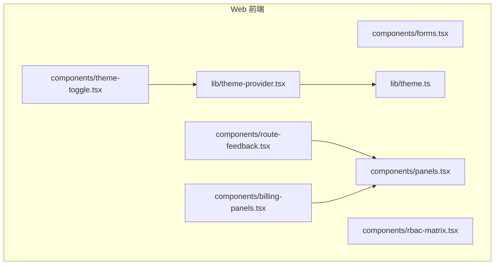
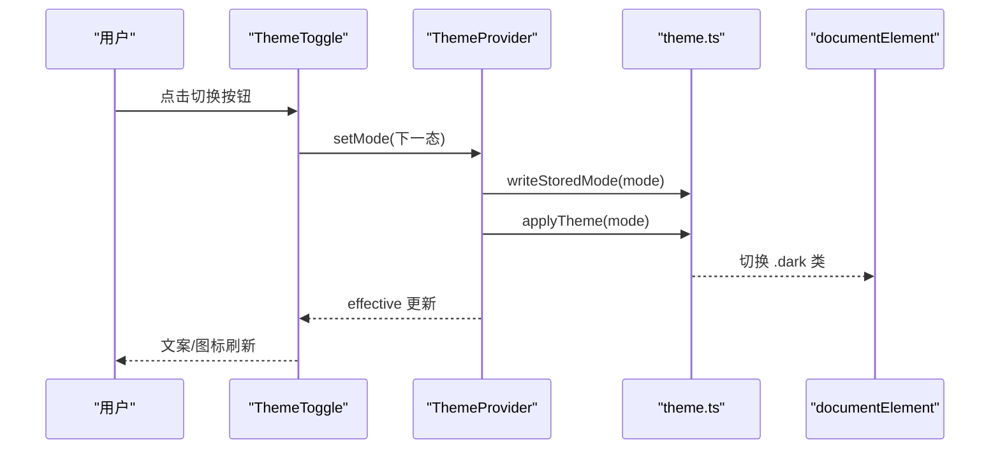
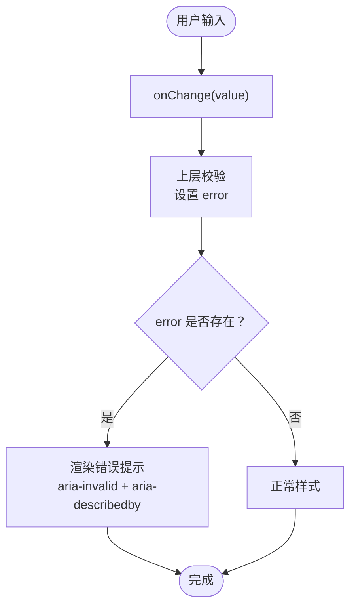
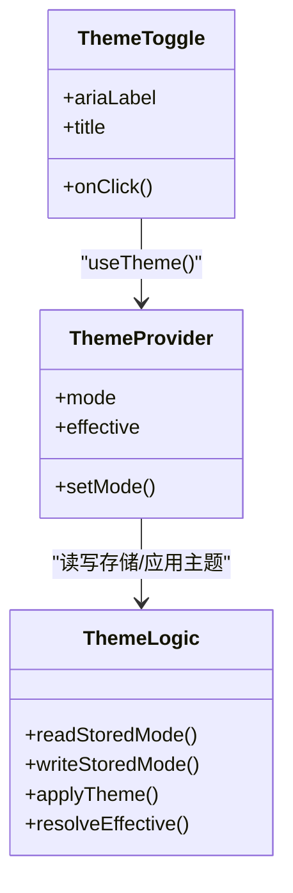
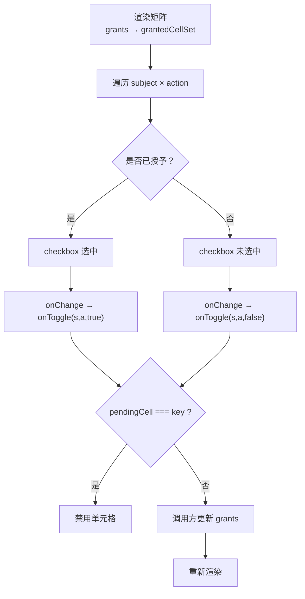
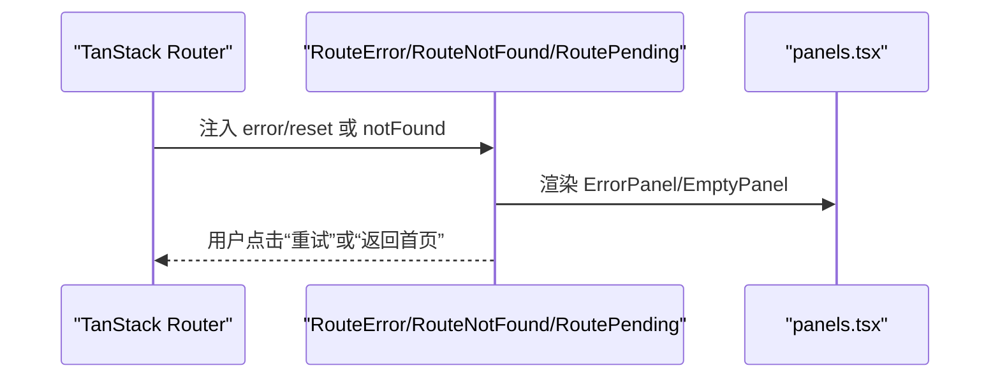
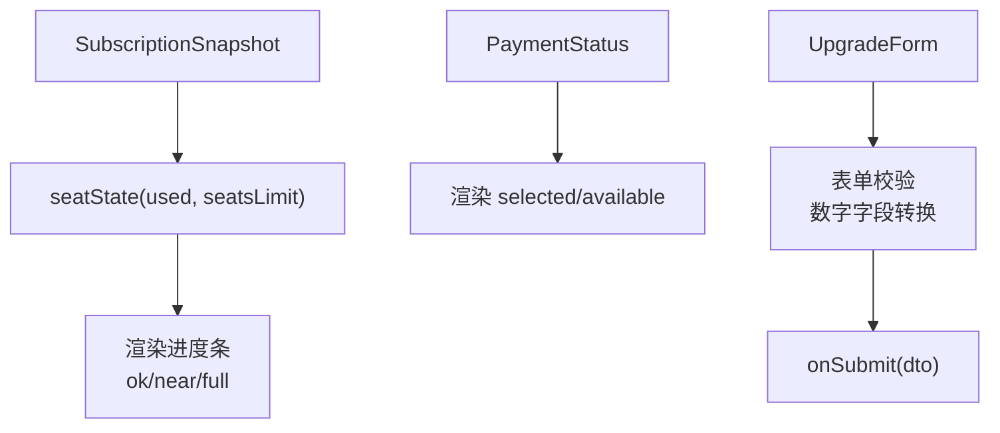
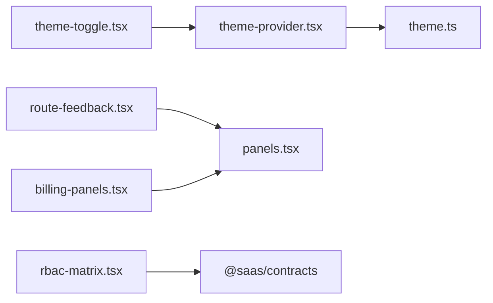

# UI 组件库

<cite>
**本文引用的文件**   
- [forms.tsx](file://apps/web/src/components/forms.tsx)
- [theme-toggle.tsx](file://apps/web/src/components/theme-toggle.tsx)
- [rbac-matrix.tsx](file://apps/web/src/components/rbac-matrix.tsx)
- [route-feedback.tsx](file://apps/web/src/components/route-feedback.tsx)
- [billing-panels.tsx](file://apps/web/src/components/billing-panels.tsx)
- [theme.ts](file://apps/web/src/lib/theme.ts)
- [theme-provider.tsx](file://apps/web/src/lib/theme-provider.tsx)
- [panels.tsx](file://apps/web/src/components/panels.tsx)
</cite>

## 目录
1. [简介](#简介)
2. [项目结构](#项目结构)
3. [核心组件总览](#核心组件总览)
4. [架构总览](#架构总览)
5. [详细组件分析](#详细组件分析)
6. [依赖关系分析](#依赖关系分析)
7. [性能与可维护性](#性能与可维护性)
8. [故障排查指南](#故障排查指南)
9. [结论](#结论)
10. [附录：使用示例与样式覆盖](#附录使用示例与样式覆盖)

## 简介
本文件面向前端使用者与维护者，系统化说明以下 UI 组件的职责、属性、交互、错误处理与样式定制方式：
- 表单基元（forms.tsx）：字段类型、验证提示、无障碍、提交反馈。
- 主题切换器（theme-toggle.tsx）：三态主题管理、颜色系统、暗色模式支持。
- RBAC 权限矩阵（rbac-matrix.tsx）：权限可视化、整行授予/撤销、实时交互。
- 路由反馈（route-feedback.tsx）：错误边界、未知路由、加载态统一呈现。
- 计费面板（billing-panels.tsx）：订阅快照、席位用量、支付通道状态、开通/升级表单。

## 项目结构
这些组件位于 Web 应用的前端代码中，采用“按功能拆分”的组织方式；主题逻辑独立在 lib 层，便于纯逻辑测试与复用。

**图表来源**
- [theme-toggle.tsx:1-27](file://apps/web/src/components/theme-toggle.tsx#L1-L27)
- [theme-provider.tsx:1-65](file://apps/web/src/lib/theme-provider.tsx#L1-L65)
- [theme.ts:1-57](file://apps/web/src/lib/theme.ts#L1-L57)
- [route-feedback.tsx:1-67](file://apps/web/src/components/route-feedback.tsx#L1-L67)
- [billing-panels.tsx:1-249](file://apps/web/src/components/billing-panels.tsx#L1-L249)
- [panels.tsx:1-25](file://apps/web/src/components/panels.tsx#L1-L25)

**章节来源**
- [theme-toggle.tsx:1-27](file://apps/web/src/components/theme-toggle.tsx#L1-L27)
- [theme-provider.tsx:1-65](file://apps/web/src/lib/theme-provider.tsx#L1-L65)
- [theme.ts:1-57](file://apps/web/src/lib/theme.ts#L1-L57)
- [route-feedback.tsx:1-67](file://apps/web/src/components/route-feedback.tsx#L1-L67)
- [billing-panels.tsx:1-249](file://apps/web/src/components/billing-panels.tsx#L1-L249)
- [panels.tsx:1-25](file://apps/web/src/components/panels.tsx#L1-L25)

## 核心组件总览
- forms.tsx：提供 Field、Select、SubmitButton、DangerButton、Feedback、FormWrap 等最小化表单原语，基于 Tailwind 类名，不引入重型 UI 库。
- theme-toggle.tsx：基于 useTheme() 实现 system/light/dark 三态循环切换，持久化到 localStorage，并即时应用到文档根节点。
- rbac-matrix.tsx：以 6×5 网格展示主体与动作的授权矩阵，勾选即整行授予，取消即整行撤销，支持 pendingCell 与 disabled 控制。
- route-feedback.tsx：统一呈现页面错误、未知路由与加载中状态，提供重试与返回首页操作。
- billing-panels.tsx：展示订阅快照、席位用量进度条、支付通道状态，并提供开通/升级表单（回调外置）。

**章节来源**
- [forms.tsx:1-188](file://apps/web/src/components/forms.tsx#L1-L188)
- [theme-toggle.tsx:1-27](file://apps/web/src/components/theme-toggle.tsx#L1-L27)
- [rbac-matrix.tsx:1-129](file://apps/web/src/components/rbac-matrix.tsx#L1-L129)
- [route-feedback.tsx:1-67](file://apps/web/src/components/route-feedback.tsx#L1-L67)
- [billing-panels.tsx:1-249](file://apps/web/src/components/billing-panels.tsx#L1-L249)

## 架构总览
主题能力由 lib/theme.ts 提供纯逻辑（读取/写入存储、解析生效主题、应用 .dark 类），theme-provider.tsx 将其接入 React Context，供 ThemeToggle 与全局组件消费。其他组件通过 Tailwind dark: 变体自动适配明暗主题。

**图表来源**
- [theme-toggle.tsx:12-26](file://apps/web/src/components/theme-toggle.tsx#L12-L26)
- [theme-provider.tsx:34-56](file://apps/web/src/lib/theme-provider.tsx#L34-L56)
- [theme.ts:40-56](file://apps/web/src/lib/theme.ts#L40-L56)

## 详细组件分析

### 表单组件（forms.tsx）
职责与能力
- Field：文本输入字段，支持 label、name、type、placeholder、value、onChange、required、error。当存在 error 时，字段边框与文字标红，并通过 aria-invalid 与 aria-describedby 关联错误信息，提升无障碍体验。
- Select：下拉选择字段，结构与 Field 一致，选项由 options 数组驱动。
- SubmitButton：提交按钮，pending 时禁用并显示“处理中…”；若传入 onClick 则作为普通按钮使用。
- DangerButton：危险操作按钮，强调红色边框与悬停效果，同样受 pending 控制。
- Feedback：统一的操作反馈条，根据 error/success 渲染不同语义与颜色。
- FormWrap：包裹 form 元素，默认 flex-wrap 布局，onSubmit 透传。

字段类型与验证
- 字段类型由 type 控制（如 text、email、number 等），必填通过 required 控制。
- 错误提示通过 error 字符串注入，Field/Select 内部渲染错误段落并以 role="alert" 暴露给辅助技术。
- 建议上层业务校验后设置 error，或结合后端返回的错误消息进行逐字段映射。

样式定制
- 所有组件使用 Tailwind 原子类，未引入第三方样式库。
- 可通过外层容器 className 调整间距与布局；对单个字段，可在父级包裹自定义容器以覆盖样式。
- 暗色模式通过 dark: 前缀自动适配，无需额外配置。

事件处理
- onChange 接收新值字符串，由调用方负责状态管理与校验。
- SubmitButton/DangerButton 支持 onClick；FormWrap 的 onSubmit 需自行 preventDefault 并执行业务逻辑。

**图表来源**
- [forms.tsx:8-56](file://apps/web/src/components/forms.tsx#L8-L56)
- [forms.tsx:58-103](file://apps/web/src/components/forms.tsx#L58-L103)

**章节来源**
- [forms.tsx:1-188](file://apps/web/src/components/forms.tsx#L1-L188)

### 主题切换组件（theme-toggle.tsx）
主题管理机制
- 三态循环：system → light → dark → system。NEXT 映射定义切换顺序。
- 文案与图标：LABEL 与 ICON 分别提供当前模式的中文文案与图标。
- 无障碍：aria-label/title 包含当前显式模式与生效主题，便于屏幕阅读器理解。
- 持久化与应用：setMode 来自 useTheme()，内部会写 localStorage 并立即应用生效主题。

颜色系统与暗色模式
- 组件自身通过 Tailwind dark: 变体适配暗色背景与文字。
- 实际生效主题由 theme-provider.tsx 将 .dark 类添加到 documentElement，配合 index.css 的 dark: 变体生效。

**图表来源**
- [theme-toggle.tsx:1-27](file://apps/web/src/components/theme-toggle.tsx#L1-L27)
- [theme-provider.tsx:1-65](file://apps/web/src/lib/theme-provider.tsx#L1-L65)
- [theme.ts:1-57](file://apps/web/src/lib/theme.ts#L1-L57)

**章节来源**
- [theme-toggle.tsx:1-27](file://apps/web/src/components/theme-toggle.tsx#L1-L27)
- [theme-provider.tsx:1-65](file://apps/web/src/lib/theme-provider.tsx#L1-L65)
- [theme.ts:1-57](file://apps/web/src/lib/theme.ts#L1-L57)

### RBAC 权限矩阵组件（rbac-matrix.tsx）
权限可视化
- 主体集合 SUBJECTS 与动作集合 ACTIONS 固定为 6×5 网格，键由 cellKey(subject, action) 生成。
- grantedCellSet 从 grants 中提取 conditions==null 的行，视为整行授予，构建已勾选集合。
- 表格头部显示动作标签与英文枚举，行首显示主体标签与英文枚举。

交互操作
- 每个单元格为 checkbox，checked 由 granted 集合决定。
- onToggle(subject, action, currentlyGranted) 由调用方实现，用于触发 mutation 或状态更新。
- pendingCell 表示正在提交的单元格，期间该单元格禁用并灰化。
- disabled 可禁用整表（如加载或无权限）。

实时更新
- 组件本身为受控展示组件，不直接发起网络请求；调用方在 onToggle 中执行变更，再回传新的 grants 以刷新视图。

**图表来源**
- [rbac-matrix.tsx:54-69](file://apps/web/src/components/rbac-matrix.tsx#L54-L69)
- [rbac-matrix.tsx:84-128](file://apps/web/src/components/rbac-matrix.tsx#L84-L128)

**章节来源**
- [rbac-matrix.tsx:1-129](file://apps/web/src/components/rbac-matrix.tsx#L1-L129)

### 路由反馈组件（route-feedback.tsx）
路由状态显示
- RouteError：接收 TanStack 注入的 error 与可选 reset。开发环境打印错误详情，生产环境隐藏细节。
- RouteNotFound：未知路由兜底，显示 EmptyPanel 与返回首页链接。
- RoutePending：路由切换时的加载中提示。

用户引导
- 提供“重试”按钮（若有 reset）与“返回首页”原生链接，避免依赖 router hook，便于单测与错误逃逸。

错误提示
- 使用 ErrorPanel 统一错误样式，role="alert" 通知辅助技术。
- 开发模式下输出错误堆栈文本，便于调试。

**图表来源**
- [route-feedback.tsx:12-46](file://apps/web/src/components/route-feedback.tsx#L12-L46)
- [route-feedback.tsx:48-66](file://apps/web/src/components/route-feedback.tsx#L48-L66)
- [panels.tsx:7-24](file://apps/web/src/components/panels.tsx#L7-L24)

**章节来源**
- [route-feedback.tsx:1-67](file://apps/web/src/components/route-feedback.tsx#L1-L67)
- [panels.tsx:1-25](file://apps/web/src/components/panels.tsx#L1-L25)

### 计费面板组件（billing-panels.tsx）
订阅信息展示
- SubscriptionSummaryView：若无生效订阅，显示空态提示；否则展示当前档位、席位用量进度条与支付客户标识。
- seatState：计算百分比与 tone（ok/near/full），limit<=0 且 used>0 视为满额。

支付状态
- PaymentStatusView：展示 selected 通道与 available 列表；若无可用通道，给出红色警告提示。

账单详情与开通/升级
- UpgradeForm：本地状态管理 plan/customerEmail/seatsLimit/storageQuota/apiQuota，提交时组装 UpgradeDto 并回调 onSubmit。
- 当无可用通道时，disabled 禁提交并显示提示。

**图表来源**
- [billing-panels.tsx:41-50](file://apps/web/src/components/billing-panels.tsx#L41-L50)
- [billing-panels.tsx:58-93](file://apps/web/src/components/billing-panels.tsx#L58-L93)
- [billing-panels.tsx:96-124](file://apps/web/src/components/billing-panels.tsx#L96-L124)
- [billing-panels.tsx:130-248](file://apps/web/src/components/billing-panels.tsx#L130-L248)

**章节来源**
- [billing-panels.tsx:1-249](file://apps/web/src/components/billing-panels.tsx#L1-L249)

## 依赖关系分析
- theme-toggle.tsx 依赖 theme-provider.tsx 提供的 useTheme()，后者依赖 theme.ts 的纯逻辑函数。
- route-feedback.tsx 依赖 panels.tsx 的 EmptyPanel/ErrorPanel。
- billing-panels.tsx 依赖 panels.tsx 的 EmptyPanel/ErrorPanel（间接通过 route-feedback 使用），以及外部契约类型（如 SubscriptionView/PaymentStatusContractView）。
- rbac-matrix.tsx 依赖外部契约类型（GrantRolePermission/TenantRoleGrantView），并在组件内导出 AuthorizationSubject/AuthorizationAction 类型。

**图表来源**
- [theme-toggle.tsx:1-27](file://apps/web/src/components/theme-toggle.tsx#L1-L27)
- [theme-provider.tsx:1-65](file://apps/web/src/lib/theme-provider.tsx#L1-L65)
- [theme.ts:1-57](file://apps/web/src/lib/theme.ts#L1-L57)
- [route-feedback.tsx:1-67](file://apps/web/src/components/route-feedback.tsx#L1-L67)
- [billing-panels.tsx:1-249](file://apps/web/src/components/billing-panels.tsx#L1-L249)
- [rbac-matrix.tsx:1-129](file://apps/web/src/components/rbac-matrix.tsx#L1-L129)

**章节来源**
- [theme-toggle.tsx:1-27](file://apps/web/src/components/theme-toggle.tsx#L1-L27)
- [theme-provider.tsx:1-65](file://apps/web/src/lib/theme-provider.tsx#L1-L65)
- [theme.ts:1-57](file://apps/web/src/lib/theme.ts#L1-L57)
- [route-feedback.tsx:1-67](file://apps/web/src/components/route-feedback.tsx#L1-L67)
- [billing-panels.tsx:1-249](file://apps/web/src/components/billing-panels.tsx#L1-L249)
- [rbac-matrix.tsx:1-129](file://apps/web/src/components/rbac-matrix.tsx#L1-L129)

## 性能与可维护性
- 表单组件轻量无状态，适合在业务组件中组合使用；避免重复引入重型 UI 库，减少包体积。
- 主题逻辑分离为纯函数，便于单元测试与 SSR 兼容；React Context 仅承载少量状态，re-render 开销低。
- RBAC 矩阵为纯展示组件，复杂逻辑（如 mutation、缓存）由调用方处理，利于单测与解耦。
- 计费面板将判定逻辑（seatState）与展示分离，便于复用与测试；表单数据在组件内局部管理，降低耦合。

[本节为通用指导，不直接分析具体文件]

## 故障排查指南
- 主题切换无效
  - 检查是否在 ThemeProvider 内使用 useTheme()。
  - 确认 localStorage 可用（隐私模式可能不可写）。
  - 检查 documentElement 是否被正确添加/移除 .dark 类。
- 表单错误不显示
  - 确保 error 字符串非空，Field/Select 才会渲染错误段落。
  - 检查 aria-invalid 与 aria-describedby 是否正确绑定。
- RBAC 矩阵不更新
  - 确认 onToggle 已调用并更新了 grants。
  - 检查 pendingCell 是否导致单元格被禁用。
- 路由错误页白屏
  - 确认已在路由配置中挂载 RouteError/RouteNotFound/RoutePending。
  - 检查 ErrorPanel/EmptyPanel 是否正常渲染。
- 计费面板无法提交
  - 检查是否有可用支付通道；若无，UpgradeForm 会被 disabled。
  - 检查数字字段是否为有效数值。

**章节来源**
- [theme-provider.tsx:59-64](file://apps/web/src/lib/theme-provider.tsx#L59-L64)
- [theme.ts:48-56](file://apps/web/src/lib/theme.ts#L48-L56)
- [forms.tsx:8-56](file://apps/web/src/components/forms.tsx#L8-L56)
- [rbac-matrix.tsx:84-128](file://apps/web/src/components/rbac-matrix.tsx#L84-L128)
- [route-feedback.tsx:12-46](file://apps/web/src/components/route-feedback.tsx#L12-L46)
- [billing-panels.tsx:130-248](file://apps/web/src/components/billing-panels.tsx#L130-L248)

## 结论
本 UI 组件库以最小化、可组合为原则，围绕表单、主题、权限矩阵、路由反馈与计费面板五个关键场景提供稳定、可测试、易扩展的前端能力。通过 Tailwind 原子类与纯逻辑分离，既保证一致性又便于按需定制。建议在业务中优先组合现有原语，必要时通过外层容器与回调机制扩展行为。

[本节为总结性内容，不直接分析具体文件]

## 附录：使用示例与样式覆盖

- 表单使用示例
  - 在业务页面中组合 Field/Select/FormWrap，onSubmit 中收集值并调用 API，成功后通过 Feedback 显示 success。
  - 样式覆盖：在 FormWrap 的 className 上追加布局类；对单个字段，用外层容器包裹并设置间距。
  - 参考路径：[forms.tsx:172-187](file://apps/web/src/components/forms.tsx#L172-L187)

- 主题切换使用示例
  - 在应用根组件包裹 ThemeProvider，然后在任意位置渲染 ThemeToggle。
  - 样式覆盖：ThemeToggle 使用 Tailwind 类，可通过外层容器调整尺寸与间距。
  - 参考路径：[theme-toggle.tsx:12-26](file://apps/web/src/components/theme-toggle.tsx#L12-L26)

- RBAC 矩阵使用示例
  - 在角色授权页面中，传入 grants 与 onToggle，onToggle 中调用 mutation 并更新 grants。
  - 使用 pendingCell 标记正在提交的单元格，避免重复提交。
  - 参考路径：[rbac-matrix.tsx:84-128](file://apps/web/src/components/rbac-matrix.tsx#L84-L128)

- 路由反馈使用示例
  - 在 createRootRoute 中设置 errorComponent=RouteError、notFoundComponent=RouteNotFound，在 createRouter 中设置 defaultPendingComponent=RoutePending。
  - 参考路径：[route-feedback.tsx:12-66](file://apps/web/src/components/route-feedback.tsx#L12-L66)

- 计费面板使用示例
  - 在设置页中渲染 SubscriptionSummaryView 与 PaymentStatusView，UpgradeForm 的 onSubmit 调用开通/升级接口。
  - 若无可用支付通道，UpgradeForm 自动禁用并提交提示。
  - 参考路径：[billing-panels.tsx:58-248](file://apps/web/src/components/billing-panels.tsx#L58-L248)

**章节来源**
- [forms.tsx:172-187](file://apps/web/src/components/forms.tsx#L172-L187)
- [theme-toggle.tsx:12-26](file://apps/web/src/components/theme-toggle.tsx#L12-L26)
- [rbac-matrix.tsx:84-128](file://apps/web/src/components/rbac-matrix.tsx#L84-L128)
- [route-feedback.tsx:12-66](file://apps/web/src/components/route-feedback.tsx#L12-L66)
- [billing-panels.tsx:58-248](file://apps/web/src/components/billing-panels.tsx#L58-L248)