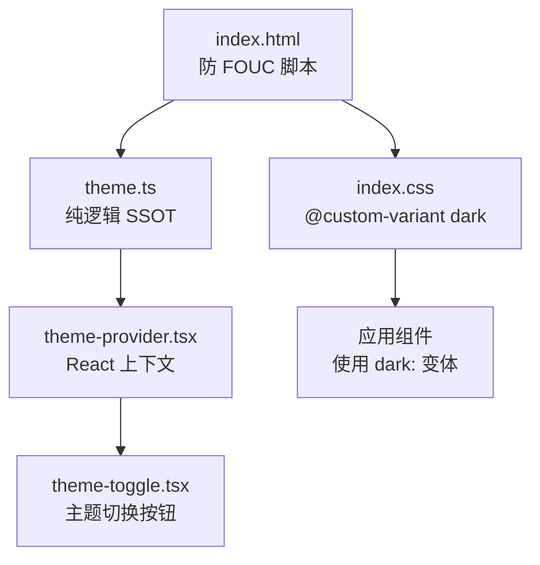
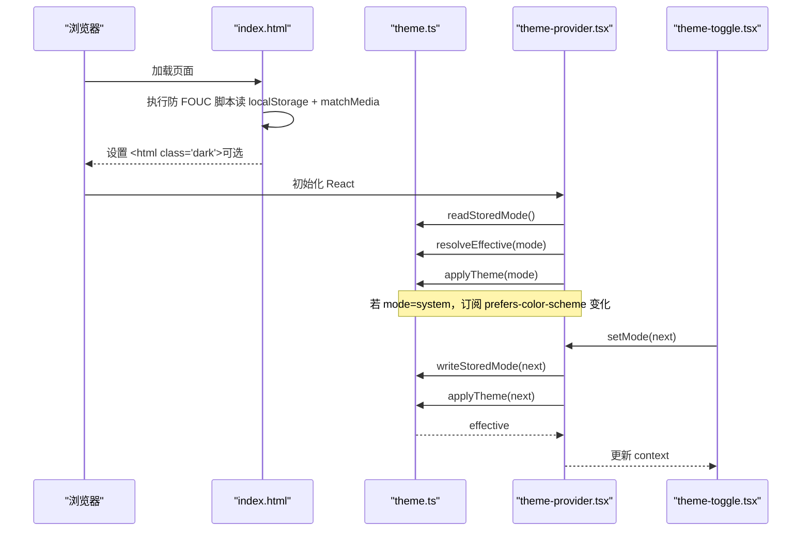
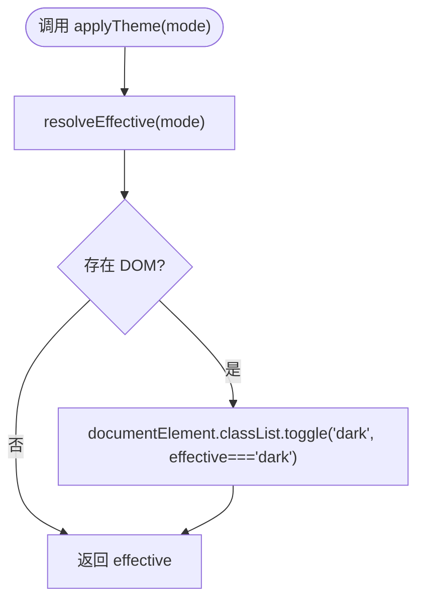
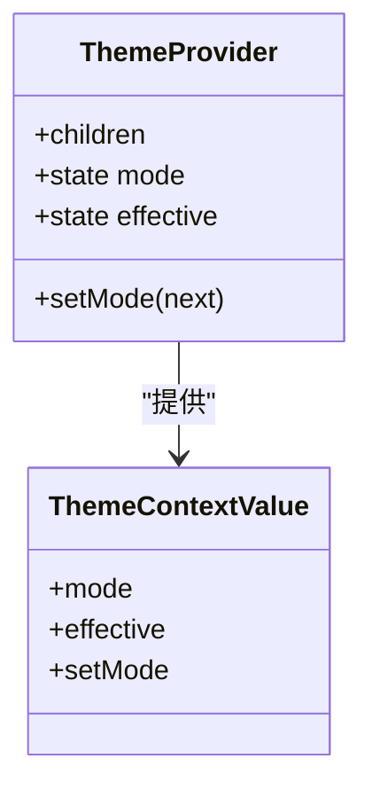
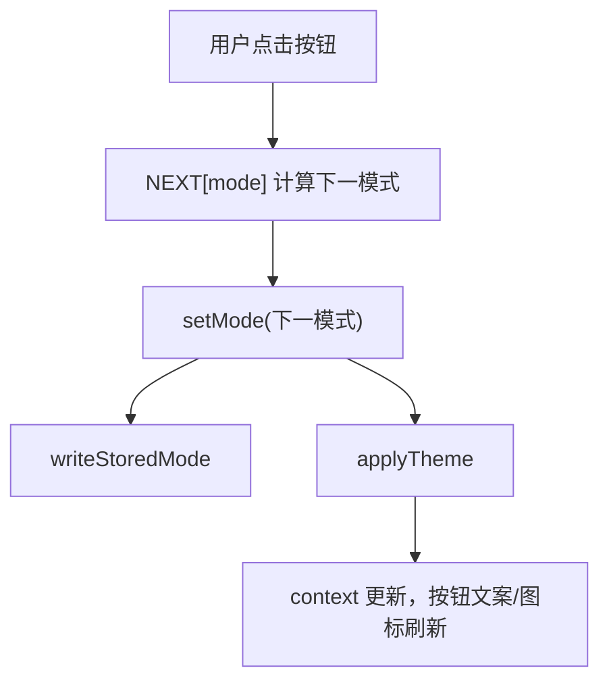
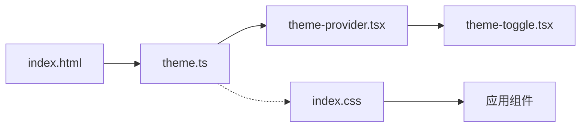
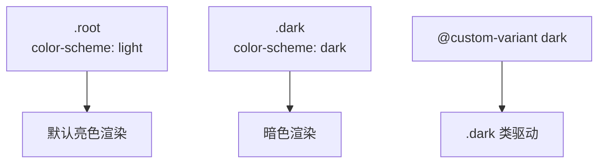

# 主题切换组件

<cite>
**本文引用的文件**   
- [apps/web/src/lib/theme.ts](file://apps/web/src/lib/theme.ts)
- [apps/web/src/lib/theme-provider.tsx](file://apps/web/src/lib/theme-provider.tsx)
- [apps/web/src/components/theme-toggle.tsx](file://apps/web/src/components/theme-toggle.tsx)
- [apps/web/index.html](file://apps/web/index.html)
- [apps/web/src/index.css](file://apps/web/src/index.css)
- [apps/web/src/lib/theme.test.ts](file://apps/web/src/lib/theme.test.ts)
- [apps/web/src/components/theme-toggle.test.tsx](file://apps/web/src/components/theme-toggle.test.tsx)
</cite>

## 目录
1. [简介](#简介)
2. [项目结构](#项目结构)
3. [核心组件](#核心组件)
4. [架构总览](#架构总览)
5. [详细组件分析](#详细组件分析)
6. [依赖关系分析](#依赖关系分析)
7. [性能与动画](#性能与动画)
8. [Tailwind CSS 深色模式集成](#tailwind-css-深色模式集成)
9. [使用示例与自定义](#使用示例与自定义)
10. [主题开发指南](#主题开发指南)
11. [故障排查](#故障排查)
12. [结论](#结论)

## 简介
本主题切换组件提供三态主题管理：浅色、深色、跟随系统。它通过纯逻辑模块维护“用户显式模式”和“生效主题”，将主题状态持久化到本地存储，并在文档根节点上切换 `.dark` 类以驱动 Tailwind v4 的 `dark:` 变体。组件具备无障碍支持、防闪烁（FOUC）防护、SSR/无 DOM 降级能力，并提供 React Context 供应用内任意位置读取与切换主题。

## 项目结构
主题相关代码集中在 Web 应用中，分为三层：
- 运行时纯逻辑层：主题解析、系统偏好探测、本地存储读写、`.dark` 类切换。
- React 接入层：上下文提供者、Hook、主题切换按钮。
- 样式与入口层：Tailwind 暗色变体定义、HTML 预渲染脚本。

**图表来源**
- [apps/web/index.html:8-18](file://apps/web/index.html#L8-L18)
- [apps/web/src/index.css:3-4](file://apps/web/src/index.css#L3-L4)
- [apps/web/src/lib/theme.ts:1-57](file://apps/web/src/lib/theme.ts#L1-L57)
- [apps/web/src/lib/theme-provider.tsx:1-65](file://apps/web/src/lib/theme-provider.tsx#L1-L65)
- [apps/web/src/components/theme-toggle.tsx:1-27](file://apps/web/src/components/theme-toggle.tsx#L1-L27)

**章节来源**
- [apps/web/index.html:1-26](file://apps/web/index.html#L1-L26)
- [apps/web/src/index.css:1-15](file://apps/web/src/index.css#L1-L15)
- [apps/web/src/lib/theme.ts:1-57](file://apps/web/src/lib/theme.ts#L1-L57)
- [apps/web/src/lib/theme-provider.tsx:1-65](file://apps/web/src/lib/theme-provider.tsx#L1-L65)
- [apps/web/src/components/theme-toggle.tsx:1-27](file://apps/web/src/components/theme-toggle.tsx#L1-L27)

## 核心组件
- 主题运行时（SSOT）：负责模式类型、本地存储键、读取/写入存储、系统偏好探测、解析生效主题、应用主题到文档。
- React 主题提供者：持有显式模式与生效主题，订阅系统偏好变化，暴露 setMode 并持久化。
- 主题切换按钮：三态循环切换，提供无障碍标签与标题，按当前模式显示文案与图标。

关键职责边界：
- theme.ts：不依赖 React，可在 SSR 或测试中独立运行。
- theme-provider.tsx：仅做 React 接线与副作用处理。
- theme-toggle.tsx：纯展示与交互，消费 useTheme。

**章节来源**
- [apps/web/src/lib/theme.ts:1-57](file://apps/web/src/lib/theme.ts#L1-L57)
- [apps/web/src/lib/theme-provider.tsx:1-65](file://apps/web/src/lib/theme-provider.tsx#L1-L65)
- [apps/web/src/components/theme-toggle.tsx:1-27](file://apps/web/src/components/theme-toggle.tsx#L1-L27)

## 架构总览
主题切换的整体流程如下：
- 页面加载时，HTML 内联脚本根据本地存储与系统偏好预先添加 `.dark`，避免闪烁。
- React 启动后，ThemeProvider 从本地存储初始化显式模式，计算生效主题，并应用至文档。
- 当模式为 system 时，监听系统偏好变化，动态更新生效主题。
- 用户点击切换按钮，按 system→light→dark 顺序推进，立即持久化并应用新主题。

**图表来源**
- [apps/web/index.html:8-18](file://apps/web/index.html#L8-L18)
- [apps/web/src/lib/theme.ts:16-56](file://apps/web/src/lib/theme.ts#L16-L56)
- [apps/web/src/lib/theme-provider.tsx:34-56](file://apps/web/src/lib/theme-provider.tsx#L34-L56)
- [apps/web/src/components/theme-toggle.tsx:12-24](file://apps/web/src/components/theme-toggle.tsx#L12-L24)

## 详细组件分析

### 主题运行时（theme.ts）
- 模式类型：light、dark、system；生效主题 EffectiveTheme 为 light/dark。
- 本地存储键：固定常量 STORAGE_KEY，与 HTML 内联脚本保持一致，防止 key 漂移。
- readStoredMode：安全读取 localStorage，非法值或缺失回落到 system。
- prefersDark：检测系统偏好，无 matchMedia 环境保守返回 false。
- resolveEffective：system 跟随系统偏好，否则强制覆盖。
- applyTheme：在 documentElement 上切换 .dark 类，无 DOM 环境短路返回 effective。
- writeStoredMode：安全写入 localStorage，失败静默降级。

复杂度与健壮性：
- 所有 I/O 均 try/catch 包裹，保证隐私模式或禁用存储时不崩溃。
- 纯函数为主，便于单元测试与 SSR 兼容。

**图表来源**
- [apps/web/src/lib/theme.ts:34-46](file://apps/web/src/lib/theme.ts#L34-L46)

**章节来源**
- [apps/web/src/lib/theme.ts:1-57](file://apps/web/src/lib/theme.ts#L1-L57)
- [apps/web/src/lib/theme.test.ts:33-104](file://apps/web/src/lib/theme.test.ts#L33-L104)

### React 主题提供者（theme-provider.tsx）
- 状态：mode（用户显式模式）、effective（生效主题）。
- 初始化：从本地存储读取初始模式并计算生效主题。
- 副作用：
  - 每次 mode 变化时，applyTheme 并更新 effective。
  - 当 mode 为 system 时，订阅 window.matchMedia('(prefers-color-scheme: dark)') 的变化，自动同步 effective。
- setMode：先持久化，再更新状态，确保 UI 与存储一致。
- useTheme：在 Provider 外使用会抛出明确错误，避免静默降级导致难以调试的问题。

**图表来源**
- [apps/web/src/lib/theme-provider.tsx:23-56](file://apps/web/src/lib/theme-provider.tsx#L23-L56)

**章节来源**
- [apps/web/src/lib/theme-provider.tsx:1-65](file://apps/web/src/lib/theme-provider.tsx#L1-L65)

### 主题切换按钮（theme-toggle.tsx）
- 三态循环：system→light→dark→system。
- 无障碍：aria-label 包含当前显式模式与生效主题，title 辅助提示。
- 样式：使用 Tailwind 基础类与 dark: 变体，适配明暗主题。
- 交互：点击即调用 setMode，立即持久化与应用。

**图表来源**
- [apps/web/src/components/theme-toggle.tsx:8-24](file://apps/web/src/components/theme-toggle.tsx#L8-L24)
- [apps/web/src/lib/theme-provider.tsx:50-53](file://apps/web/src/lib/theme-provider.tsx#L50-L53)
- [apps/web/src/lib/theme.ts:48-56](file://apps/web/src/lib/theme.ts#L48-L56)

**章节来源**
- [apps/web/src/components/theme-toggle.tsx:1-27](file://apps/web/src/components/theme-toggle.tsx#L1-L27)
- [apps/web/src/components/theme-toggle.test.tsx:35-74](file://apps/web/src/components/theme-toggle.test.tsx#L35-L74)

## 依赖关系分析
- theme.ts 被 theme-provider.tsx 与 index.html 内联脚本共同引用（通过相同 STORAGE_KEY 语义对齐）。
- theme-provider.tsx 依赖 theme.ts 提供的纯逻辑函数。
- theme-toggle.tsx 依赖 theme-provider.tsx 的 useTheme Hook。
- index.css 定义 Tailwind 暗色变体，由 .dark 类驱动。

**图表来源**
- [apps/web/src/lib/theme.ts:1-57](file://apps/web/src/lib/theme.ts#L1-L57)
- [apps/web/src/lib/theme-provider.tsx:1-65](file://apps/web/src/lib/theme-provider.tsx#L1-L65)
- [apps/web/src/components/theme-toggle.tsx:1-27](file://apps/web/src/components/theme-toggle.tsx#L1-L27)
- [apps/web/index.html:8-18](file://apps/web/index.html#L8-L18)
- [apps/web/src/index.css:3-4](file://apps/web/src/index.css#L3-L4)

**章节来源**
- [apps/web/src/lib/theme.ts:1-57](file://apps/web/src/lib/theme.ts#L1-L57)
- [apps/web/src/lib/theme-provider.tsx:1-65](file://apps/web/src/lib/theme-provider.tsx#L1-L65)
- [apps/web/src/components/theme-toggle.tsx:1-27](file://apps/web/src/components/theme-toggle.tsx#L1-L27)
- [apps/web/index.html:8-18](file://apps/web/index.html#L8-L18)
- [apps/web/src/index.css:3-4](file://apps/web/src/index.css#L3-L4)

## 性能与动画
- 切换开销极低：仅修改 documentElement 的 classList，触发 CSS 变量与 Tailwind 变体重绘。
- 无 JS 动画：主题切换未引入过渡动画，避免额外合成与布局抖动。
- 防闪烁：HTML 内联脚本在 React 挂载前设置 .dark，减少首次渲染闪烁。
- 事件监听：仅在 system 模式下订阅 matchMedia 变化，避免不必要的监听器。

优化建议：
- 如需平滑过渡，可在 CSS 中对背景色、边框色等属性添加 transition，但需评估对滚动条、原生控件的影响。
- 谨慎使用复杂动画，优先使用 CSS 变量与轻量过渡。

**章节来源**
- [apps/web/index.html:8-18](file://apps/web/index.html#L8-L18)
- [apps/web/src/lib/theme.ts:40-46](file://apps/web/src/lib/theme.ts#L40-L46)
- [apps/web/src/lib/theme-provider.tsx:40-48](file://apps/web/src/lib/theme-provider.tsx#L40-L48)

## Tailwind CSS 深色模式集成
- 使用 Tailwind v4 的 @custom-variant 定义 dark 变体，使其响应 <html class="dark">。
- 通过 color-scheme 联动原生控件与滚动条渲染，提升明暗主题一致性。
- 组件样式直接使用 dark: 前缀类名，无需额外配置。

**图表来源**
- [apps/web/src/index.css:3-14](file://apps/web/src/index.css#L3-L14)

**章节来源**
- [apps/web/src/index.css:1-15](file://apps/web/src/index.css#L1-L15)

## 使用示例与自定义
- 在应用根组件包裹 ThemeProvider，确保 useTheme 可用。
- 在需要切换主题的位置插入 ThemeToggle。
- 在其他组件中通过 useTheme 读取 mode/effective 或调用 setMode。

自定义主题配置：
- 扩展颜色：在 Tailwind 配置中定义新的颜色 token，并通过 CSS 变量映射到明暗主题。
- 覆盖样式：基于 dark: 变体为新增组件提供暗色样式。
- 新增模式：如需增加更多主题（如高对比度），可扩展 ThemeMode 类型与 NEXT/LABEL/ICON 映射，并在 Provider 中处理解析逻辑。

注意事项：
- 保持 STORAGE_KEY 与 HTML 内联脚本一致，避免 key 漂移。
- 新增模式需在 theme.ts、Provider、Toggle 三者间同步。

**章节来源**
- [apps/web/src/lib/theme-provider.tsx:34-56](file://apps/web/src/lib/theme-provider.tsx#L34-L56)
- [apps/web/src/components/theme-toggle.tsx:8-24](file://apps/web/src/components/theme-toggle.tsx#L8-L24)
- [apps/web/src/lib/theme.ts:10-11](file://apps/web/src/lib/theme.ts#L10-L11)

## 主题开发指南
颜色规范：
- 使用语义化颜色命名（如 primary、surface、text-primary），避免硬编码具体色值。
- 明暗主题下分别定义颜色 token，确保对比度符合 WCAG 标准。

对比度要求：
- 文本与背景的对比度至少达到 AA 级（4.5:1），大文本可放宽至 3:1。
- 使用工具校验颜色组合，必要时调整亮度或饱和度。

可访问性考虑：
- 按钮需提供 aria-label/title，描述当前模式与生效主题。
- 避免仅依赖颜色传达信息，辅以图标或文字说明。
- 确保键盘可操作，焦点可见。

最佳实践：
- 优先使用 CSS 变量与 Tailwind 变体，减少 JS 干预。
- 对原生控件使用 color-scheme，提升整体一致性。
- 在测试中覆盖 system/light/dark 三种模式及存储异常场景。

**章节来源**
- [apps/web/src/components/theme-toggle.tsx:14-24](file://apps/web/src/components/theme-toggle.tsx#L14-L24)
- [apps/web/src/index.css:6-14](file://apps/web/src/index.css#L6-L14)

## 故障排查
常见问题与解决：
- 主题未生效：检查 documentElement 是否包含 .dark 类；确认 Tailwind 已正确编译 dark: 变体。
- 闪烁问题：确认 HTML 内联脚本未被移除或篡改；验证 STORAGE_KEY 与 theme.ts 一致。
- 存储不可写：在隐私模式或禁用存储环境下，writeStoredMode 会静默失败，不影响当前会话；检查控制台是否有 SecurityError。
- 系统偏好未更新：确认 mode 为 system 且 matchMedia 可用；检查事件监听是否正确注册与清理。

定位方法：
- 使用浏览器开发者工具查看 <html> 的 classList。
- 在 console 中读取 localStorage 对应 key 的值。
- 检查 matchMedia 返回值是否符合预期。

**章节来源**
- [apps/web/src/lib/theme.ts:16-56](file://apps/web/src/lib/theme.ts#L16-L56)
- [apps/web/src/lib/theme-provider.tsx:40-48](file://apps/web/src/lib/theme-provider.tsx#L40-L48)
- [apps/web/index.html:8-18](file://apps/web/index.html#L8-L18)

## 结论
该主题切换组件以纯逻辑模块为核心，结合 React Context 与 Tailwind v4 的暗色变体，实现了稳定、可测试、可访问的主题管理机制。通过防闪烁脚本、系统偏好监听与本地存储持久化，提供了良好的用户体验与开发体验。遵循本文档的颜色规范与可访问性建议，可进一步扩展与定制主题体系，满足多场景需求。