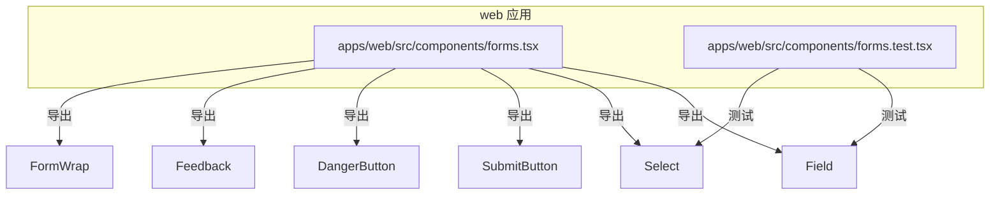
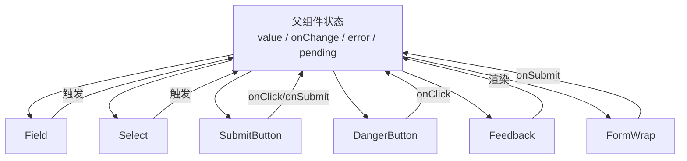
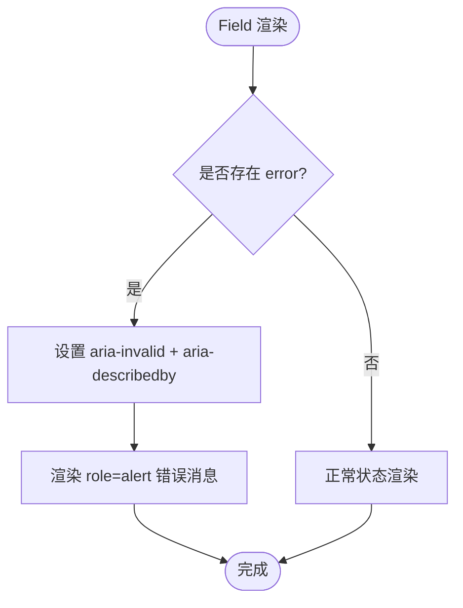
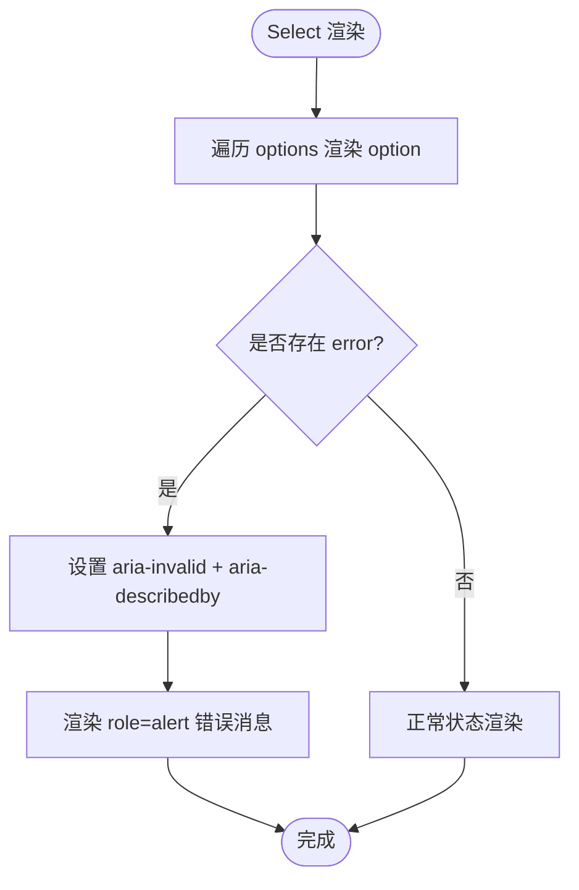
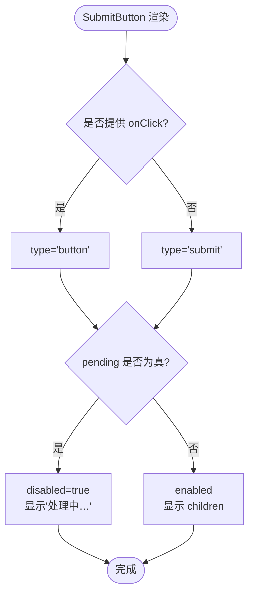
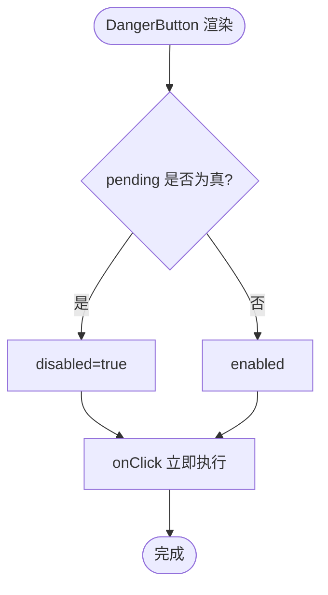
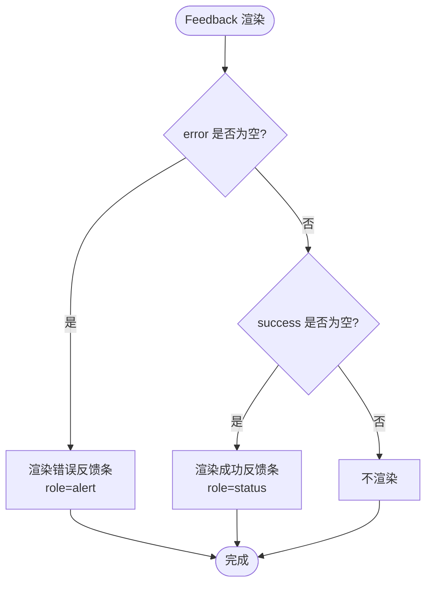
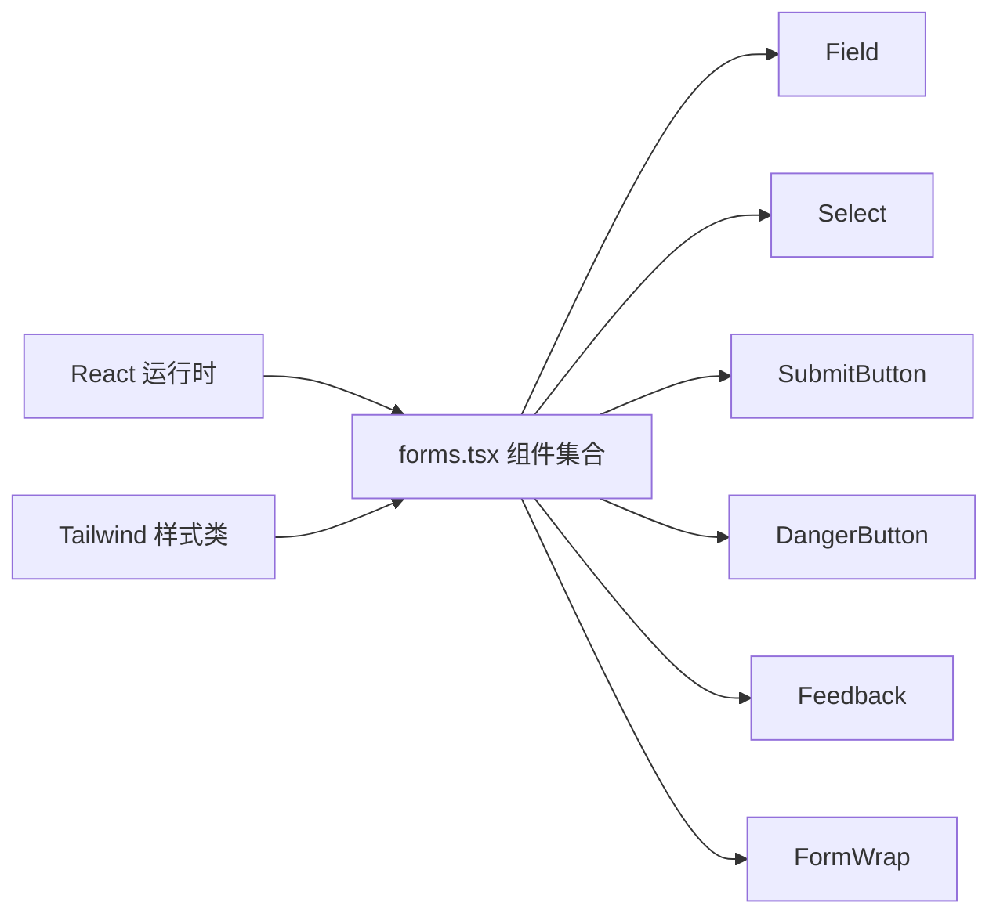

# 表单组件

<cite>
**本文引用的文件**   
- [apps/web/src/components/forms.tsx](file://apps/web/src/components/forms.tsx)
- [apps/web/src/components/forms.test.tsx](file://apps/web/src/components/forms.test.tsx)
</cite>

## 目录
1. [简介](#简介)
2. [项目结构](#项目结构)
3. [核心组件](#核心组件)
4. [架构总览](#架构总览)
5. [详细组件分析](#详细组件分析)
6. [依赖关系分析](#依赖关系分析)
7. [性能与可访问性](#性能与可访问性)
8. [故障排查指南](#故障排查指南)
9. [结论](#结论)
10. [附录：使用示例](#附录使用示例)

## 简介
本文件为前端最小化表单组件库的完整文档，覆盖以下组件：Field（输入框）、Select（下拉选择）、SubmitButton（提交按钮）、DangerButton（危险操作按钮）、Feedback（反馈条）、FormWrap（表单包装器）。文档从字段类型、验证规则、错误处理、无障碍支持、选项配置、值绑定、样式定制、状态管理、禁用逻辑、加载状态、安全设计、确认机制、视觉警示、事件处理、布局控制、样式覆盖等方面展开，并提供端到端的使用示例，帮助你在业务页面中快速构建可访问、可维护、可测试的表单。

## 项目结构
该表单组件位于 web 应用的前端组件目录中，采用“按功能拆分”的组织方式，每个组件独立导出，便于按需引入和测试。

图表来源
- [apps/web/src/components/forms.tsx:1-188](file://apps/web/src/components/forms.tsx#L1-L188)
- [apps/web/src/components/forms.test.tsx:1-64](file://apps/web/src/components/forms.test.tsx#L1-L64)

章节来源
- [apps/web/src/components/forms.tsx:1-188](file://apps/web/src/components/forms.tsx#L1-L188)
- [apps/web/src/components/forms.test.tsx:1-64](file://apps/web/src/components/forms.test.tsx#L1-L64)

## 核心组件
- Field：标签 + 输入框，支持必填标记、错误提示、无障碍关联。
- Select：标签 + 下拉选择，支持选项列表、值绑定、错误提示、无障碍关联。
- SubmitButton：提交按钮，支持 pending 禁用与加载文案切换。
- DangerButton：危险操作按钮，强调高风险操作的视觉警示。
- Feedback：全局反馈条，区分 error/success 两种状态。
- FormWrap：表单容器，统一阻止默认提交行为并包裹子元素。

章节来源
- [apps/web/src/components/forms.tsx:8-56](file://apps/web/src/components/forms.tsx#L8-L56)
- [apps/web/src/components/forms.tsx:59-103](file://apps/web/src/components/forms.tsx#L59-L103)
- [apps/web/src/components/forms.tsx:106-125](file://apps/web/src/components/forms.tsx#L106-L125)
- [apps/web/src/components/forms.tsx:128-147](file://apps/web/src/components/forms.tsx#L128-L147)
- [apps/web/src/components/forms.tsx:150-170](file://apps/web/src/components/forms.tsx#L150-L170)
- [apps/web/src/components/forms.tsx:173-187](file://apps/web/src/components/forms.tsx#L173-L187)

## 架构总览
这些组件遵循“受控组件 + 纯展示 + 轻量无障碍”的设计原则：
- 所有输入型组件均为受控组件，通过 value/onChange 双向绑定父级状态。
- 错误信息以 props.error 形式注入，组件内部负责渲染与无障碍关联。
- 按钮类组件通过 pending 控制禁用与加载态，不持有内部状态。
- 表单容器统一处理提交事件，避免默认刷新行为。

图表来源
- [apps/web/src/components/forms.tsx:8-56](file://apps/web/src/components/forms.tsx#L8-L56)
- [apps/web/src/components/forms.tsx:59-103](file://apps/web/src/components/forms.tsx#L59-L103)
- [apps/web/src/components/forms.tsx:106-125](file://apps/web/src/components/forms.tsx#L106-L125)
- [apps/web/src/components/forms.tsx:128-147](file://apps/web/src/components/forms.tsx#L128-L147)
- [apps/web/src/components/forms.tsx:150-170](file://apps/web/src/components/forms.tsx#L150-L170)
- [apps/web/src/components/forms.tsx:173-187](file://apps/web/src/components/forms.tsx#L173-L187)

## 详细组件分析

### Field 输入框组件
- 字段类型
  - 通过 type 属性支持多种原生 input 类型，如文本、密码、邮箱等。
- 值绑定
  - 受控模式：value 由外部传入，onChange 接收新字符串值。
- 验证规则
  - required 布尔值用于原生 HTML 校验；error 字符串用于业务校验结果展示。
- 错误处理
  - 当存在 error 时，输入框边框变红，并在控件下方显示 role=alert 的错误消息。
- 无障碍访问
  - 当存在 error 时，设置 aria-invalid="true" 并通过 aria-describedby 指向错误节点 id，确保屏幕阅读器正确播报。
- 样式定制
  - 使用 Tailwind 类名控制颜色、圆角、间距与焦点态；支持深色模式。

图表来源
- [apps/web/src/components/forms.tsx:8-56](file://apps/web/src/components/forms.tsx#L8-L56)

章节来源
- [apps/web/src/components/forms.tsx:8-56](file://apps/web/src/components/forms.tsx#L8-L56)
- [apps/web/src/components/forms.test.tsx:9-29](file://apps/web/src/components/forms.test.tsx#L9-L29)

### Select 下拉选择组件
- 选项配置
  - options 为对象数组，每项包含 value 与 label。
- 值绑定
  - 受控模式：value 为当前选中项的 value，onChange 返回新选中的 value。
- 验证规则
  - 通过 error 传递业务校验结果。
- 错误处理
  - 与 Field 一致，错误时边框变红并显示 role=alert 的错误消息。
- 无障碍访问
  - 当存在 error 时，select 元素设置 aria-invalid="true" 并通过 aria-describedby 关联错误节点。
- 样式定制
  - 使用 Tailwind 类名控制外观，支持深色模式。

图表来源
- [apps/web/src/components/forms.tsx:59-103](file://apps/web/src/components/forms.tsx#L59-L103)

章节来源
- [apps/web/src/components/forms.tsx:59-103](file://apps/web/src/components/forms.tsx#L59-L103)
- [apps/web/src/components/forms.test.tsx:31-63](file://apps/web/src/components/forms.test.tsx#L31-L63)

### SubmitButton 提交按钮
- 状态管理
  - pending 为 true 时按钮禁用，并显示“处理中…”文案；否则显示 children 内容。
- 禁用逻辑
  - disabled={pending}，防止重复提交。
- 交互行为
  - 若未提供 onClick，则作为 form 的 submit 按钮；若提供 onClick，则作为普通 button 触发自定义逻辑。
- 样式定制
  - 使用 Tailwind 类名控制背景色、悬停态与禁用态透明度，支持深色模式。

图表来源
- [apps/web/src/components/forms.tsx:106-125](file://apps/web/src/components/forms.tsx#L106-L125)

章节来源
- [apps/web/src/components/forms.tsx:106-125](file://apps/web/src/components/forms.tsx#L106-L125)

### DangerButton 危险操作按钮
- 安全设计
  - 明确标识高风险操作，视觉上通过红色边框与文字进行警示。
- 确认机制
  - 点击即执行，不提供二次确认弹窗；建议在调用方实现必要的业务确认流程。
- 禁用逻辑
  - disabled={pending}，在异步操作期间禁用按钮。
- 样式定制
  - 使用 Tailwind 类名定义红色主题与深色模式适配。

图表来源
- [apps/web/src/components/forms.tsx:128-147](file://apps/web/src/components/forms.tsx#L128-L147)

章节来源
- [apps/web/src/components/forms.tsx:128-147](file://apps/web/src/components/forms.tsx#L128-L147)

### Feedback 反馈组件
- 错误与成功消息
  - 当 error 非空时，渲染错误反馈条（role=alert）；当 success 非空时，渲染成功反馈条（role=status）。
- 样式区分
  - 错误使用红色系背景与文字；成功使用绿色系背景与文字；两者均支持深色模式。
- 无消息时
  - 同时为空时不渲染任何内容。

图表来源
- [apps/web/src/components/forms.tsx:150-170](file://apps/web/src/components/forms.tsx#L150-L170)

章节来源
- [apps/web/src/components/forms.tsx:150-170](file://apps/web/src/components/forms.tsx#L150-L170)

### FormWrap 表单包装器
- 事件处理
  - 包裹 form 元素并监听 onSubmit，建议配合父组件的 handleSubmit 使用。
- 布局控制
  - 默认使用 flex-wrap 与 gap 排列子元素，形成紧凑且响应式的表单布局。
- 样式覆盖
  - 通过 className 属性允许父组件覆盖默认样式。

```mermaid
flowchart TD
Start(["FormWrap 渲染"]) --> WrapForm["渲染 <form> 元素"]
WrapForm --> DefaultLayout["默认布局: flex-wrap + gap"]
DefaultLayout --> OnSubmit["onSubmit 回调"]
OnSubmit --> Children["渲染子组件"]
Children --> End(["完成"])
```

图表来源
- [apps/web/src/components/forms.tsx:173-187](file://apps/web/src/components/forms.tsx#L173-L187)

章节来源
- [apps/web/src/components/forms.tsx:173-187](file://apps/web/src/components/forms.tsx#L173-L187)

## 依赖关系分析
- 组件间耦合度低，均为独立导出函数式组件。
- 主要依赖 React 基础能力（事件、props、children）。
- 样式基于 Tailwind 原子类，无需额外样式库。
- 无障碍属性（aria-*、role）由组件内部直接设置，降低上层复杂度。

图表来源
- [apps/web/src/components/forms.tsx:1-188](file://apps/web/src/components/forms.tsx#L1-L188)

章节来源
- [apps/web/src/components/forms.tsx:1-188](file://apps/web/src/components/forms.tsx#L1-L188)

## 性能与可访问性
- 性能
  - 组件为纯函数式，无内部状态，仅根据 props 渲染，避免不必要的重渲染。
  - 错误消息仅在 error 存在时渲染，减少 DOM 节点数量。
- 可访问性
  - Field 与 Select 在 error 存在时设置 aria-invalid 与 aria-describedby，并将错误消息置于 role=alert 段落中，提升屏幕阅读器体验。
  - Feedback 在错误时使用 role=alert，成功时使用 role=status，语义清晰。

章节来源
- [apps/web/src/components/forms.tsx:8-56](file://apps/web/src/components/forms.tsx#L8-L56)
- [apps/web/src/components/forms.tsx:59-103](file://apps/web/src/components/forms.tsx#L59-L103)
- [apps/web/src/components/forms.tsx:150-170](file://apps/web/src/components/forms.tsx#L150-L170)
- [apps/web/src/components/forms.test.tsx:9-29](file://apps/web/src/components/forms.test.tsx#L9-L29)
- [apps/web/src/components/forms.test.tsx:31-63](file://apps/web/src/components/forms.test.tsx#L31-L63)

## 故障排查指南
- 问题：输入框或下拉框没有显示错误消息
  - 检查是否传入了 error 字符串；若无 error，组件不会渲染错误区域。
  - 检查 aria-describedby 是否正确指向错误节点 id。
- 问题：按钮无法点击
  - 检查 pending 是否为 true；pending 为真时按钮会被禁用。
- 问题：提交后页面刷新
  - 确保使用 FormWrap 包裹表单，并在 onSubmit 中阻止默认行为或交由父组件处理。
- 问题：无障碍读屏未播报错误
  - 确认 error 存在时，组件已设置 aria-invalid 与 aria-describedby，并且错误消息带有 role=alert。

章节来源
- [apps/web/src/components/forms.tsx:8-56](file://apps/web/src/components/forms.tsx#L8-L56)
- [apps/web/src/components/forms.tsx:59-103](file://apps/web/src/components/forms.tsx#L59-L103)
- [apps/web/src/components/forms.tsx:106-125](file://apps/web/src/components/forms.tsx#L106-L125)
- [apps/web/src/components/forms.tsx:173-187](file://apps/web/src/components/forms.tsx#L173-L187)
- [apps/web/src/components/forms.test.tsx:9-29](file://apps/web/src/components/forms.test.tsx#L9-L29)
- [apps/web/src/components/forms.test.tsx:31-63](file://apps/web/src/components/forms.test.tsx#L31-L63)

## 结论
该表单组件集以最小依赖、受控模式、强可访问性与清晰的视觉反馈为核心目标，适合在 SaaS 应用中快速搭建一致的表单体验。通过 Field、Select 的无障碍支持与错误提示，SubmitButton、DangerButton 的状态管理与视觉警示，以及 Feedback、FormWrap 的统一反馈与布局控制，开发者可以在业务层专注于数据流与校验逻辑，而不必关心底层 UI 细节。

## 附录：使用示例
以下为端到端的表单使用流程说明，涵盖表单验证、错误显示与数据提交流程。为避免泄露具体代码，这里以步骤与路径引用代替源码片段。

- 步骤一：准备父组件状态
  - 维护 fields 对象（例如 name、role），以及 errors 对象（例如 name、role），以及 pending 布尔值。
  - 参考路径：[apps/web/src/components/forms.tsx:8-56](file://apps/web/src/components/forms.tsx#L8-L56)、[apps/web/src/components/forms.tsx:59-103](file://apps/web/src/components/forms.tsx#L59-L103)

- 步骤二：渲染表单容器
  - 使用 FormWrap 包裹 Field、Select、SubmitButton、DangerButton 等子元素。
  - 在 onSubmit 中调用父组件的 handleSubmit，负责收集数据、校验与提交。
  - 参考路径：[apps/web/src/components/forms.tsx:173-187](file://apps/web/src/components/forms.tsx#L173-L187)

- 步骤三：绑定输入与选择
  - Field：将 fields.name 传给 value，onChange 更新 fields.name；将 errors.name 传给 error。
  - Select：将 fields.role 传给 value，onChange 更新 fields.role；将 errors.role 传给 error。
  - 参考路径：[apps/web/src/components/forms.tsx:8-56](file://apps/web/src/components/forms.tsx#L8-L56)、[apps/web/src/components/forms.tsx:59-103](file://apps/web/src/components/forms.tsx#L59-L103)

- 步骤四：提交与加载状态
  - SubmitButton：将 pending 传给 pending，children 设为“提交”。
  - 在 handleSubmit 中设置 pending=true，发起请求，完成后恢复 pending=false。
  - 参考路径：[apps/web/src/components/forms.tsx:106-125](file://apps/web/src/components/forms.tsx#L106-L125)

- 步骤五：错误与成功反馈
  - 校验失败时，将错误信息写入 errors 对象，Field/Select 自动显示错误。
  - 提交成功后，设置 Feedback.success；提交失败时，设置 Feedback.error。
  - 参考路径：[apps/web/src/components/forms.tsx:150-170](file://apps/web/src/components/forms.tsx#L150-L170)

- 步骤六：危险操作
  - 对于删除等高风险操作，使用 DangerButton，并在 onClick 中调用后端接口。
  - 建议在调用前由业务层实现确认流程（例如二次确认弹窗），组件本身不做二次确认。
  - 参考路径：[apps/web/src/components/forms.tsx:128-147](file://apps/web/src/components/forms.tsx#L128-L147)

- 步骤七：无障碍与测试
  - 确保在 error 存在时，Field/Select 能正确设置 aria-invalid 与 aria-describedby，并渲染 role=alert 的错误消息。
  - 参考测试用例路径：[apps/web/src/components/forms.test.tsx:9-29](file://apps/web/src/components/forms.test.tsx#L9-L29)、[apps/web/src/components/forms.test.tsx:31-63](file://apps/web/src/components/forms.test.tsx#L31-L63)

章节来源
- [apps/web/src/components/forms.tsx:8-56](file://apps/web/src/components/forms.tsx#L8-L56)
- [apps/web/src/components/forms.tsx:59-103](file://apps/web/src/components/forms.tsx#L59-L103)
- [apps/web/src/components/forms.tsx:106-125](file://apps/web/src/components/forms.tsx#L106-L125)
- [apps/web/src/components/forms.tsx:128-147](file://apps/web/src/components/forms.tsx#L128-L147)
- [apps/web/src/components/forms.tsx:150-170](file://apps/web/src/components/forms.tsx#L150-L170)
- [apps/web/src/components/forms.tsx:173-187](file://apps/web/src/components/forms.tsx#L173-L187)
- [apps/web/src/components/forms.test.tsx:9-29](file://apps/web/src/components/forms.test.tsx#L9-L29)
- [apps/web/src/components/forms.test.tsx:31-63](file://apps/web/src/components/forms.test.tsx#L31-L63)