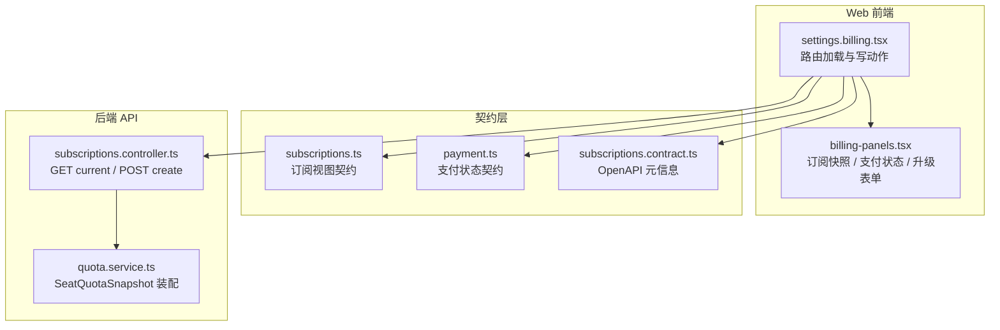
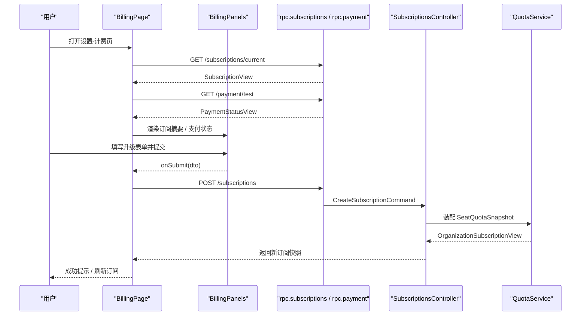
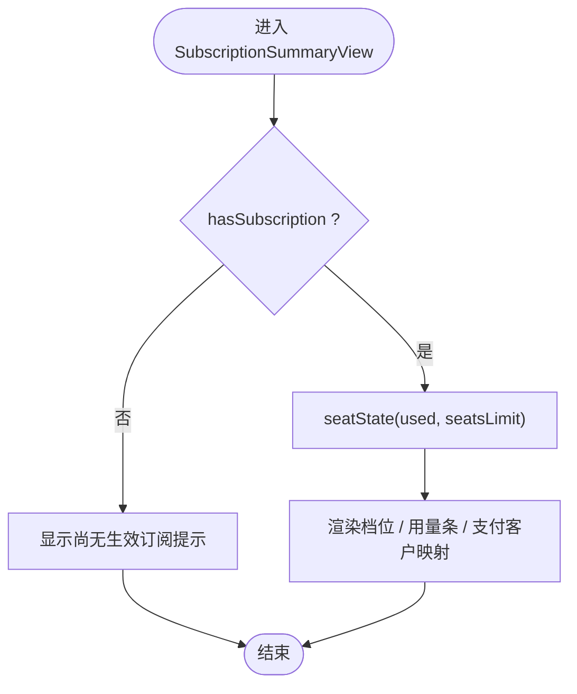
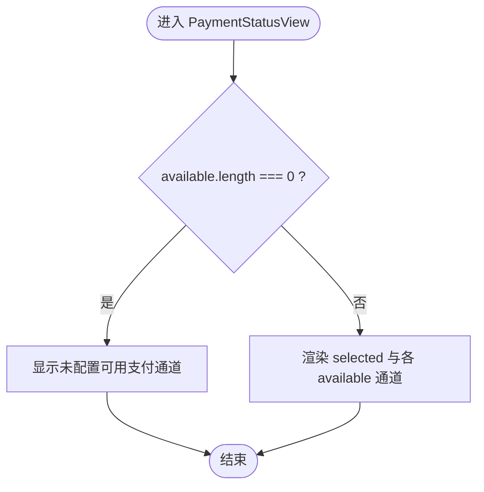
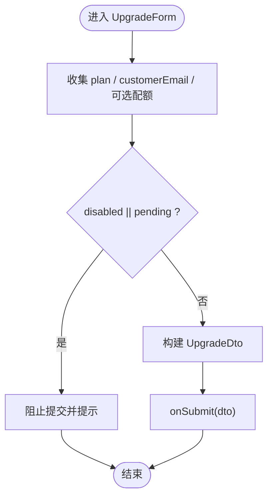
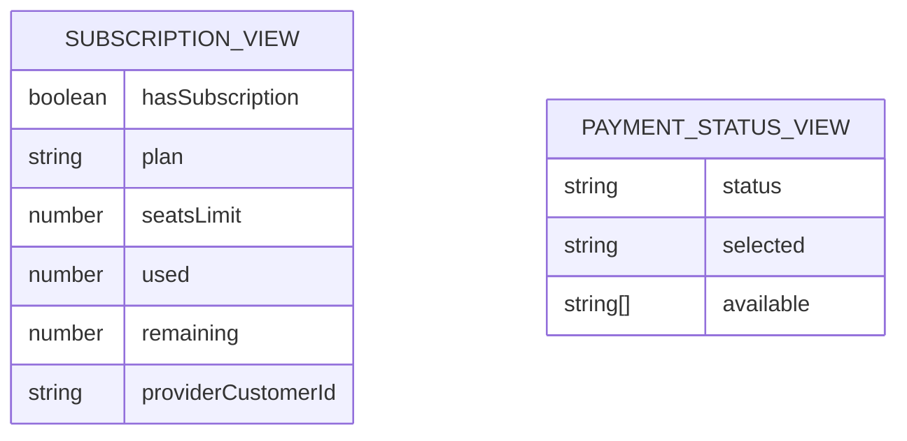
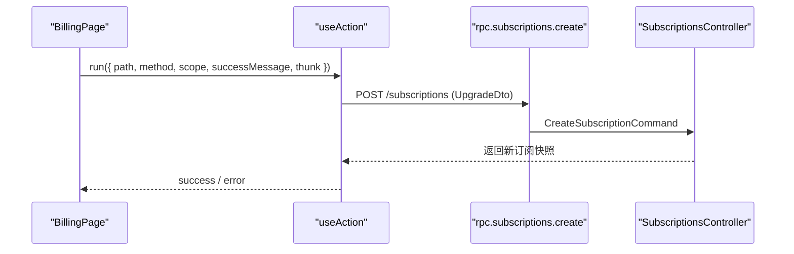

# 计费面板组件

<cite>
**本文引用的文件**   
- [apps/web/src/components/billing-panels.tsx](file://apps/web/src/components/billing-panels.tsx)
- [apps/web/src/routes/settings.billing.tsx](file://apps/web/src/routes/settings.billing.tsx)
- [apps/web/src/routes/settings.billing.test.tsx](file://apps/web/src/routes/settings.billing.test.tsx)
- [libs/contracts/src/response/subscriptions.ts](file://libs/contracts/src/response/subscriptions.ts)
- [libs/contracts/src/response/payment.ts](file://libs/contracts/src/response/payment.ts)
- [libs/api-contract/src/subscriptions.contract.ts](file://libs/api-contract/src/subscriptions.contract.ts)
- [apps/api/src/modules/subscriptions/api/subscriptions.controller.ts](file://apps/api/src/modules/subscriptions/api/subscriptions.controller.ts)
- [libs/core/src/modules/subscriptions/quota/quota.service.ts](file://libs/core/src/modules/subscriptions/quota/quota.service.ts)
</cite>

## 目录
1. [简介](#简介)
2. [项目结构定位](#项目结构定位)
3. [核心组件与职责](#核心组件与职责)
4. [架构总览](#架构总览)
5. [详细组件分析](#详细组件分析)
6. [数据结构与契约](#数据结构与契约)
7. [API 集成与数据流](#api-集成与数据流)
8. [样式、状态与国际化](#样式状态与国际化)
9. [可访问性与响应式适配](#可访问性与响应式适配)
10. [配置项与扩展点](#配置项与扩展点)
11. [完整集成示例](#完整集成示例)
12. [性能与实时性](#性能与实时性)
13. [故障排查](#故障排查)
14. [结论](#结论)

## 简介
计费面板组件用于在租户设置页中展示订阅信息、支付通道状态，并提供开通与升级入口。该组件遵循“纯展示 + 外置回调”的设计：视图和判定逻辑集中在 `billing-panels.tsx`，页面路由负责加载数据、调用 API 并绑定 UI；后端通过订阅控制器暴露当前订阅快照与开通接口，支付通道状态由独立支付模块提供。

本组件重点覆盖：
- 订阅信息展示的布局设计
- 支付状态的视觉反馈
- 账单详情的数据呈现（席位用量、档位、支付客户映射）
- 数据结构、API 集成与前端数据更新机制
- 不同计费状态的样式处理、文案本地化策略
- 可访问性支持、响应式设计与移动端适配
- 配置选项、自定义样式与数据格式化方法
- 完整的订阅数据绑定、支付状态监听与账单历史扩展建议

## 项目结构定位
计费面板相关代码位于 Web 应用的前端路由与组件层，同时依赖 contracts 层的类型契约与后端的订阅控制器。

**图表来源**
- [apps/web/src/routes/settings.billing.tsx:20-48](file://apps/web/src/routes/settings.billing.tsx#L20-L48)
- [apps/web/src/components/billing-panels.tsx:1-249](file://apps/web/src/components/billing-panels.tsx#L1-L249)
- [libs/contracts/src/response/subscriptions.ts:1-23](file://libs/contracts/src/response/subscriptions.ts#L1-L23)
- [libs/contracts/src/response/payment.ts:1-85](file://libs/contracts/src/response/payment.ts#L1-L85)
- [libs/api-contract/src/subscriptions.contract.ts:1-30](file://libs/api-contract/src/subscriptions.contract.ts#L1-L30)
- [apps/api/src/modules/subscriptions/api/subscriptions.controller.ts:42-90](file://apps/api/src/modules/subscriptions/api/subscriptions.controller.ts#L42-L90)
- [libs/core/src/modules/subscriptions/quota/quota.service.ts:1-130](file://libs/core/src/modules/subscriptions/quota/quota.service.ts#L1-L130)

**章节来源**
- [apps/web/src/routes/settings.billing.tsx:16-48](file://apps/web/src/routes/settings.billing.tsx#L16-L48)
- [apps/web/src/components/billing-panels.tsx:1-249](file://apps/web/src/components/billing-panels.tsx#L1-L249)

## 核心组件与职责
计费面板由三个主要部分组成：
- 订阅快照展示组件：显示当前组织是否已有生效订阅、档位、席位用量与剩余量、支付客户映射。
- 支付状态展示组件：显示选定支付通道与可用通道集合，并在无可用通道时给出警示。
- 开通/升级表单组件：收集用户选择的档位、客户邮箱与可选配额，提交到后端创建或升级订阅。

此外，组件还包含两个关键纯函数：
- 档位中文标签映射：将后端 plan key 转换为中文显示。
- 席位用量判定基元：根据已用量与上限计算百分比与视觉 tone（正常、接近满额、已满）。

**章节来源**
- [apps/web/src/components/billing-panels.tsx:13-50](file://apps/web/src/components/billing-panels.tsx#L13-L50)
- [apps/web/src/components/billing-panels.tsx:58-124](file://apps/web/src/components/billing-panels.tsx#L58-L124)
- [apps/web/src/components/billing-panels.tsx:130-249](file://apps/web/src/components/billing-panels.tsx#L130-L249)

## 架构总览
计费面板的数据流分为读侧与写侧：
- 读侧：路由 loader 调用订阅当前快照接口与支付测试接口，分别渲染订阅摘要与支付状态。
- 写侧：用户提交升级表单后，路由使用统一 action 封装发起 POST 请求，成功后提示成功消息并可触发刷新。

**图表来源**
- [apps/web/src/routes/settings.billing.tsx:20-63](file://apps/web/src/routes/settings.billing.tsx#L20-L63)
- [apps/api/src/modules/subscriptions/api/subscriptions.controller.ts:42-90](file://apps/api/src/modules/subscriptions/api/subscriptions.controller.ts#L42-L90)
- [libs/core/src/modules/subscriptions/quota/quota.service.ts:117-129](file://libs/core/src/modules/subscriptions/quota/quota.service.ts#L117-L129)

## 详细组件分析

### 订阅快照展示组件
订阅快照组件接收 `SubscriptionSnapshot`，当没有生效订阅时显示空态提示；有订阅时展示：
- 当前档位：通过 `planLabel` 映射为中文。
- 席位用量条：基于 `seatState` 计算百分比与 tone，并用颜色条直观表达用量等级。
- 支付客户映射：显示 providerCustomerId 或未绑定提示。

**图表来源**
- [apps/web/src/components/billing-panels.tsx:58-93](file://apps/web/src/components/billing-panels.tsx#L58-L93)
- [apps/web/src/components/billing-panels.tsx:41-50](file://apps/web/src/components/billing-panels.tsx#L41-L50)

**章节来源**
- [apps/web/src/components/billing-panels.tsx:58-93](file://apps/web/src/components/billing-panels.tsx#L58-L93)

### 支付状态展示组件
支付状态组件接收 `PaymentStatus`，显示：
- 选定通道：selected 字段。
- 可用通道列表：available 数组为空时显示红色警示，表示无法开通或升级。

**图表来源**
- [apps/web/src/components/billing-panels.tsx:96-124](file://apps/web/src/components/billing-panels.tsx#L96-L124)

**章节来源**
- [apps/web/src/components/billing-panels.tsx:96-124](file://apps/web/src/components/billing-panels.tsx#L96-L124)

### 开通/升级表单组件
升级表单组件负责：
- 选择档位：free/pro/enterprise。
- 输入客户邮箱：必填。
- 可选配额：席位上限、存储配额、API 配额。
- 禁用逻辑：若无可用支付通道则禁用提交按钮并提示。
- 提交行为：构造 UpgradeDto 并通过外部回调提交给路由层。

**图表来源**
- [apps/web/src/components/billing-panels.tsx:130-249](file://apps/web/src/components/billing-panels.tsx#L130-L249)

**章节来源**
- [apps/web/src/components/billing-panels.tsx:130-249](file://apps/web/src/components/billing-panels.tsx#L130-L249)

## 数据结构与契约
订阅快照契约定义如下字段：
- hasSubscription：布尔值，表示是否存在生效订阅。
- plan：字符串，生效档位 key。
- seatsLimit：数字，座位上限。
- used：数字，已用座位数。
- remaining：数字，剩余座位数。
- providerCustomerId：字符串或 null，支付通道客户 id。

支付状态契约定义如下字段：
- status：固定字面量 'ok'。
- selected：枚举，当前选定支付通道。
- available：枚举数组，可用支付通道集合。

**图表来源**
- [libs/contracts/src/response/subscriptions.ts:8-22](file://libs/contracts/src/response/subscriptions.ts#L8-L22)
- [libs/contracts/src/response/payment.ts:22-29](file://libs/contracts/src/response/payment.ts#L22-L29)

**章节来源**
- [libs/contracts/src/response/subscriptions.ts:1-23](file://libs/contracts/src/response/subscriptions.ts#L1-L23)
- [libs/contracts/src/response/payment.ts:1-85](file://libs/contracts/src/response/payment.ts#L1-L85)

## API 集成与数据流
前端路由在加载时执行以下操作：
- 调用订阅当前快照接口：`rpc.subscriptions.current()`。
- 调用支付测试接口：`rpc.payment.test()`。
- 捕获错误并记录日志，区分权限拒绝与其他错误。
- 渲染订阅摘要、支付状态与升级表单。

写操作通过统一 action 封装：
- 路径：`/api/v1/subscriptions`
- 方法：POST
- 载荷：UpgradeDto（plan、customerEmail、可选配额）
- 成功消息：已更新订阅档位
- 失败处理：显示错误详情

**图表来源**
- [apps/web/src/routes/settings.billing.tsx:55-63](file://apps/web/src/routes/settings.billing.tsx#L55-L63)
- [apps/api/src/modules/subscriptions/api/subscriptions.controller.ts:66-90](file://apps/api/src/modules/subscriptions/api/subscriptions.controller.ts#L66-L90)

**章节来源**
- [apps/web/src/routes/settings.billing.tsx:20-63](file://apps/web/src/routes/settings.billing.tsx#L20-L63)
- [libs/api-contract/src/subscriptions.contract.ts:12-30](file://libs/api-contract/src/subscriptions.contract.ts#L12-L30)

## 样式、状态与国际化
- 档位中文标签：通过 `planLabel` 将 free/pro/enterprise 映射为基础/专业/企业；未知档位回退原串，避免渲染崩溃。
- 席位用量视觉反馈：
  - ok：绿色进度条，表示用量较低。
  - near：琥珀色进度条，表示用量接近 80%。
  - full：红色进度条，表示已达或超过上限。
- 支付通道状态：
  - 有可用通道：显示 selected 与 available 列表。
  - 无可用通道：红色警示文本，提示无法开通或升级。
- 文案本地化：当前组件内文案为中文硬编码，未引入 i18n 库；如需多语言，可将文案抽取至翻译文件并按 locale 动态替换。

**章节来源**
- [apps/web/src/components/billing-panels.tsx:24-33](file://apps/web/src/components/billing-panels.tsx#L24-L33)
- [apps/web/src/components/billing-panels.tsx:52-56](file://apps/web/src/components/billing-panels.tsx#L52-L56)
- [apps/web/src/components/billing-panels.tsx:96-124](file://apps/web/src/components/billing-panels.tsx#L96-L124)

## 可访问性与响应式适配
- 可访问性：
  - 表单控件具备 label 与 name，便于屏幕阅读器识别。
  - 错误提示使用语义化段落与颜色对比，但可考虑增加 aria-live 区域以增强动态提示的可访问性。
  - 按钮具备 disabled 状态，避免无效交互。
- 响应式设计：
  - 使用 Flexbox 布局与 Tailwind 类名实现自适应间距与对齐。
  - 进度条宽度按百分比动态设置，适配不同屏幕尺寸。
  - 移动端建议使用更紧凑的表单布局与更大的触控目标。

**章节来源**
- [apps/web/src/components/billing-panels.tsx:166-249](file://apps/web/src/components/billing-panels.tsx#L166-L249)

## 配置项与扩展点
- 订阅快照展示：
  - 输入：`SubscriptionSnapshot`
  - 输出：订阅摘要 UI
  - 扩展点：可注入自定义格式化函数以改变用量百分比或档位标签。
- 支付状态展示：
  - 输入：`PaymentStatus`
  - 输出：支付通道状态 UI
  - 扩展点：可注入图标库或品牌色以增强通道标识。
- 升级表单：
  - 输入：pending、disabled、onSubmit
  - 输出：UpgradeDto
  - 扩展点：可添加更多配额字段或校验规则。

**章节来源**
- [apps/web/src/components/billing-panels.tsx:13-22](file://apps/web/src/components/billing-panels.tsx#L13-L22)
- [apps/web/src/components/billing-panels.tsx:130-164](file://apps/web/src/components/billing-panels.tsx#L130-L164)

## 完整集成示例
以下为计费面板的集成步骤与关键点：

1. 在路由中加载订阅快照与支付状态：
   - 调用 `rpc.subscriptions.current()` 获取订阅快照。
   - 调用 `rpc.payment.test()` 获取支付通道状态。
   - 捕获错误并区分权限拒绝与其他异常。

2. 渲染订阅摘要与支付状态：
   - 使用 `SubscriptionSummaryView` 渲染订阅快照。
   - 使用 `PaymentStatusView` 渲染支付通道状态。

3. 处理升级表单提交：
   - 使用 `UpgradeForm` 收集用户输入。
   - 在 `onSubmit` 中调用 `rpc.subscriptions.create` 提交升级请求。
   - 使用 `useAction` 管理 pending、success、error 状态。

4. 订阅数据绑定与刷新：
   - 升级成功后可重新加载订阅快照以反映最新状态。
   - 若需实时数据，可结合 WebSocket 或轮询机制刷新订阅快照。

**章节来源**
- [apps/web/src/routes/settings.billing.tsx:20-94](file://apps/web/src/routes/settings.billing.tsx#L20-L94)
- [apps/web/src/components/billing-panels.tsx:130-249](file://apps/web/src/components/billing-panels.tsx#L130-L249)

## 性能与实时性
- 性能优化：
  - 订阅快照与支付状态在路由加载时并行获取，减少首屏等待时间。
  - 表单提交使用统一 action 封装，避免重复状态管理逻辑。
- 实时性：
  - 当前组件未实现实时数据更新；可通过事件订阅或轮询机制刷新订阅快照。
  - 若后端支持事件流，可结合前端事件总线实时更新席位用量与支付状态。

**章节来源**
- [apps/web/src/routes/settings.billing.tsx:20-48](file://apps/web/src/routes/settings.billing.tsx#L20-L48)

## 故障排查
常见问题与解决方案：
- 订阅快照不可用：
  - 检查网络请求是否成功。
  - 查看错误日志中的 statusCode 是否为 403（权限拒绝）。
- 支付通道不可用：
  - 确认后端支付通道配置是否正确。
  - 检查 `rpc.payment.test()` 返回值中的 available 数组是否为空。
- 升级表单提交失败：
  - 检查 UpgradeDto 是否符合后端 schema。
  - 查看 useAction 返回的错误详情并提示用户。

**章节来源**
- [apps/web/src/routes/settings.billing.tsx:26-44](file://apps/web/src/routes/settings.billing.tsx#L26-L44)
- [apps/web/src/components/billing-panels.tsx:232-246](file://apps/web/src/components/billing-panels.tsx#L232-L246)

## 结论
计费面板组件通过清晰的职责分离与纯展示设计，提供了订阅信息展示、支付状态反馈与升级入口。其数据结构与 API 集成严格遵循契约定义，确保前后端一致性。组件具备良好的可扩展性与可维护性，适合在多租户 SaaS 场景中复用。未来可进一步增强实时数据更新、多语言支持与可访问性体验。