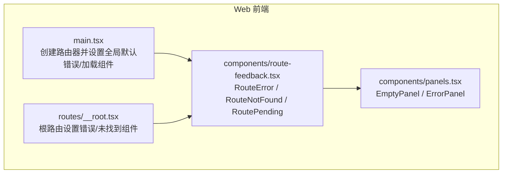
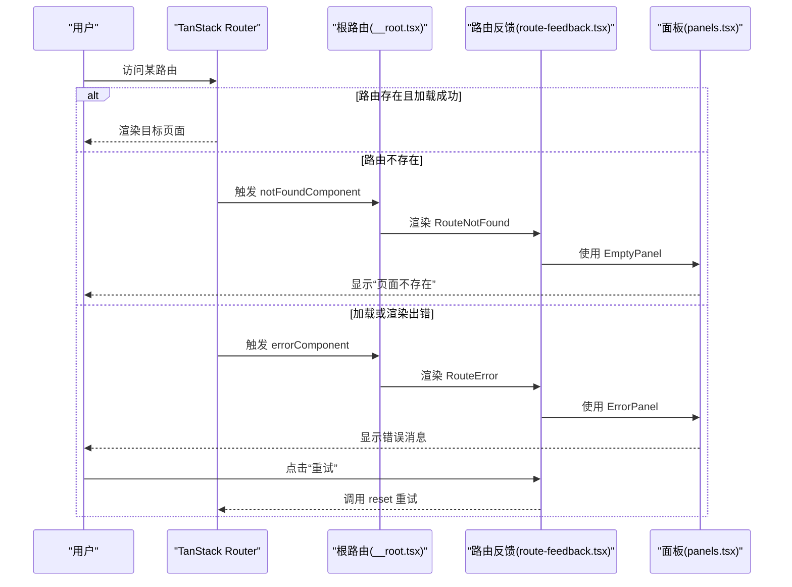
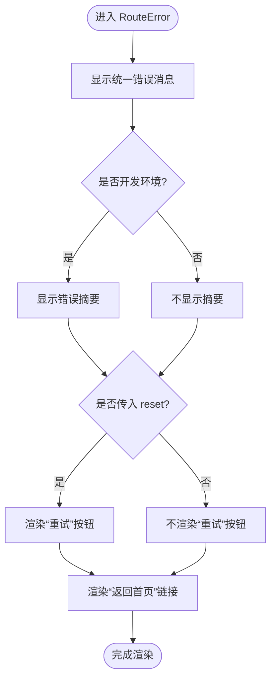
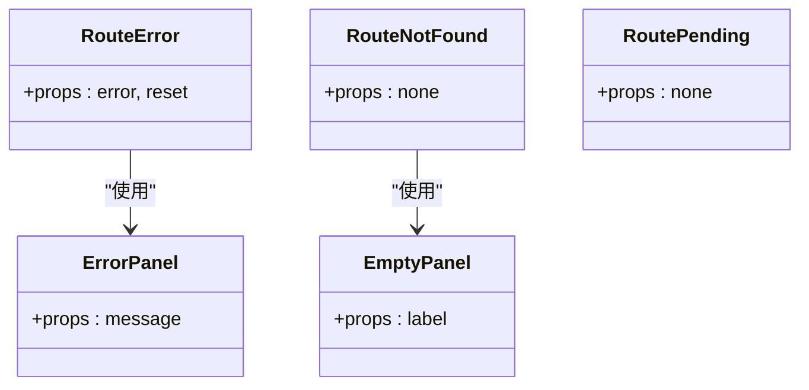
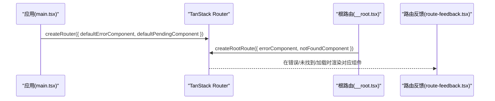
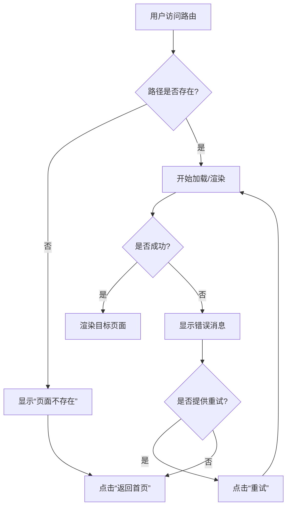

# 路由反馈组件

<cite>
**本文引用的文件**   
- [route-feedback.tsx](file://apps/web/src/components/route-feedback.tsx)
- [route-feedback.test.tsx](file://apps/web/src/components/route-feedback.test.tsx)
- [panels.tsx](file://apps/web/src/components/panels.tsx)
- [main.tsx](file://apps/web/src/main.tsx)
- [__root.tsx](file://apps/web/src/routes/__root.tsx)
</cite>

## 目录
1. [简介](#简介)
2. [项目结构定位](#项目结构定位)
3. [核心组件](#核心组件)
4. [架构总览](#架构总览)
5. [详细组件分析](#详细组件分析)
6. [依赖关系分析](#依赖关系分析)
7. [性能与体验特性](#性能与体验特性)
8. [配置与集成指南](#配置与集成指南)
9. [错误处理策略](#错误处理策略)
10. [用户引导流程](#用户引导流程)
11. [最佳实践](#最佳实践)
12. [故障排查](#故障排查)
13. [结论](#结论)

## 简介
本文件面向“路由反馈组件”，聚焦以下目标：
- 说明路由状态显示逻辑：错误、未知路由、加载态三类兜底。
- 解释用户引导实现方式：统一返回首页入口、重试操作。
- 梳理错误提示处理机制：开发环境暴露错误摘要，生产环境隐藏敏感信息。
- 描述与路由系统的集成点：根路由的 errorComponent/notFoundComponent，以及全局 defaultErrorComponent/defaultPendingComponent。
- 说明状态监听与自动更新：由 TanStack Router 在 loader 失败、渲染崩溃、未知路由时自动触发对应组件。
- 明确视觉表现与用户体验优化：统一的空面板、错误面板、轻量加载提示，配合主题切换与无障碍属性。
- 给出可配置项、自定义样式建议、国际化扩展思路。
- 提供配置示例、错误处理策略、用户引导流程与最佳实践。

## 项目结构定位
路由反馈能力集中在前端 Web 应用 `apps/web` 中，核心文件如下：
- 组件实现：`apps/web/src/components/route-feedback.tsx`
- 测试用例：`apps/web/src/components/route-feedback.test.tsx`
- 展示基元：`apps/web/src/components/panels.tsx`
- 路由初始化与全局兜底：`apps/web/src/main.tsx`
- 根路由与页面守卫：`apps/web/src/routes/__root.tsx`

**图表来源**
- [main.tsx:14-23](file://apps/web/src/main.tsx#L14-L23)
- [__root.tsx:12-22](file://apps/web/src/routes/__root.tsx#L12-L22)
- [route-feedback.tsx:1-66](file://apps/web/src/components/route-feedback.tsx#L1-L66)
- [panels.tsx:7-24](file://apps/web/src/components/panels.tsx#L7-L24)

**章节来源**
- [main.tsx:1-38](file://apps/web/src/main.tsx#L1-L38)
- [__root.tsx:1-22](file://apps/web/src/routes/__root.tsx#L1-L22)
- [route-feedback.tsx:1-66](file://apps/web/src/components/route-feedback.tsx#L1-L66)
- [panels.tsx:1-25](file://apps/web/src/components/panels.tsx#L1-L25)

## 核心组件
路由反馈组件提供三个纯函数式 React 组件，分别对应三种路由状态：
- RouteError：路由加载错误或渲染崩溃时的错误边界展示。
- RouteNotFound：未知路由（404）的兜底展示。
- RoutePending：路由切换或数据加载中的轻量提示。

这些组件不直接依赖路由钩子，仅通过 props 接收外部注入的状态（如 reset），并通过原生 `<a>` 返回首页，便于脱离路由上下文进行单测。

**章节来源**
- [route-feedback.tsx:12-66](file://apps/web/src/components/route-feedback.tsx#L12-L66)
- [route-feedback.test.tsx:9-42](file://apps/web/src/components/route-feedback.test.tsx#L9-L42)

## 架构总览
路由反馈组件与 TanStack Router 的集成分为两层：
- 根路由层：在 `createRootRoute` 中设置 errorComponent 与 notFoundComponent，使任意子路由的错误和未知路径都落到统一面板。
- 全局路由器层：在 createRouter 中设置 defaultErrorComponent 与 defaultPendingComponent，为所有未自设错误/加载 UI 的路由提供兜底。

**图表来源**
- [main.tsx:14-23](file://apps/web/src/main.tsx#L14-L23)
- [__root.tsx:12-22](file://apps/web/src/routes/__root.tsx#L12-L22)
- [route-feedback.tsx:12-66](file://apps/web/src/components/route-feedback.tsx#L12-L66)
- [panels.tsx:7-24](file://apps/web/src/components/panels.tsx#L7-L24)

## 详细组件分析

### RouteError：路由错误边界
职责
- 展示统一错误文案。
- 开发环境下附加错误摘要，帮助定位问题。
- 提供“重试”按钮（当外部注入 reset 回调时）。
- 提供“返回首页”链接，使用原生导航以脱离路由上下文。

交互流程
- 若传入 reset，则渲染“重试”按钮；点击后调用 reset，交由路由系统重新尝试当前路由加载。
- 始终渲染“返回首页”链接，用于快速退出异常状态。

视觉与可访问性
- 使用 ErrorPanel 包裹错误消息，具备语义化 role="alert"。
- 开发模式下以代码块形式展示错误摘要，便于调试。

**图表来源**
- [route-feedback.tsx:12-46](file://apps/web/src/components/route-feedback.tsx#L12-L46)
- [panels.tsx:15-24](file://apps/web/src/components/panels.tsx#L15-L24)

**章节来源**
- [route-feedback.tsx:12-46](file://apps/web/src/components/route-feedback.tsx#L12-L46)
- [route-feedback.test.tsx:24-42](file://apps/web/src/components/route-feedback.test.tsx#L24-L42)

### RouteNotFound：未知路由兜底
职责
- 向用户传达“页面不存在”。
- 提供“返回首页”链接，帮助用户回到可用入口。

视觉与可访问性
- 使用 EmptyPanel 展示简洁文本，避免干扰主界面。

**章节来源**
- [route-feedback.tsx:48-61](file://apps/web/src/components/route-feedback.tsx#L48-L61)
- [route-feedback.test.tsx:9-15](file://apps/web/src/components/route-feedback.test.tsx#L9-L15)

### RoutePending：路由切换加载态
职责
- 在路由切换或数据加载中显示轻量提示，避免白屏。

视觉与可访问性
- 使用简短文案“加载中…”，颜色柔和，不打断用户阅读。

**章节来源**
- [route-feedback.tsx:63-66](file://apps/web/src/components/route-feedback.tsx#L63-L66)
- [route-feedback.test.tsx:17-22](file://apps/web/src/components/route-feedback.test.tsx#L17-L22)

### 面板基元：EmptyPanel 与 ErrorPanel
职责
- EmptyPanel：通用空状态容器，用于 404 等轻提示场景。
- ErrorPanel：带边框与背景色的错误提示容器，具备 role="alert" 提升可访问性。

**章节来源**
- [panels.tsx:7-24](file://apps/web/src/components/panels.tsx#L7-L24)

## 依赖关系分析
- route-feedback.tsx 依赖 panels.tsx 提供的 EmptyPanel 与 ErrorPanel。
- main.tsx 将 RouteError 与 RoutePending 注册为全局默认错误与加载组件。
- __root.tsx 将 RouteError 与 RouteNotFound 注册为根路由的错误与未找到组件。
- 测试文件验证各组件的渲染行为与交互逻辑。

**图表来源**
- [route-feedback.tsx:1-66](file://apps/web/src/components/route-feedback.tsx#L1-L66)
- [panels.tsx:7-24](file://apps/web/src/components/panels.tsx#L7-L24)

**章节来源**
- [route-feedback.tsx:1-66](file://apps/web/src/components/route-feedback.tsx#L1-L66)
- [panels.tsx:1-25](file://apps/web/src/components/panels.tsx#L1-L25)
- [main.tsx:14-23](file://apps/web/src/main.tsx#L14-L23)
- [__root.tsx:12-22](file://apps/web/src/routes/__root.tsx#L12-L22)

## 性能与体验特性
- 轻量无副作用：三个组件均为纯函数式组件，不引入路由钩子，降低耦合与开销。
- 最小化闪烁：通过 defaultPendingMs 与 defaultPendingMinMs 控制加载提示的最小显示时长，避免频繁闪烁。
- 主题适配：使用 Tailwind 类名支持明暗主题，保持视觉一致性。
- 可访问性：错误面板使用 role="alert"，提升屏幕阅读器友好度。
- 安全输出：仅在开发环境展示错误摘要，避免泄露敏感信息。

[本节为通用指导，不直接分析具体文件]

## 配置与集成指南

### 与路由系统集成
- 根路由集成：在 createRootRoute 中设置 errorComponent 与 notFoundComponent，确保任意子路由错误与未知路径均落入统一面板。
- 全局默认集成：在 createRouter 中设置 defaultErrorComponent 与 defaultPendingComponent，为所有未自设错误/加载 UI 的路由提供兜底。

**图表来源**
- [main.tsx:14-23](file://apps/web/src/main.tsx#L14-L23)
- [__root.tsx:12-22](file://apps/web/src/routes/__root.tsx#L12-L22)

**章节来源**
- [main.tsx:14-23](file://apps/web/src/main.tsx#L14-L23)
- [__root.tsx:12-22](file://apps/web/src/routes/__root.tsx#L12-L22)

### 可配置选项
- 全局默认错误组件：defaultErrorComponent
- 全局默认加载组件：defaultPendingComponent
- 加载提示阈值：defaultPendingMs、defaultPendingMinMs
- 根路由错误组件：errorComponent
- 根路由未找到组件：notFoundComponent

这些选项决定了何时渲染 RouteError、RoutePending 与 RouteNotFound。

**章节来源**
- [main.tsx:14-23](file://apps/web/src/main.tsx#L14-L23)
- [__root.tsx:12-22](file://apps/web/src/routes/__root.tsx#L12-L22)

### 自定义样式
- 使用 Tailwind 类名进行样式定制，支持明暗主题。
- 可通过覆盖 panels.tsx 中的 EmptyPanel 与 ErrorPanel 样式，统一调整边框、背景色与文字颜色。
- 建议在主题提供者（ThemeProvider）上下文中统一设计令牌，保证一致体验。

[本节为通用指导，不直接分析具体文件]

### 国际化支持
- 当前文案为中文硬编码。如需国际化，可将文案抽取到 i18n 资源文件中，并在组件中根据语言环境读取。
- 建议在 panels.tsx 中抽象出 i18n 键值，供 RouteError、RouteNotFound 复用。

[本节为通用指导，不直接分析具体文件]

## 错误处理策略
- 统一错误入口：所有 loader 抛错、渲染崩溃、未知路由均落入统一面板，避免裸默认或白屏。
- 开发环境增强：在开发模式下显示错误摘要，便于快速定位问题。
- 生产环境安全：隐藏错误细节，仅展示友好提示。
- 重试机制：当外部注入 reset 回调时，允许用户主动重试当前路由加载。
- 返回首页：通过原生 `<a href="/">` 快速退出异常状态，避免陷入路由上下文。

**章节来源**
- [route-feedback.tsx:12-46](file://apps/web/src/components/route-feedback.tsx#L12-L46)
- [route-feedback.test.tsx:24-42](file://apps/web/src/components/route-feedback.test.tsx#L24-L42)

## 用户引导流程
- 404 场景：显示“页面不存在”，并提供“返回首页”链接，引导用户回到可用入口。
- 错误场景：显示统一错误消息，必要时提供“重试”按钮，同时保留“返回首页”链接。
- 加载场景：显示“加载中…”，避免白屏，提升感知流畅度。

**图表来源**
- [route-feedback.tsx:12-66](file://apps/web/src/components/route-feedback.tsx#L12-L66)

**章节来源**
- [route-feedback.tsx:12-66](file://apps/web/src/components/route-feedback.tsx#L12-L66)

## 最佳实践
- 路由命名规范
  - 使用清晰、可读的路径命名，便于错误与 404 场景下的用户理解。
  - 对受保护路由集中守卫，减少无效跳转与错误分支。
- 反馈时机选择
  - 使用 defaultPendingMs 与 defaultPendingMinMs 平衡响应性与防闪烁。
  - 在关键业务路径上提供明确的 loading 提示，避免用户困惑。
- 用户体验设计原则
  - 统一错误与 404 视觉风格，降低认知成本。
  - 提供明确的行动点（重试、返回首页），减少用户迷失。
  - 保持文案简洁友好，避免技术术语。
- 可维护性与可测试性
  - 组件保持纯函数式，不依赖路由钩子，便于单测。
  - 通过测试覆盖渲染与交互逻辑，确保回归稳定。

[本节为通用指导，不直接分析具体文件]

## 故障排查
常见问题与解决思路：
- 未显示错误面板
  - 检查是否在 createRootRoute 中设置了 errorComponent。
  - 检查是否在 createRouter 中设置了 defaultErrorComponent。
- 未显示加载提示
  - 检查 defaultPendingMs 与 defaultPendingMinMs 配置是否合理。
  - 确认 defaultPendingComponent 已设置为 RoutePending。
- 404 未生效
  - 检查根路由是否设置了 notFoundComponent。
  - 确认路由树生成正确，路径匹配无误。
- 重试无效
  - 确认外部注入了 reset 回调，且该回调能触发路由重新加载。

**章节来源**
- [main.tsx:14-23](file://apps/web/src/main.tsx#L14-L23)
- [__root.tsx:12-22](file://apps/web/src/routes/__root.tsx#L12-L22)
- [route-feedback.tsx:12-66](file://apps/web/src/components/route-feedback.tsx#L12-L66)

## 结论
路由反馈组件通过三个轻量、无副作用的组件，为 TanStack Router 提供了统一、友好的错误、404 与加载态展示。它与根路由和全局路由器配置紧密集成，确保任意路由异常都能被捕获并以一致的视觉与交互呈现给用户。结合合理的配置与最佳实践，可在复杂业务场景中显著提升用户体验与可维护性。

[本节为总结性内容，不直接分析具体文件]