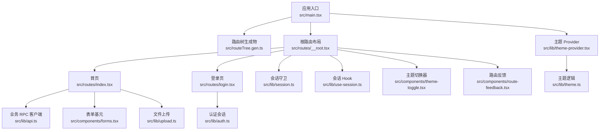
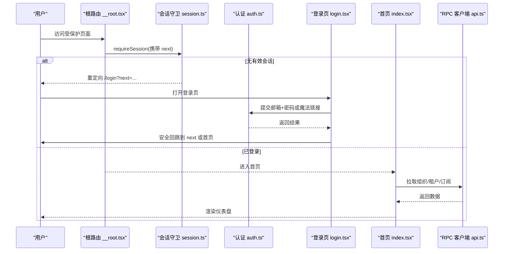
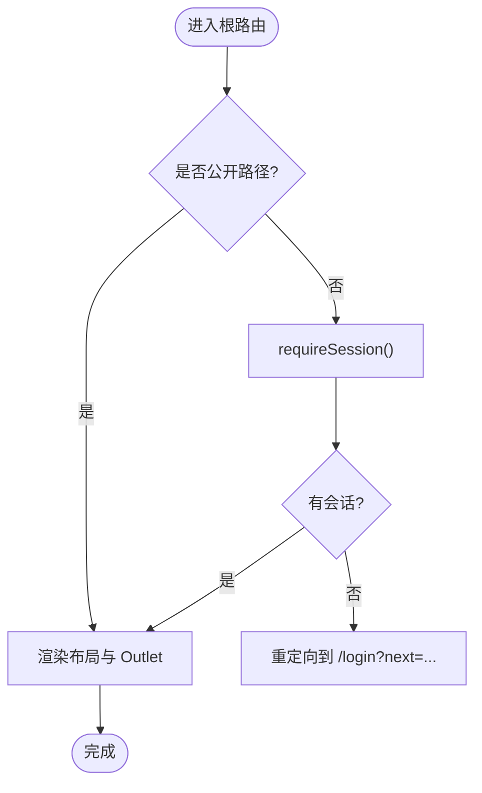
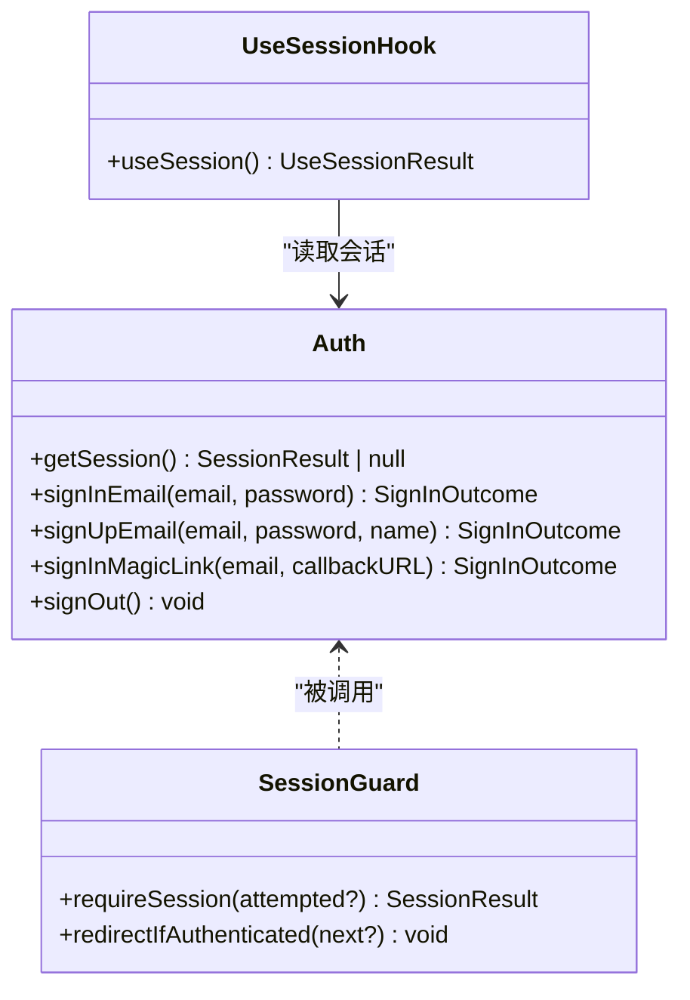
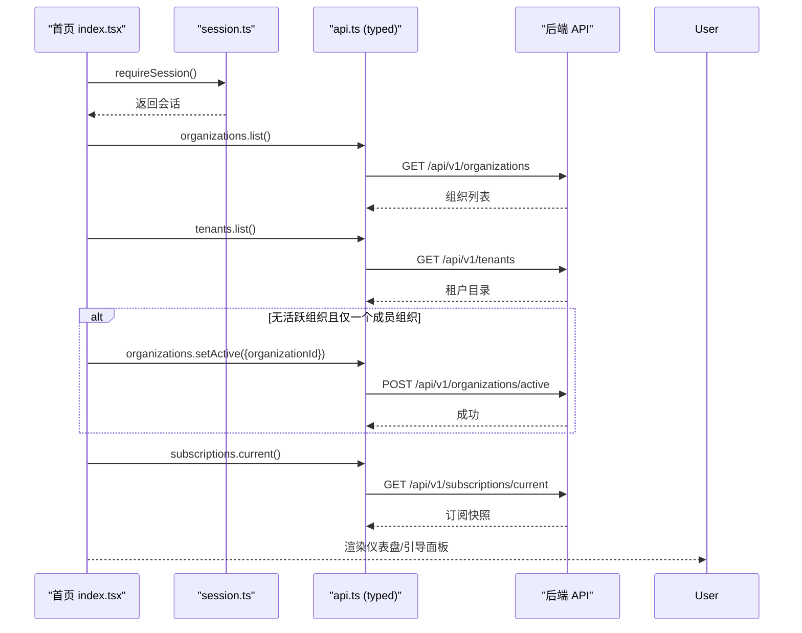
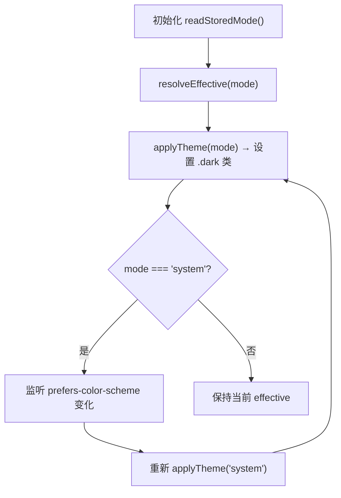
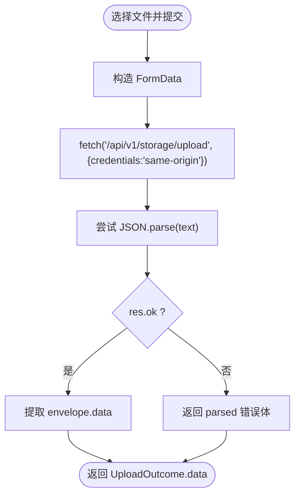
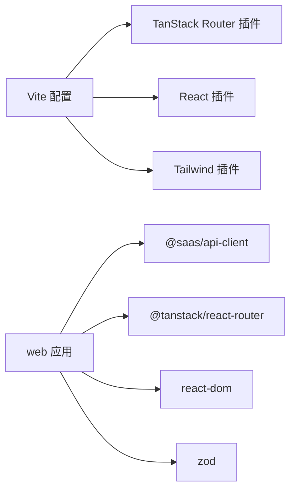

# 前端应用文档

<cite>
**本文引用的文件**   
- [apps/web/package.json](file://apps/web/package.json)
- [apps/web/vite.config.ts](file://apps/web/vite.config.ts)
- [apps/web/src/main.tsx](file://apps/web/src/main.tsx)
- [apps/web/src/routeTree.gen.ts](file://apps/web/src/routeTree.gen.ts)
- [apps/web/src/routes/__root.tsx](file://apps/web/src/routes/__root.tsx)
- [apps/web/src/routes/index.tsx](file://apps/web/src/routes/index.tsx)
- [apps/web/src/routes/login.tsx](file://apps/web/src/routes/login.tsx)
- [apps/web/src/lib/auth.ts](file://apps/web/src/lib/auth.ts)
- [apps/web/src/lib/api.ts](file://apps/web/src/lib/api.ts)
- [apps/web/src/lib/session.ts](file://apps/web/src/lib/session.ts)
- [apps/web/src/lib/use-session.ts](file://apps/web/src/lib/use-session.ts)
- [apps/web/src/lib/theme-provider.tsx](file://apps/web/src/lib/theme-provider.tsx)
- [apps/web/src/lib/theme.ts](file://apps/web/src/lib/theme.ts)
- [apps/web/src/components/theme-toggle.tsx](file://apps/web/src/components/theme-toggle.tsx)
- [apps/web/src/components/forms.tsx](file://apps/web/src/components/forms.tsx)
- [apps/web/src/components/route-feedback.tsx](file://apps/web/src/components/route-feedback.tsx)
- [apps/web/src/lib/upload.ts](file://apps/web/src/lib/upload.ts)
</cite>

## 目录
1. [简介](#简介)
2. [项目结构](#项目结构)
3. [核心组件](#核心组件)
4. [架构总览](#架构总览)
5. [详细组件分析](#详细组件分析)
6. [依赖关系分析](#依赖关系分析)
7. [性能与构建部署](#性能与构建部署)
8. [故障排查指南](#故障排查指南)
9. [结论](#结论)

## 简介
本前端应用基于 React + TypeScript，采用 TanStack Router 的文件式路由、Vite 作为构建工具、Tailwind CSS 4 进行样式开发。应用通过同源相对路径与后端集成：认证走 Better Auth 的 `/api/v1/auth` 面；业务 API 使用 @saas/api-client 生成的 typed oRPC 客户端；文件上传因 multipart 限制使用原生 fetch。主题系统支持 light/dark/system 三态切换并持久化到 localStorage；全局提供路由级错误/未找到/加载反馈面板。

## 项目结构
- 入口与路由
  - 应用入口在 `src/main.tsx`，创建 TanStack Router 实例并挂载 ThemeProvider 与 RouterProvider。
  - 路由由 `@tanstack/router-plugin` 自动生成 `src/routeTree.gen.ts`，根路由 `__root.tsx` 集中处理深链守卫与导航布局。
- 页面与功能
  - 首页 `routes/index.tsx` 负责组织/租户选择、订阅摘要与引导落租。
  - 登录页 `routes/login.tsx` 实现邮箱密码登录与魔法链接登录。
- 能力层
  - 认证会话：`lib/auth.ts` 封装 Better Auth HTTP 面；`lib/session.ts` 提供受保护路由守卫；`lib/use-session.ts` 为壳层提供会话状态。
  - 业务 API：`lib/api.ts` 暴露 typed RPC 客户端单例。
  - 主题：`lib/theme.ts` 纯逻辑，`lib/theme-provider.tsx` 提供 React Context，`components/theme-toggle.tsx` 为切换按钮。
  - 表单与反馈：`components/forms.tsx` 提供最小表单基元；`components/route-feedback.tsx` 提供路由级错误/未找到/加载 UI。
  - 文件上传：`lib/upload.ts` 以原生 fetch 上传文件。
- 构建配置
  - `vite.config.ts` 启用 Tailwind、TanStack Router 插件，配置 dev proxy 将 `/api` 转发至后端。
  - `package.json` 定义脚本与依赖（React、TanStack Router、Tailwind、Vite）。

**图示来源**
- [apps/web/src/main.tsx:1-38](file://apps/web/src/main.tsx#L1-L38)
- [apps/web/src/routeTree.gen.ts:1-451](file://apps/web/src/routeTree.gen.ts#L1-L451)
- [apps/web/src/routes/__root.tsx:1-172](file://apps/web/src/routes/__root.tsx#L1-L172)
- [apps/web/src/routes/index.tsx:1-321](file://apps/web/src/routes/index.tsx#L1-L321)
- [apps/web/src/routes/login.tsx:1-146](file://apps/web/src/routes/login.tsx#L1-L146)
- [apps/web/src/lib/api.ts:1-16](file://apps/web/src/lib/api.ts#L1-L16)
- [apps/web/src/lib/auth.ts:1-93](file://apps/web/src/lib/auth.ts#L1-L93)
- [apps/web/src/lib/session.ts:1-43](file://apps/web/src/lib/session.ts#L1-L43)
- [apps/web/src/lib/use-session.ts:1-46](file://apps/web/src/lib/use-session.ts#L1-L46)
- [apps/web/src/lib/theme-provider.tsx:1-65](file://apps/web/src/lib/theme-provider.tsx#L1-L65)
- [apps/web/src/lib/theme.ts:1-57](file://apps/web/src/lib/theme.ts#L1-L57)
- [apps/web/src/components/theme-toggle.tsx:1-27](file://apps/web/src/components/theme-toggle.tsx#L1-L27)
- [apps/web/src/components/forms.tsx:1-188](file://apps/web/src/components/forms.tsx#L1-L188)
- [apps/web/src/components/route-feedback.tsx:1-67](file://apps/web/src/components/route-feedback.tsx#L1-L67)
- [apps/web/src/lib/upload.ts:1-36](file://apps/web/src/lib/upload.ts#L1-L36)

**章节来源**
- [apps/web/package.json:1-33](file://apps/web/package.json#L1-L33)
- [apps/web/vite.config.ts:1-23](file://apps/web/vite.config.ts#L1-L23)
- [apps/web/src/main.tsx:1-38](file://apps/web/src/main.tsx#L1-L38)
- [apps/web/src/routeTree.gen.ts:1-451](file://apps/web/src/routeTree.gen.ts#L1-L451)

## 核心组件
- 路由与布局
  - 根路由 `__root.tsx` 集中处理公共路径白名单、深链守卫、导航菜单与全局登出。
  - 路由反馈组件统一展示错误、未找到与加载中状态。
- 认证与会话
  - `lib/auth.ts` 封装 Better Auth 的会话读取、登录、注册、魔法链接与登出。
  - `lib/session.ts` 提供受保护路由守卫与反向守卫。
  - `lib/use-session.ts` 为壳层提供会话状态，随路由变化刷新。
- 业务 API
  - `lib/api.ts` 暴露 typed oRPC 客户端单例，所有业务调用走该通道。
- 主题系统
  - `lib/theme.ts` 纯逻辑：模式读写、系统偏好解析、DOM 类名切换。
  - `lib/theme-provider.tsx` 提供 React Context 与 setMode。
  - `components/theme-toggle.tsx` 三态循环切换按钮。
- 表单与交互
  - `components/forms.tsx` 提供 Field、Select、SubmitButton、DangerButton、Feedback、FormWrap。
- 文件上传
  - `lib/upload.ts` 原生 fetch 上传，兼容后端信封格式。

**章节来源**
- [apps/web/src/routes/__root.tsx:1-172](file://apps/web/src/routes/__root.tsx#L1-L172)
- [apps/web/src/components/route-feedback.tsx:1-67](file://apps/web/src/components/route-feedback.tsx#L1-L67)
- [apps/web/src/lib/auth.ts:1-93](file://apps/web/src/lib/auth.ts#L1-L93)
- [apps/web/src/lib/session.ts:1-43](file://apps/web/src/lib/session.ts#L1-L43)
- [apps/web/src/lib/use-session.ts:1-46](file://apps/web/src/lib/use-session.ts#L1-L46)
- [apps/web/src/lib/api.ts:1-16](file://apps/web/src/lib/api.ts#L1-L16)
- [apps/web/src/lib/theme.ts:1-57](file://apps/web/src/lib/theme.ts#L1-L57)
- [apps/web/src/lib/theme-provider.tsx:1-65](file://apps/web/src/lib/theme-provider.tsx#L1-L65)
- [apps/web/src/components/theme-toggle.tsx:1-27](file://apps/web/src/components/theme-toggle.tsx#L1-L27)
- [apps/web/src/components/forms.tsx:1-188](file://apps/web/src/components/forms.tsx#L1-L188)
- [apps/web/src/lib/upload.ts:1-36](file://apps/web/src/lib/upload.ts#L1-L36)

## 架构总览
前端采用“文件式路由 + 根布局守卫 + 会话钩子”的模式：
- 根路由守卫对非公开路径执行会话校验，未登录则重定向到登录页并携带 next 参数。
- 登录成功后按安全策略回跳原目标。
- 首页 loader 拉取组织/租户/订阅数据，必要时自动设置活跃组织。
- 主题系统通过 Context 驱动 DOM 类名，配合 Tailwind dark 变体实现明暗切换。
- 业务 API 通过 typed oRPC 客户端访问，上传等二进制场景使用原生 fetch。

**图示来源**
- [apps/web/src/routes/__root.tsx:1-172](file://apps/web/src/routes/__root.tsx#L1-L172)
- [apps/web/src/lib/session.ts:1-43](file://apps/web/src/lib/session.ts#L1-L43)
- [apps/web/src/lib/auth.ts:1-93](file://apps/web/src/lib/auth.ts#L1-L93)
- [apps/web/src/routes/login.tsx:1-146](file://apps/web/src/routes/login.tsx#L1-L146)
- [apps/web/src/routes/index.tsx:1-321](file://apps/web/src/routes/index.tsx#L1-L321)
- [apps/web/src/lib/api.ts:1-16](file://apps/web/src/lib/api.ts#L1-L16)

## 详细组件分析

### 路由与布局
- 根路由职责
  - 维护公开路径集合（如登录、注册），其他路径需通过会话守卫。
  - 提供顶部导航与全局登出，根据会话状态动态显示菜单。
  - 注入全局错误与未找到组件，保证任意路由异常均有友好提示。
- 路由反馈
  - 统一错误面板、未知路由面板与加载中提示，避免白屏。

**图示来源**
- [apps/web/src/routes/__root.tsx:1-172](file://apps/web/src/routes/__root.tsx#L1-L172)
- [apps/web/src/lib/session.ts:1-43](file://apps/web/src/lib/session.ts#L1-L43)
- [apps/web/src/components/route-feedback.tsx:1-67](file://apps/web/src/components/route-feedback.tsx#L1-L67)

**章节来源**
- [apps/web/src/routes/__root.tsx:1-172](file://apps/web/src/routes/__root.tsx#L1-L172)
- [apps/web/src/components/route-feedback.tsx:1-67](file://apps/web/src/components/route-feedback.tsx#L1-L67)

### 认证与会话
- 认证接口
  - 会话读取：GET `/api/v1/auth/get-session`，失败分类区分网络/服务端错误与无会话。
  - 登录/注册/魔法链接/登出：POST 到对应端点，统一错误文案归一。
- 会话守卫
  - 受保护路由：未登录时抛出路由重定向，携带 next 以便登录后回跳。
  - 反向守卫：已登录访问登录/注册时弹离到合法站内地址或首页。
- 壳层会话 Hook
  - 监听路由 pathname 变化，重新获取会话；服务不可用时降级为 anon，不破坏壳层。

**图示来源**
- [apps/web/src/lib/auth.ts:1-93](file://apps/web/src/lib/auth.ts#L1-L93)
- [apps/web/src/lib/session.ts:1-43](file://apps/web/src/lib/session.ts#L1-L43)
- [apps/web/src/lib/use-session.ts:1-46](file://apps/web/src/lib/use-session.ts#L1-L46)

**章节来源**
- [apps/web/src/lib/auth.ts:1-93](file://apps/web/src/lib/auth.ts#L1-L93)
- [apps/web/src/lib/session.ts:1-43](file://apps/web/src/lib/session.ts#L1-L43)
- [apps/web/src/lib/use-session.ts:1-46](file://apps/web/src/lib/use-session.ts#L1-L46)
- [apps/web/src/routes/login.tsx:1-146](file://apps/web/src/routes/login.tsx#L1-L146)

### 首页与业务数据流
- 首页 loader
  - 先校验会话，再拉取组织列表与租户目录。
  - 若会话未带活跃组织且仅有一个成员组织，自动设置为活跃组织。
  - 在有活跃组织后拉取订阅信息，展示摘要或引导面板。
- 租户/组织切换
  - 通过 useAction 包装 mutation，调用 rpc.tenants.setActive 与 rpc.organizations.setActive。
  - 成功/失败反馈通过 Feedback 组件呈现。

**图示来源**
- [apps/web/src/routes/index.tsx:1-321](file://apps/web/src/routes/index.tsx#L1-L321)
- [apps/web/src/lib/session.ts:1-43](file://apps/web/src/lib/session.ts#L1-L43)
- [apps/web/src/lib/api.ts:1-16](file://apps/web/src/lib/api.ts#L1-L16)

**章节来源**
- [apps/web/src/routes/index.tsx:1-321](file://apps/web/src/routes/index.tsx#L1-L321)

### 主题系统
- 运行时逻辑
  - 支持 light/dark/system 三种模式，system 跟随系统偏好。
  - 通过给 `<html>` 添加 `.dark` 类名驱动 Tailwind dark 变体。
  - 模式持久化到 localStorage，读/写均做降级处理。
- React 上下文
  - ThemeProvider 持有显式模式与生效主题，并提供 setMode。
  - useTheme 提供便捷读取与写入。
- 切换器
  - 三态循环：system→light→dark→system。
  - aria-label/title 包含当前生效主题，便于无障碍。

**图示来源**
- [apps/web/src/lib/theme.ts:1-57](file://apps/web/src/lib/theme.ts#L1-L57)
- [apps/web/src/lib/theme-provider.tsx:1-65](file://apps/web/src/lib/theme-provider.tsx#L1-L65)
- [apps/web/src/components/theme-toggle.tsx:1-27](file://apps/web/src/components/theme-toggle.tsx#L1-L27)

**章节来源**
- [apps/web/src/lib/theme.ts:1-57](file://apps/web/src/lib/theme.ts#L1-L57)
- [apps/web/src/lib/theme-provider.tsx:1-65](file://apps/web/src/lib/theme-provider.tsx#L1-L65)
- [apps/web/src/components/theme-toggle.tsx:1-27](file://apps/web/src/components/theme-toggle.tsx#L1-L27)

### 表单与交互
- 表单基元
  - Field/Select 支持 error 高亮与无障碍关联。
  - SubmitButton/DangerButton 提供 pending 禁用态。
  - Feedback 统一展示 success/error。
  - FormWrap 封装 preventDefault 与回调。
- 使用建议
  - 在 mutation 操作面使用，只读页面无需依赖。
  - 结合 useAction 管理请求状态与反馈。

**章节来源**
- [apps/web/src/components/forms.tsx:1-188](file://apps/web/src/components/forms.tsx#L1-L188)

### 文件上传
- 设计要点
  - 因 oRPC 走 JSON compact 编码，不支持 multipart/form-data。
  - 使用原生 fetch 直接 POST 到 `/api/v1/storage/upload`，携带 same-origin 凭据。
  - 成功响应仍为 REST 信封 `{data, statusCode, message}`，提取 data 字段。
  - 非 2xx 返回解析后的错误体，供上层统一描述错误。

**图示来源**
- [apps/web/src/lib/upload.ts:1-36](file://apps/web/src/lib/upload.ts#L1-L36)

**章节来源**
- [apps/web/src/lib/upload.ts:1-36](file://apps/web/src/lib/upload.ts#L1-L36)

## 依赖关系分析
- 构建与插件
  - Vite 插件：TanStack Router 代码分割、React、Tailwind。
  - 环境变量：WEB_BASE 控制 basepath，WEB_PROXY_TARGET 控制 dev 代理后端。
- 运行时依赖
  - React 与 ReactDOM。
  - TanStack Router 用于文件式路由与类型安全导航。
  - @saas/api-client 提供 typed oRPC 客户端。
  - zod 用于数据校验（在本仓库中作为依赖存在）。

**图示来源**
- [apps/web/vite.config.ts:1-23](file://apps/web/vite.config.ts#L1-L23)
- [apps/web/package.json:1-33](file://apps/web/package.json#L1-L33)
- [apps/web/src/lib/api.ts:1-16](file://apps/web/src/lib/api.ts#L1-L16)

**章节来源**
- [apps/web/vite.config.ts:1-23](file://apps/web/vite.config.ts#L1-L23)
- [apps/web/package.json:1-33](file://apps/web/package.json#L1-L33)
- [apps/web/src/lib/api.ts:1-16](file://apps/web/src/lib/api.ts#L1-L16)

## 性能与构建部署
- 构建优化
  - 启用 TanStack Router 自动代码分割，减少首屏体积。
  - Tailwind v4 按需生成样式，减小 CSS 体积。
- 开发体验
  - Vite dev server 端口 5173，dev proxy 将 `/api` 转发至后端 7009，避免 CORS。
  - 支持 WEB_BASE 环境变量，便于在同源子路径（如 `/app/`）部署。
- 部署建议
  - 生产环境静态资源与后端同域反代，确保 Cookie 同源传递。
  - 构建前执行类型检查（tsc --noEmit），保证类型安全。

**章节来源**
- [apps/web/vite.config.ts:1-23](file://apps/web/vite.config.ts#L1-L23)
- [apps/web/package.json:1-33](file://apps/web/package.json#L1-L33)

## 故障排查指南
- 路由级错误
  - 任何 loader 抛错、渲染崩溃或未知路由都会落入 RouteError/RouteNotFound，提供重试与返回首页入口。
- 会话问题
  - 会话服务不可用（网络异常/5xx）会抛出错误，受保护页落到错误边界而非误弹登录页。
  - 壳层 useSession 在服务不可用时降级为 anon，避免导航崩溃。
- 认证失败
  - 登录/注册/魔法链接失败统一归一为友好文案，5xx 一律提示“服务暂时不可用”。
- 主题闪烁
  - 通过 index.html 内联脚本与 theme.ts 同步逻辑，降低 FOUC；localStorage 读写失败静默降级。

**章节来源**
- [apps/web/src/components/route-feedback.tsx:1-67](file://apps/web/src/components/route-feedback.tsx#L1-L67)
- [apps/web/src/lib/auth.ts:1-93](file://apps/web/src/lib/auth.ts#L1-L93)
- [apps/web/src/lib/use-session.ts:1-46](file://apps/web/src/lib/use-session.ts#L1-L46)
- [apps/web/src/lib/theme.ts:1-57](file://apps/web/src/lib/theme.ts#L1-L57)

## 结论
本前端应用以 TanStack Router 文件式路由为核心，结合 Vite 与 Tailwind v4 构建高效可维护的界面。通过根路由守卫与会话钩子实现统一的鉴权流程；使用 typed oRPC 客户端对接后端业务；主题系统提供三态切换与持久化；表单与反馈组件提升交互一致性；文件上传在二进制场景下采用原生 fetch 绕过 oRPC 限制。整体架构清晰、扩展性强，适合持续迭代与团队协作。