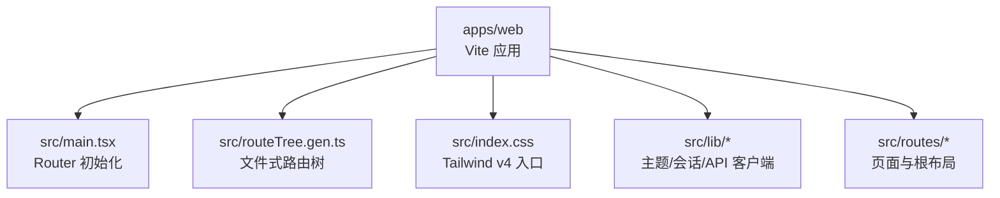
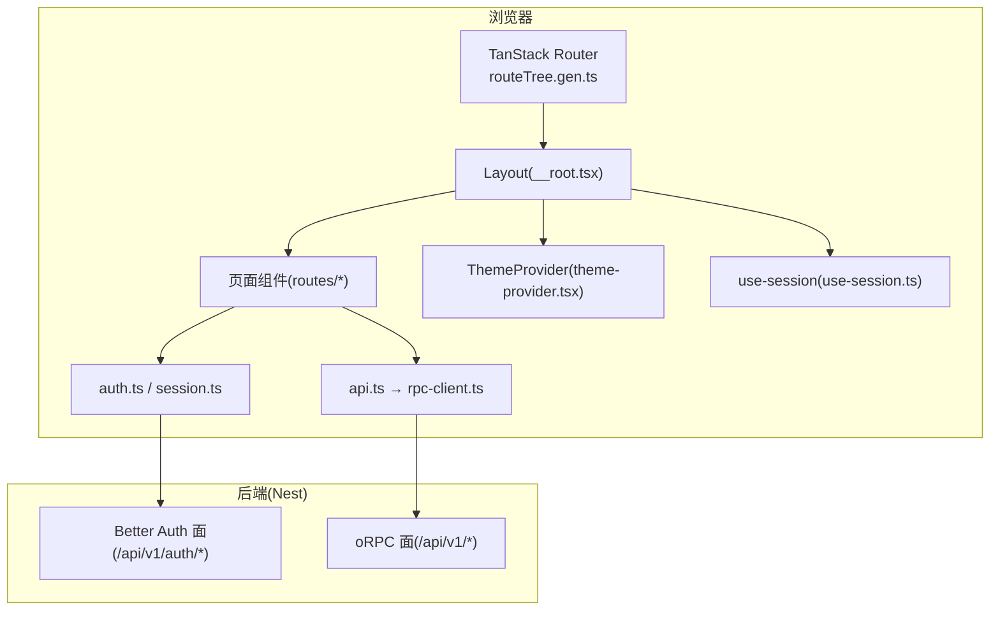
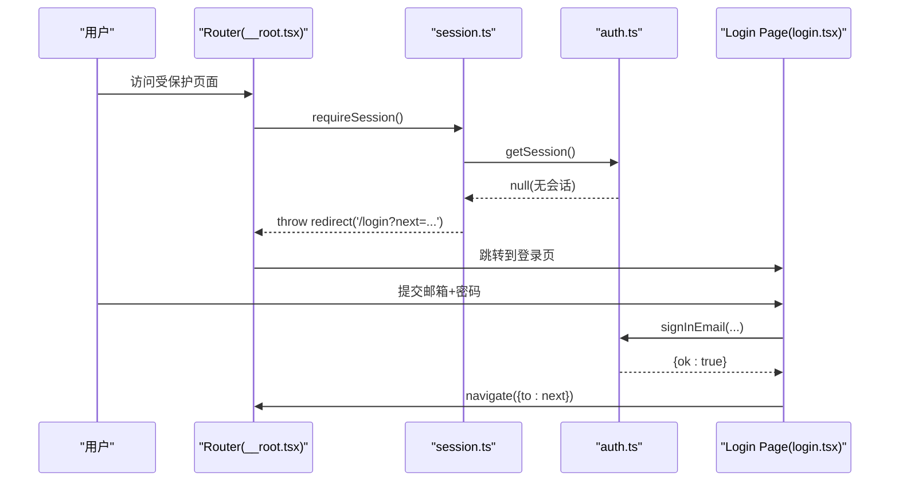
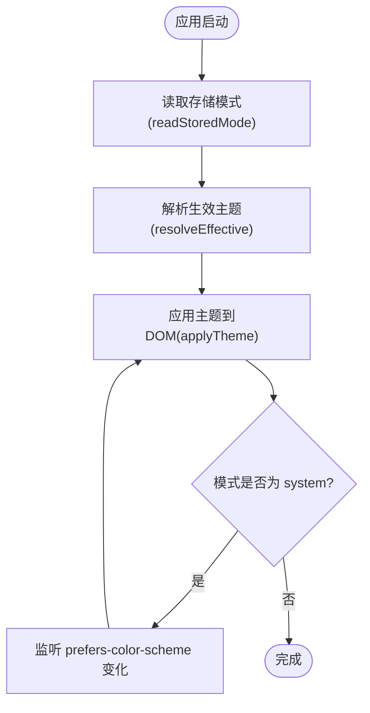
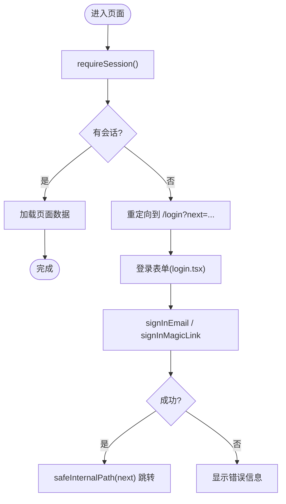
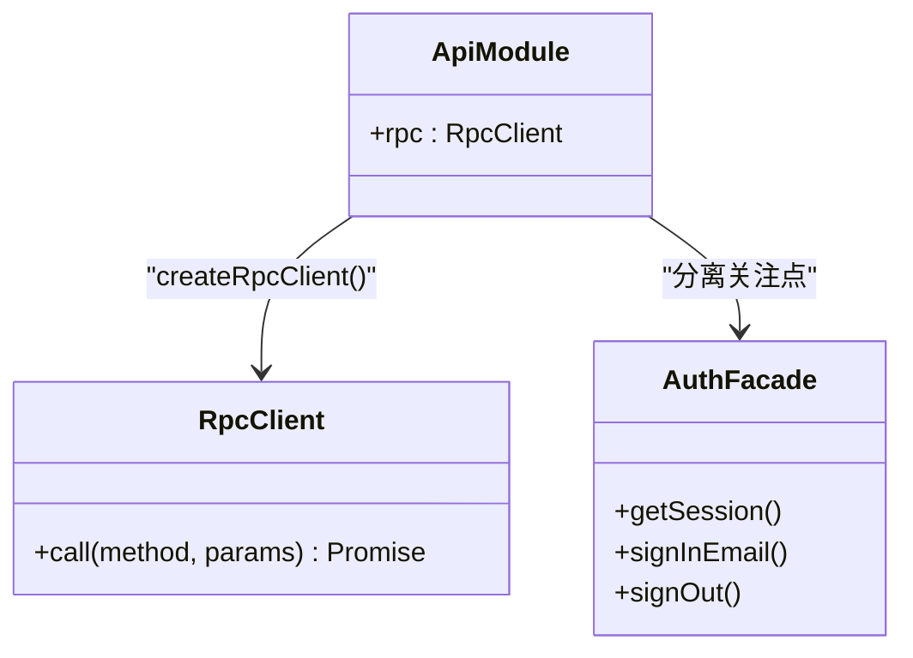
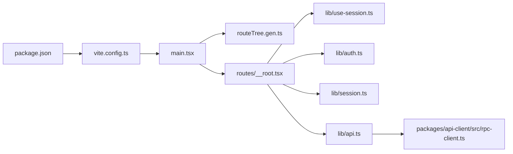

# 前端架构设计

<cite>
**本文引用的文件**   
- [apps/web/package.json](file://apps/web/package.json)
- [apps/web/vite.config.ts](file://apps/web/vite.config.ts)
- [apps/web/src/main.tsx](file://apps/web/src/main.tsx)
- [apps/web/src/routeTree.gen.ts](file://apps/web/src/routeTree.gen.ts)
- [apps/web/src/index.css](file://apps/web/src/index.css)
- [apps/web/src/lib/theme.ts](file://apps/web/src/lib/theme.ts)
- [apps/web/src/lib/theme-provider.tsx](file://apps/web/src/lib/theme-provider.tsx)
- [apps/web/src/lib/api.ts](file://apps/web/src/lib/api.ts)
- [apps/web/src/lib/auth.ts](file://apps/web/src/lib/auth.ts)
- [apps/web/src/routes/__root.tsx](file://apps/web/src/routes/__root.tsx)
- [apps/web/src/routes/login.tsx](file://apps/web/src/routes/login.tsx)
- [apps/web/src/lib/session.ts](file://apps/web/src/lib/session.ts)
- [apps/web/src/lib/use-session.ts](file://apps/web/src/lib/use-session.ts)
- [packages/api-client/src/rpc-client.ts](file://packages/api-client/src/rpc-client.ts)
</cite>

## 目录
1. [引言](#引言)
2. [项目结构](#项目结构)
3. [核心组件](#核心组件)
4. [架构总览](#架构总览)
5. [详细组件分析](#详细组件分析)
6. [依赖关系分析](#依赖关系分析)
7. [性能与构建优化](#性能与构建优化)
8. [故障排查指南](#故障排查指南)
9. [结论](#结论)

## 引言
本文件面向基于 React + TypeScript + TanStack Router + Vite 的前端控制台应用，系统性说明技术选型、整体架构模式、组件分层、状态管理策略、路由组织方式、Tailwind CSS 4 主题系统、国际化支持思路、前后端集成（API 客户端封装、认证流程、错误处理）、以及构建与开发环境配置和性能优化策略。文档同时提供架构图与组件关系图，帮助不同背景的读者快速理解并安全扩展该前端工程。

## 项目结构
前端应用位于 apps/web 子包，采用“文件式路由 + 插件生成”的组织方式：
- 入口与初始化：main.tsx 负责创建 Router、挂载根组件、注入全局上下文（如主题）。
- 路由树：由 @tanstack/router-plugin 在 dev/build 时自动生成 routeTree.gen.ts，按 src/routes 下的文件自动映射为类型安全的 Route 对象。
- 样式与主题：index.css 引入 Tailwind v4，并通过自定义 dark 变体配合运行时主题逻辑实现明暗主题。
- 业务库：src/lib 下集中 API 客户端、会话/认证、主题 Provider、工具函数等横切能力。
- 页面与布局：src/routes 下每个文件对应一个路由页面；__root.tsx 提供全局导航、登录态守卫与布局外壳。

**图示来源**
- [apps/web/src/main.tsx:10-23](file://apps/web/src/main.tsx#L10-L23)
- [apps/web/src/routeTree.gen.ts:11-30](file://apps/web/src/routeTree.gen.ts#L11-L30)
- [apps/web/src/index.css:1-14](file://apps/web/src/index.css#L1-L14)

**章节来源**
- [apps/web/src/main.tsx:1-38](file://apps/web/src/main.tsx#L1-L38)
- [apps/web/src/routeTree.gen.ts:1-451](file://apps/web/src/routeTree.gen.ts#L1-L451)
- [apps/web/src/index.css:1-15](file://apps/web/src/index.css#L1-L15)

## 核心组件
- 路由与导航
  - 使用 TanStack Router 的文件式路由，通过插件自动生成类型安全的路由树，并在 main.tsx 中注入 basepath、预加载策略与全局 pending/error 兜底组件。
  - __root.tsx 作为根布局，统一导航菜单、登出流程与受保护页面的深链守卫。
- 主题系统
  - index.css 引入 Tailwind v4，并通过 @custom-variant dark 将 .dark 类作为暗色开关。
  - lib/theme.ts 提供纯逻辑的主题模式解析与应用（light/dark/system），lib/theme-provider.tsx 将其接入 React Context，供 ThemeToggle 等组件消费。
- 会话与认证
  - lib/auth.ts 封装 Better Auth 的 HTTP 接口（同源相对路径），统一凭据传递与会话读取、登录/注册/魔法链接/登出流程的错误分类。
  - lib/session.ts 提供 requireSession 与 redirectIfAuthenticated 两个守卫钩子，分别用于受保护页面与匿名页的反向守卫。
  - lib/use-session.ts 为壳层（__root）提供会话感知 Hook，随 pathname 变化刷新会话状态。
- API 客户端
  - lib/api.ts 暴露 typed oRPC 客户端 rpc，基于 packages/api-client 的 createRpcClient，所有业务数据请求走 typed RPC，错误以 ORPCError 抛出。

**章节来源**
- [apps/web/src/main.tsx:14-23](file://apps/web/src/main.tsx#L14-L23)
- [apps/web/src/routes/__root.tsx:12-22](file://apps/web/src/routes/__root.tsx#L12-L22)
- [apps/web/src/index.css:1-14](file://apps/web/src/index.css#L1-L14)
- [apps/web/src/lib/theme.ts:1-57](file://apps/web/src/lib/theme.ts#L1-L57)
- [apps/web/src/lib/theme-provider.tsx:1-65](file://apps/web/src/lib/theme-provider.tsx#L1-L65)
- [apps/web/src/lib/auth.ts:1-93](file://apps/web/src/lib/auth.ts#L1-L93)
- [apps/web/src/lib/session.ts:1-43](file://apps/web/src/lib/session.ts#L1-L43)
- [apps/web/src/lib/use-session.ts:1-46](file://apps/web/src/lib/use-session.ts#L1-L46)
- [apps/web/src/lib/api.ts:1-16](file://apps/web/src/lib/api.ts#L1-L16)

## 架构总览
前端采用“文件式路由 + 组件分层 + 会话守卫 + Typed RPC”的整体架构：
- 表现层：各路由页面组件负责 UI 与交互。
- 壳层与布局：__root.tsx 提供全局导航、用户信息与登出入口，并集中处理未登录跳转。
- 领域能力：lib 下按能力划分（主题、会话、API、上传、格式化等），避免页面内耦合。
- 数据层：通过 typed oRPC 客户端访问后端 Nest 服务，统一信封与错误模型。

**图示来源**
- [apps/web/src/routeTree.gen.ts:11-30](file://apps/web/src/routeTree.gen.ts#L11-L30)
- [apps/web/src/routes/__root.tsx:12-22](file://apps/web/src/routes/__root.tsx#L12-L22)
- [apps/web/src/lib/auth.ts:1-93](file://apps/web/src/lib/auth.ts#L1-L93)
- [apps/web/src/lib/session.ts:1-43](file://apps/web/src/lib/session.ts#L1-L43)
- [apps/web/src/lib/api.ts:1-16](file://apps/web/src/lib/api.ts#L1-L16)
- [packages/api-client/src/rpc-client.ts](file://packages/api-client/src/rpc-client.ts)

## 详细组件分析

### 路由与导航架构
- 文件式路由：通过 @tanstack/router-plugin 自动生成 routeTree.gen.ts，包含完整的路由类型定义与父子关系。
- 根路由守卫：__root.tsx 的 beforeLoad 对非公开路径执行 requireSession，未登录则重定向到 /login?next=原路径。
- 登录页反向守卫：routes/login.tsx 的 beforeLoad 调用 redirectIfAuthenticated，已登录则回跳目标或首页。
- 导航与菜单：__root.tsx 根据 useSession 的 authed 状态渲染控制台菜单，并提供全局登出按钮。

**图示来源**
- [apps/web/src/routes/__root.tsx:12-22](file://apps/web/src/routes/__root.tsx#L12-L22)
- [apps/web/src/lib/session.ts:12-22](file://apps/web/src/lib/session.ts#L12-L22)
- [apps/web/src/lib/auth.ts:34-47](file://apps/web/src/lib/auth.ts#L34-L47)
- [apps/web/src/routes/login.tsx:7-14](file://apps/web/src/routes/login.tsx#L7-L14)
- [apps/web/src/routes/login.tsx:24-38](file://apps/web/src/routes/login.tsx#L24-L38)

**章节来源**
- [apps/web/src/routeTree.gen.ts:11-30](file://apps/web/src/routeTree.gen.ts#L11-L30)
- [apps/web/src/routes/__root.tsx:12-22](file://apps/web/src/routes/__root.tsx#L12-L22)
- [apps/web/src/routes/login.tsx:7-14](file://apps/web/src/routes/login.tsx#L7-L14)
- [apps/web/src/routes/login.tsx:24-38](file://apps/web/src/routes/login.tsx#L24-L38)

### 主题系统与 Tailwind CSS 4
- 样式入口：index.css 引入 tailwindcss，并通过 @custom-variant dark 将 .dark 类作为暗色开关，同时设置 color-scheme 联动原生控件。
- 运行时主题：theme.ts 提供 readStoredMode、prefersDark、resolveEffective、applyTheme、writeStoredMode 等纯函数，决定最终生效主题并切换 <html>.dark。
- React 上下文：theme-provider.tsx 维护 mode/effective/setMode，监听系统偏好变化，持久化用户选择，并通过 Context 暴露给 ThemeToggle 等组件。

**图示来源**
- [apps/web/src/index.css:1-14](file://apps/web/src/index.css#L1-L14)
- [apps/web/src/lib/theme.ts:15-46](file://apps/web/src/lib/theme.ts#L15-L46)
- [apps/web/src/lib/theme-provider.tsx:34-56](file://apps/web/src/lib/theme-provider.tsx#L34-L56)

**章节来源**
- [apps/web/src/index.css:1-15](file://apps/web/src/index.css#L1-L15)
- [apps/web/src/lib/theme.ts:1-57](file://apps/web/src/lib/theme.ts#L1-L57)
- [apps/web/src/lib/theme-provider.tsx:1-65](file://apps/web/src/lib/theme-provider.tsx#L1-L65)

### 会话与认证流程
- 会话读取：auth.ts 的 getSession 调用 /api/v1/auth/get-session，区分网络异常与服务端错误，返回 SessionResult 或 null。
- 受保护守卫：session.ts 的 requireSession 在无会话时抛 redirect 到 /login，并携带 ?next 原路径。
- 反向守卫：redirectIfAuthenticated 在已登录访问匿名页时弹离到合法站内路径或首页。
- 登录页：login.tsx 调用 signInEmail/signInMagicLink，成功后安全回跳（safeInternalPath 校验开放重定向风险）。

**图示来源**
- [apps/web/src/lib/auth.ts:34-47](file://apps/web/src/lib/auth.ts#L34-L47)
- [apps/web/src/lib/session.ts:12-22](file://apps/web/src/lib/session.ts#L12-L22)
- [apps/web/src/routes/login.tsx:24-38](file://apps/web/src/routes/login.tsx#L24-L38)

**章节来源**
- [apps/web/src/lib/auth.ts:1-93](file://apps/web/src/lib/auth.ts#L1-L93)
- [apps/web/src/lib/session.ts:1-43](file://apps/web/src/lib/session.ts#L1-L43)
- [apps/web/src/routes/login.tsx:1-146](file://apps/web/src/routes/login.tsx#L1-L146)

### API 客户端与错误处理
- 客户端封装：lib/api.ts 导出 rpc，基于 packages/api-client 的 createRpcClient，所有业务数据请求走 typed oRPC。
- 错误模型：typed oRPC 失败抛出 ORPCError，便于上层 loader 捕获并落入 RouteError。
- 特殊场景：multipart 上传走原生 fetch（upload.ts），Better Auth 面走裸 fetch（auth.ts），不走 rpc。

**图示来源**
- [apps/web/src/lib/api.ts:1-16](file://apps/web/src/lib/api.ts#L1-L16)
- [packages/api-client/src/rpc-client.ts](file://packages/api-client/src/rpc-client.ts)
- [apps/web/src/lib/auth.ts:1-93](file://apps/web/src/lib/auth.ts#L1-L93)

**章节来源**
- [apps/web/src/lib/api.ts:1-16](file://apps/web/src/lib/api.ts#L1-L16)
- [packages/api-client/src/rpc-client.ts](file://packages/api-client/src/rpc-client.ts)

## 依赖关系分析
- 构建与插件
  - Vite 配置启用 tanstackRouter 插件（开启代码分割）、React 插件与 Tailwind v4 插件。
  - package.json 声明依赖：react、@tanstack/react-router、tailwindcss、@tailwindcss/vite、vite 等。
- 运行时依赖
  - main.tsx 依赖 routeTree.gen.ts 生成的路由树，并注入 basepath、默认 pending/error 组件。
  - __root.tsx 依赖 use-session、auth、session 等能力模块。
  - api.ts 依赖 @saas/api-client 提供的 typed RPC 客户端。

**图示来源**
- [apps/web/package.json:1-33](file://apps/web/package.json#L1-L33)
- [apps/web/vite.config.ts:1-23](file://apps/web/vite.config.ts#L1-L23)
- [apps/web/src/main.tsx:1-38](file://apps/web/src/main.tsx#L1-L38)
- [apps/web/src/routes/__root.tsx:1-172](file://apps/web/src/routes/__root.tsx#L1-L172)
- [apps/web/src/lib/api.ts:1-16](file://apps/web/src/lib/api.ts#L1-L16)
- [packages/api-client/src/rpc-client.ts](file://packages/api-client/src/rpc-client.ts)

**章节来源**
- [apps/web/package.json:1-33](file://apps/web/package.json#L1-L33)
- [apps/web/vite.config.ts:1-23](file://apps/web/vite.config.ts#L1-L23)
- [apps/web/src/main.tsx:1-38](file://apps/web/src/main.tsx#L1-L38)
- [apps/web/src/routes/__root.tsx:1-172](file://apps/web/src/routes/__root.tsx#L1-L172)
- [apps/web/src/lib/api.ts:1-16](file://apps/web/src/lib/api.ts#L1-L16)

## 性能与构建优化
- 开发服务器与代理
  - vite.config.ts 将 /api 代理至后端 :7009，开发阶段无需 CORS，生产同域反代零绝对 URL。
  - base 支持 WEB_BASE 环境变量，适配 demo 镜像挂载到同源子路径的场景。
- 路由与代码分割
  - tanstackRouter 插件开启 autoCodeSplitting，按路由懒加载减少首屏体积。
  - defaultPreload 设为 intent，提升导航体验。
- 主题与 FOUC 防护
  - index.css 与 theme.ts 协同，确保 .dark 类与 color-scheme 一致，避免闪烁。
- 类型检查与构建
  - package.json 脚本先 tsc --noEmit 再 vite build，保证类型安全后再打包。

**章节来源**
- [apps/web/vite.config.ts:6-22](file://apps/web/vite.config.ts#L6-L22)
- [apps/web/package.json:5-10](file://apps/web/package.json#L5-L10)
- [apps/web/src/main.tsx:17-22](file://apps/web/src/main.tsx#L17-L22)
- [apps/web/src/index.css:1-14](file://apps/web/src/index.css#L1-L14)

## 故障排查指南
- 登录失败或服务不可用
  - auth.ts 对 5xx 与网络异常进行归一化处理，登录页展示友好错误文案。
  - 若会话服务不可用，getSession 会抛出错误，__root 的 use-session 降级为 anon，避免壳层崩溃。
- 路由错误与待加载
  - main.tsx 设置 defaultErrorComponent 与 defaultPendingComponent，统一错误与等待态展示。
- 主题不生效
  - 确认 index.css 已引入 tailwindcss 且 .dark 类正确切换；theme-provider.tsx 是否正确包裹根组件。
- 代理问题
  - 检查 vite.config.ts 的 server.proxy 配置与 WEB_PROXY_TARGET 环境变量，确保 /api 能转发到后端。

**章节来源**
- [apps/web/src/lib/auth.ts:49-54](file://apps/web/src/lib/auth.ts#L49-L54)
- [apps/web/src/lib/use-session.ts:16-18](file://apps/web/src/lib/use-session.ts#L16-L18)
- [apps/web/src/main.tsx:17-22](file://apps/web/src/main.tsx#L17-L22)
- [apps/web/src/index.css:1-14](file://apps/web/src/index.css#L1-L14)
- [apps/web/vite.config.ts:13-20](file://apps/web/vite.config.ts#L13-L20)

## 结论
该前端工程以 TanStack Router 的文件式路由为核心，结合 Vite 插件生态与 Tailwind v4 主题系统，构建了清晰的分层架构与一致的会话/认证流程。typed oRPC 客户端统一了数据访问与错误模型，配合全局 pending/error 组件提升了用户体验与可维护性。通过合理的代理与 base 配置，开发与生产部署均具备良好的一致性与可扩展性。后续可在保持现有契约的前提下，继续扩展功能模块与页面，复用主题、会话与 API 客户端等横切能力。