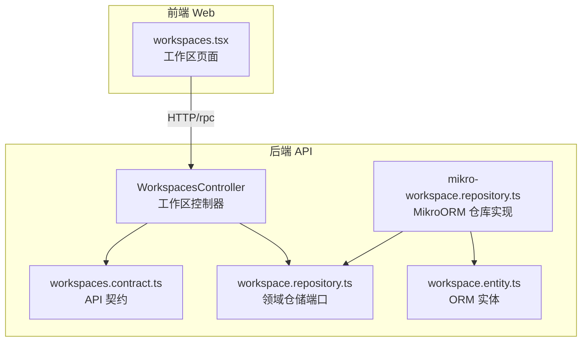
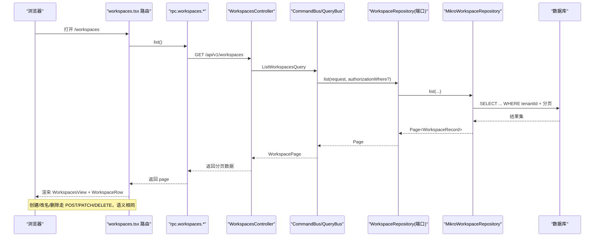
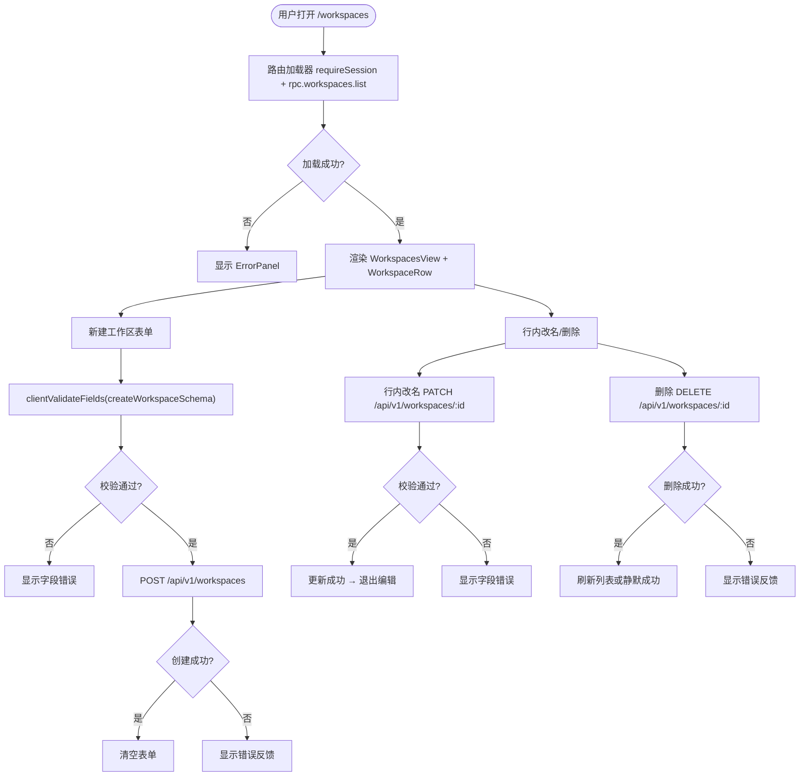
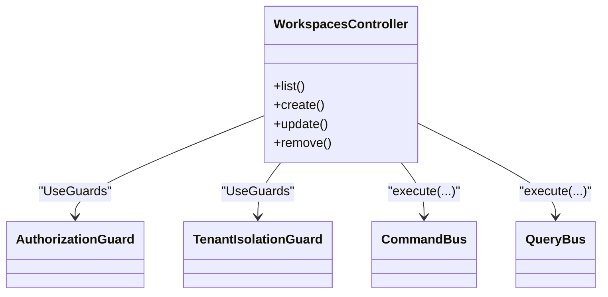
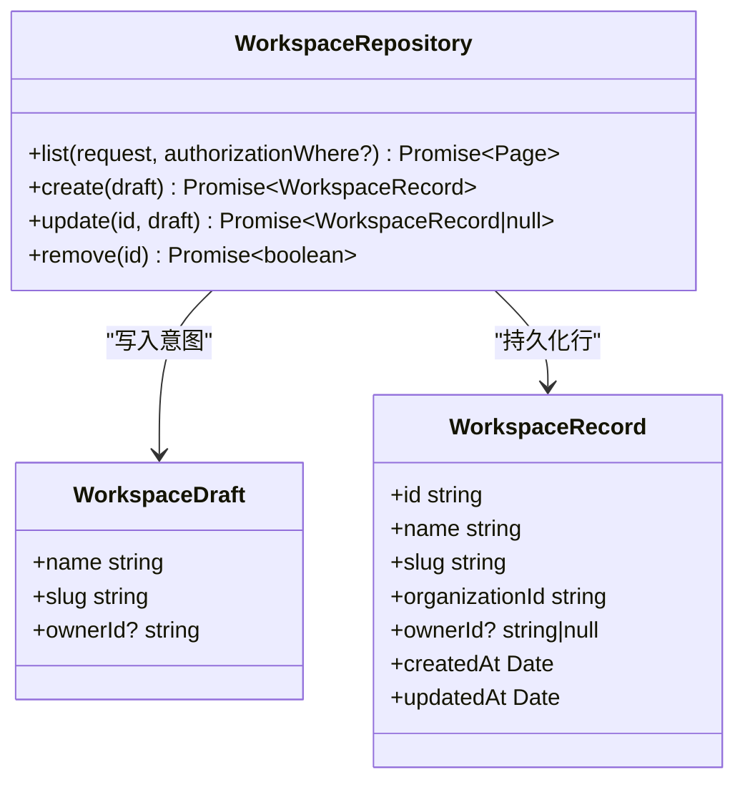
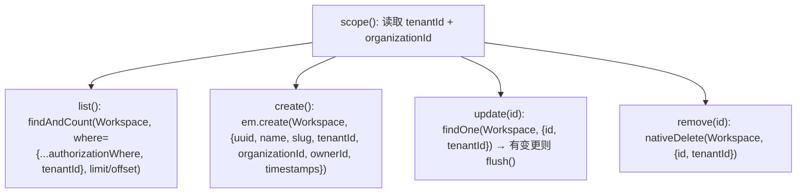
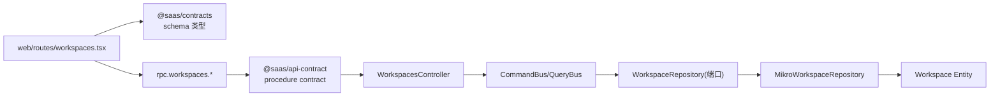

# 工作区管理

<cite>
**本文引用的文件**   
- [apps/web/src/routes/workspaces.tsx](file://apps/web/src/routes/workspaces.tsx)
- [apps/api/src/modules/workspaces/api/workspaces.controller.ts](file://apps/api/src/modules/workspaces/api/workspaces.controller.ts)
- [libs/api-contract/src/workspaces.contract.ts](file://libs/api-contract/src/workspaces.contract.ts)
- [libs/core/src/modules/workspaces/domain/repositories/workspace.repository.ts](file://libs/core/src/modules/workspaces/domain/repositories/workspace.repository.ts)
- [apps/api/src/modules/workspaces/infrastructure/entities/workspace.entity.ts](file://apps/api/src/modules/workspaces/infrastructure/entities/workspace.entity.ts)
- [apps/api/src/modules/workspaces/infrastructure/repositories/mikro-workspace.repository.ts](file://apps/api/src/modules/workspaces/infrastructure/repositories/mikro-workspace.repository.ts)
</cite>

## 目录
1. [简介](#简介)
2. [项目结构](#项目结构)
3. [核心组件](#核心组件)
4. [架构总览](#架构总览)
5. [详细组件分析](#详细组件分析)
6. [依赖关系分析](#依赖关系分析)
7. [性能与缓存策略](#性能与缓存策略)
8. [故障排查指南](#故障排查指南)
9. [结论](#结论)

## 简介
本文件面向“工作区管理”功能，覆盖以下目标：
- 工作区列表页面的展示逻辑、CRUD 操作与权限控制。
- 创建、编辑（改名）、删除流程，包括表单验证、数据同步与错误处理。
- 工作区切换机制、上下文管理与权限继承说明。
- 面板组件的使用方式，包括布局管理、响应式设计与用户体验优化。
- 工作区状态管理、数据缓存与性能优化策略。
- 完整的交互流程与代码级参考路径。

该功能由前端路由页面、API 控制器、领域仓储端口、ORM 实体与仓库实现共同组成，采用 CQRS 风格：控制器通过 CommandBus/QueryBus 派发命令与查询，仓储层负责多租户隔离的数据访问。

## 项目结构
工作区相关代码分布在前后端两个子应用与共享库中：
- 前端页面：`apps/web/src/routes/workspaces.tsx`
- API 控制器：`apps/api/src/modules/workspaces/api/workspaces.controller.ts`
- API 契约：`libs/api-contract/src/workspaces.contract.ts`
- 领域仓储端口：`libs/core/src/modules/workspaces/domain/repositories/workspace.repository.ts`
- ORM 实体定义：`apps/api/src/modules/workspaces/infrastructure/entities/workspace.entity.ts`
- ORM 仓库实现：`apps/api/src/modules/workspaces/infrastructure/repositories/mikro-workspace.repository.ts`

**图表来源**
- [apps/web/src/routes/workspaces.tsx:16-29](file://apps/web/src/routes/workspaces.tsx#L16-L29)
- [apps/api/src/modules/workspaces/api/workspaces.controller.ts:63-151](file://apps/api/src/modules/workspaces/api/workspaces.controller.ts#L63-L151)
- [libs/api-contract/src/workspaces.contract.ts:20-58](file://libs/api-contract/src/workspaces.contract.ts#L20-L58)
- [libs/core/src/modules/workspaces/domain/repositories/workspace.repository.ts:21-107](file://libs/core/src/modules/workspaces/domain/repositories/workspace.repository.ts#L21-L107)
- [apps/api/src/modules/workspaces/infrastructure/entities/workspace.entity.ts:16-55](file://apps/api/src/modules/workspaces/infrastructure/entities/workspace.entity.ts#L16-L55)
- [apps/api/src/modules/workspaces/infrastructure/repositories/mikro-workspace.repository.ts:34-135](file://apps/api/src/modules/workspaces/infrastructure/repositories/mikro-workspace.repository.ts#L34-L135)

**章节来源**
- [apps/web/src/routes/workspaces.tsx:16-29](file://apps/web/src/routes/workspaces.tsx#L16-L29)
- [apps/api/src/modules/workspaces/api/workspaces.controller.ts:63-151](file://apps/api/src/modules/workspaces/api/workspaces.controller.ts#L63-L151)

## 核心组件
- 前端工作区页面：负责会话校验、加载分页列表、新建工作区表单、行内改名与删除、错误反馈。
- API 控制器：暴露 GET/POST/PATCH/DELETE 四条路由，使用守卫进行租户隔离与权限校验，并通过 CQRS 总线调用领域命令与查询。
- API 契约：集中声明输入输出 schema 与 OpenAPI meta，作为前后端契约单源。
- 领域仓储端口：定义工作区的 CRUD 原语，强调不暴露租户参数，租户在适配层解析，保证隔离卡点。
- ORM 实体：定义 workspace 表结构与索引、唯一约束、过滤器等。
- MikroORM 仓库实现：实现仓储端口，强制租户作用域过滤与组织归属盖章。

**章节来源**
- [apps/web/src/routes/workspaces.tsx:31-100](file://apps/web/src/routes/workspaces.tsx#L31-L100)
- [apps/api/src/modules/workspaces/api/workspaces.controller.ts:63-151](file://apps/api/src/modules/workspaces/api/workspaces.controller.ts#L63-L151)
- [libs/api-contract/src/workspaces.contract.ts:20-58](file://libs/api-contract/src/workspaces.contract.ts#L20-L58)
- [libs/core/src/modules/workspaces/domain/repositories/workspace.repository.ts:21-107](file://libs/core/src/modules/workspaces/domain/repositories/workspace.repository.ts#L21-L107)
- [apps/api/src/modules/workspaces/infrastructure/entities/workspace.entity.ts:16-55](file://apps/api/src/modules/workspaces/infrastructure/entities/workspace.entity.ts#L16-L55)
- [apps/api/src/modules/workspaces/infrastructure/repositories/mikro-workspace.repository.ts:34-135](file://apps/api/src/modules/workspaces/infrastructure/repositories/mikro-workspace.repository.ts#L34-L135)

## 架构总览
工作区管理的端到端请求流如下：

**图表来源**
- [apps/web/src/routes/workspaces.tsx:16-29](file://apps/web/src/routes/workspaces.tsx#L16-L29)
- [apps/api/src/modules/workspaces/api/workspaces.controller.ts:71-85](file://apps/api/src/modules/workspaces/api/workspaces.controller.ts#L71-L85)
- [apps/api/src/modules/workspaces/infrastructure/repositories/mikro-workspace.repository.ts:61-85](file://apps/api/src/modules/workspaces/infrastructure/repositories/mikro-workspace.repository.ts#L61-L85)

## 详细组件分析

### 前端工作区页面与交互
- 路由加载器：
  - 先校验会话，再调用 `rpc.workspaces.list({})` 获取分页数据。
  - 捕获异常并记录日志，返回统一的结构 `{kind:'ok'|'error', page|body}`。
- 列表展示：
  - 使用 `WorkspacesView` 纯展示组件，显示总数、页宽、偏移以及表格内容。
  - 空态使用 `EmptyPanel` 提示当前组织下暂无工作区。
- 新建工作区：
  - 表单字段：名称、Slug。
  - 本地即时校验：基于共享契约的 `createWorkspaceSchema`，避免无效往返。
  - 提交：通过 `useAction` 发起 POST `/api/v1/workspaces`，成功后清空表单并显示成功消息。
- 行内改名与删除：
  - 改名：点击“改名”进入行内编辑，使用 `updateWorkspaceSchema` 校验后 PATCH `/api/v1/workspaces/:id`。
  - 删除：点击“删除”触发 DELETE `/api/v1/workspaces/:id`，使用危险按钮样式与 pending 状态。
- 错误与反馈：
  - 使用 `Feedback` 组件统一展示错误与成功消息。
  - 列表加载失败时显示 `ErrorPanel`，并使用 `describeApiError` 描述错误。

**图表来源**
- [apps/web/src/routes/workspaces.tsx:16-29](file://apps/web/src/routes/workspaces.tsx#L16-L29)
- [apps/web/src/routes/workspaces.tsx:31-100](file://apps/web/src/routes/workspaces.tsx#L31-L100)
- [apps/web/src/routes/workspaces.tsx:103-179](file://apps/web/src/routes/workspaces.tsx#L103-L179)
- [apps/web/src/routes/workspaces.tsx:182-224](file://apps/web/src/routes/workspaces.tsx#L182-L224)

**章节来源**
- [apps/web/src/routes/workspaces.tsx:16-29](file://apps/web/src/routes/workspaces.tsx#L16-L29)
- [apps/web/src/routes/workspaces.tsx:31-100](file://apps/web/src/routes/workspaces.tsx#L31-L100)
- [apps/web/src/routes/workspaces.tsx:103-179](file://apps/web/src/routes/workspaces.tsx#L103-L179)
- [apps/web/src/routes/workspaces.tsx:182-224](file://apps/web/src/routes/workspaces.tsx#L182-L224)

### API 控制器与权限控制
- 路由与守卫：
  - 类级别守卫：`TenantIsolationGuard`（无活动租户则 403）+ `AuthorizationGuard`（委托 Better Auth `ac`）。
  - 方法级别权限：`@Can('read'|'create'|'update'|'delete', 'Workspace')`。
- 接口契约：
  - 列表：GET `/workspaces`，输入分页查询，输出工作区分页。
  - 创建：POST `/workspaces`，输入名称与 slug，输出工作区视图。
  - 更新：PATCH `/workspaces/:id`，输入 id/name/slug，输出工作区视图；未命中抛 404。
  - 删除：DELETE `/workspaces/:id`，无返回体（204）；未命中抛 404。
- 错误面：
  - 更新与删除未命中时抛出 `NotFoundException`，携带 `ERROR_CODES.WORKSPACE_NOT_FOUND`，经 WP-D 错误面承接恢复 REST 信封。

**图表来源**
- [apps/api/src/modules/workspaces/api/workspaces.controller.ts:63-151](file://apps/api/src/modules/workspaces/api/workspaces.controller.ts#L63-L151)

**章节来源**
- [apps/api/src/modules/workspaces/api/workspaces.controller.ts:63-151](file://apps/api/src/modules/workspaces/api/workspaces.controller.ts#L63-L151)
- [libs/api-contract/src/workspaces.contract.ts:20-58](file://libs/api-contract/src/workspaces.contract.ts#L20-L58)

### 领域仓储端口与多租户隔离
- 设计要点：
  - 仓储端口不暴露租户参数，所属租户从可信 ALS 上下文解析，外部无法伪造。
  - 读侧全部按 `tenantId` 过滤，写侧全部盖章 `organizationId`。
  - 跨租户 ID 访问在 update/remove 恒匹配 0 行，杜绝越权。
- 关键接口：
  - `list(request, authorizationWhere?)`：分页列出活动租户内的 workspace，支持可选实例授权谓词下推。
  - `create(draft)`：创建 workspace 并盖章活动租户。
  - `update(id, draft)`：仅当归属活动租户时更新，否则返回 null。
  - `remove(id)`：仅当归属活动租户时删除，否则返回 false。

**图表来源**
- [libs/core/src/modules/workspaces/domain/repositories/workspace.repository.ts:21-107](file://libs/core/src/modules/workspaces/domain/repositories/workspace.repository.ts#L21-L107)

**章节来源**
- [libs/core/src/modules/workspaces/domain/repositories/workspace.repository.ts:21-107](file://libs/core/src/modules/workspaces/domain/repositories/workspace.repository.ts#L21-L107)

### ORM 实体与仓库实现
- 实体定义：
  - 表名 `workspace`，包含 `tenantId`、`organizationId`、`name`、`slug`、`ownerId`、时间戳等列。
  - 唯一约束：`(organizationId, slug)`。
  - 索引：`(organizationId, ownerId)`。
  - 过滤器：启用租户隔离过滤器。
- 仓库实现：
  - 通过 `TenantIsolationService.requireActiveTenantId()` 与 `requireActiveOrganizationId()` 获取作用域。
  - `list`：按 `tenantId` 过滤，支持 `authorizationWhere` 合并，固定展开顺序确保租户盖章最后。
  - `create`：生成 UUID，双盖章 `tenantId` 与 `organizationId`，落库。
  - `update`：按 `id + tenantId` 查找，若不存在返回 null；有变更才更新时间戳。
  - `remove`：按 `id + tenantId` 硬删，影响行数 > 0 表示成功。

**图表来源**
- [apps/api/src/modules/workspaces/infrastructure/entities/workspace.entity.ts:16-55](file://apps/api/src/modules/workspaces/infrastructure/entities/workspace.entity.ts#L16-L55)
- [apps/api/src/modules/workspaces/infrastructure/repositories/mikro-workspace.repository.ts:41-135](file://apps/api/src/modules/workspaces/infrastructure/repositories/mikro-workspace.repository.ts#L41-L135)

**章节来源**
- [apps/api/src/modules/workspaces/infrastructure/entities/workspace.entity.ts:16-55](file://apps/api/src/modules/workspaces/infrastructure/entities/workspace.entity.ts#L16-L55)
- [apps/api/src/modules/workspaces/infrastructure/repositories/mikro-workspace.repository.ts:41-135](file://apps/api/src/modules/workspaces/infrastructure/repositories/mikro-workspace.repository.ts#L41-L135)

### 面板组件与用户体验
- 列表展示：
  - `WorkspacesView` 接收 typed 分页数据，展示标题、统计信息、空态与表格。
  - 表格列：名称、Slug、所属组织、创建日期。
- 表单与反馈：
  - `FormWrap`、`Field`、`SubmitButton`、`DangerButton`、`Feedback` 提供一致的表单与反馈体验。
  - 使用 Tailwind 类实现响应式布局与深色模式兼容。
- 交互优化：
  - 行内编辑减少跳转，提升效率。
  - 本地即时校验避免无效网络往返。
  - 成功/错误消息统一展示，增强可感知性。

**章节来源**
- [apps/web/src/routes/workspaces.tsx:182-224](file://apps/web/src/routes/workspaces.tsx#L182-L224)
- [apps/web/src/routes/workspaces.tsx:31-100](file://apps/web/src/routes/workspaces.tsx#L31-L100)
- [apps/web/src/routes/workspaces.tsx:103-179](file://apps/web/src/routes/workspaces.tsx#L103-L179)

## 依赖关系分析
- 前端依赖：
  - `@tanstack/react-router` 提供文件路由与 loader。
  - `rpc` 客户端调用 oRPC typed 接口。
  - 共享契约 `createWorkspaceSchema`、`updateWorkspaceSchema` 用于前端校验。
- 后端依赖：
  - NestJS 控制器 + CQRS（CommandBus/QueryBus）。
  - 守卫：`TenantIsolationGuard`、`AuthorizationGuard`。
  - 领域仓储端口与 ORM 仓库实现解耦。
  - 契约模块 `@saas/api-contract` 提供 procedure contract 与 meta。

**图表来源**
- [apps/web/src/routes/workspaces.tsx:1-11](file://apps/web/src/routes/workspaces.tsx#L1-L11)
- [libs/api-contract/src/workspaces.contract.ts:10-18](file://libs/api-contract/src/workspaces.contract.ts#L10-L18)
- [apps/api/src/modules/workspaces/api/workspaces.controller.ts:1-32](file://apps/api/src/modules/workspaces/api/workspaces.controller.ts#L1-L32)
- [libs/core/src/modules/workspaces/domain/repositories/workspace.repository.ts:1-20](file://libs/core/src/modules/workspaces/domain/repositories/workspace.repository.ts#L1-L20)
- [apps/api/src/modules/workspaces/infrastructure/repositories/mikro-workspace.repository.ts:1-16](file://apps/api/src/modules/workspaces/infrastructure/repositories/mikro-workspace.repository.ts#L1-L16)

**章节来源**
- [apps/web/src/routes/workspaces.tsx:1-11](file://apps/web/src/routes/workspaces.tsx#L1-L11)
- [libs/api-contract/src/workspaces.contract.ts:10-18](file://libs/api-contract/src/workspaces.contract.ts#L10-L18)
- [apps/api/src/modules/workspaces/api/workspaces.controller.ts:1-32](file://apps/api/src/modules/workspaces/api/workspaces.controller.ts#L1-L32)
- [libs/core/src/modules/workspaces/domain/repositories/workspace.repository.ts:1-20](file://libs/core/src/modules/workspaces/domain/repositories/workspace.repository.ts#L1-L20)
- [apps/api/src/modules/workspaces/infrastructure/repositories/mikro-workspace.repository.ts:1-16](file://apps/api/src/modules/workspaces/infrastructure/repositories/mikro-workspace.repository.ts#L1-L16)

## 性能与缓存策略
- 列表分页：
  - 后端使用 offset 分页，限制 `limit` 与 `offset`，降低单次查询负载。
  - 前端按需渲染表格行，避免一次性渲染过多 DOM。
- 本地校验：
  - 前端基于共享契约进行即时校验，减少无效请求。
- 数据库访问：
  - 仓库每次 fork 独立 EntityManager，避免共享状态导致的并发问题。
  - 仅在字段变更时更新时间戳，减少不必要的 UPDATE。
- 建议优化：
  - 对频繁访问的工作区列表增加短期内存缓存（如 React Query 或 SWR），结合失效策略（创建/改名/删除后失效）。
  - 为常用查询条件建立复合索引（已存在 `(organizationId, slug)` 与 `(organizationId, ownerId)`）。
  - 对大列表考虑虚拟滚动或懒加载。

[本节为通用指导，不直接分析具体文件]

## 故障排查指南
- 列表加载失败：
  - 检查会话是否有效（`requireSession`）。
  - 查看日志记录（`logApiError`）与错误面板（`ErrorPanel`）。
- 创建失败：
  - 检查前端字段校验结果（`clientValidateFields`）。
  - 确认权限（`@Can('create', 'Workspace')`）与租户上下文（`TenantIsolationGuard`）。
- 改名失败：
  - 检查字段校验（`updateWorkspaceSchema`）。
  - 确认工作区是否存在且属于当前租户（仓库 `update` 返回 null 的情况）。
- 删除失败：
  - 检查工作区是否存在且属于当前租户（仓库 `remove` 返回 false 的情况）。
  - 确认权限（`@Can('delete', 'Workspace')`）。

**章节来源**
- [apps/web/src/routes/workspaces.tsx:16-29](file://apps/web/src/routes/workspaces.tsx#L16-L29)
- [apps/web/src/routes/workspaces.tsx:40-60](file://apps/web/src/routes/workspaces.tsx#L40-L60)
- [apps/web/src/routes/workspaces.tsx:110-136](file://apps/web/src/routes/workspaces.tsx#L110-L136)
- [apps/api/src/modules/workspaces/api/workspaces.controller.ts:109-150](file://apps/api/src/modules/workspaces/api/workspaces.controller.ts#L109-L150)
- [apps/api/src/modules/workspaces/infrastructure/repositories/mikro-workspace.repository.ts:106-135](file://apps/api/src/modules/workspaces/infrastructure/repositories/mikro-workspace.repository.ts#L106-L135)

## 结论
工作区管理功能在前端以简洁的表单与行内操作提供良好体验，在后端通过严格的守卫与仓储隔离保障多租户安全。契约先行与 CQRS 使职责清晰、易于测试与维护。建议在现有基础上引入前端缓存与更细粒度的权限控制，进一步提升性能与安全性。

[本节为总结性内容，不直接分析具体文件]