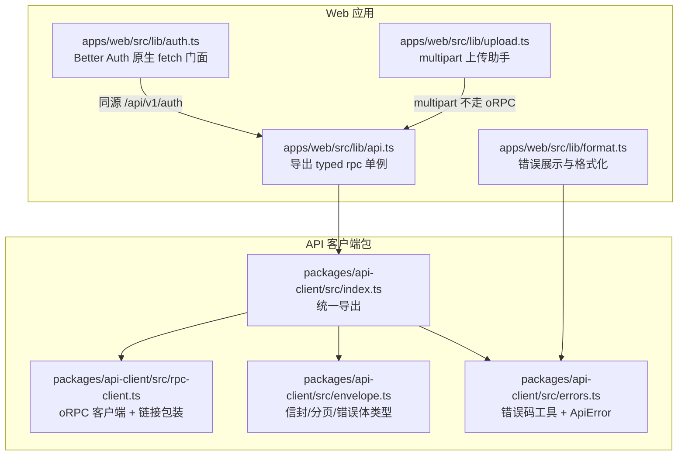
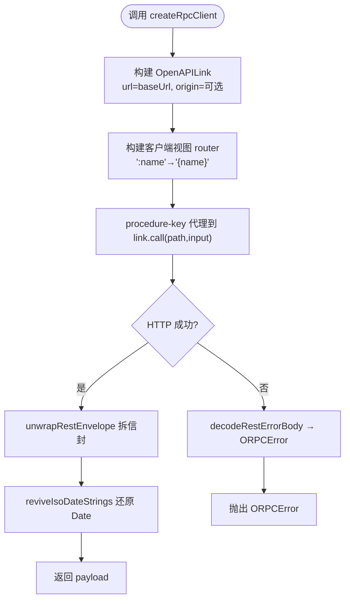
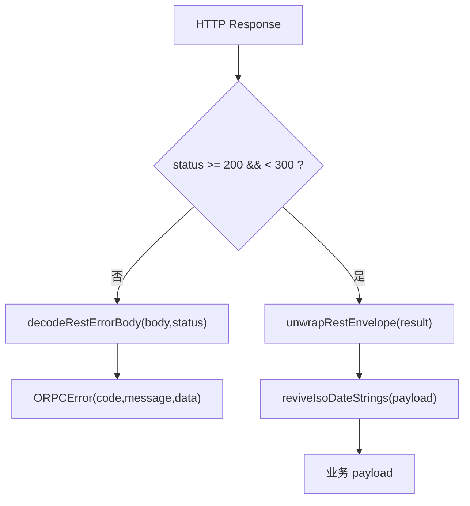
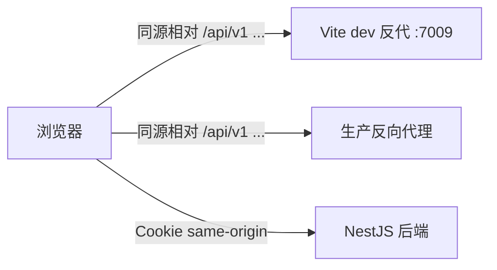
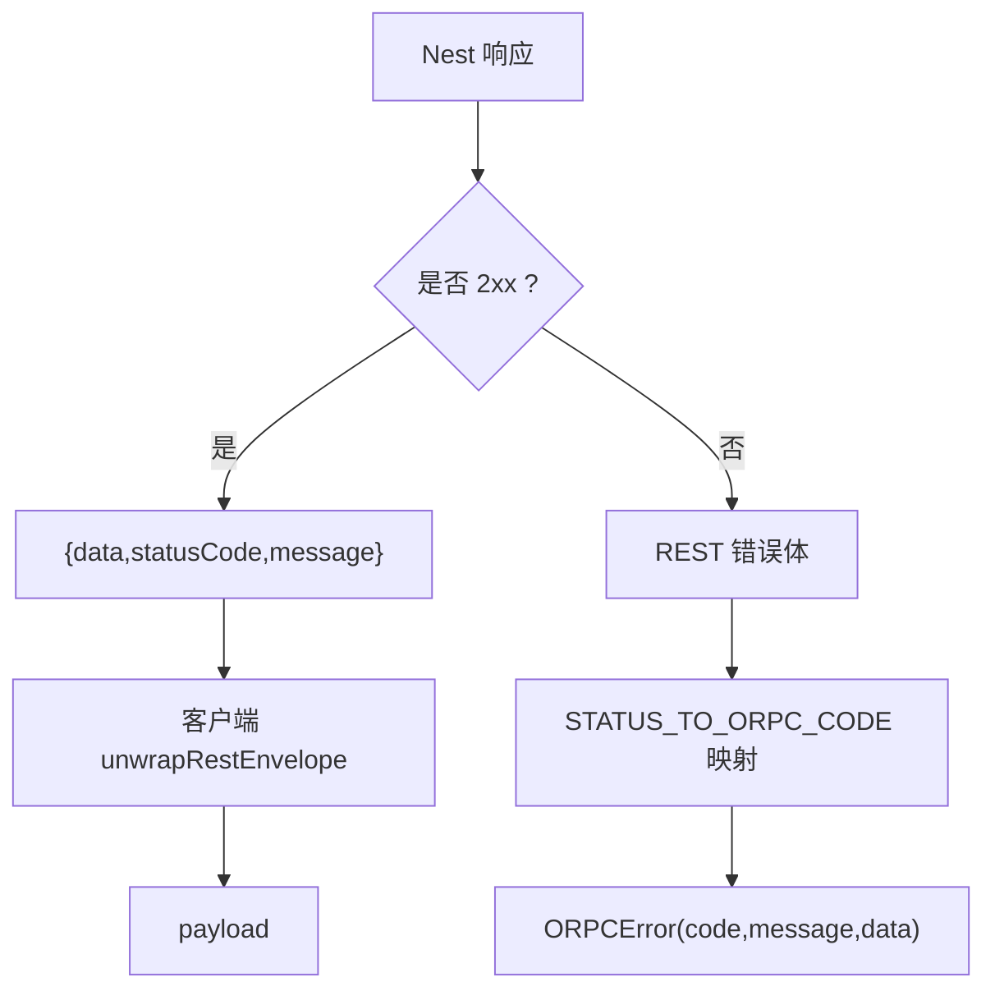
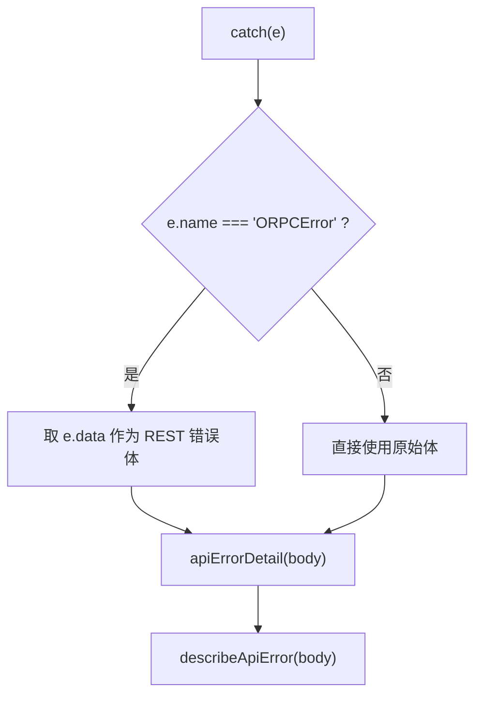
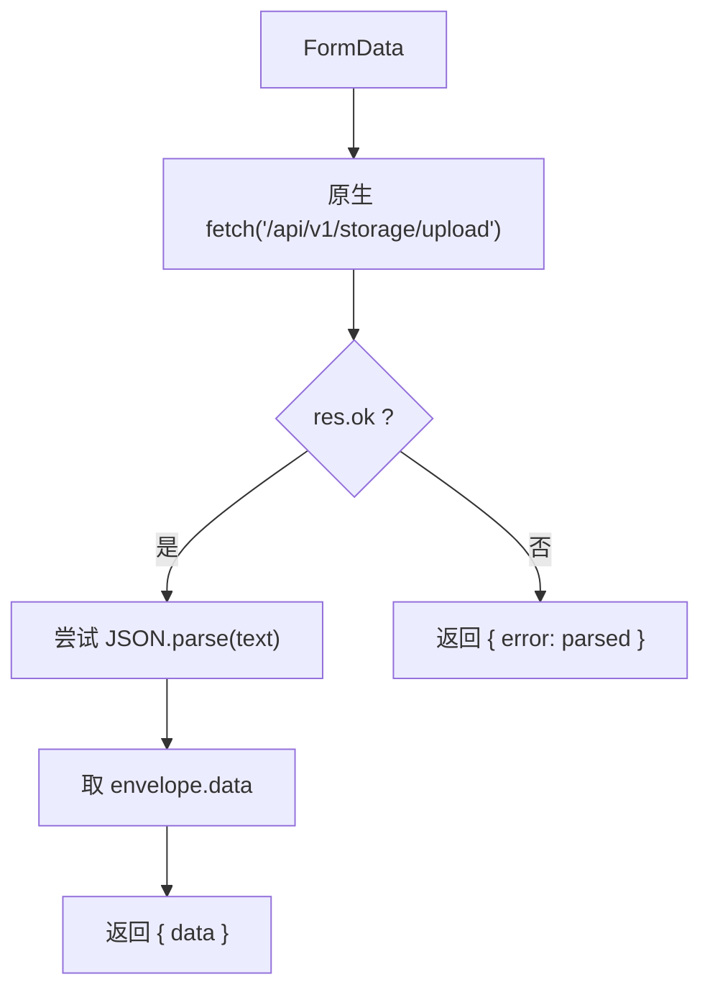
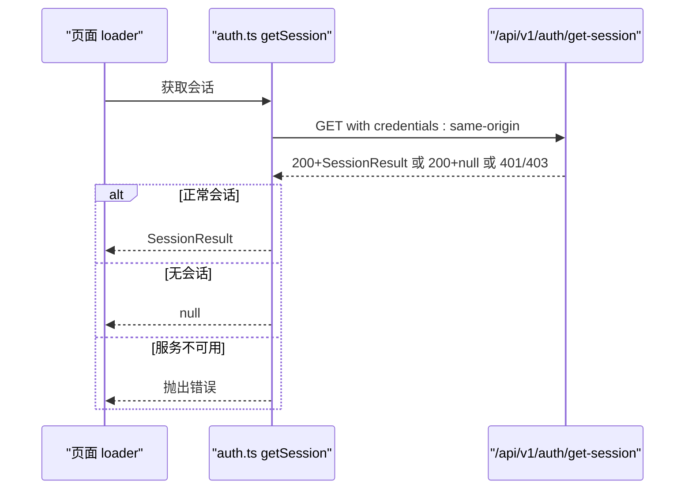
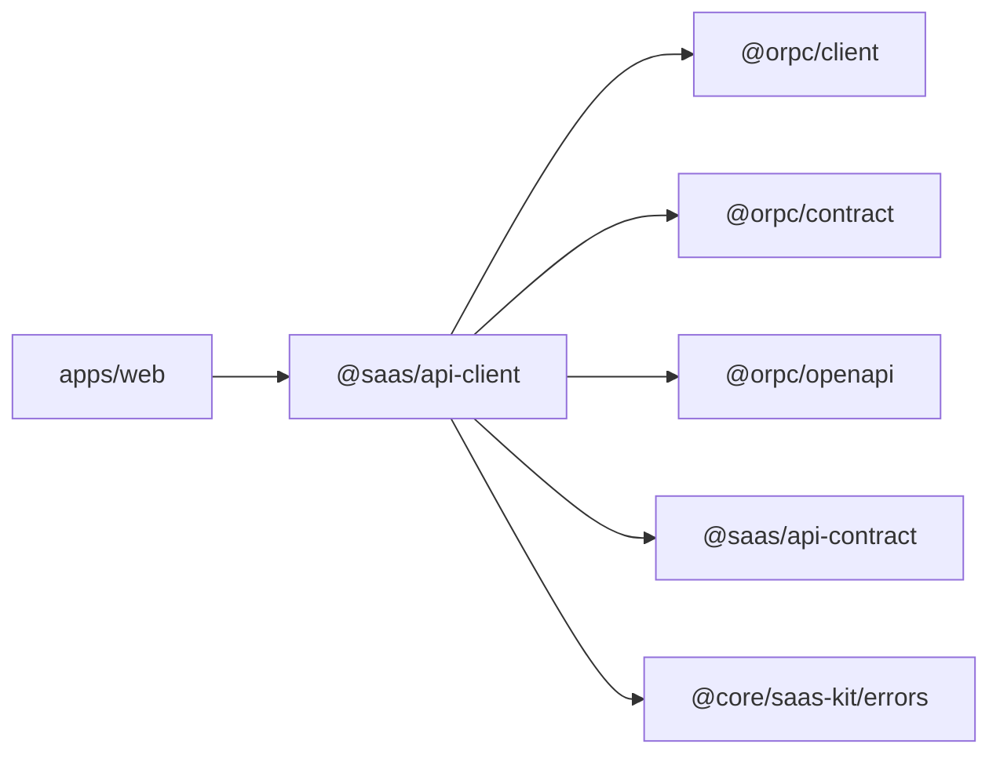

# API 客户端封装

<cite>
**本文引用的文件**   
- [packages/api-client/src/index.ts](file://packages/api-client/src/index.ts)
- [packages/api-client/src/rpc-client.ts](file://packages/api-client/src/rpc-client.ts)
- [packages/api-client/src/envelope.ts](file://packages/api-client/src/envelope.ts)
- [packages/api-client/src/errors.ts](file://packages/api-client/src/errors.ts)
- [packages/api-client/src/rpc-client.test.ts](file://packages/api-client/src/rpc-client.test.ts)
- [apps/web/src/lib/api.ts](file://apps/web/src/lib/api.ts)
- [apps/web/src/lib/auth.ts](file://apps/web/src/lib/auth.ts)
- [apps/web/src/lib/upload.ts](file://apps/web/src/lib/upload.ts)
- [apps/web/src/lib/format.ts](file://apps/web/src/lib/format.ts)
</cite>

## 目录
1. [简介](#简介)
2. [项目结构](#项目结构)
3. [核心组件](#核心组件)
4. [架构总览](#架构总览)
5. [详细组件分析](#详细组件分析)
6. [依赖关系分析](#依赖关系分析)
7. [性能与行为特征](#性能与行为特征)
8. [故障排查指南](#故障排查指南)
9. [结论](#结论)
10. [附录：使用示例与最佳实践](#附录使用示例与最佳实践)

## 简介
本文件面向前端开发者，系统性说明基于 `@saas/api-client` 的 oRPC 客户端封装。内容覆盖：
- 客户端初始化、类型安全的 API 调用方式
- 请求/响应处理链：信封拆包、日期还原、错误映射
- 同源相对路径约定、Cookie 会话与凭证传递
- 与后端 NestJS 服务的通信协议与错误策略
- multipart 文件上传的特殊处理
- 与 Better Auth 集成的认证流程
- 典型调用示例与失败处理模式

该封装的目标是：以单一契约源驱动前后端类型一致，屏蔽 REST 信封与 oRPC 错误之间的差异，让业务代码只关心“输入输出类型”和“成功/失败分支”。

## 项目结构
`@saas/api-client` 是一个独立包，对外暴露三类能力：
- typed oRPC 客户端工厂
- 统一错误工具与类型
- 信封契约类型（纯类型零运行时）

Web 应用侧仅通过一个单例导出 typed 客户端，并单独维护 Better Auth 原生 fetch 门面与 multipart 上传助手。



**图表来源**
- [packages/api-client/src/index.ts:1-9](file://packages/api-client/src/index.ts#L1-L9)
- [packages/api-client/src/rpc-client.ts:1-176](file://packages/api-client/src/rpc-client.ts#L1-L176)
- [packages/api-client/src/envelope.ts:1-71](file://packages/api-client/src/envelope.ts#L1-L71)
- [packages/api-client/src/errors.ts:1-42](file://packages/api-client/src/errors.ts#L1-L42)
- [apps/web/src/lib/api.ts:1-16](file://apps/web/src/lib/api.ts#L1-L16)
- [apps/web/src/lib/auth.ts:1-93](file://apps/web/src/lib/auth.ts#L1-L93)
- [apps/web/src/lib/upload.ts:1-36](file://apps/web/src/lib/upload.ts#L1-L36)
- [apps/web/src/lib/format.ts:1-55](file://apps/web/src/lib/format.ts#L1-L55)

**章节来源**
- [packages/api-client/src/index.ts:1-9](file://packages/api-client/src/index.ts#L1-L9)
- [apps/web/src/lib/api.ts:1-16](file://apps/web/src/lib/api.ts#L1-L16)

## 核心组件
- `createRpcClient`：创建全类型 oRPC 客户端，键位来自 `AppRouterContract`，URL 由契约元数据决定。
- `createRpcClientLink`：包装官方 `OpenAPILink`，负责 URL 模板转换、信封拆包、日期还原、错误解码。
- `unwrapRestEnvelope`：将后端 `{data, statusCode, message}` 成功信封解包为 `data`。
- `reviveIsoDateStrings`：把规范 UTC ISO 字符串还原为 `Date`，避免“编译期 Date / 运行期 string”静默错型。
- `decodeRestErrorBody`：把 Nest REST 错误体映射为 `ORPCError`，保留原始 body 到 `.data`。
- `ApiError`、`errorCodeOf`、`hasErrorCode`：统一错误码消费面，不复制码表。
- Web 侧 `rpc` 单例：同源相对 `/api/v1`，默认凭据 `same-origin`。
- Web 侧 `auth.ts`：Better Auth 裸 fetch 门面，走 Cookie + DB Session。
- Web 侧 `upload.ts`：multipart 原生 fetch，不走 oRPC JSON compact 编码。

**章节来源**
- [packages/api-client/src/rpc-client.ts:11-25](file://packages/api-client/src/rpc-client.ts#L11-L25)
- [packages/api-client/src/rpc-client.ts:34-46](file://packages/api-client/src/rpc-client.ts#L34-L46)
- [packages/api-client/src/rpc-client.ts:48-83](file://packages/api-client/src/rpc-client.ts#L48-L83)
- [packages/api-client/src/rpc-client.ts:85-114](file://packages/api-client/src/rpc-client.ts#L85-L114)
- [packages/api-client/src/rpc-client.ts:145-175](file://packages/api-client/src/rpc-client.ts#L145-L175)
- [packages/api-client/src/errors.ts:1-42](file://packages/api-client/src/errors.ts#L1-L42)
- [apps/web/src/lib/api.ts:1-16](file://apps/web/src/lib/api.ts#L1-L16)
- [apps/web/src/lib/auth.ts:1-93](file://apps/web/src/lib/auth.ts#L1-L93)
- [apps/web/src/lib/upload.ts:1-36](file://apps/web/src/lib/upload.ts#L1-L36)

## 架构总览
下图展示一次典型 typed API 调用的完整链路：从 Web 路由调用 typed `rpc`，到 oRPC link 构造 URL、发送 JSON，再到服务端返回信封或错误体，最终在客户端完成拆包、日期还原或错误映射。

```mermaid
sequenceDiagram
participant Route as "Web 路由/页面"
participant Rpc as "typed rpc 客户端"
participant Link as "OpenAPILink 包装层"
participant Net as "浏览器 fetch"
participant Server as "NestJS oRPC/REST 服务"
Route->>Rpc : 调用 typed procedure如 posts.list
Rpc->>Link : 按契约 meta.path 生成 URL 并发起请求
Link->>Net : JSON compact 编码的请求
Net->>Server : HTTP 请求同源相对 /api/v1
Server-->>Net : 成功信封 {data,...} 或 REST 错误体
Net-->>Link : Response
alt 成功
Link->>Link : unwrapRestEnvelope 拆信封
Link->>Link : reviveIsoDateStrings 还原 Date
Link-->>Rpc : payload
Rpc-->>Route : 类型化结果
else 失败
Link->>Link : decodeRestErrorBody → ORPCError
Link-->>Rpc : 抛出 ORPCError
Rpc-->>Route : 捕获 ORPCError
end
```

**图表来源**
- [packages/api-client/src/rpc-client.ts:145-175](file://packages/api-client/src/rpc-client.ts#L145-L175)
- [packages/api-client/src/rpc-client.ts:34-46](file://packages/api-client/src/rpc-client.ts#L34-L46)
- [packages/api-client/src/rpc-client.ts:48-83](file://packages/api-client/src/rpc-client.ts#L48-L83)
- [packages/api-client/src/rpc-client.ts:85-114](file://packages/api-client/src/rpc-client.ts#L85-L114)

## 详细组件分析

### typed oRPC 客户端初始化与调用
- 入口：`createRpcClient(options)` 返回 `RouterContractClient<AppRouterContract, object>`。
- 契约来源：`AppRouterContract` 与 `PUBLIC_APP_ROUTER_SPEC`，保证键位与后端 router 同步。
- URL 生成：通过 `OpenAPILink` 读取 procedure 的 `meta.path`；客户端侧把 Nest 风格 `:name` 转为 OpenAPI 风格 `{name}`，确保路径参数正确插值。
- 基址：默认 `DEFAULT_API_BASE_URL = '/api/v1'`；浏览器下为同源相对路径，生产同域反代时零绝对 URL。
- 选项：
  - `baseUrl`：不含 origin，必须以 `/` 开头。
  - `origin`：用于测试或跨 origin 场景；浏览器同源下留空。



**图表来源**
- [packages/api-client/src/rpc-client.ts:24-32](file://packages/api-client/src/rpc-client.ts#L24-L32)
- [packages/api-client/src/rpc-client.ts:116-143](file://packages/api-client/src/rpc-client.ts#L116-L143)
- [packages/api-client/src/rpc-client.ts:145-175](file://packages/api-client/src/rpc-client.ts#L145-L175)

**章节来源**
- [packages/api-client/src/rpc-client.ts:11-25](file://packages/api-client/src/rpc-client.ts#L11-L25)
- [packages/api-client/src/rpc-client.ts:116-143](file://packages/api-client/src/rpc-client.ts#L116-L143)
- [packages/api-client/src/rpc-client.ts:145-175](file://packages/api-client/src/rpc-client.ts#L145-L175)

### 类型安全与契约驱动
- 客户端类型锚定在 `AppRouterContract`，所有 procedure 的输入输出类型由后端 router 派生。
- 契约改一处，前后端类型同步，无需 openapi codegen。
- 输入对象是扁平化的 procedure 参数集合；输出是已拆信封的 payload。
- 错误类型为 `ORPCError`，其 `.data` 携带原始 REST 错误体，便于上层按 `errorCode` 分支。

```mermaid
classDiagram
class AppRouterContract {
<<contract>>
"后端 router 公共契约树"
}
class RouterContractClient {
"typed 客户端"
"+ procedures(...)"
}
class OpenAPILink {
"传输层"
"+ call(path, input, options)"
}
AppRouterContract <|-- RouterContractClient : "派生"
RouterContractClient --> OpenAPILink : "委托调用"
```

**图表来源**
- [packages/api-client/src/rpc-client.ts:1-9](file://packages/api-client/src/rpc-client.ts#L1-L9)
- [packages/api-client/src/rpc-client.ts:162-175](file://packages/api-client/src/rpc-client.ts#L162-L175)

**章节来源**
- [packages/api-client/src/rpc-client.ts:1-9](file://packages/api-client/src/rpc-client.ts#L1-L9)
- [packages/api-client/src/rpc-client.ts:162-175](file://packages/api-client/src/rpc-client.ts#L162-L175)

### 请求拦截器与响应处理机制
- 请求拦截：当前实现未引入自定义请求拦截器；URL、method、body 由 `OpenAPILink` 根据契约元数据生成。
- 响应处理链：
  1. 成功响应：先拆信封 `unwrapRestEnvelope`，再还原日期 `reviveIsoDateStrings`。
  2. 失败响应：通过 `customErrorResponseBodyDecoder` 将 REST 错误体映射为 `ORPCError`。
- 日期还原规则：仅当字符串匹配严格规范 UTC ISO 形（含毫秒与 Z）时才转 `Date`，其他字符串原样保留，避免误伤游标、邮箱等字段。



**图表来源**
- [packages/api-client/src/rpc-client.ts:34-46](file://packages/api-client/src/rpc-client.ts#L34-L46)
- [packages/api-client/src/rpc-client.ts:48-83](file://packages/api-client/src/rpc-client.ts#L48-L83)
- [packages/api-client/src/rpc-client.ts:85-114](file://packages/api-client/src/rpc-client.ts#L85-L114)
- [packages/api-client/src/rpc-client.ts:145-175](file://packages/api-client/src/rpc-client.ts#L145-L175)

**章节来源**
- [packages/api-client/src/rpc-client.ts:34-46](file://packages/api-client/src/rpc-client.ts#L34-L46)
- [packages/api-client/src/rpc-client.ts:48-83](file://packages/api-client/src/rpc-client.ts#L48-L83)
- [packages/api-client/src/rpc-client.ts:85-114](file://packages/api-client/src/rpc-client.ts#L85-L114)
- [packages/api-client/src/rpc-client.ts:145-175](file://packages/api-client/src/rpc-client.ts#L145-L175)

### 同源相对路径约定与凭证传递
- Web 侧 `rpc` 单例注释明确：路径自带 `/api/v1` 前缀；开发环境经 Vite 反代至后端端口，生产同域反代。
- 凭证：`credentials:'same-origin'`，即 Cookie 与会话随请求自动携带，与后端 Cookie + DB Session 语义一致。
- Better Auth 原生门面也使用同源相对 `/api/v1/auth`，并显式设置 `credentials:'same-origin'`。



**图表来源**
- [apps/web/src/lib/api.ts:3-14](file://apps/web/src/lib/api.ts#L3-L14)
- [apps/web/src/lib/auth.ts:1-6](file://apps/web/src/lib/auth.ts#L1-L6)
- [apps/web/src/lib/auth.ts:19-26](file://apps/web/src/lib/auth.ts#L19-L26)

**章节来源**
- [apps/web/src/lib/api.ts:3-14](file://apps/web/src/lib/api.ts#L3-L14)
- [apps/web/src/lib/auth.ts:1-6](file://apps/web/src/lib/auth.ts#L1-L6)
- [apps/web/src/lib/auth.ts:19-26](file://apps/web/src/lib/auth.ts#L19-L26)

### 与后端 NestJS 服务的通信协议
- 传输：JSON compact 编码，path/query/body 拆分与后端 `@orpc/nest` 一致，避免静默丢参。
- 成功响应：后端 `TransformInterceptor` 恒包 `{data, statusCode, message}`，客户端出网前拆回 `data`。
- 错误响应：后端 `HttpExceptionFilter` 产物无 oRPC `code` 字段，客户端将其映射为 `ORPCError`，原始 body 挂 `.data`。
- 状态码到 oRPC 码映射：400/401/403/404/409/422/429 有固定映射，未知码按 4xx/5xx 归类。



**图表来源**
- [packages/api-client/src/rpc-client.ts:11-22](file://packages/api-client/src/rpc-client.ts#L11-L22)
- [packages/api-client/src/rpc-client.ts:85-114](file://packages/api-client/src/rpc-client.ts#L85-L114)
- [packages/api-client/src/rpc-client.ts:34-46](file://packages/api-client/src/rpc-client.ts#L34-L46)

**章节来源**
- [packages/api-client/src/rpc-client.ts:11-22](file://packages/api-client/src/rpc-client.ts#L11-L22)
- [packages/api-client/src/rpc-client.ts:85-114](file://packages/api-client/src/rpc-client.ts#L85-L114)

### 错误处理策略
- 客户端抛出的错误类型为 `ORPCError`，包含：
  - `code`：标准 oRPC 错误码（如 `NOT_FOUND`）。
  - `message`：人类可读消息。
  - `data`：原始 REST 错误体，包含 `statusCode`、`errorCode`、`requestId`、`path` 等。
- Web 侧 `format.ts` 提供 `apiErrorDetail` 与 `describeApiError`，兼容新链 `ORPCError.data` 与旧链直接传体的情况，统一提取 message、errorCode、requestId、statusCode、path。
- 业务层可按 `errorCode` 分支处理，例如区分未登录、权限不足、资源不存在等。



**图表来源**
- [apps/web/src/lib/format.ts:15-55](file://apps/web/src/lib/format.ts#L15-L55)
- [packages/api-client/src/errors.ts:13-25](file://packages/api-client/src/errors.ts#L13-L25)

**章节来源**
- [packages/api-client/src/rpc-client.ts:85-114](file://packages/api-client/src/rpc-client.ts#L85-L114)
- [apps/web/src/lib/format.ts:15-55](file://apps/web/src/lib/format.ts#L15-L55)
- [packages/api-client/src/errors.ts:13-25](file://packages/api-client/src/errors.ts#L13-L25)

### 重试机制
- 当前 `@saas/api-client` 未内置重试逻辑。
- 若需重试，建议在业务层对 `ORPCError` 进行判断后自行重试，并结合指数退避与最大重试次数控制。
- 对于幂等 GET 请求可考虑轻量重试；对写操作需谨慎。

[本节为通用建议，不直接分析具体文件]

### multipart 文件上传特殊处理
- oRPC `OpenAPILink` 走 JSON compact 编码，不支持 `multipart/form-data`。
- 存储上传走原生 `fetch`，路径 `/api/v1/storage/upload`，凭据 `same-origin`。
- 成功仍返回 REST 信封，助手函数取出 `data`；非 2xx 返回解析后的错误体；网络异常则抛错，交由上层统一文案。



**图表来源**
- [apps/web/src/lib/upload.ts:1-36](file://apps/web/src/lib/upload.ts#L1-L36)

**章节来源**
- [apps/web/src/lib/upload.ts:1-36](file://apps/web/src/lib/upload.ts#L1-L36)

### 与 Better Auth 集成的认证流程
- Base：`/api/v1/auth`，同源相对路径。
- 会话读取：`GET /api/v1/auth/get-session`，返回 `SessionResult | null`。
- 登录/注册/魔法链接：POST 到对应端点，返回 `SignInOutcome`。
- 登出：POST `/api/v1/auth/sign-out`。
- 会话语义：Cookie + DB Session，前端不自造 token 存取。
- 错误分类：
  - 401/403 或登出后 200-null：视为无有效会话，由上游守卫弹回登录。
  - 5xx 或网络异常：抛出错误，使受保护页落到路由错误边界，而非误弹登录。



**图表来源**
- [apps/web/src/lib/auth.ts:1-17](file://apps/web/src/lib/auth.ts#L1-L17)
- [apps/web/src/lib/auth.ts:34-47](file://apps/web/src/lib/auth.ts#L34-L47)

**章节来源**
- [apps/web/src/lib/auth.ts:1-93](file://apps/web/src/lib/auth.ts#L1-L93)

## 依赖关系分析
- `@saas/api-client` 依赖：
  - `@orpc/client`：oRPC 客户端与错误类型。
  - `@orpc/contract`：契约类型与 router 构建。
  - `@orpc/openapi`：OpenAPI 元数据与 `OpenAPILink`。
  - `@saas/api-contract`：公共契约树与 spec。
  - `@core/saas-kit/shared-kernel/errors/error-codes`：错误码单源。
- Web 应用依赖：
  - `@saas/api-client`：typed 客户端、错误工具、信封类型。
  - 原生 `fetch`：Better Auth 与 multipart 上传。



**图表来源**
- [packages/api-client/src/rpc-client.ts:1-9](file://packages/api-client/src/rpc-client.ts#L1-L9)
- [packages/api-client/src/errors.ts:1-3](file://packages/api-client/src/errors.ts#L1-L3)

**章节来源**
- [packages/api-client/src/rpc-client.ts:1-9](file://packages/api-client/src/rpc-client.ts#L1-L9)
- [packages/api-client/src/errors.ts:1-3](file://packages/api-client/src/errors.ts#L1-L3)

## 性能与行为特征
- 请求编码：JSON compact，path/query/body 分离，减少冗余字段，降低序列化开销。
- 响应处理：仅在成功后执行信封拆包与日期还原，错误路径直接映射为 `ORPCError`，避免额外解析。
- 日期还原：正则匹配严格 UTC ISO 串，避免误伤普通字符串；递归遍历数组与对象，复杂度与响应大小线性相关。
- 错误映射：状态码到 oRPC 码为常量映射，时间复杂度 O(1)。
- 无内置重试：减少隐式网络抖动掩盖，便于上层可控重试。

[本节为一般性分析，不直接引用具体行号]

## 故障排查指南
- 现象：调用 typed `rpc.xxx` 后拿到的是 `{data,statusCode,message}` 而非 payload。
  - 检查是否绕过 `createRpcClient` 直接调用底层 link。
  - 确认响应确实来自后端 `TransformInterceptor` 包裹的成功信封。
- 现象：日期字段为字符串而非 `Date`。
  - 确认后端输出为规范 UTC ISO 串（含毫秒与 Z），否则不会还原。
  - 检查是否为游标或其他普通字符串被误判。
- 现象：错误分支无法识别业务码。
  - 使用 `errorCodeOf` 或 `hasErrorCode` 从 `ORPCError.data` 中提取 `errorCode`。
  - 使用 `describeApiError` 渲染用户可见文案。
- 现象：上传失败但看不到结构化错误。
  - 确认使用 `uploadStorageFile`，它返回 `{error: parsed}` 供上层统一处理。
- 现象：会话读取失败导致页面跳转异常。
  - 区分 401/403/null 会话与 5xx/网络异常：前者应弹登录，后者应显示服务不可用。

**章节来源**
- [packages/api-client/src/rpc-client.ts:34-46](file://packages/api-client/src/rpc-client.ts#L34-L46)
- [packages/api-client/src/rpc-client.ts:48-83](file://packages/api-client/src/rpc-client.ts#L48-L83)
- [packages/api-client/src/errors.ts:13-25](file://packages/api-client/src/errors.ts#L13-L25)
- [apps/web/src/lib/format.ts:15-55](file://apps/web/src/lib/format.ts#L15-L55)
- [apps/web/src/lib/upload.ts:17-35](file://apps/web/src/lib/upload.ts#L17-L35)
- [apps/web/src/lib/auth.ts:28-47](file://apps/web/src/lib/auth.ts#L28-L47)

## 结论
`@saas/api-client` 通过契约驱动与 oRPC 客户端封装，实现了类型安全、协议透明、错误统一的 API 调用体验。Web 侧仅需导入 `rpc` 单例即可享受强类型提示与稳定行为；Better Auth 与 multipart 上传分别以原生 fetch 门面与助手函数隔离，避免污染主链路。错误处理围绕 `ORPCError` 与 `errorCode` 展开，便于业务层精准分支与用户友好展示。

[本节为总结，不直接分析具体文件]

## 附录：使用示例与最佳实践

### 初始化与基本调用
- 在 Web 应用中导入 `rpc` 单例，直接调用 typed procedure。
- 成功返回值已是 payload，无需手动拆信封。
- 示例参考：
  - [apps/web/src/routes/index.tsx:66-98](file://apps/web/src/routes/index.tsx#L66-L98)
  - [apps/web/src/routes/index.tsx:200-211](file://apps/web/src/routes/index.tsx#L200-L211)
  - [apps/web/src/routes/index.tsx:295-295](file://apps/web/src/routes/index.tsx#L295-L295)

**章节来源**
- [apps/web/src/lib/api.ts:1-16](file://apps/web/src/lib/api.ts#L1-L16)
- [apps/web/src/routes/index.tsx:66-98](file://apps/web/src/routes/index.tsx#L66-L98)
- [apps/web/src/routes/index.tsx:200-211](file://apps/web/src/routes/index.tsx#L200-L211)
- [apps/web/src/routes/index.tsx:295-295](file://apps/web/src/routes/index.tsx#L295-L295)

### 查询与分页
- 查询参数（如 `limit`、`offset`）会被放入 URL 查询串，与后端 compact 输入对称。
- 分页载荷支持 offset 与 cursor 两种形态。
- 示例参考：
  - [packages/api-client/src/rpc-client.test.ts:53-72](file://packages/api-client/src/rpc-client.test.ts#L53-L72)
  - [packages/api-client/src/envelope.ts:17-30](file://packages/api-client/src/envelope.ts#L17-L30)

**章节来源**
- [packages/api-client/src/rpc-client.test.ts:53-72](file://packages/api-client/src/rpc-client.test.ts#L53-L72)
- [packages/api-client/src/envelope.ts:17-30](file://packages/api-client/src/envelope.ts#L17-L30)

### 路径参数与更新
- 路径参数（如 `id`）进入 URL，其余字段进入 JSON body。
- 示例参考：
  - [packages/api-client/src/rpc-client.test.ts:74-89](file://packages/api-client/src/rpc-client.test.ts#L74-L89)

**章节来源**
- [packages/api-client/src/rpc-client.test.ts:74-89](file://packages/api-client/src/rpc-client.test.ts#L74-L89)

### 日期字段处理
- 后端输出规范 UTC ISO 串，客户端自动还原为 `Date`。
- 非规范字符串（如游标）保持原样。
- 示例参考：
  - [packages/api-client/src/rpc-client.test.ts:91-125](file://packages/api-client/src/rpc-client.test.ts#L91-L125)
  - [apps/web/src/lib/format.ts:3-13](file://apps/web/src/lib/format.ts#L3-L13)

**章节来源**
- [packages/api-client/src/rpc-client.test.ts:91-125](file://packages/api-client/src/rpc-client.test.ts#L91-L125)
- [apps/web/src/lib/format.ts:3-13](file://apps/web/src/lib/format.ts#L3-L13)

### 错误处理与业务码分支
- 捕获 `ORPCError`，从 `.data` 中读取 `errorCode`、`statusCode`、`requestId`、`path`。
- 使用 `describeApiError` 渲染用户可见文案。
- 示例参考：
  - [packages/api-client/src/rpc-client.test.ts:127-155](file://packages/api-client/src/rpc-client.test.ts#L127-L155)
  - [apps/web/src/lib/format.ts:15-55](file://apps/web/src/lib/format.ts#L15-L55)
  - [packages/api-client/src/errors.ts:13-25](file://packages/api-client/src/errors.ts#L13-L25)

**章节来源**
- [packages/api-client/src/rpc-client.test.ts:127-155](file://packages/api-client/src/rpc-client.test.ts#L127-L155)
- [apps/web/src/lib/format.ts:15-55](file://apps/web/src/lib/format.ts#L15-L55)
- [packages/api-client/src/errors.ts:13-25](file://packages/api-client/src/errors.ts#L13-L25)

### 文件上传
- 使用 `uploadStorageFile(FormData)`，返回 `{ data?: FileUploadResult; error?: unknown }`。
- 成功取 `data`，失败取 `error`，网络异常由上层 catch 处理。
- 示例参考：
  - [apps/web/src/lib/upload.ts:17-35](file://apps/web/src/lib/upload.ts#L17-L35)

**章节来源**
- [apps/web/src/lib/upload.ts:17-35](file://apps/web/src/lib/upload.ts#L17-L35)

### Better Auth 认证
- 使用 `getSession`、`signInEmail`、`signUpEmail`、`signInMagicLink`、`signOut`。
- 注意会话读取的错误分类：无会话 vs 服务不可用。
- 示例参考：
  - [apps/web/src/lib/auth.ts:34-47](file://apps/web/src/lib/auth.ts#L34-L47)
  - [apps/web/src/lib/auth.ts:62-92](file://apps/web/src/lib/auth.ts#L62-L92)

**章节来源**
- [apps/web/src/lib/auth.ts:34-47](file://apps/web/src/lib/auth.ts#L34-L47)
- [apps/web/src/lib/auth.ts:62-92](file://apps/web/src/lib/auth.ts#L62-L92)