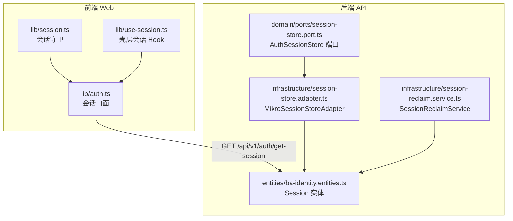
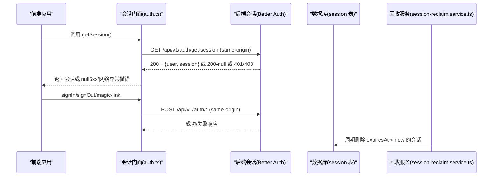
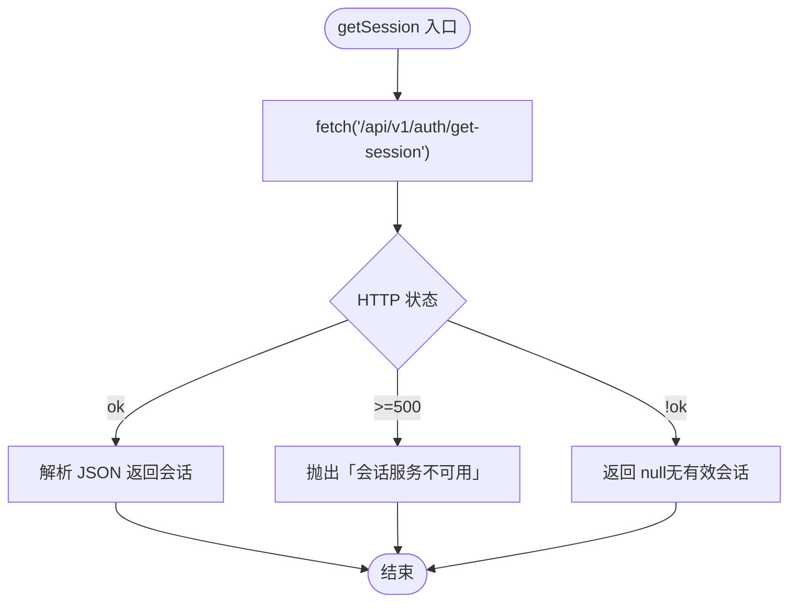
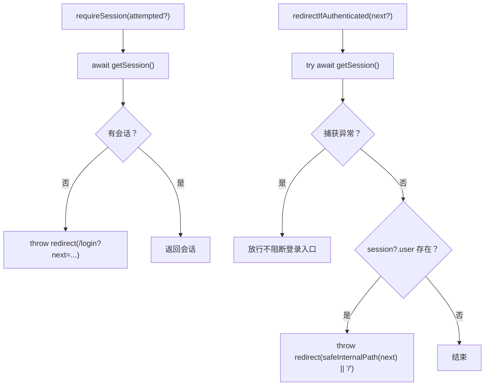
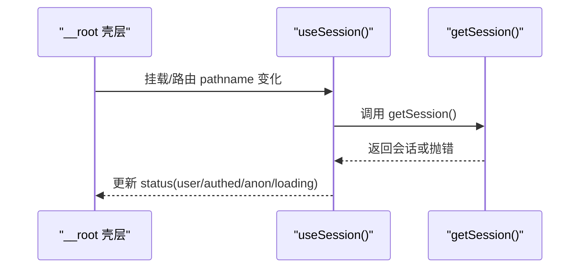
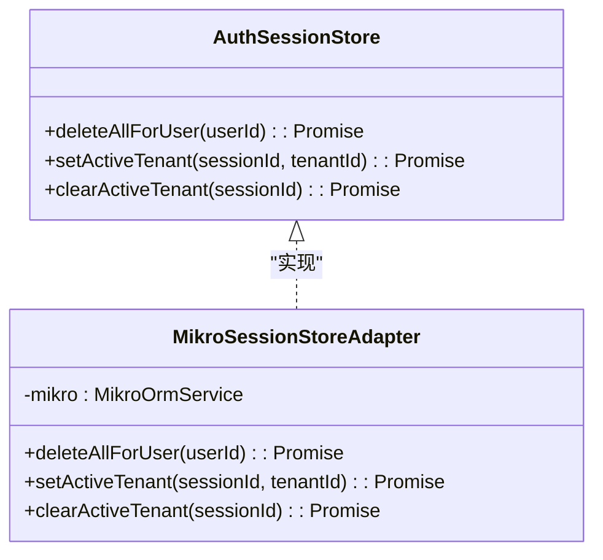
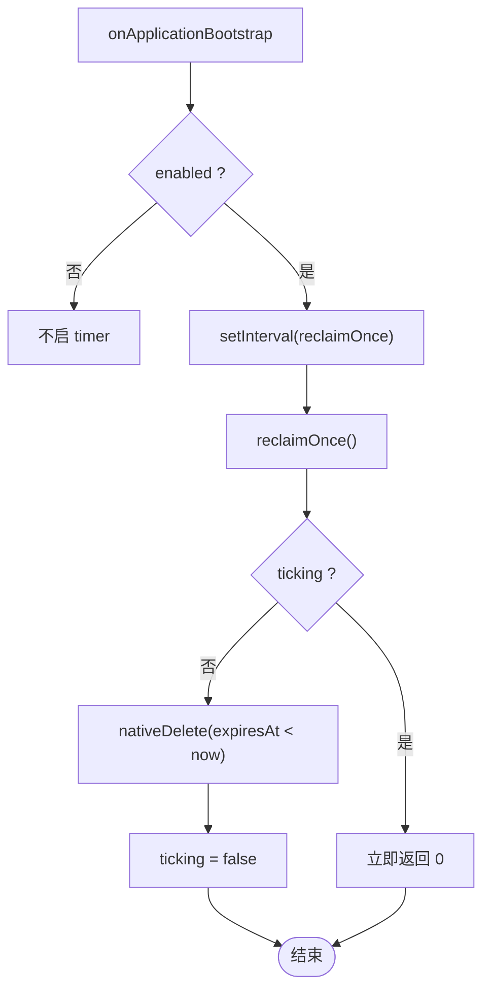
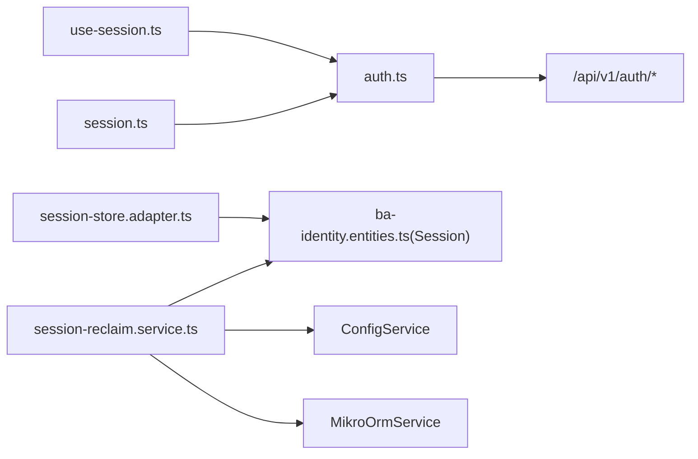

# 会话管理工具

<cite>
**本文引用的文件**   
- [apps/web/src/lib/auth.ts](file://apps/web/src/lib/auth.ts)
- [apps/web/src/lib/session.ts](file://apps/web/src/lib/session.ts)
- [apps/web/src/lib/use-session.ts](file://apps/web/src/lib/use-session.ts)
- [apps/api/src/modules/auth/infrastructure/entities/ba-identity.entities.ts](file://apps/api/src/modules/auth/infrastructure/entities/ba-identity.entities.ts)
- [apps/api/src/modules/auth/domain/ports/session-store.port.ts](file://apps/api/src/modules/auth/domain/ports/session-store.port.ts)
- [apps/api/src/modules/auth/infrastructure/session-store.adapter.ts](file://apps/api/src/modules/auth/infrastructure/session-store.adapter.ts)
- [apps/api/src/modules/auth/infrastructure/session-reclaim.service.ts](file://apps/api/src/modules/auth/infrastructure/session-reclaim.service.ts)
- [apps/api/src/modules/auth/session-reclaim.e2e.test.ts](file://apps/api/src/modules/auth/session-reclaim.e2e.test.ts)
- [apps/api/src/modules/auth/infrastructure/session-reclaim.service.test.ts](file://apps/api/src/modules/auth/infrastructure/session-reclaim.service.test.ts)
- [apps/api/src/modules/auth/auth-http-surface.e2e.test.ts](file://apps/api/src/modules/auth/auth-http-surface.e2e.test.ts)
</cite>

## 目录
1. [简介](#简介)
2. [项目结构](#项目结构)
3. [核心组件](#核心组件)
4. [架构总览](#架构总览)
5. [详细组件分析](#详细组件分析)
6. [依赖关系分析](#依赖关系分析)
7. [性能与扩展性](#性能与扩展性)
8. [故障排查指南](#故障排查指南)
9. [结论](#结论)
10. [附录：API 接口说明与使用示例](#附录api-接口说明与使用示例)

## 简介
本文件面向“会话管理工具”，聚焦前端（web）与后端（api）在 Better Auth 基础上的会话能力，覆盖以下主题：
- 本地存储中的会话数据管理：本项目采用 Cookie + 服务端数据库会话（Better Auth），前端不直接读写 token。
- 会话持久化机制：会话实体、索引、过期字段与会话激活位（租户/组织）。
- 自动刷新逻辑：壳层 hook 在路由变化时重取会话；受保护页面 loader 统一守卫。
- 生命周期与过期检测：周期回收服务按 expiresAt 清理过期会话。
- 与后端同步机制：同源 fetch + same-origin cookie；登录/登出/魔法链接等 API。
- 会话恢复流程：未登录跳转登录页并携带 next；已登录访问受限页面时回原目标。
- API 接口说明、参数验证、错误处理与使用示例。

## 项目结构
围绕会话的前后端关键文件如下：
- 前端会话门面与守卫：
  - apps/web/src/lib/auth.ts：Better Auth HTTP 门面（get-session、sign-in/email、sign-up/email、sign-out、magic-link）。
  - apps/web/src/lib/session.ts：受保护页面 requireSession 与反向守卫 redirectIfAuthenticated。
  - apps/web/src/lib/use-session.ts：壳层会话感知 hook，路由 pathname 变化后重取会话。
- 后端会话模型与写端口：
  - apps/api/src/modules/auth/infrastructure/entities/ba-identity.entities.ts：Session 实体（含 activeOrganizationId、activeTenantId、expiresAt）。
  - apps/api/src/modules/auth/domain/ports/session-store.port.ts：AuthSessionStore 端口（删除用户会话、设置/清除租级激活位）。
  - apps/api/src/modules/auth/infrastructure/session-store.adapter.ts：MikroORM 适配器实现。
- 过期会话回收：
  - apps/api/src/modules/auth/infrastructure/session-reclaim.service.ts：周期回收服务（enabled 门控、防重入、reclaimOnce）。
  - 相关测试：session-reclaim.service.test.ts、session-reclaim.e2e.test.ts。
- 端到端行为验证：
  - apps/api/src/modules/auth/auth-http-surface.e2e.test.ts：登录 → get-session → 登出 → 会话失效全链。

图表来源
- [apps/web/src/lib/auth.ts:1-93](file://apps/web/src/lib/auth.ts#L1-L93)
- [apps/web/src/lib/session.ts:1-43](file://apps/web/src/lib/session.ts#L1-L43)
- [apps/web/src/lib/use-session.ts:1-45](file://apps/web/src/lib/use-session.ts#L1-L45)
- [apps/api/src/modules/auth/infrastructure/entities/ba-identity.entities.ts:87-107](file://apps/api/src/modules/auth/infrastructure/entities/ba-identity.entities.ts#L87-L107)
- [apps/api/src/modules/auth/domain/ports/session-store.port.ts:1-43](file://apps/api/src/modules/auth/domain/ports/session-store.port.ts#L1-L43)
- [apps/api/src/modules/auth/infrastructure/session-store.adapter.ts:1-48](file://apps/api/src/modules/auth/infrastructure/session-store.adapter.ts#L1-L48)
- [apps/api/src/modules/auth/infrastructure/session-reclaim.service.ts:1-76](file://apps/api/src/modules/auth/infrastructure/session-reclaim.service.ts#L1-L76)

章节来源
- [apps/web/src/lib/auth.ts:1-93](file://apps/web/src/lib/auth.ts#L1-L93)
- [apps/web/src/lib/session.ts:1-43](file://apps/web/src/lib/session.ts#L1-L43)
- [apps/web/src/lib/use-session.ts:1-45](file://apps/web/src/lib/use-session.ts#L1-L45)
- [apps/api/src/modules/auth/infrastructure/entities/ba-identity.entities.ts:87-107](file://apps/api/src/modules/auth/infrastructure/entities/ba-identity.entities.ts#L87-L107)
- [apps/api/src/modules/auth/domain/ports/session-store.port.ts:1-43](file://apps/api/src/modules/auth/domain/ports/session-store.port.ts#L1-L43)
- [apps/api/src/modules/auth/infrastructure/session-store.adapter.ts:1-48](file://apps/api/src/modules/auth/infrastructure/session-store.adapter.ts#L1-L48)
- [apps/api/src/modules/auth/infrastructure/session-reclaim.service.ts:1-76](file://apps/api/src/modules/auth/infrastructure/session-reclaim.service.ts#L1-L76)

## 核心组件
- 前端会话门面（auth.ts）
  - 提供 getSession、signInEmail、signUpEmail、signOut、signInMagicLink。
  - 会话读取区分“不可用”与“未登录”：5xx/网络异常抛错；401/403/登出 200-null 返回 null。
- 前端会话守卫（session.ts）
  - requireSession：无有效会话则跳转到 /login，可携带 next 回跳。
  - redirectIfAuthenticated：已登录访问 /login 或 /register 时弹离到首页或白名单内 next。
- 壳层会话 Hook（use-session.ts）
  - 监听 pathname 变化，调用 getSession 刷新会话；失败降级为 anon，避免壳层崩溃。
- 后端会话实体（ba-identity.entities.ts）
  - Session 表包含 id、expiresAt、token、userId、provider、activeOrganizationId、activeTenantId、ipAddress、userAgent、createdAt、updatedAt。
- 会话写端口与适配器（session-store.port.ts、session-store.adapter.ts）
  - 端口定义 deleteAllForUser、setActiveTenant、clearActiveTenant。
  - 适配器通过 MikroOrmService.fork() 获取 em，支持事务上下文（ALS）与不受租户隔离 filter 影响的 nativeUpdate/nativeDelete。
- 过期会话回收（session-reclaim.service.ts）
  - enabled 门控开启 setInterval，周期性执行 reclaimOnce，按 expiresAt < now 删除过期行。
  - 防重入 flag ticking，公开 reclaimOnce 供单测/e2e 确定性驱动。

章节来源
- [apps/web/src/lib/auth.ts:1-93](file://apps/web/src/lib/auth.ts#L1-L93)
- [apps/web/src/lib/session.ts:1-43](file://apps/web/src/lib/session.ts#L1-L43)
- [apps/web/src/lib/use-session.ts:1-45](file://apps/web/src/lib/use-session.ts#L1-L45)
- [apps/api/src/modules/auth/infrastructure/entities/ba-identity.entities.ts:87-107](file://apps/api/src/modules/auth/infrastructure/entities/ba-identity.entities.ts#L87-L107)
- [apps/api/src/modules/auth/domain/ports/session-store.port.ts:1-43](file://apps/api/src/modules/auth/domain/ports/session-store.port.ts#L1-L43)
- [apps/api/src/modules/auth/infrastructure/session-store.adapter.ts:1-48](file://apps/api/src/modules/auth/infrastructure/session-store.adapter.ts#L1-L48)
- [apps/api/src/modules/auth/infrastructure/session-reclaim.service.ts:1-76](file://apps/api/src/modules/auth/infrastructure/session-reclaim.service.ts#L1-L76)

## 架构总览
会话从前端发起，经同源 Cookie 与后端 Better Auth 交互，会话状态落库；同时后台周期任务清理过期会话。

图表来源
- [apps/web/src/lib/auth.ts:28-93](file://apps/web/src/lib/auth.ts#L28-L93)
- [apps/api/src/modules/auth/infrastructure/session-reclaim.service.ts:39-74](file://apps/api/src/modules/auth/infrastructure/session-reclaim.service.ts#L39-L74)
- [apps/api/src/modules/auth/infrastructure/entities/ba-identity.entities.ts:87-107](file://apps/api/src/modules/auth/infrastructure/entities/ba-identity.entities.ts#L87-L107)

## 详细组件分析

### 前端会话门面（auth.ts）
- 职责
  - 封装 Better Auth 的 HTTP 接口：get-session、sign-in/email、sign-up/email、sign-out、sign-in/magic-link。
  - 错误分类：5xx/网络异常抛错；非 ok 返回 null；登录/注册/魔法链接失败文案归一化。
- 关键点
  - 所有请求使用 credentials: 'same-origin'，Cookie 由浏览器与后端共同维护。
  - getSession 对 5xx 抛错，使受保护页面落到路由错误边界而非误弹登录页。

图表来源
- [apps/web/src/lib/auth.ts:28-47](file://apps/web/src/lib/auth.ts#L28-L47)

章节来源
- [apps/web/src/lib/auth.ts:1-93](file://apps/web/src/lib/auth.ts#L1-L93)

### 前端会话守卫（session.ts）
- requireSession
  - 若 getSession 返回 null，则跳转到 /login，并可携带 next 参数用于登录后回跳。
- redirectIfAuthenticated
  - 若当前已有会话，访问 /login 或 /register 时弹离到首页或站内白名单 next。

图表来源
- [apps/web/src/lib/session.ts:5-42](file://apps/web/src/lib/session.ts#L5-L42)

章节来源
- [apps/web/src/lib/session.ts:1-43](file://apps/web/src/lib/session.ts#L1-L43)

### 壳层会话 Hook（use-session.ts）
- 行为
  - 监听 pathname 变化，调用 getSession 刷新会话；失败降级为 anon，避免壳层崩溃。
  - 登录 navigate('/') 或登出 navigate('/login) 触发导航展开/收口，无需手动刷新。

图表来源
- [apps/web/src/lib/use-session.ts:12-45](file://apps/web/src/lib/use-session.ts#L12-L45)
- [apps/web/src/lib/auth.ts:28-47](file://apps/web/src/lib/auth.ts#L28-L47)

章节来源
- [apps/web/src/lib/use-session.ts:1-45](file://apps/web/src/lib/use-session.ts#L1-L45)

### 后端会话实体与索引（ba-identity.entities.ts）
- Session 实体关键字段
  - id、expiresAt、token、userId、provider、activeOrganizationId、activeTenantId、ipAddress、userAgent、createdAt、updatedAt。
- 设计要点
  - activeOrganizationId 与 activeTenantId 互斥：选 org 与选租解绑，避免混态导致跨租借权。
  - expiresAt 用于过期检测与回收。

章节来源
- [apps/api/src/modules/auth/infrastructure/entities/ba-identity.entities.ts:87-107](file://apps/api/src/modules/auth/infrastructure/entities/ba-identity.entities.ts#L87-L107)

### 会话写端口与适配器（session-store.port.ts、session-store.adapter.ts）
- 端口（AuthSessionStore）
  - deleteAllForUser(userId)：删除某用户全部会话行（即时失权）。
  - setActiveTenant(sessionId, tenantId)：写会话的租级激活位（activeTenantId），同时清 activeOrganizationId。
  - clearActiveTenant(sessionId)：清租级激活位（activeTenantId），与 set 反向成对。
- 适配器（MikroSessionStoreAdapter）
  - 通过 MikroOrmService.fork() 获取 em，支持 ALS 感知的事务上下文。
  - 使用 nativeUpdate/nativeDelete 直写 Session 表，不受全局租户隔离 filter 影响。

图表来源
- [apps/api/src/modules/auth/domain/ports/session-store.port.ts:1-43](file://apps/api/src/modules/auth/domain/ports/session-store.port.ts#L1-L43)
- [apps/api/src/modules/auth/infrastructure/session-store.adapter.ts:1-48](file://apps/api/src/modules/auth/infrastructure/session-store.adapter.ts#L1-L48)

章节来源
- [apps/api/src/modules/auth/domain/ports/session-store.port.ts:1-43](file://apps/api/src/modules/auth/domain/ports/session-store.port.ts#L1-L43)
- [apps/api/src/modules/auth/infrastructure/session-store.adapter.ts:1-48](file://apps/api/src/modules/auth/infrastructure/session-store.adapter.ts#L1-L48)

### 过期会话回收（session-reclaim.service.ts）
- 功能
  - enabled 门控：未启用时不启动定时器、不触库。
  - 周期任务：setInterval 定时执行 reclaimOnce。
  - reclaimOnce：防重入（ticking），nativeDelete(Session, { expiresAt: { $lt: new Date() } })，返回删除行数。
- 幂等性与可测试性
  - 多实例并发各跑一次删除结果一致。
  - 公开 reclaimOnce 供单测/e2e 确定性驱动。

图表来源
- [apps/api/src/modules/auth/infrastructure/session-reclaim.service.ts:39-74](file://apps/api/src/modules/auth/infrastructure/session-reclaim.service.ts#L39-L74)

章节来源
- [apps/api/src/modules/auth/infrastructure/session-reclaim.service.ts:1-76](file://apps/api/src/modules/auth/infrastructure/session-reclaim.service.ts#L1-L76)
- [apps/api/src/modules/auth/session-reclaim.e2e.test.ts:83-103](file://apps/api/src/modules/auth/session-reclaim.e2e.test.ts#L83-L103)
- [apps/api/src/modules/auth/infrastructure/session-reclaim.service.test.ts:39-61](file://apps/api/src/modules/auth/infrastructure/session-reclaim.service.test.ts#L39-L61)

## 依赖关系分析
- 前端依赖
  - use-session.ts 依赖 auth.ts 的 getSession。
  - session.ts 依赖 auth.ts 的 getSession 与 safe-redirect 的 safeInternalPath。
- 后端依赖
  - session-store.adapter.ts 依赖 MikroOrmService 与 Session 实体。
  - session-reclaim.service.ts 依赖 ConfigService、MikroOrmService 与 Session 实体。
- 外部集成
  - 前端通过同源 Cookie 与后端 Better Auth 交互；后端基于数据库持久化会话。

图表来源
- [apps/web/src/lib/use-session.ts:1-45](file://apps/web/src/lib/use-session.ts#L1-L45)
- [apps/web/src/lib/session.ts:1-43](file://apps/web/src/lib/session.ts#L1-L43)
- [apps/web/src/lib/auth.ts:1-93](file://apps/web/src/lib/auth.ts#L1-L93)
- [apps/api/src/modules/auth/infrastructure/session-store.adapter.ts:1-48](file://apps/api/src/modules/auth/infrastructure/session-store.adapter.ts#L1-L48)
- [apps/api/src/modules/auth/infrastructure/session-reclaim.service.ts:1-76](file://apps/api/src/modules/auth/infrastructure/session-reclaim.service.ts#L1-L76)
- [apps/api/src/modules/auth/infrastructure/entities/ba-identity.entities.ts:87-107](file://apps/api/src/modules/auth/infrastructure/entities/ba-identity.entities.ts#L87-L107)

章节来源
- [apps/web/src/lib/use-session.ts:1-45](file://apps/web/src/lib/use-session.ts#L1-L45)
- [apps/web/src/lib/session.ts:1-43](file://apps/web/src/lib/session.ts#L1-L43)
- [apps/web/src/lib/auth.ts:1-93](file://apps/web/src/lib/auth.ts#L1-L93)
- [apps/api/src/modules/auth/infrastructure/session-store.adapter.ts:1-48](file://apps/api/src/modules/auth/infrastructure/session-store.adapter.ts#L1-L48)
- [apps/api/src/modules/auth/infrastructure/session-reclaim.service.ts:1-76](file://apps/api/src/modules/auth/infrastructure/session-reclaim.service.ts#L1-L76)
- [apps/api/src/modules/auth/infrastructure/entities/ba-identity.entities.ts:87-107](file://apps/api/src/modules/auth/infrastructure/entities/ba-identity.entities.ts#L87-L107)

## 性能与扩展性
- 会话读取
  - 前端每次会话读取均发一次 GET /api/v1/auth/get-session；壳层 hook 仅在 pathname 变化时触发，减少不必要刷新。
- 会话写入
  - 适配器使用 nativeUpdate/nativeDelete 直写 Session 表，避免 ORM 额外开销；通过 fork({ scoped: false }) 绕过租户隔离 filter。
- 过期回收
  - 周期任务默认关闭（enabled=false），避免无谓触库；启用后以单语句删除过期行，走 expiresAt 索引，降低扫描成本。
- 可扩展点
  - 如需海量场景限批删除，可在 reclaimOnce 中改为分批 DELETE … WHERE ctid IN (SELECT … LIMIT n)。
  - 可增加会话续期策略（如滑动 TTL）与主动刷新接口。

[本节为通用指导，不直接分析具体文件]

## 故障排查指南
- 前端会话读取失败
  - 现象：getSession 抛错（网络异常或 5xx）。
  - 原因：后端不可用或反代返回 5xx。
  - 处理：壳层降级为 anon；受保护页面落入 RouteError 而非误弹登录页。
  - 参考：[apps/web/src/lib/auth.ts:28-47](file://apps/web/src/lib/auth.ts#L28-L47)、[apps/web/src/lib/use-session.ts:12-45](file://apps/web/src/lib/use-session.ts#L12-L45)
- 会话失效
  - 现象：get-session 返回 200-null 或 401/403。
  - 原因：已登出或会话被删除（例如 suspend-user 删除用户会话）。
  - 处理：requireSession 跳转 /login 并携带 next。
  - 参考：[apps/web/src/lib/session.ts:5-22](file://apps/web/src/lib/session.ts#L5-L22)、[apps/api/src/modules/auth/auth-http-surface.e2e.test.ts:85-120](file://apps/api/src/modules/auth/auth-http-surface.e2e.test.ts#L85-L120)
- 过期会话堆积
  - 现象：session 表持续增长。
  - 原因：未启用回收或回收间隔过长。
  - 处理：开启 SESSION_RECLAIM_ENABLED=true，调整 intervalMs；确认 expiresAt 索引存在。
  - 参考：[apps/api/src/modules/auth/infrastructure/session-reclaim.service.ts:39-74](file://apps/api/src/modules/auth/infrastructure/session-reclaim.service.ts#L39-L74)

章节来源
- [apps/web/src/lib/auth.ts:28-47](file://apps/web/src/lib/auth.ts#L28-L47)
- [apps/web/src/lib/use-session.ts:12-45](file://apps/web/src/lib/use-session.ts#L12-L45)
- [apps/web/src/lib/session.ts:5-22](file://apps/web/src/lib/session.ts#L5-L22)
- [apps/api/src/modules/auth/auth-http-surface.e2e.test.ts:85-120](file://apps/api/src/modules/auth/auth-http-surface.e2e.test.ts#L85-L120)
- [apps/api/src/modules/auth/infrastructure/session-reclaim.service.ts:39-74](file://apps/api/src/modules/auth/infrastructure/session-reclaim.service.ts#L39-L74)

## 结论
本会话管理工具以前端同源 Cookie 与后端 Better Auth 为基础，结合数据库持久化与会话激活位控制，实现了安全的会话生命周期管理。前端通过门面与守卫统一处理会话读取与路由跳转，壳层 hook 保障壳层稳定性；后端通过端口与适配器规范写路径，周期回收服务保证会话表健康增长。整体方案具备清晰的职责边界、良好的可测试性与可扩展性。

[本节为总结，不直接分析具体文件]

## 附录：API 接口说明与使用示例

### 会话相关 API（前端门面）
- GET /api/v1/auth/get-session
  - 用途：获取当前会话与用户信息。
  - 认证：same-origin Cookie。
  - 返回：
    - 成功：{ user: { id, email, name? }, session: { id, expiresAt, activeOrganizationId? } }
    - 未登录：200 + null
    - 未授权：401/403
    - 服务异常：5xx（前端抛错）
- POST /api/v1/auth/sign-in/email
  - 用途：邮箱密码登录（仅非生产启用）。
  - 请求体：{ email, password }
  - 返回：{ ok, status, error? }
- POST /api/v1/auth/sign-up/email
  - 用途：邮箱密码注册（仅非生产启用）。
  - 请求体：{ email, password, name }
  - 返回：{ ok, status, error? }
- POST /api/v1/auth/sign-out
  - 用途：登出（清除会话 Cookie）。
  - 返回：空体
- POST /api/v1/auth/sign-in/magic-link
  - 用途：发送一次性登录邮件（仅非生产后端挂载）。
  - 请求体：{ email, callbackURL }
  - 返回：{ ok, status, error? }

章节来源
- [apps/web/src/lib/auth.ts:19-93](file://apps/web/src/lib/auth.ts#L19-L93)

### 使用示例（概念性步骤）
- 获取当前用户信息
  - 在壳层或页面中使用 useSession 钩子，根据 status 判断 authed/anon，并从 user 字段读取当前用户信息。
- 检查登录状态
  - 在受保护页面 loader 中调用 requireSession；未登录将跳转到 /login 并携带 next。
- 处理会话失效
  - 当 getSession 抛错（5xx/网络异常）时，壳层降级为 anon；受保护页面落入 RouteError。
  - 当 get-session 返回 null 或 401/403 时，requireSession 跳转 /login。

章节来源
- [apps/web/src/lib/use-session.ts:12-45](file://apps/web/src/lib/use-session.ts#L12-L45)
- [apps/web/src/lib/session.ts:5-22](file://apps/web/src/lib/session.ts#L5-L22)
- [apps/web/src/lib/auth.ts:28-47](file://apps/web/src/lib/auth.ts#L28-L47)