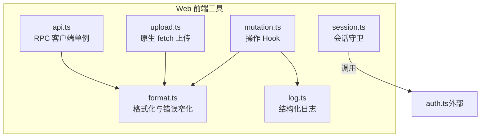
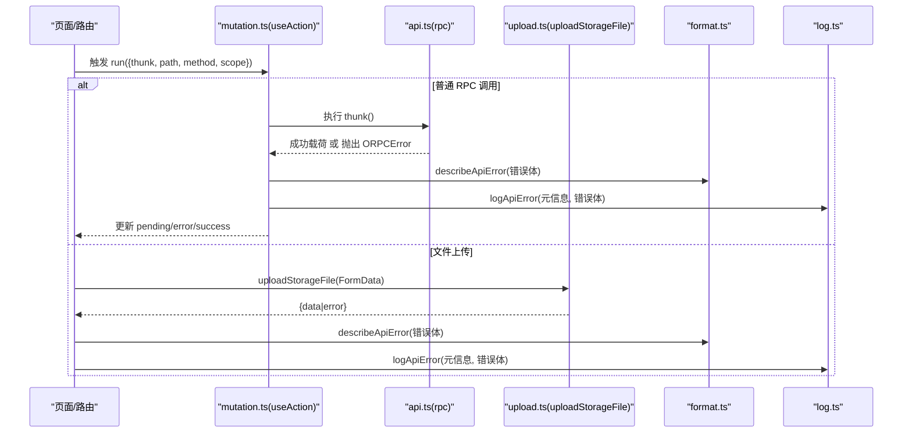
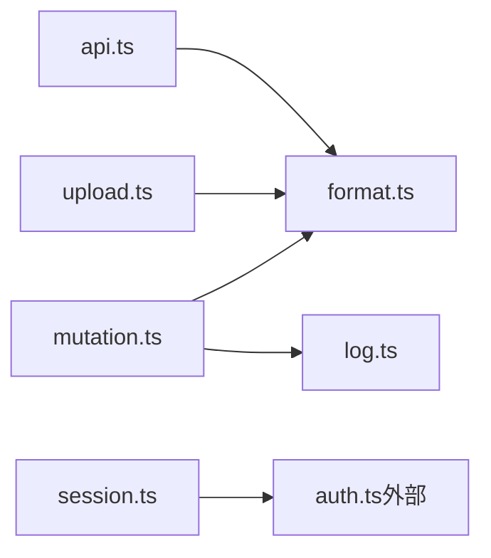

# 工具函数库

<cite>
**本文引用的文件**   
- [api.ts](file://apps/web/src/lib/api.ts)
- [session.ts](file://apps/web/src/lib/session.ts)
- [upload.ts](file://apps/web/src/lib/upload.ts)
- [format.ts](file://apps/web/src/lib/format.ts)
- [log.ts](file://apps/web/src/lib/log.ts)
- [mutation.ts](file://apps/web/src/lib/mutation.ts)
</cite>

## 目录
1. [引言](#引言)
2. [项目结构](#项目结构)
3. [核心组件](#核心组件)
4. [架构总览](#架构总览)
5. [详细组件分析](#详细组件分析)
6. [依赖关系分析](#依赖关系分析)
7. [性能与可靠性考虑](#性能与可靠性考虑)
8. [故障排查指南](#故障排查指南)
9. [结论](#结论)

## 引言
本文件面向前端工具函数库，聚焦以下六个模块：API 客户端封装、会话管理、文件上传、数据格式化、日志记录、状态变更。目标是帮助读者快速理解各模块的职责边界、调用流程、错误处理策略以及使用方式，同时提供可操作的示例与参数说明。

## 项目结构
这些工具函数位于 Web 应用的前端代码中，统一归在 `apps/web/src/lib` 下，彼此之间通过明确的接口和类型进行协作，避免直接耦合业务页面逻辑。

图表来源
- [api.ts:1-16](file://apps/web/src/lib/api.ts#L1-L16)
- [session.ts:1-43](file://apps/web/src/lib/session.ts#L1-L43)
- [upload.ts:1-36](file://apps/web/src/lib/upload.ts#L1-L36)
- [format.ts:1-55](file://apps/web/src/lib/format.ts#L1-L55)
- [log.ts:1-40](file://apps/web/src/lib/log.ts#L1-L40)
- [mutation.ts:1-74](file://apps/web/src/lib/mutation.ts#L1-L74)

章节来源
- [api.ts:1-16](file://apps/web/src/lib/api.ts#L1-L16)
- [session.ts:1-43](file://apps/web/src/lib/session.ts#L1-L43)
- [upload.ts:1-36](file://apps/web/src/lib/upload.ts#L1-L36)
- [format.ts:1-55](file://apps/web/src/lib/format.ts#L1-L55)
- [log.ts:1-40](file://apps/web/src/lib/log.ts#L1-L40)
- [mutation.ts:1-74](file://apps/web/src/lib/mutation.ts#L1-L74)

## 核心组件
- API 客户端封装（api.ts）：导出 oRPC 客户端单例，负责同源相对路径、凭据传递与类型安全调用；二进制上传走独立模块。
- 会话管理（session.ts）：提供受保护路由的会话校验与已登录反向跳转，基于 `getSession` 抽象。
- 文件上传（upload.ts）：使用原生 `fetch` 发送 `multipart/form-data`，返回统一结果对象。
- 格式化工具（format.ts）：日期格式化、后端错误体窄化为可读字段、生成用户可见文案。
- 日志工具（log.ts）：按环境输出结构化或精简日志，关联后端 `requestId`。
- 数据变更（mutation.ts）：React Hook 封装表单/按钮提交的状态机，统一成功/失败反馈与路由重载。

章节来源
- [api.ts:1-16](file://apps/web/src/lib/api.ts#L1-L16)
- [session.ts:1-43](file://apps/web/src/lib/session.ts#L1-L43)
- [upload.ts:1-36](file://apps/web/src/lib/upload.ts#L1-L36)
- [format.ts:1-55](file://apps/web/src/lib/format.ts#L1-L55)
- [log.ts:1-40](file://apps/web/src/lib/log.ts#L1-L40)
- [mutation.ts:1-74](file://apps/web/src/lib/mutation.ts#L1-L74)

## 架构总览
下图展示工具库之间的调用关系与职责分工：

图表来源
- [mutation.ts:30-73](file://apps/web/src/lib/mutation.ts#L30-L73)
- [api.ts:1-16](file://apps/web/src/lib/api.ts#L1-L16)
- [upload.ts:17-35](file://apps/web/src/lib/upload.ts#L17-L35)
- [format.ts:28-54](file://apps/web/src/lib/format.ts#L28-L54)
- [log.ts:21-39](file://apps/web/src/lib/log.ts#L21-L39)

## 详细组件分析

### API 客户端封装（api.ts）
- 职责
  - 导出 oRPC 客户端单例 `rpc`，用于类型安全的后端调用。
  - 约定同源相对路径 `/api/v1`，开发环境经 Vite 反代到后端服务端口。
  - 凭据策略为 `same-origin`，与后端 Cookie + DB Session 保持一致。
  - multipart 二进制上传不走此客户端，交由 `upload.ts`。
- 关键行为
  - 不在此文件中实现拦截器/重试/取消等通用逻辑，而是依赖 `@saas/api-client` 提供的能力。
  - 错误模型由 oRPC 客户端解码为 `ORPCError`，其 `.data` 携带 REST 错误体，便于上层统一处理。
- 使用示例
  - 在页面或 Hook 中导入 `rpc`，调用对应方法即可，例如：`const result = await rpc.someMethod(params)`。
- 参数与返回值
  - 具体方法与参数由 oRPC 契约决定，此处仅暴露单例入口。
- 错误处理
  - 失败时抛出 `ORPCError`，上层可使用 `describeApiError` 与 `logApiError` 统一处理。

章节来源
- [api.ts:1-16](file://apps/web/src/lib/api.ts#L1-L16)
- [format.ts:28-54](file://apps/web/src/lib/format.ts#L28-L54)

### 会话管理（session.ts）
- 职责
  - 提供受保护路由的统一守卫 `requireSession`：无有效会话则重定向至 `/login`，并支持携带原目标地址。
  - 提供反向守卫 `redirectIfAuthenticated`：已登录访问登录/注册页时，跳转到合法站内目标或首页。
- 本地存储与会话持久化
  - 通过 `./auth` 的 `getSession` 获取会话，具体持久化细节不在本文件内。
- 自动刷新机制
  - 本文件未实现自动刷新；刷新策略由 `auth.ts` 或其他会话层负责。
- 使用示例
  - 在路由 loader 首行调用 `await requireSession()`，若未登录将自动跳转。
  - 在登录页首行调用 `await redirectIfAuthenticated(next)`，已登录则跳转回原目标或首页。
- 参数与返回值
  - `requireSession(attempted?)`: 可选传入导航目标 `{pathname, searchStr}`；返回 `SessionResult`。
  - `redirectIfAuthenticated(next?)`: 可选传入 `next`；无返回值，异常时抛出路由跳转。
- 错误处理
  - 当 `getSession` 抛错（如网络/服务端异常），视为匿名态放行，避免阻塞登录入口。

章节来源
- [session.ts:1-43](file://apps/web/src/lib/session.ts#L1-L43)

### 文件上传（upload.ts）
- 职责
  - 使用原生 `fetch` 向 `/api/v1/storage/upload` 发送 `multipart/form-data`。
  - 成功返回 `{ data }`，失败返回 `{ error }`，其中 `error` 为解析后的 REST 错误体或原始文本。
- 分片上传、进度监控、错误恢复
  - 当前实现为一次性上传，不包含分片、断点续传、进度回调或自动重试。
- 使用示例
  - 构造 `FormData` 后调用 `uploadStorageFile(fd)`，根据返回的 `data` 或 `error` 分支处理。
- 参数与返回值
  - 入参：`fd: FormData`
  - 出参：`UploadOutcome`，包含 `data?: FileUploadResult` 或 `error?: unknown`
- 错误处理
  - 非 2xx 响应返回 `error`；网络异常会向上抛出，由调用方捕获。

章节来源
- [upload.ts:1-36](file://apps/web/src/lib/upload.ts#L1-L36)

### 格式化工具（format.ts）
- 职责
  - `formatDate(value)`: 将 `string | Date` 转为 `YYYY-MM-DD`，无法解析时回退原值。
  - `apiErrorDetail(body)`: 从后端错误体提取 `message`、`errorCode`、`requestId`、`statusCode`、`path`。
  - `describeApiError(body)`: 生成用户可读的错误文案，必要时附带错误码。
- 使用示例
  - 日期显示：`formatDate(dateOrIsoString)`
  - 错误展示：`describeApiError(errorBody)`
  - 结构化日志：`logApiError(meta, errorBody)`
- 参数与返回值
  - `formatDate(value: string | Date): string`
  - `apiErrorDetail(body: unknown): ApiErrorDetail`
  - `describeApiError(body: unknown): string`
- 兼容性
  - 兼容 oRPC 的 `ORPCError`（`.data` 挂 REST 错误体）与旧链直接传入 REST 体的情况。

章节来源
- [format.ts:1-55](file://apps/web/src/lib/format.ts#L1-L55)

### 日志工具（log.ts）
- 职责
  - 统一 API 错误日志输出：开发环境附带结构化字段（含 `requestId`），生产环境仅输出一行摘要。
  - 与 `format.ts` 协作，复用错误窄化逻辑。
- 日志级别与输出格式
  - 固定为错误级别；开发模式输出对象，生产模式输出字符串。
- 调试信息
  - 通过 `requestId` 与后端日志关联，便于跨端排查。
- 使用示例
  - `logApiError({ path, method, scope }, errorBody)`
- 参数与返回值
  - 入参：`meta: ApiCallMeta`，`body: unknown`
  - 无返回值

章节来源
- [log.ts:1-40](file://apps/web/src/lib/log.ts#L1-L40)
- [format.ts:28-54](file://apps/web/src/lib/format.ts#L28-L54)

### 数据变更（mutation.ts）
- 职责
  - 提供 React Hook `useAction`，封装表单/按钮提交的完整状态机：pending、error、success。
  - 成功时调用路由失效重载，失败时统一错误文案与日志。
- 乐观更新与冲突解决
  - 当前实现为“成功后再重载”，并非乐观更新；冲突解决依赖后端幂等性与路由重载。
- 使用示例
  - 在组件中 `const { pending, error, success, run, reset } = useAction()`
  - 提交时 `run({ path, method, scope, successMessage, thunk })`
- 参数与返回值
  - `RunOptions.path/method/scope/successMessage/thunk`
  - 返回 `ActionState` 与 `run/reset`
- 错误处理
  - 兼容旧链 `{error}` 与新链 `ORPCError`；网络异常以通用文案提示。

章节来源
- [mutation.ts:1-74](file://apps/web/src/lib/mutation.ts#L1-L74)
- [format.ts:28-54](file://apps/web/src/lib/format.ts#L28-L54)
- [log.ts:21-39](file://apps/web/src/lib/log.ts#L21-L39)

## 依赖关系分析

图表来源
- [api.ts:1-16](file://apps/web/src/lib/api.ts#L1-L16)
- [upload.ts:1-36](file://apps/web/src/lib/upload.ts#L1-L36)
- [mutation.ts:1-74](file://apps/web/src/lib/mutation.ts#L1-L74)
- [session.ts:1-43](file://apps/web/src/lib/session.ts#L1-L43)

章节来源
- [api.ts:1-16](file://apps/web/src/lib/api.ts#L1-L16)
- [upload.ts:1-36](file://apps/web/src/lib/upload.ts#L1-L36)
- [mutation.ts:1-74](file://apps/web/src/lib/mutation.ts#L1-L74)
- [session.ts:1-43](file://apps/web/src/lib/session.ts#L1-L43)

## 性能与可靠性考虑
- API 客户端
  - 采用 oRPC 类型安全客户端，减少运行时错误；二进制上传走原生 `fetch`，避免 JSON 编码开销。
- 会话管理
  - 守卫逻辑轻量，仅在路由加载时执行；错误情况下对登录入口放行，提升可用性。
- 文件上传
  - 当前为一次性上传，适合中小文件；大文件建议在上层实现分片与进度回调。
- 格式化与日志
  - 错误窄化与日志输出均为 O(1) 操作；生产环境精简输出，降低日志噪音。
- 数据变更
  - 成功后触发路由重载，保证数据一致性；如需更优体验，可在上层实现乐观更新与冲突合并。

[本节为通用指导，不直接分析具体文件]

## 故障排查指南
- 登录后仍被重定向
  - 检查 `requireSession` 是否被正确调用；确认 `getSession` 能返回有效会话。
- 上传失败
  - 查看 `uploadStorageFile` 返回的 `error`；若是网络异常，检查浏览器控制台与后端日志。
- 错误文案不清晰
  - 使用 `describeApiError` 生成用户文案；结合 `logApiError` 查看结构化日志中的 `requestId`。
- 操作后数据未刷新
  - 确认 `useAction` 的 `run` 成功分支调用了路由失效重载；检查后端是否返回预期成功载荷。

章节来源
- [session.ts:12-22](file://apps/web/src/lib/session.ts#L12-L22)
- [upload.ts:17-35](file://apps/web/src/lib/upload.ts#L17-L35)
- [format.ts:28-54](file://apps/web/src/lib/format.ts#L28-L54)
- [log.ts:21-39](file://apps/web/src/lib/log.ts#L21-L39)
- [mutation.ts:34-63](file://apps/web/src/lib/mutation.ts#L34-L63)

## 结论
该工具函数库围绕“类型安全调用、会话守卫、上传适配、错误窄化、结构化日志、统一变更状态”构建，形成稳定且可扩展的前端基础设施。建议在后续演进中：
- 在 `upload.ts` 扩展分片、进度与重试能力。
- 在 `mutation.ts` 引入乐观更新与冲突合并策略。
- 在 `api.ts` 侧统一重试与取消策略（若 `@saas/api-client` 支持）。
- 保持错误体与日志字段的一致性，便于端到端排障。

[本节为总结性内容，不直接分析具体文件]