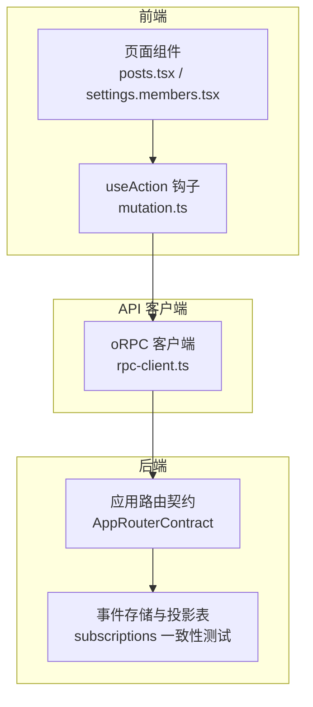
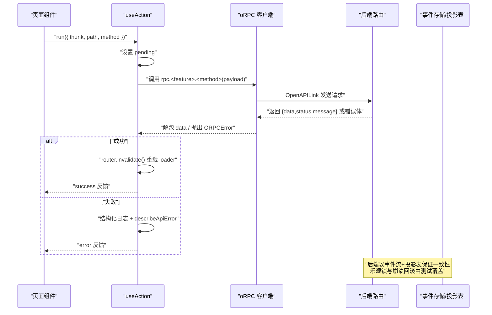
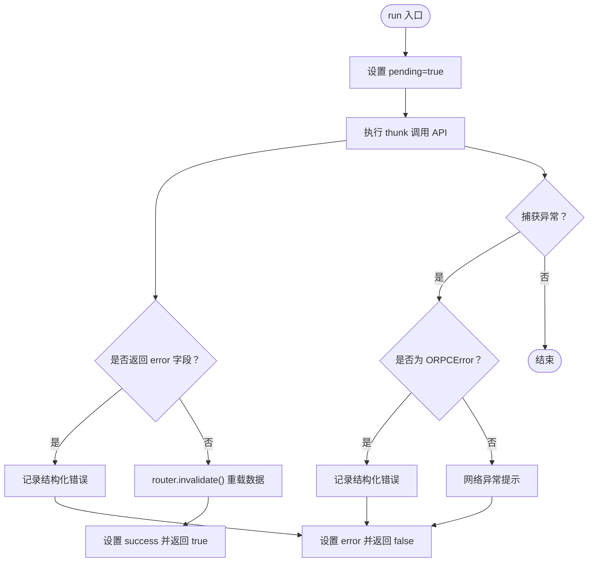
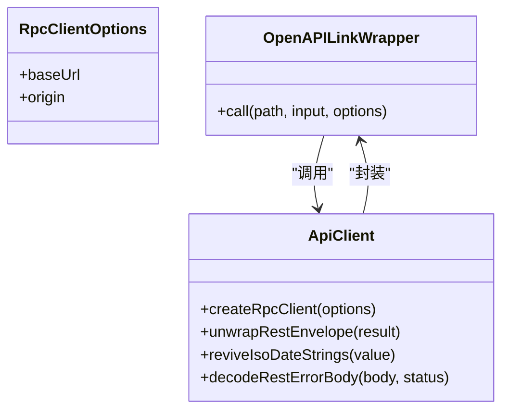
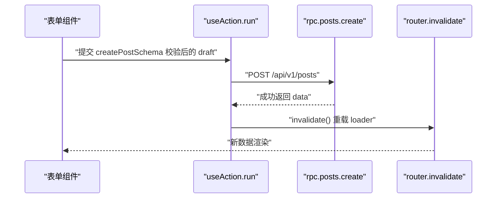
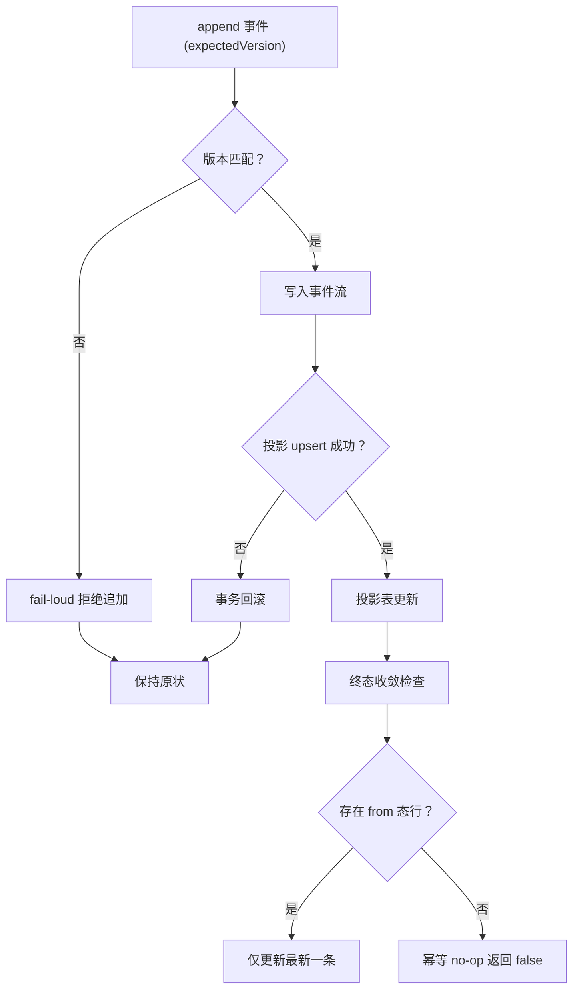
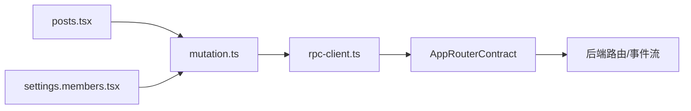

# 数据变更工具

<cite>
**本文引用的文件**   
- [apps/web/src/lib/mutation.ts](file://apps/web/src/lib/mutation.ts)
- [packages/api-client/src/rpc-client.ts](file://packages/api-client/src/rpc-client.ts)
- [apps/web/src/routes/posts.tsx](file://apps/web/src/routes/posts.tsx)
- [apps/web/src/routes/settings.members.tsx](file://apps/web/src/routes/settings.members.tsx)
- [apps/api/src/modules/subscriptions/subscription-replay-truth.e2e.test.ts](file://apps/api/src/modules/subscriptions/subscription-replay-truth.e2e.test.ts)
- [apps/api/src/modules/subscriptions/infrastructure/mikro-subscription.lifecycle.test.ts](file://apps/api/src/modules/subscriptions/infrastructure/mikro-subscription.lifecycle.test.ts)
</cite>

## 目录
1. [引言](#引言)
2. [项目结构](#项目结构)
3. [核心组件](#核心组件)
4. [架构总览](#架构总览)
5. [详细组件分析](#详细组件分析)
6. [依赖关系分析](#依赖关系分析)
7. [性能与内存优化](#性能与内存优化)
8. [故障排查指南](#故障排查指南)
9. [结论](#结论)

## 引言
本文件面向“数据变更工具”的设计与实现，聚焦前端操作面、API 客户端与后端一致性保障之间的协作。文档围绕以下目标展开：
- 状态更新机制与乐观更新策略
- 冲突检测与解决
- 数据一致性保证、回滚机制与批量操作处理
- 与 React 状态管理的集成方式
- 性能优化技巧与内存泄漏防护
- CRUD 封装、复杂业务逻辑的状态管理、异步操作模式
- 与后端数据同步的策略和错误恢复机制

本项目在前端采用基于路由加载器（loader）的数据读取与 `useAction` 统一 mutation 钩子；在 API 层使用 oRPC 客户端包装 REST 信封与错误体；在后端通过事件流与投影表的一致性测试验证乐观锁、崩溃回滚与终态收敛等能力。

## 项目结构
与数据变更相关的前端与 API 客户端关键位置如下：
- 前端操作钩子：`apps/web/src/lib/mutation.ts`
- API 客户端封装：`packages/api-client/src/rpc-client.ts`
- 典型页面示例：`apps/web/src/routes/posts.tsx`、`apps/web/src/routes/settings.members.tsx`
- 后端一致性保障（事件流与投影表）：`apps/api/src/modules/subscriptions/...`

**图表来源**
- [apps/web/src/routes/posts.tsx:27-39](file://apps/web/src/routes/posts.tsx#L27-L39)
- [apps/web/src/routes/settings.members.tsx:21-35](file://apps/web/src/routes/settings.members.tsx#L21-L35)
- [apps/web/src/lib/mutation.ts:29-72](file://apps/web/src/lib/mutation.ts#L29-L72)
- [packages/api-client/src/rpc-client.ts:145-173](file://packages/api-client/src/rpc-client.ts#L145-L173)

**章节来源**
- [apps/web/src/lib/mutation.ts:1-74](file://apps/web/src/lib/mutation.ts#L1-L74)
- [packages/api-client/src/rpc-client.ts:1-176](file://packages/api-client/src/rpc-client.ts#L1-L176)
- [apps/web/src/routes/posts.tsx:1-213](file://apps/web/src/routes/posts.tsx#L1-L213)
- [apps/web/src/routes/settings.members.tsx:1-184](file://apps/web/src/routes/settings.members.tsx#L1-L184)

## 核心组件
- useAction 钩子：提供统一的 mutation 执行流程，包含 pending/error/success 状态、成功后的路由重载、失败的结构化日志与提示。
- oRPC 客户端：基于契约派生类型安全的客户端，负责请求编码、REST 信封解包、日期还原、HTTP 错误到 ORPCError 的映射。
- 页面示例：展示如何通过 loader 获取数据、通过 useAction 提交变更、成功后刷新视图。

**章节来源**
- [apps/web/src/lib/mutation.ts:12-72](file://apps/web/src/lib/mutation.ts#L12-L72)
- [packages/api-client/src/rpc-client.ts:34-46](file://packages/api-client/src/rpc-client.ts#L34-L46)
- [packages/api-client/src/rpc-client.ts:57-83](file://packages/api-client/src/rpc-client.ts#L57-L83)
- [packages/api-client/src/rpc-client.ts:85-114](file://packages/api-client/src/rpc-client.ts#L85-L114)
- [packages/api-client/src/rpc-client.ts:149-173](file://packages/api-client/src/rpc-client.ts#L149-L173)

## 架构总览
下图展示了从页面发起变更到后端一致性的端到端流程：

**图表来源**
- [apps/web/src/lib/mutation.ts:34-66](file://apps/web/src/lib/mutation.ts#L34-L66)
- [packages/api-client/src/rpc-client.ts:149-173](file://packages/api-client/src/rpc-client.ts#L149-L173)
- [apps/api/src/modules/subscriptions/subscription-replay-truth.e2e.test.ts:260-285](file://apps/api/src/modules/subscriptions/subscription-replay-truth.e2e.test.ts#L260-L285)

## 详细组件分析

### useAction 钩子：状态更新与乐观更新策略
- 状态模型：pending、error、success 三态，避免重复提交并清晰表达用户反馈。
- 乐观更新策略：当前实现不直接修改本地列表缓存，而是通过成功后的 `router.invalidate()` 触发路由 loader 重新拉取数据，从而保证 UI 与后端一致。该策略避免了手动维护缓存与服务器不一致的风险，适合大多数 CRUD 场景。
- 错误处理：兼容旧链（openapi-fetch 返回 `{error}`）与新链（oRPC 抛 `ORPCError`），统一走结构化日志与友好消息。
- 无显式回滚：由于未做本地乐观写入，失败路径无需回滚本地状态；若未来引入本地乐观写入，应增加撤销函数与重试策略。

**图表来源**
- [apps/web/src/lib/mutation.ts:34-66](file://apps/web/src/lib/mutation.ts#L34-L66)

**章节来源**
- [apps/web/src/lib/mutation.ts:12-72](file://apps/web/src/lib/mutation.ts#L12-L72)

### oRPC 客户端：数据同步与错误恢复
- 契约驱动：基于 `AppRouterContract` 生成类型安全客户端，键位与 URL 解耦，减少前后端联调成本。
- 信封解包：成功响应为 `{data, statusCode, message}`，客户端自动提取 `data`，避免上层误判。
- 日期还原：将规范 UTC ISO 字符串还原为 `Date`，确保运行时类型与编译期类型一致。
- 错误映射：HTTP 状态码映射为标准 ORPC 错误码，原始 body 挂入 `.data`，便于上层分支处理。
- 换轨兼容：同时支持旧 REST 信封与新 oRPC 错误体，降低迁移风险。

**图表来源**
- [packages/api-client/src/rpc-client.ts:27-46](file://packages/api-client/src/rpc-client.ts#L27-L46)
- [packages/api-client/src/rpc-client.ts:57-83](file://packages/api-client/src/rpc-client.ts#L57-L83)
- [packages/api-client/src/rpc-client.ts:85-114](file://packages/api-client/src/rpc-client.ts#L85-L114)
- [packages/api-client/src/rpc-client.ts:149-173](file://packages/api-client/src/rpc-client.ts#L149-L173)

**章节来源**
- [packages/api-client/src/rpc-client.ts:1-176](file://packages/api-client/src/rpc-client.ts#L1-L176)

### 页面示例：CRUD 封装与复杂业务状态
- 文章创建（posts.tsx）：
  - 使用路由 loader 获取首屏数据，本地累积分页游标。
  - 表单提交前使用共享 schema 进行客户端校验，避免无效往返。
  - 通过 useAction.run 提交创建请求，成功后清空表单并触发 loader 重载。
- 成员管理（settings.members.tsx）：
  - 展示成员列表并提供改角色、移除、退出组织等操作。
  - 每个操作独立 useAction 实例，避免状态交叉污染。
  - 成功后的统一刷新策略保证列表与权限状态一致。

**图表来源**
- [apps/web/src/routes/posts.tsx:86-108](file://apps/web/src/routes/posts.tsx#L86-L108)
- [apps/web/src/lib/mutation.ts:49-51](file://apps/web/src/lib/mutation.ts#L49-L51)

**章节来源**
- [apps/web/src/routes/posts.tsx:27-108](file://apps/web/src/routes/posts.tsx#L27-L108)
- [apps/web/src/routes/settings.members.tsx:53-113](file://apps/web/src/routes/settings.members.tsx#L53-L113)

### 后端一致性：乐观锁、回滚与终态收敛
- 乐观锁护栏：当 append 事件的 expectedVersion 过期时，拒绝追加并报错，防止覆盖并发写入。
- 崩溃模拟：在 append 与投影 upsert 之间抛错，整体事务回滚，保证事件流与投影表一致性。
- 终态收敛：对 from 态行只收敛最新一条，幂等 no-op 情况下零写返回，避免冗余更新。

**图表来源**
- [apps/api/src/modules/subscriptions/subscription-replay-truth.e2e.test.ts:260-285](file://apps/api/src/modules/subscriptions/subscription-replay-truth.e2e.test.ts#L260-L285)
- [apps/api/src/modules/subscriptions/infrastructure/mikro-subscription.lifecycle.test.ts:32-64](file://apps/api/src/modules/subscriptions/infrastructure/mikro-subscription.lifecycle.test.ts#L32-L64)

**章节来源**
- [apps/api/src/modules/subscriptions/subscription-replay-truth.e2e.test.ts:260-285](file://apps/api/src/modules/subscriptions/subscription-replay-truth.e2e.test.ts#L260-L285)
- [apps/api/src/modules/subscriptions/infrastructure/mikro-subscription.lifecycle.test.ts:18-65](file://apps/api/src/modules/subscriptions/infrastructure/mikro-subscription.lifecycle.test.ts#L18-L65)

## 依赖关系分析
- 前端页面依赖 useAction 钩子进行变更操作，并通过 router.invalidate 触发数据刷新。
- useAction 依赖 oRPC 客户端进行网络请求，客户端内部依赖 OpenAPILink 与契约树。
- 后端通过事件流与投影表保证一致性，测试覆盖了乐观锁、崩溃回滚与终态收敛。

**图表来源**
- [apps/web/src/routes/posts.tsx:1-10](file://apps/web/src/routes/posts.tsx#L1-L10)
- [apps/web/src/routes/settings.members.tsx:1-10](file://apps/web/src/routes/settings.members.tsx#L1-L10)
- [apps/web/src/lib/mutation.ts:7-10](file://apps/web/src/lib/mutation.ts#L7-L10)
- [packages/api-client/src/rpc-client.ts:1-9](file://packages/api-client/src/rpc-client.ts#L1-L9)

**章节来源**
- [apps/web/src/routes/posts.tsx:1-213](file://apps/web/src/routes/posts.tsx#L1-L213)
- [apps/web/src/routes/settings.members.tsx:1-184](file://apps/web/src/routes/settings.members.tsx#L1-L184)
- [apps/web/src/lib/mutation.ts:1-74](file://apps/web/src/lib/mutation.ts#L1-L74)
- [packages/api-client/src/rpc-client.ts:1-176](file://packages/api-client/src/rpc-client.ts#L1-L176)

## 性能与内存优化
- 避免不必要的重渲染：useAction 仅在 run 中更新状态，避免频繁 setState；页面侧使用局部 state 管理表单与分页，减少全局状态压力。
- 路由级数据刷新：成功后的 `router.invalidate()` 仅刷新必要数据，避免全量缓存失效。
- 客户端日期还原：仅在规范 UTC ISO 串上转换 Date，避免误伤其他字符串字段，提升解析效率。
- 错误处理集中化：结构化日志与描述函数统一处理错误，减少重复代码与潜在的性能损耗。
- 内存泄漏防护：useAction 的 reset 方法可清理反馈状态；页面卸载时建议取消未完成请求（可在 thunk 中结合 AbortController）。

[本节为通用指导，不直接分析具体文件]

## 故障排查指南
- 前端操作失败：
  - 检查 useAction 的错误分支是否正确记录结构化日志与显示友好消息。
  - 确认 oRPC 客户端是否正确映射 HTTP 错误体到 ORPCError。
- 数据不一致：
  - 检查路由 loader 是否被 invalidate 正确触发。
  - 确认后端事件流与投影表的一致性测试是否通过，特别是乐观锁与崩溃回滚场景。
- 性能问题：
  - 评估是否过度使用本地乐观写入导致缓存复杂化；优先使用 loader 刷新策略。
  - 检查客户端日期还原逻辑是否误伤非日期字段。

**章节来源**
- [apps/web/src/lib/mutation.ts:52-62](file://apps/web/src/lib/mutation.ts#L52-L62)
- [packages/api-client/src/rpc-client.ts:96-114](file://packages/api-client/src/rpc-client.ts#L96-L114)
- [apps/api/src/modules/subscriptions/subscription-replay-truth.e2e.test.ts:260-285](file://apps/api/src/modules/subscriptions/subscription-replay-truth.e2e.test.ts#L260-L285)

## 结论
本项目的前端数据变更工具以 useAction 为核心，结合 oRPC 客户端与路由 loader 刷新策略，实现了简洁可靠的状态更新机制。后端通过事件流与投影表的一致性测试，确保了乐观锁、崩溃回滚与终态收敛的正确性。整体方案避免了复杂的本地缓存管理，降低了数据不一致风险，同时提供了良好的错误处理与用户体验。未来如需引入更激进的乐观更新，应在 useAction 中增加撤销与重试机制，并配合后端的冲突检测与解决策略。

[本节为总结性内容，不直接分析具体文件]