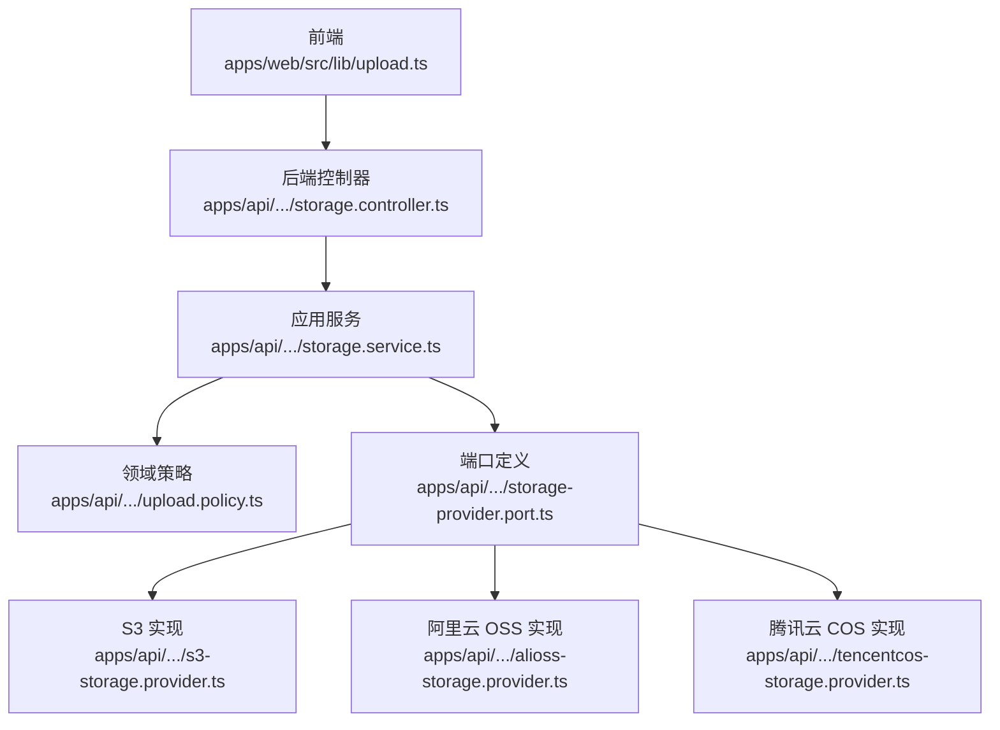
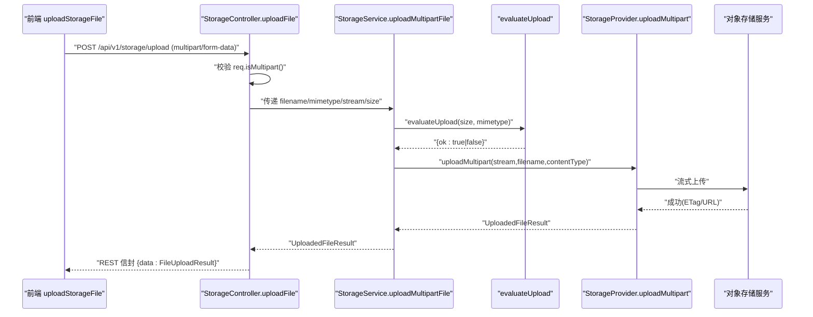
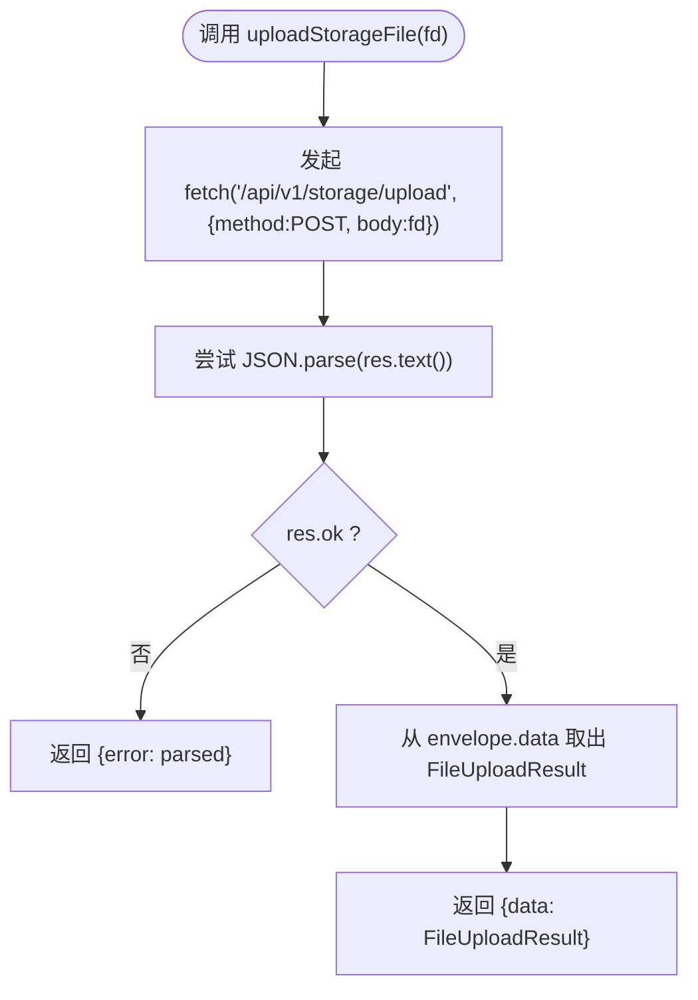
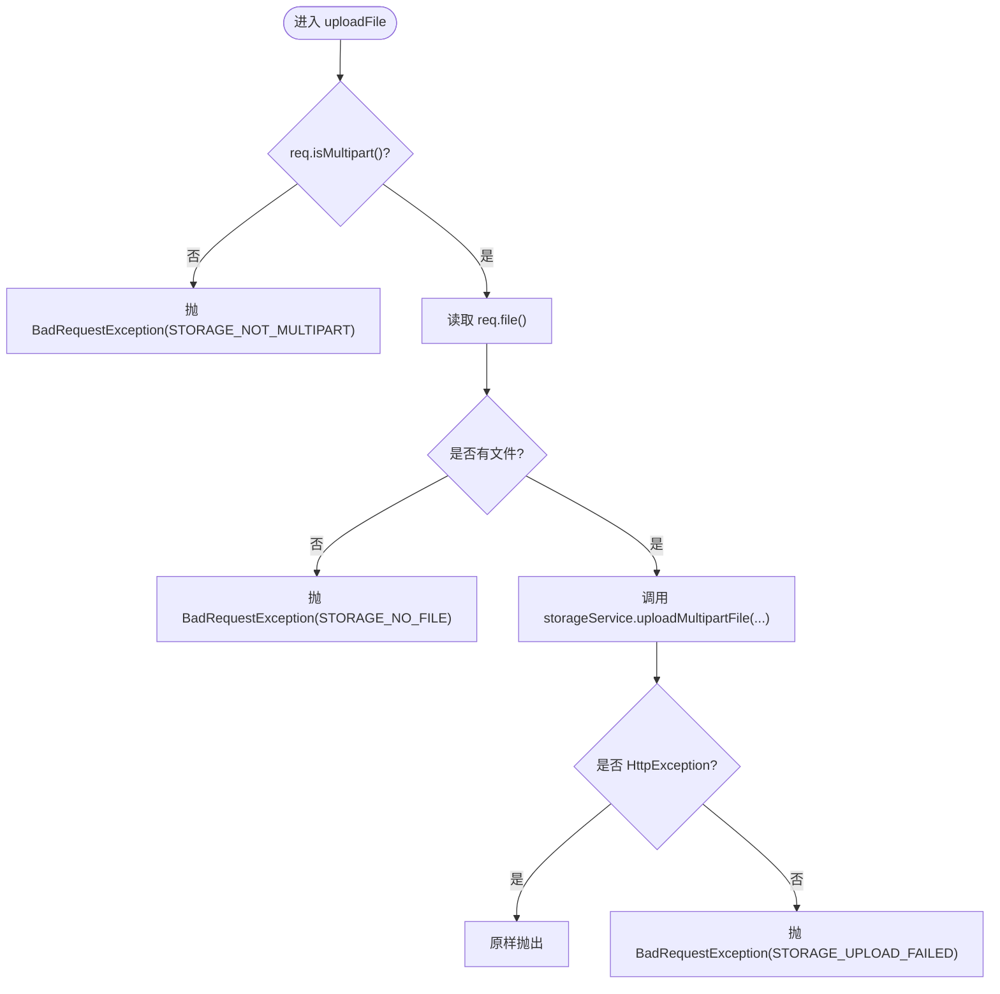
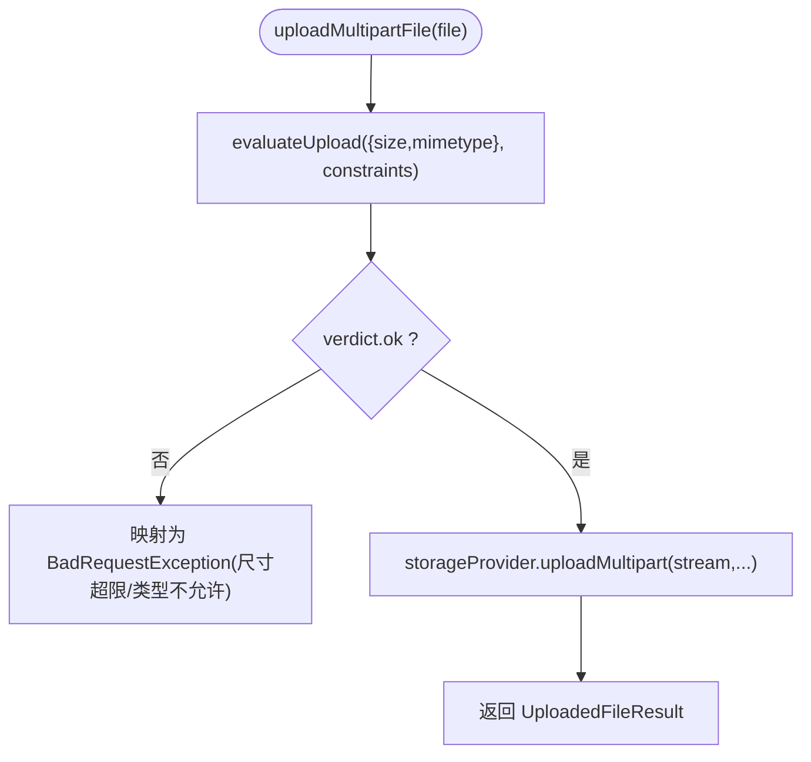
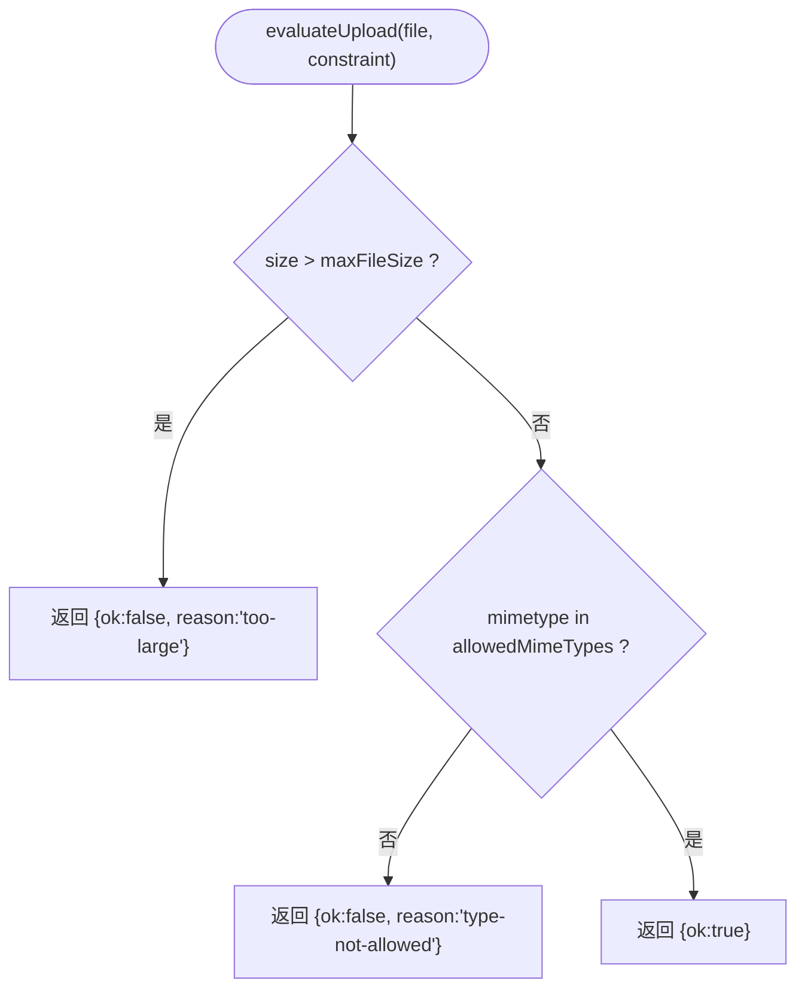
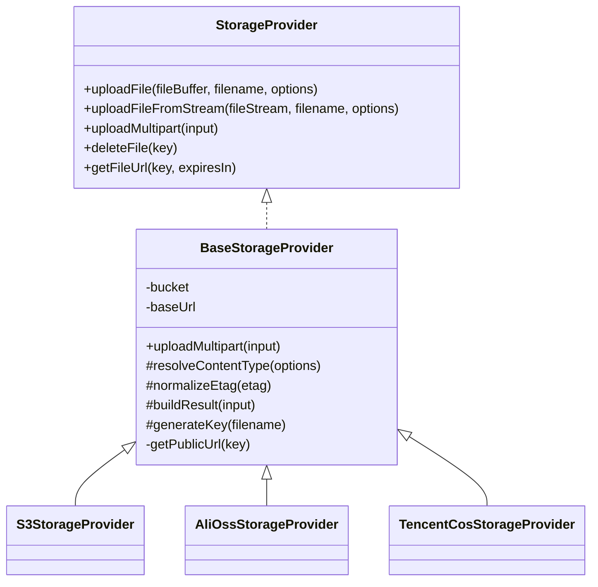
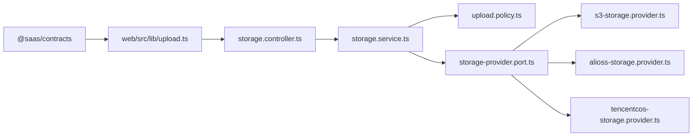

# 文件上传工具

<cite>
**本文引用的文件**   
- [apps/web/src/lib/upload.ts](file://apps/web/src/lib/upload.ts)
- [apps/api/src/modules/storage/api/storage.controller.ts](file://apps/api/src/modules/storage/api/storage.controller.ts)
- [apps/api/src/modules/storage/application/storage.service.ts](file://apps/api/src/modules/storage/application/storage.service.ts)
- [apps/api/src/modules/storage/domain/policies/upload.policy.ts](file://apps/api/src/modules/storage/domain/policies/upload.policy.ts)
- [apps/api/src/modules/storage/infrastructure/base-storage.provider.ts](file://apps/api/src/modules/storage/infrastructure/base-storage.provider.ts)
- [apps/api/src/modules/storage/domain/ports/storage-provider.port.ts](file://apps/api/src/modules/storage/domain/ports/storage-provider.port.ts)
- [apps/api/src/modules/storage/api/dto/file-upload.dto.ts](file://apps/api/src/modules/storage/api/dto/file-upload.dto.ts)
- [apps/api/src/modules/storage/infrastructure/s3-storage.provider.ts](file://apps/api/src/modules/storage/infrastructure/s3-storage.provider.ts)
- [apps/api/src/modules/storage/infrastructure/alioss-storage.provider.ts](file://apps/api/src/modules/storage/infrastructure/alioss-storage.provider.ts)
- [apps/api/src/modules/storage/infrastructure/tencentcos-storage.provider.ts](file://apps/api/src/modules/storage/infrastructure/tencentcos-storage.provider.ts)
</cite>

## 目录
1. [简介](#简介)
2. [项目结构](#项目结构)
3. [核心组件](#核心组件)
4. [架构总览](#架构总览)
5. [详细组件分析](#详细组件分析)
6. [依赖关系分析](#依赖关系分析)
7. [性能与扩展性](#性能与扩展性)
8. [故障排查指南](#故障排查指南)
9. [结论](#结论)
10. [附录：协议、数据格式与使用示例](#附录协议数据格式与使用示例)

## 简介
本文件围绕仓库中的“文件上传工具”进行系统化文档化，覆盖前端原生 fetch 上传实现、后端 REST 接口、领域校验策略、存储提供者抽象与多云实现、错误归一与响应信封等。需要特别说明的是：当前仓库并未实现分片上传、断点续传、并发控制或进度回调；大文件处理采用流式上传到对象存储，并在服务端做大小与类型校验。

## 项目结构
与文件上传相关的代码主要分布在两个子应用：
- 前端 web 应用：提供基于原生 fetch 的上传助手，负责构造 FormData 并调用后端 REST 接口。
- 后端 api 应用：暴露 `/api/v1/storage/upload` 单文件 multipart 上传接口，并通过 StorageService 编排领域策略与存储通道。

**图表来源**
- [apps/web/src/lib/upload.ts:17-35](file://apps/web/src/lib/upload.ts#L17-L35)
- [apps/api/src/modules/storage/api/storage.controller.ts:84-142](file://apps/api/src/modules/storage/api/storage.controller.ts#L84-L142)
- [apps/api/src/modules/storage/application/storage.service.ts:43-79](file://apps/api/src/modules/storage/application/storage.service.ts#L43-L79)
- [apps/api/src/modules/storage/domain/policies/upload.policy.ts:48-56](file://apps/api/src/modules/storage/domain/policies/upload.policy.ts#L48-L56)
- [apps/api/src/modules/storage/domain/ports/storage-provider.port.ts:44-100](file://apps/api/src/modules/storage/domain/ports/storage-provider.port.ts#L44-L100)
- [apps/api/src/modules/storage/infrastructure/s3-storage.provider.ts:73-102](file://apps/api/src/modules/storage/infrastructure/s3-storage.provider.ts#L73-L102)
- [apps/api/src/modules/storage/infrastructure/alioss-storage.provider.ts:55-79](file://apps/api/src/modules/storage/infrastructure/alioss-storage.provider.ts#L55-L79)
- [apps/api/src/modules/storage/infrastructure/tencentcos-storage.provider.ts:40-49](file://apps/api/src/modules/storage/infrastructure/tencentcos-storage.provider.ts#L40-L49)

**章节来源**
- [apps/web/src/lib/upload.ts:1-36](file://apps/web/src/lib/upload.ts#L1-L36)
- [apps/api/src/modules/storage/api/storage.controller.ts:1-181](file://apps/api/src/modules/storage/api/storage.controller.ts#L1-L181)

## 核心组件
- 前端上传助手：封装原生 fetch，发送 `multipart/form-data`，解析 REST 信封，返回统一结果。
- 后端控制器：接收 multipart 请求，提取文件流，委托服务层处理。
- 应用服务：执行领域策略（大小、MIME），选择存储提供者，完成上传。
- 领域策略：纯函数校验上传候选，返回裁决结果。
- 存储端口与实现：定义上传/删除/签名 URL 能力，并提供 S3、阿里云 OSS、腾讯云 COS 三种实现。
- 基础设施基类：统一临时文件落盘、流式上传、ETag 规范化、URL 拼装等公共逻辑。

**章节来源**
- [apps/web/src/lib/upload.ts:12-35](file://apps/web/src/lib/upload.ts#L12-L35)
- [apps/api/src/modules/storage/api/storage.controller.ts:84-142](file://apps/api/src/modules/storage/api/storage.controller.ts#L84-L142)
- [apps/api/src/modules/storage/application/storage.service.ts:18-79](file://apps/api/src/modules/storage/application/storage.service.ts#L18-L79)
- [apps/api/src/modules/storage/domain/policies/upload.policy.ts:11-56](file://apps/api/src/modules/storage/domain/policies/upload.policy.ts#L11-L56)
- [apps/api/src/modules/storage/domain/ports/storage-provider.port.ts:44-100](file://apps/api/src/modules/storage/domain/ports/storage-provider.port.ts#L44-L100)
- [apps/api/src/modules/storage/infrastructure/base-storage.provider.ts:61-119](file://apps/api/src/modules/storage/infrastructure/base-storage.provider.ts#L61-L119)

## 架构总览
整体流程为：前端通过原生 fetch 发起 POST 到 `/api/v1/storage/upload`，携带 `multipart/form-data`；后端控制器校验是否为 multipart 并读取文件流，交由 StorageService 执行领域策略校验后，调用具体存储提供者完成上传，最终返回包含 key/url/mimetype/size/originalname/etag 的结果。

**图表来源**
- [apps/web/src/lib/upload.ts:17-35](file://apps/web/src/lib/upload.ts#L17-L35)
- [apps/api/src/modules/storage/api/storage.controller.ts:103-142](file://apps/api/src/modules/storage/api/storage.controller.ts#L103-L142)
- [apps/api/src/modules/storage/application/storage.service.ts:43-79](file://apps/api/src/modules/storage/application/storage.service.ts#L43-L79)
- [apps/api/src/modules/storage/domain/policies/upload.policy.ts:48-56](file://apps/api/src/modules/storage/domain/policies/upload.policy.ts#L48-L56)
- [apps/api/src/modules/storage/infrastructure/base-storage.provider.ts:61-83](file://apps/api/src/modules/storage/infrastructure/base-storage.provider.ts#L61-L83)

## 详细组件分析

### 前端原生 fetch 上传助手
- 功能要点
  - 使用原生 `fetch` 直接发送 `multipart/form-data`，避免 oRPC JSON 链路无法承载二进制的问题。
  - 设置 `credentials:'same-origin'` 以保留会话 Cookie。
  - 将后端返回的 REST 信封 `{data, statusCode, message}` 解包，仅取 `data` 作为成功结果。
  - 非 2xx 时返回解析后的错误体；网络异常则抛出，由上层统一处理。
- 返回值
  - 成功：`{ data: FileUploadResult }`
  - 失败：`{ error: unknown }`

**图表来源**
- [apps/web/src/lib/upload.ts:17-35](file://apps/web/src/lib/upload.ts#L17-L35)

**章节来源**
- [apps/web/src/lib/upload.ts:1-36](file://apps/web/src/lib/upload.ts#L1-L36)

### 后端控制器：单文件 multipart 上传
- 端点：`POST /api/v1/storage/upload`
- 输入：`multipart/form-data`，字段名为 `file`（binary）
- 行为
  - 若请求非 multipart，返回 400。
  - 若无文件，返回 400。
  - 记录日志并调用 `StorageService.uploadMultipartFile`。
  - 捕获异常：HTTP 异常原样抛出；其他异常归一为 `STORAGE_UPLOAD_FAILED`。
- 输出：REST 信封包裹 `FileUploadResultDto`，由 Swagger 描述。

**图表来源**
- [apps/api/src/modules/storage/api/storage.controller.ts:103-142](file://apps/api/src/modules/storage/api/storage.controller.ts#L103-L142)

**章节来源**
- [apps/api/src/modules/storage/api/storage.controller.ts:84-142](file://apps/api/src/modules/storage/api/storage.controller.ts#L84-L142)

### 应用服务：领域策略编排与 IO 委托
- 职责
  - 根据配置选择存储提供者。
  - 调用领域策略 `evaluateUpload` 对文件大小与 MIME 类型进行校验。
  - 校验通过后，委托 `StorageProvider.uploadMultipart` 完成实际 IO。
  - 将底层异常归一为业务错误码。
- 关键参数
  - `maxFileSize`：最大字节数。
  - `allowedMimeTypes`：允许的文件类型白名单。

**图表来源**
- [apps/api/src/modules/storage/application/storage.service.ts:43-79](file://apps/api/src/modules/storage/application/storage.service.ts#L43-L79)
- [apps/api/src/modules/storage/domain/policies/upload.policy.ts:48-56](file://apps/api/src/modules/storage/domain/policies/upload.policy.ts#L48-L56)

**章节来源**
- [apps/api/src/modules/storage/application/storage.service.ts:18-79](file://apps/api/src/modules/storage/application/storage.service.ts#L18-L79)
- [apps/api/src/modules/storage/domain/policies/upload.policy.ts:11-56](file://apps/api/src/modules/storage/domain/policies/upload.policy.ts#L11-L56)

### 领域策略：上传校验纯函数
- 输入
  - `UploadCandidate`：包含 `size` 与 `mimetype`。
  - `UploadConstraint`：包含 `maxFileSize` 与 `allowedMimeTypes`。
- 输出
  - `UploadVerdict`：`{ok:true}` 或 `{ok:false, reason:'too-large'|'type-not-allowed'}`。
- 规则顺序
  - 先判断是否超过大小限制。
  - 再判断 MIME 是否在白名单中。

**图表来源**
- [apps/api/src/modules/storage/domain/policies/upload.policy.ts:48-56](file://apps/api/src/modules/storage/domain/policies/upload.policy.ts#L48-L56)

**章节来源**
- [apps/api/src/modules/storage/domain/policies/upload.policy.ts:11-56](file://apps/api/src/modules/storage/domain/policies/upload.policy.ts#L11-L56)

### 存储提供者端口与基础设施基类
- 端口定义
  - `StorageProvider`：定义 `uploadFile`、`uploadFileFromStream`、`uploadMultipart`、`deleteFile`、`getFileUrl`。
  - `UploadedFileResult`：包含 `key`、`url`、`etag`、`size`、`mimetype`、`originalname`。
- 基础设施基类
  - `BaseStorageProvider.uploadMultipart`：将 HTTP multipart 原始流写入临时文件，再以可读流上传，最后清理临时文件。
  - 提供 ETag 去引号、默认 Content-Type、公开 URL 拼装、Key 生成等通用能力。

**图表来源**
- [apps/api/src/modules/storage/domain/ports/storage-provider.port.ts:44-100](file://apps/api/src/modules/storage/domain/ports/storage-provider.port.ts#L44-L100)
- [apps/api/src/modules/storage/infrastructure/base-storage.provider.ts:28-119](file://apps/api/src/modules/storage/infrastructure/base-storage.provider.ts#L28-L119)
- [apps/api/src/modules/storage/infrastructure/s3-storage.provider.ts:21-151](file://apps/api/src/modules/storage/infrastructure/s3-storage.provider.ts#L21-L151)
- [apps/api/src/modules/storage/infrastructure/alioss-storage.provider.ts:13-129](file://apps/api/src/modules/storage/infrastructure/alioss-storage.provider.ts#L13-L129)
- [apps/api/src/modules/storage/infrastructure/tencentcos-storage.provider.ts:13-142](file://apps/api/src/modules/storage/infrastructure/tencentcos-storage.provider.ts#L13-L142)

**章节来源**
- [apps/api/src/modules/storage/domain/ports/storage-provider.port.ts:1-101](file://apps/api/src/modules/storage/domain/ports/storage-provider.port.ts#L1-L101)
- [apps/api/src/modules/storage/infrastructure/base-storage.provider.ts:1-121](file://apps/api/src/modules/storage/infrastructure/base-storage.provider.ts#L1-L121)

### 各云存储实现要点
- S3
  - 支持 Buffer 与 Stream 上传；Stream 走 SDK 的分块上传（`@aws-sdk/lib-storage`）。
  - 支持自定义 endpoint（如 MinIO），开启 path-style。
  - 签名 URL 通过 `@aws-sdk/s3-request-presigner` 生成。
- 阿里云 OSS
  - 使用 `ali-oss` SDK；支持 put/putStream/delete/signatureUrl。
  - 默认 ACL 为 private，可通过 headers 注入元数据。
- 腾讯云 COS
  - 使用 `cos-nodejs-sdk-v5`；回调风格封装为 Promise。
  - 支持私有桶签名 URL。

**章节来源**
- [apps/api/src/modules/storage/infrastructure/s3-storage.provider.ts:21-151](file://apps/api/src/modules/storage/infrastructure/s3-storage.provider.ts#L21-L151)
- [apps/api/src/modules/storage/infrastructure/alioss-storage.provider.ts:13-129](file://apps/api/src/modules/storage/infrastructure/alioss-storage.provider.ts#L13-L129)
- [apps/api/src/modules/storage/infrastructure/tencentcos-storage.provider.ts:13-142](file://apps/api/src/modules/storage/infrastructure/tencentcos-storage.provider.ts#L13-L142)

## 依赖关系分析
- 前端依赖
  - 仅依赖 `@saas/contracts` 的类型定义，用于约束返回数据结构。
- 后端依赖
  - 控制器依赖 NestJS/Fastify 框架能力与 Swagger 注解。
  - 服务层依赖配置服务与领域策略。
  - 基础设施层依赖具体云厂商 SDK。

**图表来源**
- [apps/web/src/lib/upload.ts:1-36](file://apps/web/src/lib/upload.ts#L1-L36)
- [apps/api/src/modules/storage/api/storage.controller.ts:1-181](file://apps/api/src/modules/storage/api/storage.controller.ts#L1-L181)
- [apps/api/src/modules/storage/application/storage.service.ts:1-100](file://apps/api/src/modules/storage/application/storage.service.ts#L1-L100)
- [apps/api/src/modules/storage/domain/policies/upload.policy.ts:1-57](file://apps/api/src/modules/storage/domain/policies/upload.policy.ts#L1-L57)
- [apps/api/src/modules/storage/domain/ports/storage-provider.port.ts:1-101](file://apps/api/src/modules/storage/domain/ports/storage-provider.port.ts#L1-L101)
- [apps/api/src/modules/storage/infrastructure/s3-storage.provider.ts:1-151](file://apps/api/src/modules/storage/infrastructure/s3-storage.provider.ts#L1-L151)
- [apps/api/src/modules/storage/infrastructure/alioss-storage.provider.ts:1-129](file://apps/api/src/modules/storage/infrastructure/alioss-storage.provider.ts#L1-L129)
- [apps/api/src/modules/storage/infrastructure/tencentcos-storage.provider.ts:1-142](file://apps/api/src/modules/storage/infrastructure/tencentcos-storage.provider.ts#L1-L142)

**章节来源**
- [apps/web/src/lib/upload.ts:1-36](file://apps/web/src/lib/upload.ts#L1-L36)
- [apps/api/src/modules/storage/api/storage.controller.ts:1-181](file://apps/api/src/modules/storage/api/storage.controller.ts#L1-L181)

## 性能与扩展性
- 大文件处理
  - 后端不一次性加载整个文件到内存，而是通过 Node.js 流式处理，并借助各云 SDK 的流式上传能力（S3 使用 `lib-storage` 的分块上传）。
  - 临时文件在 `BaseStorageProvider.uploadMultipart` 中创建并清理，避免长时间占用磁盘。
- 可扩展性
  - 新增存储通道只需实现 `StorageProvider` 接口，并继承 `BaseStorageProvider` 复用公共逻辑。
  - 通过配置选择不同 provider，无需修改业务层。
- 当前未实现的能力
  - 分片上传（前端侧）、断点续传、并发控制、进度监控回调、取消上传等均未在当前实现中提供。

[本节为通用指导，不直接分析具体文件]

## 故障排查指南
- 常见错误与定位
  - 非 multipart 请求：控制器会抛出 `STORAGE_NOT_MULTIPART`，检查前端是否正确构造 `FormData`。
  - 无文件上传：控制器抛出 `STORAGE_NO_FILE`，检查表单字段名是否为 `file`。
  - 文件大小超限：领域策略返回拒绝，服务层映射为 `STORAGE_FILE_TOO_LARGE`，调整 `maxFileSize` 或压缩文件。
  - 文件类型不允许：领域策略返回拒绝，服务层映射为 `STORAGE_FILE_TYPE_NOT_ALLOWED`，调整 `allowedMimeTypes`。
  - 上传失败：服务层捕获底层异常并归一为 `STORAGE_UPLOAD_FAILED`，检查网络、凭证、Bucket 权限。
- 前端错误处理
  - 非 2xx 响应返回 `{error}`，可结合 `describeApiError` 展示用户友好提示。
  - 网络异常由上层 catch 兜底，建议显示“网络异常”文案。

**章节来源**
- [apps/api/src/modules/storage/api/storage.controller.ts:103-142](file://apps/api/src/modules/storage/api/storage.controller.ts#L103-L142)
- [apps/api/src/modules/storage/application/storage.service.ts:43-79](file://apps/api/src/modules/storage/application/storage.service.ts#L43-L79)
- [apps/web/src/lib/upload.ts:17-35](file://apps/web/src/lib/upload.ts#L17-L35)

## 结论
该文件上传工具在前端采用原生 fetch 直传后端 REST 接口，在后端通过分层架构（控制器→服务→领域策略→存储端口→云实现）完成安全、可扩展的单文件上传。当前实现聚焦于流式上传与基础校验，尚未提供分片、断点续传、进度回调、并发控制等高级特性。后续可在现有端口与基础设施基类基础上扩展分片与进度监听能力。

[本节为总结，不直接分析具体文件]

## 附录：协议、数据格式与使用示例

### 上传接口协议
- 方法：POST
- 路径：`/api/v1/storage/upload`
- 内容类型：`multipart/form-data`
- 表单字段：`file`（binary）
- 成功响应：REST 信封 `{ data: FileUploadResult }`
- 失败响应：REST 信封 `{ error: ... }`，含业务错误码

**章节来源**
- [apps/api/src/modules/storage/api/storage.controller.ts:84-142](file://apps/api/src/modules/storage/api/storage.controller.ts#L84-L142)
- [apps/api/src/modules/storage/api/dto/file-upload.dto.ts:9-33](file://apps/api/src/modules/storage/api/dto/file-upload.dto.ts#L9-L33)

### 返回数据结构
- `FileUploadResult`（DTO 与 contracts zod 单源对齐）
  - `key`：对象存储键
  - `url`：访问 URL
  - `etag`：可选的内容标识
  - `size`：字节大小
  - `mimetype`：MIME 类型
  - `originalname`：原始文件名

**章节来源**
- [apps/api/src/modules/storage/api/dto/file-upload.dto.ts:9-33](file://apps/api/src/modules/storage/api/dto/file-upload.dto.ts#L9-L33)

### 使用示例（概念说明）
- 单文件上传
  - 前端构造 `FormData`，添加字段 `file`，调用 `uploadStorageFile(fd)`。
  - 成功后从返回的 `data` 获取 `url` 用于预览或下载。
- 多文件批量上传
  - 当前接口仅支持单文件；如需批量，可循环调用该接口或使用后端批量接口（当前未提供）。
- 进度条集成
  - 当前前端助手未暴露进度事件；如需进度，需自行封装 `XMLHttpRequest` 或浏览器 `fetch` 的流式 API 监听传输状态。
- 错误提示处理
  - 根据返回的 `error` 对象中的错误码与消息，展示对应提示。

[本节为概念性说明，不直接分析具体文件]