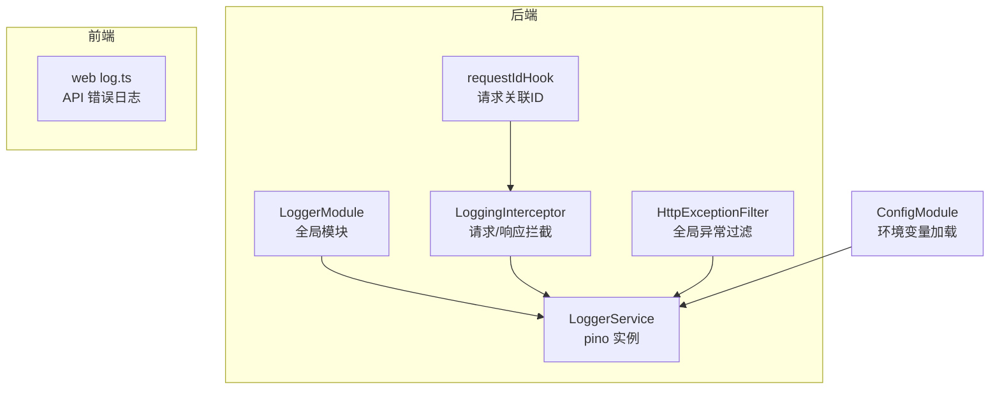
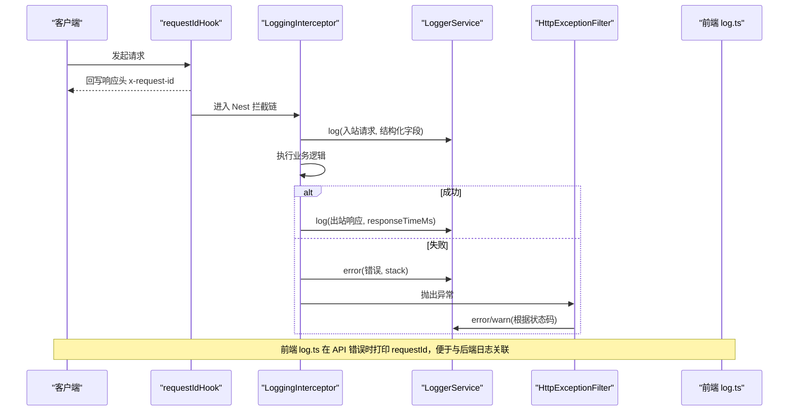
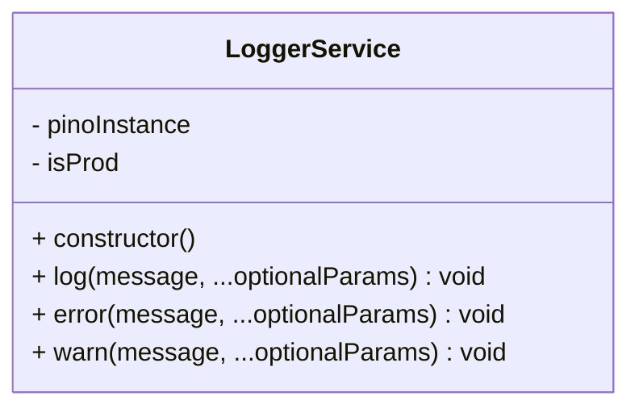
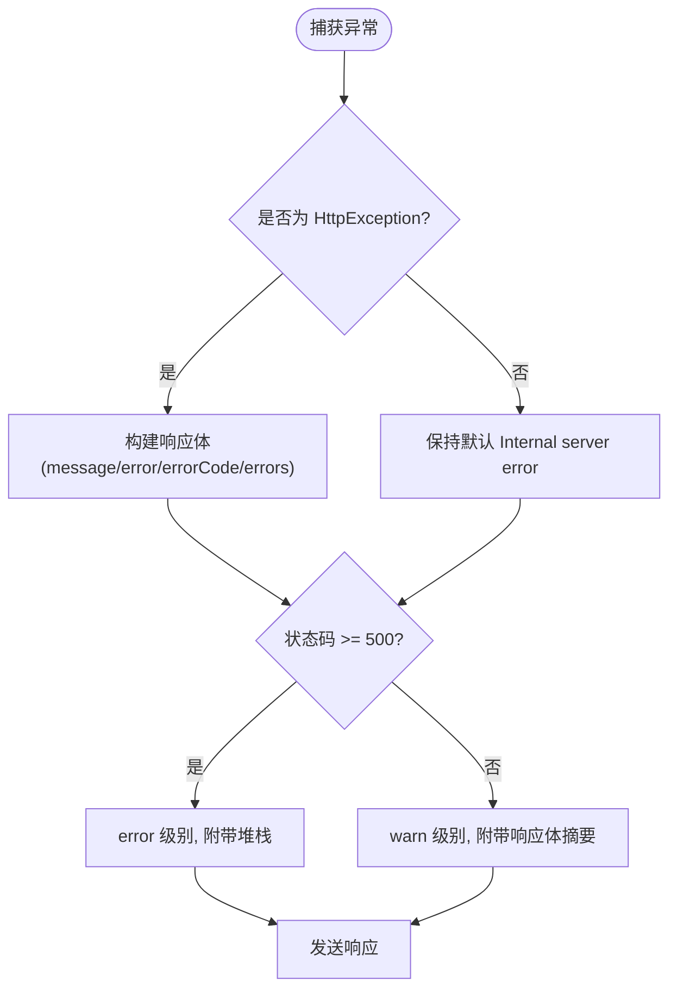
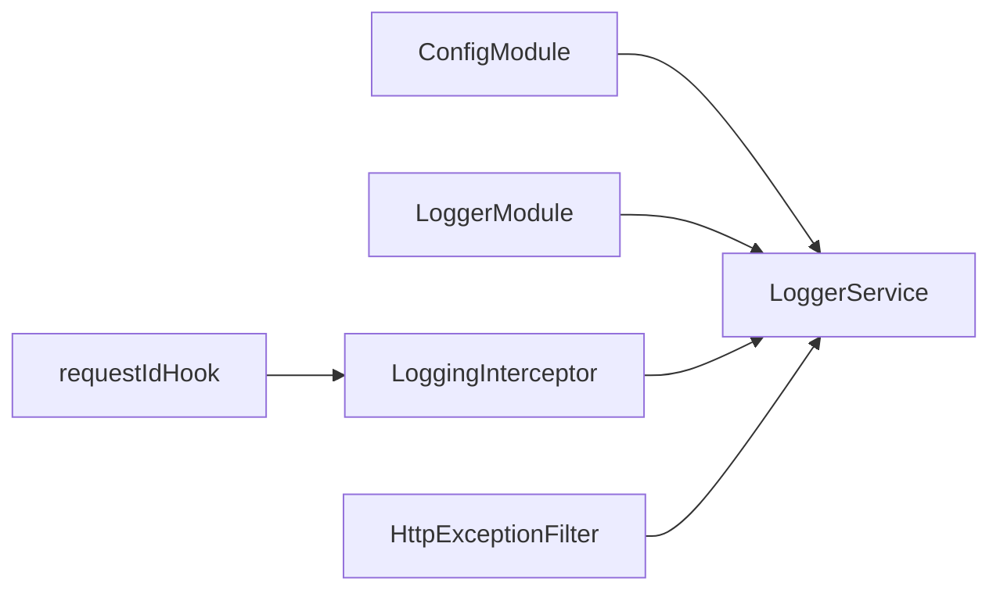

# 日志工具

<cite>
**本文引用的文件**   
- [logger.service.ts](file://apps/api/src/logger/logger.service.ts)
- [logger.module.ts](file://apps/api/src/logger/logger.module.ts)
- [logging.interceptor.ts](file://apps/api/src/common/interceptors/logging.interceptor.ts)
- [http-exception.filter.ts](file://apps/api/src/common/filters/http-exception.filter.ts)
- [request-id.hook.ts](file://apps/api/src/common/request-id.hook.ts)
- [config.module.ts](file://apps/api/src/config/config.module.ts)
- [default.ts](file://apps/api/src/config/envs/default.ts)
- [development.ts](file://apps/api/src/config/envs/development.ts)
- [production.ts](file://apps/api/src/config/envs/production.ts)
- [log.ts](file://apps/web/src/lib/log.ts)
</cite>

## 目录
1. [简介](#简介)
2. [项目结构](#项目结构)
3. [核心组件](#核心组件)
4. [架构总览](#架构总览)
5. [详细组件分析](#详细组件分析)
6. [依赖关系分析](#依赖关系分析)
7. [性能与生产优化](#性能与生产优化)
8. [故障排查指南](#故障排查指南)
9. [结论](#结论)
10. [附录：使用示例与环境变量](#附录使用示例与环境变量)

## 简介
本日志工具围绕后端 LoggerService、请求拦截器、全局异常过滤器、前端日志封装以及统一请求关联 ID，提供跨端一致的日志能力。其目标包括：
- 统一的日志级别管理（debug、info、warn、error）
- 结构化输出与可读性兼顾（开发彩色控制台、生产 JSON 文件）
- 环境相关的日志过滤（通过环境变量控制级别与输出目标）
- 调试信息收集（请求链路、用户代理、客户端 IP、响应耗时）
- 错误堆栈追踪（服务端异常堆栈、业务错误码与明细）
- 日志存储策略（开发控制台、生产文件）、导出与远程上报预留接口
- 前端与后端的关联排查（基于 requestId 的端到端关联）

## 项目结构
日志相关代码主要分布在以下位置：
- 后端服务层：apps/api/src/logger
- 请求链路日志：apps/api/src/common/interceptors/logging.interceptor.ts
- 全局异常处理：apps/api/src/common/filters/http-exception.filter.ts
- 请求关联 ID：apps/api/src/common/request-id.hook.ts
- 配置模块与环境：apps/api/src/config
- 前端日志封装：apps/web/src/lib/log.ts



图示来源
- [logger.module.ts:1-12](file://apps/api/src/logger/logger.module.ts#L1-L12)
- [logger.service.ts:1-83](file://apps/api/src/logger/logger.service.ts#L1-L83)
- [logging.interceptor.ts:1-78](file://apps/api/src/common/interceptors/logging.interceptor.ts#L1-L78)
- [http-exception.filter.ts:1-97](file://apps/api/src/common/filters/http-exception.filter.ts#L1-L97)
- [request-id.hook.ts:1-17](file://apps/api/src/common/request-id.hook.ts#L1-L17)
- [config.module.ts:94-110](file://apps/api/src/config/config.module.ts#L94-L110)

章节来源
- [logger.module.ts:1-12](file://apps/api/src/logger/logger.module.ts#L1-L12)
- [logger.service.ts:1-83](file://apps/api/src/logger/logger.service.ts#L1-L83)
- [logging.interceptor.ts:1-78](file://apps/api/src/common/interceptors/logging.interceptor.ts#L1-L78)
- [http-exception.filter.ts:1-97](file://apps/api/src/common/filters/http-exception.filter.ts#L1-L97)
- [request-id.hook.ts:1-17](file://apps/api/src/common/request-id.hook.ts#L1-L17)
- [config.module.ts:94-110](file://apps/api/src/config/config.module.ts#L94-L110)

## 核心组件
- LoggerService：封装 pino，按环境选择输出目标；支持结构化字段与错误堆栈；在 prod 下同时写入容器 stdout。
- LoggingInterceptor：记录请求入站、响应出站与错误路径，附带 requestId、method、url、ip、userAgent、responseTimeMs 等结构化字段。
- HttpExceptionFilter：统一错误响应体，5xx 记录 error 级别并附带堆栈，非 5xx 记录 warn 级别。
- requestIdHook：统一生成/透传 x-request-id，并通过异步上下文注入后续链路。
- web log.ts：前端 API 错误日志，dev 输出结构化对象，prod 仅单行，携带 requestId 以便与后端对齐。

章节来源
- [logger.service.ts:1-83](file://apps/api/src/logger/logger.service.ts#L1-L83)
- [logging.interceptor.ts:1-78](file://apps/api/src/common/interceptors/logging.interceptor.ts#L1-L78)
- [http-exception.filter.ts:1-97](file://apps/api/src/common/filters/http-exception.filter.ts#L1-L97)
- [request-id.hook.ts:1-17](file://apps/api/src/common/request-id.hook.ts#L1-L17)
- [log.ts:1-40](file://apps/web/src/lib/log.ts#L1-L40)

## 架构总览
下图展示一次 HTTP 请求从进入 Fastify 到返回响应的完整日志链路，以及前后端如何通过 requestId 关联。



图示来源
- [request-id.hook.ts:1-17](file://apps/api/src/common/request-id.hook.ts#L1-L17)
- [logging.interceptor.ts:1-78](file://apps/api/src/common/interceptors/logging.interceptor.ts#L1-L78)
- [http-exception.filter.ts:1-97](file://apps/api/src/common/filters/http-exception.filter.ts#L1-L97)
- [log.ts:1-40](file://apps/web/src/lib/log.ts#L1-L40)

## 详细组件分析

### LoggerService：日志级别、输出格式与环境过滤
- 级别管理
  - 通过环境变量 LOG_LEVEL 控制 pino 级别，默认 info。
  - 暴露 log、warn、error 方法，分别对应 info、warn、error 级别。
- 输出格式
  - 开发/测试：pino-pretty 彩色控制台，时间格式化，忽略 pid/hostname。
  - 生产：pino/file 输出 JSON 文件，可通过 LOG_FILE 指定路径，自动创建目录。
- 环境相关过滤
  - isProd 由 NODE_ENV === 'production' 判定。
  - 生产环境下，同时调用父类 Logger 将消息写入容器 stdout，避免被 pino 单独输出覆盖。
- 结构化字段
  - 支持以对象形式传入 meta，作为结构化字段附加到日志中。
  - error 方法支持额外字符串参数作为 trace 堆栈，并合并为结构化字段。



图示来源
- [logger.service.ts:1-83](file://apps/api/src/logger/logger.service.ts#L1-L83)

章节来源
- [logger.service.ts:1-83](file://apps/api/src/logger/logger.service.ts#L1-L83)

### LoggingInterceptor：请求/响应/错误日志
- 采集字段
  - requestId：优先取 ALS 上下文 currentRequestId()，否则回退到 request.id。
  - method、url、bodySummary（首参保留人类可读前缀，次参为结构化字段）。
  - ip：从 x-forwarded-for、connection.remoteAddress、socket.remoteAddress 推导。
  - userAgent：从 headers.user-agent 获取。
  - responseTimeMs：响应时间与错误路径均计算。
- 输出策略
  - 正常响应：log 级别，附带 responseTimeMs。
  - 错误路径：error 级别，附带 statusCode、stack 或序列化错误对象。
- 与 requestId 的关系
  - 读取当前请求的 requestId，确保整条链路一致。

```mermaid
flowchart TD
Start(["拦截器入口"]) --> ReadReq["读取 method/url/body/headers/ip/userAgent"]
ReadReq --> GetRID["获取 requestId (ALS 或 req.id)")
GetRID --> LogIn["记录入站日志(log)"]
LogIn --> Next["执行处理器"]
Next --> Success{"是否成功?"}
Success --> |是| LogOut["记录出站日志(log, responseTimeMs)"]
Success --> |否| LogErr["记录错误日志(error, statusCode, stack)"]
LogOut --> End(["结束"])
LogErr --> End
```

图示来源
- [logging.interceptor.ts:1-78](file://apps/api/src/common/interceptors/logging.interceptor.ts#L1-L78)
- [request-id.hook.ts:1-17](file://apps/api/src/common/request-id.hook.ts#L1-L17)

章节来源
- [logging.interceptor.ts:1-78](file://apps/api/src/common/interceptors/logging.interceptor.ts#L1-L78)

### HttpExceptionFilter：错误堆栈追踪与结构化错误响应
- 错误响应体
  - 统一 statusCode、message、error、errorCode、errors 等字段。
  - 非 HttpException 的任意 Error 不泄露内部 message，仅记录到日志。
- 日志策略
  - 5xx：error 级别，附带 exception.stack 或 JSON 序列化。
  - 非 5xx：warn 级别，附带响应体摘要。
- 与 LoggerService 的集成
  - 通过 LoggerService.error/warn 输出，保持结构化与一致性。



图示来源
- [http-exception.filter.ts:1-97](file://apps/api/src/common/filters/http-exception.filter.ts#L1-L97)
- [logger.service.ts:1-83](file://apps/api/src/logger/logger.service.ts#L1-L83)

章节来源
- [http-exception.filter.ts:1-97](file://apps/api/src/common/filters/http-exception.filter.ts#L1-L97)

### RequestIdHook：统一请求关联 ID
- 行为
  - 若入站包含 x-request-id，则透传；否则使用 Fastify 原生 req.id。
  - 回写响应头 x-request-id。
  - 通过 requestStorage.run 注入异步上下文，供后续拦截器/中间件读取。
- 作用
  - 保证全链路 requestId 一致，便于前后端日志关联与问题定位。

章节来源
- [request-id.hook.ts:1-17](file://apps/api/src/common/request-id.hook.ts#L1-L17)

### 前端日志封装：web log.ts
- 设计目标
  - 与后端 LoggerService 口径对齐：dev 结构化便于查看，prod 精简不刷屏。
  - 带出后端 requestId（来自响应头），使前端 console 与后端日志可按同一 id 关联。
- 行为
  - dev：console.error 输出结构化对象（requestId、statusCode、errorCode、detail）。
  - prod：仅输出单行 head，减少噪音，留待前端监控采集。

章节来源
- [log.ts:1-40](file://apps/web/src/lib/log.ts#L1-L40)

## 依赖关系分析
- LoggerModule 全局导出 LoggerService，供其他模块直接注入。
- ConfigModule 负责环境变量加载与校验，LoggerService 依赖 NODE_ENV 与 LOG_LEVEL。
- LoggingInterceptor 依赖 LoggerService 与 requestId 上下文。
- HttpExceptionFilter 依赖 LoggerService 进行错误日志记录。
- requestIdHook 位于 Fastify 层，先于 Nest 拦截器执行，确保 requestId 可用。



图示来源
- [logger.module.ts:1-12](file://apps/api/src/logger/logger.module.ts#L1-L12)
- [config.module.ts:94-110](file://apps/api/src/config/config.module.ts#L94-L110)
- [logging.interceptor.ts:1-78](file://apps/api/src/common/interceptors/logging.interceptor.ts#L1-L78)
- [http-exception.filter.ts:1-97](file://apps/api/src/common/filters/http-exception.filter.ts#L1-L97)
- [request-id.hook.ts:1-17](file://apps/api/src/common/request-id.hook.ts#L1-L17)

章节来源
- [logger.module.ts:1-12](file://apps/api/src/logger/logger.module.ts#L1-L12)
- [config.module.ts:94-110](file://apps/api/src/config/config.module.ts#L94-L110)
- [logging.interceptor.ts:1-78](file://apps/api/src/common/interceptors/logging.interceptor.ts#L1-L78)
- [http-exception.filter.ts:1-97](file://apps/api/src/common/filters/http-exception.filter.ts#L1-L97)
- [request-id.hook.ts:1-17](file://apps/api/src/common/request-id.hook.ts#L1-L17)

## 性能与生产优化
- 级别控制
  - 通过 LOG_LEVEL 调整日志量级，建议生产使用 info 或更高，降低 IO 压力。
- 输出目标
  - 生产默认落盘 JSON 文件，便于集中采集与检索；可结合外部滚动/归档方案。
  - 开发使用 pino-pretty，提升可读性，避免双打（dev 不重复走父类 Logger）。
- 结构化字段
  - 尽量使用结构化字段而非拼接长串，便于下游系统解析与聚合。
- 前端日志
  - prod 仅单行输出，减少浏览器控制台噪音，配合前端监控平台采集。

[本节为通用指导，不直接分析具体文件]

## 故障排查指南
- 无法看到日志
  - 检查 NODE_ENV 与 LOG_LEVEL 是否正确设置。
  - 生产环境确认 LOG_FILE 路径存在且可写。
- 前后端日志无法关联
  - 确认前端能读取响应头 x-request-id，并在 log.ts 中正确输出。
  - 确认 requestIdHook 已注册，且 LoggingInterceptor 能读取 ALS 上下文。
- 错误堆栈缺失
  - 确认异常为 Error 类型，LoggerService.error 会提取 stack 字段。
  - 非 HttpException 的内部错误不会泄露 message，但会在日志中保留堆栈。

章节来源
- [logger.service.ts:1-83](file://apps/api/src/logger/logger.service.ts#L1-L83)
- [logging.interceptor.ts:1-78](file://apps/api/src/common/interceptors/logging.interceptor.ts#L1-L78)
- [http-exception.filter.ts:1-97](file://apps/api/src/common/filters/http-exception.filter.ts#L1-L97)
- [request-id.hook.ts:1-17](file://apps/api/src/common/request-id.hook.ts#L1-L17)
- [log.ts:1-40](file://apps/web/src/lib/log.ts#L1-L40)

## 结论
该日志工具以 LoggerService 为核心，结合请求拦截器、全局异常过滤器与前端日志封装，实现了跨端一致的日志能力。通过环境变量实现环境相关的日志过滤，通过 requestId 实现前后端关联排查。生产环境采用 JSON 文件输出，便于集中采集与分析；开发环境使用彩色控制台，提升可读性。建议在后续阶段引入日志滚动与远程上报机制，以满足更大规模的运维需求。

[本节为总结性内容，不直接分析具体文件]

## 附录：使用示例与环境变量

### 日志级别与环境变量
- LOG_LEVEL：日志级别（如 debug、info、warn、error），默认 info。
- NODE_ENV：运行环境（production 与非 production），决定输出目标。
- LOG_FILE：生产环境日志文件路径，默认 logs/app.log。

章节来源
- [logger.service.ts:1-83](file://apps/api/src/logger/logger.service.ts#L1-L83)
- [config.module.ts:94-110](file://apps/api/src/config/config.module.ts#L94-L110)

### 不同级别的日志记录
- 信息日志：用于常规业务流程记录，如请求入站/出站、关键步骤。
- 警告日志：用于非致命异常或潜在风险，如 4xx 错误、业务校验失败。
- 错误日志：用于严重异常，如 5xx 错误、未捕获异常，附带堆栈。

章节来源
- [logging.interceptor.ts:1-78](file://apps/api/src/common/interceptors/logging.interceptor.ts#L1-L78)
- [http-exception.filter.ts:1-97](file://apps/api/src/common/filters/http-exception.filter.ts#L1-L97)

### 结构化日志输出
- 推荐将关键字段（requestId、method、url、ip、userAgent、responseTimeMs、statusCode）作为结构化字段输出，便于检索与分析。
- 错误日志应包含 trace 堆栈，便于定位问题根因。

章节来源
- [logging.interceptor.ts:1-78](file://apps/api/src/common/interceptors/logging.interceptor.ts#L1-L78)
- [logger.service.ts:1-83](file://apps/api/src/logger/logger.service.ts#L1-L83)

### 条件日志开关
- 通过 LOG_LEVEL 控制是否输出 debug 级别日志。
- 前端 log.ts 在 dev 模式下输出结构化对象，prod 模式仅单行。

章节来源
- [logger.service.ts:1-83](file://apps/api/src/logger/logger.service.ts#L1-L83)
- [log.ts:1-40](file://apps/web/src/lib/log.ts#L1-L40)

### 与前端框架的集成方式
- 前端通过 log.ts 封装 API 错误日志，读取响应头 x-request-id，并与后端日志关联。
- 建议在 API 客户端中统一注入 requestId，确保前后端一致。

章节来源
- [log.ts:1-40](file://apps/web/src/lib/log.ts#L1-L40)
- [request-id.hook.ts:1-17](file://apps/api/src/common/request-id.hook.ts#L1-L17)

### 生产环境的日志优化策略
- 使用 info 或更高日志级别，减少 IO 开销。
- 使用 JSON 文件输出，便于集中采集与检索。
- 结合外部日志滚动与归档方案，避免磁盘占用过大。
- 前端 prod 仅单行输出，减少浏览器控制台噪音。

章节来源
- [logger.service.ts:1-83](file://apps/api/src/logger/logger.service.ts#L1-L83)
- [log.ts:1-40](file://apps/web/src/lib/log.ts#L1-L40)