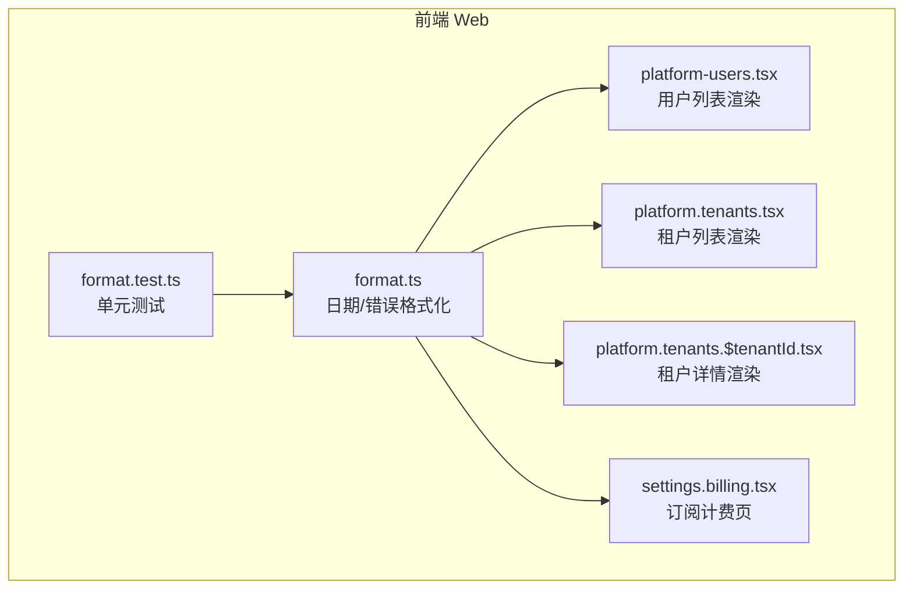
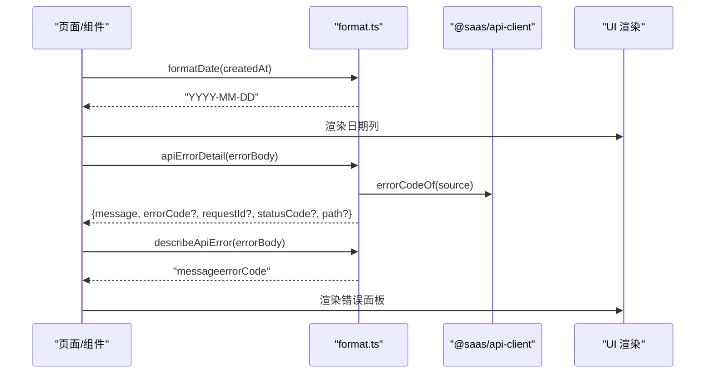
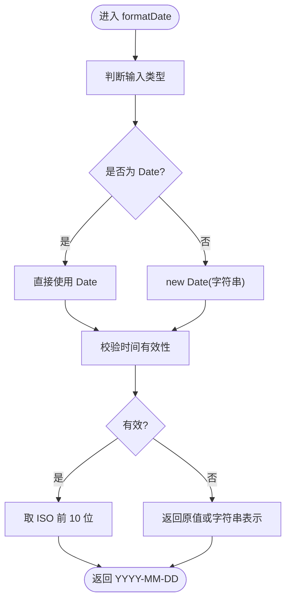
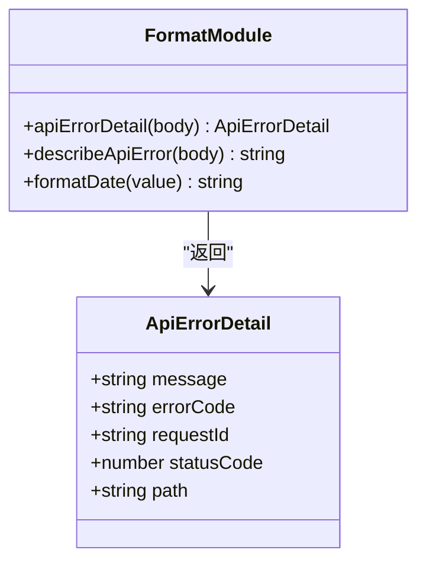
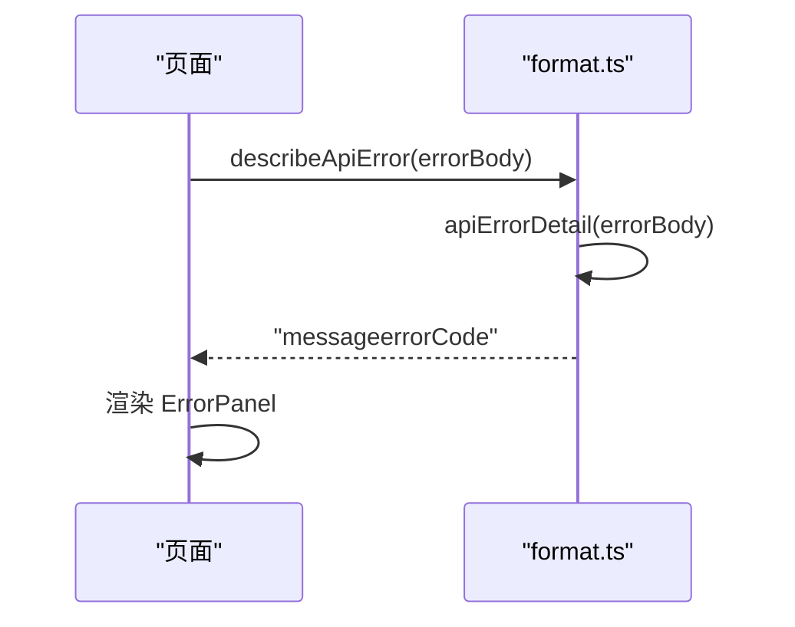
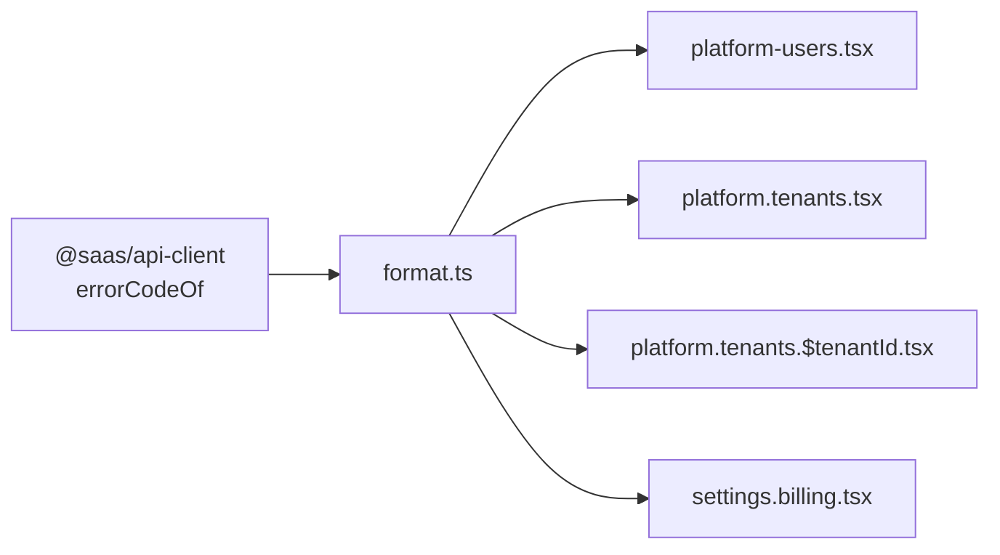

# 格式化工具

<cite>
**本文引用的文件**   
- [apps/web/src/lib/format.ts](file://apps/web/src/lib/format.ts)
- [apps/web/src/lib/format.test.ts](file://apps/web/src/lib/format.test.ts)
- [apps/web/src/components/platform-users.tsx](file://apps/web/src/components/platform-users.tsx)
- [apps/web/src/routes/platform.tenants.tsx](file://apps/web/src/routes/platform.tenants.tsx)
- [apps/web/src/routes/platform.tenants.$tenantId.tsx](file://apps/web/src/routes/platform.tenants.$tenantId.tsx)
- [apps/web/src/routes/settings.billing.tsx](file://apps/web/src/routes/settings.billing.tsx)
</cite>

## 目录
1. [简介](#简介)
2. [项目结构](#项目结构)
3. [核心组件](#核心组件)
4. [架构总览](#架构总览)
5. [详细组件分析](#详细组件分析)
6. [依赖关系分析](#依赖关系分析)
7. [性能与边界处理](#性能与边界处理)
8. [国际化与本地化](#国际化与本地化)
9. [使用示例与最佳实践](#使用示例与最佳实践)
10. [故障排查](#故障排查)
11. [结论](#结论)

## 简介
本文件面向前端格式化能力，聚焦以下目标：
- 数据格式化函数：日期、错误信息、结构化错误字段提取。
- 日期时间处理：ISO 字符串与 Date 对象统一输出为 YYYY-MM-DD。
- 货币金额显示：当前未实现专用货币格式化；提供扩展建议。
- 文本格式化：错误消息聚合与可读文案生成。
- 国际化支持：当前工具不直接依赖 i18n，但可配合现有国际化体系扩展。
- 数字精度控制：当前未实现数值格式化；给出扩展方案。
- 转换规则与边界情况：非法日期回退、空体兜底、数组消息拼接等。
- 性能优化：轻量、无外部依赖、避免重复计算。
- 与其他组件的兼容性：与 API 客户端、路由、状态管理、日志模块对齐。

## 项目结构
格式化能力集中在前端应用 `apps/web/src/lib/format.ts`，并通过测试文件验证行为。业务页面通过导入该模块，将后端返回的数据转换为稳定、可读的前端展示内容。

图表来源
- [apps/web/src/lib/format.ts:1-55](file://apps/web/src/lib/format.ts#L1-L55)
- [apps/web/src/lib/format.test.ts:1-54](file://apps/web/src/lib/format.test.ts#L1-L54)
- [apps/web/src/components/platform-users.tsx:1-122](file://apps/web/src/components/platform-users.tsx#L1-L122)
- [apps/web/src/routes/platform.tenants.tsx:1-208](file://apps/web/src/routes/platform.tenants.tsx#L1-L208)
- [apps/web/src/routes/platform.tenants.$tenantId.tsx:1-317](file://apps/web/src/routes/platform.tenants.$tenantId.tsx#L1-L317)
- [apps/web/src/routes/settings.billing.tsx:1-95](file://apps/web/src/routes/settings.billing.tsx#L1-L95)

章节来源
- [apps/web/src/lib/format.ts:1-55](file://apps/web/src/lib/format.ts#L1-L55)
- [apps/web/src/lib/format.test.ts:1-54](file://apps/web/src/lib/format.test.ts#L1-L54)

## 核心组件
- 日期格式化：`formatDate(value)`
  - 输入：字符串或 Date 对象。
  - 输出：YYYY-MM-DD 字符串；无法解析时回退原值，避免 NaN。
- 错误结构化提取：`apiErrorDetail(body)`
  - 从后端错误响应体中提取 message、errorCode、requestId、statusCode、path。
  - 兼容 ORPCError 与 REST 错误体两种形态。
- 错误文案描述：`describeApiError(body)`
  - 将结构化错误窄化为一句可读文案，必要时附带 errorCode。

章节来源
- [apps/web/src/lib/format.ts:1-55](file://apps/web/src/lib/format.ts#L1-L55)

## 架构总览
格式化模块作为前端通用工具层，被多个页面和组件消费，承担“后端原始数据 → 前端展示数据”的转换职责。

图表来源
- [apps/web/src/lib/format.ts:1-55](file://apps/web/src/lib/format.ts#L1-L55)
- [apps/web/src/routes/platform.tenants.tsx:1-208](file://apps/web/src/routes/platform.tenants.tsx#L1-L208)
- [apps/web/src/routes/platform.tenants.$tenantId.tsx:1-317](file://apps/web/src/routes/platform.tenants.$tenantId.tsx#L1-L317)
- [apps/web/src/routes/settings.billing.tsx:1-95](file://apps/web/src/routes/settings.billing.tsx#L1-L95)

## 详细组件分析

### 日期格式化：formatDate
- 设计要点
  - 同时接受 ISO 字符串与 Date 对象，适配后端 reviving Date 后的契约视图。
  - 对非法日期进行防御性处理，返回原串，避免渲染 NaN。
  - 输出固定长度为 YYYY-MM-DD，便于表格列对齐与排序。
- 复杂度
  - 时间复杂度 O(1)，空间复杂度 O(1)。
- 边界情况
  - 非 ISO 字符串：直接返回原串。
  - null/undefined：调用方应判空后再传入；若传入 Date 对象且无效，会回退为字符串表示。
- 扩展建议
  - 如需本地化日期（如中文年月日），可在上层组件中根据 locale 选择不同格式化策略。

图表来源
- [apps/web/src/lib/format.ts:7-13](file://apps/web/src/lib/format.ts#L7-L13)

章节来源
- [apps/web/src/lib/format.ts:7-13](file://apps/web/src/lib/format.ts#L7-L13)
- [apps/web/src/lib/format.test.ts:4-11](file://apps/web/src/lib/format.test.ts#L4-L11)

### 错误结构化提取：apiErrorDetail
- 设计要点
  - 兼容 ORPCError 与 REST 错误体：根据 name 字段识别并抽取 data。
  - message 支持 string 或 string[]：数组用分号连接成单句文案。
  - 仅当字段存在且类型正确时才写入结果对象，避免污染日志。
- 数据结构
  - ApiErrorDetail：包含 message、errorCode、requestId、statusCode、path。
- 与后端约定
  - 字段名与 HttpExceptionFilter 同源键一致，便于前后端日志对映。
- 复杂度
  - 时间复杂度 O(1)，空间复杂度 O(1)。

图表来源
- [apps/web/src/lib/format.ts:20-46](file://apps/web/src/lib/format.ts#L20-L46)

章节来源
- [apps/web/src/lib/format.ts:20-46](file://apps/web/src/lib/format.ts#L20-L46)
- [apps/web/src/lib/format.test.ts:32-53](file://apps/web/src/lib/format.test.ts#L32-L53)

### 错误文案描述：describeApiError
- 设计要点
  - 基于 apiErrorDetail 的结果，构造简洁可读的错误文案。
  - 有 errorCode 时附加在括号内，便于快速定位问题。
- 使用场景
  - 页面级错误面板、操作失败提示、导出/诊断失败反馈。

图表来源
- [apps/web/src/lib/format.ts:51-54](file://apps/web/src/lib/format.ts#L51-L54)
- [apps/web/src/routes/platform.tenants.tsx:38-45](file://apps/web/src/routes/platform.tenants.tsx#L38-L45)
- [apps/web/src/routes/platform.tenants.$tenantId.tsx:34-44](file://apps/web/src/routes/platform.tenants.$tenantId.tsx#L34-L44)
- [apps/web/src/routes/settings.billing.tsx:28-35](file://apps/web/src/routes/settings.billing.tsx#L28-L35)

章节来源
- [apps/web/src/lib/format.ts:51-54](file://apps/web/src/lib/format.ts#L51-L54)
- [apps/web/src/lib/format.test.ts:13-30](file://apps/web/src/lib/format.test.ts#L13-L30)

## 依赖关系分析
- 内部依赖
  - format.ts 依赖 @saas/api-client 的 errorCodeOf，用于统一错误码提取。
- 外部消费者
  - platform-users.tsx：使用 formatDate 渲染创建时间。
  - platform.tenants.tsx：使用 formatDate、apiErrorDetail、describeApiError。
  - platform.tenants.$tenantId.tsx：同上。
  - settings.billing.tsx：使用 apiErrorDetail、describeApiError。

图表来源
- [apps/web/src/lib/format.ts:1-55](file://apps/web/src/lib/format.ts#L1-L55)
- [apps/web/src/components/platform-users.tsx:1-122](file://apps/web/src/components/platform-users.tsx#L1-L122)
- [apps/web/src/routes/platform.tenants.tsx:1-208](file://apps/web/src/routes/platform.tenants.tsx#L1-L208)
- [apps/web/src/routes/platform.tenants.$tenantId.tsx:1-317](file://apps/web/src/routes/platform.tenants.$tenantId.tsx#L1-L317)
- [apps/web/src/routes/settings.billing.tsx:1-95](file://apps/web/src/routes/settings.billing.tsx#L1-L95)

章节来源
- [apps/web/src/lib/format.ts:1-55](file://apps/web/src/lib/format.ts#L1-L55)

## 性能与边界处理
- 性能
  - 所有函数均为常量时间与常量空间，适合批量数据处理。
  - 建议在列表渲染中对每个条目调用 formatDate，避免在模板中进行复杂逻辑。
- 边界处理
  - 非法日期：返回原串，避免 NaN。
  - 空体错误：message 默认“请求失败”。
  - 数组消息：以分号连接为单句文案。
  - 可选字段：仅在存在且类型正确时写入结果对象。

章节来源
- [apps/web/src/lib/format.ts:7-13](file://apps/web/src/lib/format.ts#L7-L13)
- [apps/web/src/lib/format.ts:28-46](file://apps/web/src/lib/format.ts#L28-L46)
- [apps/web/src/lib/format.test.ts:4-11](file://apps/web/src/lib/format.test.ts#L4-L11)
- [apps/web/src/lib/format.test.ts:13-30](file://apps/web/src/lib/format.test.ts#L13-L30)

## 国际化与本地化
- 当前实现
  - 日期格式化输出为 ISO 前 10 位，不依赖 Intl 或 i18n。
  - 错误文案由后端 message 提供，前端仅做聚合与附加 errorCode。
- 扩展建议
  - 如需本地化日期（例如中文“年-月-日”），可在上层组件中根据 locale 选择不同格式化策略。
  - 如需本地化错误文案，可将 message 交由 i18n 翻译层处理，或在后端返回多语言 message。

[本节为概念性说明，不直接分析具体文件]

## 使用示例与最佳实践

### 日期显示
- 在用户列表与租户列表中，使用 formatDate 将 createdAt 转为 YYYY-MM-DD。
- 若字段可能为空，应先判空再调用。

章节来源
- [apps/web/src/components/platform-users.tsx:101-114](file://apps/web/src/components/platform-users.tsx#L101-L114)
- [apps/web/src/routes/platform.tenants.tsx:185-200](file://apps/web/src/routes/platform.tenants.tsx#L185-L200)
- [apps/web/src/routes/platform.tenants.$tenantId.tsx:120-128](file://apps/web/src/routes/platform.tenants.$tenantId.tsx#L120-L128)

### 错误处理
- 在 loader 或异步操作中捕获异常后：
  - 使用 apiErrorDetail 提取结构化字段（requestId、statusCode、path）。
  - 使用 describeApiError 生成可读文案，用于 ErrorPanel 展示。
- 对于 403 等权限错误，可根据 statusCode 设置 denied 标志，差异化提示。

章节来源
- [apps/web/src/routes/platform.tenants.tsx:38-45](file://apps/web/src/routes/platform.tenants.tsx#L38-L45)
- [apps/web/src/routes/platform.tenants.$tenantId.tsx:34-44](file://apps/web/src/routes/platform.tenants.$tenantId.tsx#L34-L44)
- [apps/web/src/routes/settings.billing.tsx:28-35](file://apps/web/src/routes/settings.billing.tsx#L28-L35)

### 自定义格式化规则
- 如需本地化日期：
  - 在上层组件中根据 locale 选择不同格式化策略，例如使用 Intl.DateTimeFormat。
- 如需货币金额显示：
  - 新增 currencyFormat(amount, locale, currency) 函数，使用 Intl.NumberFormat 配置最小/最大小数位数。
- 如需数字精度控制：
  - 新增 numberFormat(value, options) 函数，支持千分位、百分比、固定小数位等。

[本节为扩展建议，不直接分析具体文件]

### 批量数据处理
- 在列表渲染中，对 items.map 中的每个条目调用 formatDate。
- 对于错误处理，建议在 catch 块中统一调用 apiErrorDetail 与 describeApiError，保持错误展示一致性。

章节来源
- [apps/web/src/routes/platform.tenants.tsx:185-200](file://apps/web/src/routes/platform.tenants.tsx#L185-L200)
- [apps/web/src/routes/platform.tenants.$tenantId.tsx:214-231](file://apps/web/src/routes/platform.tenants.$tenantId.tsx#L214-L231)

## 故障排查
- 日期显示为 NaN
  - 检查传入值是否为合法 Date 或 ISO 字符串。
  - 若为 mock 数据或历史数据，确保字段类型正确。
- 错误文案缺失 errorCode
  - 确认后端返回体包含 errorCode 字段，且 errorCodeOf 能正确提取。
- 403 权限错误未正确提示
  - 检查 apiErrorDetail 返回的 statusCode 是否为 403，并在页面中设置 denied 标志。

章节来源
- [apps/web/src/lib/format.test.ts:4-11](file://apps/web/src/lib/format.test.ts#L4-L11)
- [apps/web/src/lib/format.test.ts:13-30](file://apps/web/src/lib/format.test.ts#L13-L30)
- [apps/web/src/routes/platform.tenants.tsx:38-45](file://apps/web/src/routes/platform.tenants.tsx#L38-L45)
- [apps/web/src/routes/platform.tenants.$tenantId.tsx:34-44](file://apps/web/src/routes/platform.tenants.$tenantId.tsx#L34-L44)
- [apps/web/src/routes/settings.billing.tsx:28-35](file://apps/web/src/routes/settings.billing.tsx#L28-L35)

## 结论
当前格式化模块提供了稳定的日期与错误处理能力，满足前端展示的基本需求。未来可扩展货币金额、数字精度、本地化日期等功能，以满足更丰富的国际化与业务场景。建议在上层组件中封装更多格式化策略，保持 format.ts 的轻量与专注。