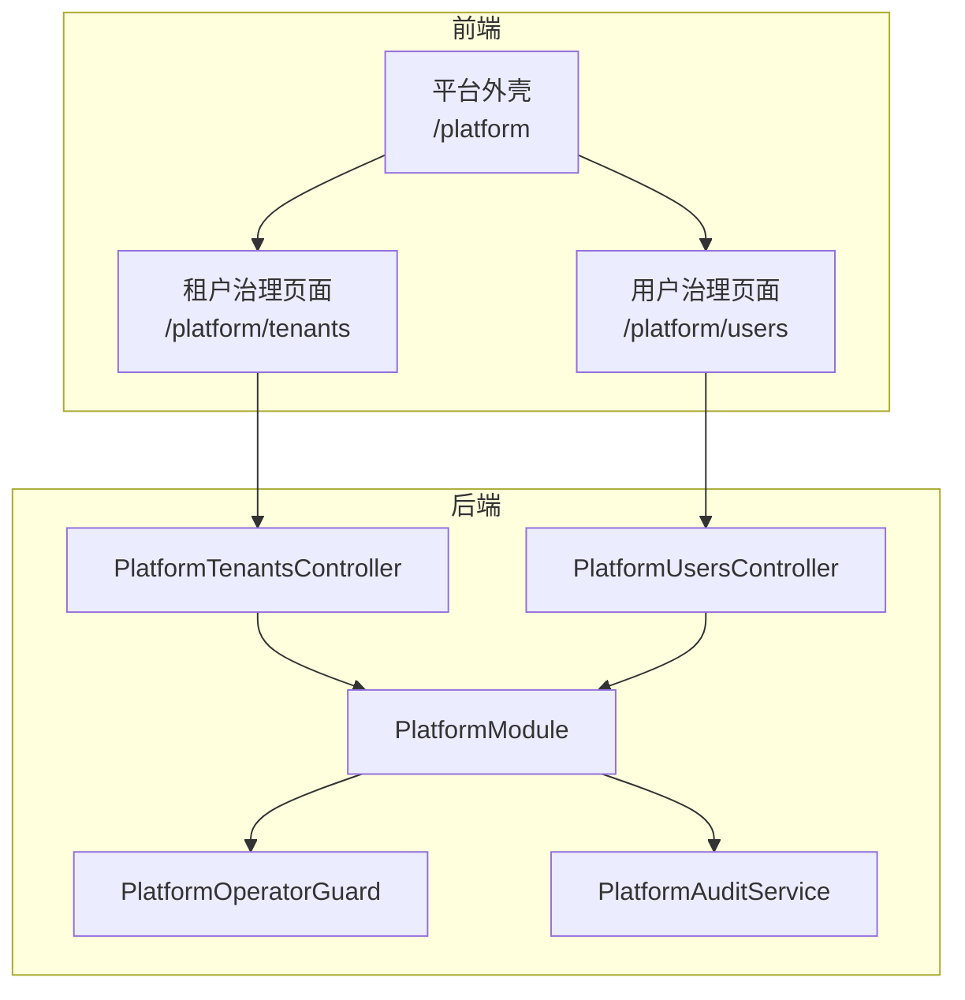
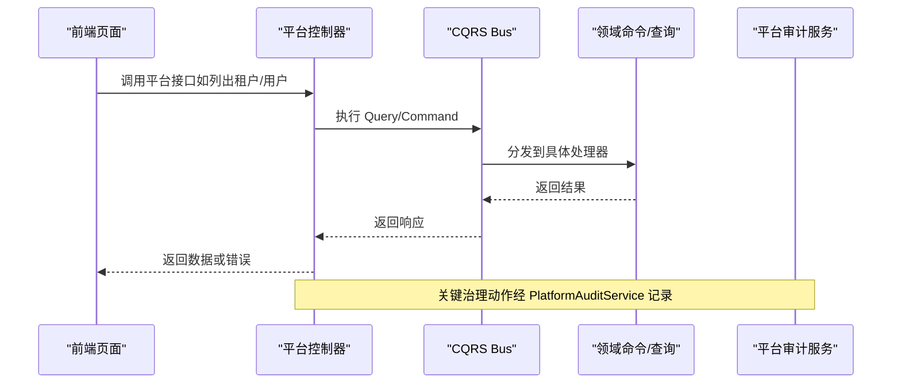
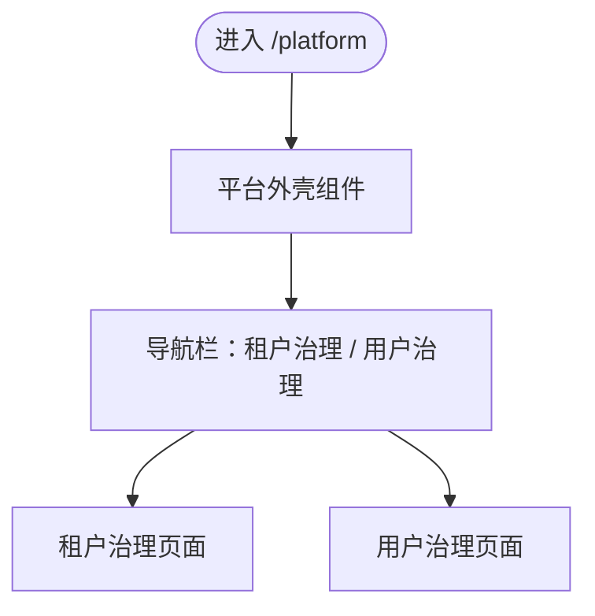
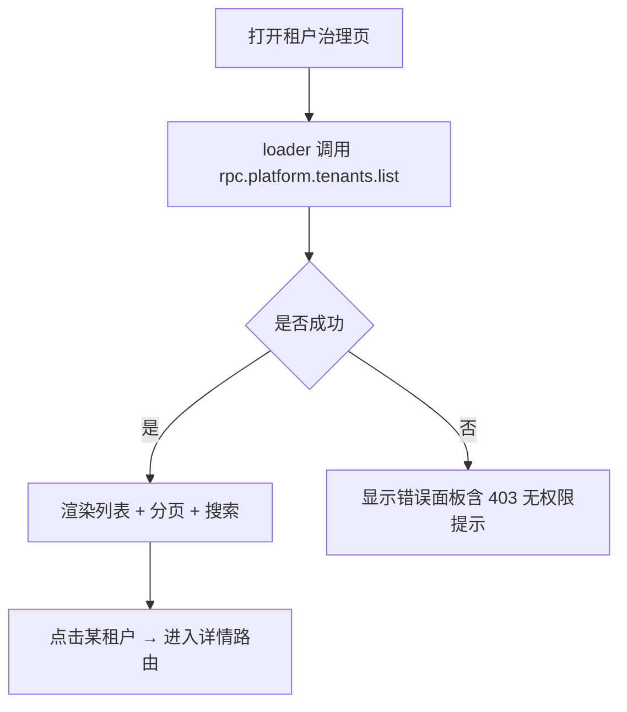
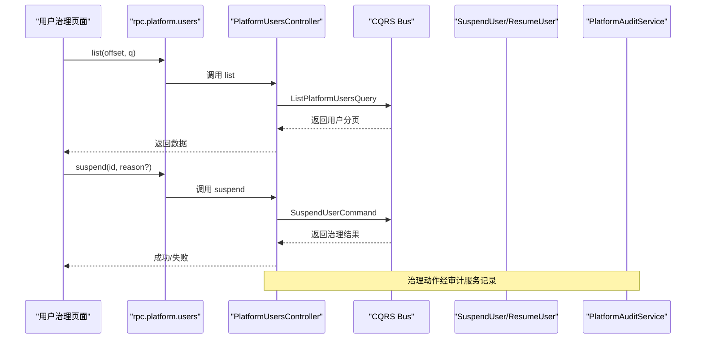
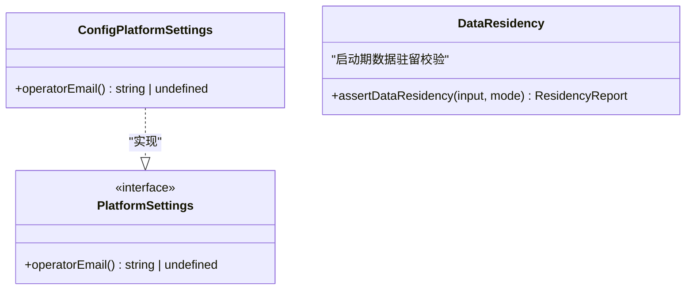
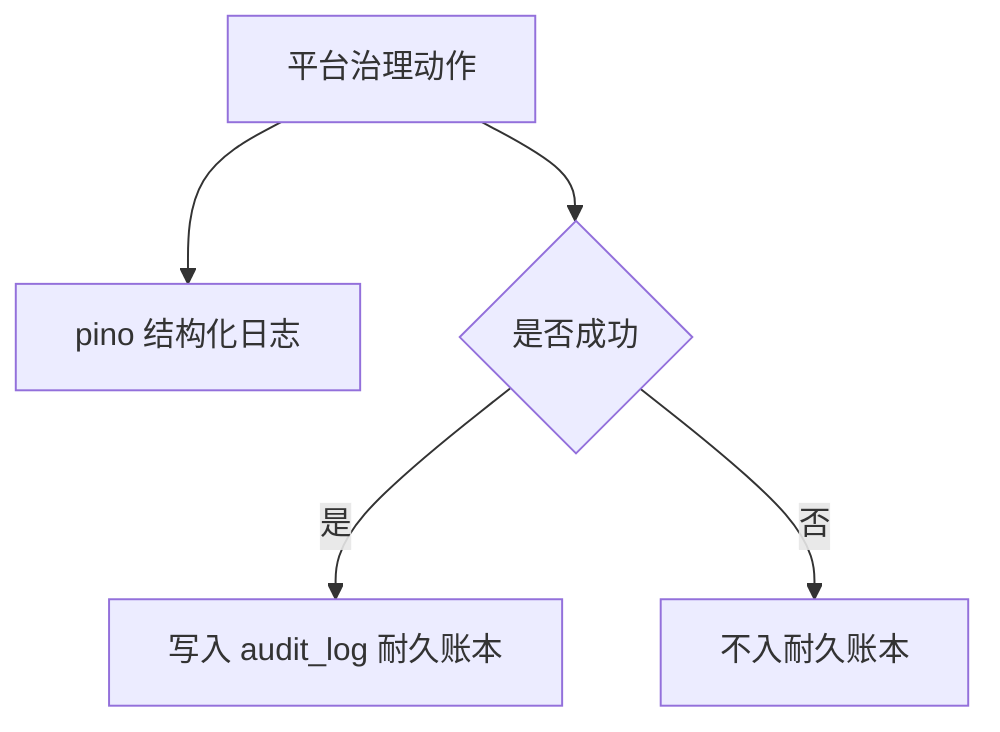
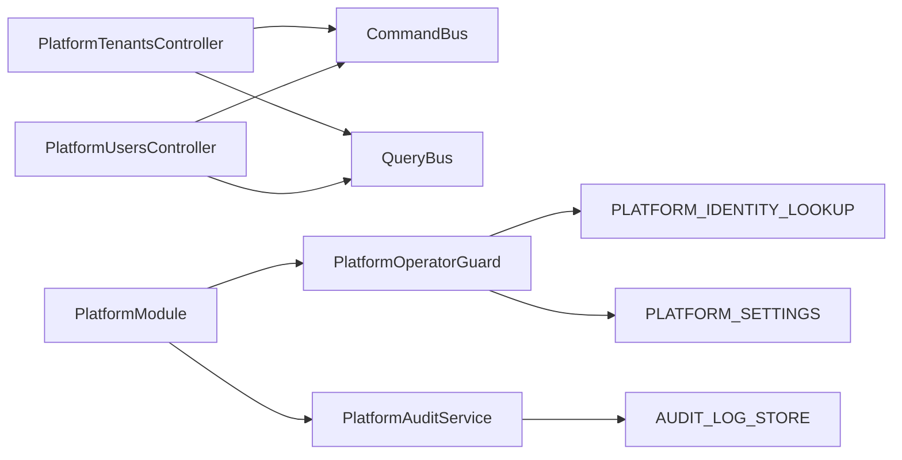

# 平台管理功能

<cite>
**本文引用的文件**   
- [apps/web/src/routes/platform.tsx](file://apps/web/src/routes/platform.tsx)
- [apps/web/src/routes/platform.tenants.tsx](file://apps/web/src/routes/platform.tenants.tsx)
- [apps/web/src/routes/platform.users.tsx](file://apps/web/src/routes/platform.users.tsx)
- [apps/web/src/components/platform-tenants.tsx](file://apps/web/src/components/platform-tenants.tsx)
- [apps/web/src/components/platform-users.tsx](file://apps/web/src/components/platform-users.tsx)
- [apps/api/src/modules/platform/api/platform-tenants.controller.ts](file://apps/api/src/modules/platform/api/platform-tenants.controller.ts)
- [apps/api/src/modules/platform/api/platform-users.controller.ts](file://apps/api/src/modules/platform/api/platform-users.controller.ts)
- [apps/api/src/modules/platform/platform.module.ts](file://apps/api/src/modules/platform/platform.module.ts)
- [libs/core/src/platform/platform-operator.guard.ts](file://libs/core/src/platform/platform-operator.guard.ts)
- [libs/core/src/platform/platform-audit.service.ts](file://libs/core/src/platform/platform-audit.service.ts)
- [apps/api/src/modules/platform/platform-audit.service.test.ts](file://apps/api/src/modules/platform/platform-audit.service.test.ts)
- [apps/api/src/config/data-residency.ts](file://apps/api/src/config/data-residency.ts)
- [libs/core/src/platform/platform-config.port.ts](file://libs/core/src/platform/platform-config.port.ts)
- [apps/api/src/modules/platform/infrastructure/config-platform.settings.ts](file://apps/api/src/modules/platform/infrastructure/config-platform.settings.ts)
</cite>

## 目录
1. [引言](#引言)
2. [项目结构](#项目结构)
3. [核心组件](#核心组件)
4. [架构总览](#架构总览)
5. [详细组件分析](#详细组件分析)
6. [依赖关系分析](#依赖关系分析)
7. [性能与可用性考虑](#性能与可用性考虑)
8. [故障排查指南](#故障排查指南)
9. [结论](#结论)
10. [附录：最佳实践与安全建议](#附录最佳实践与安全建议)

## 引言
本文件面向平台管理员，说明平台管理功能的整体布局、导航结构、租户治理、用户治理、平台级配置、系统监控与日志能力，并给出权限模型、数据安全与审计要求以及运维最佳实践。该功能由前端路由与页面、后端控制器、平台级守卫与审计服务共同实现，采用 CQRS 模式委派命令与查询，所有平台级操作均受“平台操作员”闸门保护，并对关键动作进行结构化审计记录。

## 项目结构
平台管理在前后端分别有清晰边界：
- 前端以 `/platform` 为运营段外壳，提供“租户治理”和“用户治理”两个入口，使用 TanStack Router 的文件式路由与 `Outlet` 组合子页面。
- 后端以 `PlatformModule` 聚合平台治理控制器，统一暴露跨租户的 HTTP 接口；所有接口通过 `PlatformOperatorGuard` 校验平台操作员身份，并通过 `TenantIsolationExempt` 豁免租户隔离。

图表来源
- [apps/web/src/routes/platform.tsx:10-41](file://apps/web/src/routes/platform.tsx#L10-L41)
- [apps/web/src/routes/platform.tenants.tsx:21-48](file://apps/web/src/routes/platform.tenants.tsx#L21-L48)
- [apps/web/src/routes/platform.users.tsx:22-49](file://apps/web/src/routes/platform.users.tsx#L22-L49)
- [apps/api/src/modules/platform/platform.module.ts:29-46](file://apps/api/src/modules/platform/platform.module.ts#L29-L46)

章节来源
- [apps/web/src/routes/platform.tsx:10-41](file://apps/web/src/routes/platform.tsx#L10-L41)
- [apps/api/src/modules/platform/platform.module.ts:29-46](file://apps/api/src/modules/platform/platform.module.ts#L29-L46)

## 核心组件
- 平台外壳与导航：提供“平台运营”标题与“租户治理”“用户治理”导航链接，使用 `Outlet` 渲染子页面。
- 租户治理页面：分页列表、搜索（名称/Slug）、状态徽标、进入详情跳转。
- 用户治理页面：分页列表、搜索（名称/邮箱）、行内暂停/恢复操作，支持填写暂停理由。
- 平台控制器：
  - 租户控制器：列出租户、查看详情、暂停/恢复、设置组织可见性、软删/硬删、组织诊断与数据导出。
  - 用户控制器：列出用户、暂停/恢复用户。
- 平台级安全与审计：
  - 平台操作员守卫：基于会话用户 DB email 与配置项匹配，fail-closed。
  - 平台审计服务：双通道（pino 结构化日志 + audit_log 耐久账本），PII 最小化。

章节来源
- [apps/web/src/routes/platform.tsx:10-41](file://apps/web/src/routes/platform.tsx#L10-L41)
- [apps/web/src/routes/platform.tenants.tsx:21-208](file://apps/web/src/routes/platform.tenants.tsx#L21-L208)
- [apps/web/src/routes/platform.users.tsx:22-207](file://apps/web/src/routes/platform.users.tsx#L22-L207)
- [apps/api/src/modules/platform/api/platform-tenants.controller.ts:100-311](file://apps/api/src/modules/platform/api/platform-tenants.controller.ts#L100-L311)
- [apps/api/src/modules/platform/api/platform-users.controller.ts:54-121](file://apps/api/src/modules/platform/api/platform-users.controller.ts#L54-L121)
- [libs/core/src/platform/platform-operator.guard.ts:18-43](file://libs/core/src/platform/platform-operator.guard.ts#L18-L43)
- [libs/core/src/platform/platform-audit.service.ts:49-151](file://libs/core/src/platform/platform-audit.service.ts#L49-L151)

## 架构总览
平台管理采用“前端页面 → 后端控制器 → CQRS Bus → 领域命令/查询”的分层结构，并以平台级守卫与审计服务作为横切关注点。

图表来源
- [apps/api/src/modules/platform/api/platform-tenants.controller.ts:112-123](file://apps/api/src/modules/platform/api/platform-tenants.controller.ts#L112-L123)
- [apps/api/src/modules/platform/api/platform-users.controller.ts:67-78](file://apps/api/src/modules/platform/api/platform-users.controller.ts#L67-L78)
- [libs/core/src/platform/platform-audit.service.ts:49-151](file://libs/core/src/platform/platform-audit.service.ts#L49-L151)

## 详细组件分析

### 平台管理员界面布局与导航
- 外壳路由 `/platform` 负责加载会话校验，并提供顶部导航栏，包含“租户治理”和“用户治理”两个链接。
- 子页面通过 `Outlet` 渲染，保持统一的运营段外观与上下文。

图表来源
- [apps/web/src/routes/platform.tsx:10-41](file://apps/web/src/routes/platform.tsx#L10-L41)

章节来源
- [apps/web/src/routes/platform.tsx:10-41](file://apps/web/src/routes/platform.tsx#L10-L41)

### 租户管理页面
- 列表展示：名称、Slug、组织数、状态、创建时间，支持分页（offset 分页）。
- 搜索：按名称/Slug 模糊匹配，提交后重置 offset 并刷新列表。
- 状态监控：使用状态徽标显示待审批、生效、已暂停、已删除等状态。
- 生命周期管理：通过控制器暴露暂停、恢复、软删、硬删、组织可见性设置、组织诊断与数据导出等能力。

图表来源
- [apps/web/src/routes/platform.tenants.tsx:21-48](file://apps/web/src/routes/platform.tenants.tsx#L21-L48)
- [apps/web/src/routes/platform.tenants.tsx:85-138](file://apps/web/src/routes/platform.tenants.tsx#L85-L138)
- [apps/web/src/components/platform-tenants.tsx:15-56](file://apps/web/src/components/platform-tenants.tsx#L15-L56)

章节来源
- [apps/web/src/routes/platform.tenants.tsx:21-208](file://apps/web/src/routes/platform.tenants.tsx#L21-L208)
- [apps/web/src/components/platform-tenants.tsx:15-127](file://apps/web/src/components/platform-tenants.tsx#L15-L127)
- [apps/api/src/modules/platform/api/platform-tenants.controller.ts:100-311](file://apps/api/src/modules/platform/api/platform-tenants.controller.ts#L100-L311)

### 用户管理页面
- 列表展示：名称、邮箱、状态、创建时间，支持分页与搜索（名称/邮箱）。
- 权限控制：仅平台操作员可访问；前端对非法操作按钮禁用，后端以 409 做最终裁判。
- 批量/行内操作：当前实现为行内暂停/恢复；暂停需可选填写理由，用于审计记录。

图表来源
- [apps/web/src/routes/platform.users.tsx:22-49](file://apps/web/src/routes/platform.users.tsx#L22-L49)
- [apps/web/src/routes/platform.users.tsx:135-206](file://apps/web/src/routes/platform.users.tsx#L135-L206)
- [apps/api/src/modules/platform/api/platform-users.controller.ts:67-121](file://apps/api/src/modules/platform/api/platform-users.controller.ts#L67-L121)
- [libs/core/src/platform/platform-audit.service.ts:111-151](file://libs/core/src/platform/platform-audit.service.ts#L111-L151)

章节来源
- [apps/web/src/routes/platform.users.tsx:22-207](file://apps/web/src/routes/platform.users.tsx#L22-L207)
- [apps/web/src/components/platform-users.tsx:6-122](file://apps/web/src/components/platform-users.tsx#L6-L122)
- [apps/api/src/modules/platform/api/platform-users.controller.ts:54-121](file://apps/api/src/modules/platform/api/platform-users.controller.ts#L54-L121)

### 平台级配置管理
- 平台操作员身份来源于配置项 `operatorEmail`，由 `ConfigPlatformSettings` 适配应用侧配置服务读取。
- 若未配置或会话用户 email 不匹配，平台级访问 fail-closed（403）。
- 数据驻留检查模块校验数据库与对象存储区域是否符合中国大陆合规要求，启动时可按 strict/warn 模式收集违规信息。

图表来源
- [apps/api/src/modules/platform/infrastructure/config-platform.settings.ts:11-18](file://apps/api/src/modules/platform/infrastructure/config-platform.settings.ts#L11-L18)
- [libs/core/src/platform/platform-config.port.ts:1-25](file://libs/core/src/platform/platform-config.port.ts#L1-L25)
- [apps/api/src/config/data-residency.ts:1-111](file://apps/api/src/config/data-residency.ts#L1-L111)

章节来源
- [apps/api/src/modules/platform/infrastructure/config-platform.settings.ts:11-18](file://apps/api/src/modules/platform/infrastructure/config-platform.settings.ts#L11-L18)
- [libs/core/src/platform/platform-config.port.ts:1-25](file://libs/core/src/platform/platform-config.port.ts#L1-L25)
- [apps/api/src/config/data-residency.ts:1-111](file://apps/api/src/config/data-residency.ts#L1-L111)

### 系统监控与日志查看
- 运行时观测：平台审计服务对所有治理动作输出 pino 结构化日志，便于实时观测与告警。
- 持久审计：成功的治理动作写入 `audit_log` 表，记录实体类型、实体 ID、动作、迁移前后状态、操作者 ID、原因与关联请求 ID。
- 失败尝试：仅观测日志，不入耐久账本，避免污染审计事实。

图表来源
- [libs/core/src/platform/platform-audit.service.ts:49-151](file://libs/core/src/platform/platform-audit.service.ts#L49-L151)
- [apps/api/src/modules/platform/platform-audit.service.test.ts:19-92](file://apps/api/src/modules/platform/platform-audit.service.test.ts#L19-L92)

章节来源
- [libs/core/src/platform/platform-audit.service.ts:49-151](file://libs/core/src/platform/platform-audit.service.ts#L49-L151)
- [apps/api/src/modules/platform/platform-audit.service.test.ts:19-92](file://apps/api/src/modules/platform/platform-audit.service.test.ts#L19-L92)

## 依赖关系分析
- 控制器依赖：
  - `PlatformTenantsController` 与 `PlatformUsersController` 均注入 `CommandBus` 与 `QueryBus`，通过 CQRS 委派业务逻辑。
  - 类级别标注 `@TenantIsolationExempt()` 与 `@UseGuards(PlatformOperatorGuard)`，确保跨租户且仅平台操作员可访问。
- 模块装配：
  - `PlatformModule` 全局导出 `PlatformOperatorGuard`、`PlatformAuditService` 及平台身份/配置端口，供其他模块复用。
- 外部依赖：
  - 平台操作员判定依赖 `PLATFORM_IDENTITY_LOOKUP`（DB email 查询）与 `PLATFORM_SETTINGS`（operatorEmail）。
  - 审计落库依赖 `AUDIT_LOG_STORE` 端口。

图表来源
- [apps/api/src/modules/platform/api/platform-tenants.controller.ts:100-107](file://apps/api/src/modules/platform/api/platform-tenants.controller.ts#L100-L107)
- [apps/api/src/modules/platform/api/platform-users.controller.ts:54-61](file://apps/api/src/modules/platform/api/platform-users.controller.ts#L54-L61)
- [apps/api/src/modules/platform/platform.module.ts:29-46](file://apps/api/src/modules/platform/platform.module.ts#L29-L46)
- [libs/core/src/platform/platform-operator.guard.ts:36-43](file://libs/core/src/platform/platform-operator.guard.ts#L36-L43)
- [libs/core/src/platform/platform-audit.service.ts:63-70](file://libs/core/src/platform/platform-audit.service.ts#L63-L70)

章节来源
- [apps/api/src/modules/platform/api/platform-tenants.controller.ts:100-311](file://apps/api/src/modules/platform/api/platform-tenants.controller.ts#L100-L311)
- [apps/api/src/modules/platform/api/platform-users.controller.ts:54-121](file://apps/api/src/modules/platform/api/platform-users.controller.ts#L54-L121)
- [apps/api/src/modules/platform/platform.module.ts:29-46](file://apps/api/src/modules/platform/platform.module.ts#L29-L46)
- [libs/core/src/platform/platform-operator.guard.ts:18-43](file://libs/core/src/platform/platform-operator.guard.ts#L18-L43)
- [libs/core/src/platform/platform-audit.service.ts:49-151](file://libs/core/src/platform/platform-audit.service.ts#L49-L151)

## 性能与可用性考虑
- 分页策略：租户与用户列表均采用 offset 分页，默认 LIMIT=20，适合中等规模数据量；当总量较大时建议结合服务端游标或索引优化。
- 前端交互：搜索提交会重置 offset，避免翻页错位；破坏性操作（暂停/恢复/删除）在前端禁用非法按钮，后端以 409 做最终裁决，提升用户体验同时保证一致性。
- 审计开销：审计服务对每次治理动作输出日志并可能写持久账本，建议在高频场景下评估异步落库与批处理策略。

[本节为通用指导，不直接分析具体文件]

## 故障排查指南
- 401 未登录：平台级接口需要有效会话；若无会话，守卫抛出 401。
- 403 无平台权限：会话用户 DB email 未命中配置的 operatorEmail，或经营者自身被暂停，将拒绝访问。
- 404 资源不存在：租户/用户详情或治理目标不存在时，控制器抛出 404。
- 409 非法状态转移：前端已禁用非法操作，但后端仍会拒绝非法状态迁移（如从非 active 暂停）。
- 审计缺失：失败尝试不会写入 audit_log；仅成功动作落库。

章节来源
- [apps/web/src/routes/platform.tenants.tsx:38-46](file://apps/web/src/routes/platform.tenants.tsx#L38-L46)
- [apps/web/src/routes/platform.users.tsx:38-46](file://apps/web/src/routes/platform.users.tsx#L38-L46)
- [apps/api/src/modules/platform/api/platform-tenants.controller.ts:134-144](file://apps/api/src/modules/platform/api/platform-tenants.controller.ts#L134-L144)
- [apps/api/src/modules/platform/api/platform-users.controller.ts:89-98](file://apps/api/src/modules/platform/api/platform-users.controller.ts#L89-L98)
- [libs/core/src/platform/platform-operator.guard.ts:18-43](file://libs/core/src/platform/platform-operator.guard.ts#L18-L43)
- [libs/core/src/platform/platform-audit.service.ts:49-151](file://libs/core/src/platform/platform-audit.service.ts#L49-L151)

## 结论
平台管理功能围绕“平台操作员”这一顶层权限展开，前端提供清晰的租户与用户治理界面，后端通过控制器与 CQRS 总线实现跨租户治理能力，并由平台守卫与审计服务保障安全与可追溯性。配合数据驻留检查与结构化审计，平台可在满足合规的前提下高效运营多租户生态。

[本节为总结性内容，不直接分析具体文件]

## 附录：最佳实践与安全建议
- 权限最小化
  - 仅将唯一 operatorEmail 配置为平台操作员，避免多人共享高权限账号。
  - 定期审查 operatorEmail 配置与会话用户状态，防止越权。
- 数据安全
  - 启用数据驻留检查，确保数据库与对象存储位于中国大陆区域。
  - 审计条目仅携带标识符（entityId/actorId），严禁记录邮箱、姓名等 PII。
- 审计与可追溯
  - 所有治理动作必须经 PlatformAuditService 记录，禁止散点手搓日志。
  - 对失败尝试保留观测日志但不入耐久账本，避免污染审计事实。
- 操作体验
  - 前端禁用非法状态迁移按钮，后端以 409 做最终裁决，形成双保险。
  - 暂停用户时鼓励填写理由，便于审计与回溯。
- 扩展性
  - 新增平台级能力应遵循现有模式：控制器 + CQRS + 审计单点 + 平台守卫。
  - 配置项通过 PLATFORM_SETTINGS 端口注入，避免耦合应用侧配置实现。

[本节为通用指导，不直接分析具体文件]