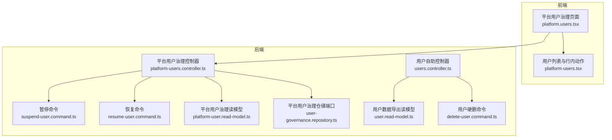
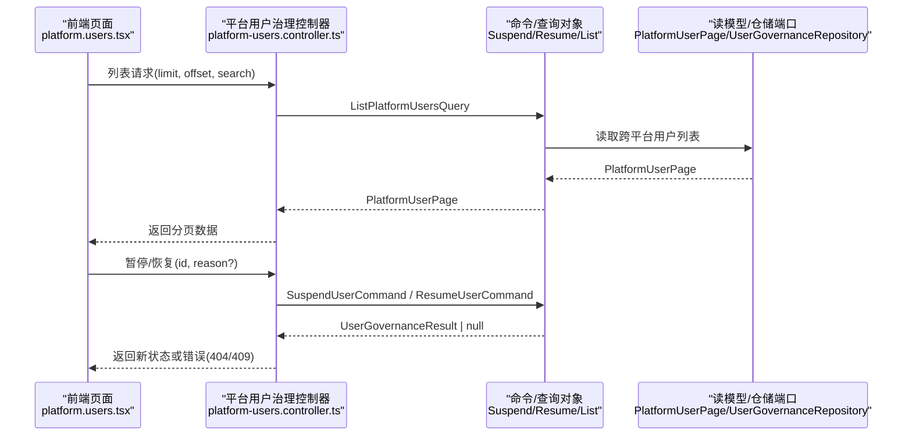
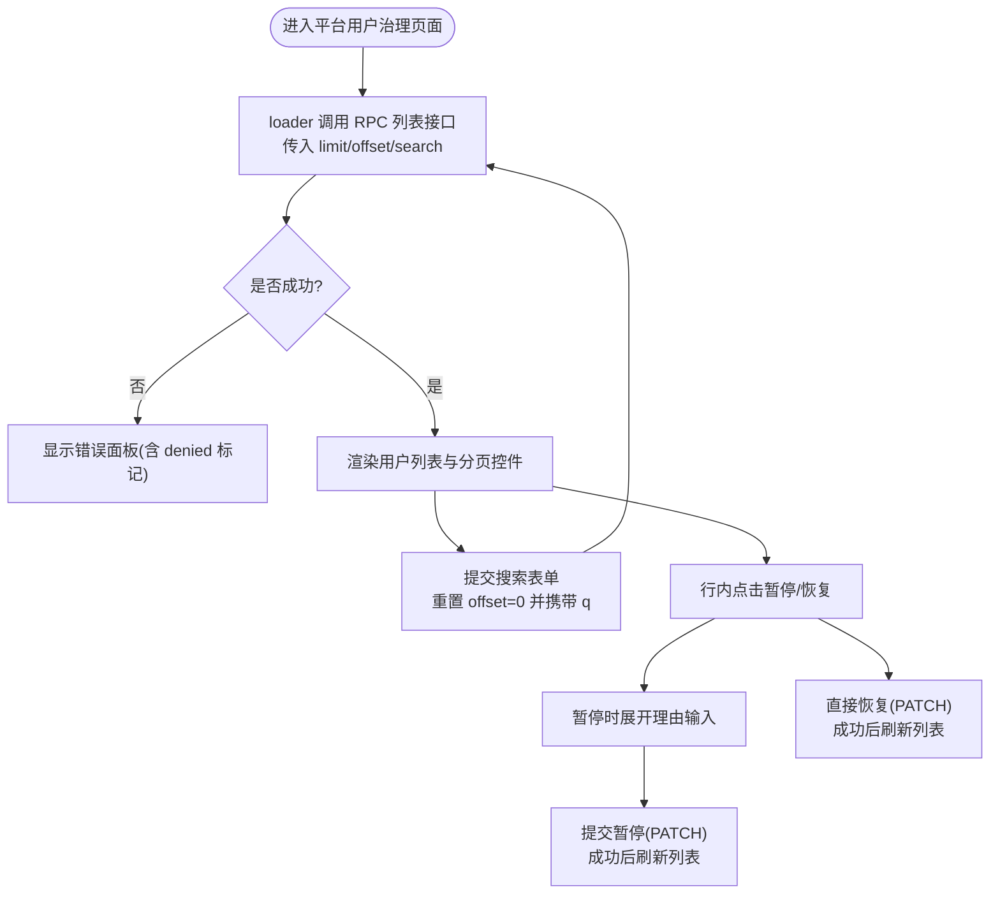
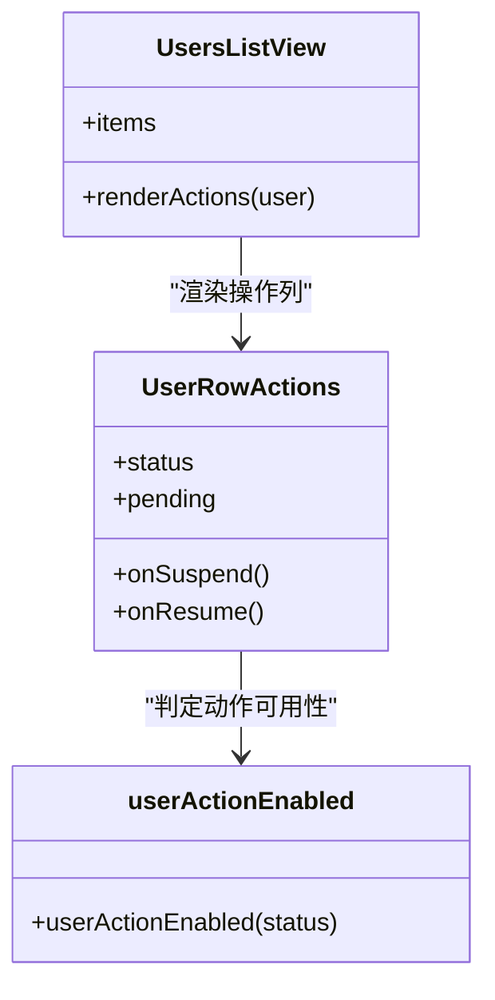
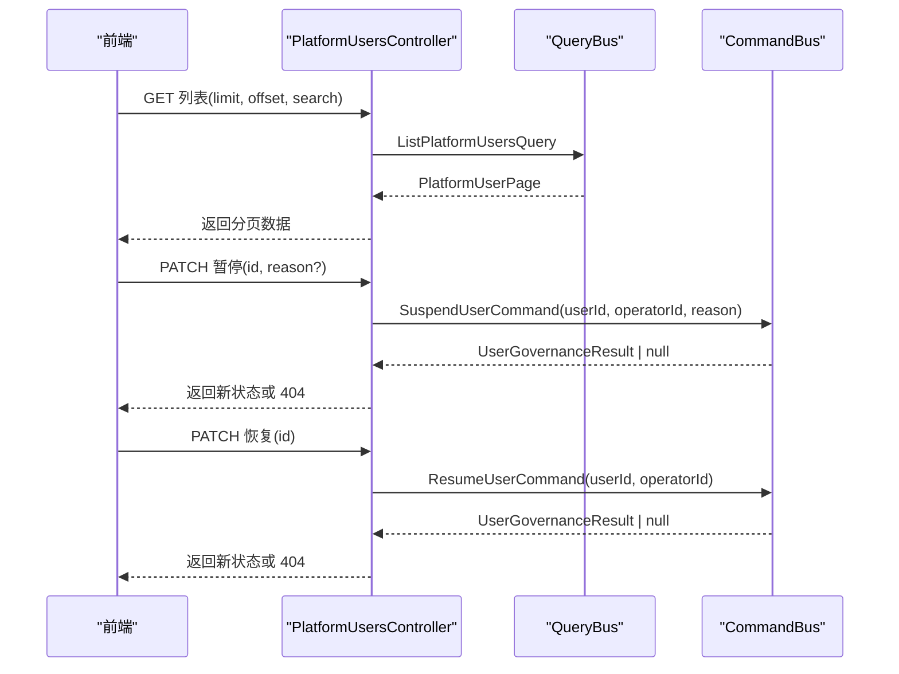
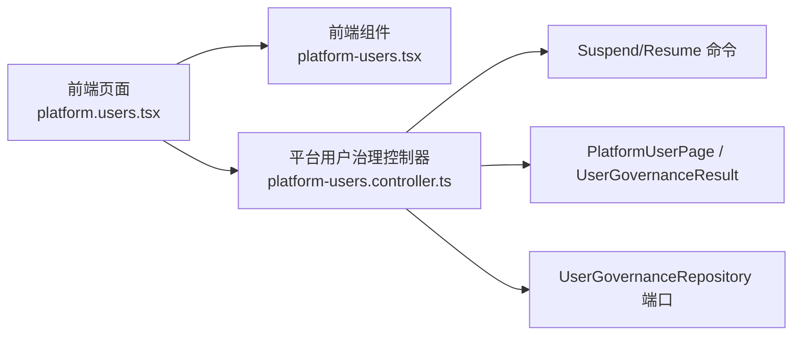

# 用户管理

<cite>
**本文引用的文件**   
- [apps/web/src/routes/platform.users.tsx](file://apps/web/src/routes/platform.users.tsx)
- [apps/web/src/components/platform-users.tsx](file://apps/web/src/components/platform-users.tsx)
- [apps/api/src/modules/platform/api/platform-users.controller.ts](file://apps/api/src/modules/platform/api/platform-users.controller.ts)
- [apps/api/src/modules/organizations/application/commands/suspend-user.command.ts](file://apps/api/src/modules/organizations/application/commands/suspend-user.command.ts)
- [apps/api/src/modules/organizations/application/commands/resume-user.command.ts](file://apps/api/src/modules/organizations/application/commands/resume-user.command.ts)
- [apps/api/src/modules/organizations/application/read-models/platform-user.read-model.ts](file://apps/api/src/modules/organizations/application/read-models/platform-user.read-model.ts)
- [apps/api/src/modules/organizations/domain/repositories/user-governance.repository.ts](file://apps/api/src/modules/organizations/domain/repositories/user-governance.repository.ts)
- [apps/api/src/modules/users/api/users.controller.ts](file://apps/api/src/modules/users/api/users.controller.ts)
- [apps/api/src/modules/users/application/commands/delete-user.command.ts](file://apps/api/src/modules/users/application/commands/delete-user.command.ts)
- [apps/api/src/modules/users/application/read-models/user.read-model.ts](file://apps/api/src/modules/users/application/read-models/user.read-model.ts)
</cite>

## 目录
1. [简介](#简介)
2. [项目结构](#项目结构)
3. [核心组件](#核心组件)
4. [架构总览](#架构总览)
5. [详细组件分析](#详细组件分析)
6. [依赖关系分析](#依赖关系分析)
7. [性能与分页](#性能与分页)
8. [权限与安全](#权限与安全)
9. [审计与合规](#审计与合规)
10. [故障排查](#故障排查)
11. [最佳实践](#最佳实践)
12. [结论](#结论)

## 简介
本文件面向平台管理员，系统性说明“用户治理”功能的界面布局、列表展示、搜索过滤与分页、生命周期操作（创建、激活、暂停、删除）、角色与组织成员关系、全局权限控制、批量操作能力边界、审计日志记录以及数据安全注意事项。文档同时覆盖前端页面、后端控制器、命令/查询对象、读模型与仓储端口等关键实现点，帮助读者从端到端理解用户管理的完整链路。

## 项目结构
用户治理功能横跨前端路由与组件、平台侧 API 控制器、组织域的命令与读模型、以及用户自助面端点：
- 前端
  - 平台用户治理页面路由与交互：[apps/web/src/routes/platform.users.tsx](file://apps/web/src/routes/platform.users.tsx)
  - 用户列表与行内动作纯展示组件：[apps/web/src/components/platform-users.tsx](file://apps/web/src/components/platform-users.tsx)
- 后端
  - 平台用户治理控制器（仅平台运营者）：[apps/api/src/modules/platform/api/platform-users.controller.ts](file://apps/api/src/modules/platform/api/platform-users.controller.ts)
  - 平台级暂停/恢复命令：[apps/api/src/modules/organizations/application/commands/suspend-user.command.ts](file://apps/api/src/modules/organizations/application/commands/suspend-user.command.ts)、[apps/api/src/modules/organizations/application/commands/resume-user.command.ts](file://apps/api/src/modules/organizations/application/commands/resume-user.command.ts)
  - 平台用户治理读模型：[apps/api/src/modules/organizations/application/read-models/platform-user.read-model.ts](file://apps/api/src/modules/organizations/application/read-models/platform-user.read-model.ts)
  - 平台用户治理仓储端口（跨租户列表）：[apps/api/src/modules/organizations/domain/repositories/user-governance.repository.ts](file://apps/api/src/modules/organizations/domain/repositories/user-governance.repository.ts)
  - 用户自助面端点（导出/硬删）：[apps/api/src/modules/users/api/users.controller.ts](file://apps/api/src/modules/users/api/users.controller.ts)
  - 用户数据导出读模型（PIPL 导出）：[apps/api/src/modules/users/application/read-models/user.read-model.ts](file://apps/api/src/modules/users/application/read-models/user.read-model.ts)
  - 用户硬删命令（PIPL 删除权）：[apps/api/src/modules/users/application/commands/delete-user.command.ts](file://apps/api/src/modules/users/application/commands/delete-user.command.ts)

**图示来源**
- [apps/web/src/routes/platform.users.tsx:22-48](file://apps/web/src/routes/platform.users.tsx#L22-L48)
- [apps/web/src/components/platform-users.tsx:75-121](file://apps/web/src/components/platform-users.tsx#L75-L121)
- [apps/api/src/modules/platform/api/platform-users.controller.ts:54-121](file://apps/api/src/modules/platform/api/platform-users.controller.ts#L54-L121)
- [apps/api/src/modules/organizations/application/commands/suspend-user.command.ts:1-21](file://apps/api/src/modules/organizations/application/commands/suspend-user.command.ts#L1-L21)
- [apps/api/src/modules/organizations/application/commands/resume-user.command.ts:1-20](file://apps/api/src/modules/organizations/application/commands/resume-user.command.ts#L1-L20)
- [apps/api/src/modules/organizations/application/read-models/platform-user.read-model.ts:1-19](file://apps/api/src/modules/organizations/application/read-models/platform-user.read-model.ts#L1-L19)
- [apps/api/src/modules/organizations/domain/repositories/user-governance.repository.ts:30-49](file://apps/api/src/modules/organizations/domain/repositories/user-governance.repository.ts#L30-L49)
- [apps/api/src/modules/users/api/users.controller.ts:19-77](file://apps/api/src/modules/users/api/users.controller.ts#L19-L77)
- [apps/api/src/modules/users/application/read-models/user.read-model.ts:1-42](file://apps/api/src/modules/users/application/read-models/user.read-model.ts#L1-L42)
- [apps/api/src/modules/users/application/commands/delete-user.command.ts:1-22](file://apps/api/src/modules/users/application/commands/delete-user.command.ts#L1-L22)

**章节来源**
- [apps/web/src/routes/platform.users.tsx:22-48](file://apps/web/src/routes/platform.users.tsx#L22-L48)
- [apps/web/src/components/platform-users.tsx:75-121](file://apps/web/src/components/platform-users.tsx#L75-L121)
- [apps/api/src/modules/platform/api/platform-users.controller.ts:54-121](file://apps/api/src/modules/platform/api/platform-users.controller.ts#L54-L121)

## 核心组件
- 平台用户治理页面（前端）
  - 提供标题、搜索框、用户列表、分页控件；支持按名称/邮箱模糊搜索，offset 分页。
  - 行内提供“暂停/恢复”按钮，依据状态启用或禁用。
- 用户列表与行内动作（前端）
  - 纯展示组件，渲染名称、邮箱、状态徽标、创建时间，并可选渲染操作列。
  - 根据当前状态计算 suspend/resume 可用性。
- 平台用户治理控制器（后端）
  - 列表、暂停、恢复三个端点，均受 PlatformOperatorGuard 保护，跨租户隔离豁免。
  - 通过 CQRS 调用命令/查询对象，返回最小治理结果或分页视图。
- 命令与读模型
  - SuspendUserCommand/ResumeUserCommand：封装平台级状态迁移语义。
  - UserGovernanceResult：返回新状态的最小回执。
  - PlatformUserPage：平台用户列表分页形状。
- 用户治理仓储端口
  - 定义跨平台用户列表查询接口（name/email 模糊匹配、createdAt 倒序、limit/offset 分页）。
- 用户自助面端点
  - 导出个人数据（PIPL 访问权）与硬删（PIPL 删除权），需会话认证且无租户作用域。

**章节来源**
- [apps/web/src/routes/platform.users.tsx:51-128](file://apps/web/src/routes/platform.users.tsx#L51-L128)
- [apps/web/src/components/platform-users.tsx:1-23](file://apps/web/src/components/platform-users.tsx#L1-L23)
- [apps/web/src/components/platform-users.tsx:75-121](file://apps/web/src/components/platform-users.tsx#L75-L121)
- [apps/api/src/modules/platform/api/platform-users.controller.ts:54-121](file://apps/api/src/modules/platform/api/platform-users.controller.ts#L54-L121)
- [apps/api/src/modules/organizations/application/commands/suspend-user.command.ts:1-21](file://apps/api/src/modules/organizations/application/commands/suspend-user.command.ts#L1-L21)
- [apps/api/src/modules/organizations/application/commands/resume-user.command.ts:1-20](file://apps/api/src/modules/organizations/application/commands/resume-user.command.ts#L1-L20)
- [apps/api/src/modules/organizations/application/read-models/platform-user.read-model.ts:1-19](file://apps/api/src/modules/organizations/application/read-models/platform-user.read-model.ts#L1-L19)
- [apps/api/src/modules/organizations/domain/repositories/user-governance.repository.ts:30-49](file://apps/api/src/modules/organizations/domain/repositories/user-governance.repository.ts#L30-L49)
- [apps/api/src/modules/users/api/users.controller.ts:19-77](file://apps/api/src/modules/users/api/users.controller.ts#L19-L77)

## 架构总览
平台用户治理采用前后端分离 + CQRS 分层：
- 前端路由发起 RPC 请求，加载分页数据并渲染列表；行内触发暂停/恢复。
- 后端控制器校验平台运营者身份后，委派命令/查询处理器执行业务逻辑。
- 写操作通过命令对象表达意图，读操作通过查询对象获取视图模型。
- 平台级操作跨租户隔离豁免，确保对全局用户状态的统一治理。

**图示来源**
- [apps/web/src/routes/platform.users.tsx:30-47](file://apps/web/src/routes/platform.users.tsx#L30-L47)
- [apps/api/src/modules/platform/api/platform-users.controller.ts:67-120](file://apps/api/src/modules/platform/api/platform-users.controller.ts#L67-L120)
- [apps/api/src/modules/organizations/application/commands/suspend-user.command.ts:1-21](file://apps/api/src/modules/organizations/application/commands/suspend-user.command.ts#L1-L21)
- [apps/api/src/modules/organizations/application/commands/resume-user.command.ts:1-20](file://apps/api/src/modules/organizations/application/commands/resume-user.command.ts#L1-L20)
- [apps/api/src/modules/organizations/application/read-models/platform-user.read-model.ts:1-19](file://apps/api/src/modules/organizations/application/read-models/platform-user.read-model.ts#L1-L19)
- [apps/api/src/modules/organizations/domain/repositories/user-governance.repository.ts:30-49](file://apps/api/src/modules/organizations/domain/repositories/user-governance.repository.ts#L30-L49)

## 详细组件分析

### 前端：平台用户治理页面
- 页面职责
  - 使用 loader 调用 RPC 拉取用户列表，携带 limit、offset、search。
  - 渲染 SectionHeading、搜索表单、用户列表、分页控件。
  - 行内渲染 UserGovernanceRow，封装暂停/恢复的交互与反馈。
- 搜索与分页
  - 搜索参数 q 用于名称/邮箱模糊匹配；offset 控制分页起点；LIMIT=20。
  - 上一页/下一页更新 URL 查询参数，重新触发 loader。
- 权限提示
  - 若后端返回 403，显示“无平台运营权限”的错误面板。

**图示来源**
- [apps/web/src/routes/platform.users.tsx:22-48](file://apps/web/src/routes/platform.users.tsx#L22-L48)
- [apps/web/src/routes/platform.users.tsx:51-128](file://apps/web/src/routes/platform.users.tsx#L51-L128)
- [apps/web/src/routes/platform.users.tsx:135-206](file://apps/web/src/routes/platform.users.tsx#L135-L206)

**章节来源**
- [apps/web/src/routes/platform.users.tsx:22-48](file://apps/web/src/routes/platform.users.tsx#L22-L48)
- [apps/web/src/routes/platform.users.tsx:51-128](file://apps/web/src/routes/platform.users.tsx#L51-L128)
- [apps/web/src/routes/platform.users.tsx:135-206](file://apps/web/src/routes/platform.users.tsx#L135-L206)

### 前端：用户列表与行内动作
- 列表展示
  - 表头包含名称、邮箱、状态、创建时间，可选操作列。
  - 空态提示“平台暂无用户数据”。
- 状态驱动的动作可用性
  - userActionEnabled(status) 返回 { suspend, resume }，仅 active 可暂停、仅 suspended 可恢复。
- 行内动作
  - 暂停按钮危险样式，恢复按钮常规样式；pending 状态下禁用。
  - 实际确认由页面层在 onSuspend 中处理（含理由输入）。

**图示来源**
- [apps/web/src/components/platform-users.tsx:75-121](file://apps/web/src/components/platform-users.tsx#L75-L121)
- [apps/web/src/components/platform-users.tsx:18-23](file://apps/web/src/components/platform-users.tsx#L18-L23)
- [apps/web/src/components/platform-users.tsx:34-68](file://apps/web/src/components/platform-users.tsx#L34-L68)

**章节来源**
- [apps/web/src/components/platform-users.tsx:1-23](file://apps/web/src/components/platform-users.tsx#L1-L23)
- [apps/web/src/components/platform-users.tsx:75-121](file://apps/web/src/components/platform-users.tsx#L75-L121)

### 后端：平台用户治理控制器
- 列表端点
  - 接收 listPlatformUsersQuerySchema（limit、offset、search），返回 platformUserPageSchema。
  - 通过 QueryBus 执行 ListPlatformUsersQuery，返回 PlatformUserPage。
- 暂停端点
  - 接收 suspendUserInputSchema（id、reason?），返回 userGovernanceResultSchema。
  - 通过 CommandBus 执行 SuspendUserCommand，未命中返回 404。
- 恢复端点
  - 接收 platformUserIdParamSchema（id），返回 userGovernanceResultSchema。
  - 通过 CommandBus 执行 ResumeUserCommand，未命中返回 404。
- 安全与隔离
  - 类级 @TenantIsolationExempt() 与 @UseGuards(PlatformOperatorGuard)，确保跨租户治理且 fail-closed。

**图示来源**
- [apps/api/src/modules/platform/api/platform-users.controller.ts:67-120](file://apps/api/src/modules/platform/api/platform-users.controller.ts#L67-L120)

**章节来源**
- [apps/api/src/modules/platform/api/platform-users.controller.ts:54-121](file://apps/api/src/modules/platform/api/platform-users.controller.ts#L54-L121)

### 命令与读模型
- SuspendUserCommand
  - 表示平台级暂停动作，operatorId 为会话主体，reason 可选用于审计。
  - 非法迁移返回 409；用户不存在返回 null（对应 404）。
- ResumeUserCommand
  - 表示平台级恢复动作，不重建 session，仅移除 deny-list。
  - 非法迁移返回 409；用户不存在返回 null（对应 404）。
- UserGovernanceResult
  - 最小回执，包含 userId 与 status（新状态）。
- PlatformUserPage
  - 平台用户列表分页形状，归属 domain 端口，供 application/controller 消费。

**章节来源**
- [apps/api/src/modules/organizations/application/commands/suspend-user.command.ts:1-21](file://apps/api/src/modules/organizations/application/commands/suspend-user.command.ts#L1-L21)
- [apps/api/src/modules/organizations/application/commands/resume-user.command.ts:1-20](file://apps/api/src/modules/organizations/application/commands/resume-user.command.ts#L1-L20)
- [apps/api/src/modules/organizations/application/read-models/platform-user.read-model.ts:1-19](file://apps/api/src/modules/organizations/application/read-models/platform-user.read-model.ts#L1-L19)

### 用户治理仓储端口
- 定义跨平台用户列表查询接口：list(opts) 支持 search（name/email 模糊）、createdAt 倒序、limit/offset 分页。
- 注释明确：平台级天然全量，不做租户过滤；用户暂停态存独立表 user_status，无记录行视同 active。

**章节来源**
- [apps/api/src/modules/organizations/domain/repositories/user-governance.repository.ts:30-49](file://apps/api/src/modules/organizations/domain/repositories/user-governance.repository.ts#L30-L49)

### 用户自助面端点（PIPL 访问与删除）
- 导出个人数据
  - 仅本人可用，经 SessionGuard 认证；返回聚合的个人数据导出体（凭据除外）。
  - 输出 schema 来自 userDataExportViewSchema。
- 硬删用户
  - 仅本人可用，经 SessionGuard 认证；执行 DeleteUserCommand 进行硬删。
  - 删除后 account/session cascade，consent FK 置空保留匿名审计轨迹。

**章节来源**
- [apps/api/src/modules/users/api/users.controller.ts:19-77](file://apps/api/src/modules/users/api/users.controller.ts#L19-L77)
- [apps/api/src/modules/users/application/commands/delete-user.command.ts:1-22](file://apps/api/src/modules/users/application/commands/delete-user.command.ts#L1-L22)
- [apps/api/src/modules/users/application/read-models/user.read-model.ts:1-42](file://apps/api/src/modules/users/application/read-models/user.read-model.ts#L1-L42)

## 依赖关系分析
- 前端依赖
  - platform.users.tsx 依赖 platform-users.tsx 的展示组件与行内动作。
  - 通过 rpc.platform.users.* 调用后端契约。
- 后端依赖
  - platform-users.controller.ts 依赖 CQRS 总线与平台运营者守卫。
  - 依赖组织域的命令与读模型类型，以及平台侧 contracts/schema。
  - 用户治理仓储端口定义在组织域，体现跨租户治理的领域边界。

**图示来源**
- [apps/web/src/routes/platform.users.tsx:22-48](file://apps/web/src/routes/platform.users.tsx#L22-L48)
- [apps/web/src/components/platform-users.tsx:75-121](file://apps/web/src/components/platform-users.tsx#L75-L121)
- [apps/api/src/modules/platform/api/platform-users.controller.ts:54-121](file://apps/api/src/modules/platform/api/platform-users.controller.ts#L54-L121)
- [apps/api/src/modules/organizations/domain/repositories/user-governance.repository.ts:30-49](file://apps/api/src/modules/organizations/domain/repositories/user-governance.repository.ts#L30-L49)

**章节来源**
- [apps/web/src/routes/platform.users.tsx:22-48](file://apps/web/src/routes/platform.users.tsx#L22-L48)
- [apps/web/src/components/platform-users.tsx:75-121](file://apps/web/src/components/platform-users.tsx#L75-L121)
- [apps/api/src/modules/platform/api/platform-users.controller.ts:54-121](file://apps/api/src/modules/platform/api/platform-users.controller.ts#L54-L121)
- [apps/api/src/modules/organizations/domain/repositories/user-governance.repository.ts:30-49](file://apps/api/src/modules/organizations/domain/repositories/user-governance.repository.ts#L30-L49)

## 性能与分页
- 分页策略
  - 前端固定 LIMIT=20，通过 offset 控制页码；URL 查询参数承载 offset 与 q。
  - 后端列表端点接受 limit/offset/search，返回 total 与 items。
- 搜索优化建议
  - 建议在数据库层对 name/email 建立索引以加速模糊匹配。
  - 避免在前端做大规模过滤，尽量将搜索下推至服务端。
- 列表渲染
  - 使用纯展示组件减少重渲染开销；仅在必要时渲染操作列。

**章节来源**
- [apps/web/src/routes/platform.users.tsx:15-20](file://apps/web/src/routes/platform.users.tsx#L15-L20)
- [apps/web/src/routes/platform.users.tsx:30-47](file://apps/web/src/routes/platform.users.tsx#L30-L47)
- [apps/web/src/components/platform-users.tsx:75-121](file://apps/web/src/components/platform-users.tsx#L75-L121)
- [apps/api/src/modules/platform/api/platform-users.controller.ts:67-78](file://apps/api/src/modules/platform/api/platform-users.controller.ts#L67-L78)
- [apps/api/src/modules/organizations/domain/repositories/user-governance.repository.ts:42-49](file://apps/api/src/modules/organizations/domain/repositories/user-governance.repository.ts#L42-L49)

## 权限与安全
- 平台运营者控制
  - 平台用户治理控制器类级启用 PlatformOperatorGuard，fail-closed 设计，非平台运营者无法访问。
  - 跨租户隔离豁免（@TenantIsolationExempt），确保平台级操作不受租户边界限制。
- 会话与认证
  - 用户自助面端点（导出/硬删）需 SessionGuard 认证；平台治理面端点通过 PlatformOperatorGuard 认证。
- 状态机与非法迁移
  - 前端基于状态禁用非法动作；后端对非法迁移返回 409，未命中返回 404。
- 数据可见性
  - 平台治理列表为全量用户视图；用户自助导出仅暴露本人数据，排除敏感字段。

**章节来源**
- [apps/api/src/modules/platform/api/platform-users.controller.ts:54-57](file://apps/api/src/modules/platform/api/platform-users.controller.ts#L54-L57)
- [apps/api/src/modules/users/api/users.controller.ts:19-33](file://apps/api/src/modules/users/api/users.controller.ts#L19-L33)
- [apps/web/src/components/platform-users.tsx:18-23](file://apps/web/src/components/platform-users.tsx#L18-L23)
- [apps/api/src/modules/users/application/read-models/user.read-model.ts:33-41](file://apps/api/src/modules/users/application/read-models/user.read-model.ts#L33-L41)

## 审计与合规
- 审计记录
  - 暂停操作支持 reason 字段，用于结构化审计（FR-6）。
  - 平台治理控制器注释表明每次成功/失败会发出结构化审计行。
- PIPL 合规
  - 导出个人数据（不含凭据）满足访问权；硬删用户满足删除权，consent 匿名留存作为审计轨迹。
- 会话失效
  - 暂停用户会硬失效其会话，确保即时失权。

**章节来源**
- [apps/api/src/modules/platform/api/platform-users.controller.ts:80-99](file://apps/api/src/modules/platform/api/platform-users.controller.ts#L80-L99)
- [apps/api/src/modules/users/api/users.controller.ts:46-77](file://apps/api/src/modules/users/api/users.controller.ts#L46-L77)
- [apps/api/src/modules/users/application/commands/delete-user.command.ts:1-22](file://apps/api/src/modules/users/application/commands/delete-user.command.ts#L1-L22)

## 故障排查
- 403 无平台运营权限
  - 现象：前端显示“无平台运营权限（仅平台运营者可访问）”。
  - 原因：未通过 PlatformOperatorGuard。
  - 处理：确认当前会话具备平台运营者身份。
- 404 用户不存在
  - 现象：暂停/恢复返回未找到。
  - 原因：目标用户不存在或已被删除。
  - 处理：检查用户 ID 有效性。
- 409 非法状态迁移
  - 现象：对非 active 用户执行暂停或对非 suspended 用户执行恢复。
  - 原因：违反状态机约束。
  - 处理：根据当前状态选择合法动作。
- 搜索无结果
  - 现象：列表为空。
  - 原因：search 条件过严或数据尚未入库。
  - 处理：放宽搜索条件或确认数据同步。

**章节来源**
- [apps/web/src/routes/platform.users.tsx:39-47](file://apps/web/src/routes/platform.users.tsx#L39-L47)
- [apps/api/src/modules/platform/api/platform-users.controller.ts:90-119](file://apps/api/src/modules/platform/api/platform-users.controller.ts#L90-L119)
- [apps/web/src/components/platform-users.tsx:18-23](file://apps/web/src/components/platform-users.tsx#L18-L23)

## 最佳实践
- 界面与交互
  - 保持搜索与分页在 URL 中可分享与可回退；避免前端缓存导致的状态不一致。
  - 行内动作需提供明确的成功/失败反馈，并在 pending 时禁用重复提交。
- 权限与审计
  - 所有平台级操作必须经过 PlatformOperatorGuard；记录 operatorId 与 reason。
  - 对敏感操作（暂停/恢复/删除）进行审计日志记录，便于事后追溯。
- 数据安全
  - 对外暴露字段遵循白名单原则（如 userPublicColumns），避免泄露敏感信息。
  - 用户自助导出与删除严格限定本人范围，并通过 SessionGuard 认证。
- 性能优化
  - 将搜索与排序下推到服务端；合理使用索引；避免大列表前端渲染。
  - 分页大小适中（如 20），平衡用户体验与服务器负载。

**章节来源**
- [apps/web/src/routes/platform.users.tsx:71-81](file://apps/web/src/routes/platform.users.tsx#L71-L81)
- [apps/web/src/routes/platform.users.tsx:135-206](file://apps/web/src/routes/platform.users.tsx#L135-L206)
- [apps/api/src/modules/platform/api/platform-users.controller.ts:80-119](file://apps/api/src/modules/platform/api/platform-users.controller.ts#L80-L119)
- [apps/api/src/modules/users/application/read-models/user.read-model.ts:33-41](file://apps/api/src/modules/users/application/read-models/user.read-model.ts#L33-L41)

## 结论
用户治理功能通过清晰的前后端分层与 CQRS 模式，实现了平台管理员对全局用户的可视、可控、可审计的管理能力。前端提供直观的列表与行内操作，后端通过严格的权限守卫与状态机约束保障安全性与一致性。结合 PIPL 合规的导出与删除能力，系统兼顾了用户体验与数据安全。建议在生产环境中持续完善审计日志、索引优化与错误监控，以提升系统的可维护性与可靠性。