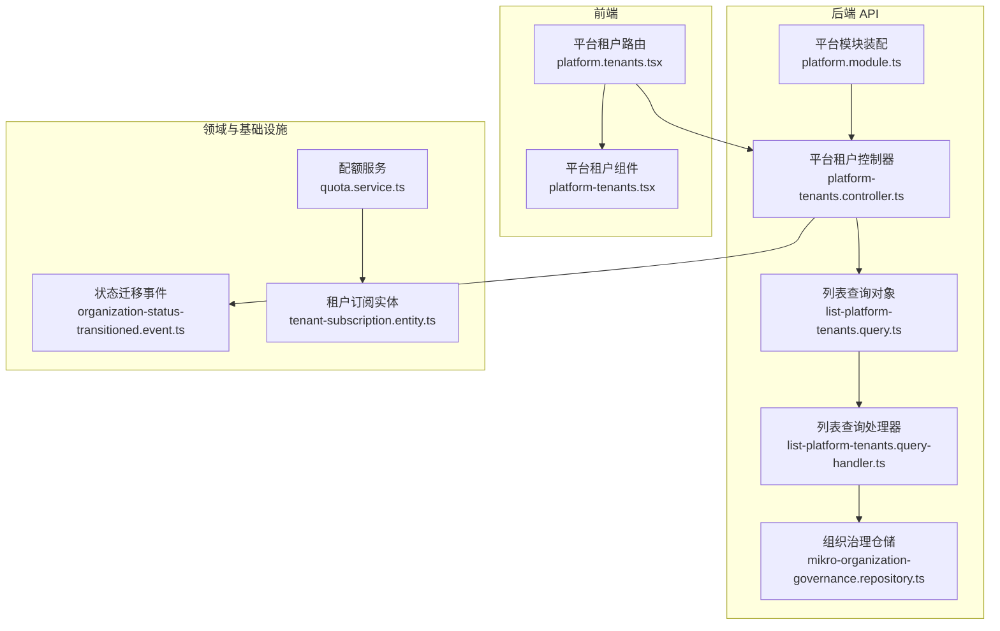
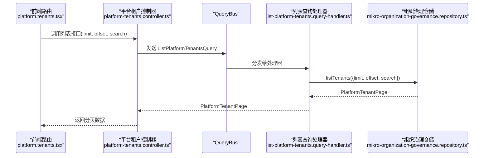
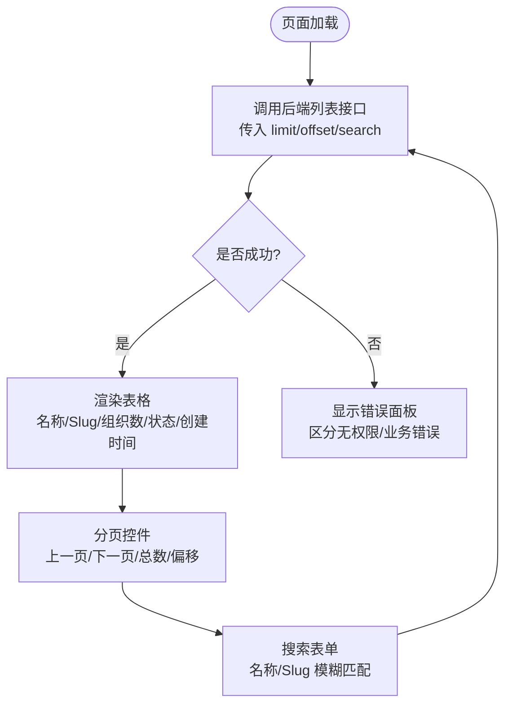
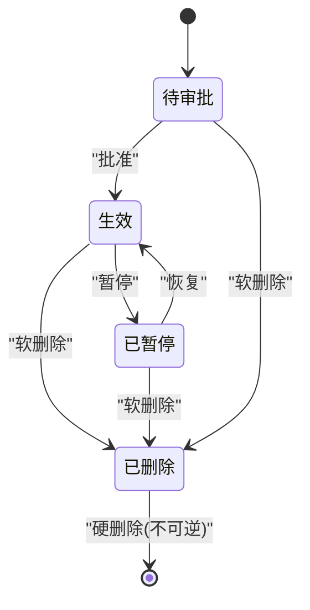
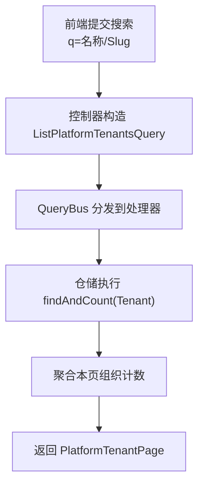
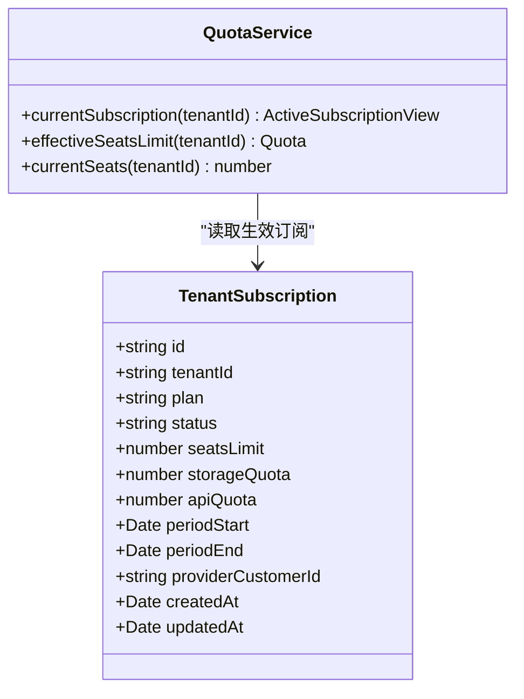
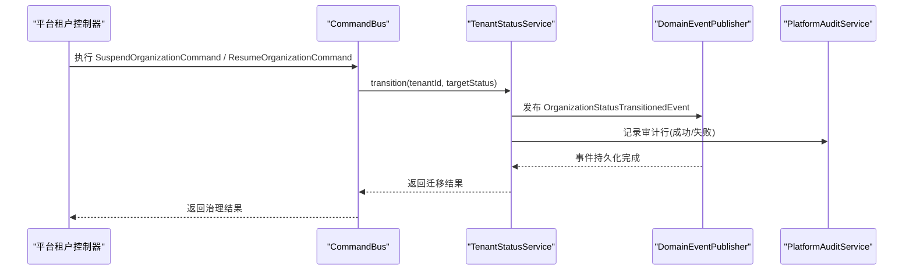
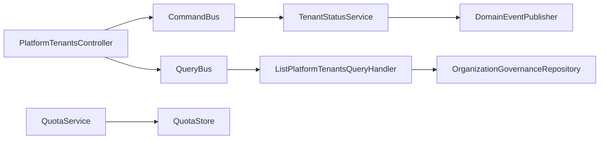

# 租户管理

<cite>
**本文引用的文件**   
- [platform-tenants.controller.ts](file://apps/api/src/modules/platform/api/platform-tenants.controller.ts)
- [platform.tenants.tsx](file://apps/web/src/routes/platform.tenants.tsx)
- [platform-tenants.tsx](file://apps/web/src/components/platform-tenants.tsx)
- [list-platform-tenants.query.ts](file://apps/api/src/modules/organizations/application/queries/list-platform-tenants.query.ts)
- [list-platform-tenants.query-handler.ts](file://apps/api/src/modules/organizations/application/queries/handlers/list-platform-tenants.query-handler.ts)
- [mikro-organization-governance.repository.ts](file://apps/api/src/modules/organizations/infrastructure/repositories/mikro-organization-governance.repository.ts)
- [tenant-status.service.test.ts](file://apps/api/src/modules/organizations/lifecycle/tenant-status.service.test.ts)
- [organization-lifecycle.test.ts](file://apps/api/src/modules/organizations/lifecycle/organization-lifecycle.test.ts)
- [organization-status-transitioned.event.ts](file://libs/core/src/modules/organizations/lifecycle/events/organization-status-transitioned.event.ts)
- [status-transition.correlation.test.ts](file://libs/core/src/modules/organizations/lifecycle/status-transition.correlation.test.ts)
- [platform.module.ts](file://apps/api/src/modules/platform/platform.module.ts)
- [tenant-subscription.entity.ts](file://apps/api/src/modules/subscriptions/infrastructure/entities/tenant-subscription.entity.ts)
- [quota.service.ts](file://libs/core/src/modules/subscriptions/quota/quota.service.ts)
- [subscriptions.ts](file://libs/contracts/src/response/subscriptions.ts)
</cite>

## 目录
1. [简介](#简介)
2. [项目结构](#项目结构)
3. [核心组件](#核心组件)
4. [架构总览](#架构总览)
5. [详细组件分析](#详细组件分析)
6. [依赖关系分析](#依赖关系分析)
7. [性能与可扩展性](#性能与可扩展性)
8. [故障排查指南](#故障排查指南)
9. [最佳实践与安全建议](#最佳实践与安全建议)
10. [结论](#结论)

## 简介
本文件面向平台管理员，系统性说明“租户治理”功能：包括治理页面布局、租户列表展示、状态监控、生命周期操作（创建/激活/暂停/恢复/软删/硬删）、信息查询与搜索过滤分页、配置与配额查看、订阅状态查看、权限控制、批量操作能力边界、审计日志记录，以及安全与合规注意事项。文档同时给出后端控制器、查询处理器、仓储实现、前端路由与组件之间的调用关系图，帮助读者从界面到数据流完整理解该功能。

## 项目结构
租户治理涉及前后端多个模块：
- 前端治理页面位于 web 应用的路由与组件中，负责搜索、分页、状态徽标、生命周期按钮组等交互。
- 后端平台治理控制器暴露跨租户的管理接口，所有请求均受平台操作员守卫保护。
- CQRS 查询层将列表查询委派给组织治理仓储，仓储直接读取租户表并聚合组织计数。
- 生命周期状态机与事件用于保证状态迁移的合法性与可审计性。
- 订阅与配额子系统提供套餐、座位限额、用量快照等能力，供租户配置与配额查看使用。

**图表来源**
- [platform.tenants.tsx:21-48](file://apps/web/src/routes/platform.tenants.tsx#L21-L48)
- [platform-tenants.tsx:1-170](file://apps/web/src/components/platform-tenants.tsx#L1-L170)
- [platform-tenants.controller.ts:100-123](file://apps/api/src/modules/platform/api/platform-tenants.controller.ts#L100-L123)
- [list-platform-tenants.query.ts:12-20](file://apps/api/src/modules/organizations/application/queries/list-platform-tenants.query.ts#L12-L20)
- [list-platform-tenants.query-handler.ts:18-38](file://apps/api/src/modules/organizations/application/queries/handlers/list-platform-tenants.query-handler.ts#L18-L38)
- [mikro-organization-governance.repository.ts:103-133](file://apps/api/src/modules/organizations/infrastructure/repositories/mikro-organization-governance.repository.ts#L103-L133)
- [organization-status-transitioned.event.ts:32-53](file://libs/core/src/modules/organizations/lifecycle/events/organization-status-transitioned.event.ts#L32-L53)
- [tenant-subscription.entity.ts:47-65](file://apps/api/src/modules/subscriptions/infrastructure/entities/tenant-subscription.entity.ts#L47-L65)
- [quota.service.ts:62-91](file://libs/core/src/modules/subscriptions/quota/quota.service.ts#L62-L91)
- [platform.module.ts:12-35](file://apps/api/src/modules/platform/platform.module.ts#L12-L35)

**章节来源**
- [platform.tenants.tsx:21-48](file://apps/web/src/routes/platform.tenants.tsx#L21-L48)
- [platform-tenants.controller.ts:100-123](file://apps/api/src/modules/platform/api/platform-tenants.controller.ts#L100-L123)
- [platform.module.ts:12-35](file://apps/api/src/modules/platform/platform.module.ts#L12-L35)

## 核心组件
- 平台租户控制器：提供跨租户治理的 HTTP 接口，包括列表、详情、暂停、恢复、设置可见性、软删、硬删、诊断、导出等。
- 前端租户治理路由与组件：提供搜索框、分页控件、状态徽标、生命周期动作按钮组、详情入口。
- 列表查询与处理器：封装 limit/offset/search 参数，委托治理仓储返回分页结果。
- 组织治理仓储：按名称或 slug 模糊匹配，分页查询租户，并批量计算名下组织数量。
- 生命周期与事件：通过状态机校验迁移合法性，产出状态迁移事件用于审计与下游消费。
- 订阅与配额：提供生效订阅视图、座位限额、用量统计，支撑租户配置与配额查看。

**章节来源**
- [platform-tenants.controller.ts:100-311](file://apps/api/src/modules/platform/api/platform-tenants.controller.ts#L100-L311)
- [platform.tenants.tsx:85-139](file://apps/web/src/routes/platform.tenants.tsx#L85-L139)
- [platform-tenants.tsx:1-170](file://apps/web/src/components/platform-tenants.tsx#L1-L170)
- [list-platform-tenants.query.ts:12-20](file://apps/api/src/modules/organizations/application/queries/list-platform-tenants.query.ts#L12-L20)
- [list-platform-tenants.query-handler.ts:18-38](file://apps/api/src/modules/organizations/application/queries/handlers/list-platform-tenants.query-handler.ts#L18-L38)
- [mikro-organization-governance.repository.ts:103-133](file://apps/api/src/modules/organizations/infrastructure/repositories/mikro-organization-governance.repository.ts#L103-L133)
- [organization-status-transitioned.event.ts:32-53](file://libs/core/src/modules/organizations/lifecycle/events/organization-status-transitioned.event.ts#L32-L53)
- [quota.service.ts:62-91](file://libs/core/src/modules/subscriptions/quota/quota.service.ts#L62-L91)

## 架构总览
平台租户治理采用“前端路由 + 控制器 + CQRS + 仓储”的分层架构：
- 前端通过 TanStack Router 加载数据，渲染列表、状态徽标与动作按钮。
- 控制器统一受 PlatformOperatorGuard 保护，仅平台运营者可访问。
- 列表查询经 QueryBus 分发至处理器，处理器调用组织治理仓储进行数据库查询。
- 生命周期操作经 CommandBus 执行命令，触发状态迁移与审计事件。
- 订阅与配额子系统提供租户配置与配额查看能力。

**图表来源**
- [platform.tenants.tsx:29-46](file://apps/web/src/routes/platform.tenants.tsx#L29-L46)
- [platform-tenants.controller.ts:112-123](file://apps/api/src/modules/platform/api/platform-tenants.controller.ts#L112-L123)
- [list-platform-tenants.query-handler.ts:30-38](file://apps/api/src/modules/organizations/application/queries/handlers/list-platform-tenants.query-handler.ts#L30-L38)
- [mikro-organization-governance.repository.ts:103-133](file://apps/api/src/modules/organizations/infrastructure/repositories/mikro-organization-governance.repository.ts#L103-L133)

## 详细组件分析

### 治理页面布局与列表展示
- 页面标题为“租户治理”，包含搜索表单（名称/Slug 模糊匹配）与分页控件（上一页/下一页、总数与偏移）。
- 列表表格展示字段：名称、Slug、组织数、状态徽标、创建时间；每行提供“详情”链接进入租户详情。
- 状态徽标根据后端状态映射显示中文标签与样式。
- 列表数据通过 RPC 调用后端列表接口获取，错误时区分无权限与业务错误。

**图表来源**
- [platform.tenants.tsx:21-48](file://apps/web/src/routes/platform.tenants.tsx#L21-L48)
- [platform.tenants.tsx:85-139](file://apps/web/src/routes/platform.tenants.tsx#L85-L139)
- [platform.tenants.tsx:167-207](file://apps/web/src/routes/platform.tenants.tsx#L167-L207)

**章节来源**
- [platform.tenants.tsx:21-48](file://apps/web/src/routes/platform.tenants.tsx#L21-L48)
- [platform.tenants.tsx:85-139](file://apps/web/src/routes/platform.tenants.tsx#L85-L139)
- [platform.tenants.tsx:167-207](file://apps/web/src/routes/platform.tenants.tsx#L167-L207)

### 状态监控与生命周期操作
- 状态值包括：待审批、生效、已暂停、已删除。
- 生命周期动作可用性规则：
  - 暂停：仅对“生效”状态可用。
  - 恢复：仅对“已暂停”状态可用。
  - 软删除：非“已删除”状态均可用。
  - 硬删除：仅“已删除”终态可用。
- 前端禁用非法转移按钮，最终裁判在后端（非法转移返回 409）。

**图表来源**
- [platform-tenants.tsx:15-20](file://apps/web/src/components/platform-tenants.tsx#L15-L20)
- [platform-tenants.tsx:44-56](file://apps/web/src/components/platform-tenants.tsx#L44-L56)
- [platform-tenants.tsx:67-127](file://apps/web/src/components/platform-tenants.tsx#L67-L127)

**章节来源**
- [platform-tenants.tsx:15-20](file://apps/web/src/components/platform-tenants.tsx#L15-L20)
- [platform-tenants.tsx:44-56](file://apps/web/src/components/platform-tenants.tsx#L44-L56)
- [platform-tenants.tsx:67-127](file://apps/web/src/components/platform-tenants.tsx#L67-L127)

### 租户信息查询、搜索、过滤与分页
- 查询参数：limit、offset、search（可选）。
- 后端列表查询处理器接收参数并委派仓储执行。
- 仓储实现：
  - 支持按 name/slug 模糊匹配。
  - 分页排序按创建时间倒序。
  - 批量计算本页租户名下的组织数量，避免 N+1。

**图表来源**
- [platform-tenants.controller.ts:112-123](file://apps/api/src/modules/platform/api/platform-tenants.controller.ts#L112-L123)
- [list-platform-tenants.query.ts:12-20](file://apps/api/src/modules/organizations/application/queries/list-platform-tenants.query.ts#L12-L20)
- [list-platform-tenants.query-handler.ts:30-38](file://apps/api/src/modules/organizations/application/queries/handlers/list-platform-tenants.query-handler.ts#L30-L38)
- [mikro-organization-governance.repository.ts:103-133](file://apps/api/src/modules/organizations/infrastructure/repositories/mikro-organization-governance.repository.ts#L103-L133)

**章节来源**
- [platform-tenants.controller.ts:112-123](file://apps/api/src/modules/platform/api/platform-tenants.controller.ts#L112-L123)
- [list-platform-tenants.query.ts:12-20](file://apps/api/src/modules/organizations/application/queries/list-platform-tenants.query.ts#L12-L20)
- [list-platform-tenants.query-handler.ts:30-38](file://apps/api/src/modules/organizations/application/queries/handlers/list-platform-tenants.query-handler.ts#L30-L38)
- [mikro-organization-governance.repository.ts:103-133](file://apps/api/src/modules/organizations/infrastructure/repositories/mikro-organization-governance.repository.ts#L103-L133)

### 租户配置管理与配额设置
- 订阅实体包含 plan、status、seatsLimit、storageQuota、apiQuota、periodStart/End、providerCustomerId 等字段。
- 配额服务提供：
  - currentSubscription：最新生效订阅视图。
  - effectiveSeatsLimit：有 active 订阅则取 seatsLimit，否则回退免费档。
  - currentSeats：当前成员数作为用量。
- 订阅视图契约定义 hasSubscription、plan、seatsLimit、used、remaining、providerCustomerId。

**图表来源**
- [tenant-subscription.entity.ts:47-65](file://apps/api/src/modules/subscriptions/infrastructure/entities/tenant-subscription.entity.ts#L47-L65)
- [quota.service.ts:62-91](file://libs/core/src/modules/subscriptions/quota/quota.service.ts#L62-L91)
- [subscriptions.ts:8-21](file://libs/contracts/src/response/subscriptions.ts#L8-L21)

**章节来源**
- [tenant-subscription.entity.ts:47-65](file://apps/api/src/modules/subscriptions/infrastructure/entities/tenant-subscription.entity.ts#L47-L65)
- [quota.service.ts:62-91](file://libs/core/src/modules/subscriptions/quota/quota.service.ts#L62-L91)
- [subscriptions.ts:8-21](file://libs/contracts/src/response/subscriptions.ts#L8-L21)

### 平台管理员权限控制与批量操作
- 平台租户控制器类级别启用 PlatformOperatorGuard，仅平台运营者（邮箱命中配置）可访问。
- 控制器方法均不绑定租户隔离守卫，以跨租户治理为目标。
- 当前控制器未暴露批量操作接口；如需批量暂停/恢复/删除，应在控制器新增批量方法并通过 CommandBus 执行多条命令，并在事务中确保一致性。

**章节来源**
- [platform-tenants.controller.ts:100-107](file://apps/api/src/modules/platform/api/platform-tenants.controller.ts#L100-L107)
- [platform.module.ts:12-35](file://apps/api/src/modules/platform/platform.module.ts#L12-L35)

### 审计日志记录
- 生命周期状态迁移成功后会产出 OrganizationStatusTransitionedEvent，携带 from/to、actorId、reason 等载荷。
- 迁移过程在请求上下文内传递 correlationId，便于链路追踪。
- 平台模块提供 PlatformAuditService 作为审计单点，控制器每次成功/失败落结构化审计行。

**图表来源**
- [platform-tenants.controller.ts:150-191](file://apps/api/src/modules/platform/api/platform-tenants.controller.ts#L150-L191)
- [organization-status-transitioned.event.ts:32-53](file://libs/core/src/modules/organizations/lifecycle/events/organization-status-transitioned.event.ts#L32-L53)
- [status-transition.correlation.test.ts:41-61](file://libs/core/src/modules/organizations/lifecycle/status-transition.correlation.test.ts#L41-L61)
- [platform.module.ts:12-35](file://apps/api/src/modules/platform/platform.module.ts#L12-L35)

**章节来源**
- [organization-status-transitioned.event.ts:32-53](file://libs/core/src/modules/organizations/lifecycle/events/organization-status-transitioned.event.ts#L32-L53)
- [status-transition.correlation.test.ts:41-61](file://libs/core/src/modules/organizations/lifecycle/status-transition.correlation.test.ts#L41-L61)
- [platform.module.ts:12-35](file://apps/api/src/modules/platform/platform.module.ts#L12-L35)

## 依赖关系分析
- 控制器依赖 CommandBus/QueryBus，解耦命令与查询处理逻辑。
- 列表查询依赖组织治理仓储，仓储直接访问租户与组织实体。
- 生命周期操作依赖 TenantStatusService 与 DomainEventPublisher，确保状态迁移一致性与可审计性。
- 订阅与配额子系统独立于治理控制器，通过 QuotaService 对外提供配额裁决与快照。

**图表来源**
- [platform-tenants.controller.ts:104-107](file://apps/api/src/modules/platform/api/platform-tenants.controller.ts#L104-L107)
- [list-platform-tenants.query-handler.ts:18-38](file://apps/api/src/modules/organizations/application/queries/handlers/list-platform-tenants.query-handler.ts#L18-L38)
- [organization-status-transitioned.event.ts:32-53](file://libs/core/src/modules/organizations/lifecycle/events/organization-status-transitioned.event.ts#L32-L53)
- [quota.service.ts:62-91](file://libs/core/src/modules/subscriptions/quota/quota.service.ts#L62-L91)

**章节来源**
- [platform-tenants.controller.ts:104-107](file://apps/api/src/modules/platform/api/platform-tenants.controller.ts#L104-L107)
- [list-platform-tenants.query-handler.ts:18-38](file://apps/api/src/modules/organizations/application/queries/handlers/list-platform-tenants.query-handler.ts#L18-L38)
- [organization-status-transitioned.event.ts:32-53](file://libs/core/src/modules/organizations/lifecycle/events/organization-status-transitioned.event.ts#L32-L53)
- [quota.service.ts:62-91](file://libs/core/src/modules/subscriptions/quota/quota.service.ts#L62-L91)

## 性能与可扩展性
- 列表查询使用分页（limit/offset），避免一次性加载全量数据。
- 仓储对组织计数采用批量 in 查询，减少 N+1 问题。
- 搜索条件使用 ILIKE 模糊匹配，注意在大表上建立合适索引以提升性能。
- 生命周期迁移通过事件驱动，便于扩展下游消费者（如通知、指标收集）。
- 配额服务基于快照与实时用量计算，适合横向扩展。

[本节为通用指导，不直接分析具体文件]

## 故障排查指南
- 无平台运营权限：前端显示“无平台运营权限（仅平台运营者可访问）”，检查用户邮箱是否命中平台运营配置。
- 非法状态迁移：后端返回 409，检查当前状态与目标状态是否符合状态机规则。
- 租户不存在：控制器抛出 NotFoundException，检查 tenantId 是否正确。
- 订阅/配额异常：确认生效订阅是否存在，seatsLimit 是否为非负安全整数。

**章节来源**
- [platform.tenants.tsx:38-45](file://apps/web/src/routes/platform.tenants.tsx#L38-L45)
- [platform-tenants.controller.ts:134-144](file://apps/api/src/modules/platform/api/platform-tenants.controller.ts#L134-L144)
- [platform-tenants.controller.ts:156-167](file://apps/api/src/modules/platform/api/platform-tenants.controller.ts#L156-L167)
- [platform-tenants.controller.ts:179-190](file://apps/api/src/modules/platform/api/platform-tenants.controller.ts#L179-L190)
- [quota.service.ts:40-43](file://libs/core/src/modules/subscriptions/quota/quota.service.ts#L40-L43)

## 最佳实践与安全建议
- 权限最小化：仅平台运营者可访问治理接口，禁止普通用户越权。
- 状态机强约束：所有生命周期变更必须经过状态机校验，避免非法迁移。
- 审计留痕：每次成功/失败操作均需落结构化审计行，便于追溯与合规。
- 数据导出脱敏：导出数据不含凭证，避免敏感信息泄露。
- 批量操作谨慎：如需批量暂停/恢复/删除，应使用事务与幂等设计，防止部分成功导致数据不一致。
- 配额校验前置：在成员增加等操作前进行配额检查，避免超额使用。

[本节为通用指导，不直接分析具体文件]

## 结论
租户治理功能通过清晰的前后端分层与 CQRS 架构，实现了跨租户的列表查询、状态监控、生命周期操作、配置与配额查看、权限控制与审计记录。前端提供直观的搜索、分页与状态徽标，后端通过严格的权限守卫与状态机保障数据安全与一致性。建议在后续迭代中补充批量操作接口，优化搜索索引，完善订阅与配额的可视化展示，进一步提升平台管理员的操作效率与系统可观测性。