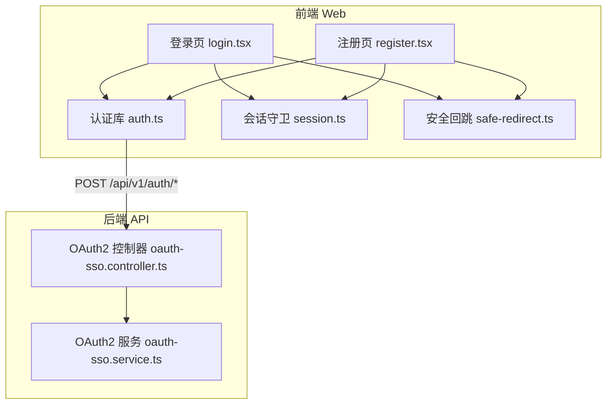
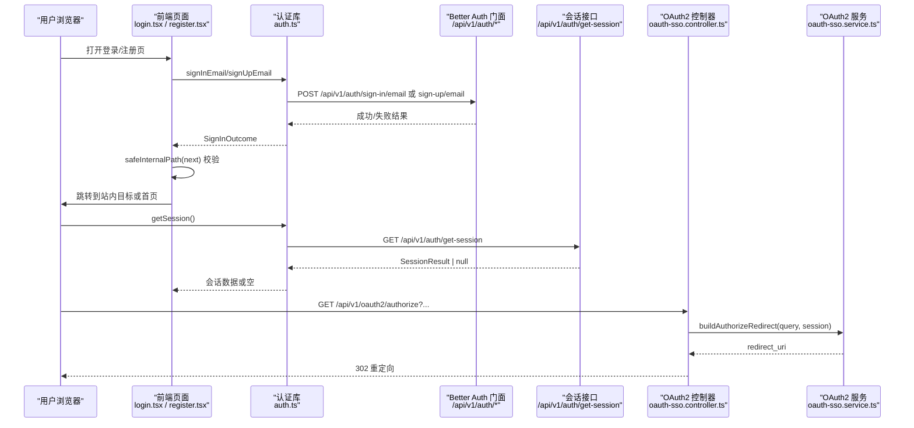
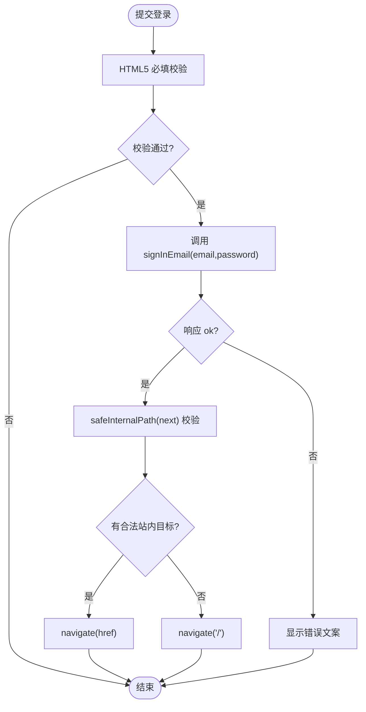
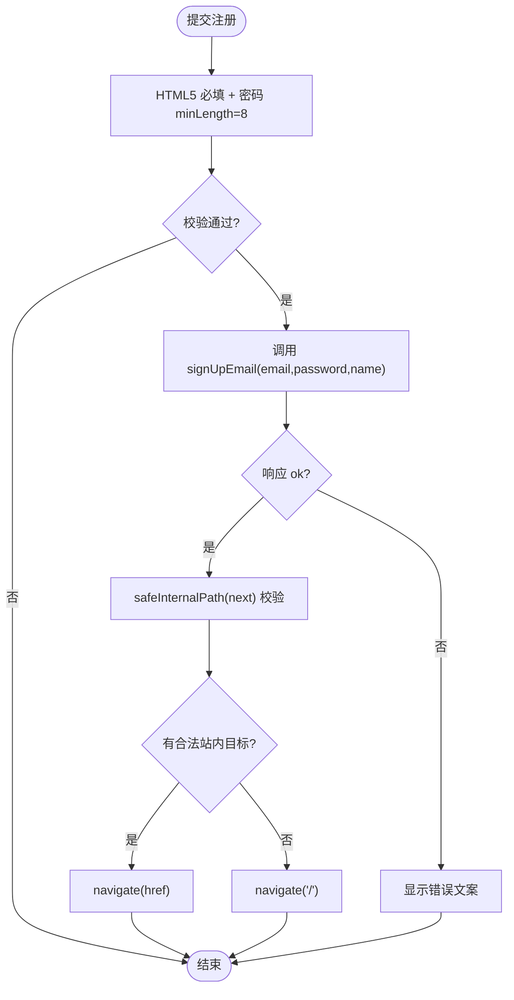
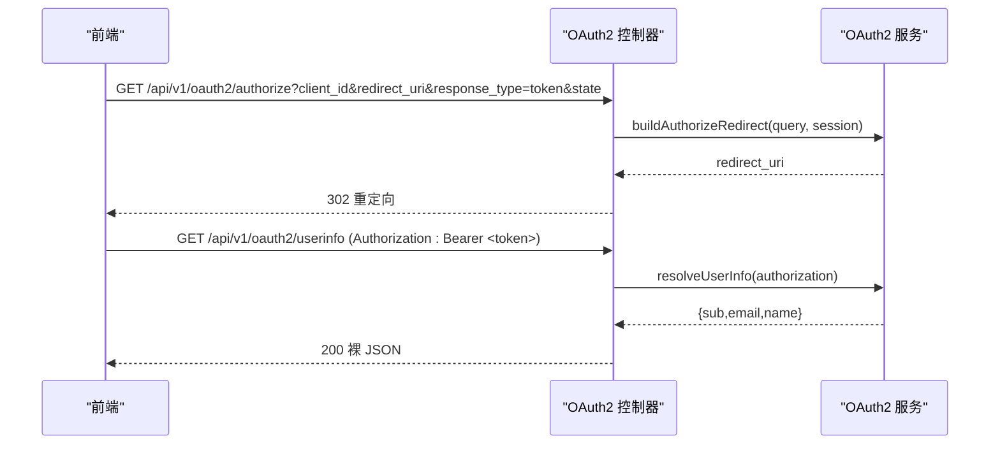
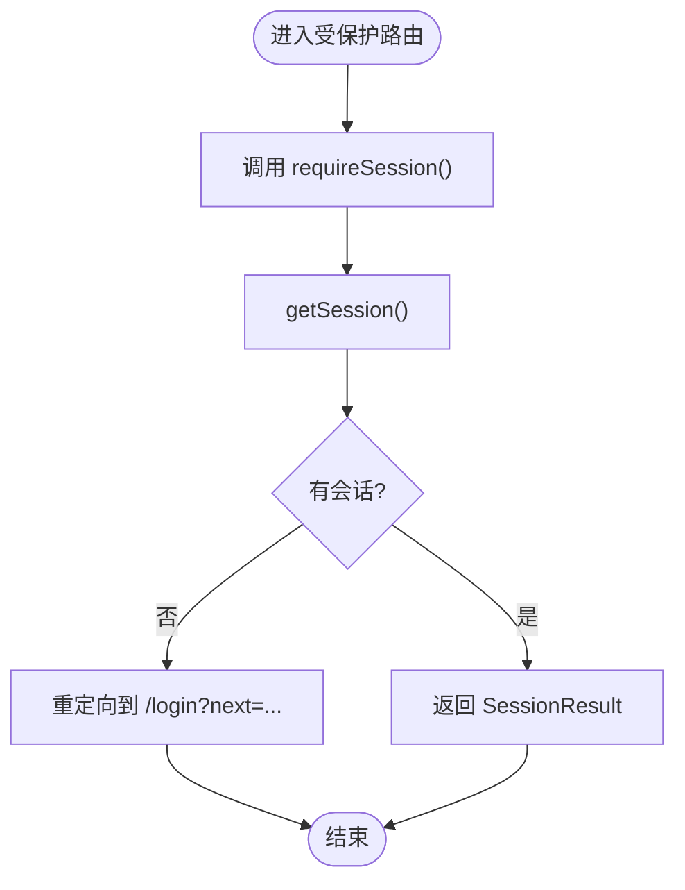
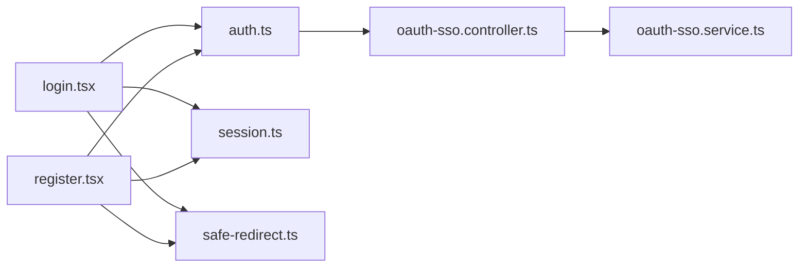

# 认证页面组件

<cite>
**本文引用的文件**   
- [apps/web/src/routes/login.tsx](file://apps/web/src/routes/login.tsx)
- [apps/web/src/routes/register.tsx](file://apps/web/src/routes/register.tsx)
- [apps/web/src/routes/login-redirect.test.tsx](file://apps/web/src/routes/login-redirect.test.tsx)
- [apps/web/src/lib/auth.ts](file://apps/web/src/lib/auth.ts)
- [apps/web/src/lib/session.ts](file://apps/web/src/lib/session.ts)
- [apps/web/src/lib/safe-redirect.ts](file://apps/web/src/lib/safe-redirect.ts)
- [apps/api/src/modules/auth/api/oauth-sso.controller.ts](file://apps/api/src/modules/auth/api/oauth-sso.controller.ts)
- [apps/api/src/modules/auth/infrastructure/oauth-sso.service.ts](file://apps/api/src/modules/auth/infrastructure/oauth-sso.service.ts)
</cite>

## 目录
1. [简介](#简介)
2. [项目结构](#项目结构)
3. [核心组件](#核心组件)
4. [架构总览](#架构总览)
5. [详细组件分析](#详细组件分析)
6. [依赖关系分析](#依赖关系分析)
7. [性能与体验优化](#性能与体验优化)
8. [故障排查指南](#故障排查指南)
9. [结论](#结论)

## 简介
本文件面向前端认证相关页面与后端 OAuth2 授权流程，聚焦以下目标：
- 登录页面（login.tsx）的用户界面、表单验证、错误处理与安全回跳。
- 注册页面（register.tsx）的注册流程、邮箱字段校验、密码最小长度限制与环境提示。
- 登录重定向与 OAuth2 回调：说明前端深链回跳机制、开放重定向防护，以及后端作为 Odoo OIDC OP 的 authorize/userinfo 端点行为。
- 认证状态管理、会话读取、反向守卫与受保护路由守卫。
- 用户友好的错误提示、加载状态、表单提交优化建议。
- 提供完整的使用指南与代码片段路径，便于快速定位实现。

## 项目结构
认证相关的前端代码集中在 `apps/web`，后端 OAuth2 授权逻辑在 `apps/api`。关键文件如下：
- 前端页面：`apps/web/src/routes/login.tsx`、`apps/web/src/routes/register.tsx`
- 前端认证库：`apps/web/src/lib/auth.ts`、`apps/web/src/lib/session.ts`、`apps/web/src/lib/safe-redirect.ts`
- 后端控制器与服务：`apps/api/src/modules/auth/api/oauth-sso.controller.ts`、`apps/api/src/modules/auth/infrastructure/oauth-sso.service.ts`

图表来源
- [apps/web/src/routes/login.tsx:1-146](file://apps/web/src/routes/login.tsx#L1-L146)
- [apps/web/src/routes/register.tsx:1-104](file://apps/web/src/routes/register.tsx#L1-L104)
- [apps/web/src/lib/auth.ts:1-93](file://apps/web/src/lib/auth.ts#L1-L93)
- [apps/web/src/lib/session.ts:1-43](file://apps/web/src/lib/session.ts#L1-L43)
- [apps/web/src/lib/safe-redirect.ts:1-13](file://apps/web/src/lib/safe-redirect.ts#L1-L13)
- [apps/api/src/modules/auth/api/oauth-sso.controller.ts:1-89](file://apps/api/src/modules/auth/api/oauth-sso.controller.ts#L1-L89)
- [apps/api/src/modules/auth/infrastructure/oauth-sso.service.ts:1-125](file://apps/api/src/modules/auth/infrastructure/oauth-sso.service.ts#L1-L125)

章节来源
- [apps/web/src/routes/login.tsx:1-146](file://apps/web/src/routes/login.tsx#L1-L146)
- [apps/web/src/routes/register.tsx:1-104](file://apps/web/src/routes/register.tsx#L1-L104)
- [apps/web/src/lib/auth.ts:1-93](file://apps/web/src/lib/auth.ts#L1-L93)
- [apps/web/src/lib/session.ts:1-43](file://apps/web/src/lib/session.ts#L1-L43)
- [apps/web/src/lib/safe-redirect.ts:1-13](file://apps/web/src/lib/safe-redirect.ts#L1-L13)
- [apps/api/src/modules/auth/api/oauth-sso.controller.ts:1-89](file://apps/api/src/modules/auth/api/oauth-sso.controller.ts#L1-L89)
- [apps/api/src/modules/auth/infrastructure/oauth-sso.service.ts:1-125](file://apps/api/src/modules/auth/infrastructure/oauth-sso.service.ts#L1-L125)

## 核心组件
- 登录页面（login.tsx）
  - 提供邮箱+密码登录表单与“魔法链接”免密登录分区。
  - 使用 `signInEmail` 发起登录；成功后通过 `safeInternalPath(next)` 做站内白名单校验再跳转。
  - 已登录访问 `/login` 时由 `redirectIfAuthenticated` 弹离到合法 next 或首页。
- 注册页面（register.tsx）
  - 仅开发环境可用（后端 emailAndPassword 非生产启用）。
  - 收集姓名、邮箱、密码；密码最小长度为 8；成功后自动登录并安全回跳。
- 认证库（auth.ts）
  - 封装同源相对路径的 `/api/v1/auth/*` 请求；统一错误分类（5xx 归一为“服务暂时不可用”）。
  - 提供 `getSession`、`signInEmail`、`signUpEmail`、`signOut`、`signInMagicLink`。
- 会话守卫（session.ts）
  - `requireSession`：受保护路由 loader 首行调用，无会话则重定向到 `/login?next=...`。
  - `redirectIfAuthenticated`：反向守卫，已登录访问登录/注册页时弹离。
- 安全回跳（safe-redirect.ts）
  - 仅接受站内绝对路径，拒绝协议相对、外链、反斜杠变体等开放重定向风险。
- 后端 OAuth2（oauth-sso.controller.ts + oauth-sso.service.ts）
  - 作为 Odoo 的 OIDC OP，提供隐式流 authorize（返回 fragment access_token）与 userinfo（Bearer 验签后返回裸 JSON）。
  - client_id 与 redirect_uri 精确白名单校验；活跃租户 Odoo 可用性 fail-closed 门禁。

章节来源
- [apps/web/src/routes/login.tsx:1-146](file://apps/web/src/routes/login.tsx#L1-L146)
- [apps/web/src/routes/register.tsx:1-104](file://apps/web/src/routes/register.tsx#L1-L104)
- [apps/web/src/lib/auth.ts:1-93](file://apps/web/src/lib/auth.ts#L1-L93)
- [apps/web/src/lib/session.ts:1-43](file://apps/web/src/lib/session.ts#L1-L43)
- [apps/web/src/lib/safe-redirect.ts:1-13](file://apps/web/src/lib/safe-redirect.ts#L1-L13)
- [apps/api/src/modules/auth/api/oauth-sso.controller.ts:1-89](file://apps/api/src/modules/auth/api/oauth-sso.controller.ts#L1-L89)
- [apps/api/src/modules/auth/infrastructure/oauth-sso.service.ts:1-125](file://apps/api/src/modules/auth/infrastructure/oauth-sso.service.ts#L1-L125)

## 架构总览
下图展示从前端表单到后端会话/OAuth2 授权的端到端交互。

图表来源
- [apps/web/src/routes/login.tsx:24-38](file://apps/web/src/routes/login.tsx#L24-L38)
- [apps/web/src/routes/register.tsx:29-42](file://apps/web/src/routes/register.tsx#L29-L42)
- [apps/web/src/lib/auth.ts:19-26](file://apps/web/src/lib/auth.ts#L19-L26)
- [apps/web/src/lib/auth.ts:34-47](file://apps/web/src/lib/auth.ts#L34-L47)
- [apps/web/src/lib/auth.ts:62-77](file://apps/web/src/lib/auth.ts#L62-L77)
- [apps/api/src/modules/auth/api/oauth-sso.controller.ts:50-62](file://apps/api/src/modules/auth/api/oauth-sso.controller.ts#L50-L62)
- [apps/api/src/modules/auth/infrastructure/oauth-sso.service.ts:52-90](file://apps/api/src/modules/auth/infrastructure/oauth-sso.service.ts#L52-L90)

## 详细组件分析

### 登录页面（login.tsx）
- 用户界面
  - 包含邮箱、密码输入框，登录按钮，错误消息区域，以及“没有账号？注册”链接。
  - 提供“魔法链接”分区：输入邮箱发送一次性登录邮件，成功后显示通知，失败显示错误。
- 表单验证
  - 使用 HTML5 必填校验；邮箱类型输入；密码最小长度由后端约束（前端未额外强度检查）。
- 错误处理
  - 登录失败时，`authFailure` 将 5xx 归一为“服务暂时不可用”，否则取后端 message 或带状态码兜底文案。
  - 魔法链接发送失败同理。
- 登录重定向
  - 成功后通过 `safeInternalPath(next)` 校验站内路径，合法则 SPA 跳转，否则回首页。
  - 已登录访问 `/login` 时由 `redirectIfAuthenticated` 弹离到合法 next 或首页。
- 加载状态
  - 提交期间禁用按钮并显示“登录中…”/“发送中…”。

图表来源
- [apps/web/src/routes/login.tsx:24-38](file://apps/web/src/routes/login.tsx#L24-L38)
- [apps/web/src/lib/auth.ts:49-54](file://apps/web/src/lib/auth.ts#L49-L54)
- [apps/web/src/lib/safe-redirect.ts:6-12](file://apps/web/src/lib/safe-redirect.ts#L6-L12)

章节来源
- [apps/web/src/routes/login.tsx:1-146](file://apps/web/src/routes/login.tsx#L1-L146)
- [apps/web/src/lib/auth.ts:49-54](file://apps/web/src/lib/auth.ts#L49-L54)
- [apps/web/src/lib/safe-redirect.ts:1-13](file://apps/web/src/lib/safe-redirect.ts#L1-L13)

### 注册页面（register.tsx）
- 注册流程
  - 收集姓名、邮箱、密码；调用 `signUpEmail`；成功后自动登录并安全回跳。
- 邮箱验证
  - 前端使用 HTML5 邮箱类型校验；后端对邮箱有效性进行业务校验（不在前端重复实现）。
- 密码强度检查
  - 前端设置最小长度 8；更严格的强度规则（大小写、数字、特殊字符）可在后续扩展。
- 环境提示
  - 页面顶部提示“仅开发环境可用（后端 emailAndPassword 非生产启用）”。
- 错误处理与加载状态
  - 与登录页一致的错误归一化与加载禁用按钮。

图表来源
- [apps/web/src/routes/register.tsx:29-42](file://apps/web/src/routes/register.tsx#L29-L42)
- [apps/web/src/lib/auth.ts:68-77](file://apps/web/src/lib/auth.ts#L68-L77)
- [apps/web/src/lib/safe-redirect.ts:6-12](file://apps/web/src/lib/safe-redirect.ts#L6-L12)

章节来源
- [apps/web/src/routes/register.tsx:1-104](file://apps/web/src/routes/register.tsx#L1-L104)
- [apps/web/src/lib/auth.ts:68-77](file://apps/web/src/lib/auth.ts#L68-L77)
- [apps/web/src/lib/safe-redirect.ts:1-13](file://apps/web/src/lib/safe-redirect.ts#L1-L13)

### 登录重定向与 OAuth2 回调
- 前端深链回跳
  - 登录/注册成功后，使用 `safeInternalPath(next)` 校验站内路径，防止开放重定向攻击。
  - 测试用例覆盖合法站内 next、非法协议相对 next、已登录反向守卫等场景。
- 后端 OAuth2 授权（隐式流）
  - 控制器 `GET /api/v1/oauth2/authorize`：校验 client_id 与 redirect_uri 精确白名单，铸超短 TTL access_token，并以 fragment 形式返回。
  - 服务层 `buildAuthorizeRedirect`：fail-closed 门禁，若活跃租户 Odoo 不可用则 403。
- 后端 OIDC userinfo
  - 控制器 `GET /api/v1/oauth2/userinfo`：旁路会话墙，Bearer 验签 + aud 强制校验，返回裸 JSON `{sub,email,name}`。

图表来源
- [apps/api/src/modules/auth/api/oauth-sso.controller.ts:50-62](file://apps/api/src/modules/auth/api/oauth-sso.controller.ts#L50-L62)
- [apps/api/src/modules/auth/api/oauth-sso.controller.ts:82-87](file://apps/api/src/modules/auth/api/oauth-sso.controller.ts#L82-L87)
- [apps/api/src/modules/auth/infrastructure/oauth-sso.service.ts:52-90](file://apps/api/src/modules/auth/infrastructure/oauth-sso.service.ts#L52-L90)
- [apps/api/src/modules/auth/infrastructure/oauth-sso.service.ts:99-116](file://apps/api/src/modules/auth/infrastructure/oauth-sso.service.ts#L99-L116)

章节来源
- [apps/web/src/routes/login-redirect.test.tsx:1-114](file://apps/web/src/routes/login-redirect.test.tsx#L1-L114)
- [apps/api/src/modules/auth/api/oauth-sso.controller.ts:1-89](file://apps/api/src/modules/auth/api/oauth-sso.controller.ts#L1-L89)
- [apps/api/src/modules/auth/infrastructure/oauth-sso.service.ts:1-125](file://apps/api/src/modules/auth/infrastructure/oauth-sso.service.ts#L1-L125)

### 认证状态管理与会话持久化
- 会话读取
  - `getSession` 调用 `/api/v1/auth/get-session`，区分网络异常与无会话（null），5xx 抛出错误以触发路由错误边界而非误弹登录。
- 受保护路由守卫
  - `requireSession`：无会话则重定向到 `/login?next=<原路径>`；有会话则返回 typed 会话数据。
- 反向守卫
  - `redirectIfAuthenticated`：已登录访问登录/注册页时弹离到合法 next 或首页；会话面抖动不阻断登录入口。
- 令牌刷新
  - 当前实现基于 Cookie + DB Session，前端不自造 token 存取；刷新策略由后端会话生命周期管理。

图表来源
- [apps/web/src/lib/session.ts:12-22](file://apps/web/src/lib/session.ts#L12-L22)
- [apps/web/src/lib/auth.ts:34-47](file://apps/web/src/lib/auth.ts#L34-L47)

章节来源
- [apps/web/src/lib/session.ts:1-43](file://apps/web/src/lib/session.ts#L1-L43)
- [apps/web/src/lib/auth.ts:34-47](file://apps/web/src/lib/auth.ts#L34-L47)

## 依赖关系分析
- 登录/注册页面依赖认证库与会话守卫，确保登录后安全回跳与反向守卫。
- 认证库封装所有 `/api/v1/auth/*` 请求，集中错误处理与语义。
- 后端 OAuth2 控制器与服务解耦：控制器薄、服务承载业务校验与令牌生成。
- 安全回跳函数被登录/注册页面复用，避免开放重定向风险。

图表来源
- [apps/web/src/routes/login.tsx:1-146](file://apps/web/src/routes/login.tsx#L1-L146)
- [apps/web/src/routes/register.tsx:1-104](file://apps/web/src/routes/register.tsx#L1-L104)
- [apps/web/src/lib/auth.ts:1-93](file://apps/web/src/lib/auth.ts#L1-L93)
- [apps/web/src/lib/session.ts:1-43](file://apps/web/src/lib/session.ts#L1-L43)
- [apps/web/src/lib/safe-redirect.ts:1-13](file://apps/web/src/lib/safe-redirect.ts#L1-L13)
- [apps/api/src/modules/auth/api/oauth-sso.controller.ts:1-89](file://apps/api/src/modules/auth/api/oauth-sso.controller.ts#L1-L89)
- [apps/api/src/modules/auth/infrastructure/oauth-sso.service.ts:1-125](file://apps/api/src/modules/auth/infrastructure/oauth-sso.service.ts#L1-L125)

章节来源
- [apps/web/src/routes/login.tsx:1-146](file://apps/web/src/routes/login.tsx#L1-L146)
- [apps/web/src/routes/register.tsx:1-104](file://apps/web/src/routes/register.tsx#L1-L104)
- [apps/web/src/lib/auth.ts:1-93](file://apps/web/src/lib/auth.ts#L1-L93)
- [apps/web/src/lib/session.ts:1-43](file://apps/web/src/lib/session.ts#L1-L43)
- [apps/web/src/lib/safe-redirect.ts:1-13](file://apps/web/src/lib/safe-redirect.ts#L1-L13)
- [apps/api/src/modules/auth/api/oauth-sso.controller.ts:1-89](file://apps/api/src/modules/auth/api/oauth-sso.controller.ts#L1-L89)
- [apps/api/src/modules/auth/infrastructure/oauth-sso.service.ts:1-125](file://apps/api/src/modules/auth/infrastructure/oauth-sso.service.ts#L1-L125)

## 性能与体验优化
- 表单提交优化
  - 提交期间禁用按钮，避免重复提交；使用 pending 状态控制 UI。
  - 建议在长耗时操作中加入防抖/节流（如魔法链接发送）与重试退避。
- 错误提示优化
  - 统一错误归一化：5xx 显示“服务暂时不可用”，其他错误显示后端 message 或兜底文案。
  - 对用户可见错误保持简洁明确，避免暴露内部细节。
- 加载状态优化
  - 在会话读取失败时，受保护路由应落到错误边界而非反复弹登录。
  - 对网络抖动场景提供重试或降级提示。
- 安全回跳优化
  - 严格白名单校验站内路径，防止开放重定向攻击。
  - 对 next 参数进行 URL 解码后再校验，避免编码绕过。

[本节为通用指导，不直接分析具体文件]

## 故障排查指南
- 登录失败
  - 检查后端是否返回 5xx；若是，统一提示“服务暂时不可用”。
  - 确认 `signInEmail` 返回的 `SignInOutcome.error` 是否正确渲染。
- 注册失败
  - 检查邮箱格式与密码最小长度；确认后端 emailAndPassword 在非生产环境启用。
- 会话读取异常
  - 若 `getSession` 抛错（网络/5xx），受保护路由应落入错误边界；检查网络连通性与后端健康。
- 重定向异常
  - 检查 `safeInternalPath` 是否放行合法 next；确认 next 不含协议相对或外链。
- OAuth2 授权失败
  - 确认 client_id 已注册且 redirect_uri 精确匹配；检查活跃租户 Odoo 绑定状态。
  - 若 userinfo 返回 401/403，检查 Bearer 令牌有效性与邮箱验证状态。

章节来源
- [apps/web/src/lib/auth.ts:49-54](file://apps/web/src/lib/auth.ts#L49-L54)
- [apps/web/src/lib/session.ts:12-22](file://apps/web/src/lib/session.ts#L12-L22)
- [apps/web/src/lib/safe-redirect.ts:6-12](file://apps/web/src/lib/safe-redirect.ts#L6-L12)
- [apps/api/src/modules/auth/infrastructure/oauth-sso.service.ts:52-90](file://apps/api/src/modules/auth/infrastructure/oauth-sso.service.ts#L52-L90)
- [apps/api/src/modules/auth/infrastructure/oauth-sso.service.ts:99-116](file://apps/api/src/modules/auth/infrastructure/oauth-sso.service.ts#L99-L116)

## 结论
本认证体系以前端页面为中心，结合会话守卫与安全回跳，确保登录/注册流程的安全与用户体验；后端通过 Better Auth 门面与 OAuth2 控制器/服务，提供稳定的会话与 OIDC 能力。建议后续增强密码强度校验、增加重试与降级策略，并持续完善错误提示与可观测性。