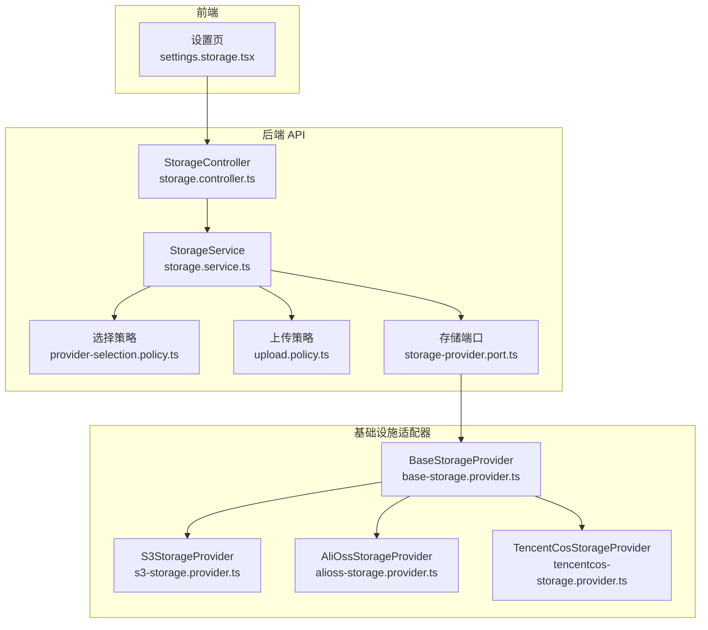
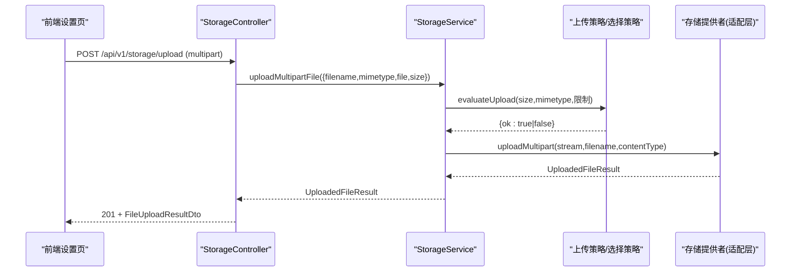
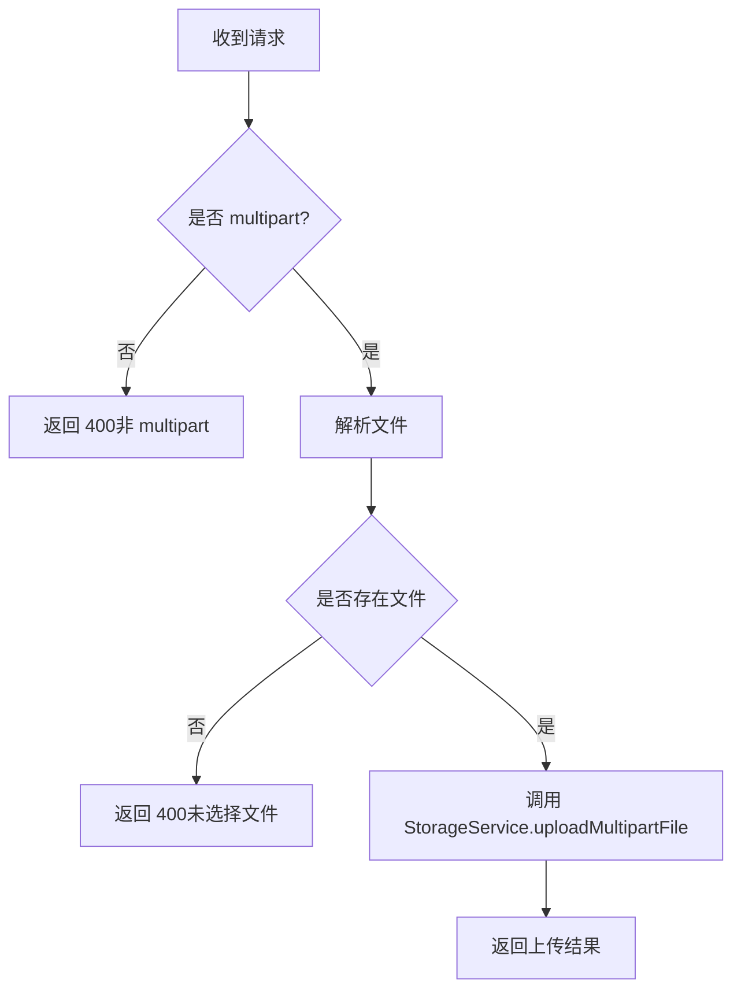
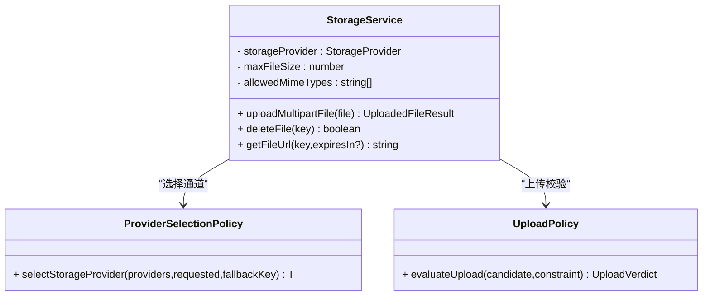
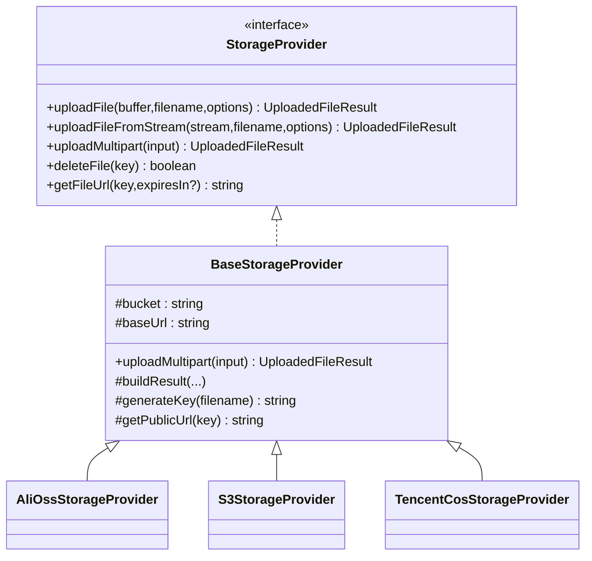
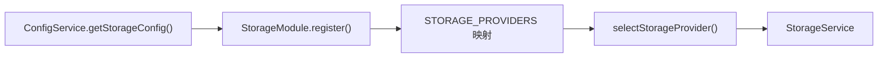

# 存储设置页面

<cite>
**本文引用的文件**   
- [storage.module.ts](file://apps/api/src/modules/storage/storage.module.ts)
- [storage.controller.ts](file://apps/api/src/modules/storage/api/storage.controller.ts)
- [storage.service.ts](file://apps/api/src/modules/storage/application/storage.service.ts)
- [base-storage.provider.ts](file://apps/api/src/modules/storage/infrastructure/base-storage.provider.ts)
- [alioss-storage.provider.ts](file://apps/api/src/modules/storage/infrastructure/alioss-storage.provider.ts)
- [s3-storage.provider.ts](file://apps/api/src/modules/storage/infrastructure/s3-storage.provider.ts)
- [tencentcos-storage.provider.ts](file://apps/api/src/modules/storage/infrastructure/tencentcos-storage.provider.ts)
- [storage-provider.port.ts](file://apps/api/src/modules/storage/domain/ports/storage-provider.port.ts)
- [provider-selection.policy.ts](file://apps/api/src/modules/storage/domain/policies/provider-selection.policy.ts)
- [upload.policy.ts](file://apps/api/src/modules/storage/domain/policies/upload.policy.ts)
- [storage-key.ts](file://apps/api/src/modules/storage/domain/value-objects/storage-key.ts)
- [settings.storage.tsx](file://apps/web/src/routes/settings.storage.tsx)
</cite>

## 目录
1. [简介](#简介)
2. [项目结构](#项目结构)
3. [核心组件](#核心组件)
4. [架构总览](#架构总览)
5. [详细组件分析](#详细组件分析)
6. [依赖关系分析](#依赖关系分析)
7. [性能与成本优化建议](#性能与成本优化建议)
8. [故障排查指南](#故障排查指南)
9. [结论](#结论)
10. [附录：配置示例与多云集成方案](#附录配置示例与多云集成方案)

## 简介
本页面面向“存储设置”功能，覆盖云存储配置、文件管理、访问控制、提供商切换、配置校验与连接测试、成本估算与监控、以及多云存储集成。后端采用分层架构（API 层 → 应用编排层 → 领域策略/端口 → 基础设施适配器），前端提供单文件上传、签名 URL 生成与删除操作；对象存储无列表能力，因此前端仅支持“本次会话上传件”和“按 key 操作既有文件”。

## 项目结构
存储模块在后端以 NestJS 模块组织，包含控制器、服务、领域策略、端口定义与多厂商适配器；前端在设置路由中提供上传、取签名 URL、删除等交互。

图表来源
- [storage.controller.ts:71-180](file://apps/api/src/modules/storage/api/storage.controller.ts#L71-L180)
- [storage.service.ts:17-99](file://apps/api/src/modules/storage/application/storage.service.ts#L17-L99)
- [provider-selection.policy.ts:14-20](file://apps/api/src/modules/storage/domain/policies/provider-selection.policy.ts#L14-L20)
- [upload.policy.ts:48-56](file://apps/api/src/modules/storage/domain/policies/upload.policy.ts#L48-L56)
- [storage-provider.port.ts:44-100](file://apps/api/src/modules/storage/domain/ports/storage-provider.port.ts#L44-L100)
- [base-storage.provider.ts:28-119](file://apps/api/src/modules/storage/infrastructure/base-storage.provider.ts#L28-L119)
- [s3-storage.provider.ts:20-149](file://apps/api/src/modules/storage/infrastructure/s3-storage.provider.ts#L20-L149)
- [alioss-storage.provider.ts:12-127](file://apps/api/src/modules/storage/infrastructure/alioss-storage.provider.ts#L12-L127)
- [tencentcos-storage.provider.ts:12-141](file://apps/api/src/modules/storage/infrastructure/tencentcos-storage.provider.ts#L12-L141)

章节来源
- [storage.module.ts:11-47](file://apps/api/src/modules/storage/storage.module.ts#L11-L47)
- [storage.controller.ts:71-180](file://apps/api/src/modules/storage/api/storage.controller.ts#L71-L180)
- [settings.storage.tsx:20-277](file://apps/web/src/routes/settings.storage.tsx#L20-L277)

## 核心组件
- 存储控制器：暴露上传、删除、签名 URL 接口；上传走 Fastify multipart 原始流，其余通过 oRPC 契约。
- 存储服务：编排上传校验（尺寸/MIME）、选择存储通道、委托底层 provider 执行 IO。
- 存储端口：定义统一上传/删除/签名 URL 的出站网关。
- 基础提供者：封装临时文件落盘、流式上传、ETag 归一化、公共 URL 拼装、Key 命名规则注入。
- 厂商适配器：阿里云 OSS、AWS S3、腾讯云 COS 的具体实现。
- 领域策略：提供商选择与上传校验纯函数。
- 前端设置页：单文件上传、刷新签名 URL、删除、按 key 获取签名 URL 或删除。

章节来源
- [storage.controller.ts:71-180](file://apps/api/src/modules/storage/api/storage.controller.ts#L71-L180)
- [storage.service.ts:17-99](file://apps/api/src/modules/storage/application/storage.service.ts#L17-L99)
- [storage-provider.port.ts:44-100](file://apps/api/src/modules/storage/domain/ports/storage-provider.port.ts#L44-L100)
- [base-storage.provider.ts:28-119](file://apps/api/src/modules/storage/infrastructure/base-storage.provider.ts#L28-L119)
- [provider-selection.policy.ts:14-20](file://apps/api/src/modules/storage/domain/policies/provider-selection.policy.ts#L14-L20)
- [upload.policy.ts:48-56](file://apps/api/src/modules/storage/domain/policies/upload.policy.ts#L48-L56)
- [settings.storage.tsx:20-277](file://apps/web/src/routes/settings.storage.tsx#L20-L277)

## 架构总览
下图展示一次“上传文件”的端到端调用链：前端表单提交 → 控制器解析 multipart → 服务进行领域校验 → 选择具体存储通道 → 基础设施完成上传并返回结果。

图表来源
- [storage.controller.ts:84-142](file://apps/api/src/modules/storage/api/storage.controller.ts#L84-L142)
- [storage.service.ts:43-79](file://apps/api/src/modules/storage/application/storage.service.ts#L43-L79)
- [upload.policy.ts:48-56](file://apps/api/src/modules/storage/domain/policies/upload.policy.ts#L48-L56)
- [base-storage.provider.ts:61-83](file://apps/api/src/modules/storage/infrastructure/base-storage.provider.ts#L61-L83)

## 详细组件分析

### 存储控制器（API 层）
- 上传：要求 multipart/form-data；若请求非 multipart 或无文件，返回 400 错误码；成功返回上传结果 DTO。
- 删除：通过 oRPC 契约接收 key，透传至服务层。
- 签名 URL：通过 oRPC 契约接收 key 与可选 expiresIn，返回可访问 URL。

图表来源
- [storage.controller.ts:84-142](file://apps/api/src/modules/storage/api/storage.controller.ts#L84-L142)

章节来源
- [storage.controller.ts:71-180](file://apps/api/src/modules/storage/api/storage.controller.ts#L71-L180)

### 存储服务（应用编排层）
- 选择存储通道：根据配置 provider 从已注册 providers 中选择，未命中则回退到 s3。
- 上传校验：先检查文件大小，再检查 MIME 白名单；失败抛 400 并携带领域错误码。
- 委托上传：将 multipart 原始流交给 BaseStorageProvider 处理临时文件与流式上传。
- 删除与签名 URL：直接透传到底层 provider。

图表来源
- [storage.service.ts:17-99](file://apps/api/src/modules/storage/application/storage.service.ts#L17-L99)
- [provider-selection.policy.ts:14-20](file://apps/api/src/modules/storage/domain/policies/provider-selection.policy.ts#L14-L20)
- [upload.policy.ts:48-56](file://apps/api/src/modules/storage/domain/policies/upload.policy.ts#L48-L56)

章节来源
- [storage.service.ts:17-99](file://apps/api/src/modules/storage/application/storage.service.ts#L17-L99)

### 存储端口与基础提供者（领域/基础设施）
- 端口定义：统一抽象 uploadFile、uploadFileFromStream、uploadMultipart、deleteFile、getFileUrl。
- 基础提供者：
  - 统一 Key 命名：YYYY/MM/DD/<uuid><ext>（由领域值对象决定）。
  - 统一内容类型默认值、ETag 去引号、公共 URL 拼接（优先 baseUrl，否则厂商默认格式）。
  - 统一 multipart 流程：写入 tmp 目录 → 流式上传 → 清理临时文件。

图表来源
- [storage-provider.port.ts:44-100](file://apps/api/src/modules/storage/domain/ports/storage-provider.port.ts#L44-L100)
- [base-storage.provider.ts:28-119](file://apps/api/src/modules/storage/infrastructure/base-storage.provider.ts#L28-L119)
- [alioss-storage.provider.ts:12-127](file://apps/api/src/modules/storage/infrastructure/alioss-storage.provider.ts#L12-L127)
- [s3-storage.provider.ts:20-149](file://apps/api/src/modules/storage/infrastructure/s3-storage.provider.ts#L20-L149)
- [tencentcos-storage.provider.ts:12-141](file://apps/api/src/modules/storage/infrastructure/tencentcos-storage.provider.ts#L12-L141)

章节来源
- [storage-provider.port.ts:44-100](file://apps/api/src/modules/storage/domain/ports/storage-provider.port.ts#L44-L100)
- [base-storage.provider.ts:28-119](file://apps/api/src/modules/storage/infrastructure/base-storage.provider.ts#L28-L119)

### 阿里云 OSS 适配器
- 客户端初始化：region、accessKeyId、accessKeySecret、bucket、endpoint。
- 上传：put/putStream，超时 60 秒；ACL 通过 x-oss-object-acl 头传递。
- 删除：delete。
- 签名 URL：signatureUrl，适用于私有桶。
- 默认公开 URL：https://{bucket}.{endpoint}/{key}。

章节来源
- [alioss-storage.provider.ts:12-127](file://apps/api/src/modules/storage/infrastructure/alioss-storage.provider.ts#L12-L127)

### AWS S3 适配器
- 客户端初始化：region、credentials；当 endpoint 存在时启用 forcePathStyle（兼容 MinIO 等）。
- 上传：PutObjectCommand；大文件使用 @aws-sdk/lib-storage 的 Upload 分片上传。
- 删除：DeleteObjectCommand。
- 签名 URL：getSignedUrl。
- 默认公开 URL：https://{bucket}.s3.{region}.amazonaws.com/{key}。

章节来源
- [s3-storage.provider.ts:20-149](file://apps/api/src/modules/storage/infrastructure/s3-storage.provider.ts#L20-L149)

### 腾讯云 COS 适配器
- 客户端初始化：SecretId、SecretKey。
- 上传：putObject（回调风格），size 为 -1 表示流式未知大小。
- 删除：deleteObject。
- 签名 URL：getObjectUrl(Sign=true)。
- 默认公开 URL：https://{bucket}.cos.{region}.myqcloud.com/{key}。

章节来源
- [tencentcos-storage.provider.ts:12-141](file://apps/api/src/modules/storage/infrastructure/tencentcos-storage.provider.ts#L12-L141)

### 前端设置页（Web）
- 上传：选择文件后通过原生 fetch 发送 multipart 表单，成功后显示文件名、大小、类型、key、访问 URL。
- 签名 URL：对已上传文件或手动输入的 key 调用签名 URL 接口，支持刷新。
- 删除：对已上传文件或手动 key 执行删除，成功后清空状态。
- 说明：对象存储无列表能力，故本页仅操作“本次上传件”和“按 key 操作既有文件”。

章节来源
- [settings.storage.tsx:20-277](file://apps/web/src/routes/settings.storage.tsx#L20-L277)

## 依赖关系分析
- 模块装配：StorageModule.register 根据 storageConfig.provider 动态注册 alioss 或 tencentoss；s3 始终可用作为回退。
- 运行时选择：StorageService 构造期通过 selectStorageProvider 选择实际 provider。
- 关键外部依赖：ali-oss、@aws-sdk/*、cos-nodejs-sdk-v5。

图表来源
- [storage.module.ts:17-47](file://apps/api/src/modules/storage/storage.module.ts#L17-L47)
- [provider-selection.policy.ts:14-20](file://apps/api/src/modules/storage/domain/policies/provider-selection.policy.ts#L14-L20)
- [storage.service.ts:23-34](file://apps/api/src/modules/storage/application/storage.service.ts#L23-L34)

章节来源
- [storage.module.ts:11-47](file://apps/api/src/modules/storage/storage.module.ts#L11-L47)
- [provider-selection.policy.ts:14-20](file://apps/api/src/modules/storage/domain/policies/provider-selection.policy.ts#L14-L20)
- [storage.service.ts:23-34](file://apps/api/src/modules/storage/application/storage.service.ts#L23-L34)

## 性能与成本优化建议
- 大文件上传
  - 使用流式上传避免内存峰值；S3 适配器已使用分片上传提升稳定性。
  - 合理设置超时与重试（OSS 适配器已设置 60 秒超时）。
- 缓存与 CDN
  - 配置 baseUrl 指向 CDN 域名，减少源站压力；静态资源开启缓存。
- 生命周期与归档
  - 利用各云厂商的生命周期规则自动转低频/归档存储，降低成本。
- 压缩与转码
  - 上传前压缩图片/视频，降低带宽与存储成本。
- 监控与告警
  - 关注存储用量、请求次数、出网流量；结合云监控设置阈值告警。
- 成本估算
  - 基于月均存储量、请求次数、出网流量、CDN 用量估算月度费用；不同厂商定价差异较大，需结合业务地域与访问模式评估。

[本节为通用建议，不直接分析具体文件]

## 故障排查指南
- 上传失败
  - 非 multipart 或未选择文件：控制器会返回 400 错误码。
  - 文件过大或类型不在白名单：服务层抛出 400 并附带领域错误码。
  - 底层 provider 异常：统一包装为 400 并携带 STORAGE_UPLOAD_FAILED。
- 签名 URL 失败
  - 各 provider 内部捕获异常并抛出错误信息，便于定位凭证/权限问题。
- 删除失败
  - 删除接口透传 provider 异常，检查 bucket/key 是否存在及权限。
- 提供商切换
  - 确认 storageConfig.provider 与已注册实例一致；未匹配将回退 s3。

章节来源
- [storage.controller.ts:103-142](file://apps/api/src/modules/storage/api/storage.controller.ts#L103-L142)
- [storage.service.ts:43-79](file://apps/api/src/modules/storage/application/storage.service.ts#L43-L79)
- [alioss-storage.provider.ts:89-100](file://apps/api/src/modules/storage/infrastructure/alioss-storage.provider.ts#L89-L100)
- [s3-storage.provider.ts:118-129](file://apps/api/src/modules/storage/infrastructure/s3-storage.provider.ts#L118-L129)
- [tencentcos-storage.provider.ts:71-96](file://apps/api/src/modules/storage/infrastructure/tencentcos-storage.provider.ts#L71-L96)

## 结论
存储设置页面围绕“上传—签名—删除”形成闭环，后端通过清晰的层次与端口抽象屏蔽多厂商差异，前端聚焦用户交互。借助领域策略与基础提供者，系统在可扩展性、可测性与一致性方面具备良好基础。生产环境应结合 CDN、生命周期策略与监控告警，持续优化性能与成本。

[本节为总结性内容，不直接分析具体文件]

## 附录：配置示例与多云集成方案

### 云存储配置参数说明
- 通用字段
  - provider：当前启用的存储提供商标识（如 s3、alioss、tencentoss）。
  - region：区域标识（如 cn-hangzhou、us-east-1、ap-shanghai）。
  - accessKeyId / accessKeySecret：访问密钥。
  - bucket：目标存储空间名称。
  - endpoint：自定义端点（兼容 S3 协议的服务如 MinIO 时可配合 forcePathStyle）。
  - baseUrl：自定义公开访问基址（用于 CDN 或反向代理）。
  - maxFileSize：最大允许文件大小（字节）。
  - allowedMimeTypes：允许的文件类型白名单。
- 阿里云 OSS
  - 必填：region、accessKeyId、accessKeySecret、bucket、endpoint（可选）。
  - ACL：通过上传选项中的 acl 字段设置对象 ACL（私有/公有读等）。
- AWS S3
  - 必填：region、accessKeyId、accessKeySecret、bucket。
  - endpoint：当使用兼容 S3 的服务时需设置，并启用 path-style。
  - ACL：通过上传选项中的 acl 字段设置（Canned ACL）。
- 腾讯云 COS
  - 必填：SecretId、SecretKey、bucket、region。
  - 签名 URL：getObjectUrl 支持 Sign=true 生成带签名的访问链接。

章节来源
- [storage.module.ts:17-47](file://apps/api/src/modules/storage/storage.module.ts#L17-L47)
- [alioss-storage.provider.ts:16-27](file://apps/api/src/modules/storage/infrastructure/alioss-storage.provider.ts#L16-L27)
- [s3-storage.provider.ts:25-45](file://apps/api/src/modules/storage/infrastructure/s3-storage.provider.ts#L25-L45)
- [tencentcos-storage.provider.ts:17-27](file://apps/api/src/modules/storage/infrastructure/tencentcos-storage.provider.ts#L17-L27)

### 访问控制与安全
- ACL 配置
  - 上传时可通过 options.acl 指定对象 ACL；OSS/S3/COS 分别映射到各自 SDK 的 ACL 语义。
- 签名 URL
  - 所有 provider 均支持生成带时效的签名 URL，适合私有桶安全访问。
- 防盗链
  - 建议在 CDN/网关层配置 Referer 白名单与 User-Agent 校验；对象存储侧可结合私有桶+签名 URL 实现强访问控制。

章节来源
- [alioss-storage.provider.ts:109-122](file://apps/api/src/modules/storage/infrastructure/alioss-storage.provider.ts#L109-L122)
- [s3-storage.provider.ts:135-149](file://apps/api/src/modules/storage/infrastructure/s3-storage.provider.ts#L135-L149)
- [tencentcos-storage.provider.ts:71-96](file://apps/api/src/modules/storage/infrastructure/tencentcos-storage.provider.ts#L71-L96)

### 提供商切换与连接测试
- 提供商切换
  - 修改 storageConfig.provider 即可切换；未注册时将回退到 s3。
- 连接测试
  - 通过上传小文件并获取签名 URL 验证连通性与权限；也可调用删除接口验证写权限。

章节来源
- [storage.module.ts:17-47](file://apps/api/src/modules/storage/storage.module.ts#L17-L47)
- [storage.service.ts:23-34](file://apps/api/src/modules/storage/application/storage.service.ts#L23-L34)

### 文件管理与批量操作
- 文件查看
  - 对象存储无列表能力，前端仅展示本次上传结果与手动 key 的操作。
- 上传/下载
  - 上传：multipart 直传后端，后端落临时文件后流式上传。
  - 下载：通过签名 URL 或公开 URL（取决于 ACL 与 baseUrl）。
- 批量操作
  - 当前页面不支持批量；可在上层业务逻辑中循环调用删除/签名 URL 接口实现。

章节来源
- [settings.storage.tsx:20-277](file://apps/web/src/routes/settings.storage.tsx#L20-L277)
- [base-storage.provider.ts:61-83](file://apps/api/src/modules/storage/infrastructure/base-storage.provider.ts#L61-L83)

### Key 命名与元数据
- Key 命名规则
  - YYYY/MM/DD/<uuid><ext>，确保跨时间分片与唯一性。
- 元数据
  - 支持 metadata 键值对附加到对象；OSS 通过 x-oss-meta-* 头传递。

章节来源
- [storage-key.ts:14-23](file://apps/api/src/modules/storage/domain/value-objects/storage-key.ts#L14-L23)
- [alioss-storage.provider.ts:109-122](file://apps/api/src/modules/storage/infrastructure/alioss-storage.provider.ts#L109-L122)

### 多云存储集成方案
- 统一入口
  - 通过 StorageService 与 StorageProvider 端口屏蔽差异，业务代码无需感知具体厂商。
- 多租户/多环境
  - 不同环境/租户可配置不同 provider 与 bucket，实现隔离与成本优化。
- 灰度与回滚
  - 通过 provider 选择策略快速切换；保留 s3 作为回退通道保障可用性。

章节来源
- [storage.service.ts:17-34](file://apps/api/src/modules/storage/application/storage.service.ts#L17-L34)
- [provider-selection.policy.ts:14-20](file://apps/api/src/modules/storage/domain/policies/provider-selection.policy.ts#L14-L20)