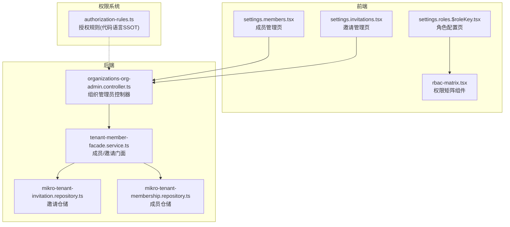
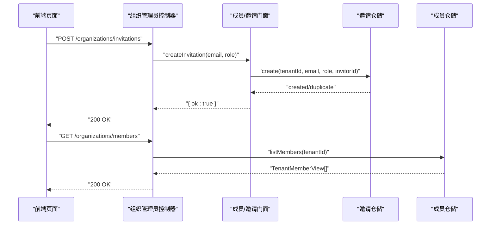
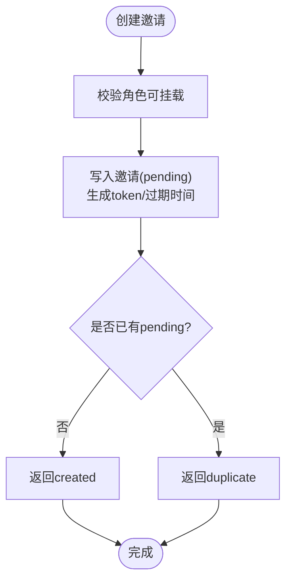
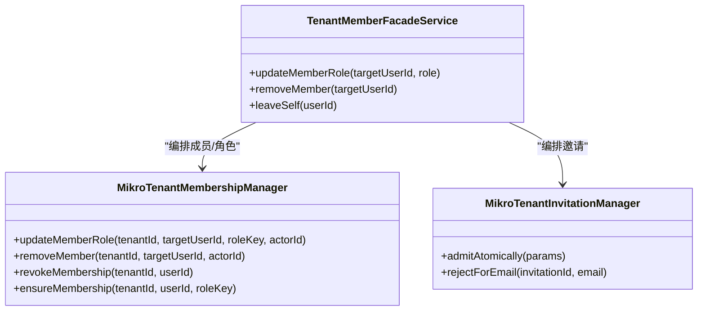
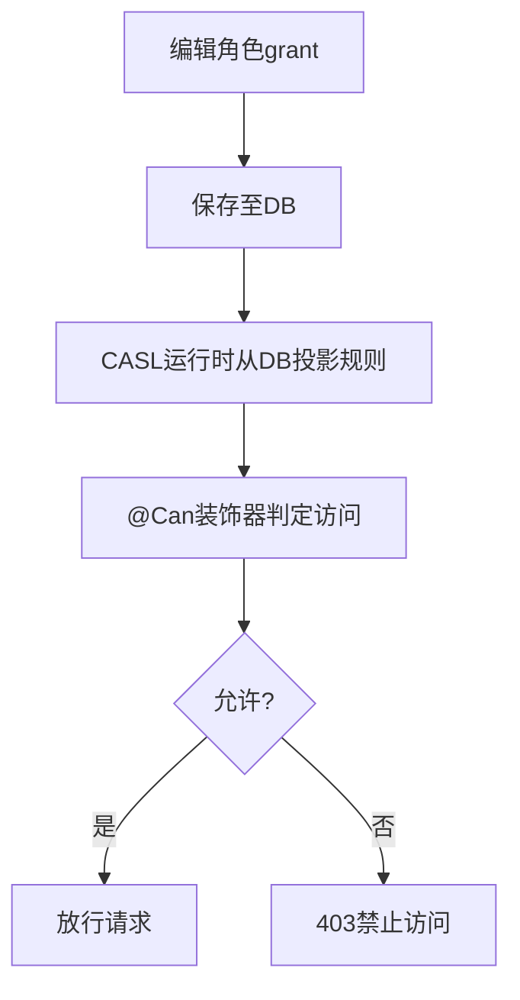
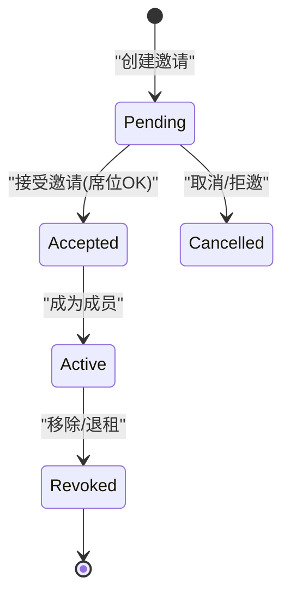
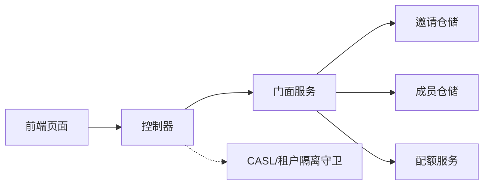

# 成员管理页面

<cite>
**本文引用的文件**   
- [apps/web/src/routes/settings.members.tsx](file://apps/web/src/routes/settings.members.tsx)
- [apps/web/src/routes/settings.invitations.tsx](file://apps/web/src/routes/settings.invitations.tsx)
- [apps/api/src/modules/organizations/api/organizations-org-admin.controller.ts](file://apps/api/src/modules/organizations/api/organizations-org-admin.controller.ts)
- [apps/api/src/modules/organizations/application/tenant-member-facade.service.ts](file://apps/api/src/modules/organizations/application/tenant-member-facade.service.ts)
- [apps/api/src/modules/authorization/infrastructure/repositories/mikro-tenant-invitation.repository.ts](file://apps/api/src/modules/authorization/infrastructure/repositories/mikro-tenant-invitation.repository.ts)
- [apps/api/src/modules/authorization/infrastructure/repositories/mikro-tenant-membership.repository.ts](file://apps/api/src/modules/authorization/infrastructure/repositories/mikro-tenant-membership.repository.ts)
- [libs/core/src/authorization/authorization-rules.ts](file://libs/core/src/authorization/authorization-rules.ts)
- [apps/web/src/components/rbac-matrix.tsx](file://apps/web/src/components/rbac-matrix.tsx)
- [apps/web/src/routes/settings.roles.$roleKey.tsx](file://apps/web/src/routes/settings.roles.$roleKey.tsx)
</cite>

## 目录
1. [引言](#引言)
2. [项目结构](#项目结构)
3. [核心组件](#核心组件)
4. [架构总览](#架构总览)
5. [详细组件分析](#详细组件分析)
6. [依赖关系分析](#依赖关系分析)
7. [性能与可扩展性](#性能与可扩展性)
8. [故障排查指南](#故障排查指南)
9. [结论](#结论)
10. [附录：API 调用示例与体验优化](#附录api-调用示例与体验优化)

## 引言
本文件面向“成员管理页面”的完整实现与使用文档，覆盖以下目标：
- 成员邀请：邮箱邀请发送、邀请链接生成、邀请状态跟踪。
- 成员角色分配：角色选择、权限继承、批量角色变更（当前为单成员操作，提供扩展建议）。
- 成员权限控制：访问权限矩阵、资源级权限设置、权限撤销机制。
- 成员状态管理：激活/禁用、离职处理、权限回收。
- 列表交互：实时成员列表更新、搜索过滤、分页加载（现状与增强建议）。
- API 调用示例与用户体验优化方案。

## 项目结构
成员管理相关代码横跨前端路由、后端控制器、门面服务与仓储层：
- 前端页面：
  - 成员管理页：`apps/web/src/routes/settings.members.tsx`
  - 邀请管理页：`apps/web/src/routes/settings.invitations.tsx`
  - 权限矩阵组件：`apps/web/src/components/rbac-matrix.tsx`
  - 角色配置页：`apps/web/src/routes/settings.roles.$roleKey.tsx`
- 后端接口：
  - 组织管理员控制器：`apps/api/src/modules/organizations/api/organizations-org-admin.controller.ts`
  - 成员/邀请门面服务：`apps/api/src/modules/organizations/application/tenant-member-facade.service.ts`
  - 邀请仓储：`apps/api/src/modules/authorization/infrastructure/repositories/mikro-tenant-invitation.repository.ts`
  - 成员仓储：`apps/api/src/modules/authorization/infrastructure/repositories/mikro-tenant-membership.repository.ts`
- 权限规则：
  - 授权规则定义（DB 为 SSOT，代码为语言 SSOT）：`libs/core/src/authorization/authorization-rules.ts`

**图表来源**
- [apps/web/src/routes/settings.members.tsx:21-87](file://apps/web/src/routes/settings.members.tsx#L21-L87)
- [apps/web/src/routes/settings.invitations.tsx:39-127](file://apps/web/src/routes/settings.invitations.tsx#L39-L127)
- [apps/api/src/modules/organizations/api/organizations-org-admin.controller.ts:58-156](file://apps/api/src/modules/organizations/api/organizations-org-admin.controller.ts#L58-L156)
- [apps/api/src/modules/organizations/application/tenant-member-facade.service.ts:56-243](file://apps/api/src/modules/organizations/application/tenant-member-facade.service.ts#L56-L243)
- [apps/api/src/modules/authorization/infrastructure/repositories/mikro-tenant-invitation.repository.ts:38-178](file://apps/api/src/modules/authorization/infrastructure/repositories/mikro-tenant-invitation.repository.ts#L38-L178)
- [apps/api/src/modules/authorization/infrastructure/repositories/mikro-tenant-membership.repository.ts:34-152](file://apps/api/src/modules/authorization/infrastructure/repositories/mikro-tenant-membership.repository.ts#L34-L152)
- [libs/core/src/authorization/authorization-rules.ts:1-20](file://libs/core/src/authorization/authorization-rules.ts#L1-L20)

**章节来源**
- [apps/web/src/routes/settings.members.tsx:1-184](file://apps/web/src/routes/settings.members.tsx#L1-L184)
- [apps/web/src/routes/settings.invitations.tsx:1-158](file://apps/web/src/routes/settings.invitations.tsx#L1-L158)
- [apps/api/src/modules/organizations/api/organizations-org-admin.controller.ts:1-157](file://apps/api/src/modules/organizations/api/organizations-org-admin.controller.ts#L1-L157)
- [apps/api/src/modules/organizations/application/tenant-member-facade.service.ts:1-264](file://apps/api/src/modules/organizations/application/tenant-member-facade.service.ts#L1-L264)
- [apps/api/src/modules/authorization/infrastructure/repositories/mikro-tenant-invitation.repository.ts:1-198](file://apps/api/src/modules/authorization/infrastructure/repositories/mikro-tenant-invitation.repository.ts#L1-L198)
- [apps/api/src/modules/authorization/infrastructure/repositories/mikro-tenant-membership.repository.ts:1-154](file://apps/api/src/modules/authorization/infrastructure/repositories/mikro-tenant-membership.repository.ts#L1-L154)
- [libs/core/src/authorization/authorization-rules.ts:1-20](file://libs/core/src/authorization/authorization-rules.ts#L1-L20)

## 核心组件
- 成员管理页：展示成员列表、支持单成员角色变更与移除、提供退出当前组织入口。
- 邀请管理页：支持按邮箱+角色创建邀请、列出待处理邀请并撤回。
- 组织管理员控制器：暴露成员/邀请管理的 REST 端点，统一鉴权与租户隔离。
- 门面服务：编排成员与邀请的业务逻辑，包括角色可挂载校验、席位限额、最后属主保护等。
- 邀请仓储：维护邀请生命周期（pending/accepted/cancelled）、去重、过期、原子接受。
- 成员仓储：维护成员与角色分配、last-owner 保护、自移除限制、批量用户信息读取。
- 权限矩阵与角色配置：基于 DB 授权的 RBAC 矩阵编辑界面。

**章节来源**
- [apps/web/src/routes/settings.members.tsx:13-184](file://apps/web/src/routes/settings.members.tsx#L13-L184)
- [apps/web/src/routes/settings.invitations.tsx:18-158](file://apps/web/src/routes/settings.invitations.tsx#L18-L158)
- [apps/api/src/modules/organizations/api/organizations-org-admin.controller.ts:32-156](file://apps/api/src/modules/organizations/api/organizations-org-admin.controller.ts#L32-L156)
- [apps/api/src/modules/organizations/application/tenant-member-facade.service.ts:37-264](file://apps/api/src/modules/organizations/application/tenant-member-facade.service.ts#L37-L264)
- [apps/api/src/modules/authorization/infrastructure/repositories/mikro-tenant-invitation.repository.ts:25-198](file://apps/api/src/modules/authorization/infrastructure/repositories/mikro-tenant-invitation.repository.ts#L25-L198)
- [apps/api/src/modules/authorization/infrastructure/repositories/mikro-tenant-membership.repository.ts:14-154](file://apps/api/src/modules/authorization/infrastructure/repositories/mikro-tenant-membership.repository.ts#L14-L154)

## 架构总览
成员管理采用“前端路由 → 控制器 → 门面 → 仓储”的分层架构，结合 CASL 与租户隔离守卫进行安全控制。

**图表来源**
- [apps/web/src/routes/settings.invitations.tsx:68-85](file://apps/web/src/routes/settings.invitations.tsx#L68-L85)
- [apps/api/src/modules/organizations/api/organizations-org-admin.controller.ts:123-138](file://apps/api/src/modules/organizations/api/organizations-org-admin.controller.ts#L123-L138)
- [apps/api/src/modules/organizations/application/tenant-member-facade.service.ts:171-184](file://apps/api/src/modules/organizations/application/tenant-member-facade.service.ts#L171-L184)
- [apps/api/src/modules/authorization/infrastructure/repositories/mikro-tenant-invitation.repository.ts:48-88](file://apps/api/src/modules/authorization/infrastructure/repositories/mikro-tenant-invitation.repository.ts#L48-L88)
- [apps/api/src/modules/authorization/infrastructure/repositories/mikro-tenant-membership.repository.ts:38-59](file://apps/api/src/modules/authorization/infrastructure/repositories/mikro-tenant-membership.repository.ts#L38-L59)

## 详细组件分析

### 成员邀请功能
- 邮箱邀请发送：
  - 前端通过 `rpc.organizations.invitations.create({ email, role })` 调用后端。
  - 控制器校验权限后委派门面；门面先校验角色可挂载，再写入邀请记录。
  - 邀请状态初始为 pending，支持重复投递时返回 duplicate。
- 邀请链接生成：
  - 仓库在创建或复位邀请时生成 token，用于后续接受流程定位邀请行。
  - 前端未直接渲染链接，但可通过邀请 id 与 token 组合构建接受链接（由业务侧决定）。
- 邀请状态跟踪：
  - 列表仅显示 pending 且未过期的邀请。
  - 支持取消邀请（pending → cancelled），以及受邀者自助拒邀（按邮箱匹配）。
  - 接受邀请时原子化检查：pending + 邮箱匹配 + 席位限额 + 落成员/角色 + 标记 accepted。

**图表来源**
- [apps/api/src/modules/organizations/application/tenant-member-facade.service.ts:171-184](file://apps/api/src/modules/organizations/application/tenant-member-facade.service.ts#L171-L184)
- [apps/api/src/modules/authorization/infrastructure/repositories/mikro-tenant-invitation.repository.ts:48-88](file://apps/api/src/modules/authorization/infrastructure/repositories/mikro-tenant-invitation.repository.ts#L48-L88)

**章节来源**
- [apps/web/src/routes/settings.invitations.tsx:68-127](file://apps/web/src/routes/settings.invitations.tsx#L68-L127)
- [apps/api/src/modules/organizations/api/organizations-org-admin.controller.ts:123-155](file://apps/api/src/modules/organizations/api/organizations-org-admin.controller.ts#L123-L155)
- [apps/api/src/modules/organizations/application/tenant-member-facade.service.ts:171-243](file://apps/api/src/modules/organizations/application/tenant-member-facade.service.ts#L171-L243)
- [apps/api/src/modules/authorization/infrastructure/repositories/mikro-tenant-invitation.repository.ts:48-178](file://apps/api/src/modules/authorization/infrastructure/repositories/mikro-tenant-invitation.repository.ts#L48-L178)

### 成员角色分配
- 角色选择：
  - 成员管理页提供 owner/admin/member 下拉选项。
  - 更新角色前需通过角色可挂载校验。
- 权限继承：
  - 角色本身不直接承载权限矩阵；权限来自 DB 中的 grant 行，由 CASL 运行时投影。
  - 系统角色 seed 与旧矩阵对拍保证语义一致。
- 批量角色变更：
  - 当前实现为单成员逐行改角色。
  - 建议在 UI 增加多选与批量提交，后端新增批量更新接口（复用角色可挂载校验与 last-owner 保护）。

**图表来源**
- [apps/api/src/modules/organizations/application/tenant-member-facade.service.ts:71-142](file://apps/api/src/modules/organizations/application/tenant-member-facade.service.ts#L71-L142)
- [apps/api/src/modules/authorization/infrastructure/repositories/mikro-tenant-membership.repository.ts:61-144](file://apps/api/src/modules/authorization/infrastructure/repositories/mikro-tenant-membership.repository.ts#L61-L144)
- [apps/api/src/modules/authorization/infrastructure/repositories/mikro-tenant-invitation.repository.ts:117-159](file://apps/api/src/modules/authorization/infrastructure/repositories/mikro-tenant-invitation.repository.ts#L117-L159)

**章节来源**
- [apps/web/src/routes/settings.members.tsx:37-134](file://apps/web/src/routes/settings.members.tsx#L37-L134)
- [apps/api/src/modules/organizations/application/tenant-member-facade.service.ts:71-142](file://apps/api/src/modules/organizations/application/tenant-member-facade.service.ts#L71-L142)
- [apps/api/src/modules/authorization/infrastructure/repositories/mikro-tenant-membership.repository.ts:61-144](file://apps/api/src/modules/authorization/infrastructure/repositories/mikro-tenant-membership.repository.ts#L61-L144)
- [libs/core/src/authorization/authorization-rules.ts:1-20](file://libs/core/src/authorization/authorization-rules.ts#L1-L20)

### 成员权限控制
- 访问权限矩阵：
  - 角色与资源的权限矩阵以 DB 为 SSOT，代码侧保留 subject/action 词汇表。
  - 前端通过 `RbacMatrix` 组件可视化编辑 grant。
- 资源级权限设置：
  - 自定义角色可在资源维度设置条件（如 ownerId 实例级条件）。
- 权限撤销机制：
  - 移除成员即撤销其成员身份与角色分配（同时清理 BA 遗留轴 best-effort）。
  - 拒绝邀请则标记为 cancelled，不再可被接受。

**图表来源**
- [libs/core/src/authorization/authorization-rules.ts:1-20](file://libs/core/src/authorization/authorization-rules.ts#L1-L20)
- [apps/web/src/components/rbac-matrix.tsx:84-113](file://apps/web/src/components/rbac-matrix.tsx#L84-L113)
- [apps/api/src/modules/organizations/api/organizations-org-admin.controller.ts:67-108](file://apps/api/src/modules/organizations/api/organizations-org-admin.controller.ts#L67-L108)

**章节来源**
- [libs/core/src/authorization/authorization-rules.ts:1-20](file://libs/core/src/authorization/authorization-rules.ts#L1-L20)
- [apps/web/src/components/rbac-matrix.tsx:84-113](file://apps/web/src/components/rbac-matrix.tsx#L84-L113)
- [apps/web/src/routes/settings.roles.$roleKey.tsx:52-121](file://apps/web/src/routes/settings.roles.$roleKey.tsx#L52-L121)
- [apps/api/src/modules/organizations/application/tenant-member-facade.service.ts:96-142](file://apps/api/src/modules/organizations/application/tenant-member-facade.service.ts#L96-L142)

### 成员状态管理
- 激活/禁用：
  - 当前模型无显式“禁用”字段；通过成员存在性与角色分配体现活跃状态。
  - 若需启用/禁用开关，可在成员实体中增加 status 字段并在查询时过滤。
- 离职处理：
  - 自助退租：`leaveSelf` 走 revokeMembership，防止唯一 owner 退出。
  - 管理员移除：`removeMember` 同样受 last-owner 保护，并尝试清理 BA member 行。
- 权限回收：
  - 移除成员会删除 tenant_role_assignment 与 tenant_membership 两行，同步撤销权限与席位占用。

**图表来源**
- [apps/api/src/modules/authorization/infrastructure/repositories/mikro-tenant-invitation.repository.ts:90-178](file://apps/api/src/modules/authorization/infrastructure/repositories/mikro-tenant-invitation.repository.ts#L90-L178)
- [apps/api/src/modules/organizations/application/tenant-member-facade.service.ts:122-142](file://apps/api/src/modules/organizations/application/tenant-member-facade.service.ts#L122-L142)
- [apps/api/src/modules/authorization/infrastructure/repositories/mikro-tenant-membership.repository.ts:94-118](file://apps/api/src/modules/authorization/infrastructure/repositories/mikro-tenant-membership.repository.ts#L94-L118)

**章节来源**
- [apps/api/src/modules/organizations/application/tenant-member-facade.service.ts:122-142](file://apps/api/src/modules/organizations/application/tenant-member-facade.service.ts#L122-L142)
- [apps/api/src/modules/authorization/infrastructure/repositories/mikro-tenant-membership.repository.ts:94-118](file://apps/api/src/modules/authorization/infrastructure/repositories/mikro-tenant-membership.repository.ts#L94-L118)

### 实时成员列表更新、搜索过滤、分页加载
- 现状：
  - 成员列表通过 loader 一次性拉取，无内置搜索过滤与分页。
  - 邀请列表同理，仅展示 pending 项。
- 建议增强：
  - 前端增加本地搜索过滤（email/name/roleKey）。
  - 后端新增分页参数（page、pageSize）与筛选参数（roleKey、keyword）。
  - 使用乐观更新与错误回滚提升交互体验。

[本节为概念性说明，不涉及具体文件分析]

## 依赖关系分析
- 控制器依赖门面服务，门面服务依赖成员/邀请仓储与配额服务。
- 前端页面依赖 rpc 客户端调用后端端点。
- 权限系统通过 CASL 与 DB grant 行共同决定访问控制。

**图表来源**
- [apps/web/src/routes/settings.members.tsx:21-35](file://apps/web/src/routes/settings.members.tsx#L21-L35)
- [apps/web/src/routes/settings.invitations.tsx:39-53](file://apps/web/src/routes/settings.invitations.tsx#L39-L53)
- [apps/api/src/modules/organizations/api/organizations-org-admin.controller.ts:58-156](file://apps/api/src/modules/organizations/api/organizations-org-admin.controller.ts#L58-L156)
- [apps/api/src/modules/organizations/application/tenant-member-facade.service.ts:56-64](file://apps/api/src/modules/organizations/application/tenant-member-facade.service.ts#L56-L64)

**章节来源**
- [apps/web/src/routes/settings.members.tsx:21-87](file://apps/web/src/routes/settings.members.tsx#L21-L87)
- [apps/web/src/routes/settings.invitations.tsx:39-127](file://apps/web/src/routes/settings.invitations.tsx#L39-L127)
- [apps/api/src/modules/organizations/api/organizations-org-admin.controller.ts:58-156](file://apps/api/src/modules/organizations/api/organizations-org-admin.controller.ts#L58-L156)
- [apps/api/src/modules/organizations/application/tenant-member-facade.service.ts:56-64](file://apps/api/src/modules/organizations/application/tenant-member-facade.service.ts#L56-L64)

## 性能与可扩展性
- 成员列表读取：
  - 仓储层批量获取 user 信息，避免 N+1 查询。
- 邀请接受：
  - 使用事务与 advisory 锁串行化并发 accept，避免 TOCTOU 竞态。
- 可扩展点：
  - 引入缓存层（如 Redis）缓存角色 grant 投影，减少频繁 DB 读取。
  - 异步邮件发送队列解耦邀请创建与邮件投递。

[本节为通用性能讨论，不涉及具体文件分析]

## 故障排查指南
- 常见错误码与场景：
  - ORG_MEMBER_NOT_FOUND：成员不存在。
  - ORG_LAST_OWNER：试图降级/移除最后一个 owner。
  - ORG_SELF_REMOVAL：管理员面不允许自移。
  - ORG_INVITATION_DUPLICATE：已存在 pending 邀请。
  - ORG_INVITATION_NOT_FOUND：邀请不存在或已消费。
  - BILLING_SEAT_LIMIT_EXCEEDED：席位超限。
- 排查步骤：
  - 确认当前租户上下文与活动租户 ID。
  - 检查角色是否可挂载（ROLE_NOT_FOUND）。
  - 查看邀请状态是否为 pending 且未过期。
  - 核对受邀邮箱与会话邮箱一致性。

**章节来源**
- [apps/api/src/modules/organizations/application/tenant-member-facade.service.ts:76-142](file://apps/api/src/modules/organizations/application/tenant-member-facade.service.ts#L76-L142)
- [apps/api/src/modules/organizations/application/tenant-member-facade.service.ts:171-243](file://apps/api/src/modules/organizations/application/tenant-member-facade.service.ts#L171-L243)

## 结论
成员管理页面围绕“邀请—成员—角色—权限”的主线展开，后端通过门面服务统一编排业务规则，仓储层保障数据一致性与安全性，前端提供直观的操作界面。当前实现已覆盖核心流程，建议在搜索过滤、分页加载、批量操作与邮件异步化方面继续增强，以提升用户体验与系统可扩展性。

[本节为总结性内容，不涉及具体文件分析]

## 附录：API 调用示例与体验优化

### API 调用示例
- 创建邀请：
  - 方法：POST
  - 路径：/api/v1/organizations/invitations
  - 请求体：{ email, role }
  - 响应：{ ok: true }
- 列出邀请：
  - 方法：GET
  - 路径：/api/v1/organizations/invitations
  - 响应：[{ id, email, roleKey, status, ... }]
- 取消邀请：
  - 方法：POST
  - 路径：/api/v1/organizations/invitations/cancel
  - 请求体：{ invitationId }
  - 响应：{ ok: true }
- 列出成员：
  - 方法：GET
  - 路径：/api/v1/organizations/members
  - 响应：[{ userId, email, name, roleKey }]
- 更新成员角色：
  - 方法：POST
  - 路径：/api/v1/organizations/members/role
  - 请求体：{ memberId, role }
  - 响应：{ ok: true }
- 移除成员：
  - 方法：POST
  - 路径：/api/v1/organizations/members/remove
  - 请求体：{ memberId }
  - 响应：{ ok: true }

**章节来源**
- [apps/web/src/routes/settings.invitations.tsx:68-140](file://apps/web/src/routes/settings.invitations.tsx#L68-L140)
- [apps/web/src/routes/settings.members.tsx:95-113](file://apps/web/src/routes/settings.members.tsx#L95-L113)
- [apps/api/src/modules/organizations/api/organizations-org-admin.controller.ts:67-155](file://apps/api/src/modules/organizations/api/organizations-org-admin.controller.ts#L67-L155)

### 用户体验优化方案
- 表单即时校验：
  - 前端使用共享契约 schema 做字段级校验，减少无效往返。
- 操作反馈：
  - 所有写操作使用 useAction 包装，提供 pending/error/success 状态。
- 空态与引导：
  - 无成员/无邀请时展示 EmptyPanel；无组织上下文时展示 OrganizationContextGuidePanel。
- 错误描述：
  - 使用 describeApiError 将后端错误翻译为用户可读消息。

**章节来源**
- [apps/web/src/routes/settings.invitations.tsx:68-85](file://apps/web/src/routes/settings.invitations.tsx#L68-L85)
- [apps/web/src/routes/settings.members.tsx:47-87](file://apps/web/src/routes/settings.members.tsx#L47-L87)