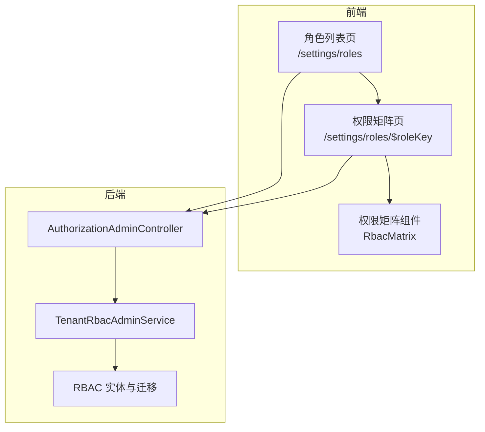
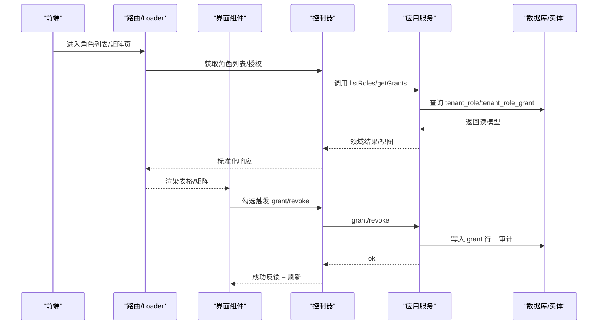
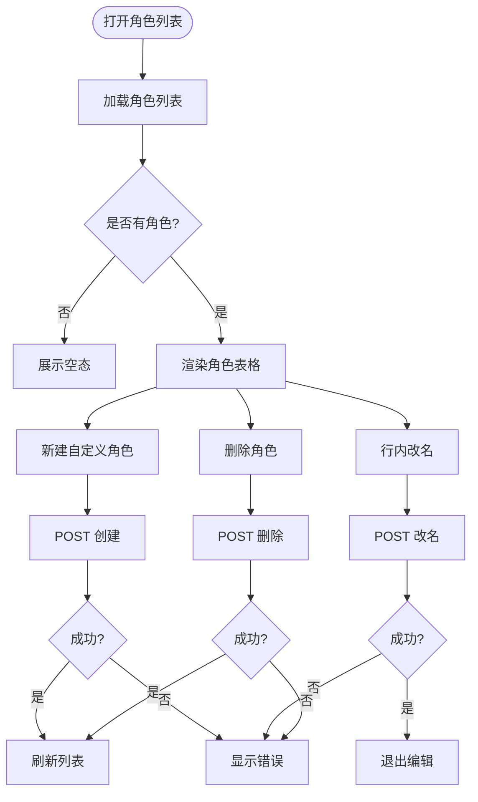
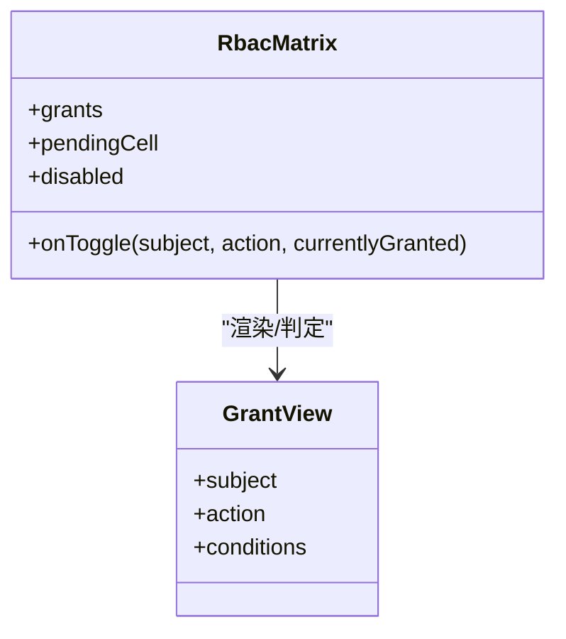
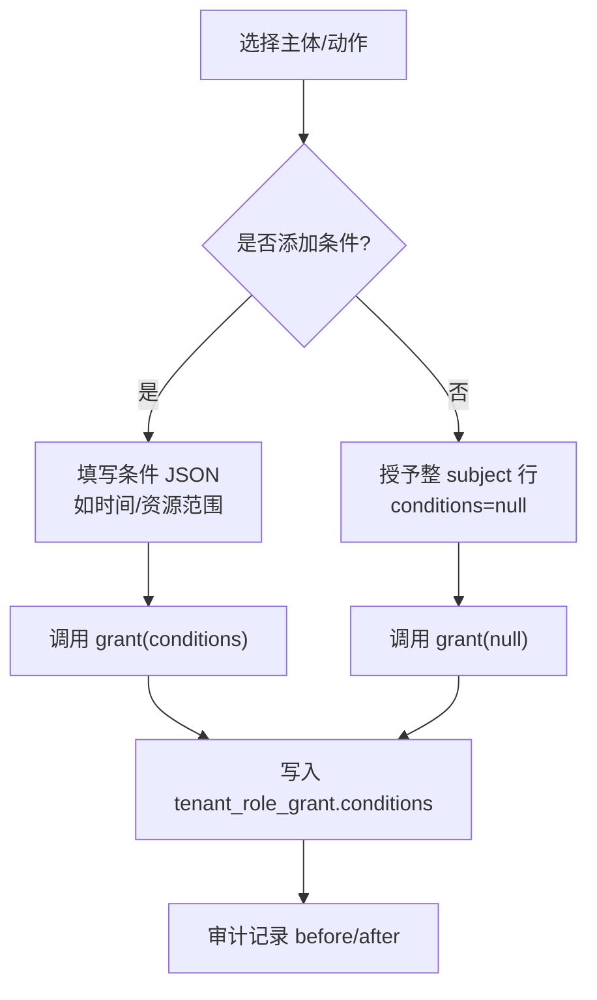
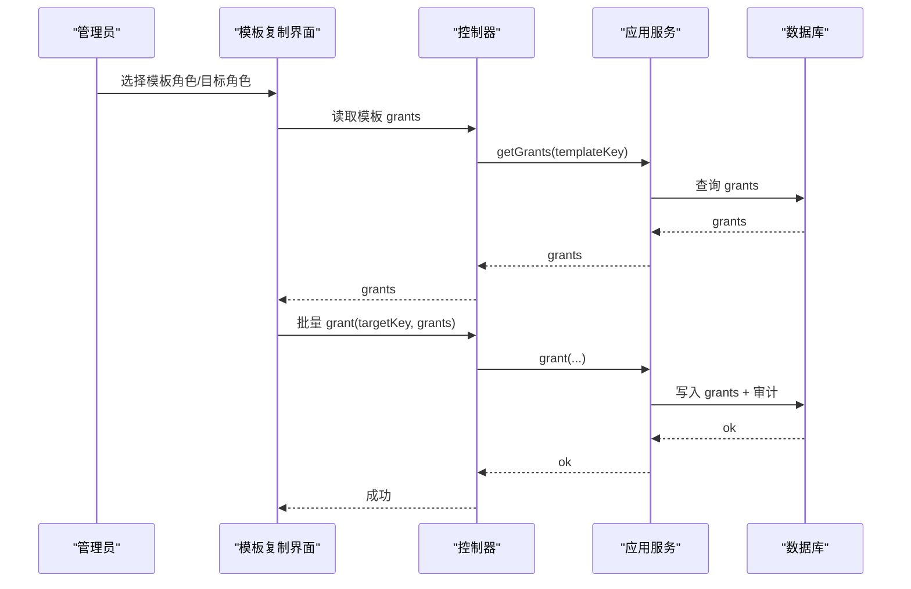
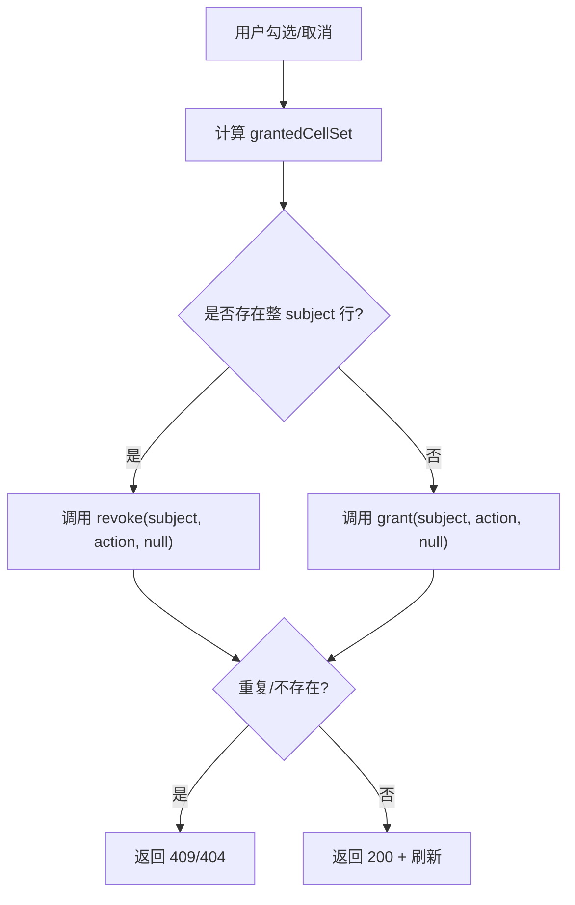
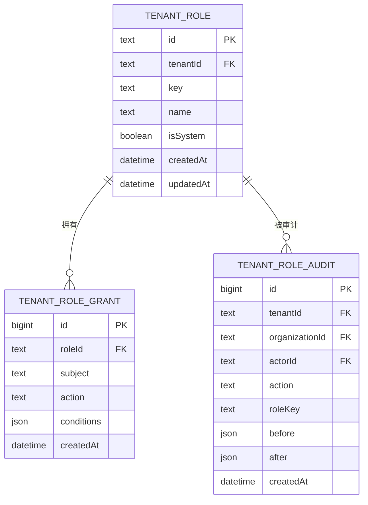
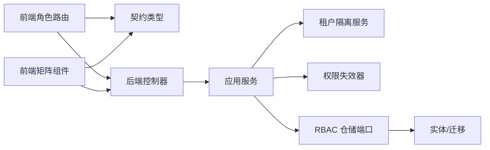

# 角色管理页面

<cite>
**本文引用的文件**   
- [apps/web/src/routes/settings.roles.tsx](file://apps/web/src/routes/settings.roles.tsx)
- [apps/web/src/routes/settings.roles.$roleKey.tsx](file://apps/web/src/routes/settings.roles.$roleKey.tsx)
- [apps/web/src/components/rbac-matrix.tsx](file://apps/web/src/components/rbac-matrix.tsx)
- [apps/api/src/modules/authorization/api/authorization-admin.controller.ts](file://apps/api/src/modules/authorization/api/authorization-admin.controller.ts)
- [apps/api/src/modules/authorization/application/organization-rbac-admin.service.ts](file://apps/api/src/modules/authorization/application/organization-rbac-admin.service.ts)
- [apps/api/src/modules/authorization/infrastructure/entities/rbac.entities.ts](file://apps/api/src/modules/authorization/infrastructure/entities/rbac.entities.ts)
- [apps/api/src/database/mikro/migration/migrations/Migration20261016205324_add_rbac_dynamic_roles.ts](file://apps/api/src/database/mikro/migration/migrations/Migration20261016205324_add_rbac_dynamic_roles.ts)
</cite>

## 目录
1. [简介](#简介)
2. [项目结构](#项目结构)
3. [核心组件](#核心组件)
4. [架构总览](#架构总览)
5. [详细组件分析](#详细组件分析)
6. [依赖关系分析](#依赖关系分析)
7. [性能与扩展性](#性能与扩展性)
8. [故障排查](#故障排查)
9. [最佳实践](#最佳实践)
10. [结论](#结论)

## 简介
本文件面向“角色管理页面”的完整实现，覆盖以下目标：
- 角色定义能力：创建、名称编辑、删除；系统角色保护。
- 权限矩阵管理：RBAC 模型、主体与动作枚举、勾选交互、整行授予语义。
- 动态权限配置：条件权限字段、时间/资源范围等扩展点（当前以 JSONB 条件列承载）。
- 角色模板能力：基于现有角色的复制与批量应用（通过 API 复用 grant/revoke 接口实现）。
- 安全与合规：权限冲突检测、权限验证、审计日志记录。
- 提供可操作的权限矩阵交互示例与 RBAC 配置最佳实践。

## 项目结构
角色管理由前端路由与后端控制器/服务/实体共同构成：
- 前端
  - 角色列表页：`/settings/roles`，负责新建、改名、删除、跳转矩阵。
  - 权限矩阵页：`/settings/roles/$roleKey`，加载角色授权并渲染矩阵。
  - 权限矩阵组件：`RbacMatrix`，渲染 6×5 网格，处理勾选与 pending 态。
- 后端
  - 控制器：`AuthorizationAdminController`，暴露 REST 端点，统一守卫与契约校验。
  - 应用服务：`TenantRbacAdminService`，领域结果转 HTTP 语义、缓存失效、租户隔离。
  - 实体与迁移：`tenant_role` / `tenant_role_grant` / `tenant_role_audit` 三表，支持条件与审计。

图表来源
- [apps/web/src/routes/settings.roles.tsx:20-34](file://apps/web/src/routes/settings.roles.tsx#L20-L34)
- [apps/web/src/routes/settings.roles.$roleKey.tsx:24-50](file://apps/web/src/routes/settings.roles.$roleKey.tsx#L24-L50)
- [apps/web/src/components/rbac-matrix.tsx:84-128](file://apps/web/src/components/rbac-matrix.tsx#L84-L128)
- [apps/api/src/modules/authorization/api/authorization-admin.controller.ts:65-179](file://apps/api/src/modules/authorization/api/authorization-admin.controller.ts#L65-L179)
- [apps/api/src/modules/authorization/application/organization-rbac-admin.service.ts:42-241](file://apps/api/src/modules/authorization/application/organization-rbac-admin.service.ts#L42-L241)
- [apps/api/src/modules/authorization/infrastructure/entities/rbac.entities.ts:27-85](file://apps/api/src/modules/authorization/infrastructure/entities/rbac.entities.ts#L27-L85)

章节来源
- [apps/web/src/routes/settings.roles.tsx:1-211](file://apps/web/src/routes/settings.roles.tsx#L1-L211)
- [apps/web/src/routes/settings.roles.$roleKey.tsx:1-122](file://apps/web/src/routes/settings.roles.$roleKey.tsx#L1-L122)
- [apps/web/src/components/rbac-matrix.tsx:1-129](file://apps/web/src/components/rbac-matrix.tsx#L1-L129)
- [apps/api/src/modules/authorization/api/authorization-admin.controller.ts:1-180](file://apps/api/src/modules/authorization/api/authorization-admin.controller.ts#L1-L180)
- [apps/api/src/modules/authorization/application/organization-rbac-admin.service.ts:1-242](file://apps/api/src/modules/authorization/application/organization-rbac-admin.service.ts#L1-L242)
- [apps/api/src/modules/authorization/infrastructure/entities/rbac.entities.ts:27-85](file://apps/api/src/modules/authorization/infrastructure/entities/rbac.entities.ts#L27-L85)

## 核心组件
- 角色列表与操作
  - 新建自定义角色：输入 key 与 name，调用创建接口，成功后刷新列表。
  - 改名：行内编辑，仅自定义角色可改；系统角色按钮禁用。
  - 删除：级联删除授权行；系统角色受保护。
- 权限矩阵
  - 主体集合：组织、成员、邀请、工作区、角色、授权。
  - 动作集合：新建、查看、修改、删除、取消。
  - 勾选语义：勾选 = 授予整 subject 行（conditions 为 null）；取消 = 撤销整行。
  - Pending 态：提交中单元格置灰，避免重复提交。
- 后端门面
  - 列出角色、列出授权、创建/改名/删除角色、新增/撤销授权。
  - 写后失效租户级权限缓存，保证热更新。
  - 领域结果码映射到 HTTP 状态码（400/404/409）。

章节来源
- [apps/web/src/routes/settings.roles.tsx:51-173](file://apps/web/src/routes/settings.roles.tsx#L51-L173)
- [apps/web/src/routes/settings.roles.$roleKey.tsx:52-121](file://apps/web/src/routes/settings.roles.$roleKey.tsx#L52-L121)
- [apps/web/src/components/rbac-matrix.tsx:20-69](file://apps/web/src/components/rbac-matrix.tsx#L20-L69)
- [apps/api/src/modules/authorization/api/authorization-admin.controller.ts:70-178](file://apps/api/src/modules/authorization/api/authorization-admin.controller.ts#L70-L178)
- [apps/api/src/modules/authorization/application/organization-rbac-admin.service.ts:51-206](file://apps/api/src/modules/authorization/application/organization-rbac-admin.service.ts#L51-L206)

## 架构总览
角色管理采用前后端分离 + 领域驱动的分层设计：
- 前端路由负责数据加载与交互编排。
- 控制器负责协议契约、鉴权守卫与参数校验。
- 应用服务负责领域结果转译、缓存失效与租户隔离。
- 基础设施层通过实体与迁移维护持久化结构与审计。

图表来源
- [apps/web/src/routes/settings.roles.tsx:20-34](file://apps/web/src/routes/settings.roles.tsx#L20-L34)
- [apps/web/src/routes/settings.roles.$roleKey.tsx:24-50](file://apps/web/src/routes/settings.roles.$roleKey.tsx#L24-L50)
- [apps/api/src/modules/authorization/api/authorization-admin.controller.ts:70-178](file://apps/api/src/modules/authorization/api/authorization-admin.controller.ts#L70-L178)
- [apps/api/src/modules/authorization/application/organization-rbac-admin.service.ts:51-206](file://apps/api/src/modules/authorization/application/organization-rbac-admin.service.ts#L51-L206)
- [apps/api/src/modules/authorization/infrastructure/entities/rbac.entities.ts:27-85](file://apps/api/src/modules/authorization/infrastructure/entities/rbac.entities.ts#L27-L85)

## 详细组件分析

### 角色列表与角色定义
- 功能要点
  - 新建：校验 key/name，调用创建接口，成功后清空表单并提示。
  - 改名：行内编辑保存；系统角色不可改名。
  - 删除：确认删除；系统角色受保护。
  - 导航：点击“权限矩阵”跳转到 `/settings/roles/$roleKey`。
- 错误处理
  - 加载失败时显示错误面板或组织上下文引导。
  - 系统角色改名/删除在后端返回 409，前端按钮禁用作为双重防护。

图表来源
- [apps/web/src/routes/settings.roles.tsx:51-173](file://apps/web/src/routes/settings.roles.tsx#L51-L173)
- [apps/api/src/modules/authorization/application/organization-rbac-admin.service.ts:87-132](file://apps/api/src/modules/authorization/application/organization-rbac-admin.service.ts#L87-L132)

章节来源
- [apps/web/src/routes/settings.roles.tsx:20-173](file://apps/web/src/routes/settings.roles.tsx#L20-L173)
- [apps/api/src/modules/authorization/application/organization-rbac-admin.service.ts:87-132](file://apps/api/src/modules/authorization/application/organization-rbac-admin.service.ts#L87-L132)

### 权限矩阵与 RBAC 模型
- 模型说明
  - 主体（Subject）：Organization、Member、Invitation、Workspace、Role、RoleGrant。
  - 动作（Action）：create、read、update、delete、cancel。
  - 单元格键：subject:action，用于标识唯一格。
  - 勾选语义：勾选表示授予整 subject 行（conditions 为 null），取消表示撤销整行。
- 交互流程
  - 加载：读取当前角色的 grants，计算已勾选集合。
  - 切换：pendingCell 标记当前提交中的单元格，避免重复提交。
  - 成功：刷新授权列表，回显最新勾选态。

图表来源
- [apps/web/src/components/rbac-matrix.tsx:10-69](file://apps/web/src/components/rbac-matrix.tsx#L10-L69)
- [apps/web/src/components/rbac-matrix.tsx:71-128](file://apps/web/src/components/rbac-matrix.tsx#L71-L128)

章节来源
- [apps/web/src/components/rbac-matrix.tsx:1-129](file://apps/web/src/components/rbac-matrix.tsx#L1-L129)
- [apps/web/src/routes/settings.roles.$roleKey.tsx:52-121](file://apps/web/src/routes/settings.roles.$roleKey.tsx#L52-L121)

### 动态权限配置（条件权限、时间权限、资源范围限制）
- 现状
  - 授权表包含 conditions 列（JSONB），可为 null 表示整 subject 级授权。
  - 当前前端矩阵仅管理 whole-subject 行（conditions 为 null），instance-level 条件行不在此面呈现。
- 扩展点
  - 可在 conditions 中表达时间窗口、资源范围、所有者匹配等策略。
  - 后续可在矩阵页增加“高级条件”编辑器，将 JSON 条件可视化。
  - 后端 grant/revoke 已支持传入 conditions，允许精确增删单条条件行。

图表来源
- [apps/api/src/modules/authorization/infrastructure/entities/rbac.entities.ts:45-59](file://apps/api/src/modules/authorization/infrastructure/entities/rbac.entities.ts#L45-L59)
- [apps/api/src/modules/authorization/application/organization-rbac-admin.service.ts:143-206](file://apps/api/src/modules/authorization/application/organization-rbac-admin.service.ts#L143-L206)

章节来源
- [apps/api/src/modules/authorization/infrastructure/entities/rbac.entities.ts:45-59](file://apps/api/src/modules/authorization/infrastructure/entities/rbac.entities.ts#L45-L59)
- [apps/api/src/modules/authorization/application/organization-rbac-admin.service.ts:143-206](file://apps/api/src/modules/authorization/application/organization-rbac-admin.service.ts#L143-L206)

### 角色模板（预设角色、模板复制、批量应用）
- 概念
  - 模板即一组预定义的 grants。可通过复制已有角色的 grants 快速构建新角色。
- 实现建议
  - 复制：读取源角色 grants，过滤 conditions=null 的行，批量调用 grant 接口为目标角色创建。
  - 批量应用：对多个目标角色循环执行复制逻辑，结合 useAction 进行并发控制与错误聚合。
  - 模板库：在角色列表增加“设为模板”入口，导出/导入模板 JSON。

图表来源
- [apps/api/src/modules/authorization/api/authorization-admin.controller.ts:125-178](file://apps/api/src/modules/authorization/api/authorization-admin.controller.ts#L125-L178)
- [apps/api/src/modules/authorization/application/organization-rbac-admin.service.ts:143-206](file://apps/api/src/modules/authorization/application/organization-rbac-admin.service.ts#L143-L206)

章节来源
- [apps/api/src/modules/authorization/api/authorization-admin.controller.ts:125-178](file://apps/api/src/modules/authorization/api/authorization-admin.controller.ts#L125-L178)
- [apps/api/src/modules/authorization/application/organization-rbac-admin.service.ts:143-206](file://apps/api/src/modules/authorization/application/organization-rbac-admin.service.ts#L143-L206)

### 权限冲突检测与权限验证
- 冲突检测
  - 同一 roleKey + subject + action 存在多条 grants 时视为重复，后端返回 409。
  - 前端在 toggle 前通过 grantedCellSet 判断当前勾选态，避免无意义请求。
- 权限验证
  - 控制器使用 AuthorizationGuard + @Can 守卫，确保只有具备 Role/RoleGrant 权限的管理员可操作。
  - 应用服务将领域结果码映射为 HTTP 异常（400/404/409），统一错误信封。

图表来源
- [apps/web/src/components/rbac-matrix.tsx:59-69](file://apps/web/src/components/rbac-matrix.tsx#L59-L69)
- [apps/api/src/modules/authorization/application/organization-rbac-admin.service.ts:143-206](file://apps/api/src/modules/authorization/application/organization-rbac-admin.service.ts#L143-L206)

章节来源
- [apps/web/src/components/rbac-matrix.tsx:59-69](file://apps/web/src/components/rbac-matrix.tsx#L59-L69)
- [apps/api/src/modules/authorization/application/organization-rbac-admin.service.ts:143-206](file://apps/api/src/modules/authorization/application/organization-rbac-admin.service.ts#L143-L206)

### 审计日志记录
- 审计表
  - tenant_role_audit 记录每次角色/授权变更，包含 actorId、action、roleKey、before/after、createdAt。
- 行为
  - 写操作（创建/改名/删除角色、grant/revoke）均会落审计行。
  - 审计按租户留痕，actorId 可空，便于追踪历史。

图表来源
- [apps/api/src/modules/authorization/infrastructure/entities/rbac.entities.ts:27-85](file://apps/api/src/modules/authorization/infrastructure/entities/rbac.entities.ts#L27-L85)
- [apps/api/src/database/mikro/migration/migrations/Migration20261016205324_add_rbac_dynamic_roles.ts:8-40](file://apps/api/src/database/mikro/migration/migrations/Migration20261016205324_add_rbac_dynamic_roles.ts#L8-L40)

章节来源
- [apps/api/src/modules/authorization/infrastructure/entities/rbac.entities.ts:27-85](file://apps/api/src/modules/authorization/infrastructure/entities/rbac.entities.ts#L27-L85)
- [apps/api/src/database/mikro/migration/migrations/Migration20261016205324_add_rbac_dynamic_roles.ts:8-40](file://apps/api/src/database/mikro/migration/migrations/Migration20261016205324_add_rbac_dynamic_roles.ts#L8-L40)

## 依赖关系分析
- 前端依赖
  - 路由依赖 api-client 调用 REST 端点。
  - 矩阵组件依赖 contracts 类型，保证 subject/action 枚举一致性。
- 后端依赖
  - 控制器依赖契约 schema 与 meta，以及应用服务。
  - 应用服务依赖租户隔离服务、权限失效器、RBAC 仓储端口。
  - 实体与迁移定义持久化结构与索引。

图表来源
- [apps/web/src/routes/settings.roles.tsx:1-11](file://apps/web/src/routes/settings.roles.tsx#L1-L11)
- [apps/web/src/components/rbac-matrix.tsx:10-18](file://apps/web/src/components/rbac-matrix.tsx#L10-L18)
- [apps/api/src/modules/authorization/api/authorization-admin.controller.ts:1-34](file://apps/api/src/modules/authorization/api/authorization-admin.controller.ts#L1-L34)
- [apps/api/src/modules/authorization/application/organization-rbac-admin.service.ts:1-25](file://apps/api/src/modules/authorization/application/organization-rbac-admin.service.ts#L1-L25)
- [apps/api/src/modules/authorization/infrastructure/entities/rbac.entities.ts:27-85](file://apps/api/src/modules/authorization/infrastructure/entities/rbac.entities.ts#L27-L85)

章节来源
- [apps/web/src/routes/settings.roles.tsx:1-11](file://apps/web/src/routes/settings.roles.tsx#L1-L11)
- [apps/web/src/components/rbac-matrix.tsx:10-18](file://apps/web/src/components/rbac-matrix.tsx#L10-L18)
- [apps/api/src/modules/authorization/api/authorization-admin.controller.ts:1-34](file://apps/api/src/modules/authorization/api/authorization-admin.controller.ts#L1-L34)
- [apps/api/src/modules/authorization/application/organization-rbac-admin.service.ts:1-25](file://apps/api/src/modules/authorization/application/organization-rbac-admin.service.ts#L1-L25)
- [apps/api/src/modules/authorization/infrastructure/entities/rbac.entities.ts:27-85](file://apps/api/src/modules/authorization/infrastructure/entities/rbac.entities.ts#L27-L85)

## 性能与扩展性
- 性能
  - 矩阵渲染为固定 6×5 网格，复杂度 O(1)，适合一屏展示。
  - grantedCellSet 使用 Set 查找，O(1) 判定，避免重复遍历。
  - 写操作后失效租户级缓存，保证热更新且不影响其他租户。
- 扩展性
  - conditions 列支持任意 JSONB 结构，便于扩展时间、资源范围等策略。
  - 可引入模板库与批量复制，提升运营效率。
  - 可增强矩阵 UI，支持条件可视化编辑与冲突预览。

[本节为通用指导，无需特定文件引用]

## 故障排查
- 常见问题
  - 角色不存在：getGrants 返回 404，前端显示“角色不存在”。
  - 系统角色保护：改名/删除系统角色返回 409，前端按钮禁用。
  - 授权重复：grant 重复提交返回 409，需先撤销再授予或合并条件。
  - 条件非法：conditions 不在白名单返回 400，检查 JSON 结构。
- 定位步骤
  - 检查浏览器网络面板，确认请求路径与参数。
  - 查看后端日志，关注 ERROR_CODES 与异常堆栈。
  - 核对数据库 tenant_role_audit，确认变更轨迹。

章节来源
- [apps/web/src/routes/settings.roles.$roleKey.tsx:57-60](file://apps/web/src/routes/settings.roles.$roleKey.tsx#L57-L60)
- [apps/api/src/modules/authorization/application/organization-rbac-admin.service.ts:116-132](file://apps/api/src/modules/authorization/application/organization-rbac-admin.service.ts#L116-L132)
- [apps/api/src/modules/authorization/application/organization-rbac-admin.service.ts:143-206](file://apps/api/src/modules/authorization/application/organization-rbac-admin.service.ts#L143-L206)

## 最佳实践
- RBAC 设计
  - 优先使用整 subject 行（conditions=null）简化授权，减少碎片化。
  - 仅在必要时使用 conditions 表达细粒度策略（如时间窗口、资源范围）。
  - 保持 subject/action 枚举稳定，避免频繁变更导致前端编译期报错。
- 权限矩阵交互
  - 使用 pendingCell 防止重复提交，提升用户体验。
  - 成功/失败反馈明确，便于用户理解操作结果。
- 模板与批量
  - 模板复制时仅复制 conditions=null 的行，避免复杂条件污染。
  - 批量应用时进行并发控制与错误聚合，保证一致性。
- 审计与合规
  - 所有写操作必须落审计行，保留 before/after 快照。
  - 定期审计高风险操作（如 delete、RoleGrant 管理）。

[本节为通用指导，无需特定文件引用]

## 结论
角色管理页面通过清晰的前端交互与稳健的后端门面，实现了 RBAC 的动态配置与管理。矩阵组件提供了直观的权限勾选体验，后端通过领域结果码与缓存失效机制保证了正确性与实时性。借助 conditions 列与审计表，系统具备良好的扩展性与合规性。建议在后续迭代中完善条件可视化、模板库与冲突预览，进一步提升运营效率与用户体验。

[本节为总结性内容，无需特定文件引用]