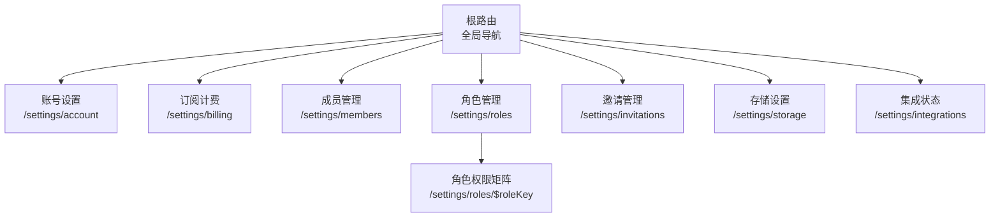
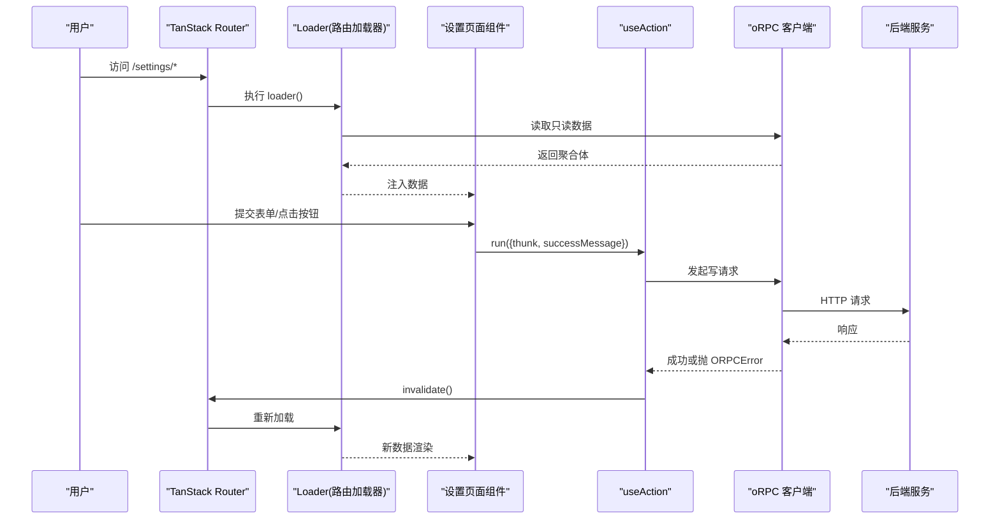
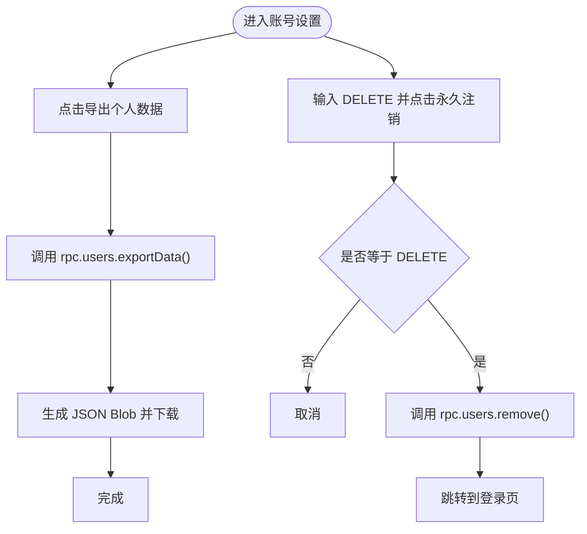
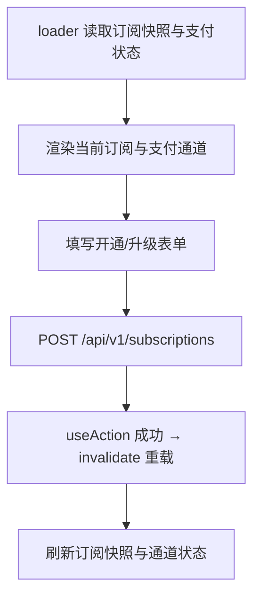
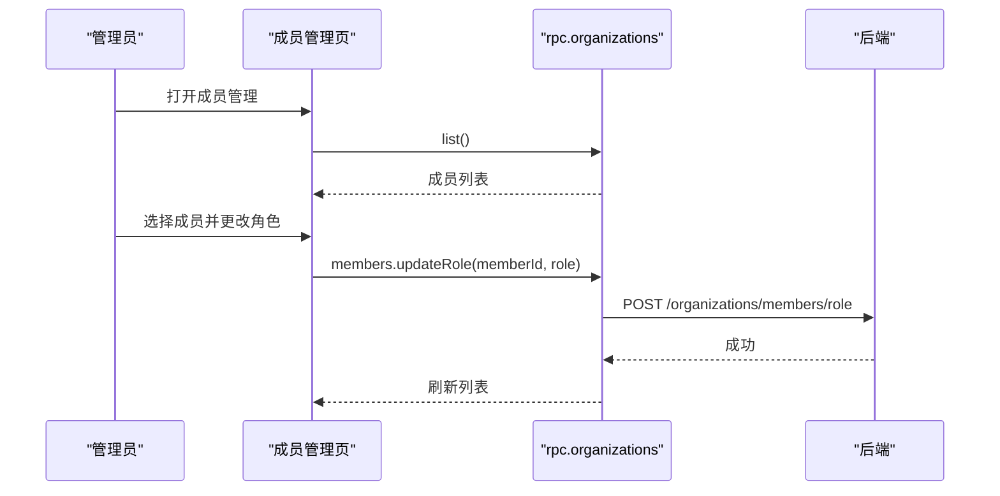
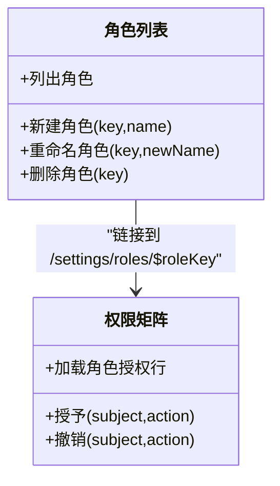
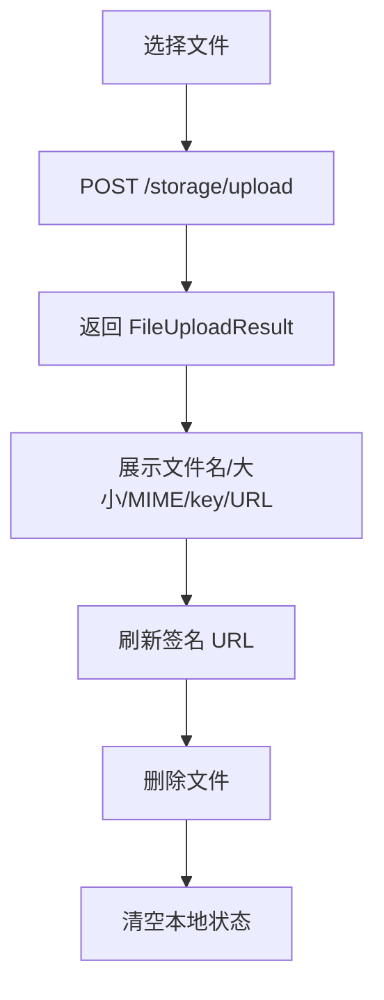
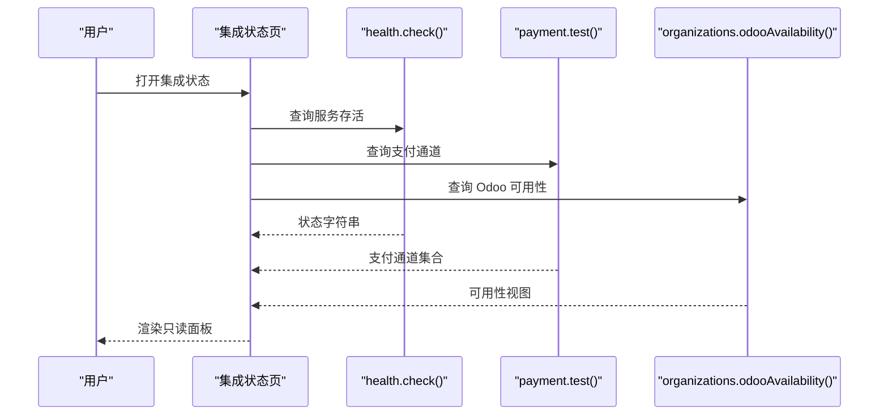
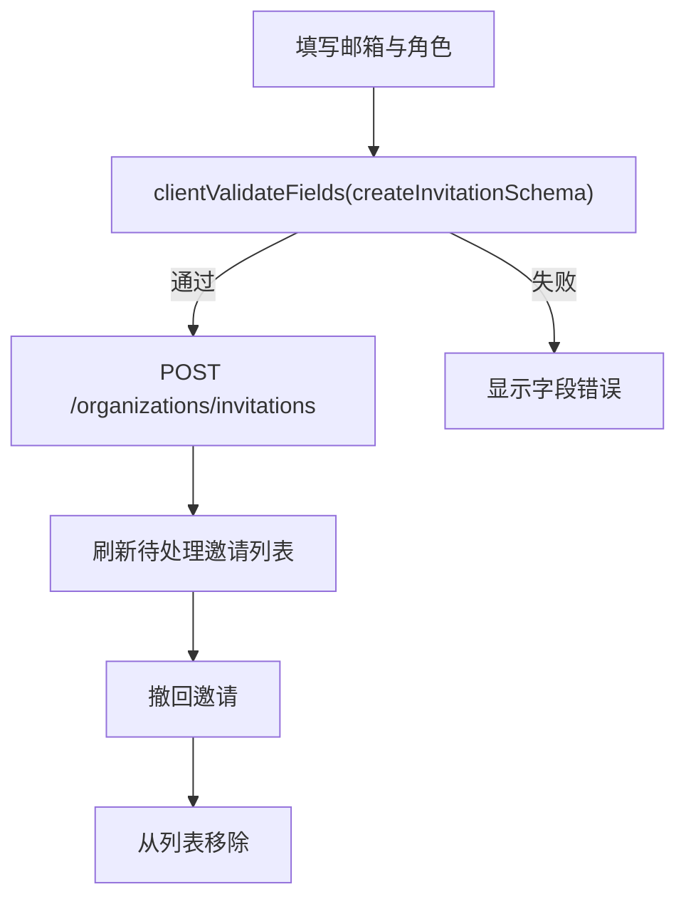
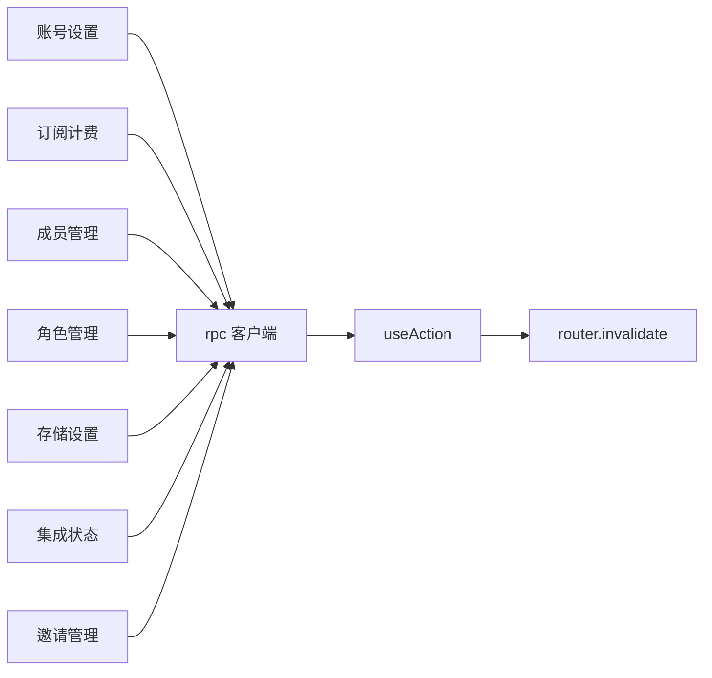

# 设置页面模块

<cite>
**本文引用的文件**   
- [apps/web/src/routes/__root.tsx](file://apps/web/src/routes/__root.tsx)
- [apps/web/src/routes/settings.account.tsx](file://apps/web/src/routes/settings.account.tsx)
- [apps/web/src/routes/settings.billing.tsx](file://apps/web/src/routes/settings.billing.tsx)
- [apps/web/src/components/billing-panels.tsx](file://apps/web/src/components/billing-panels.tsx)
- [apps/web/src/routes/settings.members.tsx](file://apps/web/src/routes/settings.members.tsx)
- [apps/web/src/routes/settings.roles.tsx](file://apps/web/src/routes/settings.roles.tsx)
- [apps/web/src/routes/settings.roles.$roleKey.tsx](file://apps/web/src/routes/settings.roles.$roleKey.tsx)
- [apps/web/src/routes/settings.storage.tsx](file://apps/web/src/routes/settings.storage.tsx)
- [apps/web/src/routes/settings.integrations.tsx](file://apps/web/src/routes/settings.integrations.tsx)
- [apps/web/src/routes/settings.invitations.tsx](file://apps/web/src/routes/settings.invitations.tsx)
- [apps/web/src/lib/api.ts](file://apps/web/src/lib/api.ts)
- [apps/web/src/lib/mutation.ts](file://apps/web/src/lib/mutation.ts)
</cite>

## 目录
1. [简介](#简介)
2. [项目结构](#项目结构)
3. [核心组件](#核心组件)
4. [架构总览](#架构总览)
5. [详细组件分析](#详细组件分析)
6. [依赖关系分析](#依赖关系分析)
7. [性能与一致性考虑](#性能与一致性考虑)
8. [故障排查指南](#故障排查指南)
9. [结论](#结论)

## 简介
本模块聚焦“设置”相关的前端页面，覆盖账户设置、账单订阅、成员管理、角色权限、存储管理、集成状态与邀请管理等能力。整体采用 TanStack Router 的文件式路由组织，统一通过 oRPC 客户端访问后端 typed API，并通过统一的 mutation hook 处理写操作、错误展示与数据刷新。

该文档的目标是：
- 说明各设置子页面的职责、交互流程与数据来源。
- 解释角色矩阵与权限配置的工作方式。
- 描述订阅计费、支付通道、存储上传与签名 URL、集成健康探针等关键能力。
- 给出统一的布局导航、数据同步机制与常见问题排查建议。

## 项目结构
设置页面位于前端 Web 应用的 `routes` 目录下，每个设置项对应一个路由文件；根路由负责渲染统一导航栏，将用户引导至各设置子页面。

**图表来源**
- [apps/web/src/routes/__root.tsx:67-125](file://apps/web/src/routes/__root.tsx#L67-L125)

**章节来源**
- [apps/web/src/routes/__root.tsx:67-125](file://apps/web/src/routes/__root.tsx#L67-L125)

## 核心组件
- 统一 RPC 客户端：所有设置页通过 `rpc` 调用 typed 接口，避免手写 fetch 与类型漂移。
- 统一 Mutation Hook：`useAction` 封装请求生命周期、错误日志、成功提示与路由级数据失效刷新。
- 纯展示面板：如订阅计费面板、支付状态面板、Odoo 可用性面板等，便于单测与复用。

**章节来源**
- [apps/web/src/lib/api.ts:1-16](file://apps/web/src/lib/api.ts#L1-L16)
- [apps/web/src/lib/mutation.ts:1-74](file://apps/web/src/lib/mutation.ts#L1-L74)
- [apps/web/src/components/billing-panels.tsx:1-249](file://apps/web/src/components/billing-panels.tsx#L1-L249)

## 架构总览
设置页面遵循“路由加载器读数据 + 组件渲染 + useAction 写数据 + router.invalidate 刷新”的固定模式。

**图表来源**
- [apps/web/src/lib/api.ts:1-16](file://apps/web/src/lib/api.ts#L1-L16)
- [apps/web/src/lib/mutation.ts:30-66](file://apps/web/src/lib/mutation.ts#L30-L66)

## 详细组件分析

### 账户设置页面（个人信息管理与隐私权）
当前实现聚焦 PIPL 自助面：个人数据导出与账号注销（硬删）。未包含密码修改与安全设置开关，这些能力可在此页面扩展。

- 数据导出：调用用户数据导出接口，浏览器生成 JSON Blob 并触发下载。
- 账号注销：输入确认文本后删除账号，成功后跳转登录页。
- 错误处理：捕获异常并结构化记录，同时向用户反馈可读错误。

**图表来源**
- [apps/web/src/routes/settings.account.tsx:30-61](file://apps/web/src/routes/settings.account.tsx#L30-L61)

**章节来源**
- [apps/web/src/routes/settings.account.tsx:14-96](file://apps/web/src/routes/settings.account.tsx#L14-L96)

### 账单设置页面（订阅管理、支付方式、账单历史）
当前实现提供：
- 当前订阅快照：显示档位、席位用量、支付客户标识。
- 支付集成状态：展示选定通道与可用通道列表。
- 开通/升级：选择档位与客户邮箱，可选填写席位/存储/API 配额。

注意：
- 无账单历史查看入口；如需账单历史，可在后续扩展独立页面。
- 无直接“支付方式管理”编辑界面；支付通道由后端配置，前端仅展示可用通道。

**图表来源**
- [apps/web/src/routes/settings.billing.tsx:20-63](file://apps/web/src/routes/settings.billing.tsx#L20-L63)
- [apps/web/src/components/billing-panels.tsx:58-124](file://apps/web/src/components/billing-panels.tsx#L58-L124)
- [apps/web/src/components/billing-panels.tsx:130-249](file://apps/web/src/components/billing-panels.tsx#L130-L249)

**章节来源**
- [apps/web/src/routes/settings.billing.tsx:16-95](file://apps/web/src/routes/settings.billing.tsx#L16-L95)
- [apps/web/src/components/billing-panels.tsx:1-249](file://apps/web/src/components/billing-panels.tsx#L1-L249)

### 成员管理页面（邀请发送、角色分配、权限控制）
当前实现提供：
- 成员列表：从租户成员 SSOT 端点拉取，展示成员名/邮箱与角色键。
- 改角色：对指定成员更新角色。
- 移除成员：从组织中移除成员。
- 退出组织：当前用户退出当前活跃组织。

说明：
- “邀请发送”在“邀请管理”页面实现；成员管理侧重已加入成员的维护。
- 权限控制由 RBAC 系统承担，成员角色映射到权限矩阵。

**图表来源**
- [apps/web/src/routes/settings.members.tsx:21-63](file://apps/web/src/routes/settings.members.tsx#L21-L63)
- [apps/web/src/routes/settings.members.tsx:90-134](file://apps/web/src/routes/settings.members.tsx#L90-L134)

**章节来源**
- [apps/web/src/routes/settings.members.tsx:13-184](file://apps/web/src/routes/settings.members.tsx#L13-L184)

### 角色管理页面（角色定义、权限矩阵、动态权限配置）
角色管理分为两个页面：
- 角色列表：创建、重命名、删除自定义角色；系统角色受保护。
- 权限矩阵：为某角色授予/撤销具体 subject:action 权限。

**图表来源**
- [apps/web/src/routes/settings.roles.tsx:20-89](file://apps/web/src/routes/settings.roles.tsx#L20-L89)
- [apps/web/src/routes/settings.roles.tsx:92-174](file://apps/web/src/routes/settings.roles.tsx#L92-L174)
- [apps/web/src/routes/settings.roles.$roleKey.tsx:24-49](file://apps/web/src/routes/settings.roles.$roleKey.tsx#L24-L49)
- [apps/web/src/routes/settings.roles.$roleKey.tsx:65-103](file://apps/web/src/routes/settings.roles.$roleKey.tsx#L65-L103)

**章节来源**
- [apps/web/src/routes/settings.roles.tsx:13-211](file://apps/web/src/routes/settings.roles.tsx#L13-L211)
- [apps/web/src/routes/settings.roles.$roleKey.tsx:19-122](file://apps/web/src/routes/settings.roles.$roleKey.tsx#L19-L122)

### 存储设置页面（云存储配置、文件管理、访问控制）
当前实现提供：
- 上传文件：使用原生 FormData 直传，后端返回文件元信息（文件名、大小、MIME、key、URL）。
- 刷新签名 URL：按 key 获取临时访问 URL。
- 删除文件：按 key 删除对象存储中的文件。
- 手动操作既有文件：输入已有 key 获取签名 URL 或删除。

说明：
- 对象存储无状态且后端无 LIST 接口，因此不展示全量文件列表。
- 体积/MIME 限制在后端配置，前端仅回显错误文案。

**图表来源**
- [apps/web/src/routes/settings.storage.tsx:42-70](file://apps/web/src/routes/settings.storage.tsx#L42-L70)
- [apps/web/src/routes/settings.storage.tsx:72-101](file://apps/web/src/routes/settings.storage.tsx#L72-L101)
- [apps/web/src/routes/settings.storage.tsx:103-135](file://apps/web/src/routes/settings.storage.tsx#L103-L135)

**章节来源**
- [apps/web/src/routes/settings.storage.tsx:14-277](file://apps/web/src/routes/settings.storage.tsx#L14-L277)

### 集成设置页面（第三方服务配置、API 密钥管理）
当前实现为只读运维与集成状态面板：
- 服务存活探针：调用 health check，展示 ok/degraded/down 等状态。
- 支付集成状态：展示选定通道与可用通道。
- Odoo 集成可用性：展示当前租户是否可用及绑定生命周期态。

说明：
- 不包含第三方服务凭据配置或 API Key 管理界面；此类敏感配置通常由平台侧或运维工具管理。
- 支付操作面（checkout/customer/refund）需真实 PSP 密钥，当前未在前端暴露。

**图表来源**
- [apps/web/src/routes/settings.integrations.tsx:36-75](file://apps/web/src/routes/settings.integrations.tsx#L36-L75)
- [apps/web/src/routes/settings.integrations.tsx:78-122](file://apps/web/src/routes/settings.integrations.tsx#L78-L122)

**章节来源**
- [apps/web/src/routes/settings.integrations.tsx:10-222](file://apps/web/src/routes/settings.integrations.tsx#L10-L222)

### 邀请管理页面（邀请状态跟踪、批量操作）
当前实现提供：
- 发送邀请：选择邮箱与角色，基于共享契约进行客户端前置校验。
- 撤回邀请：对待处理邀请执行取消。

说明：
- 当前未实现批量操作；如需批量发送/撤回，可扩展多选与批量 API。
- 邀请状态由后端驱动，前端仅展示待处理列表。

**图表来源**
- [apps/web/src/routes/settings.invitations.tsx:68-85](file://apps/web/src/routes/settings.invitations.tsx#L68-L85)
- [apps/web/src/routes/settings.invitations.tsx:130-157](file://apps/web/src/routes/settings.invitations.tsx#L130-L157)

**章节来源**
- [apps/web/src/routes/settings.invitations.tsx:1-158](file://apps/web/src/routes/settings.invitations.tsx#L1-L158)

## 依赖关系分析
设置页面之间的耦合度较低，主要依赖以下公共能力：
- oRPC 客户端：统一 typed 接口访问。
- useAction：统一写操作生命周期。
- 组织上下文引导：当缺少活跃组织时，展示引导面板。

**图表来源**
- [apps/web/src/lib/api.ts:1-16](file://apps/web/src/lib/api.ts#L1-L16)
- [apps/web/src/lib/mutation.ts:30-66](file://apps/web/src/lib/mutation.ts#L30-L66)

**章节来源**
- [apps/web/src/lib/api.ts:1-16](file://apps/web/src/lib/api.ts#L1-L16)
- [apps/web/src/lib/mutation.ts:1-74](file://apps/web/src/lib/mutation.ts#L1-L74)

## 性能与一致性考虑
- 只读数据在 loader 中预取，减少组件内异步逻辑，提升首屏体验。
- 写操作通过 useAction 统一处理，成功后调用 router.invalidate 触发 loader 重载，保证数据一致性。
- 存储上传使用原生 FormData 直传，避免 oRPC link 不支持二进制体的问题。
- 订阅计费面板将席位用量判定逻辑抽离为纯函数，便于单测与复用。

[本节为通用指导，不直接分析具体文件]

## 故障排查指南
- 网络或鉴权错误：useAction 会记录结构化日志并展示 describeApiError 的结果；检查浏览器控制台与后端日志。
- 组织上下文缺失：成员、角色、邀请等页面会探测组织上下文并展示引导面板；先选择或加入组织。
- 支付通道不可用：订阅计费页面会在无可用通道时禁用开通/升级表单；检查后端支付集成配置。
- 存储上传失败：检查文件大小与 MIME 是否符合后端限制；错误文案由后端返回并在前端展示。
- 集成状态异常：健康探针或支付通道查询失败时，页面会显示错误面板；可点击刷新重试。

**章节来源**
- [apps/web/src/lib/mutation.ts:34-66](file://apps/web/src/lib/mutation.ts#L34-L66)
- [apps/web/src/routes/settings.billing.tsx:20-48](file://apps/web/src/routes/settings.billing.tsx#L20-L48)
- [apps/web/src/routes/settings.storage.tsx:42-70](file://apps/web/src/routes/settings.storage.tsx#L42-L70)
- [apps/web/src/routes/settings.integrations.tsx:36-75](file://apps/web/src/routes/settings.integrations.tsx#L36-L75)

## 结论
设置页面模块以清晰的路由划分与统一的读写模式组织，覆盖了账户隐私、订阅计费、成员与角色管理、存储与集成状态、邀请管理等核心场景。当前实现强调只读展示与最小化写操作，敏感配置（如支付密钥、第三方 API Key）由后端或平台侧管理。未来可按需在账户设置扩展密码修改与安全设置，在账单设置增加账单历史，在邀请管理增加批量操作，以满足更丰富的运营需求。