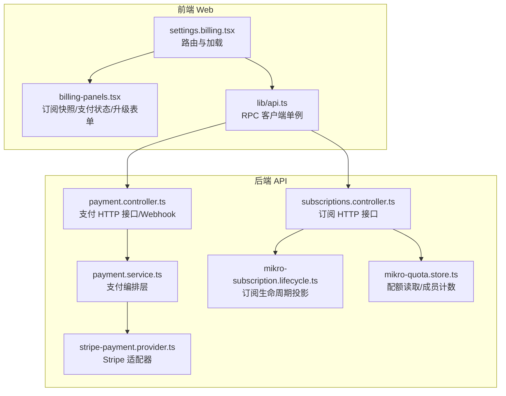
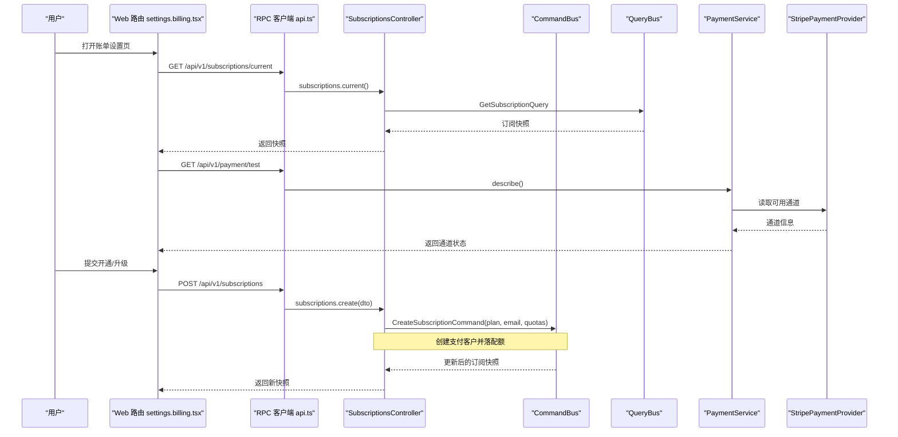
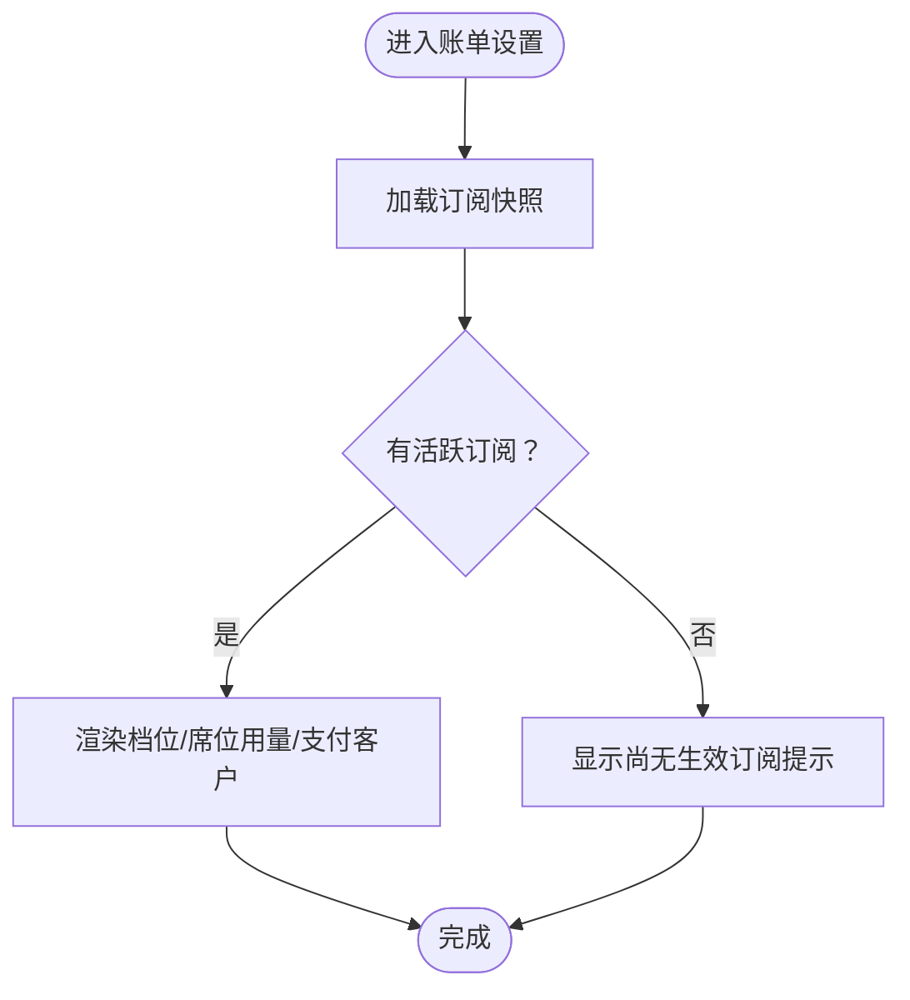
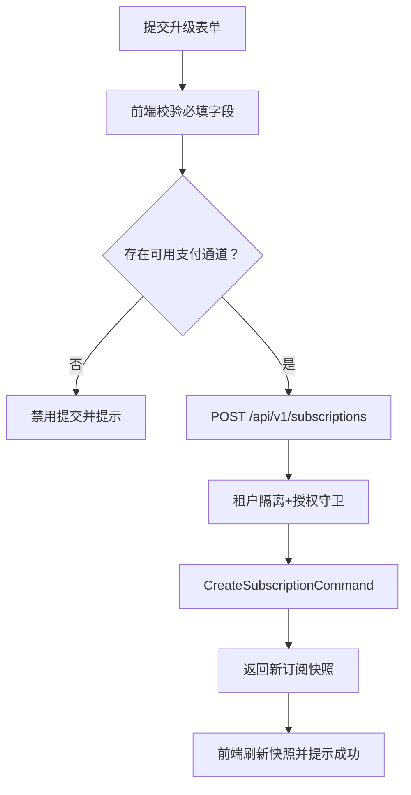
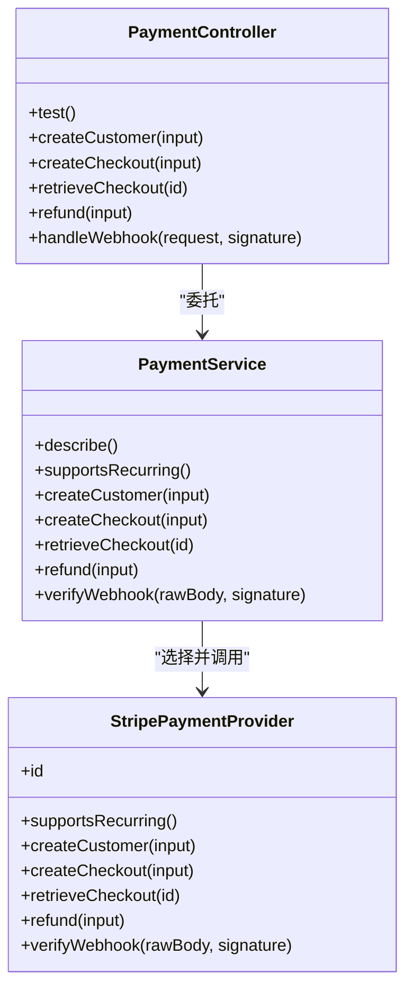
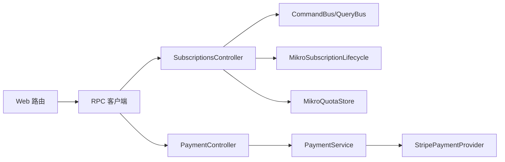

# 账单设置页面

<cite>
**本文引用的文件**   
- [apps/web/src/routes/settings.billing.tsx](file://apps/web/src/routes/settings.billing.tsx)
- [apps/web/src/components/billing-panels.tsx](file://apps/web/src/components/billing-panels.tsx)
- [apps/web/src/lib/api.ts](file://apps/web/src/lib/api.ts)
- [apps/api/src/modules/subscriptions/api/subscriptions.controller.ts](file://apps/api/src/modules/subscriptions/api/subscriptions.controller.ts)
- [apps/api/src/modules/payment/api/payment.controller.ts](file://apps/api/src/modules/payment/api/payment.controller.ts)
- [apps/api/src/modules/payment/application/payment.service.ts](file://apps/api/src/modules/payment/application/payment.service.ts)
- [apps/api/src/modules/payment/infrastructure/stripe-payment.provider.ts](file://apps/api/src/modules/payment/infrastructure/stripe-payment.provider.ts)
- [apps/api/src/modules/subscriptions/infrastructure/mikro-subscription.lifecycle.ts](file://apps/api/src/modules/subscriptions/infrastructure/mikro-subscription.lifecycle.ts)
- [apps/api/src/modules/subscriptions/infrastructure/mikro-quota.store.ts](file://apps/api/src/modules/subscriptions/infrastructure/mikro-quota.store.ts)
- [apps/api/src/modules/subscriptions/quota/quota.service.test.ts](file://apps/api/src/modules/subscriptions/quota/quota.service.test.ts)
</cite>

## 目录
1. [引言](#引言)
2. [项目结构](#项目结构)
3. [核心组件](#核心组件)
4. [架构总览](#架构总览)
5. [详细组件分析](#详细组件分析)
6. [依赖关系分析](#依赖关系分析)
7. [性能与可靠性](#性能与可靠性)
8. [故障排查指南](#故障排查指南)
9. [结论](#结论)
10. [附录：API 调用示例与 UI 交互流程](#附录api-调用示例与-ui-交互流程)

## 引言
本文件面向“账单设置页面”的完整实现说明，覆盖订阅计划管理、支付方式管理、账单历史查看、配额监控与续费提醒、Stripe 集成细节、支付回调处理与错误重试机制，并给出前后端 API 调用示例和 UI 交互流程。该页面是租户组织在 SaaS 平台中查看当前订阅、开通或升级计划、确认支付通道状态以及后续扩展账单历史与续费提醒的统一入口。

## 项目结构
账单设置功能横跨前端路由、展示面板、后端订阅控制器、支付控制器与 Stripe 适配器，并通过统一的 RPC 客户端连接前后端。

图表来源
- [apps/web/src/routes/settings.billing.tsx:20-48](file://apps/web/src/routes/settings.billing.tsx#L20-L48)
- [apps/web/src/components/billing-panels.tsx:58-124](file://apps/web/src/components/billing-panels.tsx#L58-L124)
- [apps/web/src/lib/api.ts:1-16](file://apps/web/src/lib/api.ts#L1-L16)
- [apps/api/src/modules/subscriptions/api/subscriptions.controller.ts:42-90](file://apps/api/src/modules/subscriptions/api/subscriptions.controller.ts#L42-L90)
- [apps/api/src/modules/payment/api/payment.controller.ts:66-172](file://apps/api/src/modules/payment/api/payment.controller.ts#L66-L172)
- [apps/api/src/modules/payment/application/payment.service.ts:32-123](file://apps/api/src/modules/payment/application/payment.service.ts#L32-L123)
- [apps/api/src/modules/payment/infrastructure/stripe-payment.provider.ts:19-107](file://apps/api/src/modules/payment/infrastructure/stripe-payment.provider.ts#L19-L107)
- [apps/api/src/modules/subscriptions/infrastructure/mikro-subscription.lifecycle.ts:45-155](file://apps/api/src/modules/subscriptions/infrastructure/mikro-subscription.lifecycle.ts#L45-L155)
- [apps/api/src/modules/subscriptions/infrastructure/mikro-quota.store.ts:26-80](file://apps/api/src/modules/subscriptions/infrastructure/mikro-quota.store.ts#L26-L80)

章节来源
- [apps/web/src/routes/settings.billing.tsx:1-95](file://apps/web/src/routes/settings.billing.tsx#L1-L95)
- [apps/web/src/components/billing-panels.tsx:1-249](file://apps/web/src/components/billing-panels.tsx#L1-L249)
- [apps/web/src/lib/api.ts:1-16](file://apps/web/src/lib/api.ts#L1-L16)

## 核心组件
- 订阅快照与席位用量展示：基于 `SubscriptionSummaryView` 显示当前档位、席位用量进度条、支付客户映射。
- 支付通道状态展示：基于 `PaymentStatusView` 显示已选通道与可用通道列表；无可用通道时给出告警提示。
- 开通/升级表单：基于 `UpgradeForm` 收集 plan、customerEmail 及可选 seatsLimit/storageQuota/apiQuota，并在无可用通道时禁用提交。
- 订阅控制器：提供获取当前订阅快照与创建/升级订阅的 oRPC 方法，受租户隔离与授权守卫保护。
- 支付控制器：暴露支付通道测试、创建客户、创建结账、取回结账、退款与 Webhook 接收等能力。
- 支付服务：按配置选择支付提供者，封装金额不变量、Webhook 验签与事件归一化。
- Stripe 适配器：实现统一支付端口，完成客户创建、付款意图创建/查询、退款与 Webhook 构造校验。
- 订阅生命周期：将订阅状态迁移落库，支持事件流真相源模式，保证幂等与可重放。
- 配额存储：读取生效订阅快照与席位用量（成员数），支撑配额检查与快照组装。

章节来源
- [apps/web/src/components/billing-panels.tsx:58-124](file://apps/web/src/components/billing-panels.tsx#L58-L124)
- [apps/web/src/components/billing-panels.tsx:130-248](file://apps/web/src/components/billing-panels.tsx#L130-L248)
- [apps/api/src/modules/subscriptions/api/subscriptions.controller.ts:42-90](file://apps/api/src/modules/subscriptions/api/subscriptions.controller.ts#L42-L90)
- [apps/api/src/modules/payment/api/payment.controller.ts:66-172](file://apps/api/src/modules/payment/api/payment.controller.ts#L66-L172)
- [apps/api/src/modules/payment/application/payment.service.ts:32-123](file://apps/api/src/modules/payment/application/payment.service.ts#L32-L123)
- [apps/api/src/modules/payment/infrastructure/stripe-payment.provider.ts:19-107](file://apps/api/src/modules/payment/infrastructure/stripe-payment.provider.ts#L19-L107)
- [apps/api/src/modules/subscriptions/infrastructure/mikro-subscription.lifecycle.ts:45-155](file://apps/api/src/modules/subscriptions/infrastructure/mikro-subscription.lifecycle.ts#L45-L155)
- [apps/api/src/modules/subscriptions/infrastructure/mikro-quota.store.ts:26-80](file://apps/api/src/modules/subscriptions/infrastructure/mikro-quota.store.ts#L26-L80)

## 架构总览
账单设置页面的端到端流程如下：前端路由加载订阅快照与支付通道状态，渲染展示面板；用户通过升级表单发起开通/升级请求，后端经订阅控制器进入命令总线，必要时调用支付服务创建支付客户与结账；Stripe 作为支付通道适配器完成真实支付操作；支付回调通过 Webhook 入口验签后分发处理。

图表来源
- [apps/web/src/routes/settings.billing.tsx:20-63](file://apps/web/src/routes/settings.billing.tsx#L20-L63)
- [apps/api/src/modules/subscriptions/api/subscriptions.controller.ts:42-90](file://apps/api/src/modules/subscriptions/api/subscriptions.controller.ts#L42-L90)
- [apps/api/src/modules/payment/application/payment.service.ts:32-123](file://apps/api/src/modules/payment/application/payment.service.ts#L32-L123)
- [apps/api/src/modules/payment/infrastructure/stripe-payment.provider.ts:19-107](file://apps/api/src/modules/payment/infrastructure/stripe-payment.provider.ts#L19-L107)

## 详细组件分析

### 订阅计划管理：当前订阅状态查看
- 前端通过 `rpc.subscriptions.current()` 拉取当前组织的订阅快照，包含是否有订阅、plan、seatsLimit、used、remaining、providerCustomerId。
- 若无活跃组织上下文，前端显示“请先选择或加入一个组织后再查看订阅”。
- 快照由后端 `SubscriptionsController.getCurrent()` 经 `GetSubscriptionQuery` 返回，受 `TenantIsolationGuard` 保护。

图表来源
- [apps/web/src/routes/settings.billing.tsx:20-48](file://apps/web/src/routes/settings.billing.tsx#L20-L48)
- [apps/web/src/components/billing-panels.tsx:58-93](file://apps/web/src/components/billing-panels.tsx#L58-L93)
- [apps/api/src/modules/subscriptions/api/subscriptions.controller.ts:49-64](file://apps/api/src/modules/subscriptions/api/subscriptions.controller.ts#L49-L64)

章节来源
- [apps/web/src/routes/settings.billing.tsx:20-48](file://apps/web/src/routes/settings.billing.tsx#L20-L48)
- [apps/web/src/components/billing-panels.tsx:58-93](file://apps/web/src/components/billing-panels.tsx#L58-L93)
- [apps/api/src/modules/subscriptions/api/subscriptions.controller.ts:49-64](file://apps/api/src/modules/subscriptions/api/subscriptions.controller.ts#L49-L64)

### 订阅计划管理：计划升级与降级
- 前端 `UpgradeForm` 允许选择 plan（free/pro/enterprise）、填写 customerEmail，并可传入 seatsLimit/storageQuota/apiQuota。
- 当无可用支付通道时，表单禁用提交并提示“当前无可用支付通道，暂不能提交开通/升级”。
- 后端 `SubscriptionsController.create()` 使用 `CreateSubscriptionCommand` 执行开通/升级，输入经 `createSubscriptionSchema` 校验，输出为 `subscriptionViewSchema`。
- 该接口同时受 `TenantIsolationGuard` 与 `AuthorizationGuard` + `update Organization` 权限控制。

图表来源
- [apps/web/src/components/billing-panels.tsx:130-248](file://apps/web/src/components/billing-panels.tsx#L130-L248)
- [apps/web/src/routes/settings.billing.tsx:55-63](file://apps/web/src/routes/settings.billing.tsx#L55-L63)
- [apps/api/src/modules/subscriptions/api/subscriptions.controller.ts:66-90](file://apps/api/src/modules/subscriptions/api/subscriptions.controller.ts#L66-L90)

章节来源
- [apps/web/src/components/billing-panels.tsx:130-248](file://apps/web/src/components/billing-panels.tsx#L130-L248)
- [apps/web/src/routes/settings.billing.tsx:55-63](file://apps/web/src/routes/settings.billing.tsx#L55-L63)
- [apps/api/src/modules/subscriptions/api/subscriptions.controller.ts:66-90](file://apps/api/src/modules/subscriptions/api/subscriptions.controller.ts#L66-L90)

### 支付方式管理：通道状态、绑定与默认方式
- 通道状态：前端通过 `rpc.payment.test()` 获取 `selected` 与 `available` 通道列表；后端 `PaymentController.test()` 委托 `PaymentService.describe()`。
- 绑定支付客户：`PaymentController.createCustomer()` 调用 `PaymentService.createCustomer()`，最终由 Stripe 适配器创建 Stripe Customer 并返回归一化引用。
- 默认支付方式：当前代码未显式实现“默认支付方式”字段切换逻辑；如需扩展，可在支付客户对象上增加默认标记并在 UI 中提供切换入口，后端在创建结账时优先选择默认渠道。

图表来源
- [apps/api/src/modules/payment/api/payment.controller.ts:66-172](file://apps/api/src/modules/payment/api/payment.controller.ts#L66-L172)
- [apps/api/src/modules/payment/application/payment.service.ts:32-123](file://apps/api/src/modules/payment/application/payment.service.ts#L32-L123)
- [apps/api/src/modules/payment/infrastructure/stripe-payment.provider.ts:19-107](file://apps/api/src/modules/payment/infrastructure/stripe-payment.provider.ts#L19-L107)

章节来源
- [apps/api/src/modules/payment/api/payment.controller.ts:71-97](file://apps/api/src/modules/payment/api/payment.controller.ts#L71-L97)
- [apps/api/src/modules/payment/application/payment.service.ts:40-66](file://apps/api/src/modules/payment/application/payment.service.ts#L40-L66)
- [apps/api/src/modules/payment/infrastructure/stripe-payment.provider.ts:43-55](file://apps/api/src/modules/payment/infrastructure/stripe-payment.provider.ts#L43-L55)

### 账单历史查看：列表、金额统计与支付状态跟踪
- 当前代码未直接实现“账单历史”页面；但支付控制器提供了结账取回与退款能力，可用于扩展账单历史视图。
- 建议扩展方案：
  - 新增“账单历史”路由，调用 `rpc.payment.retrieveCheckout(checkoutId)` 获取结账详情（含 status、clientSecret、amount 等）。
  - 对多次结账进行分页与筛选（时间范围、状态、金额区间）。
  - 金额统计：在前端聚合 amount 字段计算总额、均值、峰值等指标。
  - 支付状态跟踪：根据 checkout.status 展示“待支付/已支付/失败/已退款”等状态，并结合 Webhook 事件同步最新状态。

[本节为概念性扩展建议，不直接分析具体文件]

### 配额使用情况监控与续费提醒机制
- 配额监控：
  - 席位用量：`MikroQuotaStore.countMembers` 统计租户成员数；`QuotaService.snapshot` 组装 hasSubscription、plan、seatsLimit、used、remaining、providerCustomerId。
  - 生效订阅：`MikroQuotaStore.currentActiveSubscription` 读取最新 active 订阅行（按 periodStart 倒序）。
- 续费提醒机制：
  - 当前代码未实现自动续费提醒；可在订阅生命周期事件中结合邮件通知（已有 mailer 模块）与前端轮询订阅快照，当接近到期或席位超限时触发提醒。
  - 建议在 `MikroSubscriptionLifecycle.convergeStatus` 成功后，向订阅到期前 N 天发送提醒邮件，并在 UI 高亮席位用量接近上限（near/full）。

章节来源
- [apps/api/src/modules/subscriptions/infrastructure/mikro-quota.store.ts:30-62](file://apps/api/src/modules/subscriptions/infrastructure/mikro-quota.store.ts#L30-L62)
- [apps/api/src/modules/subscriptions/quota/quota.service.test.ts:69-94](file://apps/api/src/modules/subscriptions/quota/quota.service.test.ts#L69-L94)
- [apps/api/src/modules/subscriptions/infrastructure/mikro-subscription.lifecycle.ts:69-134](file://apps/api/src/modules/subscriptions/infrastructure/mikro-subscription.lifecycle.ts#L69-L134)

### Stripe 集成细节、支付回调处理与错误重试
- Stripe 集成：
  - `StripePaymentProvider` 懒初始化 Stripe SDK，支持 recurring（supportsRecurring=true）。
  - 创建客户：调用 Stripe customers.create，返回 providerId=stripe 的客户引用。
  - 创建结账：调用 paymentIntents.create，返回包含 clientSecret 的结账引用。
  - 取回结账：调用 paymentIntents.retrieve。
  - 退款：调用 refunds.create，返回退款引用。
  - Webhook 验签：调用 webhooks.constructEventAsync 校验签名并返回归一化事件。
- 支付回调处理：
  - `PaymentController.handleWebhook` 保留 REST 入口，使用 `request.rawBody` 原始字节做 Stripe 签名校验。
  - 当前仅预留 `payment_intent.succeeded` 与 `payment_intent.payment_failed` 分支，可扩展更多事件类型。
- 错误重试机制：
  - 支付服务在找不到配置通道时抛出 `ServiceUnavailableException`，前端应捕获并提示“未配置可用支付通道”。
  - Webhook 验签失败应由 Stripe SDK 抛出异常，建议在后端记录日志并返回非 2xx 以触发 Stripe 的重试策略。
  - 对于网络抖动导致的临时失败，建议在调用 Stripe SDK 时增加指数退避重试（当前代码未内置，需扩展）。

章节来源
- [apps/api/src/modules/payment/infrastructure/stripe-payment.provider.ts:28-96](file://apps/api/src/modules/payment/infrastructure/stripe-payment.provider.ts#L28-L96)
- [apps/api/src/modules/payment/api/payment.controller.ts:147-171](file://apps/api/src/modules/payment/api/payment.controller.ts#L147-L171)
- [apps/api/src/modules/payment/application/payment.service.ts:112-122](file://apps/api/src/modules/payment/application/payment.service.ts#L112-L122)

## 依赖关系分析
订阅与支付模块之间的耦合关系如下：
- 前端通过 RPC 客户端调用后端 oRPC 方法，避免硬编码路径。
- 订阅控制器依赖命令/查询总线，解耦业务逻辑与 HTTP 层。
- 支付控制器依赖支付服务，支付服务再按配置选择支付提供者（如 Stripe）。
- 订阅生命周期与配额存储均依赖 MikroORM，读取 tenant_subscription 与 tenant_membership 数据。

图表来源
- [apps/web/src/lib/api.ts:1-16](file://apps/web/src/lib/api.ts#L1-L16)
- [apps/api/src/modules/subscriptions/api/subscriptions.controller.ts:42-90](file://apps/api/src/modules/subscriptions/api/subscriptions.controller.ts#L42-L90)
- [apps/api/src/modules/payment/api/payment.controller.ts:66-172](file://apps/api/src/modules/payment/api/payment.controller.ts#L66-L172)
- [apps/api/src/modules/payment/application/payment.service.ts:32-123](file://apps/api/src/modules/payment/application/payment.service.ts#L32-L123)
- [apps/api/src/modules/subscriptions/infrastructure/mikro-subscription.lifecycle.ts:45-155](file://apps/api/src/modules/subscriptions/infrastructure/mikro-subscription.lifecycle.ts#L45-L155)
- [apps/api/src/modules/subscriptions/infrastructure/mikro-quota.store.ts:26-80](file://apps/api/src/modules/subscriptions/infrastructure/mikro-quota.store.ts#L26-L80)

章节来源
- [apps/web/src/lib/api.ts:1-16](file://apps/web/src/lib/api.ts#L1-L16)
- [apps/api/src/modules/subscriptions/api/subscriptions.controller.ts:42-90](file://apps/api/src/modules/subscriptions/api/subscriptions.controller.ts#L42-L90)
- [apps/api/src/modules/payment/api/payment.controller.ts:66-172](file://apps/api/src/modules/payment/api/payment.controller.ts#L66-L172)

## 性能与可靠性
- 懒解析支付提供者：避免启动期校验失败，仅在调用时检测通道可用性。
- 幂等订阅状态收敛：`MikroSubscriptionLifecycle.convergeStatus` 通过查找 from 态行并条件更新 to 态，确保重复事件 no-op。
- 事件流真相源：可选开启 ES_TRUTH_SOURCE_SUBSCRIPTIONS，将订阅状态写入事件流并投影到表，保证可重放与一致性。
- 配额读取优化：使用独立 em fork 与 scoped:false 绕过环境过滤，确保跨租计量准确。
- 前端错误处理：订阅快照与支付状态加载失败时记录日志并降级展示，避免阻断主流程。

章节来源
- [apps/api/src/modules/payment/application/payment.service.ts:23-38](file://apps/api/src/modules/payment/application/payment.service.ts#L23-L38)
- [apps/api/src/modules/subscriptions/infrastructure/mikro-subscription.lifecycle.ts:69-134](file://apps/api/src/modules/subscriptions/infrastructure/mikro-subscription.lifecycle.ts#L69-L134)
- [apps/api/src/modules/subscriptions/infrastructure/mikro-quota.store.ts:30-62](file://apps/api/src/modules/subscriptions/infrastructure/mikro-quota.store.ts#L30-L62)
- [apps/web/src/routes/settings.billing.tsx:20-48](file://apps/web/src/routes/settings.billing.tsx#L20-L48)

## 故障排查指南
- 无活跃组织上下文：
  - 现象：订阅快照加载失败并显示“无活跃组织上下文，请先选择或加入一个组织后再查看订阅”。
  - 排查：确认会话与组织选择是否正确；检查 `requireSession` 是否通过。
- 无可用支付通道：
  - 现象：支付通道状态不可用或升级表单被禁用。
  - 排查：检查 `PaymentService.describe()` 返回的 available 列表；确认 Stripe 配置是否启用。
- Webhook 验签失败：
  - 现象：Stripe 回调无法被接受。
  - 排查：确认 `stripe-signature` 头与 webhookSecret 配置正确；检查 rawBody 是否被篡改。
- 配额超限：
  - 现象：席位用量达到或超过限制，新增成员被拒绝。
  - 排查：检查 `MikroQuotaStore.countMembers` 与 `effectiveSeatsLimit` 返回值；确认订阅快照是否正确。

章节来源
- [apps/web/src/routes/settings.billing.tsx:20-48](file://apps/web/src/routes/settings.billing.tsx#L20-L48)
- [apps/api/src/modules/payment/application/payment.service.ts:112-122](file://apps/api/src/modules/payment/application/payment.service.ts#L112-L122)
- [apps/api/src/modules/payment/api/payment.controller.ts:147-171](file://apps/api/src/modules/payment/api/payment.controller.ts#L147-L171)
- [apps/api/src/modules/subscriptions/infrastructure/mikro-quota.store.ts:30-62](file://apps/api/src/modules/subscriptions/infrastructure/mikro-quota.store.ts#L30-L62)

## 结论
账单设置页面在当前实现中提供了订阅快照查看、支付通道状态展示与开通/升级表单的核心能力。后端通过订阅控制器与支付控制器分别处理订阅与支付逻辑，Stripe 作为支付通道适配器完成真实支付操作。配额监控基于成员计数与生效订阅快照，订阅生命周期支持事件流真相源模式以保证一致性与幂等。未来可扩展账单历史、默认支付方式切换与续费提醒机制，以完善计费体验。

[本节为总结性内容，不直接分析具体文件]

## 附录：API 调用示例与 UI 交互流程

### 前端 API 调用示例
- 获取当前订阅快照：
  - 调用：`rpc.subscriptions.current()`
  - 用途：加载订阅快照用于展示当前档位、席位用量与支付客户映射。
- 获取支付通道状态：
  - 调用：`rpc.payment.test()`
  - 用途：显示已选通道与可用通道列表。
- 提交开通/升级：
  - 调用：`rpc.subscriptions.create({ plan, customerEmail, seatsLimit?, storageQuota?, apiQuota? })`
  - 用途：创建或升级订阅，返回新快照。

章节来源
- [apps/web/src/routes/settings.billing.tsx:20-63](file://apps/web/src/routes/settings.billing.tsx#L20-L63)
- [apps/web/src/components/billing-panels.tsx:130-248](file://apps/web/src/components/billing-panels.tsx#L130-L248)

### UI 交互流程
- 打开账单设置页：
  - 加载订阅快照与支付通道状态。
  - 渲染“当前订阅”、“支付集成状态”、“开通/升级”三个区块。
- 查看当前订阅：
  - 若有订阅，显示档位、席位用量进度条与支付客户 ID。
  - 若无订阅，显示“本组织尚无生效订阅，可在下方开通档位”。
- 查看支付通道状态：
  - 显示已选通道与可用通道列表；若无可用通道，显示红色警告。
- 提交开通/升级：
  - 选择 plan、填写 customerEmail，可选填写配额。
  - 若无可用通道，按钮禁用并提示。
  - 提交后刷新订阅快照并显示成功反馈。

章节来源
- [apps/web/src/routes/settings.billing.tsx:50-94](file://apps/web/src/routes/settings.billing.tsx#L50-L94)
- [apps/web/src/components/billing-panels.tsx:58-124](file://apps/web/src/components/billing-panels.tsx#L58-L124)
- [apps/web/src/components/billing-panels.tsx:130-248](file://apps/web/src/components/billing-panels.tsx#L130-L248)