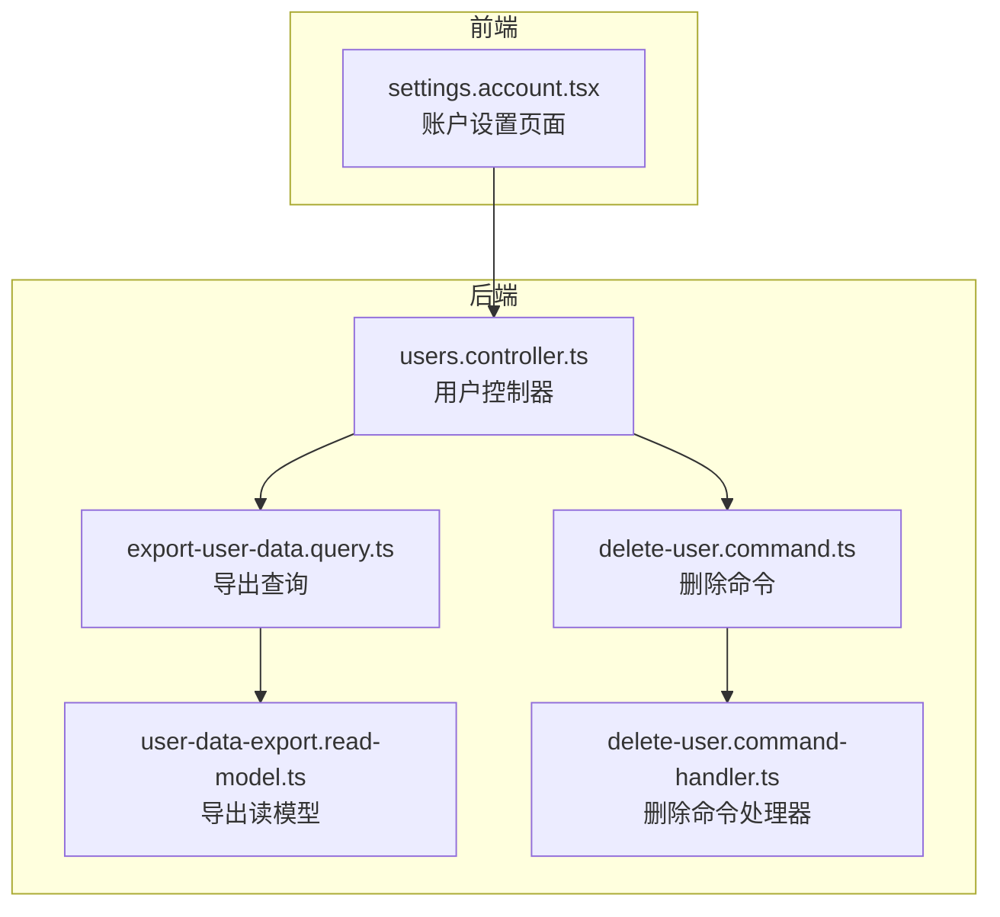
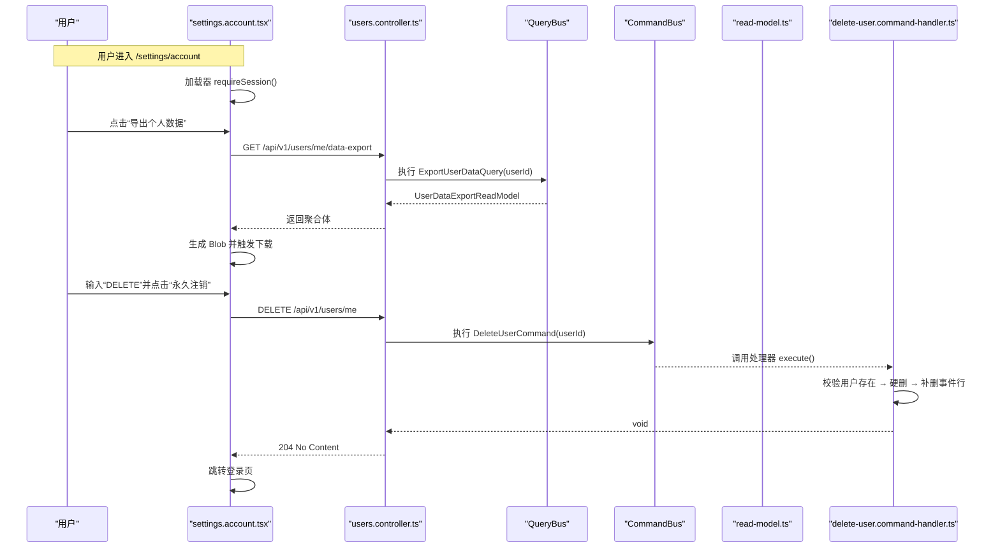
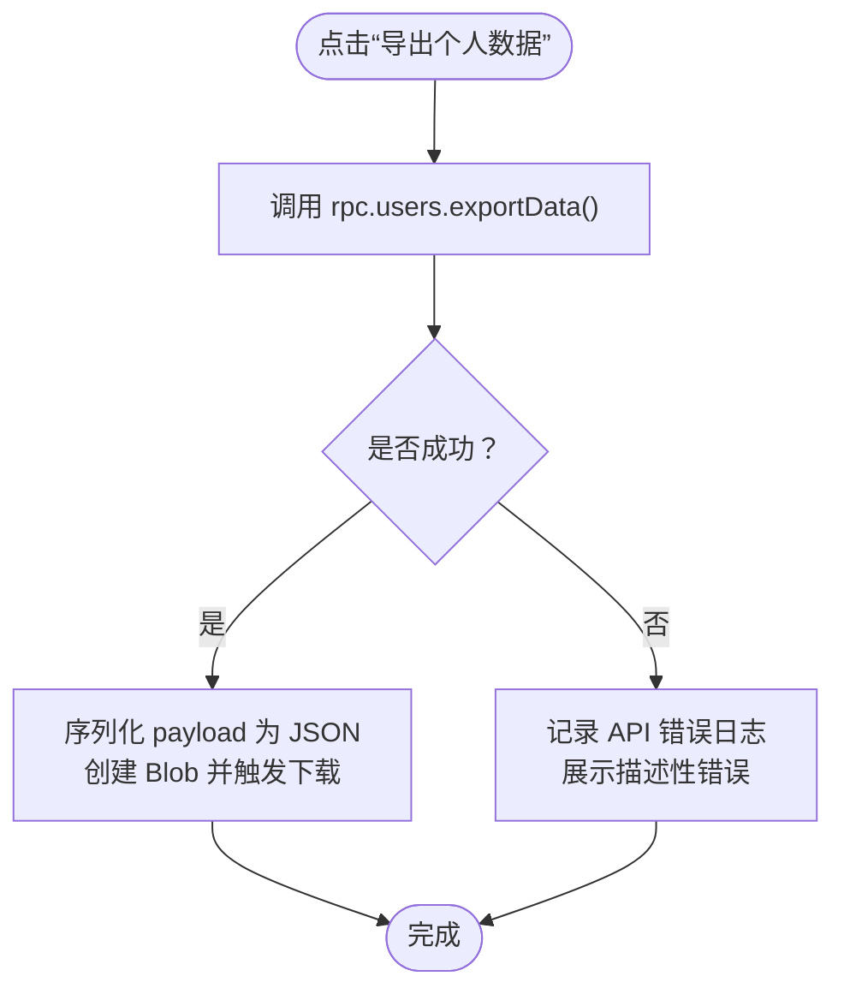
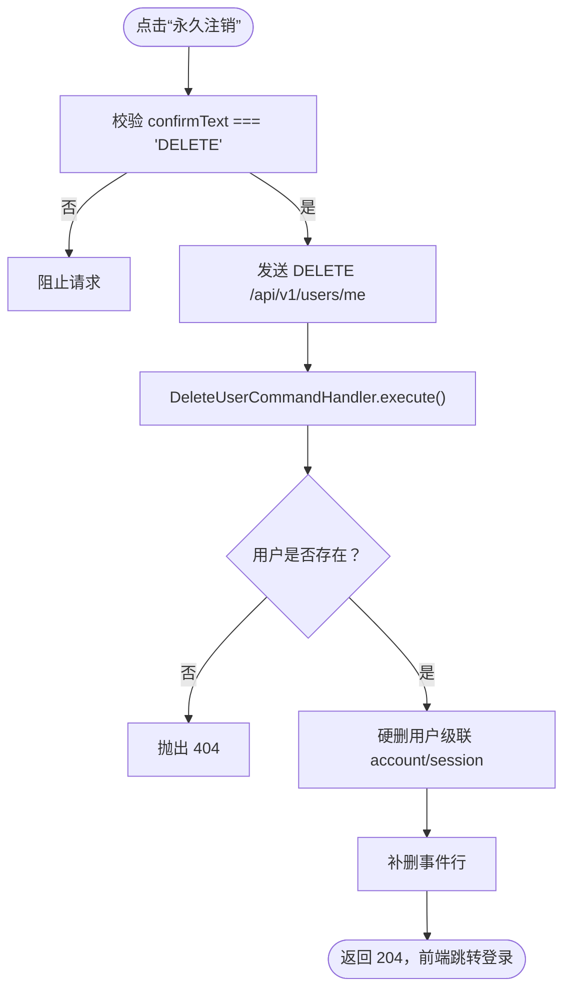
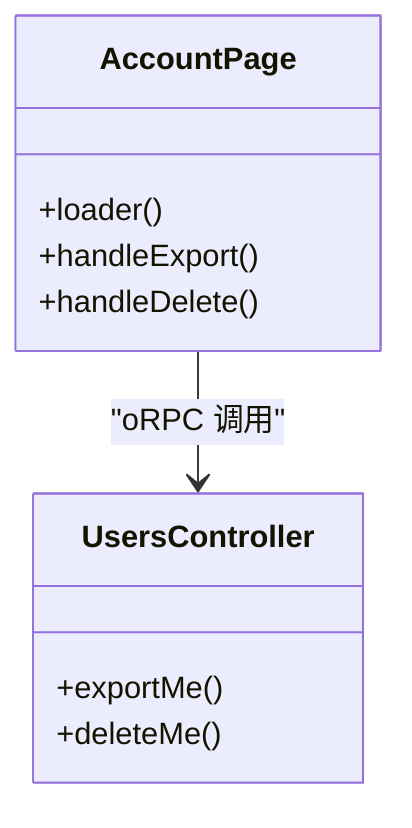
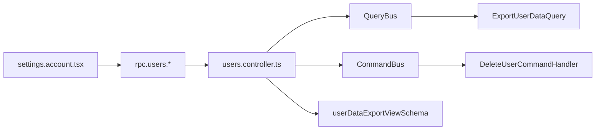

# 账户设置页面

<cite>
**本文引用的文件**   
- [apps/web/src/routes/settings.account.tsx](file://apps/web/src/routes/settings.account.tsx)
- [apps/api/src/modules/users/api/users.controller.ts](file://apps/api/src/modules/users/api/users.controller.ts)
- [apps/api/src/modules/users/application/queries/export-user-data.query.ts](file://apps/api/src/modules/users/application/queries/export-user-data.query.ts)
- [apps/api/src/modules/users/application/read-models/user-data-export.read-model.ts](file://apps/api/src/modules/users/application/read-models/user-data-export.read-model.ts)
- [libs/contracts/src/response/users.ts](file://libs/contracts/src/response/users.ts)
- [apps/api/src/modules/users/application/commands/delete-user.command.ts](file://apps/api/src/modules/users/application/commands/delete-user.command.ts)
- [apps/api/src/modules/users/application/commands/handlers/delete-user.command-handler.ts](file://apps/api/src/modules/users/application/commands/handlers/delete-user.command-handler.ts)
- [apps/web/src/routes/settings.account.test.tsx](file://apps/web/src/routes/settings.account.test.tsx)
</cite>

## 目录
1. [简介](#简介)
2. [项目结构](#项目结构)
3. [核心组件](#核心组件)
4. [架构总览](#架构总览)
5. [详细组件分析](#详细组件分析)
6. [依赖关系分析](#依赖关系分析)
7. [性能与可观测性](#性能与可观测性)
8. [故障排查指南](#故障排查指南)
9. [结论](#结论)

## 简介
本文件面向“账户设置”页面，聚焦以下能力：
- PIPL 可携带权（数据导出）：聚合用户、账号、会话、同意记录，输出不含凭据的 JSON 快照。
- PIPL 被遗忘权（账号注销）：硬删除当前用户，级联清理关联数据，保留匿名审计痕迹；前端提供 DELETE 确认闸。
- 会话与安全：路由加载时校验会话；控制器层使用会话守卫保护敏感接口。
- 错误处理：前端统一日志与描述化错误提示；后端通过 CQRS 命令/查询处理器抛出标准异常。

## 项目结构
账户设置页面由前端路由与后端用户模块共同实现：
- 前端：`/settings/account` 路由负责渲染导出与注销区块，调用 oRPC 客户端发起请求。
- 后端：`UsersController` 暴露两个受保护的端点，分别对应导出与删除；内部通过 CQRS 分发到查询/命令处理器。

**图示来源**
- [apps/web/src/routes/settings.account.tsx:14-20](file://apps/web/src/routes/settings.account.tsx#L14-L20)
- [apps/api/src/modules/users/api/users.controller.ts:38-76](file://apps/api/src/modules/users/api/users.controller.ts#L38-L76)
- [apps/api/src/modules/users/application/queries/export-user-data.query.ts:12-16](file://apps/api/src/modules/users/application/queries/export-user-data.query.ts#L12-L16)
- [apps/api/src/modules/users/application/read-models/user-data-export.read-model.ts:102-111](file://apps/api/src/modules/users/application/read-models/user-data-export.read-model.ts#L102-L111)
- [apps/api/src/modules/users/application/commands/delete-user.command.ts:14-21](file://apps/api/src/modules/users/application/commands/delete-user.command.ts#L14-L21)
- [apps/api/src/modules/users/application/commands/handlers/delete-user.command-handler.ts:20-55](file://apps/api/src/modules/users/application/commands/handlers/delete-user.command-handler.ts#L20-L55)

**章节来源**
- [apps/web/src/routes/settings.account.tsx:14-20](file://apps/web/src/routes/settings.account.tsx#L14-L20)
- [apps/api/src/modules/users/api/users.controller.ts:38-76](file://apps/api/src/modules/users/api/users.controller.ts#L38-L76)

## 核心组件
- 账户设置页面（前端）
  - 路由加载阶段强制要求会话存在。
  - 提供“导出个人数据”按钮，成功后浏览器下载 JSON 文件。
  - 提供“永久注销”按钮，需输入固定文本“DELETE”方可触发删除。
- 用户控制器（后端）
  - 导出接口：读取当前会话用户，执行导出查询，返回四段聚合体。
  - 删除接口：读取当前会话用户，执行硬删命令，成功返回空响应。
- 导出查询与读模型
  - 导出查询对象承载 userId。
  - 读模型定义导出的数据结构，明确排除凭据字段。
- 删除命令与处理器
  - 删除命令对象承载 userId。
  - 处理器执行用户存在性检查、硬删、事件行补删并记录日志。

**章节来源**
- [apps/web/src/routes/settings.account.tsx:14-61](file://apps/web/src/routes/settings.account.tsx#L14-L61)
- [apps/api/src/modules/users/api/users.controller.ts:46-76](file://apps/api/src/modules/users/api/users.controller.ts#L46-L76)
- [apps/api/src/modules/users/application/queries/export-user-data.query.ts:12-16](file://apps/api/src/modules/users/application/queries/export-user-data.query.ts#L12-L16)
- [apps/api/src/modules/users/application/read-models/user-data-export.read-model.ts:12-35](file://apps/api/src/modules/users/application/read-models/user-data-export.read-model.ts#L12-L35)
- [apps/api/src/modules/users/application/commands/delete-user.command.ts:14-21](file://apps/api/src/modules/users/application/commands/delete-user.command.ts#L14-L21)
- [apps/api/src/modules/users/application/commands/handlers/delete-user.command-handler.ts:40-55](file://apps/api/src/modules/users/application/commands/handlers/delete-user.command-handler.ts#L40-L55)

## 架构总览
账户设置页面的端到端流程如下：

**图示来源**
- [apps/web/src/routes/settings.account.tsx:14-61](file://apps/web/src/routes/settings.account.tsx#L14-L61)
- [apps/api/src/modules/users/api/users.controller.ts:50-76](file://apps/api/src/modules/users/api/users.controller.ts#L50-L76)
- [apps/api/src/modules/users/application/queries/export-user-data.query.ts:12-16](file://apps/api/src/modules/users/application/queries/export-user-data.query.ts#L12-L16)
- [apps/api/src/modules/users/application/read-models/user-data-export.read-model.ts:102-111](file://apps/api/src/modules/users/application/read-models/user-data-export.read-model.ts#L102-L111)
- [apps/api/src/modules/users/application/commands/delete-user.command.ts:14-21](file://apps/api/src/modules/users/application/commands/delete-user.command.ts#L14-L21)
- [apps/api/src/modules/users/application/commands/handlers/delete-user.command-handler.ts:40-55](file://apps/api/src/modules/users/application/commands/handlers/delete-user.command-handler.ts#L40-L55)

## 详细组件分析

### 数据导出（PIPL 可携带权）
- 前端交互
  - 点击“导出个人数据”后，调用 `rpc.users.exportData()`。
  - 将返回的业务聚合体序列化为 JSON，创建 Blob 并通过隐藏 `<a>` 标签触发下载，文件名包含日期前缀。
  - 捕获异常后记录结构化日志并展示可读错误信息。
- 后端实现
  - 控制器方法受会话守卫保护，从上下文获取当前用户。
  - 通过 QueryBus 执行导出查询，返回符合契约的聚合体。
  - 输出侧使用 Zod schema 对返回体进行校验，确保字段稳定且不含凭据。
- 数据结构
  - 导出体包含 user/accounts/sessions/consents 四段。
  - 所有凭据类字段（密码、令牌、证据等）在导出面被刻意剔除。

**图示来源**
- [apps/web/src/routes/settings.account.tsx:30-47](file://apps/web/src/routes/settings.account.tsx#L30-L47)
- [apps/api/src/modules/users/api/users.controller.ts:50-63](file://apps/api/src/modules/users/api/users.controller.ts#L50-L63)
- [libs/contracts/src/response/users.ts:14-35](file://libs/contracts/src/response/users.ts#L14-L35)

**章节来源**
- [apps/web/src/routes/settings.account.tsx:30-47](file://apps/web/src/routes/settings.account.tsx#L30-L47)
- [apps/api/src/modules/users/api/users.controller.ts:50-63](file://apps/api/src/modules/users/api/users.controller.ts#L50-L63)
- [apps/api/src/modules/users/application/queries/export-user-data.query.ts:12-16](file://apps/api/src/modules/users/application/queries/export-user-data.query.ts#L12-L16)
- [apps/api/src/modules/users/application/read-models/user-data-export.read-model.ts:12-35](file://apps/api/src/modules/users/application/read-models/user-data-export.read-model.ts#L12-L35)
- [libs/contracts/src/response/users.ts:14-35](file://libs/contracts/src/response/users.ts#L14-L35)

### 账号注销（PIPL 被遗忘权）
- 前端交互
  - 显示红色警示区，要求输入固定文本“DELETE”。
  - 未输入正确文本时，点击“永久注销”不会触发任何网络请求。
  - 成功后跳转到登录页。
- 后端实现
  - 控制器方法受会话守卫保护，从上下文获取当前用户。
  - 通过 CommandBus 执行删除命令，成功返回空响应。
- 命令处理器
  - 若用户不存在则抛出 404。
  - 经属主端口执行硬删，级联清理 account/session。
  - 显式补删该用户的事件行，失败即抛错（不留残迹）。
  - consent 表外键置空以保留匿名审计轨迹。

**图示来源**
- [apps/web/src/routes/settings.account.tsx:49-61](file://apps/web/src/routes/settings.account.tsx#L49-L61)
- [apps/api/src/modules/users/api/users.controller.ts:68-76](file://apps/api/src/modules/users/api/users.controller.ts#L68-L76)
- [apps/api/src/modules/users/application/commands/delete-user.command.ts:14-21](file://apps/api/src/modules/users/application/commands/delete-user.command.ts#L14-L21)
- [apps/api/src/modules/users/application/commands/handlers/delete-user.command-handler.ts:40-55](file://apps/api/src/modules/users/application/commands/handlers/delete-user.command-handler.ts#L40-L55)

**章节来源**
- [apps/web/src/routes/settings.account.tsx:49-61](file://apps/web/src/routes/settings.account.tsx#L49-L61)
- [apps/api/src/modules/users/api/users.controller.ts:68-76](file://apps/api/src/modules/users/api/users.controller.ts#L68-L76)
- [apps/api/src/modules/users/application/commands/delete-user.command.ts:14-21](file://apps/api/src/modules/users/application/commands/delete-user.command.ts#L14-L21)
- [apps/api/src/modules/users/application/commands/handlers/delete-user.command-handler.ts:40-55](file://apps/api/src/modules/users/application/commands/handlers/delete-user.command-handler.ts#L40-L55)

### 会话管理与安全设置
- 会话校验
  - 页面加载器调用会话校验函数，未登录将被拦截。
- 接口保护
  - 导出与删除接口均挂载会话守卫，仅已认证主体可访问。
- 上下文用户
  - 控制器通过上下文解析当前会话用户，避免越权。

**图示来源**
- [apps/web/src/routes/settings.account.tsx:14-20](file://apps/web/src/routes/settings.account.tsx#L14-L20)
- [apps/api/src/modules/users/api/users.controller.ts:50-76](file://apps/api/src/modules/users/api/users.controller.ts#L50-L76)

**章节来源**
- [apps/web/src/routes/settings.account.tsx:14-20](file://apps/web/src/routes/settings.account.tsx#L14-L20)
- [apps/api/src/modules/users/api/users.controller.ts:50-76](file://apps/api/src/modules/users/api/users.controller.ts#L50-L76)

### 个人信息修改（说明）
- 当前仓库中“账户设置”页面未包含个人信息编辑入口；如需扩展，可在同一路由下新增表单区块，复用现有会话校验与错误反馈机制。

[本节不直接分析具体源码文件]

## 依赖关系分析
- 前端依赖
  - TanStack Router：路由与导航。
  - 自定义 hooks：useAction 管理异步动作状态。
  - 工具库：describeApiError、logApiError 用于错误呈现与日志。
- 后端依赖
  - NestJS CQRS：CommandBus/QueryBus 分发命令与查询。
  - orpc/nest：@Impl 装饰器绑定契约与方法。
  - 领域端口：AuthUserStore、EventStore、UserRepository。
  - 契约与校验：userDataExportViewSchema 约束导出体结构。

**图示来源**
- [apps/web/src/routes/settings.account.tsx:8-12](file://apps/web/src/routes/settings.account.tsx#L8-L12)
- [apps/api/src/modules/users/api/users.controller.ts:1-17](file://apps/api/src/modules/users/api/users.controller.ts#L1-L17)
- [libs/contracts/src/response/users.ts:14-35](file://libs/contracts/src/response/users.ts#L14-L35)

**章节来源**
- [apps/web/src/routes/settings.account.tsx:8-12](file://apps/web/src/routes/settings.account.tsx#L8-L12)
- [apps/api/src/modules/users/api/users.controller.ts:1-17](file://apps/api/src/modules/users/api/users.controller.ts#L1-L17)
- [libs/contracts/src/response/users.ts:14-35](file://libs/contracts/src/response/users.ts#L14-L35)

## 性能与可观测性
- 导出性能
  - 导出聚合体体积较小（user + 少量集合），JSON 序列化与 Blob 下载开销低。
  - 建议在服务端对聚合查询做分页或流式组装（如未来数据量增长）。
- 日志与可观测性
  - 前端：导出失败时记录结构化日志（含路径与作用域）。
  - 后端：控制器与命令处理器记录关键操作日志（导出/删除、事件清理数量）。
- 安全与合规
  - 导出面严格剔除凭据与敏感证据，满足最小披露原则。
  - 删除操作不可逆，前端通过文本确认降低误操作风险。

[本节为通用指导，不直接分析具体源码文件]

## 故障排查指南
- 导出失败
  - 现象：页面显示错误提示，控制台有结构化日志。
  - 排查要点：
    - 确认会话有效且未被中断。
    - 检查后端导出查询是否正常返回聚合体。
    - 核对 Zod schema 校验是否因字段缺失而拒绝。
- 注销失败
  - 现象：点击“永久注销”无反应或返回错误。
  - 排查要点：
    - 确认已输入“DELETE”。
    - 检查后端 404（用户不存在）或数据库/事件存储异常。
    - 查看命令处理器日志，确认是否完成硬删与事件补删。
- 单元测试参考
  - 页面测试覆盖两区块渲染与“未输入 DELETE 不触发删除”的不可逆闸逻辑。

**章节来源**
- [apps/web/src/routes/settings.account.tsx:30-61](file://apps/web/src/routes/settings.account.tsx#L30-L61)
- [apps/api/src/modules/users/application/commands/handlers/delete-user.command-handler.ts:40-55](file://apps/api/src/modules/users/application/commands/handlers/delete-user.command-handler.ts#L40-L55)
- [apps/web/src/routes/settings.account.test.tsx:46-62](file://apps/web/src/routes/settings.account.test.tsx#L46-L62)

## 结论
账户设置页面实现了 PIPL 可携带权与被遗忘权的完整闭环：
- 导出功能以聚合快照形式提供可携带数据，严格剔除凭据，保障隐私。
- 注销功能采用硬删除策略，配合前端确认闸与后端级联清理，确保数据不留残迹。
- 会话与会话守卫贯穿前后端，保证接口安全。
- 错误处理与日志体系完善，便于定位问题与合规审计。

[本节为总结性内容，不直接分析具体源码文件]