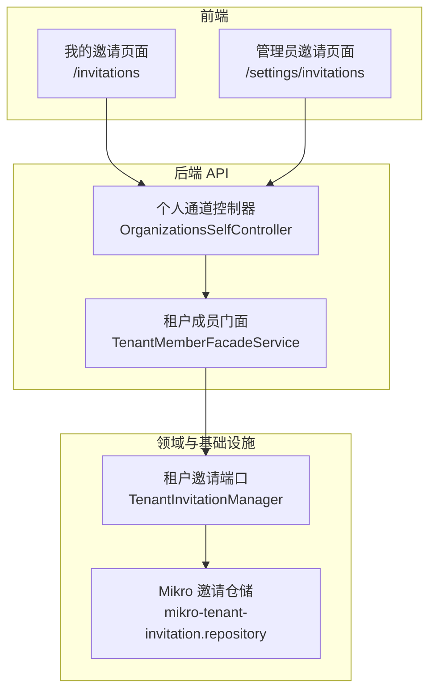
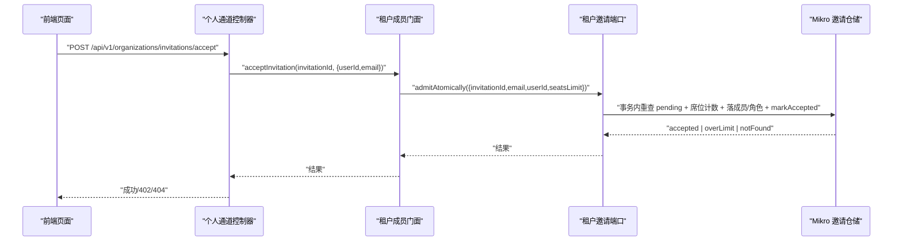
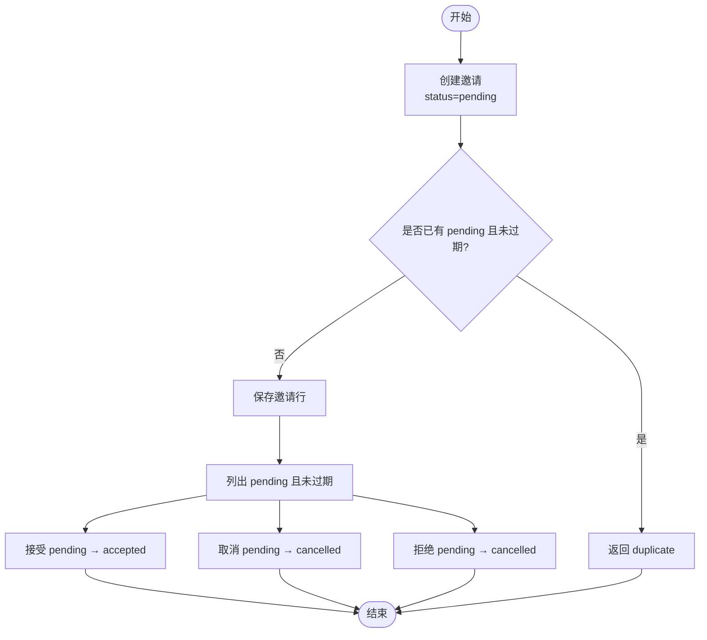
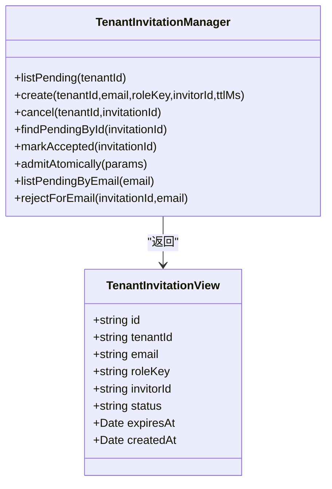
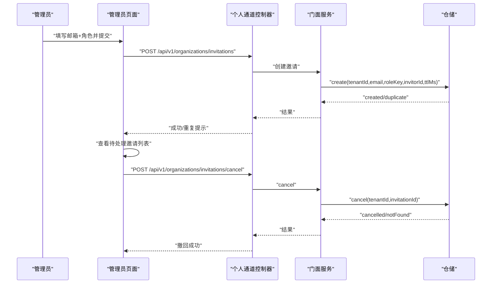
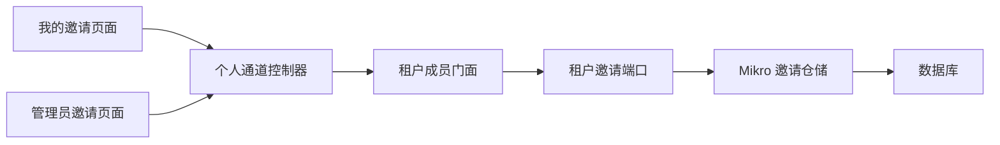

# 邀请管理页面

<cite>
**本文引用的文件**   
- [apps/web/src/routes/invitations.tsx](file://apps/web/src/routes/invitations.tsx)
- [apps/web/src/routes/settings.invitations.tsx](file://apps/web/src/routes/settings.invitations.tsx)
- [apps/api/src/modules/authorization/domain/ports/tenant-invitation.port.ts](file://apps/api/src/modules/authorization/domain/ports/tenant-invitation.port.ts)
- [apps/api/src/modules/authorization/infrastructure/repositories/mikro-tenant-invitation.repository.ts](file://apps/api/src/modules/authorization/infrastructure/repositories/mikro-tenant-invitation.repository.ts)
- [apps/api/src/modules/organizations/application/tenant-member-facade.service.ts](file://apps/api/src/modules/organizations/application/tenant-member-facade.service.ts)
- [apps/api/src/modules/organizations/api/organizations-self.controller.ts](file://apps/api/src/modules/organizations/api/organizations-self.controller.ts)
</cite>

## 目录
1. [引言](#引言)
2. [项目结构](#项目结构)
3. [核心组件](#核心组件)
4. [架构总览](#架构总览)
5. [详细组件分析](#详细组件分析)
6. [依赖关系分析](#依赖关系分析)
7. [性能与并发特性](#性能与并发特性)
8. [权限与访问控制](#权限与访问控制)
9. [错误处理与故障排查](#错误处理与故障排查)
10. [用户体验优化建议](#用户体验优化建议)
11. [结论](#结论)

## 引言
本文件围绕“邀请管理页面”进行系统化文档说明，覆盖以下目标：
- 邀请状态跟踪：待接受、已接受、已过期状态的实时更新与一致性保障。
- 批量邀请操作：多邮箱邀请、模板化邀请消息、批量状态管理的实现现状与扩展建议。
- 邀请权限控制：角色绑定、有效期设置、使用次数限制（席位上限）的机制。
- 邀请历史记录：邀请日志、审计追踪、统计分析的实现现状与扩展建议。
- 邀请链接生成、二维码分享、邮件模板定制：当前能力边界与集成点。
- 邀请工作流示例与用户体验优化方案。

## 项目结构
邀请功能横跨前端路由、API 控制器、门面服务、领域端口与仓储实现，形成清晰的分层结构：
- 前端页面
  - 我的邀请页面：列出当前用户的待处理邀请，支持接受或拒绝。
  - 管理员邀请页面：发送邀请、查看待处理邀请、撤回邀请。
- 后端 API
  - 个人通道控制器：暴露接受/拒绝邀请、列出本人邀请等端点。
  - 门面服务：组合邀请、成员、配额等能力，对外提供统一业务语义。
- 领域与基础设施
  - 领域端口定义邀请管理能力与视图模型。
  - 仓储实现负责持久化、状态迁移、过期判断与并发安全。

**图表来源**
- [apps/web/src/routes/invitations.tsx:29-41](file://apps/web/src/routes/invitations.tsx#L29-L41)
- [apps/web/src/routes/settings.invitations.tsx:39-53](file://apps/web/src/routes/settings.invitations.tsx#L39-L53)
- [apps/api/src/modules/organizations/api/organizations-self.controller.ts:168-217](file://apps/api/src/modules/organizations/api/organizations-self.controller.ts#L168-L217)
- [apps/api/src/modules/organizations/application/tenant-member-facade.service.ts:149-169](file://apps/api/src/modules/organizations/application/tenant-member-facade.service.ts#L149-L169)
- [apps/api/src/modules/authorization/domain/ports/tenant-invitation.port.ts:59-129](file://apps/api/src/modules/authorization/domain/ports/tenant-invitation.port.ts#L59-L129)
- [apps/api/src/modules/authorization/infrastructure/repositories/mikro-tenant-invitation.repository.ts:48-197](file://apps/api/src/modules/authorization/infrastructure/repositories/mikro-tenant-invitation.repository.ts#L48-L197)

**章节来源**
- [apps/web/src/routes/invitations.tsx:1-106](file://apps/web/src/routes/invitations.tsx#L1-L106)
- [apps/web/src/routes/settings.invitations.tsx:1-158](file://apps/web/src/routes/settings.invitations.tsx#L1-L158)
- [apps/api/src/modules/organizations/api/organizations-self.controller.ts:86-217](file://apps/api/src/modules/organizations/api/organizations-self.controller.ts#L86-L217)
- [apps/api/src/modules/organizations/application/tenant-member-facade.service.ts:149-169](file://apps/api/src/modules/organizations/application/tenant-member-facade.service.ts#L149-L169)
- [apps/api/src/modules/authorization/domain/ports/tenant-invitation.port.ts:1-130](file://apps/api/src/modules/authorization/domain/ports/tenant-invitation.port.ts#L1-L130)
- [apps/api/src/modules/authorization/infrastructure/repositories/mikro-tenant-invitation.repository.ts:1-197](file://apps/api/src/modules/authorization/infrastructure/repositories/mikro-tenant-invitation.repository.ts#L1-L197)

## 核心组件
- 我的邀请页面
  - 加载当前用户待处理邀请列表，展示组织名或邮箱、角色键，并提供接受与拒绝操作。
  - 通过 RPC 调用个人通道接口获取数据并渲染。
- 管理员邀请页面
  - 提供表单发送邀请（邮箱 + 角色），校验字段后调用创建接口。
  - 展示待处理邀请列表，支持撤回某条邀请。
- 个人通道控制器
  - 暴露接受邀请、拒绝邀请、列出本人邀请等端点，均要求会话认证。
  - 将请求委派给门面服务完成业务编排。
- 租户成员门面服务
  - 封装邀请相关能力：列出本人邀请、拒绝邀请、接受邀请（含席位检查与原子入租）。
- 租户邀请端口
  - 定义邀请管理能力：创建、取消、查找、标记接受、原子入租、按邮箱列出、按邮箱拒绝。
  - 定义邀请视图模型，包含 id、租户 id、邮箱、角色键、邀请人 id、状态、过期时间、创建时间。
- Mikro 邀请仓储
  - 实现邀请状态迁移：pending → accepted/cancelled/expired。
  - 提供过期判断、重复邀请去重、按邮箱过滤、跨租可见性控制。

**章节来源**
- [apps/web/src/routes/invitations.tsx:29-106](file://apps/web/src/routes/invitations.tsx#L29-L106)
- [apps/web/src/routes/settings.invitations.tsx:39-158](file://apps/web/src/routes/settings.invitations.tsx#L39-L158)
- [apps/api/src/modules/organizations/api/organizations-self.controller.ts:168-217](file://apps/api/src/modules/organizations/api/organizations-self.controller.ts#L168-L217)
- [apps/api/src/modules/organizations/application/tenant-member-facade.service.ts:149-169](file://apps/api/src/modules/organizations/application/tenant-member-facade.service.ts#L149-L169)
- [apps/api/src/modules/authorization/domain/ports/tenant-invitation.port.ts:11-129](file://apps/api/src/modules/authorization/domain/ports/tenant-invitation.port.ts#L11-L129)
- [apps/api/src/modules/authorization/infrastructure/repositories/mikro-tenant-invitation.repository.ts:48-197](file://apps/api/src/modules/authorization/infrastructure/repositories/mikro-tenant-invitation.repository.ts#L48-L197)

## 架构总览
邀请流程从前端发起，经控制器进入门面服务，再调用领域端口与仓储完成状态变更与数据落盘。

**图表来源**
- [apps/api/src/modules/organizations/api/organizations-self.controller.ts:168-184](file://apps/api/src/modules/organizations/api/organizations-self.controller.ts#L168-L184)
- [apps/api/src/modules/authorization/domain/ports/tenant-invitation.port.ts:102-113](file://apps/api/src/modules/authorization/domain/ports/tenant-invitation.port.ts#L102-L113)
- [apps/api/src/modules/authorization/infrastructure/repositories/mikro-tenant-invitation.repository.ts:106-114](file://apps/api/src/modules/authorization/infrastructure/repositories/mikro-tenant-invitation.repository.ts#L106-L114)

## 详细组件分析

### 邀请状态跟踪与实时更新
- 状态集合
  - pending：待接受。
  - accepted：已接受。
  - cancelled：已取消（管理员撤回或受邀者拒绝）。
  - expired：已过期（expiresAt 到达）。
- 状态迁移规则
  - 创建：写入 pending，可带 ttlMs 计算 expiresAt；若同 (tenantId,email) 已有 pending 且未过期，返回 duplicate。
  - 取消：仅对 pending 行生效，转为 cancelled。
  - 接受：仅对 pending 且未过期行生效，转为 accepted；过期返回 expired。
  - 拒绝：仅限受邀邮箱匹配，pending → cancelled。
- 实时性
  - 前端每次打开页面或刷新时重新拉取列表，服务端在查询时过滤过期项，保证显示为最新有效状态。
  - 接受/拒绝操作成功后，前端反馈成功信息并可清空输入或移除行。

**图表来源**
- [apps/api/src/modules/authorization/infrastructure/repositories/mikro-tenant-invitation.repository.ts:48-97](file://apps/api/src/modules/authorization/infrastructure/repositories/mikro-tenant-invitation.repository.ts#L48-L97)
- [apps/api/src/modules/authorization/infrastructure/repositories/mikro-tenant-invitation.repository.ts:106-114](file://apps/api/src/modules/authorization/infrastructure/repositories/mikro-tenant-invitation.repository.ts#L106-L114)
- [apps/api/src/modules/authorization/infrastructure/repositories/mikro-tenant-invitation.repository.ts:161-177](file://apps/api/src/modules/authorization/infrastructure/repositories/mikro-tenant-invitation.repository.ts#L161-L177)

**章节来源**
- [apps/api/src/modules/authorization/domain/ports/tenant-invitation.port.ts:11-28](file://apps/api/src/modules/authorization/domain/ports/tenant-invitation.port.ts#L11-L28)
- [apps/api/src/modules/authorization/infrastructure/repositories/mikro-tenant-invitation.repository.ts:48-197](file://apps/api/src/modules/authorization/infrastructure/repositories/mikro-tenant-invitation.repository.ts#L48-L197)

### 批量邀请操作
- 当前实现
  - 管理员页面支持单条邀请创建（邮箱 + 角色），无批量输入框。
  - 列表展示待处理邀请，支持逐条撤回。
- 扩展建议
  - 多邮箱邀请：在前端增加文本域或上传 CSV，解析多个邮箱后循环调用创建接口；后端可增加批量创建接口以优化往返。
  - 模板化邀请消息：在后端发送邮件时引入模板引擎，根据 roleKey 与租户上下文填充内容；前端可配置模板变量。
  - 批量状态管理：提供批量撤回、批量过期清理任务；后端定时任务扫描过期邀请并更新状态。

**章节来源**
- [apps/web/src/routes/settings.invitations.tsx:68-127](file://apps/web/src/routes/settings.invitations.tsx#L68-L127)
- [apps/web/src/routes/settings.invitations.tsx:130-158](file://apps/web/src/routes/settings.invitations.tsx#L130-L158)

### 邀请权限控制
- 角色绑定
  - 邀请携带 roleKey，接受后授予对应角色；管理员页面提供角色选择。
- 有效期设置
  - create 支持 ttlMs，仓储据此计算 expiresAt；过期判定函数 isExpired 用于过滤与拒绝接受。
- 使用次数限制
  - 原子入租过程中结合席位上限 seatsLimit 进行 TOCTOU 硬化，超限时返回 overLimit，门面映射为 402。

**图表来源**
- [apps/api/src/modules/authorization/domain/ports/tenant-invitation.port.ts:11-129](file://apps/api/src/modules/authorization/domain/ports/tenant-invitation.port.ts#L11-L129)

**章节来源**
- [apps/api/src/modules/authorization/domain/ports/tenant-invitation.port.ts:59-129](file://apps/api/src/modules/authorization/domain/ports/tenant-invitation.port.ts#L59-L129)
- [apps/api/src/modules/authorization/infrastructure/repositories/mikro-tenant-invitation.repository.ts:48-197](file://apps/api/src/modules/authorization/infrastructure/repositories/mikro-tenant-invitation.repository.ts#L48-L197)

### 邀请历史记录
- 当前实现
  - 仓储维护邀请行的状态与时间戳（createdAt、updatedAt、expiresAt），可用于基础审计。
  - 未显式提供独立审计表或统计报表接口。
- 扩展建议
  - 审计追踪：为邀请关键动作（创建、接受、拒绝、过期）记录审计事件，关联邀请 id、操作人、时间、IP。
  - 统计分析：提供按租户、角色、状态、时间的聚合查询接口，供仪表盘展示。

**章节来源**
- [apps/api/src/modules/authorization/infrastructure/repositories/mikro-tenant-invitation.repository.ts:181-197](file://apps/api/src/modules/authorization/infrastructure/repositories/mikro-tenant-invitation.repository.ts#L181-L197)

### 邀请链接生成、二维码分享、邮件模板定制
- 当前实现
  - 仓储生成 token 字段，但未暴露链接生成接口；前端未展示邀请链接或二维码。
  - 未集成邮件发送逻辑到邀请流程中。
- 扩展建议
  - 链接生成：基于 invitationId 与 token 构建邀请链接，并在邮件中附带。
  - 二维码分享：前端将邀请链接编码为二维码，便于移动端扫码加入。
  - 邮件模板：在后端 mailer 模块中新增邀请模板，支持多语言与租户品牌化。

**章节来源**
- [apps/api/src/modules/authorization/infrastructure/repositories/mikro-tenant-invitation.repository.ts:48-87](file://apps/api/src/modules/authorization/infrastructure/repositories/mikro-tenant-invitation.repository.ts#L48-L87)

### 邀请工作流示例
- 管理员发送邀请
  - 管理员在 /settings/invitations 填写邮箱与角色，提交后后端创建 pending 邀请。
  - 列表显示该邀请，管理员可撤回。
- 受邀者接受邀请
  - 受邀者在 /invitations 看到待处理邀请，点击接受。
  - 后端原子入租：校验 pending、邮箱匹配、席位上限，成功后授予成员与角色。
- 受邀者拒绝邀请
  - 受邀者在 /invitations 点击拒绝，pending → cancelled。

**图表来源**
- [apps/web/src/routes/settings.invitations.tsx:68-127](file://apps/web/src/routes/settings.invitations.tsx#L68-L127)
- [apps/web/src/routes/settings.invitations.tsx:130-158](file://apps/web/src/routes/settings.invitations.tsx#L130-L158)
- [apps/api/src/modules/authorization/infrastructure/repositories/mikro-tenant-invitation.repository.ts:48-97](file://apps/api/src/modules/authorization/infrastructure/repositories/mikro-tenant-invitation.repository.ts#L48-L97)

**章节来源**
- [apps/web/src/routes/settings.invitations.tsx:39-158](file://apps/web/src/routes/settings.invitations.tsx#L39-L158)
- [apps/api/src/modules/authorization/infrastructure/repositories/mikro-tenant-invitation.repository.ts:48-97](file://apps/api/src/modules/authorization/infrastructure/repositories/mikro-tenant-invitation.repository.ts#L48-L97)

## 依赖关系分析
- 前端依赖
  - 我的邀请页面依赖个人通道 RPC 接口。
  - 管理员邀请页面依赖创建与撤回接口。
- 后端依赖
  - 个人通道控制器依赖门面服务。
  - 门面服务依赖租户邀请端口。
  - 租户邀请端口依赖 Mikro 仓储实现。
- 外部依赖
  - 数据库：tenant_invitation 表存储邀请状态与元数据。
  - 会话系统：SessionGuard 确保身份认证。

**图表来源**
- [apps/web/src/routes/invitations.tsx:29-41](file://apps/web/src/routes/invitations.tsx#L29-L41)
- [apps/web/src/routes/settings.invitations.tsx:39-53](file://apps/web/src/routes/settings.invitations.tsx#L39-L53)
- [apps/api/src/modules/organizations/api/organizations-self.controller.ts:168-217](file://apps/api/src/modules/organizations/api/organizations-self.controller.ts#L168-L217)
- [apps/api/src/modules/organizations/application/tenant-member-facade.service.ts:149-169](file://apps/api/src/modules/organizations/application/tenant-member-facade.service.ts#L149-L169)
- [apps/api/src/modules/authorization/domain/ports/tenant-invitation.port.ts:59-129](file://apps/api/src/modules/authorization/domain/ports/tenant-invitation.port.ts#L59-L129)
- [apps/api/src/modules/authorization/infrastructure/repositories/mikro-tenant-invitation.repository.ts:48-197](file://apps/api/src/modules/authorization/infrastructure/repositories/mikro-tenant-invitation.repository.ts#L48-L197)

**章节来源**
- [apps/web/src/routes/invitations.tsx:1-106](file://apps/web/src/routes/invitations.tsx#L1-L106)
- [apps/web/src/routes/settings.invitations.tsx:1-158](file://apps/web/src/routes/settings.invitations.tsx#L1-L158)
- [apps/api/src/modules/organizations/api/organizations-self.controller.ts:86-217](file://apps/api/src/modules/organizations/api/organizations-self.controller.ts#L86-L217)
- [apps/api/src/modules/organizations/application/tenant-member-facade.service.ts:149-169](file://apps/api/src/modules/organizations/application/tenant-member-facade.service.ts#L149-L169)
- [apps/api/src/modules/authorization/domain/ports/tenant-invitation.port.ts:1-130](file://apps/api/src/modules/authorization/domain/ports/tenant-invitation.port.ts#L1-L130)
- [apps/api/src/modules/authorization/infrastructure/repositories/mikro-tenant-invitation.repository.ts:1-197](file://apps/api/src/modules/authorization/infrastructure/repositories/mikro-tenant-invitation.repository.ts#L1-L197)

## 性能与并发特性
- 过期过滤
  - 查询 pending 列表时过滤过期项，避免无效数据影响前端渲染。
- 并发安全
  - 原子入租使用事务与 advisory lock 串行化同租并发 accept，防止双消费与席位超限。
- 去重机制
  - 同 (tenantId,email) 已有 pending 且未过期时返回 duplicate，减少冗余邀请。

**章节来源**
- [apps/api/src/modules/authorization/infrastructure/repositories/mikro-tenant-invitation.repository.ts:48-61](file://apps/api/src/modules/authorization/infrastructure/repositories/mikro-tenant-invitation.repository.ts#L48-L61)
- [apps/api/src/modules/authorization/infrastructure/repositories/mikro-tenant-invitation.repository.ts:161-166](file://apps/api/src/modules/authorization/infrastructure/repositories/mikro-tenant-invitation.repository.ts#L161-L166)
- [apps/api/src/modules/authorization/domain/ports/tenant-invitation.port.ts:102-113](file://apps/api/src/modules/authorization/domain/ports/tenant-invitation.port.ts#L102-L113)

## 权限与访问控制
- 会话认证
  - 所有个人通道端点要求 SessionGuard，确保用户身份。
- 租户隔离豁免
  - 个人通道类级 @TenantIsolationExempt()，允许无 active 租户时仍可访问（如接受邀请前）。
- 数据面授权
  - 邀请接受/拒绝由 BA 数据面裁决成员资格与受邀人匹配，CASL 不介入个人通道。

**章节来源**
- [apps/api/src/modules/organizations/api/organizations-self.controller.ts:86-96](file://apps/api/src/modules/organizations/api/organizations-self.controller.ts#L86-L96)
- [apps/api/src/modules/organizations/api/organizations-self.controller.ts:168-217](file://apps/api/src/modules/organizations/api/organizations-self.controller.ts#L168-L217)

## 错误处理与故障排查
- 常见错误
  - 404：邀请不存在、非 pending、邮箱不匹配。
  - 402：席位超限。
  - 403：非受邀人尝试拒绝。
- 前端处理
  - 使用 Feedback 组件展示错误与成功消息。
  - 捕获 API 错误并记录日志。
- 后端处理
  - 门面服务抛出 NotFoundException 或映射 BA 错误。
  - 仓储返回枚举结果，控制器转换为 HTTP 状态码。

**章节来源**
- [apps/web/src/routes/invitations.tsx:64-106](file://apps/web/src/routes/invitations.tsx#L64-L106)
- [apps/web/src/routes/settings.invitations.tsx:68-158](file://apps/web/src/routes/settings.invitations.tsx#L68-L158)
- [apps/api/src/modules/organizations/application/tenant-member-facade.service.ts:149-169](file://apps/api/src/modules/organizations/application/tenant-member-facade.service.ts#L149-L169)

## 用户体验优化建议
- 即时反馈
  - 接受/拒绝操作后，立即更新列表状态，无需刷新页面。
- 批量操作
  - 支持多选邀请进行批量撤回，提升管理员效率。
- 可视化状态
  - 在列表中显示邀请状态标签（待接受、已接受、已过期），颜色区分。
- 帮助引导
  - 首次进入邀请页面时，提供简短引导说明操作步骤。

[本节为概念性建议，不涉及具体文件分析]

## 结论
邀请管理页面在当前实现中提供了完整的邀请生命周期管理：创建、查看、接受、拒绝、撤回，并通过领域端口与仓储实现保证了状态一致性与并发安全。未来可扩展批量邀请、邮件模板、链接与二维码分享、审计统计等功能，以提升用户体验与管理效率。

[本节为总结性内容，不涉及具体文件分析]