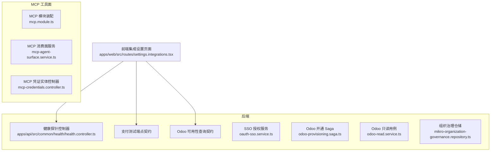
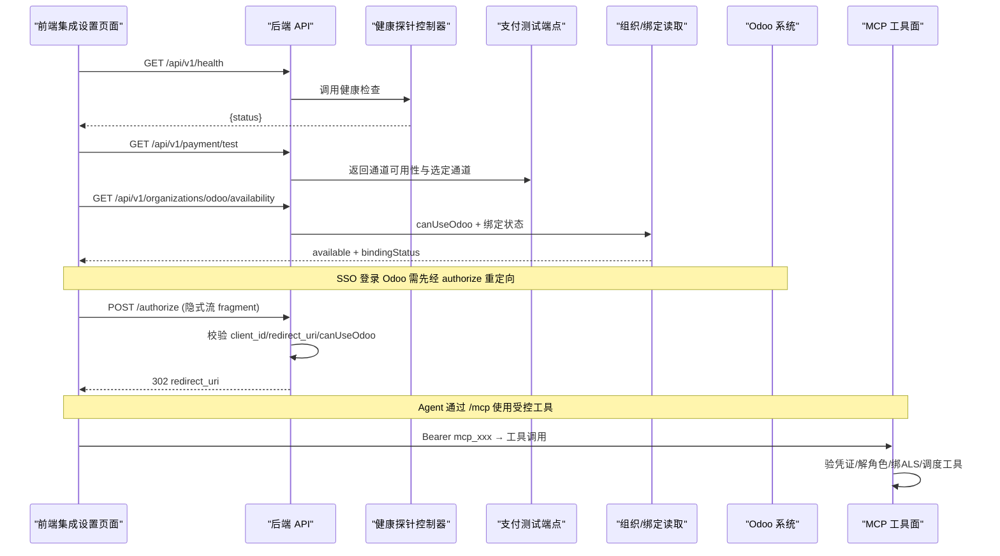
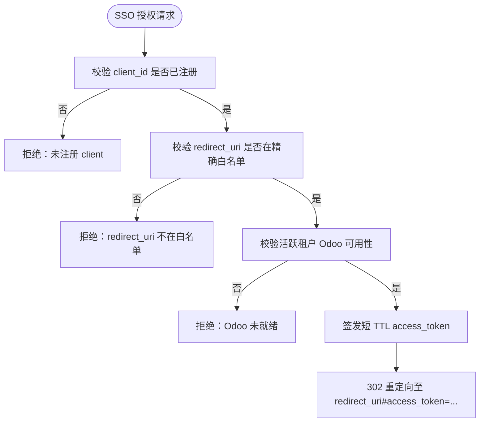
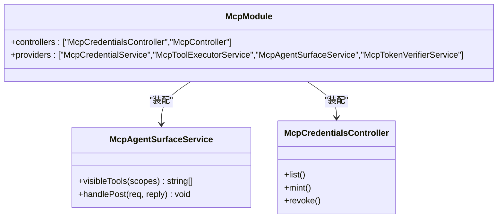
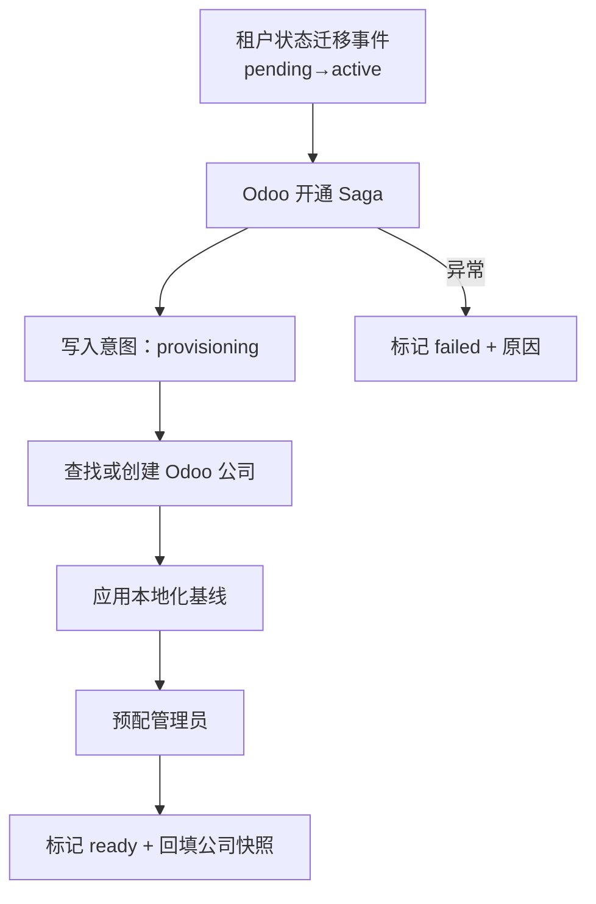
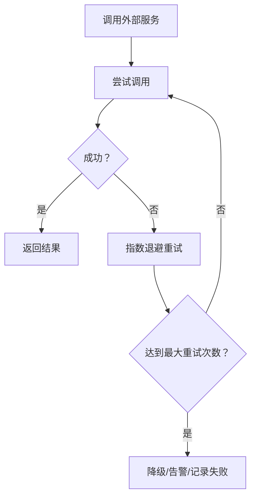
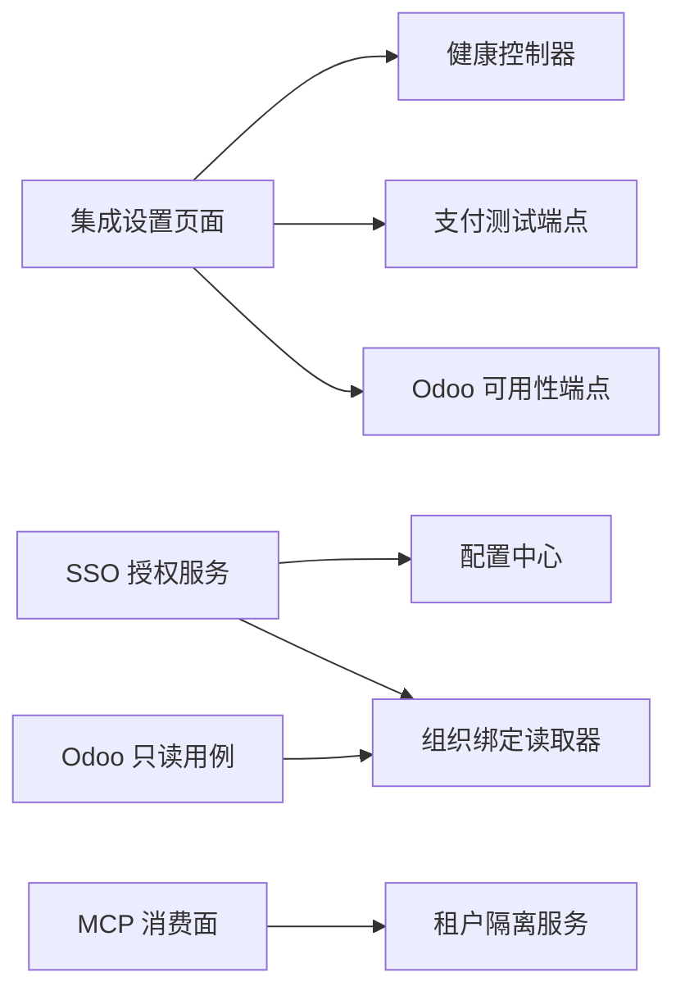

# 集成设置页面

<cite>
**本文引用的文件**   
- [apps/web/src/routes/settings.integrations.tsx](file://apps/web/src/routes/settings.integrations.tsx)
- [apps/api/src/common/health/health.controller.ts](file://apps/api/src/common/health/health.controller.ts)
- [apps/api/src/modules/auth/infrastructure/oauth-sso.service.ts](file://apps/api/src/modules/auth/infrastructure/oauth-sso.service.ts)
- [apps/api/src/config/interfaces/config.interface.ts](file://apps/api/src/config/interfaces/config.interface.ts)
- [apps/api/src/features/odoo-provisioning/application/odoo-provisioning.saga.ts](file://apps/api/src/features/odoo-provisioning/application/odoo-provisioning.saga.ts)
- [apps/api/src/features/odoo-rpc-api/application/odoo-read.service.ts](file://apps/api/src/features/odoo-rpc-api/application/odoo-read.service.ts)
- [apps/api/src/modules/organizations/infrastructure/repositories/mikro-organization-governance.repository.ts](file://apps/api/src/modules/organizations/infrastructure/repositories/mikro-organization-governance.repository.ts)
- [apps/api/src/features/mcp/api/mcp.module.ts](file://apps/api/src/features/mcp/api/mcp.module.ts)
- [apps/api/src/features/mcp/application/mcp-agent-surface.service.ts](file://apps/api/src/features/mcp/application/mcp-agent-surface.service.ts)
- [apps/api/src/features/mcp/api/mcp-credentials.controller.ts](file://apps/api/src/features/mcp/api/mcp-credentials.controller.ts)
- [apps/web/src/routes/platform.tenants.$tenantId.tsx](file://apps/web/src/routes/platform.tenants.$tenantId.tsx)
</cite>

## 目录
1. [引言](#引言)
2. [项目结构](#项目结构)
3. [核心组件](#核心组件)
4. [架构总览](#架构总览)
5. [详细组件分析](#详细组件分析)
6. [依赖关系分析](#依赖关系分析)
7. [性能与可靠性](#性能与可靠性)
8. [故障排查指南](#故障排查指南)
9. [结论](#结论)
10. [附录：配置模板与最佳实践](#附录配置模板与最佳实践)

## 引言
本文件面向“集成设置页面”的运维与实施人员，系统性说明第三方服务配置、MCP 工具集成、Odoo ERP 集成、健康检查、错误日志与重试机制，并给出配置模板、批量导入导出与配置版本管理的落地建议与安全最佳实践。文档以仓库中现有实现为依据，重点覆盖以下能力：
- 第三方服务配置：OAuth2 客户端白名单、API 密钥管理（通过配置中心）、Webhook 接入面（支付等）。
- MCP 工具集成：工具注册、凭证管理与执行权限控制。
- Odoo ERP 集成：公司绑定、数据同步、状态监控。
- 健康检查、错误日志、重试机制与可观测性。
- 配置模板、批量导入导出与配置版本管理建议。
- 具体第三方服务集成示例与安全最佳实践。

## 项目结构
集成设置页面位于前端租户控制台路由 `/settings/integrations`，后端提供健康探针、支付测试与 Odoo 可用性查询；Odoo 开通由 Saga 编排；MCP 工具面独立于 oRPC 主 API 面，走官方 SDK 协议。

**图表来源**
- [apps/web/src/routes/settings.integrations.tsx:36-76](file://apps/web/src/routes/settings.integrations.tsx#L36-L76)
- [apps/api/src/common/health/health.controller.ts:28-40](file://apps/api/src/common/health/health.controller.ts#L28-L40)
- [apps/api/src/modules/auth/infrastructure/oauth-sso.service.ts:52-90](file://apps/api/src/modules/auth/infrastructure/oauth-sso.service.ts#L52-L90)
- [apps/api/src/features/odoo-provisioning/application/odoo-provisioning.saga.ts:67-104](file://apps/api/src/features/odoo-provisioning/application/odoo-provisioning.saga.ts#L67-L104)
- [apps/api/src/features/odoo-rpc-api/application/odoo-read.service.ts:40-82](file://apps/api/src/features/odoo-rpc-api/application/odoo-read.service.ts#L40-L82)
- [apps/api/src/modules/organizations/infrastructure/repositories/mikro-organization-governance.repository.ts:374-496](file://apps/api/src/modules/organizations/infrastructure/repositories/mikro-organization-governance.repository.ts#L374-L496)
- [apps/api/src/features/mcp/api/mcp.module.ts:20-33](file://apps/api/src/features/mcp/api/mcp.module.ts#L20-L33)
- [apps/api/src/features/mcp/application/mcp-agent-surface.service.ts:120-142](file://apps/api/src/features/mcp/application/mcp-agent-surface.service.ts#L120-L142)
- [apps/api/src/features/mcp/api/mcp-credentials.controller.ts:1-13](file://apps/api/src/features/mcp/api/mcp-credentials.controller.ts#L1-L13)

**章节来源**
- [apps/web/src/routes/settings.integrations.tsx:36-76](file://apps/web/src/routes/settings.integrations.tsx#L36-L76)
- [apps/api/src/common/health/health.controller.ts:28-40](file://apps/api/src/common/health/health.controller.ts#L28-L40)

## 核心组件
- 集成设置页面（前端）：聚合健康、支付、Odoo 三个面板，统一刷新与错误展示。
- 健康探针控制器：对外暴露 `/api/v1/health`，零凭据访问，限流豁免。
- OAuth2 SSO 授权服务：client 白名单校验、redirect_uri 精确匹配、令牌生成与用户信息解析。
- Odoo 开通 Saga：订阅租户状态迁移事件，编排建司、本地化基线、管理员预配与就绪回写。
- Odoo 只读用例：按租户绑定与 `canUseOdoo` 裁决，注入公司域与上下文，字段白名单校验。
- MCP 模块与消费面：凭证校验、租户作用域绑定、工具可见性与执行调度。
- 组织治理仓储：公司绑定、意图落库、就绪/失败标记。

**章节来源**
- [apps/web/src/routes/settings.integrations.tsx:36-122](file://apps/web/src/routes/settings.integrations.tsx#L36-L122)
- [apps/api/src/common/health/health.controller.ts:28-40](file://apps/api/src/common/health/health.controller.ts#L28-L40)
- [apps/api/src/modules/auth/infrastructure/oauth-sso.service.ts:52-116](file://apps/api/src/modules/auth/infrastructure/oauth-sso.service.ts#L52-L116)
- [apps/api/src/features/odoo-provisioning/application/odoo-provisioning.saga.ts:67-104](file://apps/api/src/features/odoo-provisioning/application/odoo-provisioning.saga.ts#L67-L104)
- [apps/api/src/features/odoo-rpc-api/application/odoo-read.service.ts:40-108](file://apps/api/src/features/odoo-rpc-api/application/odoo-read.service.ts#L40-L108)
- [apps/api/src/features/mcp/application/mcp-agent-surface.service.ts:120-142](file://apps/api/src/features/mcp/application/mcp-agent-surface.service.ts#L120-L142)
- [apps/api/src/modules/organizations/infrastructure/repositories/mikro-organization-governance.repository.ts:374-496](file://apps/api/src/modules/organizations/infrastructure/repositories/mikro-organization-governance.repository.ts#L374-L496)

## 架构总览
集成设置页面作为“只读探针面”，不直接修改第三方配置；真正的配置入口在平台侧或运维脚本。下图展示从前端到后端的调用链与关键安全门控。

**图表来源**
- [apps/web/src/routes/settings.integrations.tsx:36-76](file://apps/web/src/routes/settings.integrations.tsx#L36-L76)
- [apps/api/src/common/health/health.controller.ts:28-40](file://apps/api/src/common/health/health.controller.ts#L28-L40)
- [apps/api/src/modules/auth/infrastructure/oauth-sso.service.ts:52-90](file://apps/api/src/modules/auth/infrastructure/oauth-sso.service.ts#L52-L90)
- [apps/api/src/features/mcp/application/mcp-agent-surface.service.ts:120-142](file://apps/api/src/features/mcp/application/mcp-agent-surface.service.ts#L120-L142)

## 详细组件分析

### 第三方服务配置（OAuth2 客户端、API 密钥、Webhook）
- OAuth2 客户端配置
  - 通过配置中心的 `oauthSso.clients` 维护 client 白名单，包含 `clientId`、`redirectUris`、`audience` 等。
  - SSO 授权流程对 `client_id` 与 `redirect_uri` 做严格白名单校验，防止开放重定向。
  - 令牌签发前再次校验当前活跃租户的 Odoo 可用性，未就绪则拒绝。
- API 密钥管理
  - 各类 provider（存储、支付、邮件等）通过配置中心集中注入，避免硬编码。
  - 鉴权相关密钥（如 Stripe、对象存储 AK/SK）应通过环境变量或密钥管理服务注入。
- Webhook 设置
  - 支付等外部回调通常走 REST carve-out，需在网关层限制来源 IP、签名校验与幂等处理。
  - 建议在平台侧提供 Webhook 管理界面（登记 URL、签名算法、重试策略），并在后端记录接收与处理结果。

**图表来源**
- [apps/api/src/modules/auth/infrastructure/oauth-sso.service.ts:52-90](file://apps/api/src/modules/auth/infrastructure/oauth-sso.service.ts#L52-L90)

**章节来源**
- [apps/api/src/modules/auth/infrastructure/oauth-sso.service.ts:52-116](file://apps/api/src/modules/auth/infrastructure/oauth-sso.service.ts#L52-L116)
- [apps/api/src/config/interfaces/config.interface.ts:63-107](file://apps/api/src/config/interfaces/config.interface.ts#L63-L107)

### MCP 工具集成（工具注册、凭证管理、执行权限控制）
- 工具注册与可见性
  - MCP 模块装配控制器与服务，暴露 `/mcp` 消费面。
  - 工具可见性基于凭证 scope 过滤，仅授权 scope 对应的工具名可见。
- 凭证管理
  - 凭证实体与持久化端口归属 auth 属主上下文，MCP 模块通过公开端口消费。
  - 凭证校验失败直接返回 401，不进入租户隔离上下文。
- 执行权限控制
  - 校验通过后解析租户角色与作用域，绑定 ALS（异步本地存储）后再调度工具执行。
  - 工具 handler 在同一异步链内执行，确保租户轴一致。

**图表来源**
- [apps/api/src/features/mcp/api/mcp.module.ts:20-33](file://apps/api/src/features/mcp/api/mcp.module.ts#L20-L33)
- [apps/api/src/features/mcp/application/mcp-agent-surface.service.ts:116-142](file://apps/api/src/features/mcp/application/mcp-agent-surface.service.ts#L116-L142)
- [apps/api/src/features/mcp/api/mcp-credentials.controller.ts:1-13](file://apps/api/src/features/mcp/api/mcp-credentials.controller.ts#L1-L13)

**章节来源**
- [apps/api/src/features/mcp/api/mcp.module.ts:20-33](file://apps/api/src/features/mcp/api/mcp.module.ts#L20-L33)
- [apps/api/src/features/mcp/application/mcp-agent-surface.service.ts:116-142](file://apps/api/src/features/mcp/application/mcp-agent-surface.service.ts#L116-L142)
- [apps/api/src/features/mcp/api/mcp-credentials.controller.ts:1-13](file://apps/api/src/features/mcp/api/mcp-credentials.controller.ts#L1-L13)

### Odoo ERP 集成（公司绑定、数据同步、状态监控）
- 公司绑定
  - 通过组织治理仓储支持绑定已有公司、开始开通、标记就绪/失败。
  - 绑定态包括 provisioning、ready、failed 等，带快照字段（公司 id、名称、时间）。
- 数据同步
  - 只读用例强制注入公司域与上下文，字段白名单校验，上游模式漂移即时报错。
  - 通过 `canUseOdoo` 单源裁决，fail-closed 保证非就绪租户不可访问。
- 状态监控
  - 前端集成设置页面显示 Odoo 可用性、绑定状态与提示文案。
  - 平台侧可通过 doctor 脚本比对 SaaS 与 Odoo 侧公司映射一致性。

**图表来源**
- [apps/api/src/features/odoo-provisioning/application/odoo-provisioning.saga.ts:67-104](file://apps/api/src/features/odoo-provisioning/application/odoo-provisioning.saga.ts#L67-L104)
- [apps/api/src/modules/organizations/infrastructure/repositories/mikro-organization-governance.repository.ts:449-496](file://apps/api/src/modules/organizations/infrastructure/repositories/mikro-organization-governance.repository.ts#L449-L496)

**章节来源**
- [apps/api/src/features/odoo-provisioning/application/odoo-provisioning.saga.ts:67-104](file://apps/api/src/features/odoo-provisioning/application/odoo-provisioning.saga.ts#L67-L104)
- [apps/api/src/features/odoo-rpc-api/application/odoo-read.service.ts:40-108](file://apps/api/src/features/odoo-rpc-api/application/odoo-read.service.ts#L40-L108)
- [apps/api/src/modules/organizations/infrastructure/repositories/mikro-organization-governance.repository.ts:374-496](file://apps/api/src/modules/organizations/infrastructure/repositories/mikro-organization-governance.repository.ts#L374-L496)
- [apps/web/src/routes/settings.integrations.tsx:147-193](file://apps/web/src/routes/settings.integrations.tsx#L147-L193)

### 健康检查、错误日志与重试机制
- 健康检查
  - `/api/v1/health` 为公共端点，限流豁免，返回 terminus 健康检查结果。
  - 前端兼容两种响应体结构，兜底取 status 或 data.status。
- 错误日志
  - 前端统一记录 API 错误路径与作用域，便于定位。
  - 后端错误信封统一携带 requestId、path、timestamp，便于链路追踪。
- 重试机制
  - 外部调用（如 Odoo RPC、支付通道）应在基础设施层实现退避重试与熔断降级。
  - Saga 层面通过“意图落库 + 命名回找”实现崩溃恢复与幂等重投。

**图表来源**
- [apps/api/src/common/health/health.controller.ts:28-40](file://apps/api/src/common/health/health.controller.ts#L28-L40)
- [apps/web/src/routes/settings.integrations.tsx:40-48](file://apps/web/src/routes/settings.integrations.tsx#L40-L48)
- [apps/api/src/features/odoo-provisioning/application/odoo-provisioning.saga.ts:82-104](file://apps/api/src/features/odoo-provisioning/application/odoo-provisioning.saga.ts#L82-L104)

**章节来源**
- [apps/api/src/common/health/health.controller.ts:28-40](file://apps/api/src/common/health/health.controller.ts#L28-L40)
- [apps/web/src/routes/settings.integrations.tsx:40-48](file://apps/web/src/routes/settings.integrations.tsx#L40-L48)

## 依赖关系分析
- 前端集成设置页面依赖 oRPC 客户端，分别调用 health、payment、organizations.odooAvailability。
- 后端健康控制器依赖 Terminus HealthCheckService。
- SSO 授权服务依赖配置中心、SSO Token 服务、组织绑定读取器与租户隔离服务。
- Odoo 只读用例依赖 Odoo JSON 客户端、租户隔离服务与组织绑定读取器。
- MCP 模块依赖认证端口、租户作用域解析器与工具执行器。

**图表来源**
- [apps/web/src/routes/settings.integrations.tsx:36-76](file://apps/web/src/routes/settings.integrations.tsx#L36-L76)
- [apps/api/src/modules/auth/infrastructure/oauth-sso.service.ts:52-90](file://apps/api/src/modules/auth/infrastructure/oauth-sso.service.ts#L52-L90)
- [apps/api/src/features/odoo-rpc-api/application/odoo-read.service.ts:40-82](file://apps/api/src/features/odoo-rpc-api/application/odoo-read.service.ts#L40-L82)
- [apps/api/src/features/mcp/application/mcp-agent-surface.service.ts:120-142](file://apps/api/src/features/mcp/application/mcp-agent-surface.service.ts#L120-L142)

**章节来源**
- [apps/web/src/routes/settings.integrations.tsx:36-76](file://apps/web/src/routes/settings.integrations.tsx#L36-L76)
- [apps/api/src/modules/auth/infrastructure/oauth-sso.service.ts:52-90](file://apps/api/src/modules/auth/infrastructure/oauth-sso.service.ts#L52-L90)
- [apps/api/src/features/odoo-rpc-api/application/odoo-read.service.ts:40-82](file://apps/api/src/features/odoo-rpc-api/application/odoo-read.service.ts#L40-L82)
- [apps/api/src/features/mcp/application/mcp-agent-surface.service.ts:120-142](file://apps/api/src/features/mcp/application/mcp-agent-surface.service.ts#L120-L142)

## 性能与可靠性
- 前端面板纯展示，无额外 fetch，渲染性能稳定。
- 健康探针为 ping-only，避免数据库/外部依赖压力。
- Odoo 只读用例并行发起 searchRead 与 searchCount，减少往返延迟。
- Saga 采用“意图落库 + 命名回找”保障崩溃恢复与幂等，降低重复建司风险。
- 外部调用建议引入超时、重试与熔断，避免级联故障。

[本节为通用指导，无需代码引用]

## 故障排查指南
- 健康检查失败
  - 确认 `/api/v1/health` 可达且未被限流拦截。
  - 检查 Terminus 健康指示器配置与依赖服务状态。
- SSO 授权失败
  - 核对 `client_id` 是否注册、`redirect_uri` 是否精确匹配。
  - 检查活跃租户 Odoo 可用性是否为 ready。
- Odoo 数据访问失败
  - 检查组织绑定状态是否为 ready，公司 id 是否存在。
  - 查看上游字段类型是否漂移（zod 校验会抛错）。
- MCP 工具不可用
  - 检查凭证 scope 是否包含工具所需 scope。
  - 确认凭证有效且租户成员关系存在。

**章节来源**
- [apps/api/src/common/health/health.controller.ts:28-40](file://apps/api/src/common/health/health.controller.ts#L28-L40)
- [apps/api/src/modules/auth/infrastructure/oauth-sso.service.ts:52-90](file://apps/api/src/modules/auth/infrastructure/oauth-sso.service.ts#L52-L90)
- [apps/api/src/features/odoo-rpc-api/application/odoo-read.service.ts:84-108](file://apps/api/src/features/odoo-rpc-api/application/odoo-read.service.ts#L84-L108)
- [apps/api/src/features/mcp/application/mcp-agent-surface.service.ts:120-142](file://apps/api/src/features/mcp/application/mcp-agent-surface.service.ts#L120-L142)

## 结论
集成设置页面提供了统一的只读探针视图，帮助运维快速掌握服务存活、支付通道与 Odoo 可用性。第三方服务配置集中在配置中心，SSO 授权与 Odoo 访问均遵循 fail-closed 原则。MCP 工具面通过凭证与 scope 控制工具可见性与执行权限。Saga 与仓储层共同保障 Odoo 公司绑定的幂等与可恢复性。建议在生产环境完善外部调用的重试与熔断策略，并通过平台侧工具实现配置的批量导入导出与版本管理。

[本节为总结，无需代码引用]

## 附录：配置模板与最佳实践

### 第三方服务配置模板（建议）
- OAuth2 客户端
  - 字段：clientId、redirectUris、audience、enabled。
  - 要求：redirectUris 精确匹配，audience 限定为本 OP。
- API 密钥
  - 字段：provider、apiKey、secretKey、region、bucket（按 provider 扩展）。
  - 要求：通过环境变量注入，禁止入库。
- Webhook
  - 字段：url、algorithm、secret、retryPolicy、maxRetries。
  - 要求：来源 IP 白名单、签名校验、幂等键。

[本节为概念模板，无需代码引用]

### 批量导入导出与配置版本管理
- 批量导入
  - 平台侧提供 CSV/JSON 导入接口，服务端进行 schema 校验与冲突检测。
  - 导入过程事务化，失败回滚并输出差异报告。
- 批量导出
  - 前端平台租户页已实现导出数据下载（六段聚合），可作为集成配置导出的参考实现。
- 版本管理
  - 配置变更纳入 Git 版本控制，发布前运行契约对拍与 CI 门禁。
  - 生产环境启用灰度发布与回滚预案。

**章节来源**
- [apps/web/src/routes/platform.tenants.$tenantId.tsx:234-266](file://apps/web/src/routes/platform.tenants.$tenantId.tsx#L234-L266)

### 安全最佳实践
- 最小权限：SSO 授权与 MCP 工具均按 scope/role 最小授权。
- 防开放重定向：redirect_uri 精确白名单校验。
- 防混淆副手：SSO 令牌 aud 校验，仅接受已注册受众。
- 数据隔离：Odoo 只读用例强制注入公司域与上下文，fail-closed 拒答未就绪租户。
- 审计与追踪：错误信封统一携带 requestId/path/timestamp，便于全链路追踪。

**章节来源**
- [apps/api/src/modules/auth/infrastructure/oauth-sso.service.ts:52-116](file://apps/api/src/modules/auth/infrastructure/oauth-sso.service.ts#L52-L116)
- [apps/api/src/features/odoo-rpc-api/application/odoo-read.service.ts:84-108](file://apps/api/src/features/odoo-rpc-api/application/odoo-read.service.ts#L84-L108)