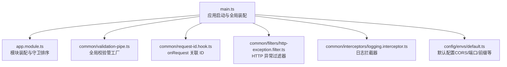
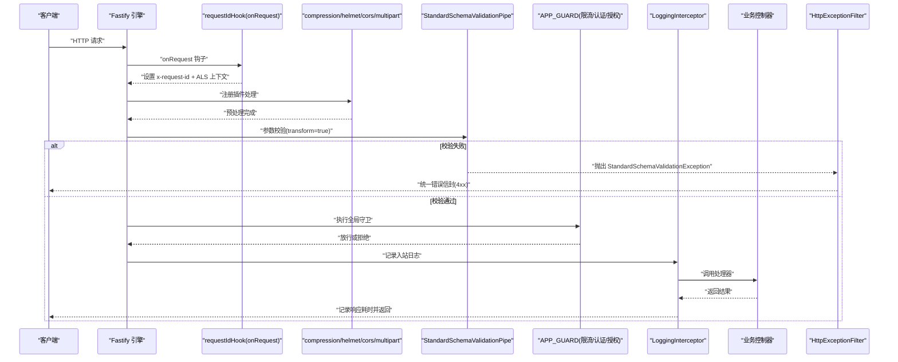
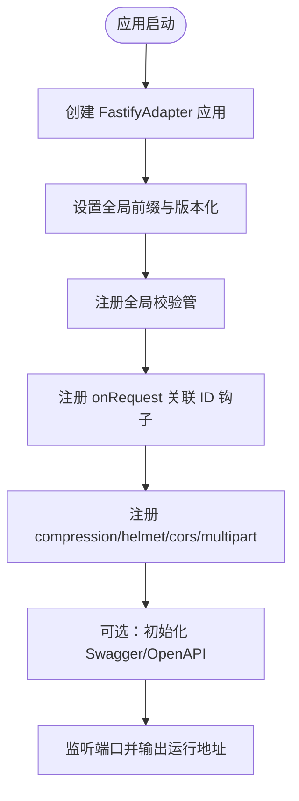
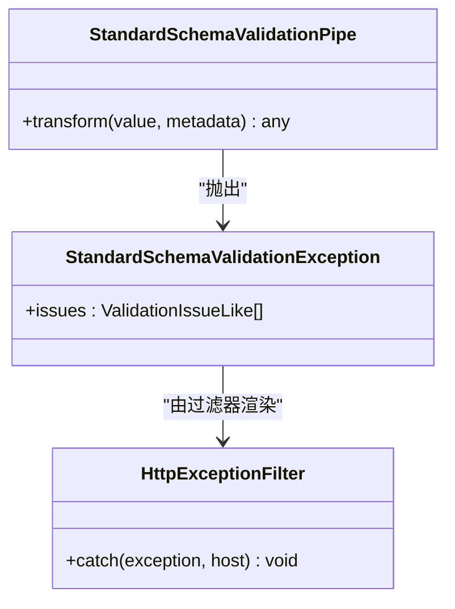
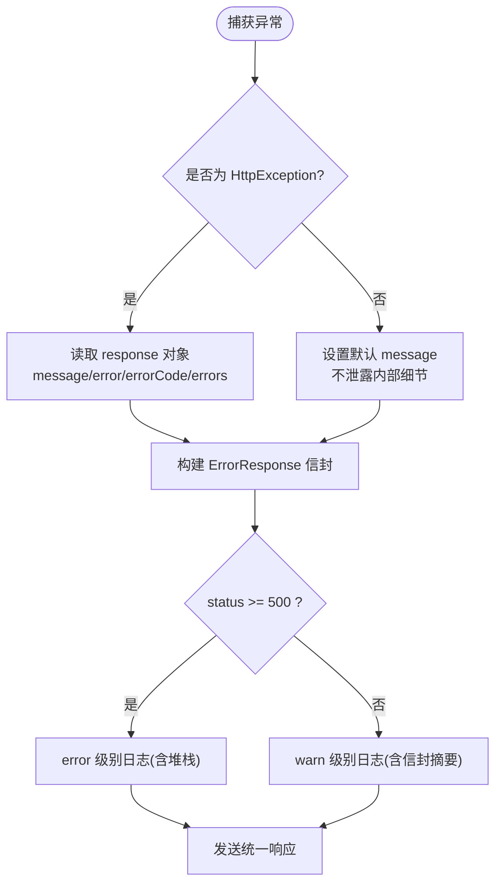
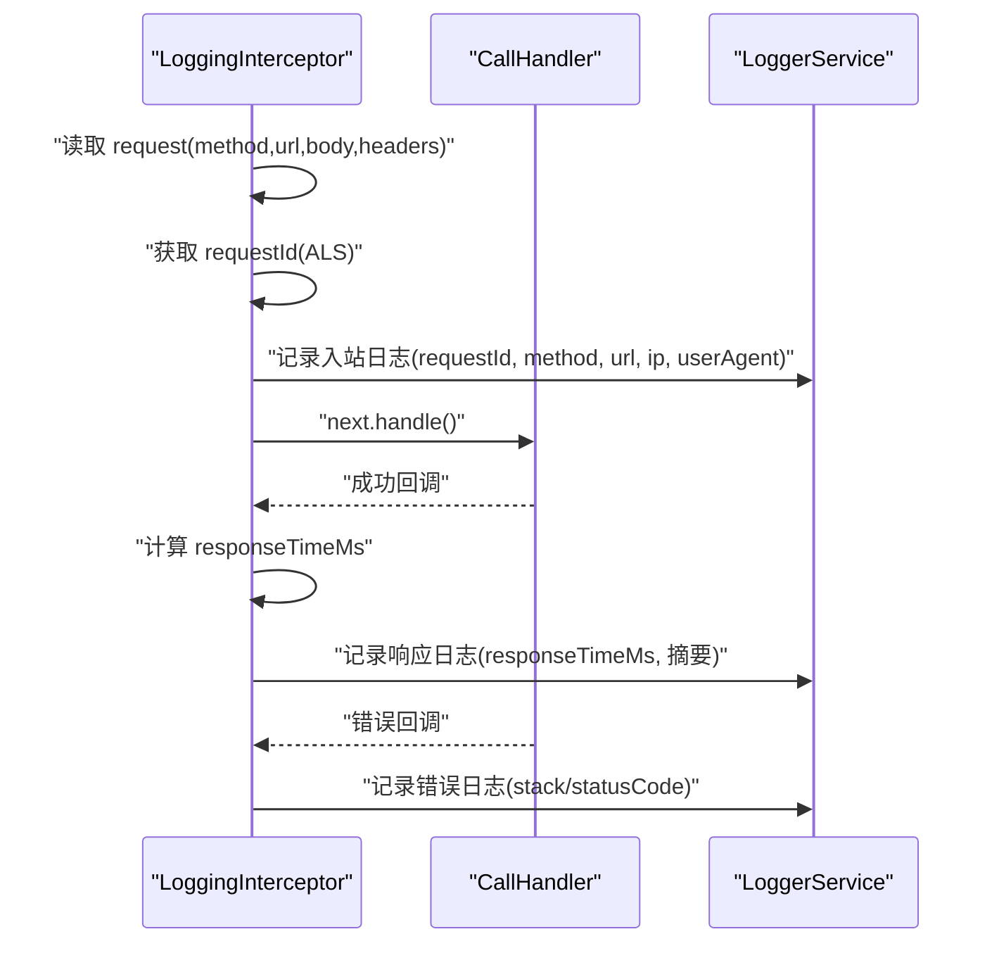
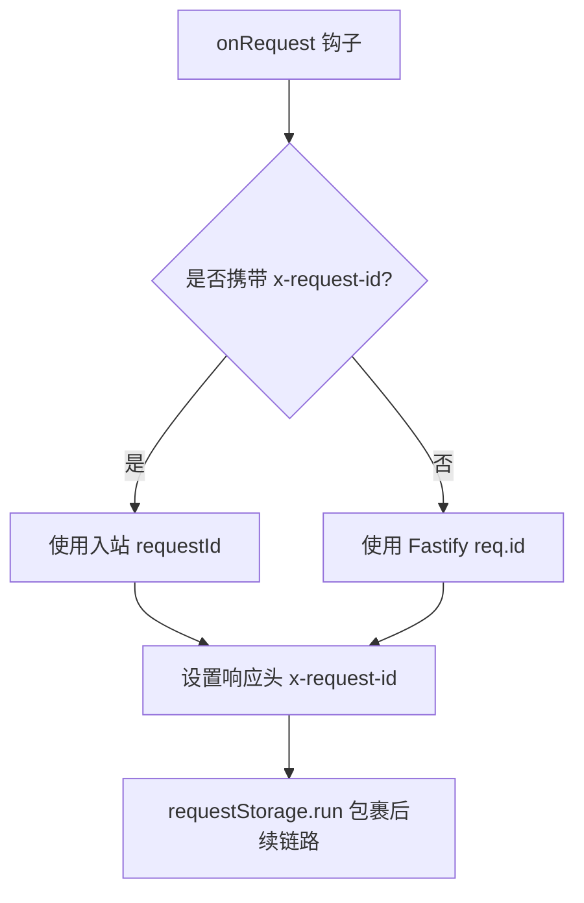
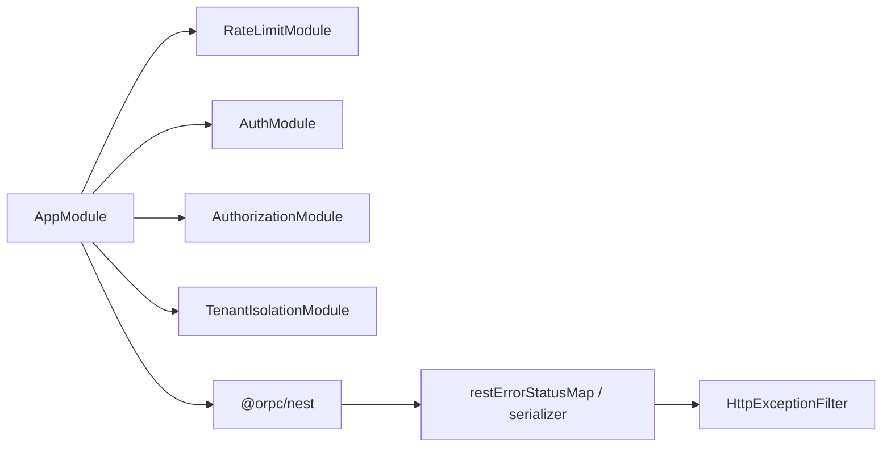

# API 网关与中间件

<cite>
**本文引用的文件**   
- [apps/api/src/main.ts](file://apps/api/src/main.ts)
- [apps/api/src/app.module.ts](file://apps/api/src/app.module.ts)
- [apps/api/src/common/validation-pipe.ts](file://apps/api/src/common/validation-pipe.ts)
- [apps/api/src/common/filters/http-exception.filter.ts](file://apps/api/src/common/filters/http-exception.filter.ts)
- [apps/api/src/common/interceptors/logging.interceptor.ts](file://apps/api/src/common/interceptors/logging.interceptor.ts)
- [apps/api/src/common/request-id.hook.ts](file://apps/api/src/common/request-id.hook.ts)
- [apps/api/src/common/errors/error-envelope-fields.ts](file://apps/api/src/common/errors/error-envelope-fields.ts)
- [apps/api/src/common/errors/standard-schema-validation.exception.ts](file://apps/api/src/common/errors/standard-schema-validation.exception.ts)
- [apps/api/src/config/envs/default.ts](file://apps/api/src/config/envs/default.ts)
</cite>

## 目录
1. [简介](#简介)
2. [项目结构](#项目结构)
3. [核心组件](#核心组件)
4. [架构总览](#架构总览)
5. [详细组件分析](#详细组件分析)
6. [依赖关系分析](#依赖关系分析)
7. [性能考量](#性能考量)
8. [故障排查指南](#故障排查指南)
9. [结论](#结论)
10. [附录：自定义中间件开发指南与安全配置清单](#附录自定义中间件开发指南与安全配置清单)

## 简介
本文件聚焦 Fastify + NestJS 的 API 网关与中间件体系，覆盖以下主题：
- Fastify 服务器启动配置与全局前置钩子
- 全局中间件注册顺序与职责边界
- 请求管道 ValidationPipe（参数校验、类型转换、数据清洗）
- HTTP 异常过滤器统一错误响应格式
- 日志拦截器的请求追踪、性能监控与调试信息
- 自定义中间件最佳实践
- 安全相关中间件配置（CORS、压缩、安全头、上传限制等）

## 项目结构
API 网关位于 apps/api 应用入口 main.ts，通过 NestFactory 创建基于 FastifyAdapter 的应用实例，并集中注册全局管道、Fastify 插件、CORS、Helmet、压缩、Multipart 等能力。模块装配在 AppModule 中完成，限流、认证、授权、租户隔离等模块按严格顺序导入，确保 APP_GUARD 执行序符合“限流 → 会话 → 租户”的安全策略。

图示来源
- [apps/api/src/main.ts:20-151](file://apps/api/src/main.ts#L20-L151)
- [apps/api/src/app.module.ts:33-73](file://apps/api/src/app.module.ts#L33-L73)
- [apps/api/src/common/validation-pipe.ts:19-25](file://apps/api/src/common/validation-pipe.ts#L19-L25)
- [apps/api/src/common/request-id.hook.ts:11-16](file://apps/api/src/common/request-id.hook.ts#L11-L16)
- [apps/api/src/common/filters/http-exception.filter.ts:22-96](file://apps/api/src/common/filters/http-exception.filter.ts#L22-L96)
- [apps/api/src/common/interceptors/logging.interceptor.ts:13-77](file://apps/api/src/common/interceptors/logging.interceptor.ts#L13-L77)
- [apps/api/src/config/envs/default.ts:4-54](file://apps/api/src/config/envs/default.ts#L4-L54)

章节来源
- [apps/api/src/main.ts:20-151](file://apps/api/src/main.ts#L20-L151)
- [apps/api/src/app.module.ts:33-73](file://apps/api/src/app.module.ts#L33-L73)

## 核心组件
- Fastify 启动与全局装配：设置全局前缀、版本化、全局管道、Fastify 钩子与插件、Swagger 文档、监听端口。
- 全局校验管：基于官方 StandardSchemaValidationPipe，开启 transform，统一抛出自定义校验异常，交由专用过滤器渲染。
- HTTP 异常过滤器：统一错误信封，包含 statusCode、message、error、errorCode、errors、timestamp、path、requestId。
- 日志拦截器：记录入站请求、出站响应耗时、错误堆栈，并通过 ALS 注入 requestId。
- 请求关联 ID：Fastify onRequest 钩子生成或透传 x-request-id，写入响应头，并通过 requestStorage.run 包裹后续链路。
- 安全与传输：启用 compression、helmet、cors（白名单函数式回显）、multipart（文件大小限制）。

章节来源
- [apps/api/src/main.ts:74-122](file://apps/api/src/main.ts#L74-L122)
- [apps/api/src/common/validation-pipe.ts:7-25](file://apps/api/src/common/validation-pipe.ts#L7-L25)
- [apps/api/src/common/filters/http-exception.filter.ts:16-96](file://apps/api/src/common/filters/http-exception.filter.ts#L16-L96)
- [apps/api/src/common/interceptors/logging.interceptor.ts:13-77](file://apps/api/src/common/interceptors/logging.interceptor.ts#L13-L77)
- [apps/api/src/common/request-id.hook.ts:4-16](file://apps/api/src/common/request-id.hook.ts#L4-L16)

## 架构总览
下图展示一次典型请求从进入 Fastify 到返回响应的关键路径，包括钩子、中间件、管道、控制器、拦截器与过滤器的协作关系。

图示来源
- [apps/api/src/main.ts:88-122](file://apps/api/src/main.ts#L88-L122)
- [apps/api/src/common/request-id.hook.ts:11-16](file://apps/api/src/common/request-id.hook.ts#L11-L16)
- [apps/api/src/common/validation-pipe.ts:19-25](file://apps/api/src/common/validation-pipe.ts#L19-L25)
- [apps/api/src/common/interceptors/logging.interceptor.ts:17-66](file://apps/api/src/common/interceptors/logging.interceptor.ts#L17-L66)
- [apps/api/src/common/filters/http-exception.filter.ts:26-96](file://apps/api/src/common/filters/http-exception.filter.ts#L26-L96)

## 详细组件分析

### Fastify 启动与全局中间件注册
- 使用 FastifyAdapter 并传入 trustProxy 配置，使反向代理后的真实 IP 可被正确解析，配合限流墙按真实 IP 分桶。
- 设置全局前缀与 API 版本化；注册全局校验管；挂载 requestIdHook 于 onRequest，保证所有路由（含健康检查旁路）具备一致关联 ID。
- 依次注册 compression、helmet、cors、multipart；CORS origin 采用函数式白名单校验，并在 credentials:true 时回显具体 Origin，同时暴露 x-request-id 响应头。
- 可选启用 Swagger/OpenAPI，提供 JSON/YAML 文档端点。

图示来源
- [apps/api/src/main.ts:26-38](file://apps/api/src/main.ts#L26-L38)
- [apps/api/src/main.ts:74-122](file://apps/api/src/main.ts#L74-L122)
- [apps/api/src/main.ts:124-151](file://apps/api/src/main.ts#L124-L151)

章节来源
- [apps/api/src/main.ts:26-38](file://apps/api/src/main.ts#L26-L38)
- [apps/api/src/main.ts:74-122](file://apps/api/src/main.ts#L74-L122)
- [apps/api/src/main.ts:124-151](file://apps/api/src/main.ts#L124-L151)

### 全局中间件注册顺序与职责
- 顺序：Nest 全局管道 → Fastify onRequest 钩子 → Fastify 插件（compression/helmet/cors/multipart）→ 模块级守卫/拦截器/管道 → 控制器。
- 职责边界：
  - 全局管道：参数校验与类型转换（transform），不直接产出 HTTP 响应。
  - onRequest 钩子：关联 ID 生成/透传、ALS 上下文注入、响应头回写。
  - 插件层：传输压缩、安全头、跨域、文件上传限制。
  - 守卫层：限流、认证、授权、租户隔离（由 AppModule 导入顺序决定执行序）。
  - 拦截器层：日志采集、性能计时、调试信息收集。
  - 过滤器层：统一错误信封、状态码映射、敏感信息脱敏。

章节来源
- [apps/api/src/app.module.ts:8-10](file://apps/api/src/app.module.ts#L8-L10)
- [apps/api/src/app.module.ts:33-73](file://apps/api/src/app.module.ts#L33-L73)
- [apps/api/src/main.ts:88-122](file://apps/api/src/main.ts#L88-L122)

### 请求管道 ValidationPipe 工作原理
- 实现：基于官方 StandardSchemaValidationPipe，开启 transform，将不符合 schema 的参数转换为标准校验异常。
- 行为：
  - 带 schema 的参数：走官方校验，支持 z.coerce 等类型转换，失败抛出自定义异常。
  - 不带 schema 的参数：原样返回，不做额外转换。
- 异常处理：自定义异常 StandardSchemaValidationException 携带 issues，交由专用过滤器渲染为统一 ErrorResponse，保持与旧 class-validator 行为一致。

图示来源
- [apps/api/src/common/validation-pipe.ts:19-25](file://apps/api/src/common/validation-pipe.ts#L19-L25)
- [apps/api/src/common/errors/standard-schema-validation.exception.ts:20-30](file://apps/api/src/common/errors/standard-schema-validation.exception.ts#L20-L30)
- [apps/api/src/common/filters/http-exception.filter.ts:26-96](file://apps/api/src/common/filters/http-exception.filter.ts#L26-L96)

章节来源
- [apps/api/src/common/validation-pipe.ts:7-25](file://apps/api/src/common/validation-pipe.ts#L7-L25)
- [apps/api/src/common/errors/standard-schema-validation.exception.ts:1-42](file://apps/api/src/common/errors/standard-schema-validation.exception.ts#L1-L42)

### HTTP 异常过滤器与统一错误响应
- 目标：将所有异常统一为 ErrorResponse 信封，包含 statusCode、message、error、errorCode、errors、timestamp、path、requestId。
- 行为：
  - HttpException：优先读取 response 对象中的 message/error/errorCode/errors；兜底使用 HTTP reason phrase。
  - 非 HttpException：message 固定为内部错误提示，避免泄露 SQL/连接信息等敏感内容；原始 Error.stack 仅记录服务端日志。
  - 5xx：记录 error 级别日志；4xx：记录 warn 级别日志。
  - 关联字段：通过 errorEnvelopeFields 单源注入 timestamp/path/requestId。

图示来源
- [apps/api/src/common/filters/http-exception.filter.ts:26-96](file://apps/api/src/common/filters/http-exception.filter.ts#L26-L96)
- [apps/api/src/common/errors/error-envelope-fields.ts:18-28](file://apps/api/src/common/errors/error-envelope-fields.ts#L18-L28)

章节来源
- [apps/api/src/common/filters/http-exception.filter.ts:16-96](file://apps/api/src/common/filters/http-exception.filter.ts#L16-L96)
- [apps/api/src/common/errors/error-envelope-fields.ts:1-29](file://apps/api/src/common/errors/error-envelope-fields.ts#L1-L29)

### 日志拦截器：请求追踪、性能监控与调试信息
- 功能：
  - 入站日志：method/url/ip/userAgent/bodySummary，附带结构化字段（requestId、method、url、ip、userAgent）。
  - 出站日志：计算 responseTimeMs，截断响应体摘要用于快速定位。
  - 错误日志：记录错误堆栈或序列化对象，附带 statusCode（若存在）。
  - 关联 ID：从 ALS 读取 currentRequestId()，与 onRequest 钩子写入的 x-request-id 保持一致。
- 客户端 IP：优先 x-forwarded-for，其次 connection/socket remoteAddress。

图示来源
- [apps/api/src/common/interceptors/logging.interceptor.ts:17-66](file://apps/api/src/common/interceptors/logging.interceptor.ts#L17-L66)
- [apps/api/src/common/request-id.hook.ts:11-16](file://apps/api/src/common/request-id.hook.ts#L11-L16)

章节来源
- [apps/api/src/common/interceptors/logging.interceptor.ts:13-77](file://apps/api/src/common/interceptors/logging.interceptor.ts#L13-L77)
- [apps/api/src/common/request-id.hook.ts:4-16](file://apps/api/src/common/request-id.hook.ts#L4-L16)

### 请求关联 ID 机制
- 触发点：Fastify onRequest 钩子。
- 逻辑：
  - 优先透传入站 x-request-id；否则使用 Fastify 原生 req.id。
  - 回写响应头 x-request-id。
  - 通过 requestStorage.run 包裹后续全链，供拦截器、过滤器、审计等组件读取。

图示来源
- [apps/api/src/common/request-id.hook.ts:11-16](file://apps/api/src/common/request-id.hook.ts#L11-L16)

章节来源
- [apps/api/src/common/request-id.hook.ts:4-16](file://apps/api/src/common/request-id.hook.ts#L4-L16)

## 依赖关系分析
- 模块装配顺序对守卫执行序至关重要：RateLimitModule 必须排在 AuthModule 之前，以实现“限流(最廉价拒绝) → 会话墙 401 → 租户墙 403”。
- ORPC 集成通过 customErrorResponseBodyEncoder 与 errorStatusMap 将 oRPC 错误映射为 HttpExceptionFilter 可识别的响应体形状，再由过滤器恢复状态码与错误信封。

图示来源
- [apps/api/src/app.module.ts:8-10](file://apps/api/src/app.module.ts#L8-L10)
- [apps/api/src/app.module.ts:33-73](file://apps/api/src/app.module.ts#L33-L73)

章节来源
- [apps/api/src/app.module.ts:8-10](file://apps/api/src/app.module.ts#L8-L10)
- [apps/api/src/app.module.ts:33-73](file://apps/api/src/app.module.ts#L33-L73)

## 性能考量
- 压缩：启用 @fastify/compression 减少响应体积，注意大响应体与 CPU 开销的权衡。
- 安全头：@fastify/helmet 自动添加安全相关响应头，建议保持启用。
- CORS：函数式 origin 校验避免广播 *，在 credentials:true 时必须回显具体 Origin，减少浏览器预检失败。
- 上传限制：multipart 限制 fileSize 与 files 数量，防止恶意大文件攻击。
- 校验管道：transform=true 带来类型转换成本，建议在 schema 中使用 z.coerce 精确控制转换范围，避免过度转换。
- 日志：避免在高频路径打印完整 body，已采用摘要与条件拼接；生产环境建议采样或降低日志级别。

[本节为通用指导，无需列出具体文件来源]

## 故障排查指南
- 校验失败但无结构化错误：确认控制器装饰器使用了 @Body/@Query({ schema }) 等带 schema 的形式；未带 schema 的参数不会进行转换或校验。
- 校验异常未返回统一信封：检查 StandardSchemaValidationException 是否被专用过滤器捕获；确保未在其它过滤器中提前消费该异常。
- 5xx 错误消息泄露：确认异常为非 HttpException 分支，message 应固定为内部错误提示；原始堆栈仅记录在服务端日志。
- 关联 ID 缺失：检查 onRequest 钩子是否注册；确认 x-request-id 是否正确透传；验证拦截器/过滤器是否从 ALS 读取 currentRequestId()。
- CORS 凭证失败：确认 ALLOWED_ORIGINS 配置为具体 origin，且函数式 origin 校验返回 true；检查响应头是否回显具体 Origin 而非 *。
- 上传失败：检查 multipart 的 limits.fileSize 与 allowedMimeTypes 配置是否与业务需求匹配。

章节来源
- [apps/api/src/common/validation-pipe.ts:7-25](file://apps/api/src/common/validation-pipe.ts#L7-L25)
- [apps/api/src/common/filters/http-exception.filter.ts:67-96](file://apps/api/src/common/filters/http-exception.filter.ts#L67-L96)
- [apps/api/src/common/request-id.hook.ts:11-16](file://apps/api/src/common/request-id.hook.ts#L11-L16)
- [apps/api/src/config/envs/default.ts:27-54](file://apps/api/src/config/envs/default.ts#L27-L54)

## 结论
本项目以 Fastify 为底层运行时，结合 NestJS 的模块化与装饰器生态，构建了高内聚、低耦合的 API 网关与中间件体系。通过统一的校验管道、异常过滤器与日志拦截器，实现了参数校验、错误归一与可观测性；借助 onRequest 钩子与 ALS 上下文，保证了全链路的请求关联与可追踪性。安全层面通过 Helmet、CORS 白名单与上传限制形成纵深防御。模块导入顺序与守卫执行序的设计确保了限流、认证与授权的优先级与一致性。

[本节为总结性内容，无需列出具体文件来源]

## 附录：自定义中间件开发指南与安全配置清单

### 自定义中间件开发指南
- 选择合适层次：
  - 全局横切关注点（如限流、鉴权、租户隔离）优先使用 Guard/Interceptor/Pipe。
  - 需要访问底层 Fastify 请求/响应对象时使用 Fastify 插件或 onRequest 钩子。
- 保持单一职责：每个中间件只做一件事，组合多个关注点。
- 可测试性：将钩子与工具函数独立成文件，便于单元测试直调。
- 可观测性：在关键路径记录 requestId、method、url、responseTimeMs 等结构化字段。
- 安全性：避免在日志中输出敏感信息（密码、令牌、完整 body），必要时做脱敏或摘要。

[本节为通用指导，无需列出具体文件来源]

### 安全相关中间件配置清单
- CORS：
  - 启用 credentials:true 时，origin 必须为具体值或 *；函数式校验需回显具体 Origin。
  - 暴露 x-request-id 以便前端可读。
- Helmet：
  - 启用默认安全头策略，避免 XSS、点击劫持等风险。
- 压缩：
  - 根据业务流量与 CPU 资源评估是否启用。
- 上传限制：
  - 限制 fileSize 与 files 数量，避免资源耗尽。
- 信任代理：
  - 配置 AUTH_TRUSTED_PROXIES，确保真实 IP 可被正确解析，配合限流墙防误杀。

章节来源
- [apps/api/src/main.ts:94-122](file://apps/api/src/main.ts#L94-L122)
- [apps/api/src/config/envs/default.ts:27-54](file://apps/api/src/config/envs/default.ts#L27-L54)