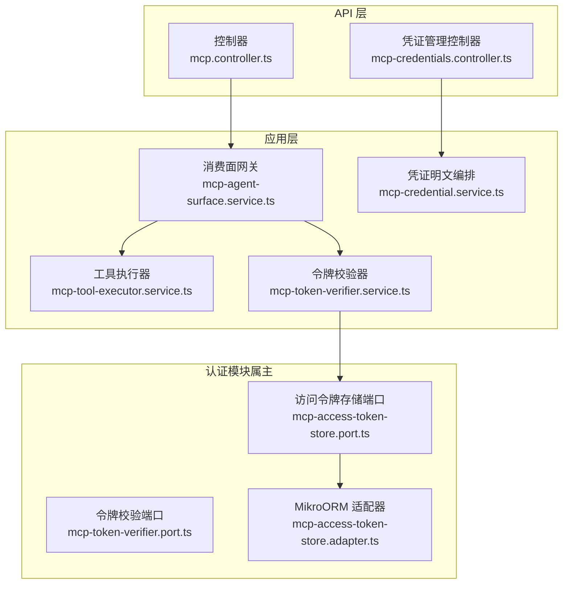
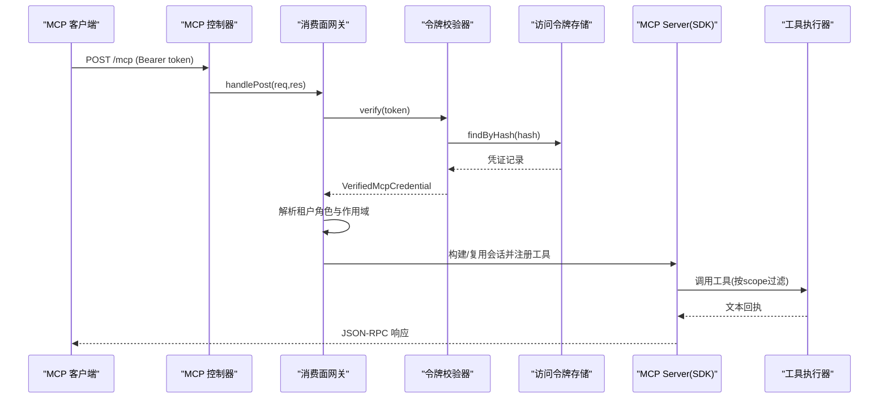
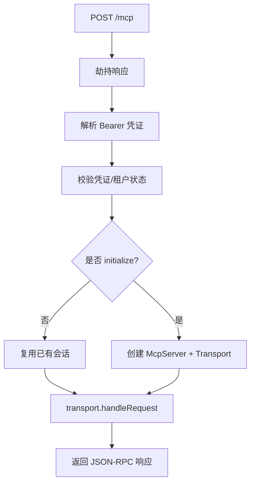
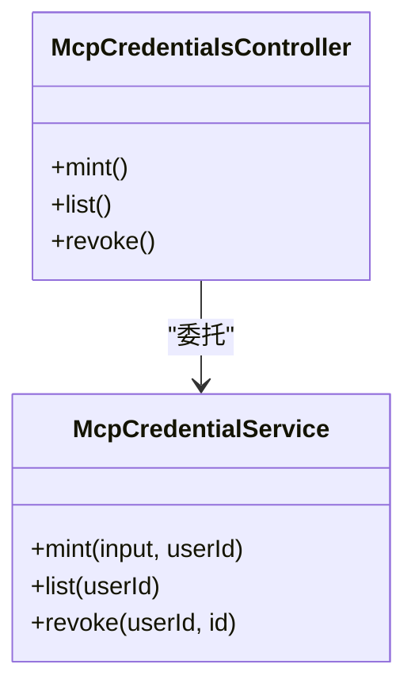
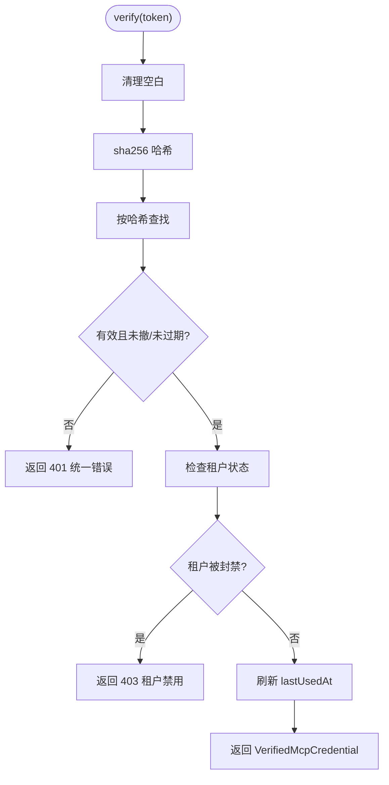
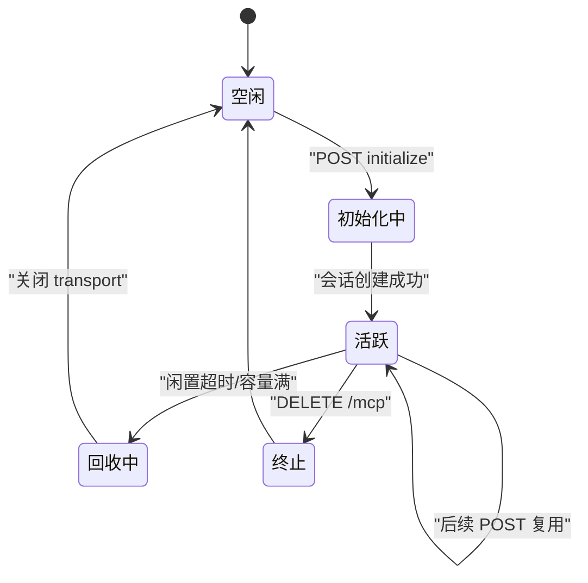
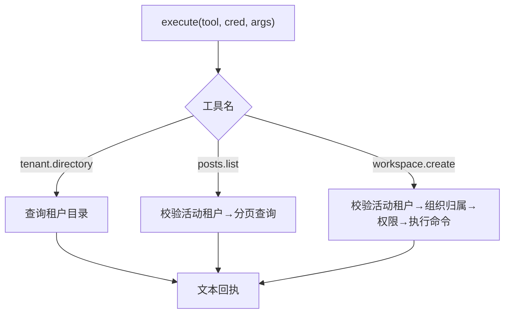
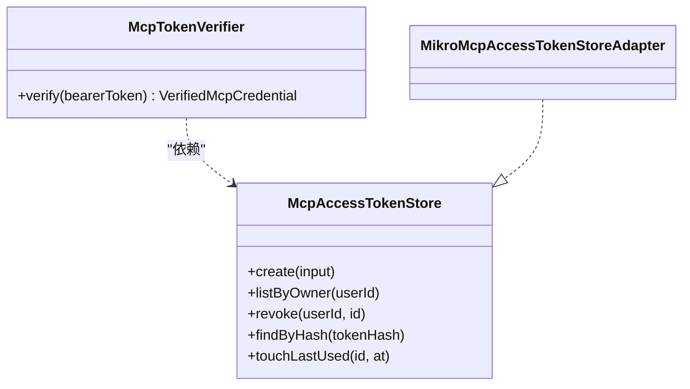
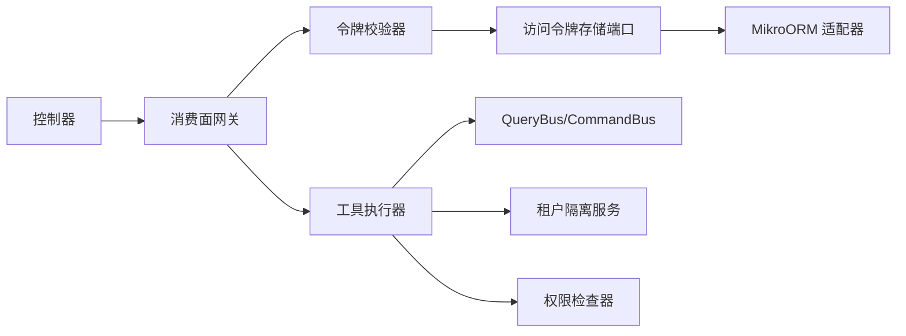

# MCP 工具 API

<cite>
**本文引用的文件**   
- [mcp.controller.ts](file://apps/api/src/features/mcp/api/mcp.controller.ts)
- [mcp-credentials.controller.ts](file://apps/api/src/features/mcp/api/mcp-credentials.controller.ts)
- [mcp-agent-surface.service.ts](file://apps/api/src/features/mcp/application/mcp-agent-surface.service.ts)
- [mcp-tool-executor.service.ts](file://apps/api/src/features/mcp/application/mcp-tool-executor.service.ts)
- [mcp-token-verifier.service.ts](file://apps/api/src/features/mcp/application/mcp-token-verifier.service.ts)
- [mcp-credential.service.ts](file://apps/api/src/features/mcp/application/mcp-credential.service.ts)
- [mcp-token-verifier.port.ts](file://apps/api/src/modules/auth/application/ports/mcp-token-verifier.port.ts)
- [mcp-access-token-store.port.ts](file://apps/api/src/modules/auth/application/ports/mcp-access-token-store.port.ts)
- [mcp-access-token-store.adapter.ts](file://apps/api/src/modules/auth/infrastructure/mcp-access-token-store.adapter.ts)
</cite>

## 目录
1. [简介](#简介)
2. [项目结构](#项目结构)
3. [核心组件](#核心组件)
4. [架构总览](#架构总览)
5. [详细组件分析](#详细组件分析)
6. [依赖关系分析](#依赖关系分析)
7. [性能与容量特性](#性能与容量特性)
8. [安全与沙箱机制](#安全与沙箱机制)
9. [运维：调试、日志与监控](#运维调试日志与监控)
10. [客户端集成指南与 SDK 使用说明](#客户端集成指南与-sdk-使用说明)
11. [故障排查](#故障排查)
12. [结论](#结论)

## 简介
本文件面向 Model Context Protocol（MCP）工具接口的实现与使用，覆盖协议消费面、工具执行引擎、凭证管理、鉴权与隔离、会话生命周期、错误与日志、以及客户端集成要点。该实现基于 NestJS + Fastify，通过 MCP SDK 的 Streamable HTTP 传输承载 JSON-RPC 帧，并在服务内部完成凭证校验、租户作用域绑定、工具发现与注册、参数校验、权限判定与结果序列化。

## 项目结构
MCP 能力位于 `features/mcp` 下，分为 API 层与应用层；凭证持久化端口与实现位于 `modules/auth`。

**图示来源**
- [mcp.controller.ts:1-44](file://apps/api/src/features/mcp/api/mcp.controller.ts#L1-L44)
- [mcp-credentials.controller.ts:1-99](file://apps/api/src/features/mcp/api/mcp-credentials.controller.ts#L1-L99)
- [mcp-agent-surface.service.ts:1-384](file://apps/api/src/features/mcp/application/mcp-agent-surface.service.ts#L1-L384)
- [mcp-tool-executor.service.ts:1-167](file://apps/api/src/features/mcp/application/mcp-tool-executor.service.ts#L1-L167)
- [mcp-token-verifier.service.ts:1-81](file://apps/api/src/features/mcp/application/mcp-token-verifier.service.ts#L1-L81)
- [mcp-credential.service.ts:1-98](file://apps/api/src/features/mcp/application/mcp-credential.service.ts#L1-L98)
- [mcp-token-verifier.port.ts:1-42](file://apps/api/src/modules/auth/application/ports/mcp-token-verifier.port.ts#L1-L42)
- [mcp-access-token-store.port.ts:1-78](file://apps/api/src/modules/auth/application/ports/mcp-access-token-store.port.ts#L1-L78)
- [mcp-access-token-store.adapter.ts:1-102](file://apps/api/src/modules/auth/infrastructure/mcp-access-token-store.adapter.ts#L1-L102)

**章节来源**
- [mcp.controller.ts:1-44](file://apps/api/src/features/mcp/api/mcp.controller.ts#L1-L44)
- [mcp-credentials.controller.ts:1-99](file://apps/api/src/features/mcp/api/mcp-credentials.controller.ts#L1-L99)
- [mcp-agent-surface.service.ts:1-120](file://apps/api/src/features/mcp/application/mcp-agent-surface.service.ts#L1-L120)

## 核心组件
- 消费面控制器：暴露 `/mcp` 的 POST/DELETE 端点，负责劫持响应并委托给消费面网关。
- 凭证管理控制器：暴露 `/api/v1/mcp/credentials` 的铸造、列表、撤销接口，受会话与租户隔离守卫保护。
- 消费面网关：解析 Bearer 凭证、校验、解析租户角色与作用域、建立或复用 MCP 会话、按 scope 注册工具、调度执行。
- 工具执行器：将 MCP 工具名映射到既有 CQRS 查询/命令，做参数收敛、租属校验与权限检查，返回文本回执。
- 令牌校验器：对 bearer token 进行哈希查找、过期/撤销/封禁判断，成功时刷 lastUsedAt。
- 凭证明文编排：生成明文 token、计算哈希、设置 TTL、维护属主与可见字段视图。
- 认证端口与实现：定义令牌校验与访问令牌存储的接口，并由 MikroORM 适配器落地。

**章节来源**
- [mcp.controller.ts:1-44](file://apps/api/src/features/mcp/api/mcp.controller.ts#L1-L44)
- [mcp-credentials.controller.ts:1-99](file://apps/api/src/features/mcp/api/mcp-credentials.controller.ts#L1-L99)
- [mcp-agent-surface.service.ts:66-120](file://apps/api/src/features/mcp/application/mcp-agent-surface.service.ts#L66-L120)
- [mcp-tool-executor.service.ts:34-167](file://apps/api/src/features/mcp/application/mcp-tool-executor.service.ts#L34-L167)
- [mcp-token-verifier.service.ts:14-81](file://apps/api/src/features/mcp/application/mcp-token-verifier.service.ts#L14-L81)
- [mcp-credential.service.ts:14-98](file://apps/api/src/features/mcp/application/mcp-credential.service.ts#L14-L98)
- [mcp-token-verifier.port.ts:1-42](file://apps/api/src/modules/auth/application/ports/mcp-token-verifier.port.ts#L1-L42)
- [mcp-access-token-store.port.ts:1-78](file://apps/api/src/modules/auth/application/ports/mcp-access-token-store.port.ts#L1-L78)
- [mcp-access-token-store.adapter.ts:1-102](file://apps/api/src/modules/auth/infrastructure/mcp-access-token-store.adapter.ts#L1-L102)

## 架构总览
MCP 消费面采用“薄控制器 + 厚服务”的分层：控制器仅负责路由与劫持，业务逻辑集中在服务层。凭证管理走 REST 接口，由会话用户驱动；MCP 消费面走 Bearer 服务凭证，无浏览器会话。

**图示来源**
- [mcp.controller.ts:24-42](file://apps/api/src/features/mcp/api/mcp.controller.ts#L24-L42)
- [mcp-agent-surface.service.ts:120-235](file://apps/api/src/features/mcp/application/mcp-agent-surface.service.ts#L120-L235)
- [mcp-token-verifier.service.ts:40-67](file://apps/api/src/features/mcp/application/mcp-token-verifier.service.ts#L40-L67)
- [mcp-access-token-store.adapter.ts:76-93](file://apps/api/src/modules/auth/infrastructure/mcp-access-token-store.adapter.ts#L76-L93)
- [mcp-tool-executor.service.ts:67-127](file://apps/api/src/features/mcp/application/mcp-tool-executor.service.ts#L67-L127)

## 详细组件分析

### 消费面控制器与端点
- 暴露 POST `/mcp` 与 DELETE `/mcp`，绕过全局信封拦截器，直接接管响应流。
- 所有请求均委托给 `McpAgentSurfaceService`，在内部完成鉴权、作用域绑定与会话路由。

**图示来源**
- [mcp.controller.ts:24-42](file://apps/api/src/features/mcp/api/mcp.controller.ts#L24-L42)
- [mcp-agent-surface.service.ts:120-235](file://apps/api/src/features/mcp/application/mcp-agent-surface.service.ts#L120-L235)

**章节来源**
- [mcp.controller.ts:1-44](file://apps/api/src/features/mcp/api/mcp.controller.ts#L1-L44)
- [mcp-agent-surface.service.ts:120-235](file://apps/api/src/features/mcp/application/mcp-agent-surface.service.ts#L120-L235)

### 凭证管理控制器
- 路径：`/api/v1/mcp/credentials`
- 能力：
  - 铸造：一次性回显明文 token，随后仅保留哈希前缀等不可逆信息。
  - 列表：返回当前用户的活动凭证清单（不含可复原明文字段）。
  - 撤销：幂等，不存在即 404，不泄露存在性。
- 安全：受全局 SessionGuard 与租户隔离守卫保护，属主为当前会话用户。

**图示来源**
- [mcp-credentials.controller.ts:50-98](file://apps/api/src/features/mcp/api/mcp-credentials.controller.ts#L50-L98)
- [mcp-credential.service.ts:32-69](file://apps/api/src/features/mcp/application/mcp-credential.service.ts#L32-L69)

**章节来源**
- [mcp-credentials.controller.ts:1-99](file://apps/api/src/features/mcp/api/mcp-credentials.controller.ts#L1-L99)
- [mcp-credential.service.ts:14-98](file://apps/api/src/features/mcp/application/mcp-credential.service.ts#L14-L98)

### 令牌校验器（消费面入口）
- 职责：将 Bearer token 转换为可信的 `VerifiedMcpCredential`。
- 策略：
  - 不存在/已撤销/已过期 → 统一 401，防探测。
  - 租户被封禁 → 403，联动租户状态服务。
  - 成功后窄写 `lastUsedAt`，失败不阻断主流程。
- 成本：每次验证约 2 次 DB 往返（读 + 窄写），换取撤销/封禁即时生效。

**图示来源**
- [mcp-token-verifier.service.ts:40-67](file://apps/api/src/features/mcp/application/mcp-token-verifier.service.ts#L40-L67)
- [mcp-access-token-store.adapter.ts:76-100](file://apps/api/src/modules/auth/infrastructure/mcp-access-token-store.adapter.ts#L76-L100)

**章节来源**
- [mcp-token-verifier.service.ts:14-81](file://apps/api/src/features/mcp/application/mcp-token-verifier.service.ts#L14-L81)
- [mcp-access-token-store.adapter.ts:76-100](file://apps/api/src/modules/auth/infrastructure/mcp-access-token-store.adapter.ts#L76-L100)

### 消费面网关与会话管理
- 会话形：基于 SDK 的 `StreamableHTTPServerTransport`，启用 JSON 响应模式。
- 鉴权链：每请求重验凭证 → 解析租户角色与作用域 → 程序化合成 ALS → 交由 transport 处理。
- 会话表：进程内 Map，LRU 逐出 + 闲置 TTL 回收，上限固定。
- 工具注册：按凭证 scopes 过滤后注册工具，空集即零工具（deny-by-default）。

**图示来源**
- [mcp-agent-surface.service.ts:94-118](file://apps/api/src/features/mcp/application/mcp-agent-surface.service.ts#L94-L118)
- [mcp-agent-surface.service.ts:170-235](file://apps/api/src/features/mcp/application/mcp-agent-surface.service.ts#L170-L235)
- [mcp-agent-surface.service.ts:293-341](file://apps/api/src/features/mcp/application/mcp-agent-surface.service.ts#L293-L341)

**章节来源**
- [mcp-agent-surface.service.ts:66-120](file://apps/api/src/features/mcp/application/mcp-agent-surface.service.ts#L66-L120)
- [mcp-agent-surface.service.ts:170-235](file://apps/api/src/features/mcp/application/mcp-agent-surface.service.ts#L170-L235)
- [mcp-agent-surface.service.ts:293-341](file://apps/api/src/features/mcp/application/mcp-agent-surface.service.ts#L293-L341)

### 工具执行器与工具集合
- 工具发现：通过 `selectToolNames(scopes)` 从注册表筛选可见工具。
- 工具实现：
  - `tenant.directory`：列出凭证持有者可见的租户及组织。
  - `posts.list`：分页列出帖子，限制页宽上限。
  - `workspace.create`：在工作区创建命令前校验组织归属与权限。
- 安全对齐：工具授权口径与对应 HTTP 面一致，避免第二套判据。

**图示来源**
- [mcp-tool-executor.service.ts:67-127](file://apps/api/src/features/mcp/application/mcp-tool-executor.service.ts#L67-L127)

**章节来源**
- [mcp-tool-executor.service.ts:34-167](file://apps/api/src/features/mcp/application/mcp-tool-executor.service.ts#L34-L167)

### 凭证存储端口与实现
- 端口：
  - `McpTokenVerifier`：Bearer token → 可信凭证视图。
  - `McpAccessTokenStore`：凭证的 create/list/revoke/findByHash/touchLastUsed。
- 实现：
  - 明文 token 永不落库，仅存 sha256 哈希与前缀。
  - 消费面查找走全租单行查（scoped:false），安全由行自带 tenantId 承担。
  - 撤销软位、幂等；列表按 createdAt 降序。

**图示来源**
- [mcp-token-verifier.port.ts:11-41](file://apps/api/src/modules/auth/application/ports/mcp-token-verifier.port.ts#L11-L41)
- [mcp-access-token-store.port.ts:8-77](file://apps/api/src/modules/auth/application/ports/mcp-access-token-store.port.ts#L8-L77)
- [mcp-access-token-store.adapter.ts:22-101](file://apps/api/src/modules/auth/infrastructure/mcp-access-token-store.adapter.ts#L22-L101)

**章节来源**
- [mcp-token-verifier.port.ts:1-42](file://apps/api/src/modules/auth/application/ports/mcp-token-verifier.port.ts#L1-L42)
- [mcp-access-token-store.port.ts:1-78](file://apps/api/src/modules/auth/application/ports/mcp-access-token-store.port.ts#L1-L78)
- [mcp-access-token-store.adapter.ts:1-102](file://apps/api/src/modules/auth/infrastructure/mcp-access-token-store.adapter.ts#L1-L102)

## 依赖关系分析
- 控制器依赖应用服务，应用服务通过 DI 注入端口与外部服务（CQRS、租户隔离、权限检查）。
- 凭证相关逻辑通过端口解耦 auth 属主侧实体与 features 编排面，避免跨层导入。
- 消费面网关依赖 MCP SDK 的 Server 与 Transport，封装会话与工具注册。

**图示来源**
- [mcp-controller.ts:1-44](file://apps/api/src/features/mcp/api/mcp.controller.ts#L1-L44)
- [mcp-agent-surface.service.ts:104-109](file://apps/api/src/features/mcp/application/mcp-agent-surface.service.ts#L104-L109)
- [mcp-tool-executor.service.ts:52-57](file://apps/api/src/features/mcp/application/mcp-tool-executor.service.ts#L52-L57)
- [mcp-access-token-store.adapter.ts:22-27](file://apps/api/src/modules/auth/infrastructure/mcp-access-token-store.adapter.ts#L22-L27)

**章节来源**
- [mcp-agent-surface.service.ts:104-109](file://apps/api/src/features/mcp/application/mcp-agent-surface.service.ts#L104-L109)
- [mcp-tool-executor.service.ts:52-57](file://apps/api/src/features/mcp/application/mcp-tool-executor.service.ts#L52-L57)

## 性能与容量特性
- 会话容量：进程内最多 128 个并发会话，超出按 LRU 逐出。
- 闲置回收：30 分钟无命中自动回收，释放 transport 资源。
- 校验成本：每次 verify 约 2 次 DB 往返（读 + 窄写），换取撤销/封禁即时生效。
- 工具分页：默认页宽 20，最大 100，防止大页拉爆。

**章节来源**
- [mcp-agent-surface.service.ts:96-99](file://apps/api/src/features/mcp/application/mcp-agent-surface.service.ts#L96-L99)
- [mcp-agent-surface.service.ts:293-341](file://apps/api/src/features/mcp/application/mcp-agent-surface.service.ts#L293-L341)
- [mcp-token-verifier.service.ts:26-29](file://apps/api/src/features/mcp/application/mcp-token-verifier.service.ts#L26-L29)
- [mcp-tool-executor.service.ts:29-32](file://apps/api/src/features/mcp/application/mcp-tool-executor.service.ts#L29-L32)

## 安全与沙箱机制
- 凭证安全：
  - 明文 token 仅一次性回显，不落库；落库为 sha256 哈希与前缀。
  - 撤销/过期/封禁统一拒绝语义，防探测。
- 访问控制：
  - 消费面每请求重验凭证，结合租户角色与作用域解析，fail-closed。
  - 工具授权口径与 HTTP 面一致，避免第二套判据。
  - 写操作（如 workspace.create）先校验组织归属，再经权限检查器。
- 租户隔离：
  - 通过 `TenantIsolationService.run(ctx)` 程序化绑定 ALS，确保工具执行在正确租户上下文中。
  - 消费面 GET 通知通道未启用，仅 POST/DELETE。
- 会话安全：
  - 会话条目绑定建会话时的租户 ID，跨租 sessionId 冒用视为无效。
  - 内存表非无界，LRU 与闲置 TTL 双重保护。

**章节来源**
- [mcp-credential.service.ts:14-49](file://apps/api/src/features/mcp/application/mcp-credential.service.ts#L14-L49)
- [mcp-token-verifier.service.ts:14-32](file://apps/api/src/features/mcp/application/mcp-token-verifier.service.ts#L14-L32)
- [mcp-agent-surface.service.ts:76-92](file://apps/api/src/features/mcp/application/mcp-agent-surface.service.ts#L76-L92)
- [mcp-tool-executor.service.ts:34-49](file://apps/api/src/features/mcp/application/mcp-tool-executor.service.ts#L34-L49)
- [mcp-access-token-store.adapter.ts:13-21](file://apps/api/src/modules/auth/infrastructure/mcp-access-token-store.adapter.ts#L13-L21)

## 运维：调试、日志与监控
- 日志位置：
  - 会话容量达到上限、逐出、关闭失败等告警。
  - 工具执行异常（非 HttpException）会记录警告。
  - 传输层异常统一捕获并记录。
- 错误体：
  - 统一补齐 timestamp/path/requestId 等信封字段，与 REST 过滤器共享。
  - verifier 的错误 message/errorCode 原样透传，不改写。
- 诊断接口：
  - 提供 `visibleTools(scopes)` 用于诊断 scope→可见工具映射。

**章节来源**
- [mcp-agent-surface.service.ts:201-220](file://apps/api/src/features/mcp/application/mcp-agent-surface.service.ts#L201-L220)
- [mcp-agent-surface.service.ts:241-254](file://apps/api/src/features/mcp/application/mcp-agent-surface.service.ts#L241-L254)
- [mcp-agent-surface.service.ts:343-382](file://apps/api/src/features/mcp/application/mcp-agent-surface.service.ts#L343-L382)
- [mcp-agent-surface.service.ts:111-118](file://apps/api/src/features/mcp/application/mcp-agent-surface.service.ts#L111-L118)

## 客户端集成指南与 SDK 使用说明
- 协议与传输：
  - 使用 MCP SDK 的 `StreamableHTTPServerTransport`，启用 JSON 响应模式。
  - 首次 POST 携带 `Authorization: Bearer <token>`，服务端返回会话 ID（若启用会话头）。
- 鉴权：
  - 所有请求均需携带有效的 MCP 服务凭证（Bearer token）。
  - 凭证有效期、撤销、封禁由服务端实时校验。
- 工具发现与调用：
  - 客户端通过 SDK 获取工具元数据（描述与 inputSchema）。
  - 调用工具时传入参数，服务端按 schema 校验并执行。
- 会话管理：
  - 首次 initialize 后，后续请求可复用会话 ID（若使用会话头）。
  - 会话闲置超时或容量满会被回收，客户端需重新初始化。
- 错误处理：
  - 统一错误体包含 statusCode/message/error/timestamp/path/requestId。
  - 工具执行失败返回 `isError=true` 与文本原因。

**章节来源**
- [mcp-agent-surface.service.ts:66-92](file://apps/api/src/features/mcp/application/mcp-agent-surface.service.ts#L66-L92)
- [mcp-agent-surface.service.ts:193-206](file://apps/api/src/features/mcp/application/mcp-agent-surface.service.ts#L193-L206)
- [mcp-agent-surface.service.ts:223-235](file://apps/api/src/features/mcp/application/mcp-agent-surface.service.ts#L223-L235)
- [mcp-agent-surface.service.ts:241-254](file://apps/api/src/features/mcp/application/mcp-agent-surface.service.ts#L241-L254)

## 故障排查
- 401 凭证无效：
  - 可能原因：token 不存在、已撤销、已过期。
  - 处理：重新铸造凭证或检查有效期。
- 403 租户禁用：
  - 可能原因：租户处于 suspend/deleted/pending_approval 状态。
  - 处理：联系平台管理员恢复租户状态。
- 404 会话不存在：
  - 可能原因：sessionId 跨租冒用、会话已回收、非 initialize 请求缺少会话头。
  - 处理：重新初始化或检查会话头。
- 工具执行失败：
  - 可能原因：参数校验失败、权限不足、组织归属不符。
  - 处理：检查 inputSchema、权限配置与组织归属。

**章节来源**
- [mcp-token-verifier.service.ts:40-79](file://apps/api/src/features/mcp/application/mcp-token-verifier.service.ts#L40-L79)
- [mcp-agent-surface.service.ts:144-168](file://apps/api/src/features/mcp/application/mcp-agent-surface.service.ts#L144-L168)
- [mcp-tool-executor.service.ts:88-127](file://apps/api/src/features/mcp/application/mcp-tool-executor.service.ts#L88-L127)

## 结论
本实现以清晰的层次与严格的鉴权隔离，提供了安全的 MCP 工具执行环境。凭证管理遵循最小暴露原则，消费面每请求重验以确保撤销/封禁即时生效。会话管理兼顾可用性与安全性，工具执行对齐既有 HTTP 面的授权口径，避免第二套判据。通过统一的错误体与日志记录，便于运维诊断与问题定位。客户端集成应严格遵循协议规范与安全要求，确保稳定可靠的工具调用体验。