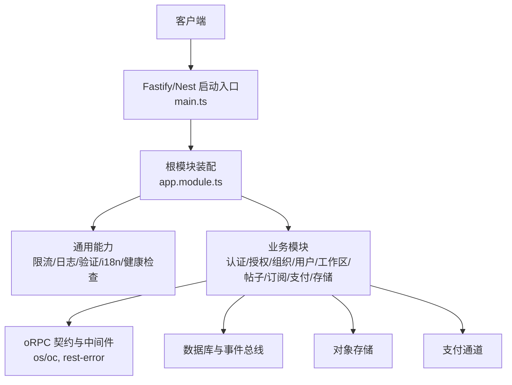
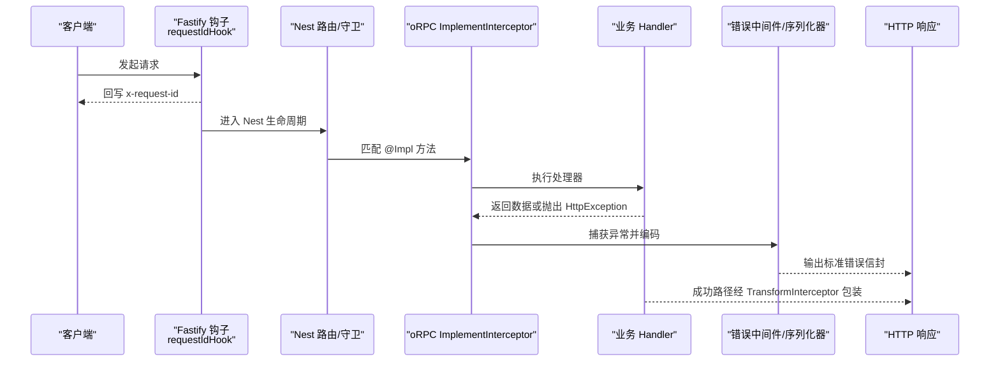
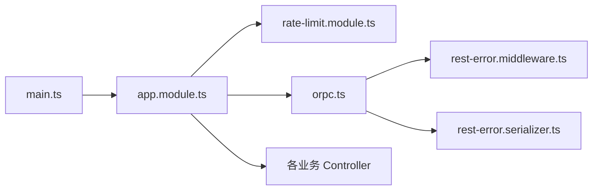
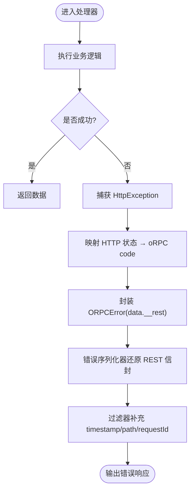

# 后端 API 文档

<cite>
**本文引用的文件**   
- [main.ts](file://apps/api/src/main.ts)
- [app.module.ts](file://apps/api/src/app.module.ts)
- [rate-limit.module.ts](file://apps/api/src/common/rate-limit.module.ts)
- [orpc.ts](file://apps/api/src/common/orpc/orpc.ts)
- [rest-error.middleware.ts](file://apps/api/src/common/orpc/rest-error.middleware.ts)
- [rest-error.serializer.ts](file://apps/api/src/common/orpc/rest-error.serializer.ts)
- [error-envelope-fields.ts](file://apps/api/src/common/errors/error-envelope-fields.ts)
- [app-router.contract.ts](file://apps/api/src/common/orpc/app-router.contract.ts)
- [openapi.yaml](file://openapi/openapi.yaml)
- [oauth-sso.controller.ts](file://apps/api/src/modules/auth/api/oauth-sso.controller.ts)
- [users.controller.ts](file://apps/api/src/modules/users/api/users.controller.ts)
- [posts.controller.ts](file://apps/api/src/modules/posts/api/posts.controller.ts)
- [workspaces.controller.ts](file://apps/api/src/modules/workspaces/api/workspaces.controller.ts)
- [storage.controller.ts](file://apps/api/src/modules/storage/api/storage.controller.ts)
- [subscriptions.controller.ts](file://apps/api/src/modules/subscriptions/api/subscriptions.controller.ts)
- [payment.controller.ts](file://apps/api/src/modules/payment/api/payment.controller.ts)
</cite>

## 目录
1. [简介](#简介)
2. [项目结构](#项目结构)
3. [核心组件](#核心组件)
4. [架构总览](#架构总览)
5. [详细组件分析](#详细组件分析)
6. [依赖关系分析](#依赖关系分析)
7. [性能与限流](#性能与限流)
8. [错误处理规范](#错误处理规范)
9. [API 版本管理与安全](#api-版本管理与安全)
10. [OpenAPI 规范生成与使用](#openapi-规范生成与使用)
11. [最佳实践与排错指南](#最佳实践与排错指南)
12. [结论](#结论)

## 简介
本文件为 SaaS 后端 RESTful API 的完整技术文档，覆盖：
- 所有业务模块的 HTTP 端点、请求/响应格式、参数校验规则
- 认证机制与会话上下文
- oRPC 契约模式与 TypeScript 类型安全的客户端生成
- 错误信封、全局过滤器与 i18n 翻译
- 版本管理、限流策略与安全配置
- OpenAPI/Swagger 文档生成与 YAML 导出

## 项目结构
应用以 NestJS + Fastify 启动，统一装配 oRPC、限流、CORS、Helmet、压缩、多部分上传、Swagger/OpenAPI。模块按领域划分（认证、授权、组织、用户、工作区、帖子、订阅、支付、存储等），并通过 `@orpc/nest` 将控制器方法暴露为 oRPC procedure，同时保留原生 HTTP 语义。

图表来源
- [main.ts:20-151](file://apps/api/src/main.ts#L20-L151)
- [app.module.ts:33-77](file://apps/api/src/app.module.ts#L33-L77)

章节来源
- [main.ts:20-151](file://apps/api/src/main.ts#L20-L151)
- [app.module.ts:33-77](file://apps/api/src/app.module.ts#L33-L77)

## 核心组件
- 启动与全局装配：统一设置全局前缀、URI 版本化、全局校验管道、关联 ID、CORS、Helmet、压缩、Multipart、Swagger/OpenAPI。
- oRPC 集成：通过 `ORPCModule.forRoot` 注入错误编码器与状态映射；中央 `os` 预挂 REST 错误中间件，保证 handler 内异常不丢失原始状态码与响应体。
- 限流墙：全局 `ThrottlerGuard`，默认 300 次/60s/IP/端点，置于 Auth/Tenant 守卫之前。
- 错误面：in-handler `HttpException` → `ORPCError` → 统一 REST 错误信封，兼容旧 REST 行为并支持 i18n。

章节来源
- [main.ts:74-148](file://apps/api/src/main.ts#L74-L148)
- [app.module.ts:33-77](file://apps/api/src/app.module.ts#L33-L77)
- [rate-limit.module.ts:6-28](file://apps/api/src/common/rate-limit.module.ts#L6-L28)
- [orpc.ts:5-17](file://apps/api/src/common/orpc/orpc.ts#L5-L17)
- [rest-error.middleware.ts:4-21](file://apps/api/src/common/orpc/rest-error.middleware.ts#L4-L21)

## 架构总览
下图展示一次典型受保护请求的生命周期：从 Fastify 钩子到 Nest 守卫链、oRPC 处理器、服务层、再到统一的错误输出。

图表来源
- [main.ts:90-93](file://apps/api/src/main.ts#L90-L93)
- [app.module.ts:33-77](file://apps/api/src/app.module.ts#L33-L77)
- [rest-error.middleware.ts:68-81](file://apps/api/src/common/orpc/rest-error.middleware.ts#L68-L81)
- [rest-error.serializer.ts:10-27](file://apps/api/src/common/orpc/rest-error.serializer.ts#L10-L27)

## 详细组件分析

### 认证与 OAuth2 SSO
- 授权端点：`GET /oauth2/authorize`（隐式流，重定向至白名单 redirect_uri）
- OIDC userinfo：`GET /oauth2/userinfo`（Bearer 访问令牌，返回裸 JSON）
- 会话要求：除 `/userinfo` 外均需已登录会话；SSO 豁免租户隔离。

请求/响应要点
- authorize：查询参数经 zod 契约校验；未登录 401；非可用 Odoo 环境 403；成功 302 重定向。
- userinfo：需 Authorization: Bearer；aud 校验失败 401；邮箱未验证 403；成功返回 { sub, email, name }。

章节来源
- [oauth-sso.controller.ts:10-23](file://apps/api/src/modules/auth/api/oauth-sso.controller.ts#L10-L23)
- [oauth-sso.controller.ts:29-62](file://apps/api/src/modules/auth/api/oauth-sso.controller.ts#L29-L62)
- [oauth-sso.controller.ts:64-87](file://apps/api/src/modules/auth/api/oauth-sso.controller.ts#L64-L87)

### 用户自助接口（PIPL）
- 导出个人数据：`GET /users/me/data-export`
- 硬删除当前用户：`DELETE /users/me`
- 均需要会话；类级豁免租户隔离。

请求/响应要点
- 导出：返回聚合的个人数据视图（用户、账户、会话、同意记录）。
- 删除：无响应体，204。

章节来源
- [users.controller.ts:19-33](file://apps/api/src/modules/users/api/users.controller.ts#L19-L33)
- [users.controller.ts:46-76](file://apps/api/src/modules/users/api/users.controller.ts#L46-L76)

### 帖子资源（租户级）
- 列表：`GET /posts`（游标分页）
- 创建：`POST /posts`
- 鉴权：类级租户隔离守卫；读写走租户仓储，handler 不直接命名租户 ID。

请求/响应要点
- 列表：支持 limit/cursor/organizationId；返回 items、hasMore、nextCursor。
- 创建：title 必填，content/published 可选；返回帖子视图。

章节来源
- [posts.controller.ts:29-46](file://apps/api/src/modules/posts/api/posts.controller.ts#L29-L46)
- [posts.controller.ts:55-89](file://apps/api/src/modules/posts/api/posts.controller.ts#L55-L89)

### 工作区 CRUD（租户级）
- 列表：`GET /workspaces`（offset 分页）
- 创建：`POST /workspaces`
- 更新：`PATCH /workspaces/:id`
- 删除：`DELETE /workspaces/:id`
- 鉴权：租户隔离 + 授权守卫；权限由角色→能力映射统一管理。

请求/响应要点
- 列表：limit/offset；返回 items、total、limit、offset。
- 创建：name/slug 必填，slug 正则约束；返回工作区视图。
- 更新/删除：body 含 id；未命中抛 404（带 errorCode）。

章节来源
- [workspaces.controller.ts:34-55](file://apps/api/src/modules/workspaces/api/workspaces.controller.ts#L34-L55)
- [workspaces.controller.ts:71-150](file://apps/api/src/modules/workspaces/api/workspaces.controller.ts#L71-L150)

### 存储接口
- 单文件上传：`POST /storage/upload`（multipart/form-data）
- 删除文件：`DELETE /storage/:key`
- 获取签名 URL：`GET /storage/:key/url`
- 鉴权：类级豁免租户隔离；上传仍受会话墙保护。

请求/响应要点
- 上传：必须 multipart；缺失文件或上传失败返回 400（errorCode 区分原因）。
- 删除：返回 { success: boolean }。
- 签名 URL：支持 expiresIn；返回 { url }。

章节来源
- [storage.controller.ts:46-59](file://apps/api/src/modules/storage/api/storage.controller.ts#L46-L59)
- [storage.controller.ts:77-142](file://apps/api/src/modules/storage/api/storage.controller.ts#L77-L142)
- [storage.controller.ts:144-179](file://apps/api/src/modules/storage/api/storage.controller.ts#L144-L179)

### 订阅接口（组织级）
- 当前订阅：`GET /subscriptions/current`
- 开通/升级：`POST /subscriptions`
- 鉴权：读取仅租户隔离；修改需组织 update 权限。

请求/响应要点
- 当前订阅：返回 hasSubscription、plan、seatsLimit、used、remaining、providerCustomerId。
- 创建订阅：plan/customerEmail/seatsLimit/storageQuota/apiQuota；返回订阅视图。

章节来源
- [subscriptions.controller.ts:19-40](file://apps/api/src/modules/subscriptions/api/subscriptions.controller.ts#L19-L40)
- [subscriptions.controller.ts:49-89](file://apps/api/src/modules/subscriptions/api/subscriptions.controller.ts#L49-L89)

### 支付接口
- 测试通道：`GET /payment/test`
- 创建客户：`POST /payment/customers`
- 创建结账：`POST /payment/checkouts`
- 查询结账：`GET /payment/checkouts/:id`
- 退款：`POST /payment/refunds`
- Webhook：`POST /payment/webhooks`（保留 REST，rawBody 签名校验）
- 鉴权：常规接口豁免租户隔离但仍需会话；webhook 为 Public。

请求/响应要点
- test：返回 status/selected/available。
- customers：email/name/metadata；返回 providerId 与 raw。
- checkouts：amount/currency/description/metadata；返回 clientSecret/raw。
- refunds：checkoutId/amount/reason；返回 amount/raw。
- webhooks：stripe-signature 头；返回 { received: true }。

章节来源
- [payment.controller.ts:42-58](file://apps/api/src/modules/payment/api/payment.controller.ts#L42-L58)
- [payment.controller.ts:71-136](file://apps/api/src/modules/payment/api/payment.controller.ts#L71-L136)
- [payment.controller.ts:138-171](file://apps/api/src/modules/payment/api/payment.controller.ts#L138-L171)

## 依赖关系分析
- 启动层 main.ts 负责 Fastify 插件、CORS、Helmet、压缩、Multipart、Swagger/OpenAPI、全局前缀与版本化。
- app.module.ts 集中导入 oRPC、限流、日志、数据库、i18n、健康检查、认证、授权、平台治理、租户隔离与各业务模块。
- oRPC 根 os 预挂 REST 错误中间件，确保 in-handler 异常不丢状态码与响应体。
- 限流模块作为 APP_GUARD 优先于认证/租户守卫，实现“最廉价拒绝”。

图表来源
- [main.ts:74-148](file://apps/api/src/main.ts#L74-L148)
- [app.module.ts:33-77](file://apps/api/src/app.module.ts#L33-L77)
- [orpc.ts:5-17](file://apps/api/src/common/orpc/orpc.ts#L5-L17)
- [rest-error.middleware.ts:68-81](file://apps/api/src/common/orpc/rest-error.middleware.ts#L68-L81)
- [rest-error.serializer.ts:10-27](file://apps/api/src/common/orpc/rest-error.serializer.ts#L10-L27)

章节来源
- [main.ts:74-148](file://apps/api/src/main.ts#L74-L148)
- [app.module.ts:33-77](file://apps/api/src/app.module.ts#L33-L77)
- [rate-limit.module.ts:6-28](file://apps/api/src/common/rate-limit.module.ts#L6-L28)
- [orpc.ts:5-17](file://apps/api/src/common/orpc/orpc.ts#L5-L17)

## 性能与限流
- 压缩：启用 gzip/deflate 压缩响应。
- CORS：函数式 origin 校验，credentials:true 时回显具体 origin。
- Multipart：限制文件大小与文件数量，避免大文件滥用。
- 限流：全局 300 次/60s/IP/端点；认证面（BA 原生路由）独立限流，互不干扰。
- 健康探针：health 端点跳过限流，保障探活与 CI。

章节来源
- [main.ts:94-122](file://apps/api/src/main.ts#L94-L122)
- [rate-limit.module.ts:6-28](file://apps/api/src/common/rate-limit.module.ts#L6-L28)

## 错误处理规范
- 统一错误信封字段：timestamp/path/requestId 单源生成，避免漂移。
- in-handler 异常：`HttpException` 被转换为 `ORPCError`，携带原始响应体，最终由过滤器补全 envelope 字段。
- 输入校验失败：standard-schema issues 渲染为与旧过滤器一致的 400 体，支持 i18n。
- 兜底：未知异常返回空体，触发通用 500 信封，不泄露内部细节。

图表来源
- [rest-error.middleware.ts:24-53](file://apps/api/src/common/orpc/rest-error.middleware.ts#L24-L53)
- [rest-error.serializer.ts:28-57](file://apps/api/src/common/orpc/rest-error.serializer.ts#L28-L57)
- [error-envelope-fields.ts:9-28](file://apps/api/src/common/errors/error-envelope-fields.ts#L9-L28)

章节来源
- [rest-error.middleware.ts:4-21](file://apps/api/src/common/orpc/rest-error.middleware.ts#L4-L21)
- [rest-error.serializer.ts:10-27](file://apps/api/src/common/orpc/rest-error.serializer.ts#L10-L27)
- [error-envelope-fields.ts:9-28](file://apps/api/src/common/errors/error-envelope-fields.ts#L9-L28)

## API 版本管理与安全
- 版本管理：启用 URI 版本化，默认 v1；全局前缀排除 Swagger/OpenAPI 路径。
- 安全：Helmet 防护、CORS 白名单、信任代理（真实 IP 解析）、x-request-id 关联追踪。
- 数据驻留：启动时校验数据库与存储区域合规，严格模式下违规即拒绝启动。

章节来源
- [main.ts:74-83](file://apps/api/src/main.ts#L74-L83)
- [main.ts:90-113](file://apps/api/src/main.ts#L90-L113)
- [main.ts:40-72](file://apps/api/src/main.ts#L40-L72)

## OpenAPI 规范生成与使用
- 运行时生成：基于 SwaggerModule 构建 OpenAPI 文档，提供 JSON/YAML 两个端点。
- 文档端点：
  - Swagger UI：/apidoc（可通过配置调整 path）
  - OpenAPI JSON：/openapi.json
  - OpenAPI YAML：/openapi.yaml
- 版本信息：可从环境变量 API_DOC_VERSION 或配置中注入文档版本。

章节来源
- [main.ts:124-148](file://apps/api/src/main.ts#L124-L148)
- [openapi.yaml:1-7](file://openapi/openapi.yaml#L1-L7)

## 最佳实践与排错指南
- 契约先行：所有端点的输入/输出 schema 与元数据定义在公共包 `@saas/api-contract`，控制器仅 re-export 同一对象，保证类型一致性与客户端生成稳定。
- 传输无关：通过 per-method `@Impl(contract)` 暴露 oRPC procedure，同时保留 Nest 守卫、权限装饰器与 HTTP 语义。
- 错误一致性：在处理器内抛出 `HttpException`（含 errorCode），由中间件与序列化器逐字复原 REST 错误信封。
- 限流排查：若出现 429，检查是否命中全局限流；认证面（BA 原生）有独立限流策略。
- 租户隔离：对租户级资源务必使用 `TenantIsolationGuard`；用户级/系统级接口使用 `@TenantIsolationExempt()`。
- 上传问题：确认 Content-Type 为 multipart/form-data，且只传一个文件；大小超限会返回 400。
- Webhook：确保传入 stripe-signature 头并使用 rawBody 进行签名校验；ack 返回 200。

章节来源
- [app-router.contract.ts:1-46](file://apps/api/src/common/orpc/app-router.contract.ts#L1-L46)
- [posts.controller.ts:29-46](file://apps/api/src/modules/posts/api/posts.controller.ts#L29-L46)
- [storage.controller.ts:77-142](file://apps/api/src/modules/storage/api/storage.controller.ts#L77-L142)
- [payment.controller.ts:138-171](file://apps/api/src/modules/payment/api/payment.controller.ts#L138-L171)

## 结论
本项目以 NestJS + Fastify 为基础，结合 oRPC 契约模式与 TypeScript 类型安全，实现了高内聚、低耦合的 RESTful API 体系。通过统一错误面、全局限流、CORS/Helmet、数据驻留校验与 OpenAPI 文档生成，保障了安全性、可观测性与可维护性。建议后续新增端点遵循契约先行、per-method `@Impl`、守卫就近、错误标准化与 OpenAPI 同步的原则，以保持整体一致性与演进可控。