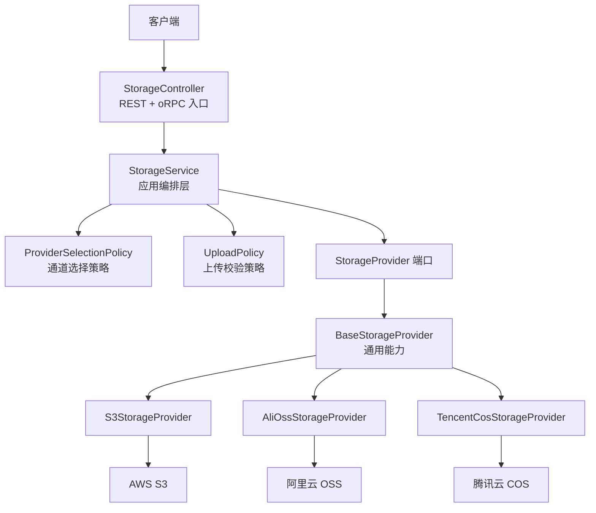
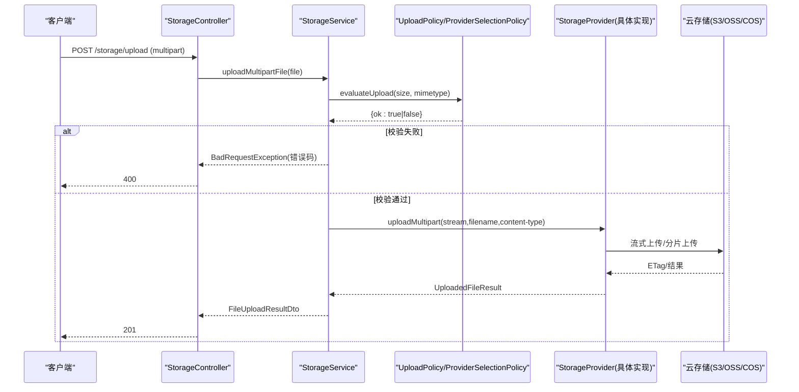
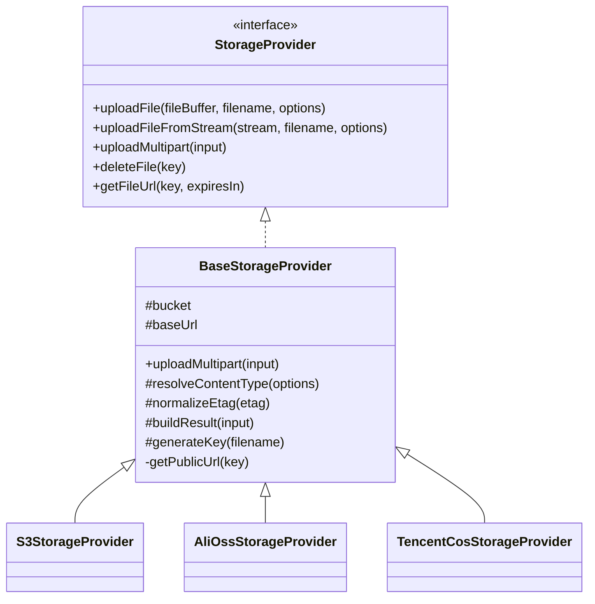

# 存储服务 API

<cite>
**本文引用的文件**   
- [storage.module.ts](file://apps/api/src/modules/storage/storage.module.ts)
- [storage.controller.ts](file://apps/api/src/modules/storage/api/storage.controller.ts)
- [storage.service.ts](file://apps/api/src/modules/storage/application/storage.service.ts)
- [storage-provider.port.ts](file://apps/api/src/modules/storage/domain/ports/storage-provider.port.ts)
- [storage-key.ts](file://apps/api/src/modules/storage/domain/value-objects/storage-key.ts)
- [provider-selection.policy.ts](file://apps/api/src/modules/storage/domain/policies/provider-selection.policy.ts)
- [upload.policy.ts](file://apps/api/src/modules/storage/domain/policies/upload.policy.ts)
- [base-storage.provider.ts](file://apps/api/src/modules/storage/infrastructure/base-storage.provider.ts)
- [s3-storage.provider.ts](file://apps/api/src/modules/storage/infrastructure/s3-storage.provider.ts)
- [alioss-storage.provider.ts](file://apps/api/src/modules/storage/infrastructure/alioss-storage.provider.ts)
- [tencentcos-storage.provider.ts](file://apps/api/src/modules/storage/infrastructure/tencentcos-storage.provider.ts)
</cite>

## 目录
1. [引言](#引言)
2. [项目结构](#项目结构)
3. [核心组件](#核心组件)
4. [架构总览](#架构总览)
5. [详细组件分析](#详细组件分析)
6. [依赖关系分析](#依赖关系分析)
7. [性能与扩展性](#性能与扩展性)
8. [故障排查指南](#故障排查指南)
9. [结论](#结论)
10. [附录：API 契约与数据模型](#附录api-契约与数据模型)

## 引言
本文件为存储服务的完整 API 文档，面向后端开发者、集成方与运维人员。该服务提供多云对象存储抽象层，统一对外暴露上传、下载（通过签名 URL）、删除等接口，并支持阿里云 OSS、AWS S3、腾讯云 COS 等多种后端。文档同时说明存储键值对象的设计、路径命名规则、元数据管理、访问控制与安全策略，以及大文件分片上传、断点续传、并发上传等高级能力的实现现状与建议。

## 项目结构
存储服务位于 NestJS 模块 `modules/storage`，采用清晰的分层设计：
- API 层：HTTP 控制器与 oRPC 契约映射
- 应用层：编排校验、通道选择与异常归一
- 领域层：端口定义、纯函数策略与值对象
- 基础设施层：各云厂商 SDK 适配实现



图表来源
- [storage.controller.ts:72-180](file://apps/api/src/modules/storage/api/storage.controller.ts#L72-L180)
- [storage.service.ts:18-99](file://apps/api/src/modules/storage/application/storage.service.ts#L18-L99)
- [provider-selection.policy.ts:14-20](file://apps/api/src/modules/storage/domain/policies/provider-selection.policy.ts#L14-L20)
- [upload.policy.ts:48-56](file://apps/api/src/modules/storage/domain/policies/upload.policy.ts#L48-L56)
- [storage-provider.port.ts:44-100](file://apps/api/src/modules/storage/domain/ports/storage-provider.port.ts#L44-L100)
- [base-storage.provider.ts:28-120](file://apps/api/src/modules/storage/infrastructure/base-storage.provider.ts#L28-L120)
- [s3-storage.provider.ts:20-150](file://apps/api/src/modules/storage/infrastructure/s3-storage.provider.ts#L20-L150)
- [alioss-storage.provider.ts:12-128](file://apps/api/src/modules/storage/infrastructure/alioss-storage.provider.ts#L12-L128)
- [tencentcos-storage.provider.ts:12-141](file://apps/api/src/modules/storage/infrastructure/tencentcos-storage.provider.ts#L12-L141)

章节来源
- [storage.module.ts:11-46](file://apps/api/src/modules/storage/storage.module.ts#L11-L46)
- [storage.controller.ts:46-75](file://apps/api/src/modules/storage/api/storage.controller.ts#L46-L75)

## 核心组件
- StorageController：对外暴露 REST 上传与 oRPC 删除、签名 URL 接口；对 multipart 上传进行原始流处理，其他操作走 oRPC 契约。
- StorageService：应用编排层，负责上传前校验（大小、MIME）、选择存储通道、委托底层 Provider 执行 IO，并将异常归一为 HTTP 错误码。
- StorageProvider 端口：领域定义的出站网关，统一 uploadFile、uploadFileFromStream、uploadMultipart、deleteFile、getFileUrl 等方法。
- BaseStorageProvider：公共基础设施基类，封装临时文件落盘、流式上传、ETag 规范化、公开 URL 生成与 key 生成。
- 具体 Provider：S3StorageProvider、AliOssStorageProvider、TencentCosStorageProvider，分别对接 AWS S3、阿里云 OSS、腾讯云 COS。
- 领域策略与值对象：
  - ProviderSelectionPolicy：根据配置选择 provider，未命中则回退到 s3。
  - UploadPolicy：上传尺寸与 MIME 白名单校验的纯函数裁决。
  - StorageKey：统一的 YYYY/MM/DD/<uuid><ext> 命名规则。

章节来源
- [storage.controller.ts:72-180](file://apps/api/src/modules/storage/api/storage.controller.ts#L72-L180)
- [storage.service.ts:18-99](file://apps/api/src/modules/storage/application/storage.service.ts#L18-L99)
- [storage-provider.port.ts:44-100](file://apps/api/src/modules/storage/domain/ports/storage-provider.port.ts#L44-L100)
- [base-storage.provider.ts:28-120](file://apps/api/src/modules/storage/infrastructure/base-storage.provider.ts#L28-L120)
- [provider-selection.policy.ts:14-20](file://apps/api/src/modules/storage/domain/policies/provider-selection.policy.ts#L14-L20)
- [upload.policy.ts:48-56](file://apps/api/src/modules/storage/domain/policies/upload.policy.ts#L48-L56)
- [storage-key.ts:14-23](file://apps/api/src/modules/storage/domain/value-objects/storage-key.ts#L14-L23)

## 架构总览
下图展示从请求进入控制器到最终落盘到云存储的调用链，以及多后端选择的决策点。



图表来源
- [storage.controller.ts:84-142](file://apps/api/src/modules/storage/api/storage.controller.ts#L84-L142)
- [storage.service.ts:43-79](file://apps/api/src/modules/storage/application/storage.service.ts#L43-L79)
- [upload.policy.ts:48-56](file://apps/api/src/modules/storage/domain/policies/upload.policy.ts#L48-L56)
- [base-storage.provider.ts:61-83](file://apps/api/src/modules/storage/infrastructure/base-storage.provider.ts#L61-L83)
- [s3-storage.provider.ts:73-102](file://apps/api/src/modules/storage/infrastructure/s3-storage.provider.ts#L73-L102)

## 详细组件分析

### 控制器层：StorageController
职责
- 接收 multipart 单文件上传，使用 Fastify 原始流解析。
- 将上传请求委派给 StorageService。
- 通过 oRPC 契约暴露删除与签名 URL 接口。
- 对非 multipart 或无文件场景返回 400，并对未知异常归一为 STORAGE_UPLOAD_FAILED。

关键行为
- 上传接口：POST /storage/upload，Content-Type: multipart/form-data，字段 file。
- 删除接口：oRPC storageDeleteContract，输入包含 key。
- 签名 URL 接口：oRPC storageUrlContract，输入包含 key 与可选 expiresIn。

安全与租户隔离
- 类级豁免全局租户墙，但会话墙仍生效；上传/下载属于用户级资源。

章节来源
- [storage.controller.ts:46-75](file://apps/api/src/modules/storage/api/storage.controller.ts#L46-L75)
- [storage.controller.ts:84-142](file://apps/api/src/modules/storage/api/storage.controller.ts#L84-L142)
- [storage.controller.ts:149-179](file://apps/api/src/modules/storage/api/storage.controller.ts#L149-L179)

### 应用层：StorageService
职责
- 读取配置，选择存储通道（优先配置指定，未注册则回退 s3）。
- 执行上传前校验（大小、MIME），失败直接抛 400。
- 委托 Provider 执行 IO，捕获异常并归一为 STORAGE_UPLOAD_FAILED。
- 透传删除与签名 URL 调用。

关键方法
- uploadMultipartFile：先校验后上传。
- deleteFile：透传 Provider.deleteFile。
- getFileUrl：透传 Provider.getFileUrl。

章节来源
- [storage.service.ts:18-34](file://apps/api/src/modules/storage/application/storage.service.ts#L18-L34)
- [storage.service.ts:43-79](file://apps/api/src/modules/storage/application/storage.service.ts#L43-L79)
- [storage.service.ts:86-98](file://apps/api/src/modules/storage/application/storage.service.ts#L86-L98)

### 领域层：端口、策略与值对象

#### 端口：StorageProvider
定义
- uploadFile(Buffer, filename, options?)
- uploadFileFromStream(stream, filename, options?)
- uploadMultipart({stream, filename, contentType})
- deleteFile(key)
- getFileUrl(key, expiresIn?)

数据结构
- FileUploadOptions：contentType、metadata、acl。
- UploadedFileResult：key、url、etag、size、mimetype、originalname。

章节来源
- [storage-provider.port.ts:7-33](file://apps/api/src/modules/storage/domain/ports/storage-provider.port.ts#L7-L33)
- [storage-provider.port.ts:44-100](file://apps/api/src/modules/storage/domain/ports/storage-provider.port.ts#L44-L100)

#### 策略：ProviderSelectionPolicy
- selectStorageProvider(providers, requested, fallback='s3')：按配置选择 provider，未命中回退 s3。

章节来源
- [provider-selection.policy.ts:14-20](file://apps/api/src/modules/storage/domain/policies/provider-selection.policy.ts#L14-L20)

#### 策略：UploadPolicy
- evaluateUpload(file, constraint)：先判 size > maxFileSize，再判 mimetype 是否在 allowedMimeTypes。
- 返回 {ok:true} 或 {ok:false, reason:'too-large'|'type-not-allowed'}。

章节来源
- [upload.policy.ts:11-27](file://apps/api/src/modules/storage/domain/policies/upload.policy.ts#L11-L27)
- [upload.policy.ts:48-56](file://apps/api/src/modules/storage/domain/policies/upload.policy.ts#L48-L56)

#### 值对象：StorageKey
- buildStorageKey(filename, now, id)：生成 YYYY/MM/DD/<uuid><ext> 格式键。

章节来源
- [storage-key.ts:14-23](file://apps/api/src/modules/storage/domain/value-objects/storage-key.ts#L14-L23)

### 基础设施层：BaseStorageProvider 与各 Provider

#### BaseStorageProvider
- 统一处理 multipart 临时文件写入、流式上传、ETag 去引号、公开 URL 拼接。
- generateKey：调用领域层 buildStorageKey，注入时间与 uuid。
- getPublicUrl：优先使用 baseUrl，否则调用 getDefaultPublicUrl。

章节来源
- [base-storage.provider.ts:28-36](file://apps/api/src/modules/storage/infrastructure/base-storage.provider.ts#L28-L36)
- [base-storage.provider.ts:61-83](file://apps/api/src/modules/storage/infrastructure/base-storage.provider.ts#L61-L83)
- [base-storage.provider.ts:89-119](file://apps/api/src/modules/storage/infrastructure/base-storage.provider.ts#L89-L119)

#### S3StorageProvider
- 使用 @aws-sdk/client-s3 与 @aws-sdk/lib-storage.Upload 实现分片上传。
- getFileUrl 使用 @aws-sdk/s3-request-presigner.getSignedUrl。
- ACL 默认 private，支持自定义 metadata/acl。

章节来源
- [s3-storage.provider.ts:20-45](file://apps/api/src/modules/storage/infrastructure/s3-storage.provider.ts#L20-L45)
- [s3-storage.provider.ts:47-102](file://apps/api/src/modules/storage/infrastructure/s3-storage.provider.ts#L47-L102)
- [s3-storage.provider.ts:104-129](file://apps/api/src/modules/storage/infrastructure/s3-storage.provider.ts#L104-L129)
- [s3-storage.provider.ts:131-149](file://apps/api/src/modules/storage/infrastructure/s3-storage.provider.ts#L131-L149)

#### AliOssStorageProvider
- 使用 ali-oss SDK，put/putStream 上传，signatureUrl 生成签名链接。
- 通过 x-oss-object-acl 与 x-oss-meta-* 设置 ACL 与元数据。

章节来源
- [alioss-storage.provider.ts:12-27](file://apps/api/src/modules/storage/infrastructure/alioss-storage.provider.ts#L12-L27)
- [alioss-storage.provider.ts:29-79](file://apps/api/src/modules/storage/infrastructure/alioss-storage.provider.ts#L29-L79)
- [alioss-storage.provider.ts:81-101](file://apps/api/src/modules/storage/infrastructure/alioss-storage.provider.ts#L81-L101)
- [alioss-storage.provider.ts:103-127](file://apps/api/src/modules/storage/infrastructure/alioss-storage.provider.ts#L103-L127)

#### TencentCosStorageProvider
- 使用 cos-nodejs-sdk-v5，回调风格 putObject/deleteObject/getObjectUrl。
- 默认公开 URL 格式遵循腾讯云 COS 规范。

章节来源
- [tencentcos-storage.provider.ts:12-27](file://apps/api/src/modules/storage/infrastructure/tencentcos-storage.provider.ts#L12-L27)
- [tencentcos-storage.provider.ts:29-49](file://apps/api/src/modules/storage/infrastructure/tencentcos-storage.provider.ts#L29-L49)
- [tencentcos-storage.provider.ts:51-96](file://apps/api/src/modules/storage/infrastructure/tencentcos-storage.provider.ts#L51-L96)
- [tencentcos-storage.provider.ts:98-140](file://apps/api/src/modules/storage/infrastructure/tencentcos-storage.provider.ts#L98-L140)

### 类图：存储提供者体系


图表来源
- [storage-provider.port.ts:44-100](file://apps/api/src/modules/storage/domain/ports/storage-provider.port.ts#L44-L100)
- [base-storage.provider.ts:28-120](file://apps/api/src/modules/storage/infrastructure/base-storage.provider.ts#L28-L120)
- [s3-storage.provider.ts:20-150](file://apps/api/src/modules/storage/infrastructure/s3-storage.provider.ts#L20-L150)
- [alioss-storage.provider.ts:12-128](file://apps/api/src/modules/storage/infrastructure/alioss-storage.provider.ts#L12-L128)
- [tencentcos-storage.provider.ts:12-141](file://apps/api/src/modules/storage/infrastructure/tencentcos-storage.provider.ts#L12-L141)

## 依赖关系分析
- 模块装配：StorageModule.register() 根据配置动态注入 s3、alioss、tencentoss 三种 Provider，始终保留 s3 作为回退。
- 运行时选择：StorageService 构造期通过 selectStorageProvider 选择实际 Provider。
- 外部依赖：
  - AWS S3：@aws-sdk/client-s3、@aws-sdk/lib-storage、@aws-sdk/s3-request-presigner
  - 阿里云 OSS：ali-oss
  - 腾讯云 COS：cos-nodejs-sdk-v5

```mermaid
graph LR
Mod["StorageModule"] --> |register()| Providers["STORAGE_PROVIDERS 集合"]
Providers --> S3["S3StorageProvider"]
Providers --> Ali["AliOssStorageProvider"]
Providers --> Cos["TencentCosStorageProvider"]
Svc["StorageService"] --> |selectStorageProvider| Providers
```

图表来源
- [storage.module.ts:17-46](file://apps/api/src/modules/storage/storage.module.ts#L17-L46)
- [provider-selection.policy.ts:14-20](file://apps/api/src/modules/storage/domain/policies/provider-selection.policy.ts#L14-L20)
- [storage.service.ts:23-34](file://apps/api/src/modules/storage/application/storage.service.ts#L23-L34)

章节来源
- [storage.module.ts:11-46](file://apps/api/src/modules/storage/storage.module.ts#L11-L46)
- [storage.service.ts:23-34](file://apps/api/src/modules/storage/application/storage.service.ts#L23-L34)

## 性能与扩展性
- 大文件分片上传
  - S3：使用 @aws-sdk/lib-storage.Upload 自动分片，适合大文件与不稳定网络。
  - OSS/COS：当前实现基于流式上传；如需分片/断点续传，可在对应 Provider 中引入 SDK 的分片上传能力。
- 断点续传
  - 当前未实现服务端断点续传状态机；可结合 Provider 的分片上传能力，在数据库记录分片任务与进度，由客户端重试未完成分片。
- 并发上传
  - 建议在上层业务侧对超大文件进行分片并发上传，并在 Provider 层合并结果；当前 S3 的 Upload 已内部优化并发。
- 流式上传
  - BaseStorageProvider.uploadMultipart 将 multipart 流写入临时文件后再流式上传，避免内存峰值过高。
- 成本优化建议
  - 合理设置 ACL（private/public）与生命周期规则（过期清理）。
  - 使用 CDN 缓存热点文件，减少直连存储带宽。
  - 压缩与转码（如图片）降低存储体积与传输成本。

[本节为通用指导，不直接分析具体文件]

## 故障排查指南
常见错误与定位
- 非 multipart 请求：控制器抛出 STORAGE_NOT_MULTIPART。
- 未携带文件：控制器抛出 STORAGE_NO_FILE。
- 文件大小超限：StorageService 抛出 STORAGE_FILE_TOO_LARGE。
- MIME 类型不在白名单：StorageService 抛出 STORAGE_FILE_TYPE_NOT_ALLOWED。
- 上传失败（IO/网络/SDK）：StorageService 抛出 STORAGE_UPLOAD_FAILED。

排查步骤
- 确认请求 Content-Type 为 multipart/form-data，且包含 file 字段。
- 检查文件大小与 MIME 是否符合配置限制。
- 查看 Provider 日志与 SDK 报错信息，确认 Bucket/Region/Credentials/Endpoint 配置正确。
- 若签名 URL 无效，检查 expiresIn 是否过期，以及存储桶权限是否为私有。

章节来源
- [storage.controller.ts:103-142](file://apps/api/src/modules/storage/api/storage.controller.ts#L103-L142)
- [storage.service.ts:43-79](file://apps/api/src/modules/storage/application/storage.service.ts#L43-L79)

## 结论
存储服务通过清晰的领域分层与 Provider 抽象，实现了多云对象存储的统一接入。对外暴露简洁的上传、删除与签名 URL 接口，内置上传校验与异常归一，并提供 S3 分片上传等基础能力。未来可扩展断点续传、并发分片、配额统计与成本优化等能力，以满足更复杂的业务需求。

[本节为总结性内容，不直接分析具体文件]

## 附录：API 契约与数据模型

### HTTP 接口
- 单文件上传
  - 方法：POST
  - 路径：/storage/upload
  - 内容类型：multipart/form-data
  - 表单字段：file（二进制）
  - 成功响应：201，返回 FileUploadResultDto（包含 key、url、size、mimetype、originalname 等）
  - 失败响应：400，错误码包括 STORAGE_NOT_MULTIPART、STORAGE_NO_FILE、STORAGE_FILE_TOO_LARGE、STORAGE_FILE_TYPE_NOT_ALLOWED、STORAGE_UPLOAD_FAILED

章节来源
- [storage.controller.ts:84-142](file://apps/api/src/modules/storage/api/storage.controller.ts#L84-L142)

### oRPC 接口
- 删除文件
  - 契约：storageDeleteContract
  - 输入：{ key: string }
  - 输出：{ success: boolean }
  - 行为：调用 StorageService.deleteFile，透传 Provider 删除结果

- 获取签名 URL
  - 契约：storageUrlContract
  - 输入：{ key: string, expiresIn?: number }
  - 输出：{ url: string }
  - 行为：调用 StorageService.getFileUrl，Provider 生成签名链接

章节来源
- [storage.controller.ts:149-179](file://apps/api/src/modules/storage/api/storage.controller.ts#L149-L179)

### 数据模型
- FileUploadOptions
  - contentType?: string
  - metadata?: Record<string, string>
  - acl?: string

- UploadedFileResult
  - key: string
  - url: string
  - etag?: string
  - size: number
  - mimetype: string
  - originalname: string

章节来源
- [storage-provider.port.ts:7-33](file://apps/api/src/modules/storage/domain/ports/storage-provider.port.ts#L7-L33)

### 存储键值对象与命名规则
- 命名规则：YYYY/MM/DD/<uuid><ext>
- 构建函数：buildStorageKey(filename, now, id)
- 用途：所有 Provider 统一使用该规则生成对象键，保证一致性与可预测性

章节来源
- [storage-key.ts:14-23](file://apps/api/src/modules/storage/domain/value-objects/storage-key.ts#L14-L23)

### 访问控制与安全策略
- ACL
  - S3：默认 private，可通过 options.acl 设置。
  - OSS：通过 x-oss-object-acl 设置，默认 private。
  - COS：默认私有，需通过签名 URL 访问。
- 防盗链与访问限制
  - 推荐将存储桶设置为私有，并通过签名 URL 短期授权访问。
  - 可结合 CDN 与 Referer 白名单进一步加固（需在云控制台配置）。
- 元数据管理
  - S3：options.metadata 透传至对象元数据。
  - OSS：通过 x-oss-meta-* 头传递自定义元数据。
  - COS：当前实现未显式设置元数据，可按需扩展。

章节来源
- [s3-storage.provider.ts:135-149](file://apps/api/src/modules/storage/infrastructure/s3-storage.provider.ts#L135-L149)
- [alioss-storage.provider.ts:109-122](file://apps/api/src/modules/storage/infrastructure/alioss-storage.provider.ts#L109-L122)

### 高级功能现状与建议
- 分片上传
  - S3：已使用 @aws-sdk/lib-storage.Upload 实现自动分片。
  - OSS/COS：当前为流式上传；建议在 Provider 层引入 SDK 分片能力以支持大文件与断点续传。
- 断点续传
  - 需要引入分片任务表与进度追踪，结合 Provider 的分片上传 API 实现。
- 并发上传
  - 上层业务可对分片并发上传，Provider 内部合并结果；S3 的 Upload 已具备并发优化。
- 配额管理与使用统计
  - 当前未在存储服务内实现；可在上层业务层结合数据库与计费系统实现。
- 成本优化
  - 启用生命周期规则、冷热分层、CDN 缓存与压缩转码。

[本节为通用指导，不直接分析具体文件]