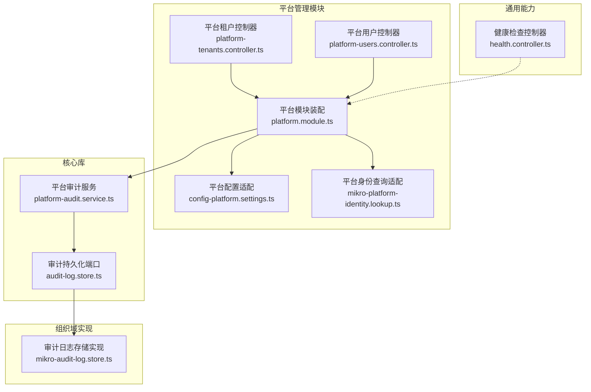
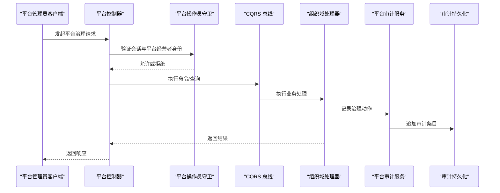
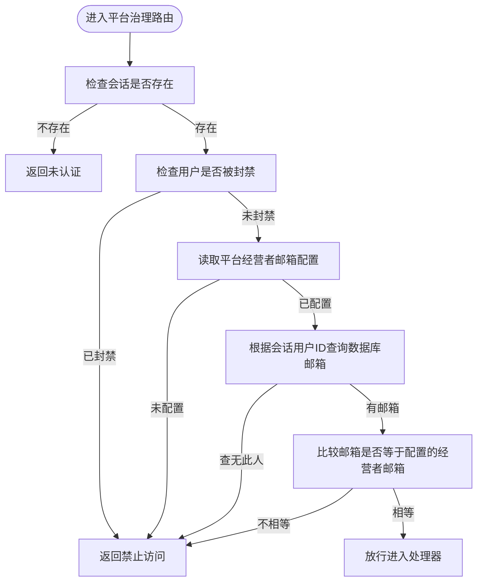
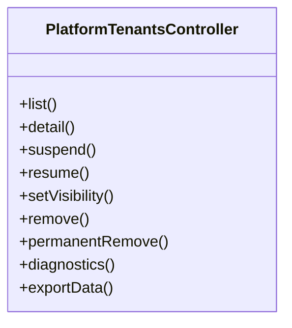
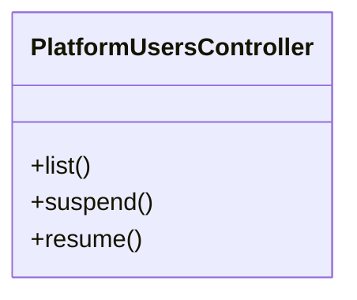
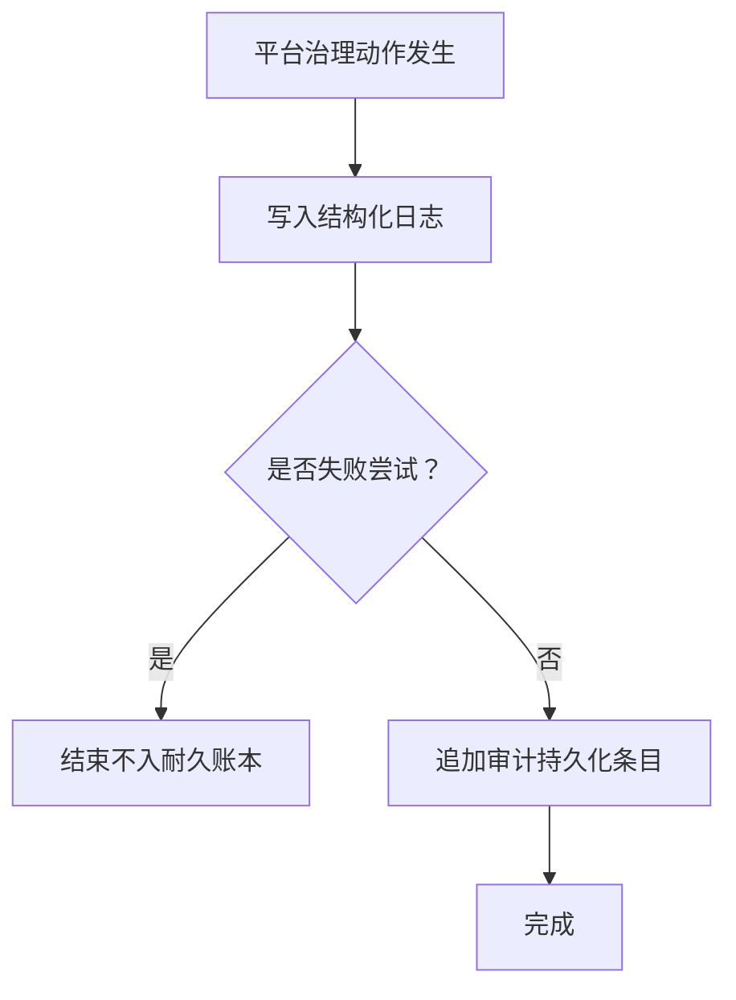
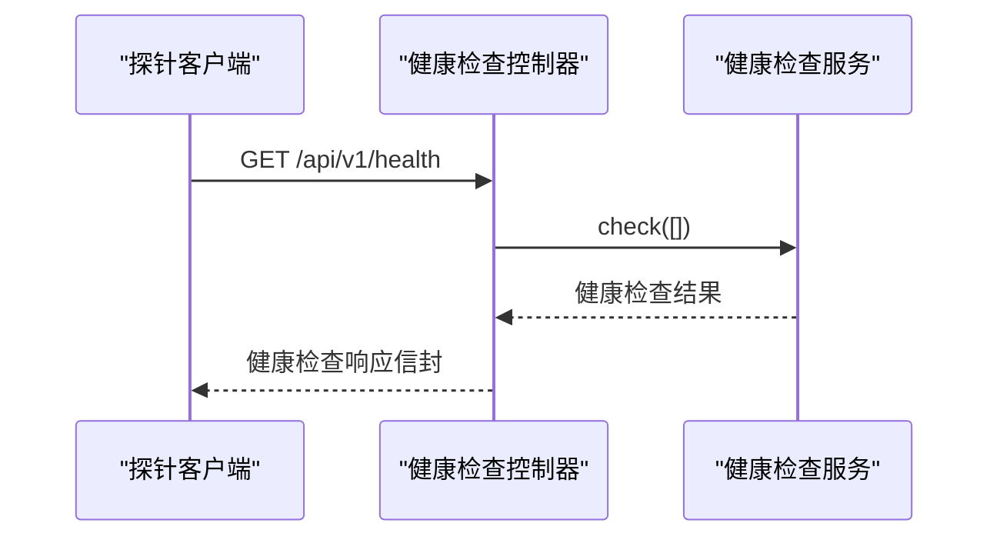
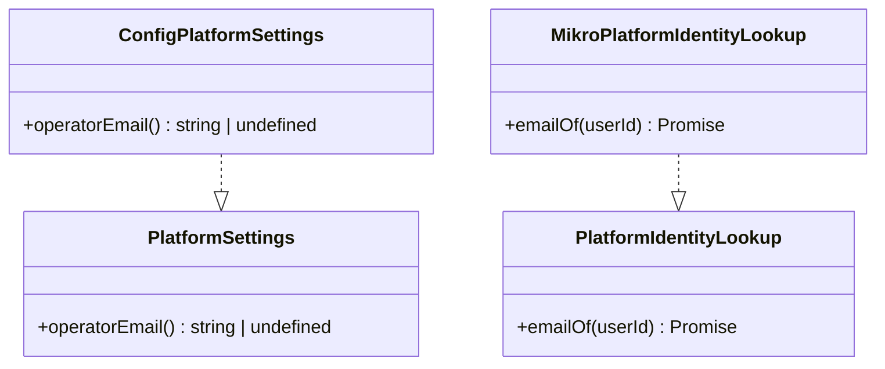
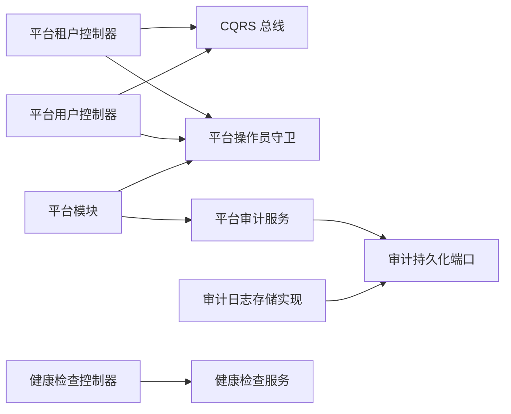

# 平台管理 API

<cite>
**本文引用的文件**   
- [platform-tenants.controller.ts](file://apps/api/src/modules/platform/api/platform-tenants.controller.ts)
- [platform-users.controller.ts](file://apps/api/src/modules/platform/api/platform-users.controller.ts)
- [platform.module.ts](file://apps/api/src/modules/platform/platform.module.ts)
- [config-platform.settings.ts](file://apps/api/src/modules/platform/infrastructure/config-platform.settings.ts)
- [mikro-platform-identity.lookup.ts](file://apps/api/src/modules/platform/infrastructure/mikro-platform-identity.lookup.ts)
- [health.controller.ts](file://apps/api/src/common/health/health.controller.ts)
- [platform-audit.service.ts](file://libs/core/src/platform/platform-audit.service.ts)
- [audit-log.store.ts](file://libs/core/src/shared-kernel/audit/audit-log.store.ts)
- [mikro-audit-log.store.ts](file://apps/api/src/modules/organizations/infrastructure/mikro-audit-log.store.ts)
</cite>

## 目录
1. [简介](#简介)
2. [项目结构](#项目结构)
3. [核心组件](#核心组件)
4. [架构总览](#架构总览)
5. [详细组件分析](#详细组件分析)
6. [依赖关系分析](#依赖关系分析)
7. [性能与运维特性](#性能与运维特性)
8. [故障排查指南](#故障排查指南)
9. [结论](#结论)

## 简介
本文档面向平台管理员，系统化说明平台管理模块的 API、权限体系与运维能力。内容覆盖：
- 平台管理员权限体系与超级管理员接口使用方式
- 平台级租户管理接口（列表、详情、暂停/恢复、软删/硬删、可见性策略、诊断、数据导出）
- 平台用户管理接口（列表、暂停/恢复）
- 平台审计日志与合规记录机制
- 健康检查与基础运维探针
- 平台配置与环境变量控制（经营者邮箱、身份查询适配）

本仓库采用 NestJS + oRPC 契约驱动开发，平台治理相关控制器通过 `PlatformOperatorGuard` 进行强访问控制，并通过 CQRS Bus 委派到组织域的命令/查询处理器，保证写能力集中在领域层，平台层仅暴露跨租户治理门面。

## 项目结构
平台管理相关代码主要位于 `apps/api/src/modules/platform`，并复用 core 层的审计与配置端口。关键路径如下：
- 平台控制器：`modules/platform/api/platform-tenants.controller.ts`、`modules/platform/api/platform-users.controller.ts`
- 平台模块装配：`modules/platform/platform.module.ts`
- 平台配置与身份适配：`modules/platform/infrastructure/config-platform.settings.ts`、`modules/platform/infrastructure/mikro-platform-identity.lookup.ts`
- 健康检查：`common/health/health.controller.ts`
- 平台审计服务：`libs/core/src/platform/platform-audit.service.ts`
- 审计持久化端口与实现：`libs/core/src/shared-kernel/audit/audit-log.store.ts`、`modules/organizations/infrastructure/mikro-audit-log.store.ts`

图表来源
- [platform.module.ts:29-46](file://apps/api/src/modules/platform/platform.module.ts#L29-L46)
- [platform-tenants.controller.ts:100-107](file://apps/api/src/modules/platform/api/platform-tenants.controller.ts#L100-L107)
- [platform-users.controller.ts:54-61](file://apps/api/src/modules/platform/api/platform-users.controller.ts#L54-L61)
- [config-platform.settings.ts:11-18](file://apps/api/src/modules/platform/infrastructure/config-platform.settings.ts#L11-L18)
- [mikro-platform-identity.lookup.ts:13-22](file://apps/api/src/modules/platform/infrastructure/mikro-platform-identity.lookup.ts#L13-L22)
- [platform-audit.service.ts:63-70](file://libs/core/src/platform/platform-audit.service.ts#L63-L70)
- [audit-log.store.ts:1-18](file://libs/core/src/shared-kernel/audit/audit-log.store.ts#L1-L18)
- [mikro-audit-log.store.ts:19-37](file://apps/api/src/modules/organizations/infrastructure/mikro-audit-log.store.ts#L19-L37)
- [health.controller.ts:28-39](file://apps/api/src/common/health/health.controller.ts#L28-L39)

章节来源
- [platform.module.ts:12-46](file://apps/api/src/modules/platform/platform.module.ts#L12-L46)
- [platform-tenants.controller.ts:64-107](file://apps/api/src/modules/platform/api/platform-tenants.controller.ts#L64-L107)
- [platform-users.controller.ts:32-61](file://apps/api/src/modules/platform/api/platform-users.controller.ts#L32-L61)

## 核心组件
- 平台租户治理控制器：提供跨租户的租户生命周期与可见性策略管理、组织级诊断与数据导出。
- 平台用户治理控制器：提供跨平台的用户生命周期管理（暂停/恢复）与用户列表。
- 平台模块装配：注册平台控制器、平台操作员守卫、平台审计服务、平台身份与配置端口适配。
- 平台审计服务：统一记录租户与用户的治理动作，双通道输出（结构化日志 + 耐久审计账本）。
- 健康检查控制器：提供存活探针与健康检查端点，豁免限流与会话墙。

章节来源
- [platform-tenants.controller.ts:100-311](file://apps/api/src/modules/platform/api/platform-tenants.controller.ts#L100-L311)
- [platform-users.controller.ts:54-121](file://apps/api/src/modules/platform/api/platform-users.controller.ts#L54-L121)
- [platform.module.ts:29-46](file://apps/api/src/modules/platform/platform.module.ts#L29-L46)
- [platform-audit.service.ts:63-151](file://libs/core/src/platform/platform-audit.service.ts#L63-L151)
- [health.controller.ts:28-39](file://apps/api/src/common/health/health.controller.ts#L28-L39)

## 架构总览
平台管理 API 遵循“平台门面 + 领域命令/查询”的分层设计：
- 控制器层：仅做参数校验、契约绑定、会话用户提取与异常映射。
- 应用层：通过 CQRS Bus 调用组织域的 Command/Query 处理器，执行业务逻辑。
- 基础设施层：平台配置、身份查询、审计持久化等由端口+适配解耦。
- 安全层：所有平台治理路由强制经过 `PlatformOperatorGuard`，确保只有唯一平台经营者可操作。

图表来源
- [platform-tenants.controller.ts:112-123](file://apps/api/src/modules/platform/api/platform-tenants.controller.ts#L112-L123)
- [platform-users.controller.ts:67-78](file://apps/api/src/modules/platform/api/platform-users.controller.ts#L67-L78)
- [platform-audit.service.ts:81-109](file://libs/core/src/platform/platform-audit.service.ts#L81-L109)
- [mikro-audit-log.store.ts:23-37](file://apps/api/src/modules/organizations/infrastructure/mikro-audit-log.store.ts#L23-L37)

## 详细组件分析

### 平台管理员权限体系与超级管理员接口
- 权限模型：平台层不引入角色模型，而是以“唯一平台经营者”为授权主体。判定依据是会话用户数据库邮箱与平台配置中的 `operatorEmail` 完全匹配（大小写不敏感），且该用户未被封禁。
- 守卫行为：无会话返回未认证；被封禁或非经营者返回禁止访问；未配置经营者邮箱则失败关闭。
- 超级管理员接口：即平台治理相关的所有 HTTP 路由，均受 `PlatformOperatorGuard` 保护，需携带有效会话且满足经营者条件。

图表来源
- [platform-operator.guard.ts:36-85](file://libs/core/src/platform/platform-operator.guard.ts#L36-L85)
- [config-platform.settings.ts:11-18](file://apps/api/src/modules/platform/infrastructure/config-platform.settings.ts#L11-L18)
- [mikro-platform-identity.lookup.ts:13-22](file://apps/api/src/modules/platform/infrastructure/mikro-platform-identity.lookup.ts#L13-L22)

章节来源
- [platform.module.ts:32-44](file://apps/api/src/modules/platform/platform.module.ts#L32-L44)
- [platform-tenants.controller.ts:100-107](file://apps/api/src/modules/platform/api/platform-tenants.controller.ts#L100-L107)
- [platform-users.controller.ts:54-61](file://apps/api/src/modules/platform/api/platform-users.controller.ts#L54-L61)

### 平台级租户管理接口
平台租户治理控制器提供以下能力：
- 列出租户：支持分页与搜索，返回租户行及名下组织计数。
- 获取租户详情：返回租户基本信息与名下组织名册。
- 暂停租户：将租户状态从 active 转为 suspended，封禁整个租户。
- 恢复租户：将租户状态从 suspended 转回 active。
- 设置可见性策略：调整租户内跨组织可见性策略。
- 软删除租户：将租户置为 deleted 终态，保留行以便导出。
- 硬删除租户：对已处 deleted 终态的租户执行不可逆清理，连带清除其名下所有组织及子表。
- 组织级诊断：下钻查看成员/邀请/工作区/帖子计数。
- 导出数据：导出该组织全部数据为单一 JSON（不含凭证）。

所有路由均要求平台经营者身份，且不使用租户隔离作用域，因为平台治理跨越所有租户。

图表来源
- [platform-tenants.controller.ts:100-311](file://apps/api/src/modules/platform/api/platform-tenants.controller.ts#L100-L311)

章节来源
- [platform-tenants.controller.ts:100-311](file://apps/api/src/modules/platform/api/platform-tenants.controller.ts#L100-L311)

### 平台用户管理接口
平台用户治理控制器提供以下能力：
- 列出用户：支持分页与搜索，返回用户行及其生命周期状态。
- 暂停用户：将用户状态从 active 转为 suspended，同时使会话失效。
- 恢复用户：将用户状态从 suspended 转回 active。

所有路由同样要求平台经营者身份，且不绑定租户隔离，因为平台用户封禁影响其在所有租户与平台层的访问。

图表来源
- [platform-users.controller.ts:54-121](file://apps/api/src/modules/platform/api/platform-users.controller.ts#L54-L121)

章节来源
- [platform-users.controller.ts:54-121](file://apps/api/src/modules/platform/api/platform-users.controller.ts#L54-L121)

### 平台审计日志接口与合规记录
平台审计服务提供统一的治理动作审计出口：
- 租户治理审计：记录 approve/reject/suspend/resume/delete/hard_delete/bind_odoo/set_visibility 等动作。
- 用户治理审计：记录 suspend/resume/delete 等动作。
- 双通道输出：
  - 结构化日志（pino）：实时观测流，包含动作、实体标识、操作者、迁移前后状态、错误上下文等。
  - 耐久审计账本（audit_log）：仅记录已提交动作（无 error），PII 最小化（仅 id，不携带邮箱等个人数据）。

审计条目字段包括实体类型、实体标识、动作、迁移前/后状态、操作者、原因、关联请求 ID 等。

图表来源
- [platform-audit.service.ts:81-109](file://libs/core/src/platform/platform-audit.service.ts#L81-L109)
- [platform-audit.service.ts:123-150](file://libs/core/src/platform/platform-audit.service.ts#L123-L150)
- [mikro-audit-log.store.ts:23-37](file://apps/api/src/modules/organizations/infrastructure/mikro-audit-log.store.ts#L23-L37)

章节来源
- [platform-audit.service.ts:63-151](file://libs/core/src/platform/platform-audit.service.ts#L63-L151)
- [audit-log.store.ts:1-18](file://libs/core/src/shared-kernel/audit/audit-log.store.ts#L1-L18)
- [mikro-audit-log.store.ts:19-37](file://apps/api/src/modules/organizations/infrastructure/mikro-audit-log.store.ts#L19-L37)

### 健康检查与基础运维探针
健康检查控制器提供 `/api/v1/health` 端点，基于 NestJS Terminus 的健康检查服务，返回健康检查结果信封。该端点：
- 标记为公开（Public），豁免全局会话墙与租户墙。
- 豁免限流（SkipThrottle），避免探活被限流阻断。
- 通过 oRPC 路由器挂载，契约定义在单源，保持 REST 面路径一致。

图表来源
- [health.controller.ts:28-39](file://apps/api/src/common/health/health.controller.ts#L28-L39)

章节来源
- [health.controller.ts:1-41](file://apps/api/src/common/health/health.controller.ts#L1-L41)

### 平台配置管理与系统设置
平台配置通过端口抽象解耦核心与应用侧实现：
- 平台配置端口：定义 `PlatformSettings`，暴露 `operatorEmail()` 方法，供核心层消费。
- 应用侧适配：`ConfigPlatformSettings` 通过 `ConfigService.getPlatformConfig()` 读取环境变量中的经营者邮箱。
- 平台身份查询端口：定义 `PlatformIdentityLookup`，应用侧通过 `MikroPlatformIdentityLookup` 基于 MikroORM 查询 BetterAuth 的 `user.email`。

图表来源
- [platform-config.port.ts:1-25](file://libs/core/src/platform/platform-config.port.ts#L1-L25)
- [config-platform.settings.ts:11-18](file://apps/api/src/modules/platform/infrastructure/config-platform.settings.ts#L11-L18)
- [mikro-platform-identity.lookup.ts:13-22](file://apps/api/src/modules/platform/infrastructure/mikro-platform-identity.lookup.ts#L13-L22)

章节来源
- [platform.module.ts:32-44](file://apps/api/src/modules/platform/platform.module.ts#L32-L44)
- [config-platform.settings.ts:11-18](file://apps/api/src/modules/platform/infrastructure/config-platform.settings.ts#L11-L18)
- [mikro-platform-identity.lookup.ts:13-22](file://apps/api/src/modules/platform/infrastructure/mikro-platform-identity.lookup.ts#L13-L22)

## 依赖关系分析
平台管理模块依赖关系如下：
- 控制器依赖 CQRS Bus（CommandBus/QueryBus）委派业务逻辑。
- 控制器依赖 `PlatformOperatorGuard` 进行平台经营者鉴权。
- 平台模块装配导出守卫、审计服务与平台端口（身份/配置）。
- 审计服务依赖审计持久化端口，具体实现位于组织域。
- 健康检查控制器依赖 NestJS Terminus 健康检查服务。

图表来源
- [platform-tenants.controller.ts:104-107](file://apps/api/src/modules/platform/api/platform-tenants.controller.ts#L104-L107)
- [platform-users.controller.ts:58-61](file://apps/api/src/modules/platform/api/platform-users.controller.ts#L58-L61)
- [platform.module.ts:32-44](file://apps/api/src/modules/platform/platform.module.ts#L32-L44)
- [platform-audit.service.ts:67-70](file://libs/core/src/platform/platform-audit.service.ts#L67-L70)
- [mikro-audit-log.store.ts:19-37](file://apps/api/src/modules/organizations/infrastructure/mikro-audit-log.store.ts#L19-L37)
- [health.controller.ts:31-39](file://apps/api/src/common/health/health.controller.ts#L31-L39)

章节来源
- [platform.module.ts:29-46](file://apps/api/src/modules/platform/platform.module.ts#L29-L46)
- [platform-audit.service.ts:63-151](file://libs/core/src/platform/platform-audit.service.ts#L63-L151)
- [mikro-audit-log.store.ts:19-37](file://apps/api/src/modules/organizations/infrastructure/mikro-audit-log.store.ts#L19-L37)

## 性能与运维特性
- 健康检查端点豁免限流与会话墙，适合外部探针与 CI 验证。
- 平台治理路由不进行租户隔离，减少跨租户边界开销，但需严格限制访问主体（平台经营者）。
- 审计持久化为 append-only，避免更新/删除带来的锁竞争与一致性风险。
- 平台身份查询每次 fork 独立 EntityManager，避免共享 EM 导致的串租户问题。

[本节为通用指导，不直接分析具体文件]

## 故障排查指南
常见错误与定位建议：
- 未认证（401）：会话缺失或无效。检查客户端是否正确携带会话令牌。
- 禁止访问（403）：
  - 平台经营者未配置：检查 `operatorEmail` 环境变量是否设置。
  - 非平台经营者：确认当前会话用户邮箱是否与配置的经营者邮箱一致。
  - 用户被封禁：检查用户状态是否为 suspended。
- 租户/用户未找到（404）：传入的 tenantId 或 userId 不存在。
- 非法状态转移（409）：例如对非 suspended 租户执行 resume，或对非 deleted 租户执行 hard delete。
- 审计记录缺失：若动作失败（带 error），不会写入耐久审计账本，仅记录结构化日志。

章节来源
- [platform-tenants.controller.ts:134-144](file://apps/api/src/modules/platform/api/platform-tenants.controller.ts#L134-L144)
- [platform-users.controller.ts:89-98](file://apps/api/src/modules/platform/api/platform-users.controller.ts#L89-L98)
- [platform-audit.service.ts:81-109](file://libs/core/src/platform/platform-audit.service.ts#L81-L109)

## 结论
平台管理模块通过严格的平台经营者权限模型与统一的审计出口，提供了安全的跨租户与跨平台治理能力。租户与用户治理接口均以 CQRS 委派至组织域，平台层专注门面与安全边界。健康检查与配置端口为运维与部署提供了必要支撑。建议在集成时：
- 正确配置 `operatorEmail` 环境变量，并确保平台经营者账户未被封禁。
- 仅在内部可信环境调用平台治理接口，避免暴露给外部客户端。
- 结合审计日志与结构化日志进行合规报告与安全监控。
- 使用健康检查端点进行服务可用性与部署验证。

[本节为总结性内容，不直接分析具体文件]