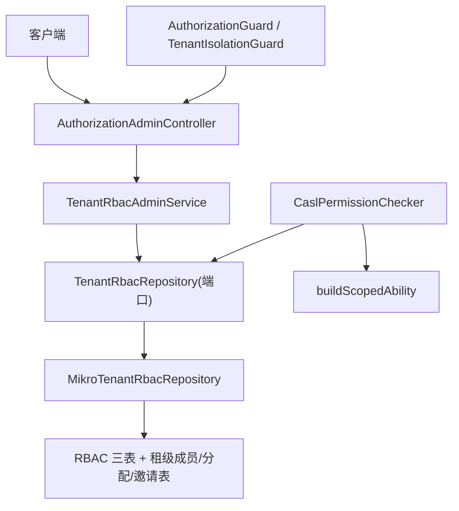
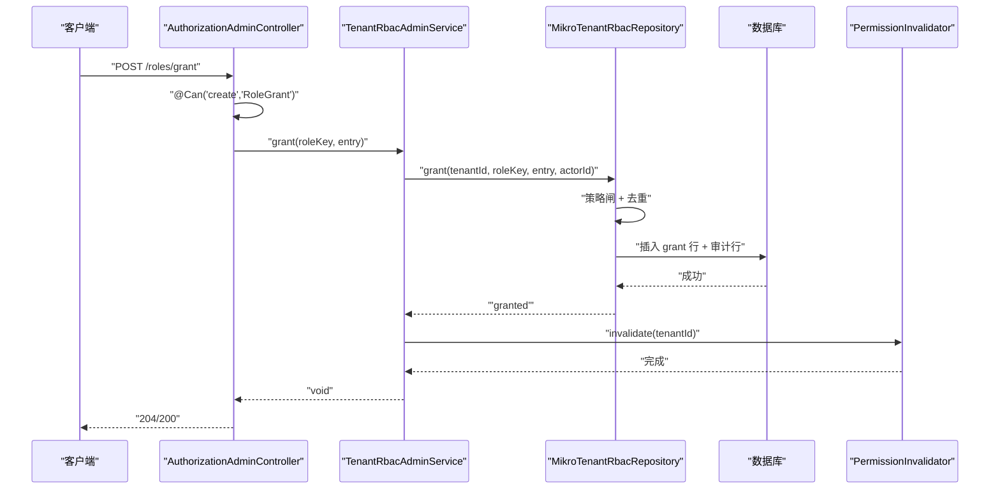
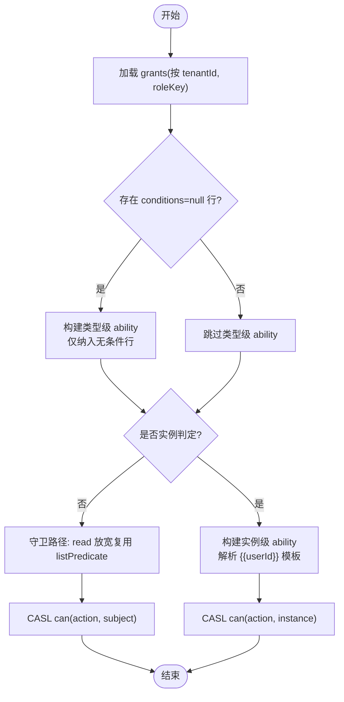
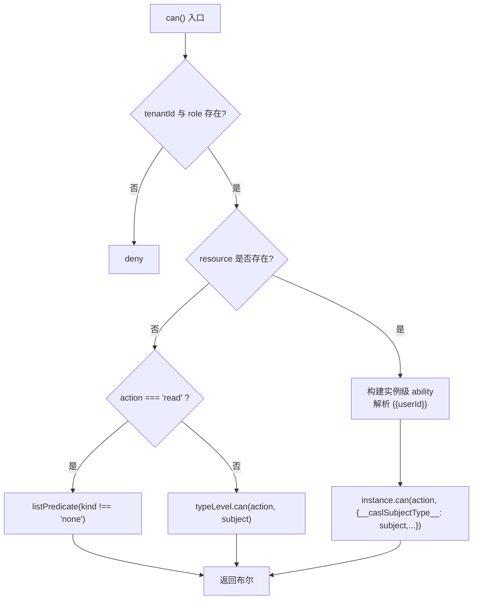
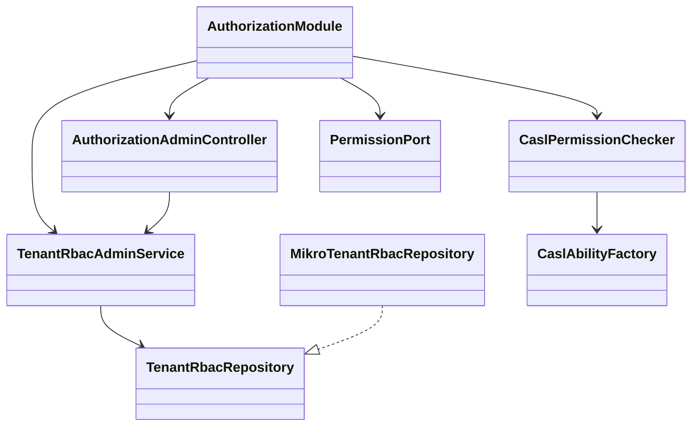

# 授权模块 API

<cite>
**本文引用的文件**   
- [authorization.module.ts](file://apps/api/src/modules/authorization/authorization.module.ts)
- [authorization-admin.controller.ts](file://apps/api/src/modules/authorization/api/authorization-admin.controller.ts)
- [organization-rbac-admin.service.ts](file://apps/api/src/modules/authorization/application/organization-rbac-admin.service.ts)
- [casl-ability.factory.ts](file://apps/api/src/modules/authorization/infrastructure/casl-ability.factory.ts)
- [casl-permission.checker.ts](file://apps/api/src/modules/authorization/infrastructure/casl-permission.checker.ts)
- [rbac.policy.ts](file://apps/api/src/modules/authorization/domain/policies/rbac.policy.ts)
- [organization-rbac.repository.ts](file://apps/api/src/modules/authorization/domain/repositories/organization-rbac.repository.ts)
- [mikro-organization-rbac.repository.ts](file://apps/api/src/modules/authorization/infrastructure/repositories/mikro-organization-rbac.repository.ts)
- [rbac.entities.ts](file://apps/api/src/modules/authorization/infrastructure/entities/rbac.entities.ts)
- [permission.port.ts](file://libs/core/src/authorization/permission.port.ts)
</cite>

## 目录
1. [引言](#引言)
2. [项目结构](#项目结构)
3. [核心组件](#核心组件)
4. [架构总览](#架构总览)
5. [详细组件分析](#详细组件分析)
6. [依赖关系分析](#依赖关系分析)
7. [性能与缓存特性](#性能与缓存特性)
8. [故障排查指南](#故障排查指南)
9. [结论](#结论)

## 引言
本文件为“授权模块”的权威 API 与实现文档，聚焦 RBAC 权限模型、CASL 能力工厂、动态角色调整、组织级权限控制与企业租户隔离、权限矩阵查询、批量权限操作、权限继承/合并/冲突规则，以及权限审计与合规性检查接口。读者可据此理解：
- 管理端如何创建、重命名、删除角色；
- 如何为角色新增或撤销授权（含条件化 ABAC）；
- 运行时如何通过 CASL 判定类型级与实例级权限；
- 列表查询如何下推权限谓词；
- 多租户与组织可见性如何与授权轴解耦；
- 变更如何落审计并失效缓存以热生效。

## 项目结构
授权模块采用分层 + 领域驱动的组织方式：
- API 层：暴露管理端 REST 路由，统一守卫与契约校验；
- 应用层：编排业务用例、错误码映射、写后失效；
- 领域层：定义仓储端口、策略纯函数、领域结果码；
- 基础设施层：MikroORM 实体、仓储实现、CASL 能力构建与权限检查器。

图表来源
- [authorization-admin.controller.ts:65-179](file://apps/api/src/modules/authorization/api/authorization-admin.controller.ts#L65-L179)
- [organization-rbac-admin.service.ts:43-241](file://apps/api/src/modules/authorization/application/organization-rbac-admin.service.ts#L43-L241)
- [organization-rbac.repository.ts:88-197](file://apps/api/src/modules/authorization/domain/repositories/organization-rbac.repository.ts#L88-L197)
- [mikro-organization-rbac.repository.ts:51-295](file://apps/api/src/modules/authorization/infrastructure/repositories/mikro-organization-rbac.repository.ts#L51-L295)
- [casl-permission.checker.ts:71-199](file://apps/api/src/modules/authorization/infrastructure/casl-permission.checker.ts#L71-L199)
- [casl-ability.factory.ts:39-46](file://apps/api/src/modules/authorization/infrastructure/casl-ability.factory.ts#L39-L46)
- [rbac.entities.ts:27-85](file://apps/api/src/modules/authorization/infrastructure/entities/rbac.entities.ts#L27-L85)

章节来源
- [authorization.module.ts:18-60](file://apps/api/src/modules/authorization/authorization.module.ts#L18-L60)

## 核心组件
- 控制器：`AuthorizationAdminController` 暴露角色与授权管理的七条路由，统一使用 `TenantIsolationGuard` 与 `AuthorizationGuard`，并通过 `@Can` 声明动作与资源类型。
- 应用服务：`TenantRbacAdminService` 负责从 ALS 取活动租户与操作者、委派仓储、将领域结果码转译为 HTTP 语义、写后调用权限失效器。
- 仓储端口：`TenantRbacRepository` 定义角色与授权的读写契约，返回领域结果码而非异常。
- 仓储实现：`MikroTenantRbacRepository` 基于 MikroORM 持久化，执行策略闸、去重、审计与级联删除。
- 权限检查器：`CaslPermissionChecker` 实现 `PermissionChecker` 与 `PermissionInvalidator`，提供进程内 ability 缓存、懒加载系统角色、类型级与实例级判定、列表谓词生成。
- 能力工厂：`buildScopedAbility` 把 grant 行投影为 CASL Mongo Ability。
- 策略：`rbac.policy.ts` 提供自定义角色 key 词法闸、conditions 白名单、规范化比较等纯函数。
- 实体：RBAC 三表（角色、授权、审计）及 X7 租级成员/角色分配/邀请三表。

章节来源
- [authorization-admin.controller.ts:36-63](file://apps/api/src/modules/authorization/api/authorization-admin.controller.ts#L36-L63)
- [organization-rbac-admin.service.ts:27-49](file://apps/api/src/modules/authorization/application/organization-rbac-admin.service.ts#L27-L49)
- [organization-rbac.repository.ts:72-87](file://apps/api/src/modules/authorization/domain/repositories/organization-rbac.repository.ts#L72-L87)
- [mikro-organization-rbac.repository.ts:32-50](file://apps/api/src/modules/authorization/infrastructure/repositories/mikro-organization-rbac.repository.ts#L32-L50)
- [casl-permission.checker.ts:51-70](file://apps/api/src/modules/authorization/infrastructure/casl-permission.checker.ts#L51-L70)
- [casl-ability.factory.ts:7-16](file://apps/api/src/modules/authorization/infrastructure/casl-ability.factory.ts#L7-L16)
- [rbac.policy.ts:3-9](file://apps/api/src/modules/authorization/domain/policies/rbac.policy.ts#L3-L9)
- [rbac.entities.ts:9-25](file://apps/api/src/modules/authorization/infrastructure/entities/rbac.entities.ts#L9-L25)

## 架构总览
授权模块以“DB 是授权事实 SSOT”为核心原则：
- 读路径：守卫/处理器通过 `PermissionChecker.can` 或 `listPredicate` 读取 per-(tenant,role) 的 grants，投影为 CASL ability 进行判定或生成 where 谓词。
- 写路径：管理端控制器经 `@Can` 放行后进入应用服务，应用服务调用仓储端口，仓储实现先过策略闸、再持久化并追加审计行，最后由应用服务触发权限失效器使缓存热失效。

图表来源
- [authorization-admin.controller.ts:143-159](file://apps/api/src/modules/authorization/api/authorization-admin.controller.ts#L143-L159)
- [organization-rbac-admin.service.ts:143-169](file://apps/api/src/modules/authorization/application/organization-rbac-admin.service.ts#L143-L169)
- [mikro-organization-rbac.repository.ts:184-216](file://apps/api/src/modules/authorization/infrastructure/repositories/mikro-organization-rbac.repository.ts#L184-L216)
- [casl-permission.checker.ts:129-135](file://apps/api/src/modules/authorization/infrastructure/casl-permission.checker.ts#L129-L135)

## 详细组件分析

### 管理端 API 端点规范
所有端点均位于同一控制器，类级守卫为 `TenantIsolationGuard` 与 `AuthorizationGuard`，方法级通过 `@Can(action, resource)` 声明权限。

| 端点 | 方法 | 资源/动作 | 输入 | 输出 | 行为说明 |
|---|---|---|---|---|---|
| `/roles` | GET | `read Role` | 无 | 角色视图列表 | 列出活动租户全部角色（系统+自定义） |
| `/roles` | POST | `create Role` | `{key,name}` | 角色视图 | 创建自定义角色；key 非法→400；重复→409 |
| `/roles` | PUT | `update Role` | `{key,name}` | 无 | 重命名自定义角色；系统角色→409；不存在→404 |
| `/roles` | DELETE | `delete Role` | `{key}` | 无 | 删除自定义角色；系统角色→409；不存在→404 |
| `/roles/grants` | GET | `read RoleGrant` | `?roleKey=` | 授权行列表 | 回显勾选态；缺 roleKey→400 |
| `/roles/grants` | POST | `create RoleGrant` | `{roleKey,subject,action,conditions?}` | 无 | 新增授权格；同格多条件=OR 并集；无效条件→400；重复→409 |
| `/roles/grants` | DELETE | `delete RoleGrant` | `{roleKey,subject,action,conditions?}` | 无 | 撤权；conditions=null 表示整 subject 级；未命中→404 |

要点：
- 列表授权查询必须带 `roleKey`，否则返回 400。
- 条件字段仅允许平铺原始量与 `$in` 数组（见策略白名单）。
- 系统角色不可改名/删除，但可调整其授权（受 `@Can` 保护）。

章节来源
- [authorization-admin.controller.ts:65-179](file://apps/api/src/modules/authorization/api/authorization-admin.controller.ts#L65-L179)
- [organization-rbac-admin.service.ts:55-206](file://apps/api/src/modules/authorization/application/organization-rbac-admin.service.ts#L55-L206)

### RBAC 权限模型与 CASL 能力工厂
- 数据源：`tenant_role`（角色）、`tenant_role_grant`（授权行）、`tenant_role_audit`（审计）。
- 授权行语义：每行一个 `(subject, action, conditions?)`；同格多行构成 OR 并集；`conditions=null` 表示无条件类型级授权。
- 能力构建：`buildScopedAbility(grants)` 将 grant 行投影为 CASL Mongo Ability；空输入即空规则（fail-closed）。
- 实例判定：当请求携带资源对象时，checker 构造实例级 ability，并将 `{{userId}}` 模板解析为实值后再交由 CASL mongo 匹配。

图表来源
- [casl-ability.factory.ts:39-46](file://apps/api/src/modules/authorization/infrastructure/casl-ability.factory.ts#L39-L46)
- [casl-permission.checker.ts:88-127](file://apps/api/src/modules/authorization/infrastructure/casl-permission.checker.ts#L88-L127)
- [casl-permission.checker.ts:188-197](file://apps/api/src/modules/authorization/infrastructure/casl-permission.checker.ts#L188-L197)

章节来源
- [casl-ability.factory.ts:7-46](file://apps/api/src/modules/authorization/infrastructure/casl-ability.factory.ts#L7-L46)
- [casl-permission.checker.ts:28-70](file://apps/api/src/modules/authorization/infrastructure/casl-permission.checker.ts#L28-L70)

### 权限检查算法与列表谓词
- `can(check)`:
  - 无租户或角色 → deny；
  - 守卫路径（无 resource）：对 `read` 放宽为“存在任一匹配 grant 行即放行”，其他写动作走类型级 ability；
  - 实例路径（有 resource）：解析 `{{userId}}` 模板，构建实例级 ability 判定；
  - 任何加载失败 → 淘汰缓存并 deny。
- `listPredicate(check)`:
  - 无租户或角色 → none；
  - 精确匹配 (action, subject) 的行集合为空 → none；
  - 存在无条件类型级行 → all；
  - 其余全为带 conditions 行 → 转换为 $or 谓词；
  - 转换或加载失败 → none 并淘汰缓存。

图表来源
- [casl-permission.checker.ts:88-127](file://apps/api/src/modules/authorization/infrastructure/casl-permission.checker.ts#L88-L127)
- [casl-permission.checker.ts:146-168](file://apps/api/src/modules/authorization/infrastructure/casl-permission.checker.ts#L146-L168)

章节来源
- [casl-permission.checker.ts:88-199](file://apps/api/src/modules/authorization/infrastructure/casl-permission.checker.ts#L88-L199)
- [permission.port.ts:110-125](file://libs/core/src/authorization/permission.port.ts#L110-L125)

### 组织级权限控制与企业租户隔离
- 授权轴上收至租户维度：角色目录与 grant 行均以 `tenantId` 为主键，不再包含 `organizationId` 作为授权范围；grant 跨 org 通配生效。
- 组织仅作为数据分组：数据可见性由 `orgVisibility` 行级过滤处理，与授权轴正交。
- 会话与上下文：`TenantIsolationService` 提供活动租户与操作者；控制器与仓储均 fail-closed 于无活动租户。
- 成员/角色分配：X7 切片引入 `tenant_membership`、`tenant_role_assignment`、`tenant_invitation` 三表作为租级 SSOT，与会话角色解析对齐。

章节来源
- [organization-rbac.repository.ts:24-31](file://apps/api/src/modules/authorization/domain/repositories/organization-rbac.repository.ts#L24-L31)
- [organization-rbac.repository.ts:81-86](file://apps/api/src/modules/authorization/domain/repositories/organization-rbac.repository.ts#L81-L86)
- [mikro-organization-rbac.repository.ts:39-49](file://apps/api/src/modules/authorization/infrastructure/repositories/mikro-organization-rbac.repository.ts#L39-L49)
- [rbac.entities.ts:130-200](file://apps/api/src/modules/authorization/infrastructure/entities/rbac.entities.ts#L130-L200)

### 权限继承、合并与冲突解决
- 继承：系统角色通过 `ensureSystemRoles` lazy-ensure 补种，自带 seed grants；自定义角色独立维护。
- 合并：同一角色的多条 grant 行按 OR 语义合并；类型级与实例级判定分别处理。
- 冲突：
  - 角色 key 唯一性由 `(tenantId,key)` 物理约束保证；
  - grant 行同格多条件合法，去重依据 JSON 规范化后的 conditions 串；
  - 撤销需精确匹配 conditions；若传 null 则撤销整 subject 级行。

章节来源
- [mikro-organization-rbac.repository.ts:55-96](file://apps/api/src/modules/authorization/infrastructure/repositories/mikro-organization-rbac.repository.ts#L55-L96)
- [mikro-organization-rbac.repository.ts:196-216](file://apps/api/src/modules/authorization/infrastructure/repositories/mikro-organization-rbac.repository.ts#L196-L216)
- [mikro-organization-rbac.repository.ts:218-248](file://apps/api/src/modules/authorization/infrastructure/repositories/mikro-organization-rbac.repository.ts#L218-L248)
- [rbac.policy.ts:83-94](file://apps/api/src/modules/authorization/domain/policies/rbac.policy.ts#L83-L94)

### 权限矩阵查询与批量权限操作
- 权限矩阵前端通过 `listRoles` 与 `listGrants(roleKey)` 获取当前角色及其授权行，并在 UI 中以矩阵形式展示。
- 批量操作：后端未提供一次性批量 grant/revoke 端点；可通过多次调用单行 grant/revoke 实现，注意同格多条件的去重与撤销精确性。

章节来源
- [authorization-admin.controller.ts:74-141](file://apps/api/src/modules/authorization/api/authorization-admin.controller.ts#L74-L141)

### 权限审计与合规性检查
- 每次角色/授权变更均写入 `tenant_role_audit`，记录 who/what/before/after，before/after 经规范化存储以便逐字节比对。
- 审计行与业务行在同一个 EntityManager 中提交，保证原子留痕。
- 合规性检查：可通过查询审计表回溯变更历史；策略闸确保 conditions 形状安全，避免危险运算符注入。

章节来源
- [mikro-organization-rbac.repository.ts:250-272](file://apps/api/src/modules/authorization/infrastructure/repositories/mikro-organization-rbac.repository.ts#L250-L272)
- [rbac.policy.ts:51-71](file://apps/api/src/modules/authorization/domain/policies/rbac.policy.ts#L51-L71)

## 依赖关系分析
授权模块通过 DI 容器注册全局守卫与端口，供各业务上下文消费：
- `AuthorizationModule` 导出 `AuthorizationGuard`、`PERMISSION_CHECKER`、`PERMISSION_INVALIDATOR`、`TENANT_RBAC_REPOSITORY`、`ROLE_ASSIGNABILITY_READER`、`TENANT_MEMBERSHIP_MANAGER`、`TENANT_INVITATION_MANAGER`。
- 控制器依赖应用服务；应用服务依赖仓储端口与权限失效器；仓储实现依赖 MikroORM 与策略纯函数；权限检查器依赖仓储端口与能力工厂。

图表来源
- [authorization.module.ts:33-59](file://apps/api/src/modules/authorization/authorization.module.ts#L33-L59)
- [authorization-admin.controller.ts:65-68](file://apps/api/src/modules/authorization/api/authorization-admin.controller.ts#L65-L68)
- [organization-rbac-admin.service.ts:43-49](file://apps/api/src/modules/authorization/application/organization-rbac-admin.service.ts#L43-L49)
- [organization-rbac.repository.ts:88-197](file://apps/api/src/modules/authorization/domain/repositories/organization-rbac.repository.ts#L88-L197)
- [mikro-organization-rbac.repository.ts:51-53](file://apps/api/src/modules/authorization/infrastructure/repositories/mikro-organization-rbac.repository.ts#L51-L53)
- [casl-permission.checker.ts:71-73](file://apps/api/src/modules/authorization/infrastructure/casl-permission.checker.ts#L71-L73)
- [casl-ability.factory.ts:39-46](file://apps/api/src/modules/authorization/infrastructure/casl-ability.factory.ts#L39-L46)

章节来源
- [authorization.module.ts:18-60](file://apps/api/src/modules/authorization/authorization.module.ts#L18-L60)

## 性能与缓存特性
- 进程内能力缓存：`CaslPermissionChecker` 维护 `(tenantId, roleKey)` 复合键的 Map，缓存 grants 与类型级 ability；并发请求共享 Promise，避免重复加载。
- LRU 驱逐：缓存上限默认 2048，超过时驱逐最久未访问项；测试可下调验证驱逐逻辑。
- 懒加载系统角色：首次访问某角色时先 ensure 系统角色，再查 grants。
- 写后失效：管理端写成功后调用 `invalidate(tenantId)`，清空该租户相关缓存，保证热改即时生效。
- 列表谓词复用：`listPredicate` 与 `can` 共用同一缓存，减少重复 IO。

章节来源
- [casl-permission.checker.ts:75-86](file://apps/api/src/modules/authorization/infrastructure/casl-permission.checker.ts#L75-L86)
- [casl-permission.checker.ts:170-186](file://apps/api/src/modules/authorization/infrastructure/casl-permission.checker.ts#L170-L186)
- [casl-permission.checker.ts:188-197](file://apps/api/src/modules/authorization/infrastructure/casl-permission.checker.ts#L188-L197)
- [organization-rbac-admin.service.ts:100-101](file://apps/api/src/modules/authorization/application/organization-rbac-admin.service.ts#L100-L101)

## 故障排查指南
常见错误与定位建议：
- 400 参数缺失：`listGrants` 缺少 `roleKey` 查询参数；检查前端调用是否遗漏。
- 400 条件非法：grant 的 conditions 不在白名单（非平铺原始量或非 `$in` 数组）；检查字段名与值类型。
- 404 角色不存在：角色 key 不存在或系统角色被误用；确认 key 来自 `listRoles`。
- 409 重复或系统保护：角色 key 重复或尝试修改/删除系统角色；确认是否为自定义角色。
- 404 授权不存在：revoke 未匹配到精确 conditions 行；确认 conditions 是否与 grant 一致。
- 5xx 或鉴权失败：检查 `TenantIsolationGuard` 与 `AuthorizationGuard` 是否生效；确认活动租户与用户上下文。

章节来源
- [authorization-admin.controller.ts:130-141](file://apps/api/src/modules/authorization/api/authorization-admin.controller.ts#L130-L141)
- [organization-rbac-admin.service.ts:87-109](file://apps/api/src/modules/authorization/application/organization-rbac-admin.service.ts#L87-L109)
- [organization-rbac-admin.service.ts:116-132](file://apps/api/src/modules/authorization/application/organization-rbac-admin.service.ts#L116-L132)
- [organization-rbac-admin.service.ts:143-206](file://apps/api/src/modules/authorization/application/organization-rbac-admin.service.ts#L143-L206)

## 结论
授权模块以“DB 为 SSOT”的 RBAC 模型为基础，结合 CASL 能力工厂实现类型级与实例级权限判定，并通过列表谓词优化查询性能。管理端 API 覆盖角色与授权的完整生命周期，配合策略闸与审计行保障安全与合规。租户隔离与组织可见性解耦，确保授权轴稳定扩展。缓存与懒加载机制兼顾性能与正确性，写后失效保证热更新。