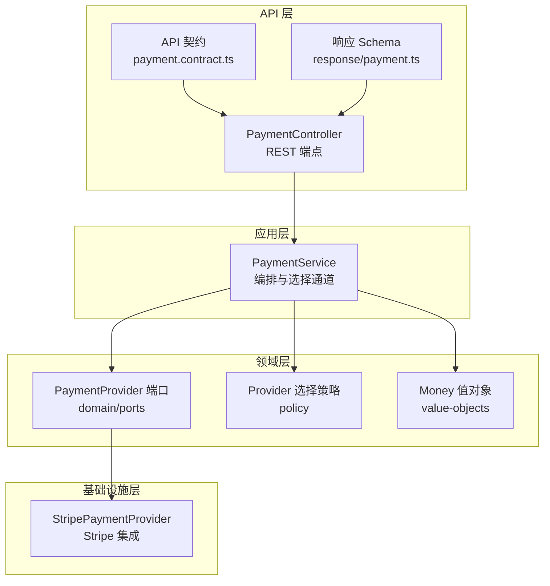
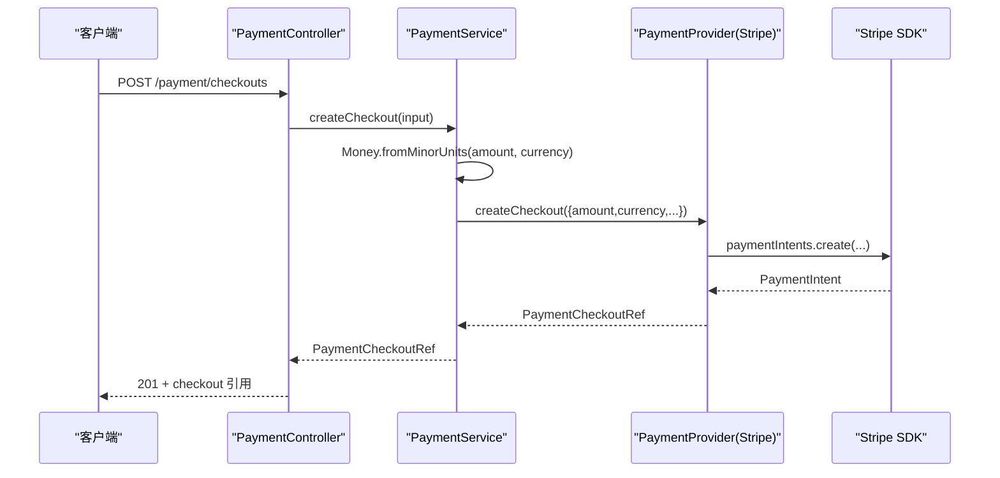
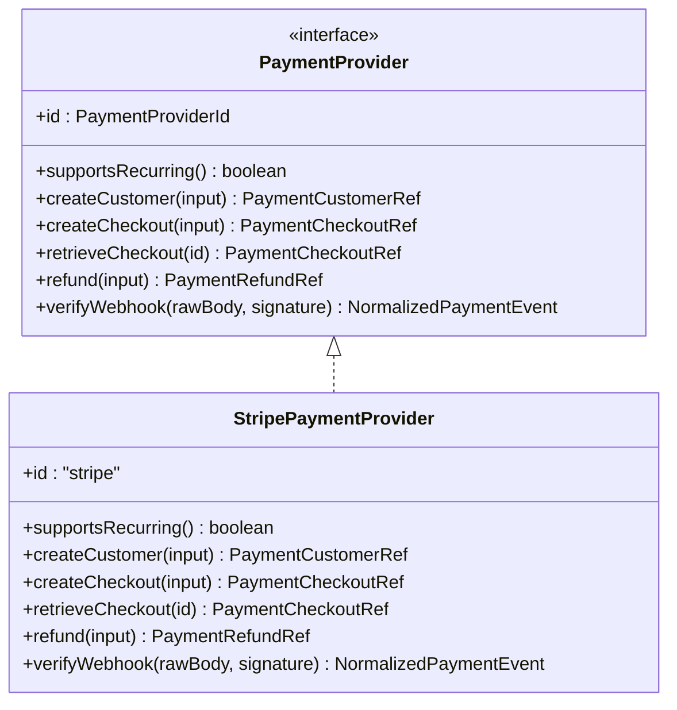
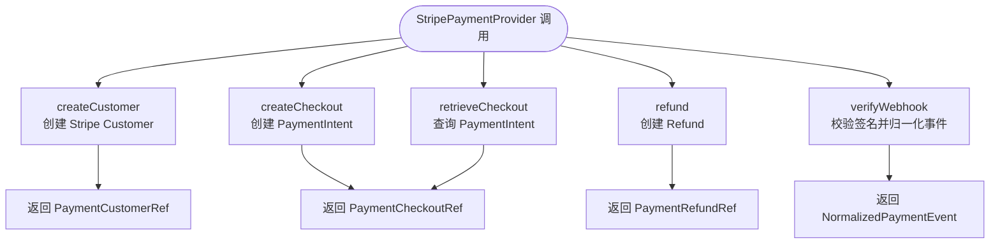
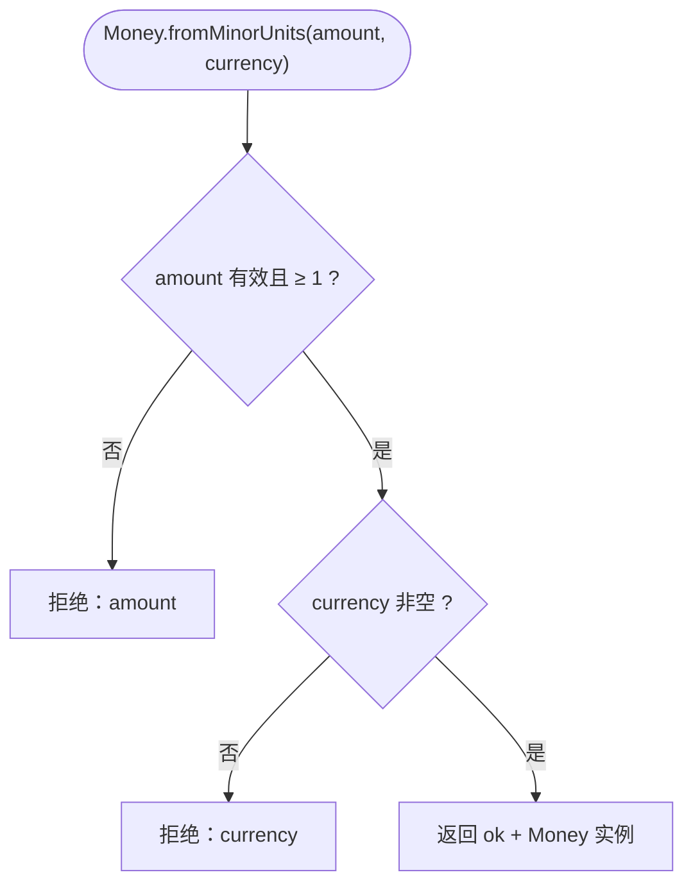
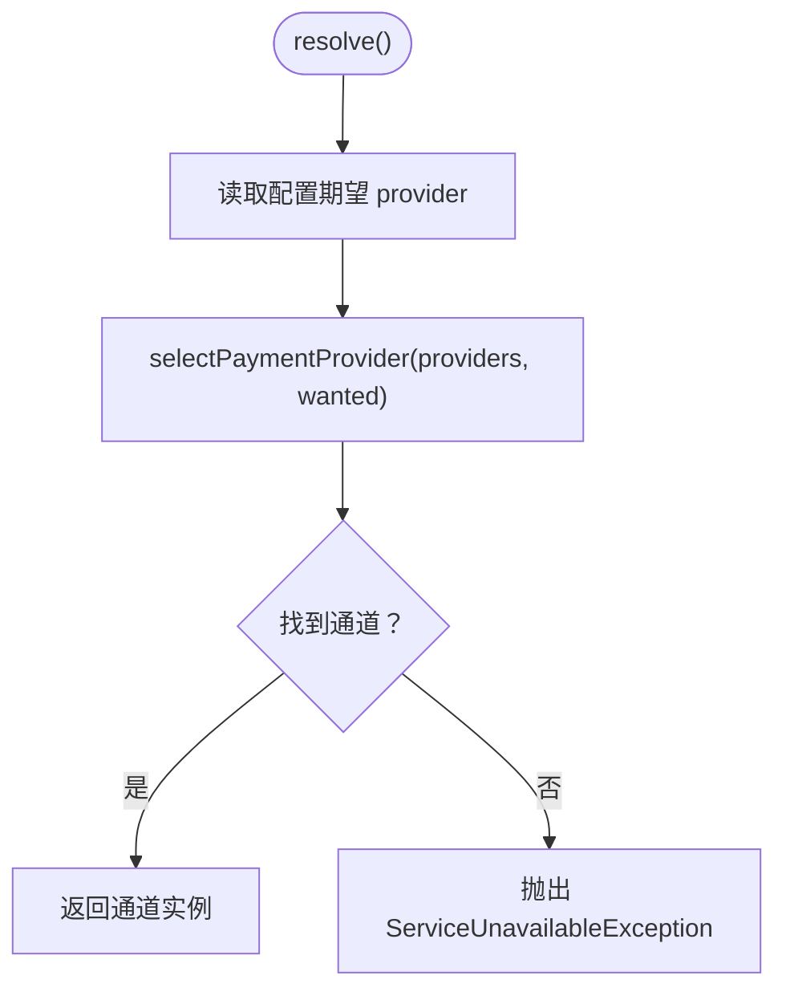
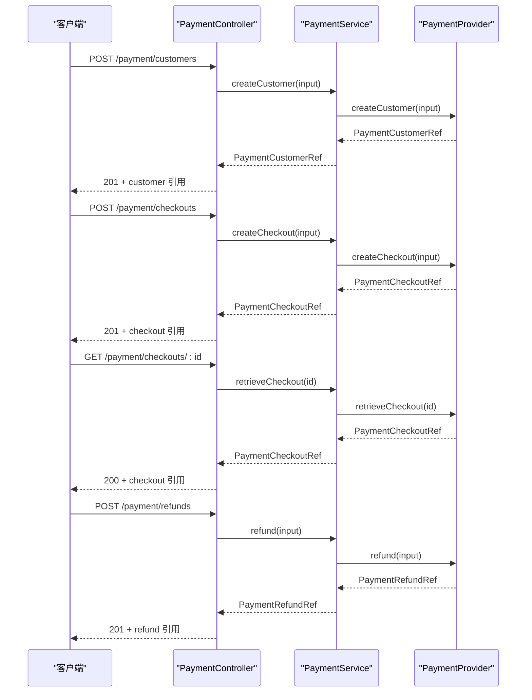
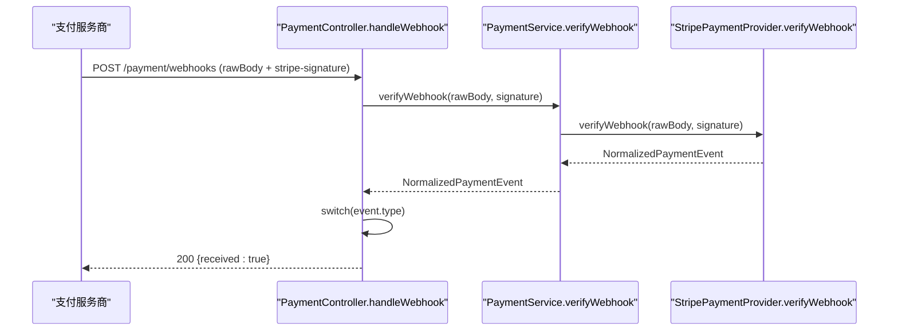
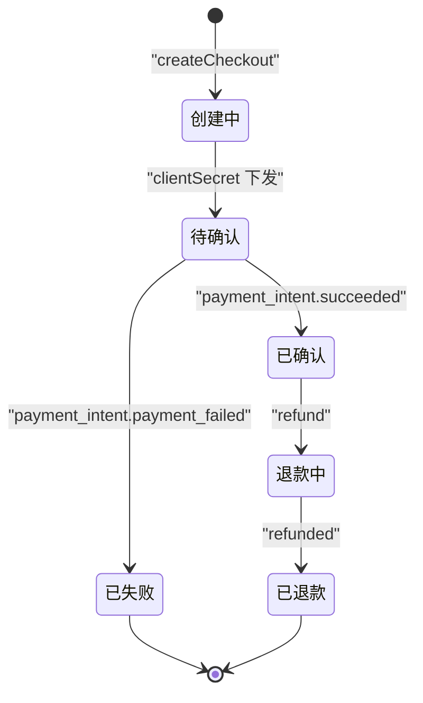
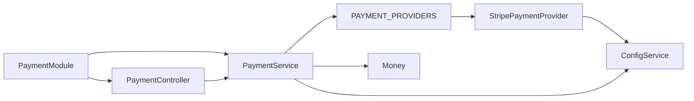

# 支付模块 API

<cite>
**本文引用的文件**   
- [payment.module.ts](file://apps/api/src/modules/payment/payment.module.ts)
- [payment.controller.ts](file://apps/api/src/modules/payment/api/payment.controller.ts)
- [payment.service.ts](file://apps/api/src/modules/payment/application/payment.service.ts)
- [stripe-payment.provider.ts](file://apps/api/src/modules/payment/infrastructure/stripe-payment.provider.ts)
- [payment-provider.port.ts](file://apps/api/src/modules/payment/domain/ports/payment-provider.port.ts)
- [money.ts](file://apps/api/src/modules/payment/domain/value-objects/money.ts)
- [provider-selection.policy.ts](file://apps/api/src/modules/payment/domain/policies/provider-selection.policy.ts)
- [payment.contract.ts](file://libs/api-contract/src/payment.contract.ts)
- [payment.ts](file://libs/contracts/src/response/payment.ts)
</cite>

## 目录
1. [引言](#引言)
2. [项目结构](#项目结构)
3. [核心组件](#核心组件)
4. [架构总览](#架构总览)
5. [详细组件分析](#详细组件分析)
6. [依赖关系分析](#依赖关系分析)
7. [性能与可扩展性](#性能与可扩展性)
8. [故障排查指南](#故障排查指南)
9. [结论](#结论)

## 引言
本文件面向支付模块的 API 设计与实现，重点说明：
- 支付提供商抽象层的设计与 Stripe 集成实现。
- 支付相关接口：支付创建、支付确认（结账取回）、退款处理、账单状态查询等。
- 金额值对象 Money 的设计与使用，包括货币单位、精度控制与扩展点。
- 支付状态机与工作流：结账生命周期、Webhook 事件分发与异常处理。
- 安全机制：签名验证、回调入口隔离、防重放建议。
- Webhook 接收与事件通知机制。

该文档既适合开发者理解代码结构，也适合非技术读者把握支付流程与安全要点。

## 项目结构
支付模块采用分层与领域驱动设计：
- API 层：HTTP 控制器暴露 REST 端点，契约定义在共享合约包中。
- 应用层：编排调用、选择通道、校验金额、统一错误语义。
- 领域层：端口接口、策略与值对象，不含框架依赖。
- 基础设施层：Stripe 具体实现。

图表来源
- [payment.controller.ts:66-172](file://apps/api/src/modules/payment/api/payment.controller.ts#L66-L172)
- [payment.contract.ts:10-67](file://libs/api-contract/src/payment.contract.ts#L10-L67)
- [payment.ts:45-84](file://libs/contracts/src/response/payment.ts#L45-L84)
- [payment.service.ts:32-122](file://apps/api/src/modules/payment/application/payment.service.ts#L32-L122)
- [payment-provider.port.ts:124-157](file://apps/api/src/modules/payment/domain/ports/payment-provider.port.ts#L124-L157)
- [provider-selection.policy.ts:13-18](file://apps/api/src/modules/payment/domain/policies/provider-selection.policy.ts#L13-L18)
- [money.ts:23-44](file://apps/api/src/modules/payment/domain/value-objects/money.ts#L23-L44)
- [stripe-payment.provider.ts:19-107](file://apps/api/src/modules/payment/infrastructure/stripe-payment.provider.ts#L19-L107)

章节来源
- [payment.module.ts:9-47](file://apps/api/src/modules/payment/payment.module.ts#L9-L47)
- [payment.controller.ts:66-172](file://apps/api/src/modules/payment/api/payment.controller.ts#L66-L172)
- [payment.service.ts:32-122](file://apps/api/src/modules/payment/application/payment.service.ts#L32-L122)

## 核心组件
- PaymentModule：注册支付控制器与服务，按配置动态装配可用支付通道（默认 Stripe）。
- PaymentController：对外暴露测试、客户、结账、退款、Webhook 五个端点。
- PaymentService：编排层，负责通道选择、金额校验、委托端口实现。
- PaymentProvider 端口：统一支付能力抽象，屏蔽不同支付方差异。
- StripePaymentProvider：Stripe 的具体实现，封装 SDK 调用并归一化返回体。
- Money 值对象：不可变金额+币种封装，构造即守不变量。
- Provider 选择策略：优先使用配置的通道，未命中时回退 Stripe。

章节来源
- [payment.module.ts:9-47](file://apps/api/src/modules/payment/payment.module.ts#L9-L47)
- [payment.controller.ts:66-172](file://apps/api/src/modules/payment/api/payment.controller.ts#L66-L172)
- [payment.service.ts:32-122](file://apps/api/src/modules/payment/application/payment.service.ts#L32-L122)
- [payment-provider.port.ts:124-157](file://apps/api/src/modules/payment/domain/ports/payment-provider.port.ts#L124-L157)
- [stripe-payment.provider.ts:19-107](file://apps/api/src/modules/payment/infrastructure/stripe-payment.provider.ts#L19-L107)
- [money.ts:23-44](file://apps/api/src/modules/payment/domain/value-objects/money.ts#L23-L44)
- [provider-selection.policy.ts:13-18](file://apps/api/src/modules/payment/domain/policies/provider-selection.policy.ts#L13-L18)

## 架构总览
支付模块通过“端口 + 适配器”解耦业务与第三方服务，控制器仅关注 HTTP 契约与输入输出，服务层专注编排与错误映射，领域层提供稳定抽象。

图表来源
- [payment.controller.ts:103-110](file://apps/api/src/modules/payment/api/payment.controller.ts#L103-L110)
- [payment.service.ts:75-82](file://apps/api/src/modules/payment/application/payment.service.ts#L75-L82)
- [stripe-payment.provider.ts:57-65](file://apps/api/src/modules/payment/infrastructure/stripe-payment.provider.ts#L57-L65)

## 详细组件分析

### 支付提供商抽象层（PaymentProvider）
PaymentProvider 是支付域的统一端口，所有支付提供方必须实现以下能力：
- id：提供方标识（如 stripe）。
- supportsRecurring：是否支持周期扣款/订阅。
- createCustomer：创建或复用支付客户。
- createCheckout：创建下单/收款意图。
- retrieveCheckout：按 id 取回收款引用。
- refund：对既有结账发起退款。
- verifyWebhook：验签并归一化 Webhook 事件。

图表来源
- [payment-provider.port.ts:124-157](file://apps/api/src/modules/payment/domain/ports/payment-provider.port.ts#L124-L157)
- [stripe-payment.provider.ts:19-107](file://apps/api/src/modules/payment/infrastructure/stripe-payment.provider.ts#L19-L107)

章节来源
- [payment-provider.port.ts:1-157](file://apps/api/src/modules/payment/domain/ports/payment-provider.port.ts#L1-L157)

### Stripe 集成实现（StripePaymentProvider）
StripePaymentProvider 将 Stripe SDK 调用结果归一化为统一的引用类型，并透传原始负载 raw，便于后续演进与迁移。关键行为：
- 懒初始化 Stripe 客户端，避免启动期失败。
- createCustomer 映射为 Stripe Customer。
- createCheckout/retrieveCheckout 映射为 Stripe PaymentIntent。
- refund 映射为 Stripe Refund。
- verifyWebhook 使用 SDK 进行签名校验并返回标准化事件。

图表来源
- [stripe-payment.provider.ts:43-96](file://apps/api/src/modules/payment/infrastructure/stripe-payment.provider.ts#L43-L96)

章节来源
- [stripe-payment.provider.ts:1-108](file://apps/api/src/modules/payment/infrastructure/stripe-payment.provider.ts#L1-L108)

### 金额值对象（Money）
Money 是不可变的“金额+币种”值对象，用于保证领域内金额表达的一致性：
- fromMinorUnits：从最小货币单位（如分）构造，若 amount 非法或 currency 为空则拒绝。
- 不额外收紧为整数或 ISO-4217 三位码，保持与边界 zod schema 一致，避免改变 HTTP 接受面。
- 在 PaymentService.createCheckout 中作为防御性兜底，确保进入下游的金额满足不变量。

图表来源
- [money.ts:35-43](file://apps/api/src/modules/payment/domain/value-objects/money.ts#L35-L43)

章节来源
- [money.ts:1-45](file://apps/api/src/modules/payment/domain/value-objects/money.ts#L1-L45)
- [payment.service.ts:75-82](file://apps/api/src/modules/payment/application/payment.service.ts#L75-L82)

### 支付通道选择策略
selectPaymentProvider 根据配置期望的 provider 选择已注册的通道；若未命中则回退到 stripe。若无任何可用通道，由应用层抛出服务不可用异常，保持“未配不炸启动”的懒解析语义。

图表来源
- [provider-selection.policy.ts:13-18](file://apps/api/src/modules/payment/domain/policies/provider-selection.policy.ts#L13-L18)
- [payment.service.ts:112-122](file://apps/api/src/modules/payment/application/payment.service.ts#L112-L122)

章节来源
- [provider-selection.policy.ts:1-19](file://apps/api/src/modules/payment/domain/policies/provider-selection.policy.ts#L1-L19)
- [payment.service.ts:112-122](file://apps/api/src/modules/payment/application/payment.service.ts#L112-L122)

### API 端点与契约
支付模块对外暴露以下 REST 端点（由 @saas/api-contract 定义契约与 OpenAPI meta）：
- GET /payment/test：支付集成状态概览。
- POST /payment/customers：创建支付客户（201）。
- POST /payment/checkouts：创建结账/收款意图（201）。
- GET /payment/checkouts/:id：按 id 取回结账（200）。
- POST /payment/refunds：对结账退款（201）。
- POST /payment/webhooks：接收支付方回调（200，保留 REST）。

请求/响应类型由 zod schema 单源管理，控制器通过 .input/.output 绑定契约，确保类型一致性。

图表来源
- [payment.contract.ts:22-67](file://libs/api-contract/src/payment.contract.ts#L22-L67)
- [payment.controller.ts:75-136](file://apps/api/src/modules/payment/api/payment.controller.ts#L75-L136)
- [payment.service.ts:64-100](file://apps/api/src/modules/payment/application/payment.service.ts#L64-L100)

章节来源
- [payment.contract.ts:1-67](file://libs/api-contract/src/payment.contract.ts#L1-L67)
- [payment.controller.ts:66-172](file://apps/api/src/modules/payment/api/payment.controller.ts#L66-L172)
- [payment.ts:45-84](file://libs/contracts/src/response/payment.ts#L45-L84)

### Webhook 回调与事件分发
Webhook 端点保留 REST 以获取原始请求体，用于签名校验：
- 使用 Stripe SDK 的 constructEventAsync 进行签名校验。
- 校验通过后返回标准化的 NormalizedPaymentEvent。
- 控制器内按 event.type 分发处理（示例包含成功与失败两种事件分支）。

图表来源
- [payment.controller.ts:147-171](file://apps/api/src/modules/payment/api/payment.controller.ts#L147-L171)
- [payment.service.ts:108-110](file://apps/api/src/modules/payment/application/payment.service.ts#L108-L110)
- [stripe-payment.provider.ts:87-96](file://apps/api/src/modules/payment/infrastructure/stripe-payment.provider.ts#L87-L96)

章节来源
- [payment.controller.ts:147-171](file://apps/api/src/modules/payment/api/payment.controller.ts#L147-L171)
- [payment.service.ts:108-110](file://apps/api/src/modules/payment/application/payment.service.ts#L108-L110)
- [stripe-payment.provider.ts:87-96](file://apps/api/src/modules/payment/infrastructure/stripe-payment.provider.ts#L87-L96)

### 支付状态机与工作流
当前结账工作流围绕 Stripe PaymentIntent 的状态展开：
- 创建结账：生成 PaymentIntent，返回 clientSecret 供前端确认。
- 取回结账：查询 PaymentIntent 状态。
- 退款：对已完成的结账发起 Refund。
- Webhook 事件：监听 payment_intent.succeeded 与 payment_intent.payment_failed 等事件，更新本地状态。

图表来源
- [stripe-payment.provider.ts:57-85](file://apps/api/src/modules/payment/infrastructure/stripe-payment.provider.ts#L57-L85)
- [payment.controller.ts:161-168](file://apps/api/src/modules/payment/api/payment.controller.ts#L161-L168)

章节来源
- [stripe-payment.provider.ts:57-85](file://apps/api/src/modules/payment/infrastructure/stripe-payment.provider.ts#L57-L85)
- [payment.controller.ts:161-168](file://apps/api/src/modules/payment/api/payment.controller.ts#L161-L168)

### 安全机制
- 签名验证：Webhook 使用 Stripe SDK 的 constructEventAsync 校验签名，防止伪造回调。
- 回调入口隔离：Webhook 端点使用 @Public 旁路全局会话墙，仅依赖签名校验；其他端点仍需会话。
- 防重放攻击：建议在应用层引入幂等键（如事件 ID + 时间窗口），结合数据库唯一约束或去重表，避免重复处理同一事件。
- 金额不变量：通过 Money 值对象确保金额与币种的合法性，减少资金路径风险。

章节来源
- [payment.controller.ts:147-171](file://apps/api/src/modules/payment/api/payment.controller.ts#L147-L171)
- [stripe-payment.provider.ts:87-96](file://apps/api/src/modules/payment/infrastructure/stripe-payment.provider.ts#L87-L96)
- [money.ts:35-43](file://apps/api/src/modules/payment/domain/value-objects/money.ts#L35-L43)

## 依赖关系分析
支付模块内部依赖如下：
- PaymentModule 注入 ConfigService，动态装配 StripePaymentProvider。
- PaymentController 依赖 PaymentService，并通过 @Impl 绑定契约。
- PaymentService 依赖 ConfigService、PAYMENT_PROVIDERS 与 Money。
- StripePaymentProvider 依赖 ConfigService 与 Stripe SDK。

图表来源
- [payment.module.ts:9-47](file://apps/api/src/modules/payment/payment.module.ts#L9-L47)
- [payment.controller.ts:66-172](file://apps/api/src/modules/payment/api/payment.controller.ts#L66-L172)
- [payment.service.ts:32-122](file://apps/api/src/modules/payment/application/payment.service.ts#L32-L122)
- [stripe-payment.provider.ts:19-37](file://apps/api/src/modules/payment/infrastructure/stripe-payment.provider.ts#L19-L37)

章节来源
- [payment.module.ts:9-47](file://apps/api/src/modules/payment/payment.module.ts#L9-L47)
- [payment.controller.ts:66-172](file://apps/api/src/modules/payment/api/payment.controller.ts#L66-L172)
- [payment.service.ts:32-122](file://apps/api/src/modules/payment/application/payment.service.ts#L32-L122)
- [stripe-payment.provider.ts:19-37](file://apps/api/src/modules/payment/infrastructure/stripe-payment.provider.ts#L19-L37)

## 性能与可扩展性
- 懒加载 Stripe 客户端：避免启动期失败，提升可用性。
- 通道选择策略：支持未来接入支付宝/微信支付，仅需新增 Provider 并在 Module.register 中装配。
- 金额计算：基于最小货币单位，避免浮点误差；如需更高精度可考虑引入 Decimal 库并在 Money 中扩展。
- Webhook 处理：建议异步队列化处理事件，避免阻塞回调响应。

[本节为通用指导，不涉及具体文件分析]

## 故障排查指南
- 无可用支付通道：当未配置任何通道时，PaymentService.resolve 会抛出服务不可用异常。检查环境变量与 ConfigService 配置。
- 金额校验失败：若传入金额或币种非法，Money.fromMinorUnits 会拒绝；检查前端提交数据与 zod schema 一致性。
- Webhook 签名失败：确认 webhookSecret 配置正确，并确保请求体未被篡改或二次序列化。
- 退款失败：检查 checkoutId 是否存在且已完成支付，以及退款金额是否合法。

章节来源
- [payment.service.ts:112-122](file://apps/api/src/modules/payment/application/payment.service.ts#L112-L122)
- [money.ts:35-43](file://apps/api/src/modules/payment/domain/value-objects/money.ts#L35-L43)
- [stripe-payment.provider.ts:87-96](file://apps/api/src/modules/payment/infrastructure/stripe-payment.provider.ts#L87-L96)

## 结论
支付模块通过清晰的层次划分与稳定的领域抽象，实现了与第三方支付服务的解耦。Stripe 集成作为首个实现，提供了完整的客户、结账、退款与 Webhook 能力。Money 值对象确保了金额处理的严谨性，而 Provider 选择策略为未来扩展更多支付通道奠定基础。在生产环境中，应重点关注签名验证、幂等性与异步事件处理，以确保资金路径的安全与可靠。