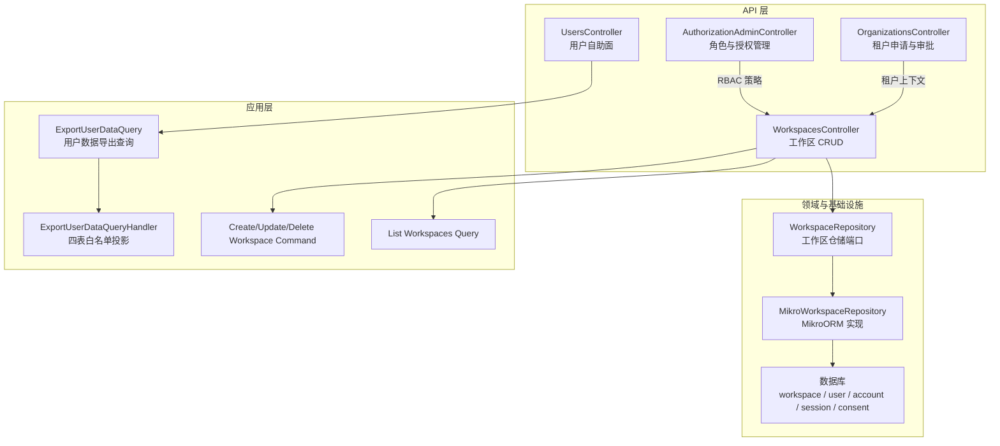
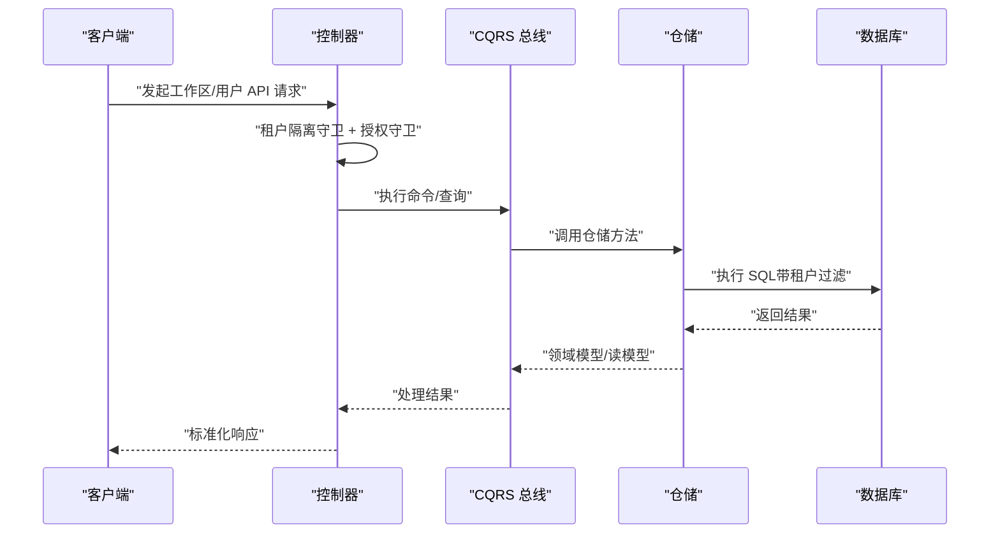
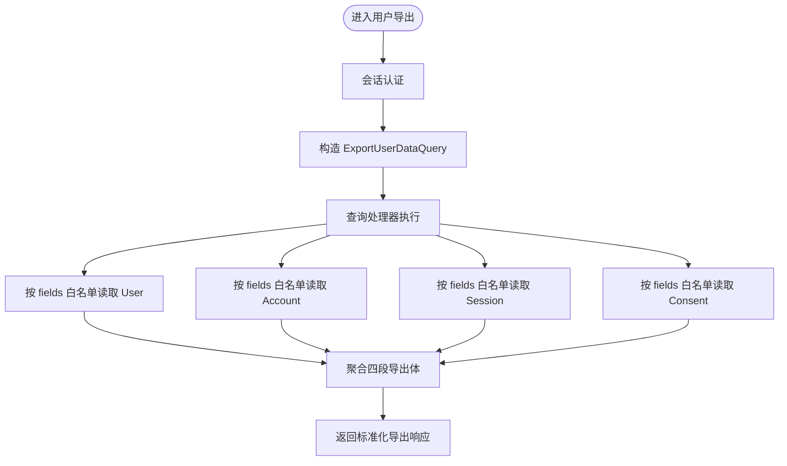
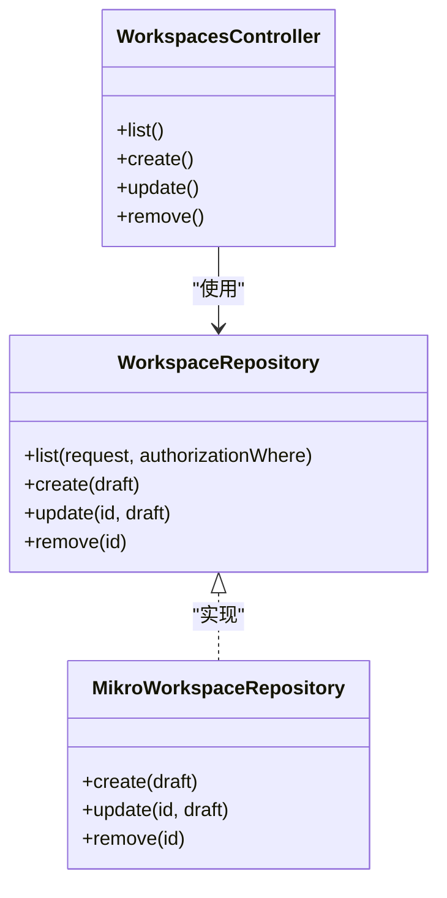
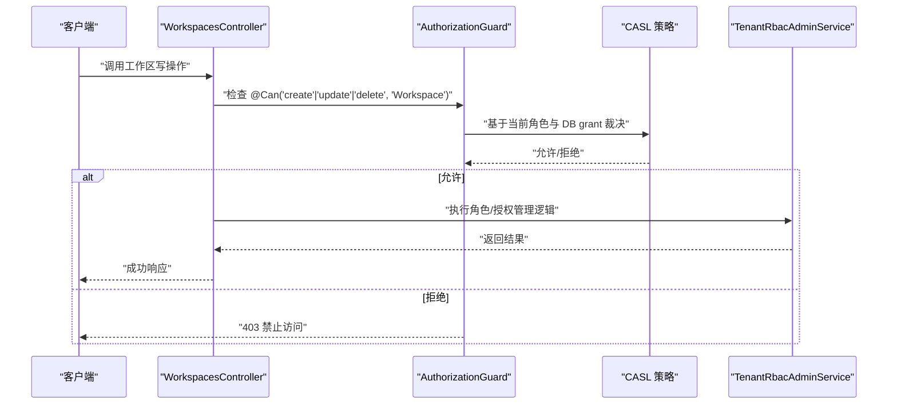
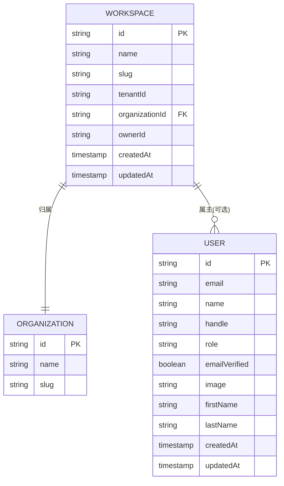
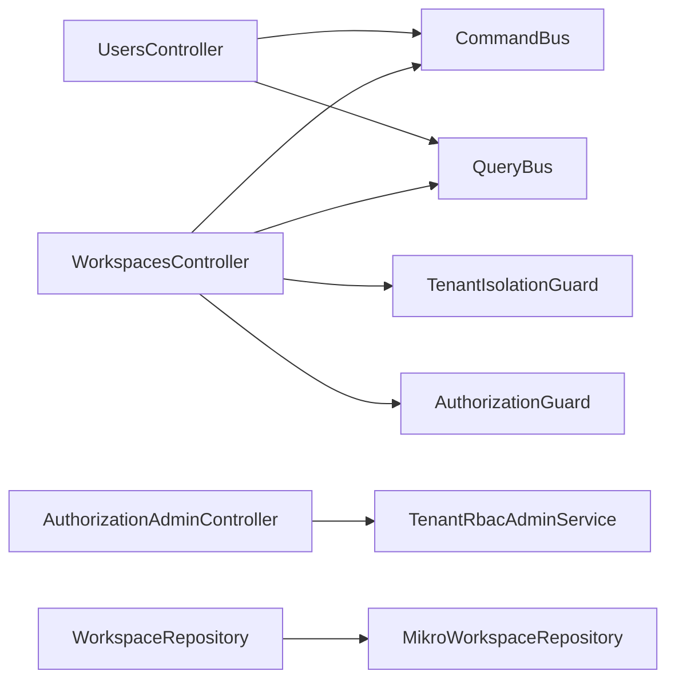

# 用户与工作区 API

<cite>
**本文引用的文件**   
- [apps/api/src/modules/users/api/users.controller.ts](file://apps/api/src/modules/users/api/users.controller.ts)
- [apps/api/src/modules/users/application/queries/export-user-data.query.ts](file://apps/api/src/modules/users/application/queries/export-user-data.query.ts)
- [apps/api/src/modules/users/application/queries/handlers/export-user-data.query-handler.ts](file://apps/api/src/modules/users/application/queries/handlers/export-user-data.query-handler.ts)
- [libs/contracts/src/response/users.ts](file://libs/contracts/src/response/users.ts)
- [apps/api/src/modules/workspaces/api/workspaces.controller.ts](file://apps/api/src/modules/workspaces/api/workspaces.controller.ts)
- [libs/core/src/modules/workspaces/domain/repositories/workspace.repository.ts](file://libs/core/src/modules/workspaces/domain/repositories/workspace.repository.ts)
- [apps/api/src/modules/workspaces/infrastructure/repositories/mikro-workspace.repository.ts](file://apps/api/src/modules/workspaces/infrastructure/repositories/mikro-workspace.repository.ts)
- [apps/api/src/database/mikro/migration/migrations/Migration20261017094221.ts](file://apps/api/src/database/mikro/migration/migrations/Migration20261017094221.ts)
- [apps/api/src/modules/authorization/api/authorization-admin.controller.ts](file://apps/api/src/modules/authorization/api/authorization-admin.controller.ts)
- [apps/api/src/modules/organizations/api/organizations.controller.ts](file://apps/api/src/modules/organizations/api/organizations.controller.ts)
</cite>

## 目录
1. [引言](#引言)
2. [项目结构](#项目结构)
3. [核心组件](#核心组件)
4. [架构总览](#架构总览)
5. [详细组件分析](#详细组件分析)
6. [依赖关系分析](#依赖关系分析)
7. [性能与扩展性](#性能与扩展性)
8. [故障排查指南](#故障排查指南)
9. [结论](#结论)

## 引言
本文件面向“用户管理”和“工作区管理”的 API 文档，覆盖以下目标：
- 用户账户生命周期接口：自助导出、硬删除等；说明管理员侧治理面能力边界。
- 工作区完整管理能力：创建、分页查询、更新、删除，以及权限控制与租户隔离。
- 用户与工作区的关联关系：通过组织（租户）与工作区属主字段建立关联，结合 RBAC 实现权限继承。
- 隐私与合规：个人数据导出遵循最小披露原则，剔除凭据与敏感审计字段。
- 高级能力现状：模板、批量操作、迁移导入在当前仓库中未提供对应控制器或命令，本文明确标注为“尚未实现”。

## 项目结构
围绕用户与工作区相关代码，主要分布在以下模块：
- 用户模块：暴露用户自助面端点，包含个人数据导出与本人硬删除。
- 工作区模块：暴露工作区 CRUD 参考切片，受租户隔离与授权守卫保护。
- 授权管理模块：提供角色与授权行管理门面，用于 RBAC 策略配置。
- 组织模块：提供建租申请与平台运营者审批流程，体现多租户上下文。

图示来源
- [apps/api/src/modules/users/api/users.controller.ts:19-77](file://apps/api/src/modules/users/api/users.controller.ts#L19-L77)
- [apps/api/src/modules/workspaces/api/workspaces.controller.ts:34-151](file://apps/api/src/modules/workspaces/api/workspaces.controller.ts#L34-L151)
- [apps/api/src/modules/authorization/api/authorization-admin.controller.ts:36-179](file://apps/api/src/modules/authorization/api/authorization-admin.controller.ts#L36-L179)
- [apps/api/src/modules/organizations/api/organizations.controller.ts:35-175](file://apps/api/src/modules/organizations/api/organizations.controller.ts#L35-L175)
- [apps/api/src/modules/users/application/queries/export-user-data.query.ts:4-16](file://apps/api/src/modules/users/application/queries/export-user-data.query.ts#L4-L16)
- [apps/api/src/modules/users/application/queries/handlers/export-user-data.query-handler.ts:14-137](file://apps/api/src/modules/users/application/queries/handlers/export-user-data.query-handler.ts#L14-L137)
- [libs/core/src/modules/workspaces/domain/repositories/workspace.repository.ts:62-107](file://libs/core/src/modules/workspaces/domain/repositories/workspace.repository.ts#L62-L107)
- [apps/api/src/modules/workspaces/infrastructure/repositories/mikro-workspace.repository.ts:87-135](file://apps/api/src/modules/workspaces/infrastructure/repositories/mikro-workspace.repository.ts#L87-L135)

章节来源
- [apps/api/src/modules/users/api/users.controller.ts:19-77](file://apps/api/src/modules/users/api/users.controller.ts#L19-L77)
- [apps/api/src/modules/workspaces/api/workspaces.controller.ts:34-151](file://apps/api/src/modules/workspaces/api/workspaces.controller.ts#L34-L151)

## 核心组件
- 用户自助面控制器：提供当前登录用户的个人数据导出与本人硬删除，均要求会话认证，且豁免全局租户隔离墙。
- 工作区控制器：提供工作区列表、创建、更新、删除，统一由租户隔离守卫与授权守卫保护，按角色能力进行细粒度访问控制。
- 授权管理控制器：提供角色与授权行的增删改查，作为 RBAC 策略的唯一入口。
- 组织控制器：提供租户申请、批准、驳回及 Odoo 绑定等流程，体现平台治理面。

章节来源
- [apps/api/src/modules/users/api/users.controller.ts:19-77](file://apps/api/src/modules/users/api/users.controller.ts#L19-L77)
- [apps/api/src/modules/workspaces/api/workspaces.controller.ts:34-151](file://apps/api/src/modules/workspaces/api/workspaces.controller.ts#L34-L151)
- [apps/api/src/modules/authorization/api/authorization-admin.controller.ts:36-179](file://apps/api/src/modules/authorization/api/authorization-admin.controller.ts#L36-L179)
- [apps/api/src/modules/organizations/api/organizations.controller.ts:35-175](file://apps/api/src/modules/organizations/api/organizations.controller.ts#L35-L175)

## 架构总览
用户与工作区 API 采用 CQRS + NestJS 控制器 + 守卫 + 仓储的模式：
- 控制器负责路由、鉴权、输入输出契约校验。
- 应用层通过 CommandBus/QueryBus 分发命令与查询。
- 领域仓储抽象出工作区读写语义，基础设施层用 MikroORM 实现。
- 租户隔离与 RBAC 在请求链路早期完成，确保跨租户越权不可发生。

图示来源
- [apps/api/src/modules/workspaces/api/workspaces.controller.ts:63-151](file://apps/api/src/modules/workspaces/api/workspaces.controller.ts#L63-L151)
- [libs/core/src/modules/workspaces/domain/repositories/workspace.repository.ts:62-107](file://libs/core/src/modules/workspaces/domain/repositories/workspace.repository.ts#L62-L107)
- [apps/api/src/modules/workspaces/infrastructure/repositories/mikro-workspace.repository.ts:87-135](file://apps/api/src/modules/workspaces/infrastructure/repositories/mikro-workspace.repository.ts#L87-L135)

## 详细组件分析

### 用户管理 API
- 个人数据导出
  - 目的：满足 PIPL/GDPR 右访问，聚合用户相关个人数据并剔除凭据。
  - 认证：会话认证（SessionGuard）。
  - 数据范围：用户基本信息、OAuth 账号、会话、同意记录；凭据列在 SELECT 层面即被排除。
  - 输出结构：用户对象 + accounts/sessions/consents 集合。
- 本人硬删除
  - 目的：PIPL 右删除，直接删除当前用户。
  - 认证：会话认证（SessionGuard）。
  - 副作用：触发用户域删除流程。

图示来源
- [apps/api/src/modules/users/api/users.controller.ts:46-63](file://apps/api/src/modules/users/api/users.controller.ts#L46-L63)
- [apps/api/src/modules/users/application/queries/export-user-data.query.ts:4-16](file://apps/api/src/modules/users/application/queries/export-user-data.query.ts#L4-L16)
- [apps/api/src/modules/users/application/queries/handlers/export-user-data.query-handler.ts:44-137](file://apps/api/src/modules/users/application/queries/handlers/export-user-data.query-handler.ts#L44-L137)
- [libs/contracts/src/response/users.ts:14-35](file://libs/contracts/src/response/users.ts#L14-L35)

章节来源
- [apps/api/src/modules/users/api/users.controller.ts:19-77](file://apps/api/src/modules/users/api/users.controller.ts#L19-L77)
- [apps/api/src/modules/users/application/queries/export-user-data.query.ts:4-16](file://apps/api/src/modules/users/application/queries/export-user-data.query.ts#L4-L16)
- [apps/api/src/modules/users/application/queries/handlers/export-user-data.query-handler.ts:14-137](file://apps/api/src/modules/users/application/queries/handlers/export-user-data.query-handler.ts#L14-L137)
- [libs/contracts/src/response/users.ts:1-36](file://libs/contracts/src/response/users.ts#L1-L36)

### 工作区管理 API
- 列出工作区
  - 功能：分页列出当前组织下的工作区。
  - 权限：需要 Workspace 的 read 能力。
  - 隔离：仅返回活动租户内的记录。
- 创建工作区
  - 功能：创建工作区并自动盖章当前组织与租户。
  - 权限：需要 Workspace 的 create 能力（owner/admin）。
- 更新工作区
  - 功能：更新名称与 slug；不存在则返回 404。
  - 权限：需要 Workspace 的 update 能力（owner/admin）。
- 删除工作区
  - 功能：硬删除工作区；不存在则返回 404。
  - 权限：需要 Workspace 的 delete 能力（owner/admin）。

图示来源
- [apps/api/src/modules/workspaces/api/workspaces.controller.ts:63-151](file://apps/api/src/modules/workspaces/api/workspaces.controller.ts#L63-L151)
- [libs/core/src/modules/workspaces/domain/repositories/workspace.repository.ts:62-107](file://libs/core/src/modules/workspaces/domain/repositories/workspace.repository.ts#L62-L107)
- [apps/api/src/modules/workspaces/infrastructure/repositories/mikro-workspace.repository.ts:87-135](file://apps/api/src/modules/workspaces/infrastructure/repositories/mikro-workspace.repository.ts#L87-L135)

章节来源
- [apps/api/src/modules/workspaces/api/workspaces.controller.ts:34-151](file://apps/api/src/modules/workspaces/api/workspaces.controller.ts#L34-L151)
- [libs/core/src/modules/workspaces/domain/repositories/workspace.repository.ts:62-107](file://libs/core/src/modules/workspaces/domain/repositories/workspace.repository.ts#L62-L107)
- [apps/api/src/modules/workspaces/infrastructure/repositories/mikro-workspace.repository.ts:87-135](file://apps/api/src/modules/workspaces/infrastructure/repositories/mikro-workspace.repository.ts#L87-L135)

### 权限与 RBAC
- 工作区权限
  - 所有成员具备 workspace:read。
  - owner/admin 具备 workspace:create/update/delete。
  - 权限判定由 AuthorizationGuard 委托给 CASL，角色到权限映射集中维护。
- 角色与授权管理
  - 提供角色与授权行的增删改查，作为租户差异化授权策略的唯一入口。
  - 系统角色与自定义角色统一管理，避免绕过 BA 内置能力。

图示来源
- [apps/api/src/modules/workspaces/api/workspaces.controller.ts:40-55](file://apps/api/src/modules/workspaces/api/workspaces.controller.ts#L40-L55)
- [apps/api/src/modules/authorization/api/authorization-admin.controller.ts:36-67](file://apps/api/src/modules/authorization/api/authorization-admin.controller.ts#L36-L67)

章节来源
- [apps/api/src/modules/workspaces/api/workspaces.controller.ts:40-55](file://apps/api/src/modules/workspaces/api/workspaces.controller.ts#L40-L55)
- [apps/api/src/modules/authorization/api/authorization-admin.controller.ts:36-179](file://apps/api/src/modules/authorization/api/authorization-admin.controller.ts#L36-L179)

### 用户与工作区关联关系
- 关联维度
  - 组织（租户）：工作区属于活动租户，仓储强制写入 tenantId 与 organizationId。
  - 属主：工作区支持 ownerId 字段，便于标识创建者或负责人。
- 权限继承机制
  - 通过 RBAC 将角色与资源实例关联，工作区列表可下推实例授权谓词，保证跨租户安全的同时实现细粒度可见性。

图示来源
- [apps/api/src/database/mikro/migration/migrations/Migration20261017094221.ts:6-10](file://apps/api/src/database/mikro/migration/migrations/Migration20261017094221.ts#L6-L10)
- [apps/api/src/modules/workspaces/infrastructure/repositories/mikro-workspace.repository.ts:87-104](file://apps/api/src/modules/workspaces/infrastructure/repositories/mikro-workspace.repository.ts#L87-L104)

章节来源
- [apps/api/src/database/mikro/migration/migrations/Migration20261017094221.ts:1-17](file://apps/api/src/database/mikro/migration/migrations/Migration20261017094221.ts#L1-L17)
- [apps/api/src/modules/workspaces/infrastructure/repositories/mikro-workspace.repository.ts:87-135](file://apps/api/src/modules/workspaces/infrastructure/repositories/mikro-workspace.repository.ts#L87-L135)

### 隐私保护与 GDPR/PIPL 合规
- 个人数据导出
  - 严格使用 fields 白名单投影，确保 password、accessToken、refreshToken、idToken、evidence 等敏感字段不在 SQL SELECT 中出现。
  - 输出结构对客户端与服务端均做 zod schema 校验，防止意外泄露。
- 组织数据导出测试断言
  - 测试验证导出不包含凭据键，保障序列化载荷安全。

章节来源
- [apps/api/src/modules/users/application/queries/handlers/export-user-data.query-handler.ts:14-137](file://apps/api/src/modules/users/application/queries/handlers/export-user-data.query-handler.ts#L14-L137)
- [libs/contracts/src/response/users.ts:1-36](file://libs/contracts/src/response/users.ts#L1-L36)

### 高级功能现状
- 工作区模板：未在仓库中发现工作区模板控制器或命令，暂不支持。
- 批量操作：未发现批量创建/更新/删除工作区的控制器或命令，暂不支持。
- 迁移导入：未发现工作区迁移导入控制器或命令，暂不支持。
- 建议：如需实现，可在 workspaces 模块新增批量命令与控制器，复用现有仓储与 RBAC 守卫。

[本节为概念性说明，不直接分析具体文件]

## 依赖关系分析
- 控制器依赖
  - UsersController 依赖 CommandBus/QueryBus 与 orpc 工具函数。
  - WorkspacesController 依赖 CommandBus/QueryBus、租户隔离守卫与授权守卫。
  - AuthorizationAdminController 依赖 TenantRbacAdminService。
- 仓储依赖
  - WorkspaceRepository 定义领域接口，MikroWorkspaceRepository 实现具体 ORM 逻辑。
- 外部依赖
  - Better Auth 会话与身份实体（User/Account/Session/Consent）。
  - MikroORM 实体管理器。

图示来源
- [apps/api/src/modules/users/api/users.controller.ts:38-44](file://apps/api/src/modules/users/api/users.controller.ts#L38-L44)
- [apps/api/src/modules/workspaces/api/workspaces.controller.ts:63-69](file://apps/api/src/modules/workspaces/api/workspaces.controller.ts#L63-L69)
- [apps/api/src/modules/authorization/api/authorization-admin.controller.ts:65-68](file://apps/api/src/modules/authorization/api/authorization-admin.controller.ts#L65-L68)
- [libs/core/src/modules/workspaces/domain/repositories/workspace.repository.ts:62-107](file://libs/core/src/modules/workspaces/domain/repositories/workspace.repository.ts#L62-L107)
- [apps/api/src/modules/workspaces/infrastructure/repositories/mikro-workspace.repository.ts:87-135](file://apps/api/src/modules/workspaces/infrastructure/repositories/mikro-workspace.repository.ts#L87-L135)

章节来源
- [apps/api/src/modules/users/api/users.controller.ts:38-44](file://apps/api/src/modules/users/api/users.controller.ts#L38-L44)
- [apps/api/src/modules/workspaces/api/workspaces.controller.ts:63-69](file://apps/api/src/modules/workspaces/api/workspaces.controller.ts#L63-L69)
- [apps/api/src/modules/authorization/api/authorization-admin.controller.ts:65-68](file://apps/api/src/modules/authorization/api/authorization-admin.controller.ts#L65-L68)

## 性能与扩展性
- 数据导出性能
  - 使用 MikroORM 分叉 EntityManager，减少连接竞争。
  - 通过 fields 白名单投影降低 I/O 与内存占用。
- 工作区查询性能
  - 分页查询支持 offset 分页，仓储层按租户与可选实例授权谓词过滤。
  - 索引优化：workspace 表增加 (organizationId, ownerId) 索引以加速属主查询。
- 扩展建议
  - 引入缓存层（如 Redis）缓存工作区列表与角色授权视图。
  - 对高频导出场景考虑异步任务与下载链接机制。

章节来源
- [apps/api/src/modules/users/application/queries/handlers/export-user-data.query-handler.ts:44-137](file://apps/api/src/modules/users/application/queries/handlers/export-user-data.query-handler.ts#L44-L137)
- [apps/api/src/database/mikro/migration/migrations/Migration20261017094221.ts:6-10](file://apps/api/src/database/mikro/migration/migrations/Migration20261017094221.ts#L6-L10)

## 故障排查指南
- 工作区 404
  - 现象：更新或删除工作区时返回 404。
  - 原因：工作区不存在或不属于当前租户。
  - 处理：检查工作区 ID 与租户上下文是否正确。
- 用户数据导出 404
  - 现象：导出指定用户数据时返回 404。
  - 原因：用户不存在。
  - 处理：确认 userId 有效且用户未被删除。
- 权限 403
  - 现象：工作区写操作返回 403。
  - 原因：当前角色不具备所需能力。
  - 处理：检查 RBAC 角色与授权行配置。

章节来源
- [apps/api/src/modules/workspaces/api/workspaces.controller.ts:109-150](file://apps/api/src/modules/workspaces/api/workspaces.controller.ts#L109-L150)
- [apps/api/src/modules/users/application/queries/handlers/export-user-data.query-handler.ts:63-67](file://apps/api/src/modules/users/application/queries/handlers/export-user-data.query-handler.ts#L63-L67)
- [apps/api/src/modules/authorization/api/authorization-admin.controller.ts:36-67](file://apps/api/src/modules/authorization/api/authorization-admin.controller.ts#L36-L67)

## 结论
- 用户管理 API 聚焦于隐私合规与本人操作，提供个人数据导出与本人硬删除。
- 工作区管理 API 提供完整的 CRUD 能力，并通过租户隔离与 RBAC 保证安全与可扩展。
- 用户与工作区通过组织与属主字段建立关联，RBAC 提供灵活的权限继承机制。
- 高级功能（模板、批量、迁移导入）当前未实现，可按需扩展。