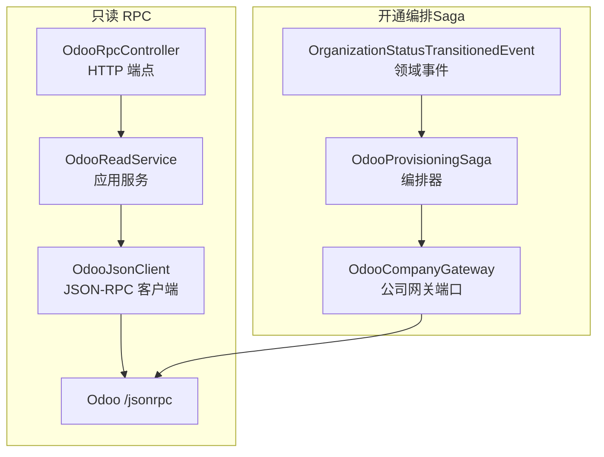
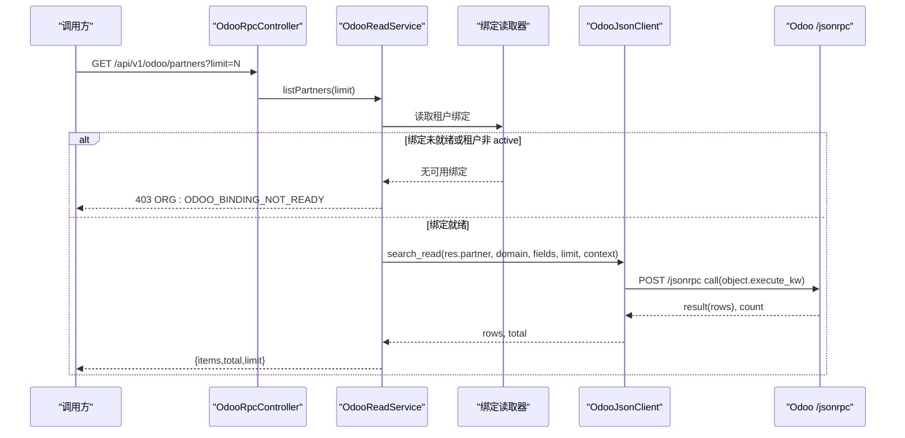
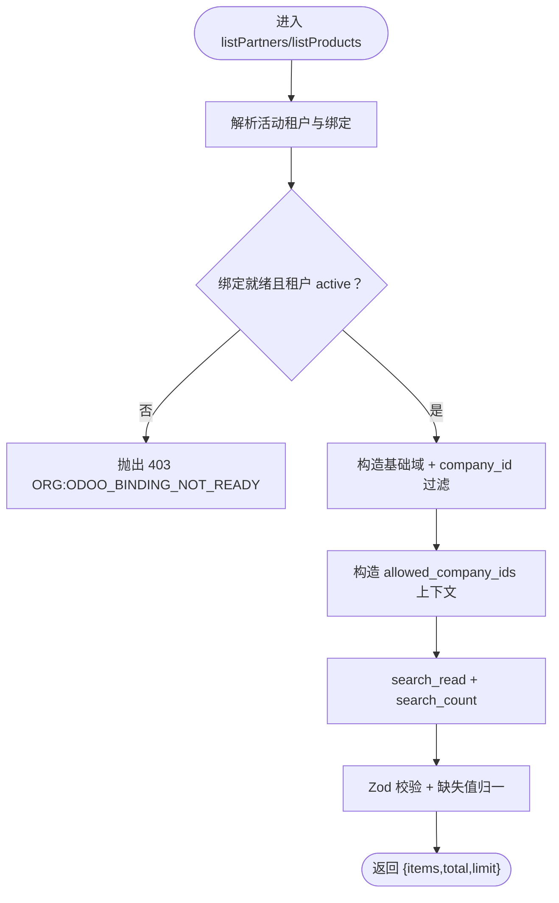
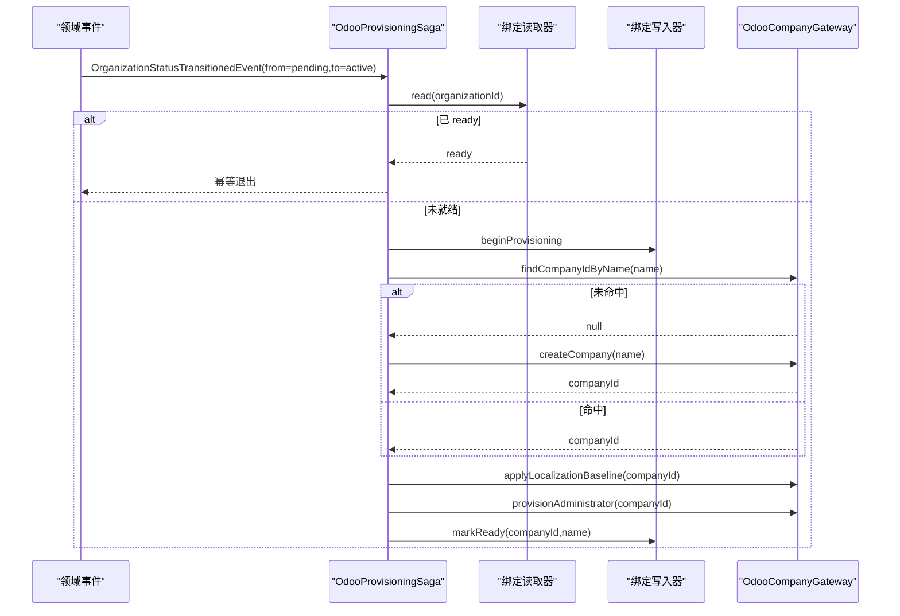
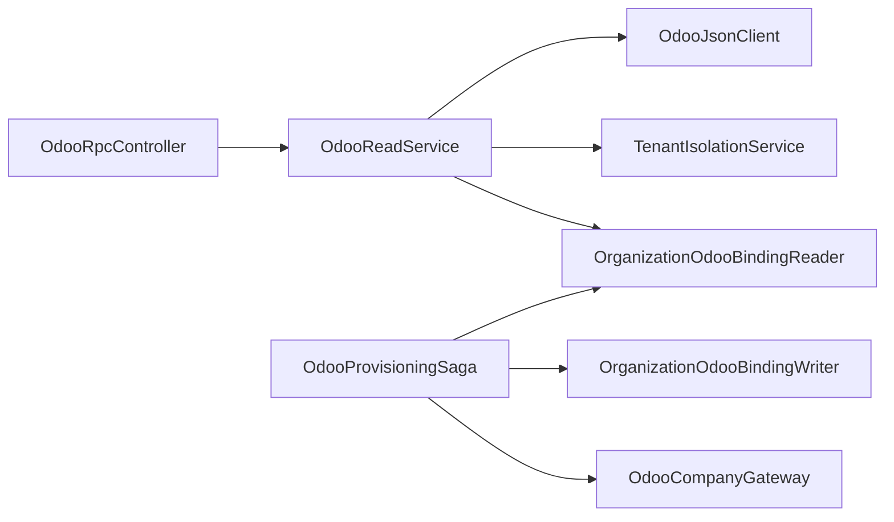

# Odoo 企业系统集成 API

<cite>
**本文引用的文件**   
- [odoo-rpc.controller.ts](file://apps/api/src/features/odoo-rpc-api/api/odoo-rpc.controller.ts)
- [odoo-read.service.ts](file://apps/api/src/features/odoo-rpc-api/application/odoo-read.service.ts)
- [odoo-json.client.ts](file://apps/api/src/features/odoo-rpc-api/infrastructure/odoo-json.client.ts)
- [odoo-rpc.schemas.ts](file://apps/api/src/features/odoo-rpc-api/api/odoo-rpc.schemas.ts)
- [odoo-company-gateway.ts](file://apps/api/src/features/odoo-provisioning/infrastructure/odoo-company-gateway.ts)
- [odoo-provisioning.saga.ts](file://apps/api/src/features/odoo-provisioning/application/odoo-provisioning.saga.ts)
- [odoo-provisioning.module.ts](file://apps/api/src/features/odoo-provisioning/api/odoo-provisioning.module.ts)
</cite>

## 目录
1. [简介](#简介)
2. [项目结构](#项目结构)
3. [核心组件](#核心组件)
4. [架构总览](#架构总览)
5. [详细组件分析](#详细组件分析)
6. [依赖关系分析](#依赖关系分析)
7. [性能与容量](#性能与容量)
8. [错误处理与重试](#错误处理与重试)
9. [配置与连接管理](#配置与连接管理)
10. [数据映射与转换](#数据映射与转换)
11. [安全与最佳实践](#安全与最佳实践)
12. [故障排查](#故障排查)
13. [结论](#结论)

## 简介
本文件面向 Odoo 企业系统集成，聚焦以下目标：
- 公司绑定完整流程：从事件触发、意图落盘、命名回找、建司、本地化基线、管理员预配到状态回写。
- 只读集成接口：客户与商品模板的白名单视图、分页计数、字段归一与校验。
- 错误处理与重试机制：fail-closed 策略、上游错误信封、鉴权失败与不可达处理。
- 配置与连接管理：Odoo JSON-RPC 客户端、凭据与超时控制。
- 数据映射与转换：Zod 契约、字段白名单、缺失值归一。
- 安全与最佳实践：会话租户隔离、公司域强制注入、allowed_company_ids 纵深防御、API Key 最小权限。

## 项目结构
Odoo 集成在应用层以 feature 形式组织，分为“只读 RPC”和“开通编排（Saga）”两个子特性：
- 只读 RPC：HTTP 控制器 → 应用服务 → JSON-RPC 客户端 → Odoo。
- 开通编排：领域事件驱动 Saga → 公司网关端口 → 具体 JSON-RPC 实现（由模块装配）。



图表来源
- [odoo-rpc.controller.ts:13-72](file://apps/api/src/features/odoo-rpc-api/api/odoo-rpc.controller.ts#L13-L72)
- [odoo-read.service.ts:17-108](file://apps/api/src/features/odoo-rpc-api/application/odoo-read.service.ts#L17-L108)
- [odoo-json.client.ts:20-147](file://apps/api/src/features/odoo-rpc-api/infrastructure/odoo-json.client.ts#L20-L147)
- [odoo-provisioning.saga.ts:22-105](file://apps/api/src/features/odoo-provisioning/application/odoo-provisioning.saga.ts#L22-L105)
- [odoo-company-gateway.ts:1-43](file://apps/api/src/features/odoo-provisioning/infrastructure/odoo-company-gateway.ts#L1-L43)

章节来源
- [odoo-rpc.controller.ts:13-72](file://apps/api/src/features/odoo-rpc-api/api/odoo-rpc.controller.ts#L13-L72)
- [odoo-provisioning.module.ts:1-25](file://apps/api/src/features/odoo-provisioning/api/odoo-provisioning.module.ts#L1-L25)

## 核心组件
- HTTP 控制器：暴露只读列表端点，仅委托应用服务，不承载业务逻辑。
- 应用服务：负责租户绑定就绪性检查、公司域注入、上下文传递、结果归一与 Zod 校验。
- JSON-RPC 客户端：封装 Odoo `/jsonrpc` 调用、鉴权、错误信封解析与超时。
- 公司网关端口：定义建司、命名回找、本地化基线与管理员预配的抽象接口。
- 开通 Saga：订阅租户状态迁移事件，编排建司全流程并持久化意图与结果。

章节来源
- [odoo-rpc.controller.ts:49-72](file://apps/api/src/features/odoo-rpc-api/api/odoo-rpc.controller.ts#L49-L72)
- [odoo-read.service.ts:30-108](file://apps/api/src/features/odoo-rpc-api/application/odoo-read.service.ts#L30-L108)
- [odoo-json.client.ts:33-147](file://apps/api/src/features/odoo-rpc-api/infrastructure/odoo-json.client.ts#L33-L147)
- [odoo-company-gateway.ts:17-43](file://apps/api/src/features/odoo-provisioning/infrastructure/odoo-company-gateway.ts#L17-L43)
- [odoo-provisioning.saga.ts:49-105](file://apps/api/src/features/odoo-provisioning/application/odoo-provisioning.saga.ts#L49-L105)

## 架构总览
下图展示一次“获取客户列表”的请求路径与关键决策点。



图表来源
- [odoo-rpc.controller.ts:49-72](file://apps/api/src/features/odoo-rpc-api/api/odoo-rpc.controller.ts#L49-L72)
- [odoo-read.service.ts:40-82](file://apps/api/src/features/odoo-rpc-api/application/odoo-read.service.ts#L40-L82)
- [odoo-json.client.ts:42-86](file://apps/api/src/features/odoo-rpc-api/infrastructure/odoo-json.client.ts#L42-L86)

## 详细组件分析

### 只读 RPC 控制器
- 职责：声明只读路由与 OpenAPI 元信息，将请求委托给 `OdooReadService`。
- 安全：受全局 SessionGuard 保护；按活动租户绑定域访问；绑定非 ready 返回 403。
- 输入输出：使用 Zod schema 约束查询参数与响应信封。

章节来源
- [odoo-rpc.controller.ts:13-72](file://apps/api/src/features/odoo-rpc-api/api/odoo-rpc.controller.ts#L13-L72)
- [odoo-rpc.schemas.ts:12-46](file://apps/api/src/features/odoo-rpc-api/api/odoo-rpc.schemas.ts#L12-L46)

### 只读应用服务
- 职责：
  - 解析活动租户并校验绑定就绪性（fail-closed）。
  - 注入公司域与 allowed_company_ids 上下文。
  - 调用 JSON-RPC 客户端执行 search_read/search_count。
  - 对上游数据进行 Zod 校验与缺失值归一。
- 关键方法：listPartners、listProducts、resolveReadyCompanyId。



图表来源
- [odoo-read.service.ts:40-108](file://apps/api/src/features/odoo-rpc-api/application/odoo-read.service.ts#L40-L108)

章节来源
- [odoo-read.service.ts:17-143](file://apps/api/src/features/odoo-rpc-api/application/odoo-read.service.ts#L17-L143)

### JSON-RPC 客户端
- 职责：封装 Odoo `/jsonrpc` 调用、鉴权、错误信封解析、超时控制。
- 鉴权：通过 common.authenticate 获取 uid，缓存至实例生命周期。
- 便捷方法：searchCount、searchRead、executeKw。
- 错误处理：网络异常/HTTP 非 2xx/Envelope.error/缺 result 均抛错，不吞错。

```mermaid
classDiagram
class OdooJsonClient {
-logger
-uid
-seq
+executeKw(model, method, args, kwargs) Promise
+searchCount(model, domain, context) Promise~number~
+searchRead(model, domain, fields, limit, context) Promise~OdooRow[]~
-credentials() {db,key}
-resolveUid(db, key) number
-call(body, label) Promise
}
```

图表来源
- [odoo-json.client.ts:33-147](file://apps/api/src/features/odoo-rpc-api/infrastructure/odoo-json.client.ts#L33-L147)

章节来源
- [odoo-json.client.ts:20-147](file://apps/api/src/features/odoo-rpc-api/infrastructure/odoo-json.client.ts#L20-L147)

### 公司网关端口（开通侧）
- 职责：定义建司相关操作的抽象接口，供 Saga 编排调用。
- 能力：按确定性公司名回找、创建公司、应用本地化基线、预配管理员。

章节来源
- [odoo-company-gateway.ts:1-43](file://apps/api/src/features/odoo-provisioning/infrastructure/odoo-company-gateway.ts#L1-L43)

### 开通 Saga（公司绑定编排）
- 触发：监听租户状态迁移事件，仅在首次开通（pending→active）时执行。
- 编排步骤：
  1) 读取绑定行，已 ready 则幂等退出。
  2) beginProvisioning 先落意图（provisioning）。
  3) findCompanyIdByName 优先回找，未命中则 createCompany。
  4) applyLocalizationBaseline → provisionAdministrator。
  5) markReady 写入 companyId/name；任一步失败则 markFailed。
- 幂等性：已 ready 早退 + 命名回找避免重复建司。



图表来源
- [odoo-provisioning.saga.ts:22-105](file://apps/api/src/features/odoo-provisioning/application/odoo-provisioning.saga.ts#L22-L105)
- [odoo-company-gateway.ts:17-43](file://apps/api/src/features/odoo-provisioning/infrastructure/odoo-company-gateway.ts#L17-L43)

章节来源
- [odoo-provisioning.saga.ts:22-105](file://apps/api/src/features/odoo-provisioning/application/odoo-provisioning.saga.ts#L22-L105)

## 依赖关系分析
- 控制器依赖应用服务；应用服务依赖 JSON-RPC 客户端、租户隔离服务与绑定读取器。
- 开通 Saga 依赖绑定读写端口与公司网关端口；网关端口由模块装配为具体实现。
- 所有外部系统交互统一经 JSON-RPC 客户端，避免跨层耦合。



图表来源
- [odoo-rpc.controller.ts:49-72](file://apps/api/src/features/odoo-rpc-api/api/odoo-rpc.controller.ts#L49-L72)
- [odoo-read.service.ts:30-38](file://apps/api/src/features/odoo-rpc-api/application/odoo-read.service.ts#L30-L38)
- [odoo-provisioning.saga.ts:54-61](file://apps/api/src/features/odoo-provisioning/application/odoo-provisioning.saga.ts#L54-L61)
- [odoo-provisioning.module.ts:17-24](file://apps/api/src/features/odoo-provisioning/api/odoo-provisioning.module.ts#L17-L24)

章节来源
- [odoo-rpc.controller.ts:49-72](file://apps/api/src/features/odoo-rpc-api/api/odoo-rpc.controller.ts#L49-L72)
- [odoo-read.service.ts:30-38](file://apps/api/src/features/odoo-rpc-api/application/odoo-read.service.ts#L30-L38)
- [odoo-provisioning.saga.ts:54-61](file://apps/api/src/features/odoo-provisioning/application/odoo-provisioning.saga.ts#L54-L61)
- [odoo-provisioning.module.ts:17-24](file://apps/api/src/features/odoo-provisioning/api/odoo-provisioning.module.ts#L17-L24)

## 性能与容量
- 列表查询限制：limit 默认 20，上限 50，防止上游压力过大。
- 并行计数：search_read 与 search_count 并发执行，减少往返延迟。
- 鉴权缓存：uid 在客户端实例内缓存，避免重复 authenticate。
- 超时控制：HTTP 请求设置 10 秒超时，快速失败。

章节来源
- [odoo-rpc.schemas.ts:12-15](file://apps/api/src/features/odoo-rpc-api/api/odoo-rpc.schemas.ts#L12-L15)
- [odoo-read.service.ts:45-48](file://apps/api/src/features/odoo-rpc-api/application/odoo-read.service.ts#L45-L48)
- [odoo-json.client.ts:97-117](file://apps/api/src/features/odoo-rpc-api/infrastructure/odoo-json.client.ts#L97-L117)
- [odoo-json.client.ts:123-129](file://apps/api/src/features/odoo-rpc-api/infrastructure/odoo-json.client.ts#L123-L129)

## 错误处理与重试
- fail-closed 策略：
  - 租户无活动绑定或绑定非 ready：返回 403，错误码 ORG:ODOO_BINDING_NOT_READY。
  - 上游鉴权失败：返回 503，提示 API key 无效或账号不可用。
  - 上游不可达或 HTTP 非 2xx：返回 503。
  - 上游 envelope.error：转为 400，携带上游错误消息。
  - 上游响应缺 result：返回 503。
- 重试机制：
  - 当前客户端未内置自动重试；建议在 Saga 或上层编排中引入可重试调用（指数退避），并对幂等操作（如 findCompanyIdByName）进行去重。
  - 对于非幂等写操作（createCompany、applyLocalizationBaseline、provisionAdministrator），需结合意图落盘（beginProvisioning）与最终一致性校验（markReady/markFailed）保证恢复正确性。

章节来源
- [odoo-read.service.ts:88-108](file://apps/api/src/features/odoo-rpc-api/application/odoo-read.service.ts#L88-L108)
- [odoo-json.client.ts:88-147](file://apps/api/src/features/odoo-rpc-api/infrastructure/odoo-json.client.ts#L88-L147)
- [odoo-provisioning.saga.ts:82-103](file://apps/api/src/features/odoo-provisioning/application/odoo-provisioning.saga.ts#L82-L103)

## 配置与连接管理
- 必需环境变量：
  - ODOO_BASE_URL：Odoo 服务地址。
  - ODOO_DB：数据库名。
  - ODOO_LOGIN：服务账号登录名。
  - ODOO_API_KEY：API Key（scope=rpc）。
- 连接行为：
  - 首次调用 common.authenticate 获取 uid 并缓存。
  - 后续调用复用 uid，减少鉴权开销。
  - 每次调用设置 10 秒超时，避免阻塞。

章节来源
- [odoo-json.client.ts:88-117](file://apps/api/src/features/odoo-rpc-api/infrastructure/odoo-json.client.ts#L88-L117)
- [odoo-json.client.ts:119-147](file://apps/api/src/features/odoo-rpc-api/infrastructure/odoo-json.client.ts#L119-L147)

## 数据映射与转换
- 传输契约：
  - 查询参数：limit 整数，范围 1..50，默认 20。
  - 响应信封：包含 items、total、limit。
- 视图模型：
  - 客户视图：id、name、email（可为空）。
  - 商品视图：id、name、listPrice（数值，缺失归一为 0）。
- 归一规则：
  - 文本字段：False/undefined/null/空串 → null。
  - 数值字段：False/undefined/null → 0。
  - 类型不符：抛出 BadGatewayException，阻止畸形数据透传。

章节来源
- [odoo-rpc.schemas.ts:12-46](file://apps/api/src/features/odoo-rpc-api/api/odoo-rpc.schemas.ts#L12-L46)
- [odoo-read.service.ts:121-142](file://apps/api/src/features/odoo-rpc-api/application/odoo-read.service.ts#L121-L142)

## 安全与最佳实践
- 会话与租户隔离：
  - 控制器受全局 SessionGuard 保护，禁止匿名访问。
  - 应用服务通过 TenantIsolationService 取活动租户 ID，拒绝无活动租户请求。
- 公司域强制注入：
  - 所有查询附加 company_id 过滤项，防止越权访问其他公司数据。
- 纵深防御：
  - 通过 context.allowed_company_ids 同步收窄 Odoo 侧 ir.rule 权限。
- 最小权限：
  - 使用 API Key（scope=rpc）而非密码；UID 由服务端 authenticate 获取，不手工配置。
- 白名单与模式校验：
  - 仅允许有限 model/method 与字段集；Zod 严格校验上游响应。

章节来源
- [odoo-rpc.controller.ts:13-28](file://apps/api/src/features/odoo-rpc-api/api/odoo-rpc.controller.ts#L13-L28)
- [odoo-read.service.ts:17-29](file://apps/api/src/features/odoo-rpc-api/application/odoo-read.service.ts#L17-L29)
- [odoo-read.service.ts:111-119](file://apps/api/src/features/odoo-rpc-api/application/odoo-read.service.ts#L111-L119)
- [odoo-json.client.ts:20-32](file://apps/api/src/features/odoo-rpc-api/infrastructure/odoo-json.client.ts#L20-L32)

## 故障排查
- 403 ORG:ODOO_BINDING_NOT_READY：
  - 检查活动租户是否存在绑定，且绑定状态为 ready。
  - 确认 canUseOdoo 裁决条件满足（租户 active、绑定 ready、公司 id 存在）。
- 503 上游不可达/鉴权失败：
  - 检查 ODOO_BASE_URL、ODOO_DB、ODOO_LOGIN、ODOO_API_KEY 是否配置正确。
  - 确认 Odoo 服务可达，API Key 有效且 scope=rpc。
- 400 上游错误：
  - 查看上游 envelope.error.data.message 或 message，定位 Odoo 侧错误。
- 数据不一致：
  - 使用绑定漂移检测脚本核对 Odoo 公司与本地绑定快照。
  - 若发现悬空绑定或孤儿公司，按治理流程修复。

章节来源
- [odoo-read.service.ts:88-108](file://apps/api/src/features/odoo-rpc-api/application/odoo-read.service.ts#L88-L108)
- [odoo-json.client.ts:88-147](file://apps/api/src/features/odoo-rpc-api/infrastructure/odoo-json.client.ts#L88-L147)

## 结论
本集成以“严格叠加·零耦合”的方式提供 Odoo 只读数据面与开通编排能力：
- 只读面通过白名单与 Zod 校验确保上游模式稳定与安全。
- 开通面通过 Saga 与意图落盘保障幂等与可恢复。
- 安全面通过会话隔离、公司域注入与 allowed_company_ids 纵深防护。
- 运维面通过明确错误分类与可观测日志便于排障。