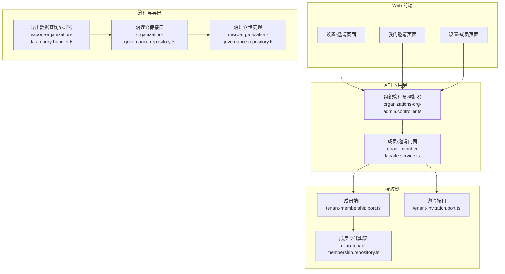
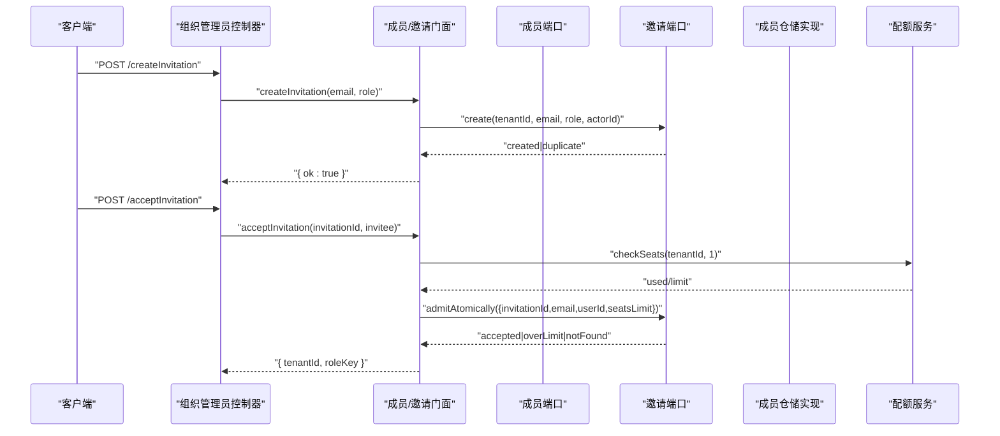
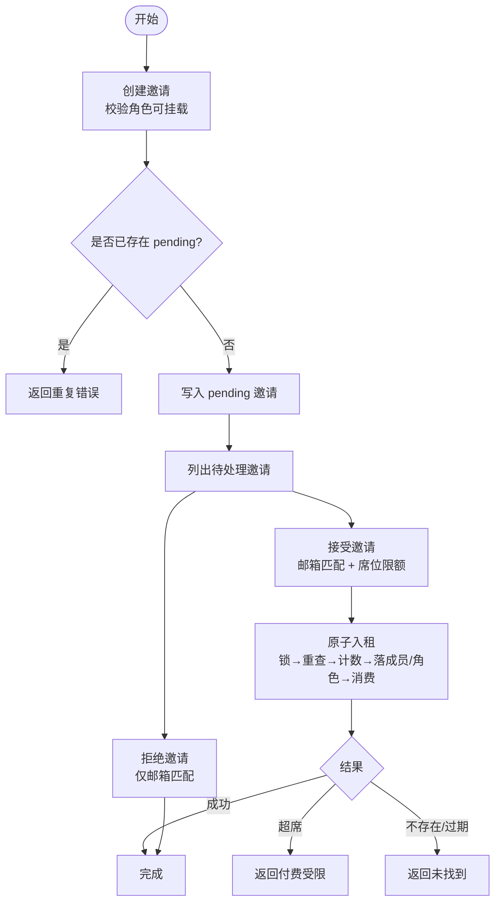
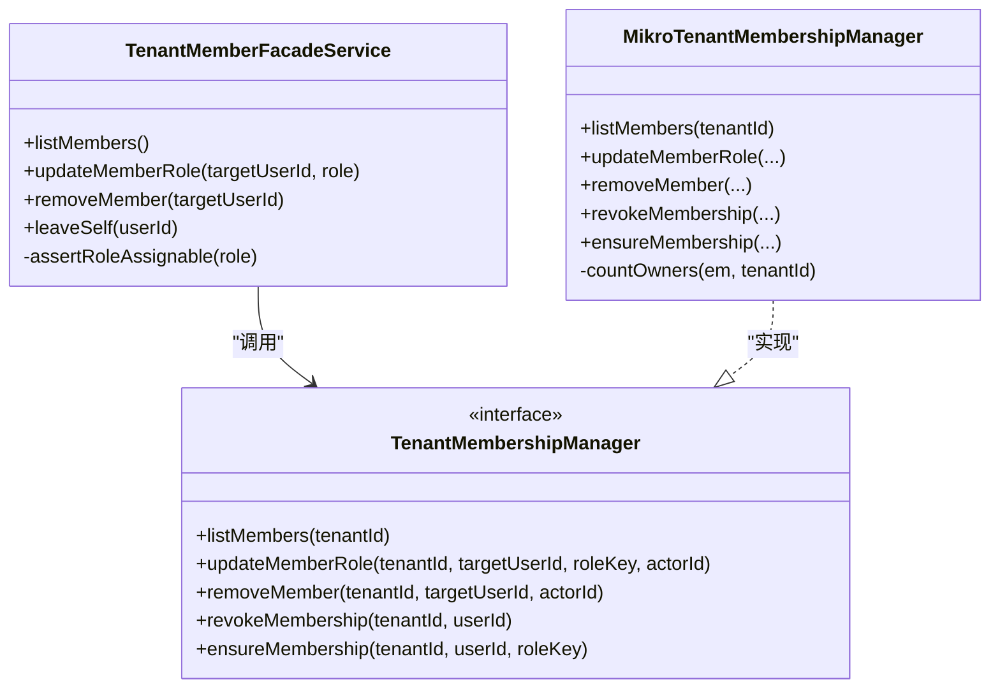
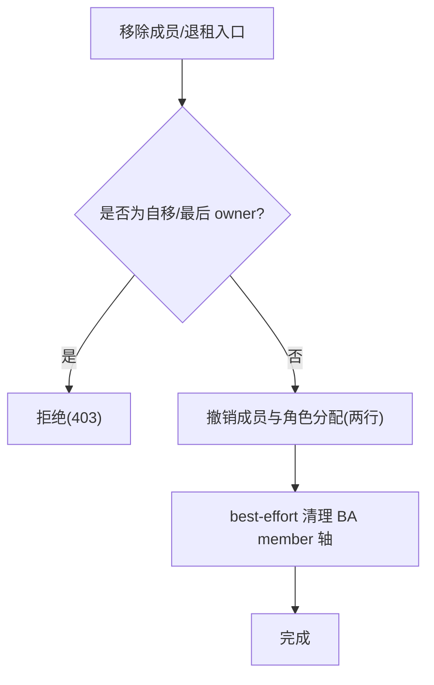
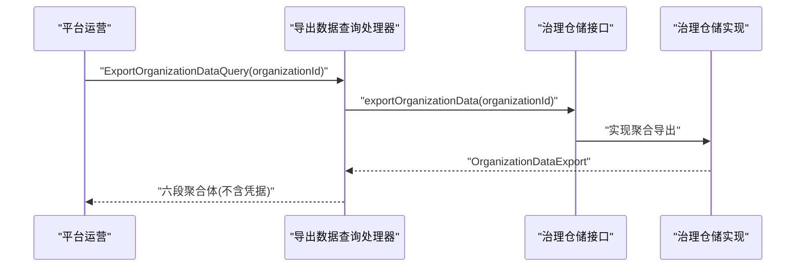
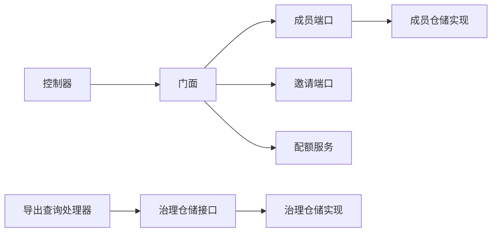

# 成员管理 API

<cite>
**本文引用的文件**   
- [organizations-org-admin.controller.ts](file://apps/api/src/modules/organizations/api/organizations-org-admin.controller.ts)
- [tenant-member-facade.service.ts](file://apps/api/src/modules/organizations/application/tenant-member-facade.service.ts)
- [tenant-membership.port.ts](file://apps/api/src/modules/authorization/domain/ports/tenant-membership.port.ts)
- [tenant-invitation.port.ts](file://apps/api/src/modules/authorization/domain/ports/tenant-invitation.port.ts)
- [mikro-tenant-membership.repository.ts](file://apps/api/src/modules/authorization/infrastructure/repositories/mikro-tenant-membership.repository.ts)
- [export-organization-data.query-handler.ts](file://apps/api/src/modules/organizations/application/queries/handlers/export-organization-data.query-handler.ts)
- [organization-governance.repository.ts](file://apps/api/src/modules/organizations/domain/repositories/organization-governance.repository.ts)
- [mikro-organization-governance.repository.ts](file://apps/api/src/modules/organizations/infrastructure/repositories/mikro-organization-governance.repository.ts)
- [settings.invitations.tsx](file://apps/web/src/routes/settings.invitations.tsx)
- [invitations.tsx](file://apps/web/src/routes/invitations.tsx)
- [settings.members.tsx](file://apps/web/src/routes/settings.members.tsx)
</cite>

## 目录
1. [简介](#简介)
2. [项目结构](#项目结构)
3. [核心组件](#核心组件)
4. [架构总览](#架构总览)
5. [详细组件分析](#详细组件分析)
6. [依赖关系分析](#依赖关系分析)
7. [性能与扩展性](#性能与扩展性)
8. [故障排查指南](#故障排查指南)
9. [结论](#结论)
10. [附录：API 契约与状态说明](#附录api-契约与状态说明)

## 简介
本文件面向“组织成员管理”的 API 文档，覆盖以下能力：
- 成员邀请与加入流程：邀请链接生成、邮件通知（由外部服务驱动）、接受/拒绝邀请、加入确认。
- 成员角色分配与权限管理接口：列出成员、更新角色、移除成员、自助退租。
- 成员状态管理与批量操作：待处理邀请列表、按邮箱的个人通道查询。
- 成员数据导出与审计日志相关 API：租户级数据导出（含成员最小身份面）。
- 权限继承与冲突解决机制：角色可挂载校验、last-owner 保护、自移限制、席位限额并发安全。

## 项目结构
成员管理在 API 层采用“控制器 → 门面 → 端口/仓储”的分层设计：
- 控制器暴露 REST 路由，负责鉴权、参数校验与结果映射。
- 门面编排业务规则（角色可挂载、席位卡点、状态守卫）。
- 端口定义跨模块契约；仓储实现具体持久化逻辑。
- Web 前端通过 RPC/HTTP 调用上述接口，提供邀请与成员管理界面。

**图表来源**
- [organizations-org-admin.controller.ts:58-156](file://apps/api/src/modules/organizations/api/organizations-org-admin.controller.ts#L58-L156)
- [tenant-member-facade.service.ts:56-264](file://apps/api/src/modules/organizations/application/tenant-member-facade.service.ts#L56-L264)
- [tenant-membership.port.ts:46-97](file://apps/api/src/modules/authorization/domain/ports/tenant-membership.port.ts#L46-L97)
- [tenant-invitation.port.ts:59-129](file://apps/api/src/modules/authorization/domain/ports/tenant-invitation.port.ts#L59-L129)
- [mikro-tenant-membership.repository.ts:35-154](file://apps/api/src/modules/authorization/infrastructure/repositories/mikro-tenant-membership.repository.ts#L35-L154)
- [export-organization-data.query-handler.ts:17-35](file://apps/api/src/modules/organizations/application/queries/handlers/export-organization-data.query-handler.ts#L17-L35)
- [organization-governance.repository.ts:212-236](file://apps/api/src/modules/organizations/domain/repositories/organization-governance.repository.ts#L212-L236)
- [mikro-organization-governance.repository.ts:222-323](file://apps/api/src/modules/organizations/infrastructure/repositories/mikro-organization-governance.repository.ts#L222-L323)

**章节来源**
- [organizations-org-admin.controller.ts:58-156](file://apps/api/src/modules/organizations/api/organizations-org-admin.controller.ts#L58-L156)
- [tenant-member-facade.service.ts:56-264](file://apps/api/src/modules/organizations/application/tenant-member-facade.service.ts#L56-L264)

## 核心组件
- 组织管理员控制器：暴露成员与邀请的管理端点，统一使用 CASL 授权与租户隔离守卫。
- 成员/邀请门面：集中实现角色可挂载校验、席位限额检查、邀请生命周期、成员增删改查、自助退租等。
- 成员端口与仓储：定义并实现成员/角色的读写原语，包含 last-owner 保护与自移限制。
- 邀请端口：定义并实现邀请创建、取消、接受、原子入租、个人通道查询与拒绝。
- 治理仓储与导出处理器：提供租户级数据导出（含成员最小身份面），用于合规与取证。

**章节来源**
- [organizations-org-admin.controller.ts:58-156](file://apps/api/src/modules/organizations/api/organizations-org-admin.controller.ts#L58-L156)
- [tenant-member-facade.service.ts:56-264](file://apps/api/src/modules/organizations/application/tenant-member-facade.service.ts#L56-L264)
- [tenant-membership.port.ts:46-97](file://apps/api/src/modules/authorization/domain/ports/tenant-membership.port.ts#L46-L97)
- [tenant-invitation.port.ts:59-129](file://apps/api/src/modules/authorization/domain/ports/tenant-invitation.port.ts#L59-L129)
- [mikro-tenant-membership.repository.ts:35-154](file://apps/api/src/modules/authorization/infrastructure/repositories/mikro-tenant-membership.repository.ts#L35-L154)
- [export-organization-data.query-handler.ts:17-35](file://apps/api/src/modules/organizations/application/queries/handlers/export-organization-data.query-handler.ts#L17-L35)
- [organization-governance.repository.ts:212-236](file://apps/api/src/modules/organizations/domain/repositories/organization-governance.repository.ts#L212-L236)
- [mikro-organization-governance.repository.ts:222-323](file://apps/api/src/modules/organizations/infrastructure/repositories/mikro-organization-governance.repository.ts#L222-L323)

## 架构总览
成员管理的请求流从控制器进入门面，再委托至授权域的端口与仓储；邀请接受时还会与配额服务协作进行席位限额裁决。

**图表来源**
- [organizations-org-admin.controller.ts:123-155](file://apps/api/src/modules/organizations/api/organizations-org-admin.controller.ts#L123-L155)
- [tenant-member-facade.service.ts:171-243](file://apps/api/src/modules/organizations/application/tenant-member-facade.service.ts#L171-L243)
- [tenant-invitation.port.ts:102-113](file://apps/api/src/modules/authorization/domain/ports/tenant-invitation.port.ts#L102-L113)

## 详细组件分析

### 成员邀请与加入流程
- 邀请创建：管理员或 owner 调用创建邀请接口，系统校验角色可挂载后写入 pending 邀请行；若同租户+邮箱已有 pending 则返回重复错误。
- 邀请列表：支持列出活动租户的待处理邀请；同时支持个人通道按邮箱列出待处理邀请（非租户作用域）。
- 邀请取消：owner/admin 可取消 pending 邀请；无 pending 行返回未找到。
- 邀请接受：受邀者自助接受，系统校验邀请存在且未过期、邮箱匹配、席位限额充足后，原子执行“锁→重查邀请→计数席位→落成员/角色→消费邀请”。
- 邀请拒绝：受邀者可拒绝邀请（pending→cancelled），仅限邮箱匹配。

**图表来源**
- [tenant-member-facade.service.ts:171-243](file://apps/api/src/modules/organizations/application/tenant-member-facade.service.ts#L171-L243)
- [tenant-invitation.port.ts:66-129](file://apps/api/src/modules/authorization/domain/ports/tenant-invitation.port.ts#L66-L129)

**章节来源**
- [organizations-org-admin.controller.ts:110-155](file://apps/api/src/modules/organizations/api/organizations-org-admin.controller.ts#L110-L155)
- [tenant-member-facade.service.ts:144-243](file://apps/api/src/modules/organizations/application/tenant-member-facade.service.ts#L144-L243)
- [tenant-invitation.port.ts:66-129](file://apps/api/src/modules/authorization/domain/ports/tenant-invitation.port.ts#L66-L129)
- [settings.invitations.tsx:34-66](file://apps/web/src/routes/settings.invitations.tsx#L34-L66)
- [invitations.tsx:43-86](file://apps/web/src/routes/invitations.tsx#L43-L86)

### 成员角色分配与权限管理
- 列出成员：返回活动租户全部成员（含角色），读侧 join user 表展示邮箱/姓名。
- 更新角色：先校验角色可挂载，再更新成员在本租的角色分配；若目标为唯一 owner 降级则拒绝。
- 移除成员：管理员移除目标成员，若自移或最后 owner 则拒绝；成功后同步清理 BA member 轴（best-effort）。
- 自助退租：当前用户退出当前活动租户，走撤销原语，同样受 last-owner 保护。

**图表来源**
- [tenant-member-facade.service.ts:56-142](file://apps/api/src/modules/organizations/application/tenant-member-facade.service.ts#L56-L142)
- [tenant-membership.port.ts:46-97](file://apps/api/src/modules/authorization/domain/ports/tenant-membership.port.ts#L46-L97)
- [mikro-tenant-membership.repository.ts:35-154](file://apps/api/src/modules/authorization/infrastructure/repositories/mikro-tenant-membership.repository.ts#L35-L154)

**章节来源**
- [organizations-org-admin.controller.ts:63-108](file://apps/api/src/modules/organizations/api/organizations-org-admin.controller.ts#L63-L108)
- [tenant-member-facade.service.ts:66-142](file://apps/api/src/modules/organizations/application/tenant-member-facade.service.ts#L66-L142)
- [tenant-membership.port.ts:46-97](file://apps/api/src/modules/authorization/domain/ports/tenant-membership.port.ts#L46-L97)
- [mikro-tenant-membership.repository.ts:38-118](file://apps/api/src/modules/authorization/infrastructure/repositories/mikro-tenant-membership.repository.ts#L38-L118)
- [settings.members.tsx:37-144](file://apps/web/src/routes/settings.members.tsx#L37-L144)

### 成员移除与权限回收
- 管理员移除：调用 removeMember，内部先做自移/最后 owner 守卫，再调用撤销原语删除成员与角色分配两行；随后 best-effort 清理 BA member 轴。
- 自助退租：调用 leaveSelf，走 revokeMembership 同形撤权撤席，同样受 last-owner 保护；成功后清理 BA member 轴。

**图表来源**
- [tenant-member-facade.service.ts:96-142](file://apps/api/src/modules/organizations/application/tenant-member-facade.service.ts#L96-L142)
- [mikro-tenant-membership.repository.ts:94-118](file://apps/api/src/modules/authorization/infrastructure/repositories/mikro-tenant-membership.repository.ts#L94-L118)

**章节来源**
- [tenant-member-facade.service.ts:96-142](file://apps/api/src/modules/organizations/application/tenant-member-facade.service.ts#L96-L142)
- [mikro-tenant-membership.repository.ts:94-118](file://apps/api/src/modules/authorization/infrastructure/repositories/mikro-tenant-membership.repository.ts#L94-L118)

### 成员状态管理与批量操作
- 待处理邀请列表：按租户列出 pending 且未过期的邀请。
- 个人通道：按邮箱列出待处理邀请（非租户作用域），用于“我的邀请”场景。
- 批量读取成员：成员列表一次批量取 user 信息，避免 N+1 查询。

**章节来源**
- [tenant-member-facade.service.ts:144-155](file://apps/api/src/modules/organizations/application/tenant-member-facade.service.ts#L144-L155)
- [tenant-invitation.port.ts:60-70](file://apps/api/src/modules/authorization/domain/ports/tenant-invitation.port.ts#L60-L70)
- [mikro-tenant-membership.repository.ts:38-59](file://apps/api/src/modules/authorization/infrastructure/repositories/mikro-tenant-membership.repository.ts#L38-L59)

### 成员数据导出与审计日志相关 API
- 租户级数据导出：通过查询处理器委派治理仓储，聚合组织本体、成员、邀请、工作区、订阅、文章六段数据；成员名册仅输出最小身份面（id/name/email/handle），绝不携带凭据列。
- 审计日志：系统引入 append-only 的 audit_log 表作为治理耐久账本，供审计与取证；成员管理相关变更可通过平台治理审计面进行追踪（此处不展开具体接口，仅说明存在性与用途）。

**图表来源**
- [export-organization-data.query-handler.ts:17-35](file://apps/api/src/modules/organizations/application/queries/handlers/export-organization-data.query-handler.ts#L17-L35)
- [organization-governance.repository.ts:212-236](file://apps/api/src/modules/organizations/domain/repositories/organization-governance.repository.ts#L212-L236)
- [mikro-organization-governance.repository.ts:222-323](file://apps/api/src/modules/organizations/infrastructure/repositories/mikro-organization-governance.repository.ts#L222-L323)

**章节来源**
- [export-organization-data.query-handler.ts:17-35](file://apps/api/src/modules/organizations/application/queries/handlers/export-organization-data.query-handler.ts#L17-L35)
- [organization-governance.repository.ts:97-129](file://apps/api/src/modules/organizations/domain/repositories/organization-governance.repository.ts#L97-L129)
- [mikro-organization-governance.repository.ts:222-323](file://apps/api/src/modules/organizations/infrastructure/repositories/mikro-organization-governance.repository.ts#L222-L323)

### 权限继承与冲突解决机制
- 角色可挂载校验：所有写操作前经 RoleAssignabilityReader 严格校验，词汇外角色直接拒绝。
- Last-owner 保护：禁止将唯一 owner 降级或移除，防止组织锁死。
- 自移限制：管理员移除面拒绝自移；自助退租允许自退但同样受 last-owner 保护。
- 席位限额并发安全：接受邀请时采用原子事务 + 会话锁串行化同租并发，最终在锁内重查 live 计数并裁决 overLimit。

**章节来源**
- [tenant-member-facade.service.ts:71-94](file://apps/api/src/modules/organizations/application/tenant-member-facade.service.ts#L71-L94)
- [tenant-member-facade.service.ts:206-243](file://apps/api/src/modules/organizations/application/tenant-member-facade.service.ts#L206-L243)
- [mikro-tenant-membership.repository.ts:61-92](file://apps/api/src/modules/authorization/infrastructure/repositories/mikro-tenant-membership.repository.ts#L61-L92)
- [tenant-invitation.port.ts:102-113](file://apps/api/src/modules/authorization/domain/ports/tenant-invitation.port.ts#L102-L113)

## 依赖关系分析
- 控制器依赖门面，门面依赖端口；端口由授权域实现。
- 门面还依赖配额服务进行席位限额裁决。
- 治理仓储接口与实现分离，查询处理器仅依赖接口。

**图表来源**
- [organizations-org-admin.controller.ts:58-156](file://apps/api/src/modules/organizations/api/organizations-org-admin.controller.ts#L58-L156)
- [tenant-member-facade.service.ts:56-264](file://apps/api/src/modules/organizations/application/tenant-member-facade.service.ts#L56-L264)
- [export-organization-data.query-handler.ts:17-35](file://apps/api/src/modules/organizations/application/queries/handlers/export-organization-data.query-handler.ts#L17-L35)

**章节来源**
- [organizations-org-admin.controller.ts:58-156](file://apps/api/src/modules/organizations/api/organizations-org-admin.controller.ts#L58-L156)
- [tenant-member-facade.service.ts:56-264](file://apps/api/src/modules/organizations/application/tenant-member-facade.service.ts#L56-L264)
- [export-organization-data.query-handler.ts:17-35](file://apps/api/src/modules/organizations/application/queries/handlers/export-organization-data.query-handler.ts#L17-L35)

## 性能与扩展性
- 成员列表优化：批量拉取 user 信息，避免 N+1 查询。
- 原子入租：使用事务与会话锁串行化同租并发接受邀请，保证席位计数准确。
- 导出聚合：按租户聚合多表数据，采用内存拼接减少多次往返。

[本节为通用指导，无需特定文件引用]

## 故障排查指南
- 角色不可挂载：检查角色是否在租户内可挂载；若词汇不在库中会返回 400。
- 最后属主保护：尝试降级/移除唯一 owner 会返回 403。
- 自移限制：管理员移除面拒绝自移；自助退租需确保不是最后 owner。
- 席位超限：接受邀请时若 live 计数超过限额返回 402。
- 邀请不存在/过期：接受或取消邀请时若找不到 pending 行返回 404。

**章节来源**
- [tenant-member-facade.service.ts:71-94](file://apps/api/src/modules/organizations/application/tenant-member-facade.service.ts#L71-L94)
- [tenant-member-facade.service.ts:96-142](file://apps/api/src/modules/organizations/application/tenant-member-facade.service.ts#L96-L142)
- [tenant-member-facade.service.ts:171-243](file://apps/api/src/modules/organizations/application/tenant-member-facade.service.ts#L171-L243)

## 结论
成员管理 API 以门面为核心，将角色可挂载、last-owner、自移限制、席位限额等关键守卫集中在应用层实现，并通过端口与仓储解耦持久化细节。邀请流程在原子事务中完成状态迁移与成员落行，确保并发安全。租户级数据导出满足合规需求，审计日志提供治理可追溯性。

[本节为总结，无需特定文件引用]

## 附录：API 契约与状态说明
- 成员管理端点（组织管理员）：
  - 列出成员：返回成员视图数组（userId/email/name/roleKey）。
  - 更新成员角色：输入 memberId/role，返回成功。
  - 移除成员：输入 memberId，返回成功。
  - 列出待处理邀请：返回邀请视图数组。
  - 创建邀请：输入 email/role，返回成功。
  - 取消邀请：输入 invitationId，返回成功。
- 个人通道（受邀者）：
  - 列出我的邀请：按邮箱列出 pending 邀请。
  - 接受邀请：输入 invitationId，返回 tenantId/roleKey。
  - 拒绝邀请：输入 invitationId，返回成功。
- 状态与结果类型：
  - 成员角色更新结果：ok/notFound/self/lastOwner。
  - 成员移除结果：ok/notFound/self/lastOwner。
  - 邀请创建结果：created/duplicate。
  - 邀请取消结果：cancelled/notFound。
  - 邀请接受结果：accepted/notFound/expired。
  - 原子入租结果：accepted/overLimit/notFound。

**章节来源**
- [organizations-org-admin.controller.ts:63-155](file://apps/api/src/modules/organizations/api/organizations-org-admin.controller.ts#L63-L155)
- [tenant-membership.port.ts:26-34](file://apps/api/src/modules/authorization/domain/ports/tenant-membership.port.ts#L26-L34)
- [tenant-invitation.port.ts:30-46](file://apps/api/src/modules/authorization/domain/ports/tenant-invitation.port.ts#L30-L46)