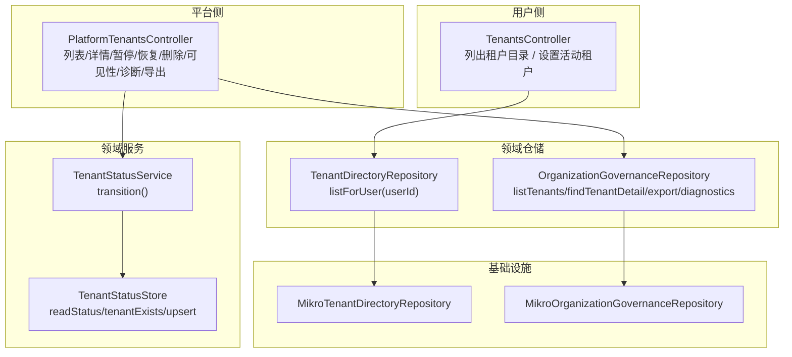
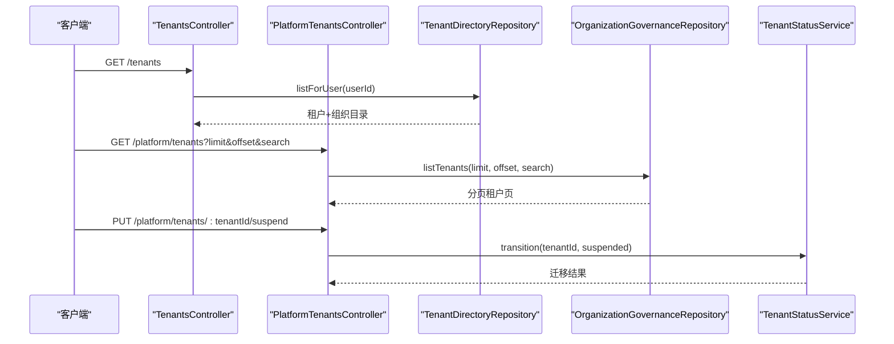
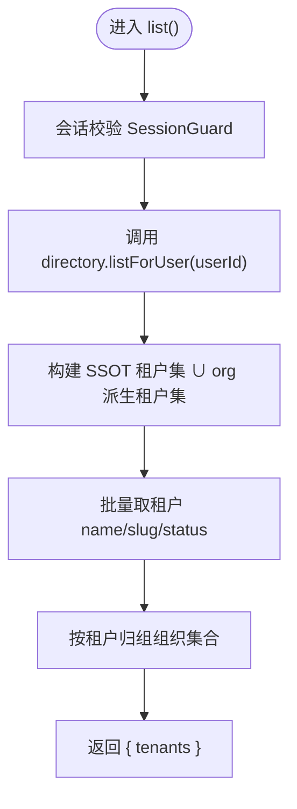
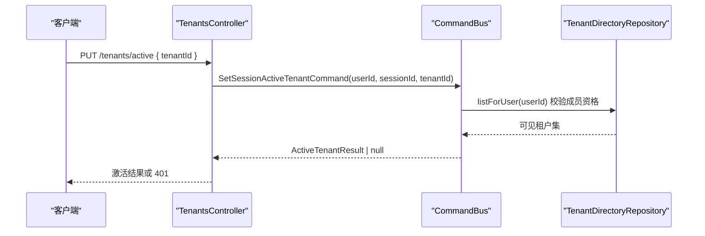
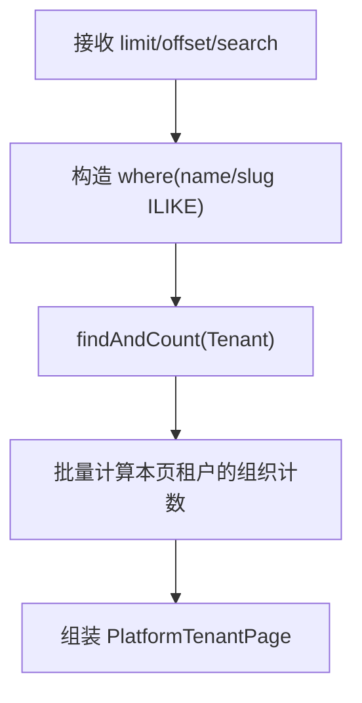
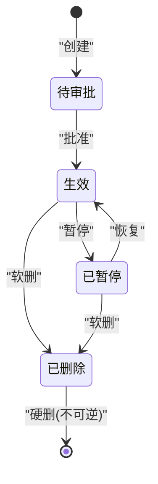
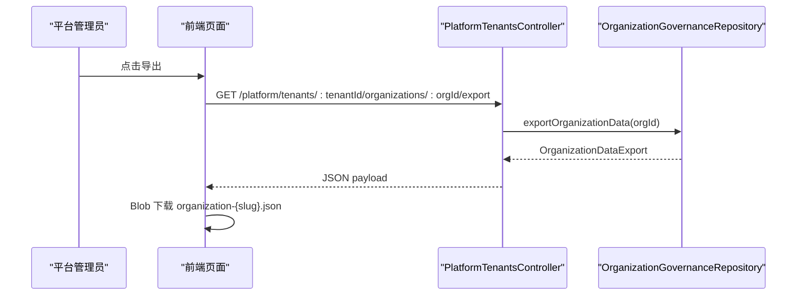
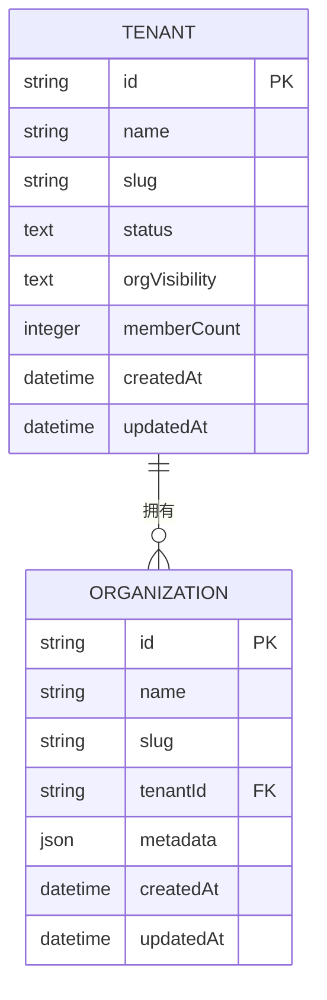
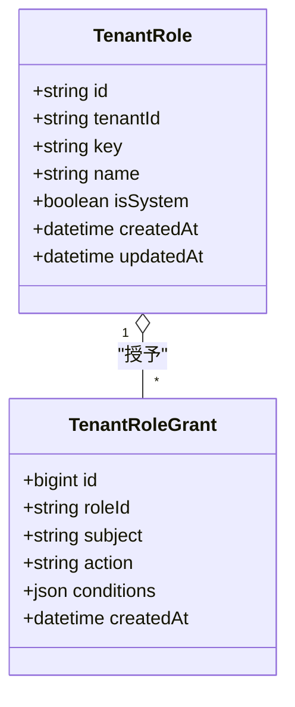
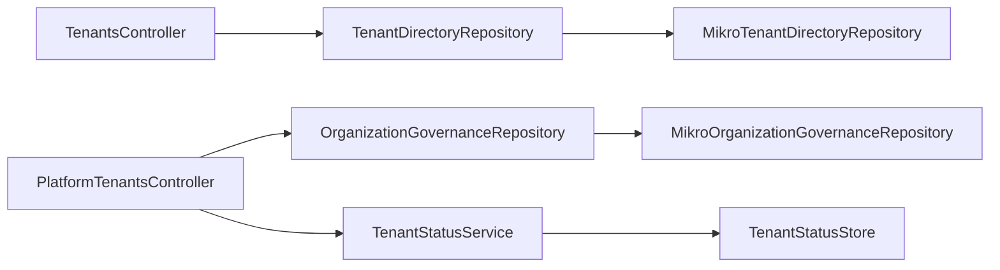

# 租户管理 API

<cite>
**本文引用的文件**   
- [tenants.controller.ts](file://apps/api/src/modules/organizations/api/tenants.controller.ts)
- [platform-tenants.controller.ts](file://apps/api/src/modules/platform/api/platform-tenants.controller.ts)
- [tenant-directory.repository.ts](file://apps/api/src/modules/organizations/domain/repositories/tenant-directory.repository.ts)
- [mikro-tenant-directory.repository.ts](file://apps/api/src/modules/organizations/infrastructure/repositories/mikro-tenant-directory.repository.ts)
- [mikro-organization-governance.repository.ts](file://apps/api/src/modules/organizations/infrastructure/repositories/mikro-organization-governance.repository.ts)
- [tenant.entity.ts](file://apps/api/src/modules/organizations/infrastructure/entities/tenant.entity.ts)
- [tenant-status.service.ts](file://libs/core/src/modules/organizations/lifecycle/tenant-status.service.ts)
- [tenant-status.store.ts](file://libs/core/src/modules/organizations/lifecycle/tenant-status.store.ts)
- [organization-status-transitioned.event.ts](file://libs/core/src/modules/organizations/lifecycle/events/organization-status-transitioned.event.ts)
- [rbac.entities.ts](file://apps/api/src/modules/authorization/infrastructure/entities/rbac.entities.ts)
- [mikro-tenant-membership.repository.ts](file://apps/api/src/modules/authorization/infrastructure/repositories/mikro-tenant-membership.repository.ts)
- [index.tsx（前端租户目录）](file://apps/web/src/routes/index.tsx)
- [platform.tenants.$tenantId.tsx（前端导出）](file://apps/web/src/routes/platform.tenants.$tenantId.tsx)
</cite>

## 目录
1. [简介](#简介)
2. [项目结构](#项目结构)
3. [核心组件](#核心组件)
4. [架构总览](#架构总览)
5. [详细组件分析](#详细组件分析)
6. [依赖关系分析](#依赖关系分析)
7. [性能与可扩展性](#性能与可扩展性)
8. [故障排查指南](#故障排查指南)
9. [结论](#结论)
10. [附录：API 契约与数据模型](#附录api-契约与数据模型)

## 简介
本文件为“租户管理模块”的完整 API 文档，覆盖以下能力：
- 租户目录查询接口：面向当前用户，返回其可见的租户及下属组织集合；支持分页、过滤与排序的平台级查询。
- 租户状态管理与配置：暂停、恢复、软删、硬删、跨组织可见性策略设置等治理接口。
- 租户与组织的关联关系和数据隔离机制：顶层租户（隔离与计费边界）与二级组织（绑定 Odoo 公司）的关系，以及成员资格收敛、跨组织可见性策略。
- 租户诊断与监控：平台侧按组织维度下钻的诊断计数接口。
- 租户数据导出与备份：平台侧按组织维度导出数据为单一 JSON。
- 租户层级结构与权限继承规则：角色与授权上收至租户级，跨组织通配生效；成员资格以租级成员表为主事实源。

## 项目结构
租户相关 API 分布在两个控制器中：
- 用户侧目录与切换：`TenantsController`
- 平台治理侧：`PlatformTenantsController`

**图示来源**
- [tenants.controller.ts:42-100](file://apps/api/src/modules/organizations/api/tenants.controller.ts#L42-L100)
- [platform-tenants.controller.ts:100-311](file://apps/api/src/modules/platform/api/platform-tenants.controller.ts#L100-L311)
- [tenant-directory.repository.ts:32-48](file://apps/api/src/modules/organizations/domain/repositories/tenant-directory.repository.ts#L32-L48)
- [mikro-organization-governance.repository.ts:103-133](file://apps/api/src/modules/organizations/infrastructure/repositories/mikro-organization-governance.repository.ts#L103-L133)
- [tenant-status.service.ts:83-122](file://libs/core/src/modules/organizations/lifecycle/tenant-status.service.ts#L83-L122)
- [tenant-status.store.ts:23-46](file://libs/core/src/modules/organizations/lifecycle/tenant-status.store.ts#L23-L46)

**章节来源**
- [tenants.controller.ts:26-40](file://apps/api/src/modules/organizations/api/tenants.controller.ts#L26-L40)
- [platform-tenants.controller.ts:64-98](file://apps/api/src/modules/platform/api/platform-tenants.controller.ts#L64-L98)

## 核心组件
- 租户目录读端口 `TenantDirectoryRepository`：定义用户级目录查询语义，返回“租户 + 其下组织集合”。
- 租户目录实现 `MikroTenantDirectoryRepository`：基于 `tenant_membership` 与 BA member/org 并集构建可见租户集，并按租户归组组织。
- 平台治理仓库 `OrganizationGovernanceRepository`：提供跨租户列表、详情、诊断、导出等能力。
- 租户状态服务 `TenantStatusService`：严格状态迁移（active/suspended/deleted），产出领域事件。
- 租户实体字段：包含准入态、跨组织可见性策略、成员数物化列等。

**章节来源**
- [tenant-directory.repository.ts:9-48](file://apps/api/src/modules/organizations/domain/repositories/tenant-directory.repository.ts#L9-L48)
- [mikro-tenant-directory.repository.ts:18-35](file://apps/api/src/modules/organizations/infrastructure/repositories/mikro-tenant-directory.repository.ts#L18-L35)
- [mikro-organization-governance.repository.ts:103-133](file://apps/api/src/modules/organizations/infrastructure/repositories/mikro-organization-governance.repository.ts#L103-L133)
- [tenant-status.service.ts:83-122](file://libs/core/src/modules/organizations/lifecycle/tenant-status.service.ts#L83-L122)
- [tenant.entity.ts:34-53](file://apps/api/src/modules/organizations/infrastructure/entities/tenant.entity.ts#L34-L53)

## 架构总览
下图展示从 HTTP 请求到仓储/服务的调用链，以及关键的数据流向。

**图示来源**
- [tenants.controller.ts:55-66](file://apps/api/src/modules/organizations/api/tenants.controller.ts#L55-L66)
- [platform-tenants.controller.ts:112-123](file://apps/api/src/modules/platform/api/platform-tenants.controller.ts#L112-L123)
- [platform-tenants.controller.ts:150-167](file://apps/api/src/modules/platform/api/platform-tenants.controller.ts#L150-L167)
- [tenant-status.service.ts:95-121](file://libs/core/src/modules/organizations/lifecycle/tenant-status.service.ts#L95-L121)

## 详细组件分析

### 租户目录查询接口（用户侧）
- 端点：GET /tenants
- 鉴权：会话校验（SessionGuard），类级旁路租户墙（跨租可见）。
- 功能：返回当前用户可见的租户及其下属组织集合。
- 参数：无（用户身份由会话解析）。
- 响应：租户数组，每项含租户 id、名称、slug、准入态、组织集合。
- 行为要点：
  - 可见面由 `tenant_membership` 与 BA member/org 并集决定。
  - 同一租户下的多个组织合并为一个条目。
  - 若租户行缺失，准入态回退为 active。

**图示来源**
- [tenants.controller.ts:55-66](file://apps/api/src/modules/organizations/api/tenants.controller.ts#L55-L66)
- [mikro-tenant-directory.repository.ts:40-115](file://apps/api/src/modules/organizations/infrastructure/repositories/mikro-tenant-directory.repository.ts#L40-L115)

**章节来源**
- [tenants.controller.ts:26-66](file://apps/api/src/modules/organizations/api/tenants.controller.ts#L26-L66)
- [tenant-directory.repository.ts:32-48](file://apps/api/src/modules/organizations/domain/repositories/tenant-directory.repository.ts#L32-L48)
- [mikro-tenant-directory.repository.ts:18-35](file://apps/api/src/modules/organizations/infrastructure/repositories/mikro-tenant-directory.repository.ts#L18-L35)

### 设置活动租户（用户侧）
- 端点：PUT /tenants/active
- 鉴权：会话校验（SessionGuard），需携带 sessionId。
- 功能：设置当前会话的活动租户（session-scoped），不改变租户生命周期态。
- 输入：目标 tenantId。
- 输出：激活结果对象。
- 行为要点：
  - 先校验目标租户的成员资格（非成员 403）。
  - 通过命令总线写入会话激活位。
  - 会话失效返回未认证错误。

**图示来源**
- [tenants.controller.ts:68-100](file://apps/api/src/modules/organizations/api/tenants.controller.ts#L68-L100)

**章节来源**
- [tenants.controller.ts:68-100](file://apps/api/src/modules/organizations/api/tenants.controller.ts#L68-L100)

### 平台租户列表（分页、过滤、排序）
- 端点：GET /platform/tenants
- 鉴权：平台操作员守卫（PlatformOperatorGuard），跨租户访问。
- 参数：
  - limit：每页数量
  - offset：偏移量
  - search：模糊匹配租户 name/slug
- 排序：按创建时间降序。
- 响应：分页对象，每项含租户基本信息与名下组织计数。

**图示来源**
- [platform-tenants.controller.ts:112-123](file://apps/api/src/modules/platform/api/platform-tenants.controller.ts#L112-L123)
- [mikro-organization-governance.repository.ts:103-133](file://apps/api/src/modules/organizations/infrastructure/repositories/mikro-organization-governance.repository.ts#L103-L133)

**章节来源**
- [platform-tenants.controller.ts:109-123](file://apps/api/src/modules/platform/api/platform-tenants.controller.ts#L109-L123)
- [mikro-organization-governance.repository.ts:103-133](file://apps/api/src/modules/organizations/infrastructure/repositories/mikro-organization-governance.repository.ts#L103-L133)

### 平台租户详情
- 端点：GET /platform/tenants/:tenantId
- 鉴权：平台操作员守卫。
- 功能：返回租户基本盘 + 名下组织名册（含 Odoo 绑定态）。
- 行为要点：
  - 未命中返回 404（带 errorCode）。
  - 组织准入态统一展所属租户 status。

**章节来源**
- [platform-tenants.controller.ts:125-145](file://apps/api/src/modules/platform/api/platform-tenants.controller.ts#L125-L145)

### 租户状态管理（暂停/恢复/软删/硬删）
- 端点：
  - PUT /platform/tenants/:tenantId/suspend
  - PUT /platform/tenants/:tenantId/resume
  - DELETE /platform/tenants/:tenantId
  - DELETE /platform/tenants/:tenantId/permanent
- 鉴权：平台操作员守卫。
- 状态机：
  - active → suspended（暂停）
  - suspended → active（恢复）
  - active/suspended → deleted（软删终态）
  - deleted → 硬删（不可逆，连带清除名下所有组织及子表）
- 行为要点：
  - 非法转移返回 409。
  - 未命中返回 404（带 errorCode）。
  - 每次成功/失败落结构化审计行。

**图示来源**
- [tenant-status.service.ts:83-122](file://libs/core/src/modules/organizations/lifecycle/tenant-status.service.ts#L83-L122)
- [platform-tenants.controller.ts:147-266](file://apps/api/src/modules/platform/api/platform-tenants.controller.ts#L147-L266)

**章节来源**
- [platform-tenants.controller.ts:147-266](file://apps/api/src/modules/platform/api/platform-tenants.controller.ts#L147-L266)
- [tenant-status.service.ts:83-122](file://libs/core/src/modules/organizations/lifecycle/tenant-status.service.ts#L83-L122)

### 租户内跨组织可见性策略
- 端点：PUT /platform/tenants/:tenantId/visibility
- 鉴权：平台操作员守卫。
- 功能：设置该租户内跨组织可见性策略（shared/isolated）。
- 行为要点：
  - isolated 为显式 opt-in，全局 filter 追加组织收窄。
  - 跨租硬地板 tenantId 不受本列影响。

**章节来源**
- [platform-tenants.controller.ts:193-220](file://apps/api/src/modules/platform/api/platform-tenants.controller.ts#L193-L220)
- [tenant.entity.ts:44-46](file://apps/api/src/modules/organizations/infrastructure/entities/tenant.entity.ts#L44-L46)

### 租户诊断与监控
- 端点：GET /platform/tenants/:tenantId/organizations/:orgId/diagnostics
- 鉴权：平台操作员守卫。
- 功能：返回组织维度的诊断计数（成员/邀请/工作区/帖子等）。
- 行为要点：
  - 未命中返回 404（带 errorCode）。

**章节来源**
- [platform-tenants.controller.ts:268-288](file://apps/api/src/modules/platform/api/platform-tenants.controller.ts#L268-L288)

### 租户数据导出与备份
- 端点：GET /platform/tenants/:tenantId/organizations/:orgId/export
- 鉴权：平台操作员守卫。
- 功能：导出该组织全部数据为单一 JSON（不含凭证）。
- 行为要点：
  - 未命中返回 404（带 errorCode）。
  - 前端直接下载 JSON 文件。

**图示来源**
- [platform-tenants.controller.ts:290-311](file://apps/api/src/modules/platform/api/platform-tenants.controller.ts#L290-L311)
- [platform.tenants.$tenantId.tsx:234-266](file://apps/web/src/routes/platform.tenants.$tenantId.tsx#L234-L266)

**章节来源**
- [platform-tenants.controller.ts:290-311](file://apps/api/src/modules/platform/api/platform-tenants.controller.ts#L290-L311)
- [platform.tenants.$tenantId.tsx:234-266](file://apps/web/src/routes/platform.tenants.$tenantId.tsx#L234-L266)

### 租户与组织的关联关系与数据隔离
- 层级关系：
  - 顶层：租户（隔离与计费边界）。
  - 二级：组织（绑定一家 Odoo 公司）。
- 成员资格收敛：
  - 目录可见面以 `tenant_membership` 为主事实源，并与 BA member/org 并集。
  - 同一租户下的多个组织合并为一个条目。
- 数据隔离：
  - 跨租户硬地板 tenantId。
  - 租户内跨组织可见性策略控制组织间互见（shared/isolated）。
- 前端展示：
  - 双层切换器：顶层租户上下文，二级组织筛选。
  - 租户状态人类标签映射（待审批/生效/已暂停/已删除）。

**图示来源**
- [tenant.entity.ts:34-53](file://apps/api/src/modules/organizations/infrastructure/entities/tenant.entity.ts#L34-L53)

**章节来源**
- [mikro-tenant-directory.repository.ts:18-35](file://apps/api/src/modules/organizations/infrastructure/repositories/mikro-tenant-directory.repository.ts#L18-L35)
- [index.tsx（前端租户目录）:30-57](file://apps/web/src/routes/index.tsx#L30-L57)

### 租户层级结构与权限继承规则
- 角色与授权：
  - 角色定义在租户级（`tenant_role`），授权（`tenant_role_grant`）亦上收至租户级。
  - 授权跨组织通配生效（不再按活动 org 过滤）。
- 成员角色：
  - 租户成员列表聚合 `tenant_membership`、`tenant_role_assignment` 与 user。
  - owner 为不可清空角色（防锁死），管理员禁止自移（对齐 BA 语义）。

**图示来源**
- [rbac.entities.ts:27-60](file://apps/api/src/modules/authorization/infrastructure/entities/rbac.entities.ts#L27-L60)

**章节来源**
- [rbac.entities.ts:27-60](file://apps/api/src/modules/authorization/infrastructure/entities/rbac.entities.ts#L27-L60)
- [mikro-tenant-membership.repository.ts:31-59](file://apps/api/src/modules/authorization/infrastructure/repositories/mikro-tenant-membership.repository.ts#L31-L59)

## 依赖关系分析
- 控制器依赖：
  - TenantsController 依赖 TenantDirectoryRepository 与 CommandBus。
  - PlatformTenantsController 依赖 CommandBus/QueryBus 与 OrganizationGovernanceRepository。
- 仓储实现：
  - MikroTenantDirectoryRepository 使用 MikroOrmService 跨租读取（scoped:false）。
  - MikroOrganizationGovernanceRepository 提供列表/详情/导出/诊断等。
- 领域服务：
  - TenantStatusService 通过 TenantStatusStore 读写 tenant.status，并发出领域事件。

**图示来源**
- [tenants.controller.ts:42-48](file://apps/api/src/modules/organizations/api/tenants.controller.ts#L42-L48)
- [platform-tenants.controller.ts:100-107](file://apps/api/src/modules/platform/api/platform-tenants.controller.ts#L100-L107)
- [mikro-tenant-directory.repository.ts:36-38](file://apps/api/src/modules/organizations/infrastructure/repositories/mikro-tenant-directory.repository.ts#L36-L38)
- [mikro-organization-governance.repository.ts:103-133](file://apps/api/src/modules/organizations/infrastructure/repositories/mikro-organization-governance.repository.ts#L103-L133)
- [tenant-status.service.ts:83-122](file://libs/core/src/modules/organizations/lifecycle/tenant-status.service.ts#L83-L122)

**章节来源**
- [tenants.controller.ts:42-48](file://apps/api/src/modules/organizations/api/tenants.controller.ts#L42-L48)
- [platform-tenants.controller.ts:100-107](file://apps/api/src/modules/platform/api/platform-tenants.controller.ts#L100-L107)

## 性能与可扩展性
- 列表分页：平台租户列表采用 offset 分页，按创建时间降序；建议限制 limit 上限。
- 组织计数优化：对每页租户批量计算组织计数，避免 N+1。
- 目录查询优化：
  - 使用 `tenant_membership` 作为主事实源，减少跨库联表。
  - 批量拉取租户与组织信息，内存 Map 分组。
- 导出与诊断：
  - 导出为单一 JSON，适合小中型组织；大型组织建议异步任务+回调下载。
  - 诊断计数可考虑缓存热点组织。

[本节为通用指导，无需代码引用]

## 故障排查指南
- 401 未认证：
  - 用户侧设置活动租户时缺少 sessionId。
- 403 未授权：
  - 用户尝试切换到非成员租户。
  - 非平台操作员访问平台治理接口。
- 404 未找到：
  - 租户/组织不存在。
- 409 冲突：
  - 非法状态迁移（如 suspended→active 以外的非法边）。
- 常见定位步骤：
  - 检查会话是否有效（sessionId）。
  - 确认用户是否在目标租户的成员列表中。
  - 确认操作者是否为平台操作员。
  - 查看状态迁移历史（领域事件）。

**章节来源**
- [tenants.controller.ts:86-99](file://apps/api/src/modules/organizations/api/tenants.controller.ts#L86-L99)
- [platform-tenants.controller.ts:134-144](file://apps/api/src/modules/platform/api/platform-tenants.controller.ts#L134-L144)
- [tenant-status.service.ts:95-121](file://libs/core/src/modules/organizations/lifecycle/tenant-status.service.ts#L95-L121)

## 结论
本租户管理模块以“租户为顶层隔离与计费边界、组织为二级业务单元”的层级模型为核心，提供用户侧目录查询与活动租户切换，以及平台侧全面的治理、诊断与导出能力。通过严格的租户状态机、跨组织可见性策略与租户级角色授权，实现了清晰的数据隔离与权限继承规则。建议在大规模场景下对导出与诊断引入异步化与缓存策略，以提升系统整体性能与稳定性。

[本节为总结性内容，无需代码引用]

## 附录：API 契约与数据模型

### 用户侧目录与切换
- GET /tenants
  - 鉴权：SessionGuard
  - 响应：租户目录（租户 + 组织集合）
- PUT /tenants/active
  - 鉴权：SessionGuard
  - 输入：tenantId
  - 响应：激活结果

**章节来源**
- [tenants.controller.ts:55-100](file://apps/api/src/modules/organizations/api/tenants.controller.ts#L55-L100)

### 平台治理接口
- GET /platform/tenants
  - 鉴权：PlatformOperatorGuard
  - 参数：limit, offset, search
  - 响应：分页租户页
- GET /platform/tenants/:tenantId
  - 鉴权：PlatformOperatorGuard
  - 响应：租户详情（含组织名册）
- PUT /platform/tenants/:tenantId/suspend
  - 鉴权：PlatformOperatorGuard
  - 响应：治理结果
- PUT /platform/tenants/:tenantId/resume
  - 鉴权：PlatformOperatorGuard
  - 响应：治理结果
- DELETE /platform/tenants/:tenantId
  - 鉴权：PlatformOperatorGuard
  - 响应：治理结果
- DELETE /platform/tenants/:tenantId/permanent
  - 鉴权：PlatformOperatorGuard
  - 响应：硬删结果
- PUT /platform/tenants/:tenantId/visibility
  - 鉴权：PlatformOperatorGuard
  - 输入：orgVisibility
  - 响应：可见性结果
- GET /platform/tenants/:tenantId/organizations/:orgId/diagnostics
  - 鉴权：PlatformOperatorGuard
  - 响应：诊断计数
- GET /platform/tenants/:tenantId/organizations/:orgId/export
  - 鉴权：PlatformOperatorGuard
  - 响应：组织数据 JSON

**章节来源**
- [platform-tenants.controller.ts:109-311](file://apps/api/src/modules/platform/api/platform-tenants.controller.ts#L109-L311)

### 数据模型
- 租户（Tenant）
  - 字段：id, name, slug, status, orgVisibility, memberCount, createdAt, updatedAt
- 组织（Organization）
  - 字段：id, name, slug, tenantId, metadata, createdAt, updatedAt
- 租户角色（TenantRole）
  - 字段：id, tenantId, key, name, isSystem, createdAt, updatedAt
- 角色授权（TenantRoleGrant）
  - 字段：id, roleId, subject, action, conditions, createdAt

**章节来源**
- [tenant.entity.ts:34-53](file://apps/api/src/modules/organizations/infrastructure/entities/tenant.entity.ts#L34-L53)
- [rbac.entities.ts:27-60](file://apps/api/src/modules/authorization/infrastructure/entities/rbac.entities.ts#L27-L60)