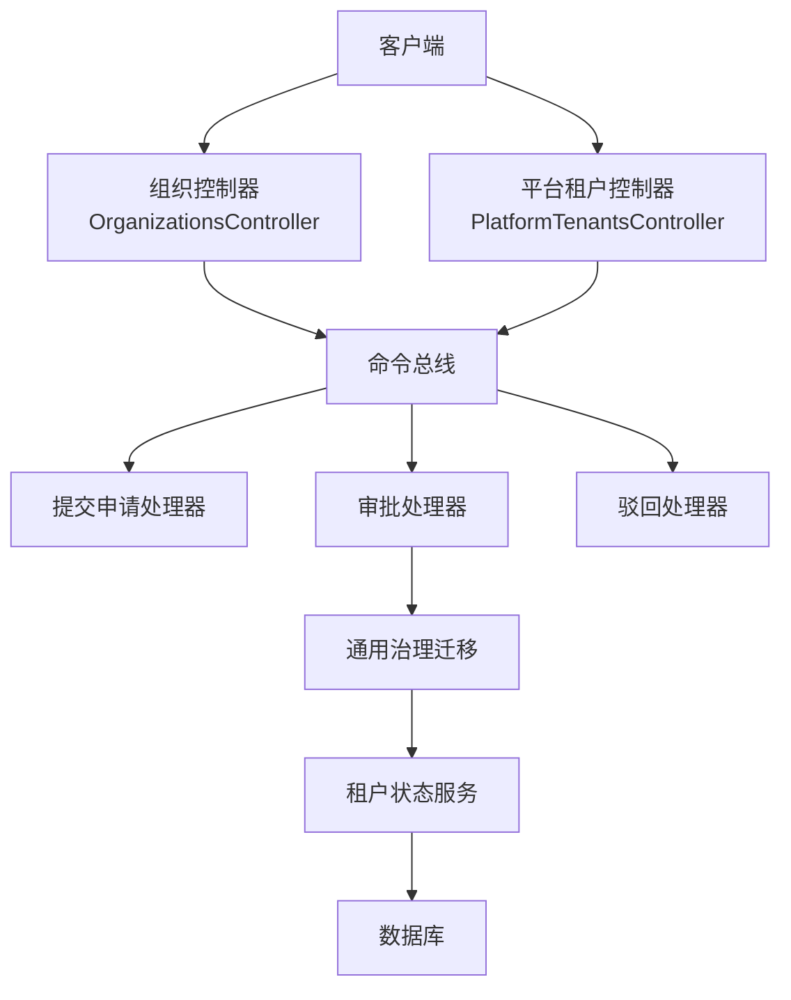
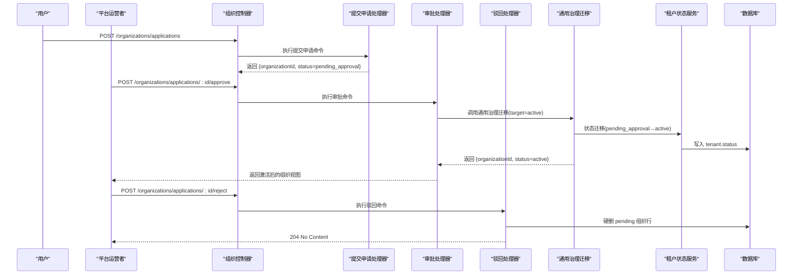
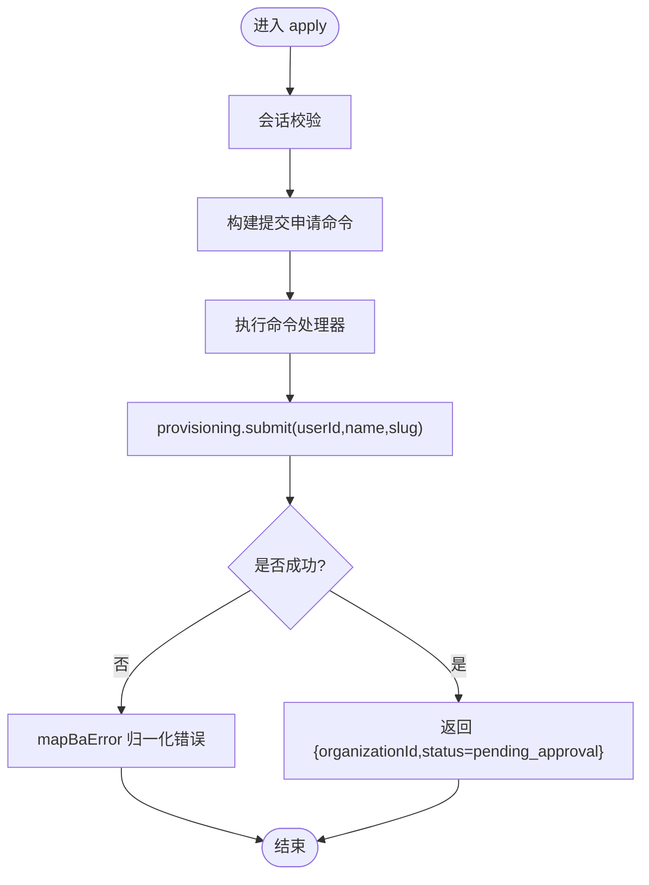
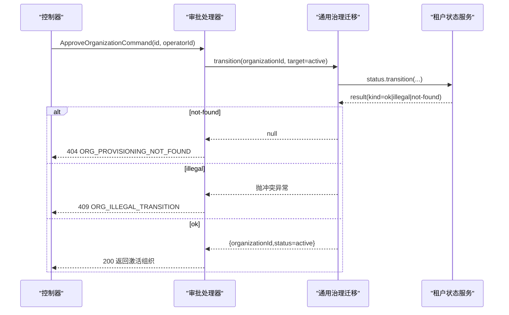
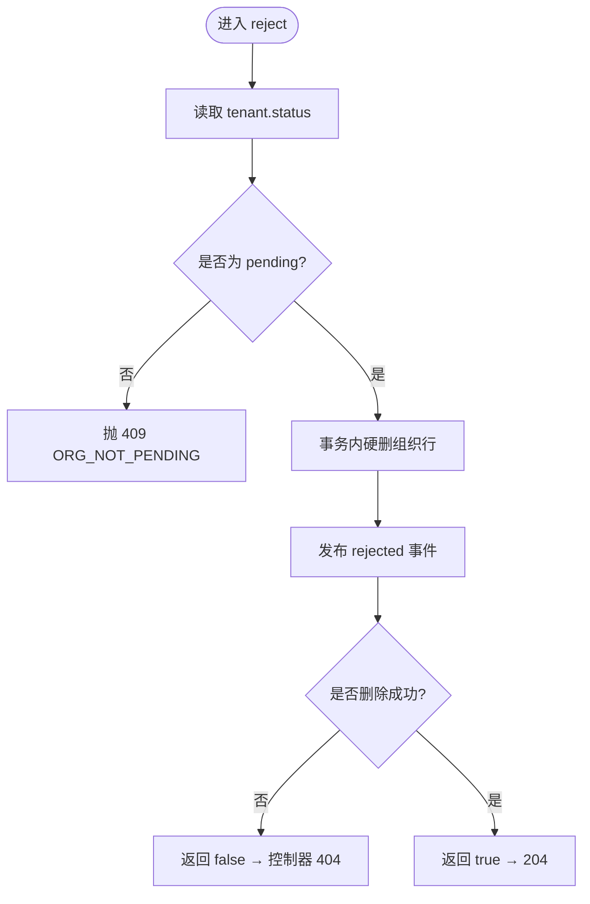
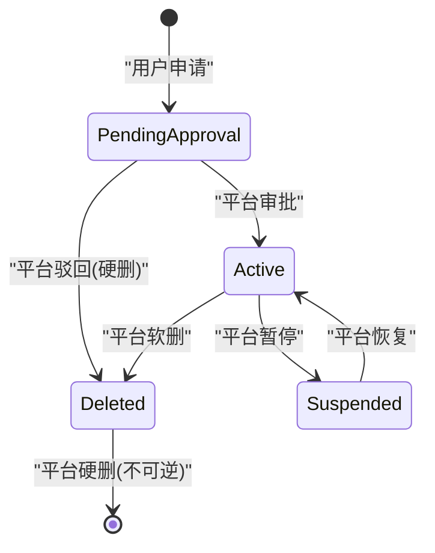
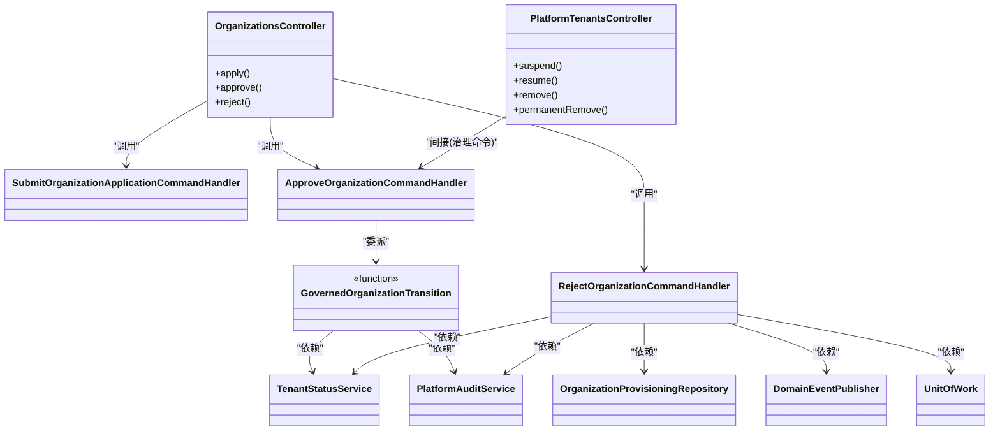

# 组织生命周期管理 API

<cite>
**本文引用的文件**   
- [organizations.controller.ts](file://apps/api/src/modules/organizations/api/organizations.controller.ts)
- [platform-tenants.controller.ts](file://apps/api/src/modules/platform/api/platform-tenants.controller.ts)
- [organizations.contract.ts](file://libs/api-contract/src/organizations.contract.ts)
- [openapi.yaml](file://openapi/openapi.yaml)
- [submit-organization-application.command-handler.ts](file://apps/api/src/modules/organizations/application/commands/handlers/submit-organization-application.command-handler.ts)
- [approve-organization.command-handler.ts](file://apps/api/src/modules/organizations/application/commands/handlers/approve-organization.command-handler.ts)
- [reject-organization.command-handler.ts](file://apps/api/src/modules/organizations/application/commands/handlers/reject-organization.command-handler.ts)
- [governed-organization-transition.ts](file://apps/api/src/modules/organizations/application/commands/handlers/governed-organization-transition.ts)
- [organization-lifecycle.test.ts](file://apps/api/src/modules/organizations/lifecycle/organization-lifecycle.test.ts)
</cite>

## 目录
1. [引言](#引言)
2. [项目结构](#项目结构)
3. [核心组件](#核心组件)
4. [架构总览](#架构总览)
5. [详细组件分析](#详细组件分析)
6. [依赖关系分析](#依赖关系分析)
7. [性能与一致性](#性能与一致性)
8. [故障排查指南](#故障排查指南)
9. [结论](#结论)

## 引言
本文件面向“组织生命周期管理”的 API 文档，覆盖以下关键能力：
- 用户提交组织申请：认证、参数校验、状态落库为待审批。
- 平台运营者审批与驳回：权限检查、状态转换、错误处理。
- 组织从 pending_approval 到 active 的状态流转。
- 组织删除与恢复（租户级治理）接口。
- 完整的请求响应示例与错误码说明。

该能力位于多租户 SaaS 平台的“全局租户治理”切片中，遵循三层分离：控制器负责路由与守卫，命令处理器负责业务规则，读模型负责对外返回结构。

## 项目结构
组织生命周期相关代码主要分布在以下位置：
- API 契约定义：libs/api-contract/src/organizations.contract.ts
- HTTP 控制器：
  - 组织申请/审批/驳回：apps/api/src/modules/organizations/api/organizations.controller.ts
  - 平台租户治理（暂停/恢复/软删/硬删等）：apps/api/src/modules/platform/api/platform-tenants.controller.ts
- 命令处理器：
  - 提交申请：handlers/submit-organization-application.command-handler.ts
  - 审批通过：handlers/approve-organization.command-handler.ts
  - 驳回申请：handlers/reject-organization.command-handler.ts
  - 通用治理迁移：handlers/governed-organization-transition.ts
- 状态机与测试：modules/organizations/lifecycle/organization-lifecycle.test.ts
- OpenAPI 文档：openapi/openapi.yaml

图表来源
- [organizations.controller.ts:62-175](file://apps/api/src/modules/organizations/api/organizations.controller.ts#L62-L175)
- [platform-tenants.controller.ts:100-311](file://apps/api/src/modules/platform/api/platform-tenants.controller.ts#L100-L311)
- [submit-organization-application.command-handler.ts:18-38](file://apps/api/src/modules/organizations/application/commands/handlers/submit-organization-application.command-handler.ts#L18-L38)
- [approve-organization.command-handler.ts:21-49](file://apps/api/src/modules/organizations/application/commands/handlers/approve-organization.command-handler.ts#L21-L49)
- [reject-organization.command-handler.ts:40-111](file://apps/api/src/modules/organizations/application/commands/handlers/reject-organization.command-handler.ts#L40-L111)
- [governed-organization-transition.ts:61-90](file://apps/api/src/modules/organizations/application/commands/handlers/governed-organization-transition.ts#L61-L90)

章节来源
- [organizations.controller.ts:1-176](file://apps/api/src/modules/organizations/api/organizations.controller.ts#L1-L176)
- [platform-tenants.controller.ts:1-312](file://apps/api/src/modules/platform/api/platform-tenants.controller.ts#L1-L312)
- [organizations.contract.ts:1-54](file://libs/api-contract/src/organizations.contract.ts#L1-L54)

## 核心组件
- 组织申请/审批控制器：提供用户申请与平台审批/驳回入口，使用会话守卫与平台运营者守卫区分权限。
- 平台租户控制器：提供租户级治理（暂停/恢复/软删/硬删/可见性策略/诊断/导出）。
- 命令处理器：封装领域动作（提交申请、审批、驳回），并通过通用治理迁移函数统一处理非法转移与审计。
- 契约与元数据：集中声明 API 路径、方法、成功状态码、输入输出 schema。
- 状态机：以 tenant.status 为唯一真相源，pending_approval 被阻断访问，active 可正常访问。

章节来源
- [organizations.controller.ts:35-63](file://apps/api/src/modules/organizations/api/organizations.controller.ts#L35-L63)
- [platform-tenants.controller.ts:64-87](file://apps/api/src/modules/platform/api/platform-tenants.controller.ts#L64-L87)
- [organizations.contract.ts:18-53](file://libs/api-contract/src/organizations.contract.ts#L18-L53)
- [organization-lifecycle.test.ts:14-26](file://apps/api/src/modules/organizations/lifecycle/organization-lifecycle.test.ts#L14-L26)

## 架构总览
下图展示“组织申请 → 审批 → 生效”的端到端调用链，以及平台治理对租户状态的统一控制。

图表来源
- [organizations.controller.ts:72-141](file://apps/api/src/modules/organizations/api/organizations.controller.ts#L72-L141)
- [submit-organization-application.command-handler.ts:27-38](file://apps/api/src/modules/organizations/application/commands/handlers/submit-organization-application.command-handler.ts#L27-L38)
- [approve-organization.command-handler.ts:35-49](file://apps/api/src/modules/organizations/application/commands/handlers/approve-organization.command-handler.ts#L35-L49)
- [reject-organization.command-handler.ts:63-111](file://apps/api/src/modules/organizations/application/commands/handlers/reject-organization.command-handler.ts#L63-L111)
- [governed-organization-transition.ts:61-90](file://apps/api/src/modules/organizations/application/commands/handlers/governed-organization-transition.ts#L61-L90)

## 详细组件分析

### 接口总览
- 用户提交组织申请
  - 方法：POST
  - 路径：/organizations/applications
  - 成功状态码：201
  - 鉴权：SessionGuard（已登录用户）
  - 入参：name、slug
  - 出参：{ organizationId, status }，status 初始为 pending_approval
- 平台运营者审批组织
  - 方法：POST
  - 路径：/organizations/applications/:id/approve
  - 成功状态码：200
  - 鉴权：PlatformOperatorGuard（平台运营者）
  - 入参：{ id }
  - 出参：{ organizationId, status }，status 变为 active
- 平台运营者驳回组织
  - 方法：POST
  - 路径：/organizations/applications/:id/reject
  - 成功状态码：204
  - 鉴权：PlatformOperatorGuard
  - 入参：{ id }
  - 出参：无
- 平台租户治理（删除与恢复）
  - 暂停：POST /platform/tenants/:tenantId/suspend
  - 恢复：POST /platform/tenants/:tenantId/resume
  - 软删：POST /platform/tenants/:tenantId/remove
  - 硬删：POST /platform/tenants/:tenantId/permanent-remove
  - 鉴权：PlatformOperatorGuard（类级别守卫）

章节来源
- [organizations.contract.ts:18-53](file://libs/api-contract/src/organizations.contract.ts#L18-L53)
- [openapi.yaml:1172-1218](file://openapi/openapi.yaml#L1172-L1218)
- [platform-tenants.controller.ts:147-266](file://apps/api/src/modules/platform/api/platform-tenants.controller.ts#L147-L266)

### 用户提交组织申请
- 流程要点
  - 控制器经 SessionGuard 校验会话，读取当前用户。
  - 构造并提交 SubmitOrganizationApplicationCommand。
  - 处理器调用 provisioning 网关创建组织，强制状态为 pending_approval。
  - 返回组织回执（organizationId + status）。
- 参数验证
  - 输入 schema 由契约层定义；控制器通过 .input() 绑定。
- 错误处理
  - BA 层 4xx 异常经 mapBaError 归一化后透传（如重复 slug）。
  - 未命中或非法操作在应用层抛出标准异常，经 WP-D 错误面统一映射。

图表来源
- [organizations.controller.ts:72-91](file://apps/api/src/modules/organizations/api/organizations.controller.ts#L72-L91)
- [submit-organization-application.command-handler.ts:27-38](file://apps/api/src/modules/organizations/application/commands/handlers/submit-organization-application.command-handler.ts#L27-L38)

章节来源
- [organizations.controller.ts:72-91](file://apps/api/src/modules/organizations/api/organizations.controller.ts#L72-L91)
- [submit-organization-application.command-handler.ts:10-38](file://apps/api/src/modules/organizations/application/commands/handlers/submit-organization-application.command-handler.ts#L10-L38)

### 平台运营者审批组织
- 流程要点
  - 控制器经 PlatformOperatorGuard 校验平台权限。
  - 构造 ApproveOrganizationCommand 并执行。
  - 处理器委托 governedOrganizationTransition，目标状态为 active。
  - 状态服务按迁移表裁决，成功后写回 tenant.status。
  - 返回激活后的组织读模型。
- 权限检查
  - 仅平台运营者可调用。
- 状态转换
  - pending_approval → active。
- 错误处理
  - 查无：返回 null，控制器抛 404（ORG_PROVISIONING_NOT_FOUND）。
  - 非法迁移：抛出 ConflictException（ORG_ILLEGAL_TRANSITION）。

图表来源
- [organizations.controller.ts:98-118](file://apps/api/src/modules/organizations/api/organizations.controller.ts#L98-L118)
- [approve-organization.command-handler.ts:35-49](file://apps/api/src/modules/organizations/application/commands/handlers/approve-organization.command-handler.ts#L35-L49)
- [governed-organization-transition.ts:61-90](file://apps/api/src/modules/organizations/application/commands/handlers/governed-organization-transition.ts#L61-L90)

章节来源
- [organizations.controller.ts:94-118](file://apps/api/src/modules/organizations/api/organizations.controller.ts#L94-L118)
- [approve-organization.command-handler.ts:10-49](file://apps/api/src/modules/organizations/application/commands/handlers/approve-organization.command-handler.ts#L10-L49)
- [governed-organization-transition.ts:40-90](file://apps/api/src/modules/organizations/application/commands/handlers/governed-organization-transition.ts#L40-L90)

### 平台运营者驳回组织
- 流程要点
  - 控制器经 PlatformOperatorGuard 校验平台权限。
  - 构造 RejectOrganizationCommand 并执行。
  - 处理器先读取 tenant.status，仅允许 pending 状态驳回。
  - 在事务内硬删组织行，并发布 rejected 事件。
  - 返回布尔值，false 时控制器抛 404。
- 权限检查
  - 仅平台运营者可调用。
- 状态约束
  - 非 pending 状态直接抛 409（ORG_NOT_PENDING）。
- 错误处理
  - 目标不存在：返回 false，控制器抛 404（ORG_PROVISIONING_NOT_FOUND）。
  - 非 pending：抛 409（ORG_NOT_PENDING）。

图表来源
- [organizations.controller.ts:124-141](file://apps/api/src/modules/organizations/api/organizations.controller.ts#L124-L141)
- [reject-organization.command-handler.ts:63-111](file://apps/api/src/modules/organizations/application/commands/handlers/reject-organization.command-handler.ts#L63-L111)

章节来源
- [organizations.controller.ts:120-141](file://apps/api/src/modules/organizations/api/organizations.controller.ts#L120-L141)
- [reject-organization.command-handler.ts:26-111](file://apps/api/src/modules/organizations/application/commands/handlers/reject-organization.command-handler.ts#L26-L111)

### 组织删除与恢复（平台租户治理）
- 暂停（active → suspended）
  - 控制器：PlatformTenantsController.suspend
  - 命令：SuspendOrganizationCommand
  - 成功返回治理结果；未命中 404（ORG_NOT_FOUND）；非法转移 409（ORG_ILLEGAL_TRANSITION）。
- 恢复（suspended → active）
  - 控制器：PlatformTenantsController.resume
  - 命令：ResumeOrganizationCommand
  - 成功返回治理结果；未命中 404；非法转移 409。
- 软删（→ deleted 终态）
  - 控制器：PlatformTenantsController.remove
  - 命令：DeleteOrganizationCommand
  - 保留行供导出；未命中 404；已删 409。
- 硬删（不可逆）
  - 控制器：PlatformTenantsController.permanentRemove
  - 命令：DeleteOrganizationPermanentlyCommand
  - 清除名下所有组织及子表；未命中/幂等 404；非终态 409。

图表来源
- [platform-tenants.controller.ts:147-266](file://apps/api/src/modules/platform/api/platform-tenants.controller.ts#L147-L266)
- [organization-lifecycle.test.ts:14-26](file://apps/api/src/modules/organizations/lifecycle/organization-lifecycle.test.ts#L14-L26)

章节来源
- [platform-tenants.controller.ts:147-266](file://apps/api/src/modules/platform/api/platform-tenants.controller.ts#L147-L266)
- [organization-lifecycle.test.ts:14-26](file://apps/api/src/modules/organizations/lifecycle/organization-lifecycle.test.ts#L14-L26)

### 状态流转与访问控制
- 状态集合
  - pending_approval：待审批，访问被阻断。
  - active：活跃，可正常使用。
  - suspended：暂停，访问被阻断。
  - deleted：软删终态，访问被阻断。
- 访问阻断
  - isTenantBlocked 对 pending_approval、suspended、deleted 返回阻断。
- 审批生效
  - 审批通过后，tenant.status 更新为 active，后续访问不再阻断。

章节来源
- [organization-lifecycle.test.ts:14-26](file://apps/api/src/modules/organizations/lifecycle/organization-lifecycle.test.ts#L14-L26)
- [governed-organization-transition.ts:61-90](file://apps/api/src/modules/organizations/application/commands/handlers/governed-organization-transition.ts#L61-L90)

## 依赖关系分析
- 控制器依赖
  - OrganizationsController：依赖 CommandBus，注入各命令处理器。
  - PlatformTenantsController：依赖 CommandBus/QueryBus，注入治理命令与查询。
- 命令处理器依赖
  - SubmitOrganizationApplicationCommandHandler：依赖 OrganizationProvisioningRepository。
  - ApproveOrganizationCommandHandler：依赖 TenantStatusService、PlatformAuditService。
  - RejectOrganizationCommandHandler：依赖 OrganizationProvisioningRepository、TenantStatusService、PlatformAuditService、DomainEventPublisher、UnitOfWork。
  - governedOrganizationTransition：依赖 TenantStatusService、PlatformAuditService。
- 外部契约
  - api-contract 暴露 meta 与 contract，OpenAPI 生成基于此。

图表来源
- [organizations.controller.ts:62-175](file://apps/api/src/modules/organizations/api/organizations.controller.ts#L62-L175)
- [platform-tenants.controller.ts:100-311](file://apps/api/src/modules/platform/api/platform-tenants.controller.ts#L100-L311)
- [submit-organization-application.command-handler.ts:18-38](file://apps/api/src/modules/organizations/application/commands/handlers/submit-organization-application.command-handler.ts#L18-L38)
- [approve-organization.command-handler.ts:21-49](file://apps/api/src/modules/organizations/application/commands/handlers/approve-organization.command-handler.ts#L21-L49)
- [reject-organization.command-handler.ts:40-111](file://apps/api/src/modules/organizations/application/commands/handlers/reject-organization.command-handler.ts#L40-L111)
- [governed-organization-transition.ts:61-90](file://apps/api/src/modules/organizations/application/commands/handlers/governed-organization-transition.ts#L61-L90)

## 性能与一致性
- 事务与事件
  - 驳回路径将硬删与事件发布包裹在 UnitOfWork 中，保证 outbox 同事务原子性。
- 状态权威
  - tenant.status 为唯一真相源，避免散点手写状态列。
- 审计
  - 所有治理动作（审批/驳回/暂停/恢复/删除）均记录结构化审计，便于追踪与合规。

章节来源
- [reject-organization.command-handler.ts:85-98](file://apps/api/src/modules/organizations/application/commands/handlers/reject-organization.command-handler.ts#L85-L98)
- [governed-organization-transition.ts:61-90](file://apps/api/src/modules/organizations/application/commands/handlers/governed-organization-transition.ts#L61-L90)

## 故障排查指南
- 常见错误码与场景
  - ORG_PROVISIONING_NOT_FOUND：审批/驳回时组织申请不存在。
  - ORG_NOT_PENDING：尝试驳回非 pending 的申请。
  - ORG_ILLEGAL_TRANSITION：非法状态迁移（如从 deleted 继续迁移）。
  - ORG_NOT_FOUND：平台租户治理中租户不存在。
- 定位建议
  - 确认请求主体是否具备对应权限（SessionGuard/PlatformOperatorGuard）。
  - 检查组织当前状态是否符合预期（pending_approval/active/suspended/deleted）。
  - 查看结构化审计日志，确认动作 from/to 与 error 字段。
  - 核对 OpenAPI 契约与控制器 successStatus 是否一致。

章节来源
- [organizations.controller.ts:111-141](file://apps/api/src/modules/organizations/api/organizations.controller.ts#L111-L141)
- [platform-tenants.controller.ts:156-266](file://apps/api/src/modules/platform/api/platform-tenants.controller.ts#L156-L266)
- [governed-organization-transition.ts:69-83](file://apps/api/src/modules/organizations/application/commands/handlers/governed-organization-transition.ts#L69-L83)
- [reject-organization.command-handler.ts:68-84](file://apps/api/src/modules/organizations/application/commands/handlers/reject-organization.command-handler.ts#L68-L84)

## 结论
本 API 体系围绕“组织申请—审批—生效—治理”的全生命周期展开，采用严格的权限守卫、统一的状态迁移与结构化审计，确保多租户环境下的数据安全与可追溯性。通过契约先行与 OpenAPI 集成，前后端可共享一致的接口语义，降低集成成本。