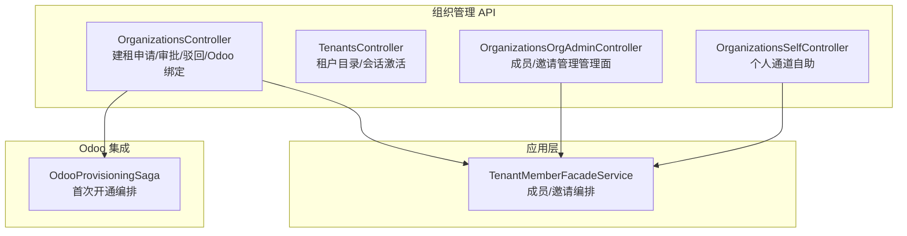
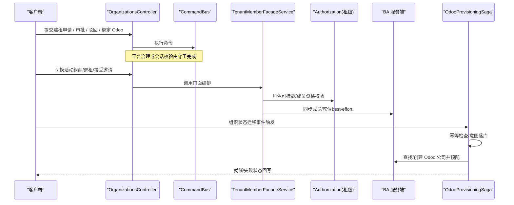
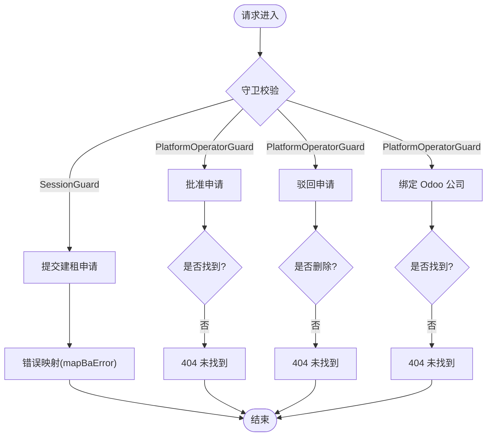
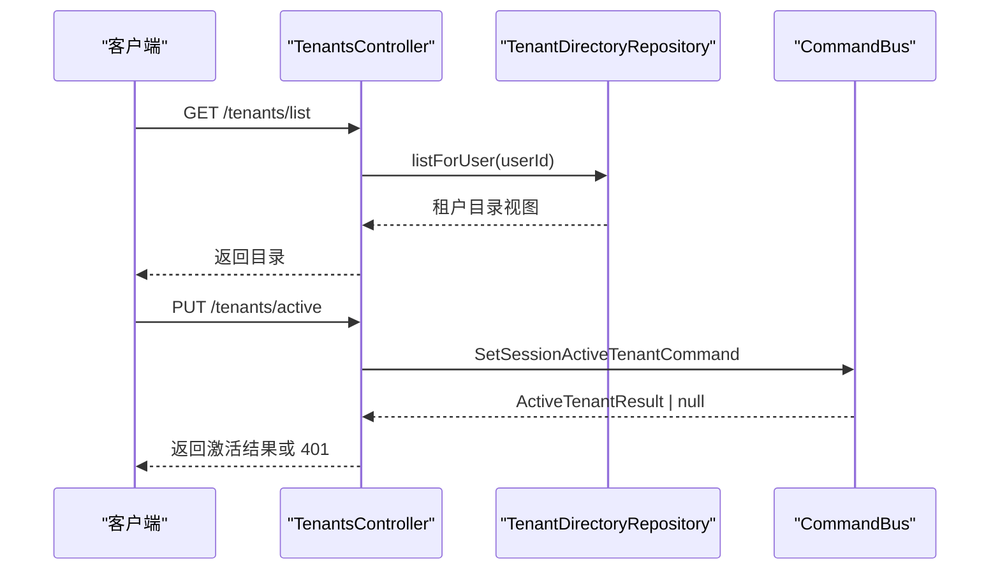
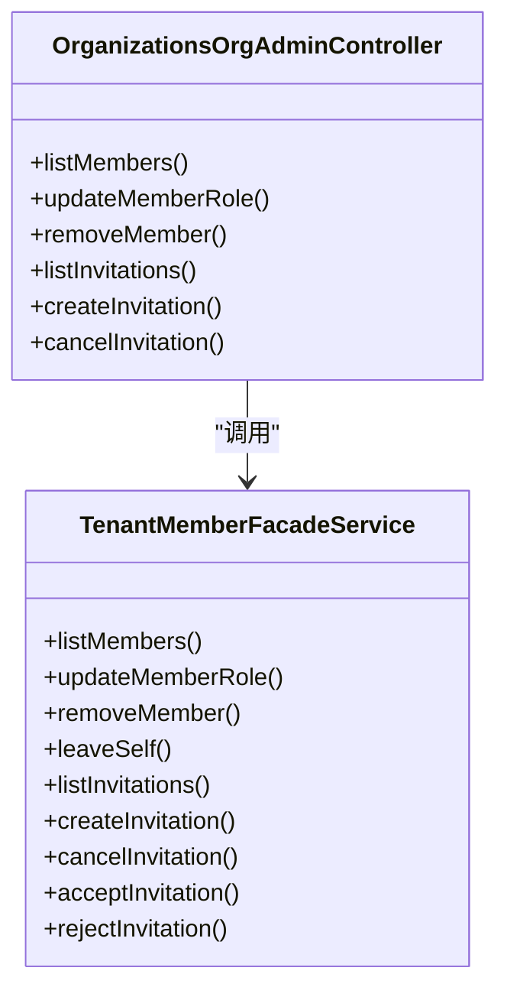
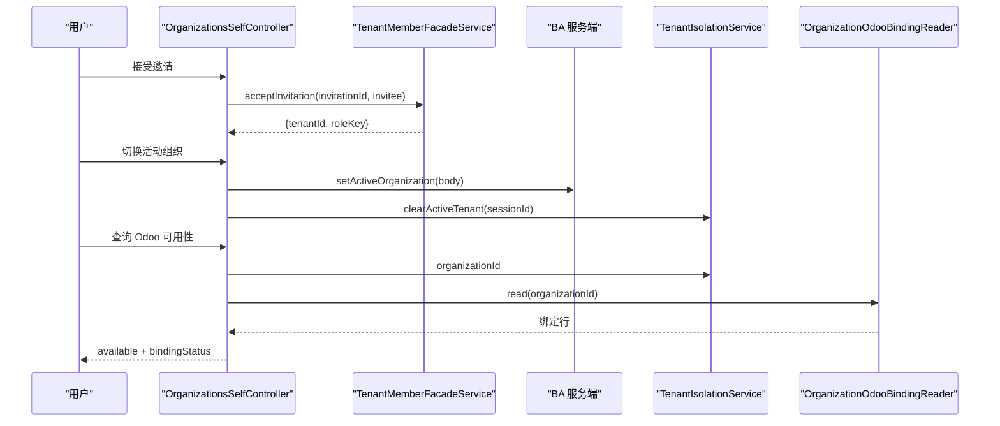
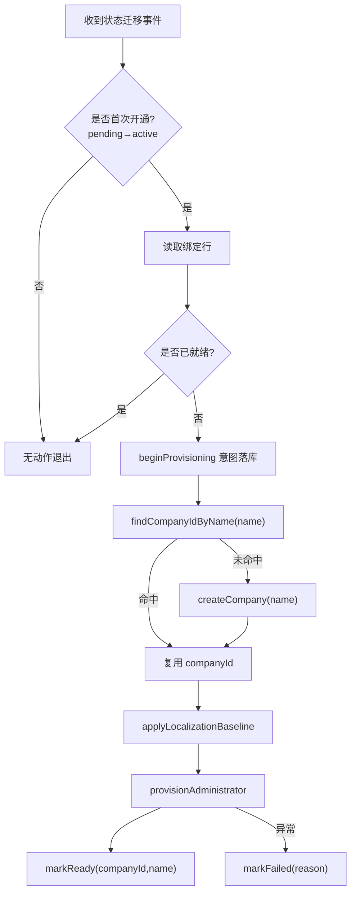
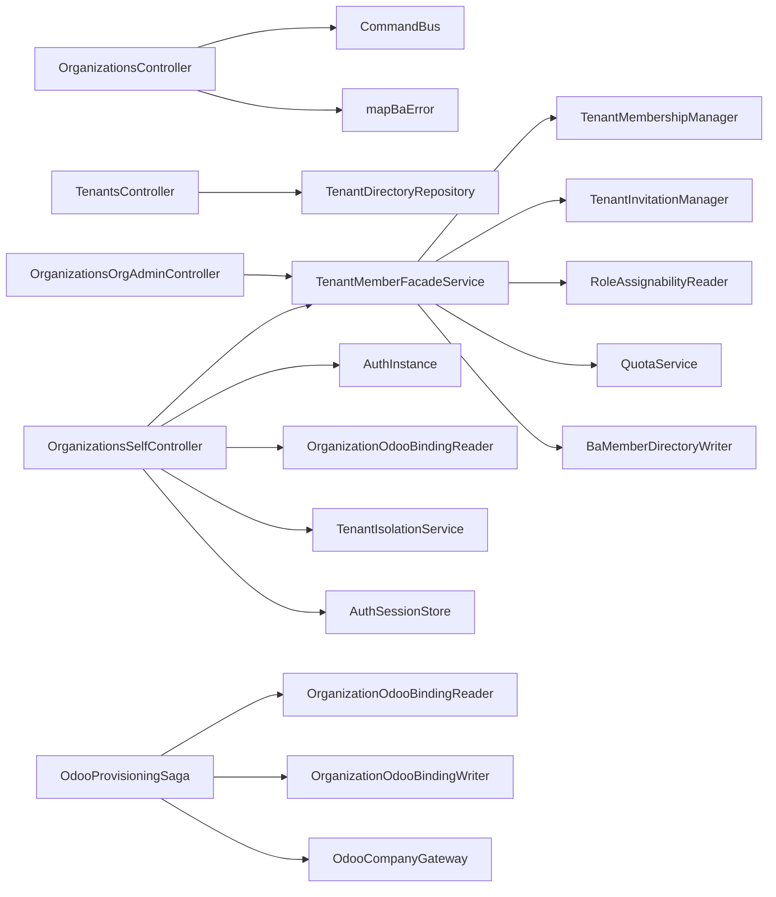

# 组织管理 API

<cite>
**本文引用的文件**   
- [apps/api/src/modules/organizations/api/organizations.controller.ts](file://apps/api/src/modules/organizations/api/organizations.controller.ts)
- [apps/api/src/modules/organizations/api/tenants.controller.ts](file://apps/api/src/modules/organizations/api/tenants.controller.ts)
- [apps/api/src/modules/organizations/api/organizations-org-admin.controller.ts](file://apps/api/src/modules/organizations/api/organizations-org-admin.controller.ts)
- [apps/api/src/modules/organizations/api/organizations-self.controller.ts](file://apps/api/src/modules/organizations/api/organizations-self.controller.ts)
- [apps/api/src/modules/organizations/application/tenant-member-facade.service.ts](file://apps/api/src/modules/organizations/application/tenant-member-facade.service.ts)
- [apps/api/src/features/odoo-provisioning/application/odoo-provisioning.saga.ts](file://apps/api/src/features/odoo-provisioning/application/odoo-provisioning.saga.ts)
</cite>

## 目录
1. [简介](#简介)
2. [项目结构](#项目结构)
3. [核心组件](#核心组件)
4. [架构总览](#架构总览)
5. [详细组件分析](#详细组件分析)
6. [依赖关系分析](#依赖关系分析)
7. [性能与可扩展性](#性能与可扩展性)
8. [故障排查指南](#故障排查指南)
9. [结论](#结论)
10. [附录：API 契约与错误码速查](#附录api-契约与错误码速查)

## 简介
本文件为“组织管理模块”的完整 API 文档，覆盖以下能力：
- 组织生命周期管理：创建申请、平台审批/驳回、绑定 Odoo 公司。
- 租户管理：列出可见租户、设置会话级活动租户。
- 成员管理：邀请、加入、拒绝、移除、角色分配等。
- 组织治理：席位配额卡点、成员资格守卫、数据导出读模型（见附录）。
- Odoo 企业系统集成：公司绑定、自动开通 Saga、可用性查询。
- 组织层级与权限继承：租户-组织双层结构、CASL 授权矩阵、租级隔离。
- 诊断与维护：Odoo 绑定状态、成员计数 Doctor（脚本）、平台租户/用户治理（参考）。

## 项目结构
组织管理相关 API 集中在 apps/api/src/modules/organizations 下，按控制器（API）、应用服务（Facade/Command/Query）、领域仓储（Repository）分层；Odoo 集成在 features/odoo-provisioning 中通过 Saga 异步编排。

图示来源
- [apps/api/src/modules/organizations/api/organizations.controller.ts:65-175](file://apps/api/src/modules/organizations/api/organizations.controller.ts#L65-L175)
- [apps/api/src/modules/organizations/api/tenants.controller.ts:44-101](file://apps/api/src/modules/organizations/api/tenants.controller.ts#L44-L101)
- [apps/api/src/modules/organizations/api/organizations-org-admin.controller.ts:58-156](file://apps/api/src/modules/organizations/api/organizations-org-admin.controller.ts#L58-L156)
- [apps/api/src/modules/organizations/api/organizations-self.controller.ts:86-249](file://apps/api/src/modules/organizations/api/organizations-self.controller.ts#L86-L249)
- [apps/api/src/modules/organizations/application/tenant-member-facade.service.ts:55-263](file://apps/api/src/modules/organizations/application/tenant-member-facade.service.ts#L55-L263)
- [apps/api/src/features/odoo-provisioning/application/odoo-provisioning.saga.ts:49-105](file://apps/api/src/features/odoo-provisioning/application/odoo-provisioning.saga.ts#L49-L105)

章节来源
- [apps/api/src/modules/organizations/api/organizations.controller.ts:35-63](file://apps/api/src/modules/organizations/api/organizations.controller.ts#L35-L63)
- [apps/api/src/modules/organizations/api/tenants.controller.ts:26-40](file://apps/api/src/modules/organizations/api/tenants.controller.ts#L26-L40)
- [apps/api/src/modules/organizations/api/organizations-org-admin.controller.ts:32-48](file://apps/api/src/modules/organizations/api/organizations-org-admin.controller.ts#L32-L48)
- [apps/api/src/modules/organizations/api/organizations-self.controller.ts:55-75](file://apps/api/src/modules/organizations/api/organizations-self.controller.ts#L55-L75)

## 核心组件
- OrganizationsController：面向平台运营者与已认证用户的组织申请、审批、驳回、Odoo 公司绑定。
- TenantsController：面向已认证用户的租户目录读取与会话级活动租户设置。
- OrganizationsOrgAdminController：租户内成员与邀请的管理面（owner/admin），基于 CASL + 租级隔离。
- OrganizationsSelfController：个人通道（接受/拒绝邀请、退租、切换活动组织、Odoo 可用性）。
- TenantMemberFacadeService：成员/邀请的统一编排门面，集中实现席位卡点、last-owner/self-removal 守卫、BA 双轴同步。
- OdooProvisioningSaga：订阅组织状态迁移事件，驱动 Odoo 公司首次开通流程。

章节来源
- [apps/api/src/modules/organizations/api/organizations.controller.ts:65-175](file://apps/api/src/modules/organizations/api/organizations.controller.ts#L65-L175)
- [apps/api/src/modules/organizations/api/tenants.controller.ts:44-101](file://apps/api/src/modules/organizations/api/tenants.controller.ts#L44-L101)
- [apps/api/src/modules/organizations/api/organizations-org-admin.controller.ts:58-156](file://apps/api/src/modules/organizations/api/organizations-org-admin.controller.ts#L58-L156)
- [apps/api/src/modules/organizations/api/organizations-self.controller.ts:86-249](file://apps/api/src/modules/organizations/api/organizations-self.controller.ts#L86-L249)
- [apps/api/src/modules/organizations/application/tenant-member-facade.service.ts:55-263](file://apps/api/src/modules/organizations/application/tenant-member-facade.service.ts#L55-L263)
- [apps/api/src/features/odoo-provisioning/application/odoo-provisioning.saga.ts:49-105](file://apps/api/src/features/odoo-provisioning/application/odoo-provisioning.saga.ts#L49-L105)

## 架构总览
组织管理采用“控制器 → 门面/命令总线 → 领域仓储/外部系统”的分层架构，并通过事件驱动完成 Odoo 侧自动化。

图示来源
- [apps/api/src/modules/organizations/api/organizations.controller.ts:72-173](file://apps/api/src/modules/organizations/api/organizations.controller.ts#L72-L173)
- [apps/api/src/modules/organizations/api/organizations-self.controller.ts:110-216](file://apps/api/src/modules/organizations/api/organizations-self.controller.ts#L110-L216)
- [apps/api/src/modules/organizations/application/tenant-member-facade.service.ts:76-243](file://apps/api/src/modules/organizations/application/tenant-member-facade.service.ts#L76-L243)
- [apps/api/src/features/odoo-provisioning/application/odoo-provisioning.saga.ts:67-103](file://apps/api/src/features/odoo-provisioning/application/odoo-provisioning.saga.ts#L67-L103)

## 详细组件分析

### 组织生命周期 API（OrganizationsController）
- 功能要点
  - 提交建租申请：已登录用户创建 pending_approval 组织，重复 slug 等错误经统一映射返回。
  - 平台审批：将 pending 转为 active，未找到返回 404。
  - 平台驳回：硬删 pending 申请，未找到返回 404。
  - 绑定 Odoo 公司：平台运营者为 active 组织回填 Odoo 公司绑定。
- 安全与隔离
  - 类级豁免租户墙（S11），路由级使用 SessionGuard 或 PlatformOperatorGuard。
- 关键路径
  - 命令总线执行对应 Command，返回读模型或布尔值。

图示来源
- [apps/api/src/modules/organizations/api/organizations.controller.ts:72-173](file://apps/api/src/modules/organizations/api/organizations.controller.ts#L72-L173)

章节来源
- [apps/api/src/modules/organizations/api/organizations.controller.ts:35-63](file://apps/api/src/modules/organizations/api/organizations.controller.ts#L35-L63)
- [apps/api/src/modules/organizations/api/organizations.controller.ts:72-173](file://apps/api/src/modules/organizations/api/organizations.controller.ts#L72-L173)

### 租户管理 API（TenantsController）
- 功能要点
  - 列出当前用户可见的租户目录（顶层租户及其下属组织）。
  - 设置会话级活动租户：不依赖先选活动组织，仅写入会话 activeTenantId。
- 安全与隔离
  - 类级豁免租户墙，逐路由 SessionGuard；可见性由仓储按 userId 收敛。
- 关键路径
  - list：调用租户目录仓储返回视图。
  - setActiveTenant：校验 sessionId，执行 SetSessionActiveTenantCommand，返回激活结果。

图示来源
- [apps/api/src/modules/organizations/api/tenants.controller.ts:55-99](file://apps/api/src/modules/organizations/api/tenants.controller.ts#L55-L99)

章节来源
- [apps/api/src/modules/organizations/api/tenants.controller.ts:26-40](file://apps/api/src/modules/organizations/api/tenants.controller.ts#L26-L40)
- [apps/api/src/modules/organizations/api/tenants.controller.ts:55-99](file://apps/api/src/modules/organizations/api/tenants.controller.ts#L55-L99)

### 成员管理 API（OrganizationsOrgAdminController）
- 功能要点
  - 列出成员、更新成员角色、移除成员。
  - 列出待处理邀请、创建邀请、取消邀请。
- 安全与隔离
  - 组合 TenantIsolationGuard + AuthorizationGuard，方法级 @Can 控制操作维度。
- 编排门面
  - 所有写操作经由 TenantMemberFacadeService，集中实现：
    - 角色可挂载校验（ROLE_NOT_FOUND）。
    - last-owner/self-removal 保护（403）。
    - 席位配额卡点（接受邀请时）。
    - BA 成员表 best-effort 同步。

图示来源
- [apps/api/src/modules/organizations/api/organizations-org-admin.controller.ts:58-156](file://apps/api/src/modules/organizations/api/organizations-org-admin.controller.ts#L58-L156)
- [apps/api/src/modules/organizations/application/tenant-member-facade.service.ts:66-243](file://apps/api/src/modules/organizations/application/tenant-member-facade.service.ts#L66-L243)

章节来源
- [apps/api/src/modules/organizations/api/organizations-org-admin.controller.ts:32-48](file://apps/api/src/modules/organizations/api/organizations-org-admin.controller.ts#L32-L48)
- [apps/api/src/modules/organizations/api/organizations-org-admin.controller.ts:58-156](file://apps/api/src/modules/organizations/api/organizations-org-admin.controller.ts#L58-L156)
- [apps/api/src/modules/organizations/application/tenant-member-facade.service.ts:55-263](file://apps/api/src/modules/organizations/application/tenant-member-facade.service.ts#L55-L263)

### 个人通道 API（OrganizationsSelfController）
- 功能要点
  - 列出所属租户（BA passthrough）。
  - 切换活动组织（BA passthrough），同时清理会话级 activeTenantId（防混态）。
  - 自助退租（撤销租级成员+BA member）。
  - 接受/拒绝邀请（席位卡点、邮箱匹配、幂等消费）。
  - 列出我的邀请（跨租个人可见）。
  - 查询 Odoo 可用性（软读活跃租户绑定，不触 Odoo）。
- 安全与隔离
  - 类级豁免租户墙，逐路由 SessionGuard；授权语义由 BA 自身裁决。

图示来源
- [apps/api/src/modules/organizations/api/organizations-self.controller.ts:110-249](file://apps/api/src/modules/organizations/api/organizations-self.controller.ts#L110-L249)
- [apps/api/src/modules/organizations/application/tenant-member-facade.service.ts:206-243](file://apps/api/src/modules/organizations/application/tenant-member-facade.service.ts#L206-L243)

章节来源
- [apps/api/src/modules/organizations/api/organizations-self.controller.ts:55-75](file://apps/api/src/modules/organizations/api/organizations-self.controller.ts#L55-L75)
- [apps/api/src/modules/organizations/api/organizations-self.controller.ts:110-249](file://apps/api/src/modules/organizations/api/organizations-self.controller.ts#L110-L249)

### Odoo 企业系统集成（OdooProvisioningSaga）
- 触发条件
  - 订阅 OrganizationStatusTransitionedEvent，仅在首次开通（pending→active）执行。
- 编排步骤
  - 幂等检查：已 ready 直接退出。
  - 意图落库：beginProvisioning。
  - 公司名派生：expectedCompanyName。
  - 查找/创建 Odoo 公司，应用本地化基线，预配管理员。
  - 成功 markReady；失败 markFailed（携带原因）。
- 一致性
  - at-least-once 幂等：重投/崩溃恢复不重复建司。

图示来源
- [apps/api/src/features/odoo-provisioning/application/odoo-provisioning.saga.ts:67-103](file://apps/api/src/features/odoo-provisioning/application/odoo-provisioning.saga.ts#L67-L103)

章节来源
- [apps/api/src/features/odoo-provisioning/application/odoo-provisioning.saga.ts:22-48](file://apps/api/src/features/odoo-provisioning/application/odoo-provisioning.saga.ts#L22-L48)
- [apps/api/src/features/odoo-provisioning/application/odoo-provisioning.saga.ts:67-103](file://apps/api/src/features/odoo-provisioning/application/odoo-provisioning.saga.ts#L67-L103)

## 依赖关系分析
- 控制器依赖
  - OrganizationsController：依赖 CommandBus、错误映射 mapBaError、契约与 schema。
  - TenantsController：依赖 TenantDirectoryRepository、CommandBus。
  - OrganizationsOrgAdminController：依赖 TenantMemberFacadeService。
  - OrganizationsSelfController：依赖 AuthInstance、OrganizationOdooBindingReader、TenantIsolationService、AuthSessionStore、TenantMemberFacadeService。
- 门面依赖
  - TenantMemberFacadeService：依赖租级成员/邀请 Manager、角色可挂载 Reader、QuotaService、BA 成员 Writer、租户隔离上下文。
- Saga 依赖
  - OdooProvisioningSaga：依赖绑定读写端口、Odoo 公司网关。

图示来源
- [apps/api/src/modules/organizations/api/organizations.controller.ts:65-175](file://apps/api/src/modules/organizations/api/organizations.controller.ts#L65-L175)
- [apps/api/src/modules/organizations/api/tenants.controller.ts:44-101](file://apps/api/src/modules/organizations/api/tenants.controller.ts#L44-L101)
- [apps/api/src/modules/organizations/api/organizations-org-admin.controller.ts:58-156](file://apps/api/src/modules/organizations/api/organizations-org-admin.controller.ts#L58-L156)
- [apps/api/src/modules/organizations/api/organizations-self.controller.ts:86-249](file://apps/api/src/modules/organizations/api/organizations-self.controller.ts#L86-L249)
- [apps/api/src/modules/organizations/application/tenant-member-facade.service.ts:55-263](file://apps/api/src/modules/organizations/application/tenant-member-facade.service.ts#L55-L263)
- [apps/api/src/features/odoo-provisioning/application/odoo-provisioning.saga.ts:49-105](file://apps/api/src/features/odoo-provisioning/application/odoo-provisioning.saga.ts#L49-L105)

章节来源
- [apps/api/src/modules/organizations/api/organizations.controller.ts:65-175](file://apps/api/src/modules/organizations/api/organizations.controller.ts#L65-L175)
- [apps/api/src/modules/organizations/api/tenants.controller.ts:44-101](file://apps/api/src/modules/organizations/api/tenants.controller.ts#L44-L101)
- [apps/api/src/modules/organizations/api/organizations-org-admin.controller.ts:58-156](file://apps/api/src/modules/organizations/api/organizations-org-admin.controller.ts#L58-L156)
- [apps/api/src/modules/organizations/api/organizations-self.controller.ts:86-249](file://apps/api/src/modules/organizations/api/organizations-self.controller.ts#L86-L249)
- [apps/api/src/modules/organizations/application/tenant-member-facade.service.ts:55-263](file://apps/api/src/modules/organizations/application/tenant-member-facade.service.ts#L55-L263)
- [apps/api/src/features/odoo-provisioning/application/odoo-provisioning.saga.ts:49-105](file://apps/api/src/features/odoo-provisioning/application/odoo-provisioning.saga.ts#L49-L105)

## 性能与可扩展性
- 幂等与重试
  - Odoo 开通 Saga 具备幂等保护（已 ready 早退 + 命名回找），支持中断恢复。
- 并发与一致性
  - 接受邀请席位卡点采用“预飞 verdict + 原子 admitAtomically”，避免 TOCTOU。
- 扩展点
  - 角色可挂载策略通过 RoleAssignabilityReader 注入，便于扩展新角色。
  - Odoo 公司网关抽象，便于替换实现或接入更多后端能力。

[本节为通用指导，无需代码引用]

## 故障排查指南
- 常见错误与定位
  - 404 未找到：组织申请不存在、成员不存在、邀请不存在。
  - 403 禁止：最后属主不可降级/移除、自移被拒、非受邀人消费邀请。
  - 402 席位超限：接受邀请时席位不足。
  - 401 会话无效：设置活动租户时缺失 sessionId 或会话失效。
- 建议排查步骤
  - 确认会话主体与会话 ID 是否正确传递。
  - 检查租户隔离上下文是否包含有效 tenantId。
  - 查看 Odoo 绑定状态（available/bindingStatus/companyId）以判断集成链路。
  - 审查 Saga 日志中的 failed reason，定位 Odoo 侧问题。

章节来源
- [apps/api/src/modules/organizations/application/tenant-member-facade.service.ts:76-243](file://apps/api/src/modules/organizations/application/tenant-member-facade.service.ts#L76-L243)
- [apps/api/src/modules/organizations/api/tenants.controller.ts:86-99](file://apps/api/src/modules/organizations/api/tenants.controller.ts#L86-L99)
- [apps/api/src/modules/organizations/api/organizations.controller.ts:105-173](file://apps/api/src/modules/organizations/api/organizations.controller.ts#L105-L173)
- [apps/api/src/features/odoo-provisioning/application/odoo-provisioning.saga.ts:99-103](file://apps/api/src/features/odoo-provisioning/application/odoo-provisioning.saga.ts#L99-L103)

## 结论
组织管理模块通过清晰的控制器-门面-仓储分层与事件驱动的 Odoo 集成，实现了从组织申请到租户激活、成员治理与 Odoo 绑定的全链路能力。其设计强调 fail-closed 的安全边界、幂等与可恢复性，以及可扩展的角色与集成点，适合在多租户 SaaS 场景下稳定演进。

[本节为总结性内容，无需代码引用]

## 附录：API 契约与错误码速查
- 组织生命周期
  - 建租申请：输入 name/slug，返回组织申请读模型；重复 slug 等错误经 mapBaError 归一。
  - 平台审批：输入组织 id，返回激活后的组织申请读模型；未找到 404。
  - 平台驳回：输入组织 id，返回 204；未找到 404。
  - 绑定 Odoo 公司：输入组织 id + odooCompanyId/odooCompanyName，返回绑定视图；未找到 404，占用/非 active 409。
- 租户管理
  - 列出租户目录：返回租户与其组织集合。
  - 设置活动租户：输入 tenantId，返回激活结果；会话无效 401。
- 成员管理
  - 列表/更新/移除成员：受 CASL 与租级隔离保护；last-owner/self-removal 403；成员不存在 404。
  - 邀请：创建/取消/接受/拒绝；重复邀请 400；非受邀人 403；席位超限 402；邀请不存在 404。
- Odoo 集成
  - 可用性查询：返回 available/bindingStatus/companyId；无活跃组织或无绑定返回不可用。
- 错误码（节选）
  - ORG_PROVISIONING_NOT_FOUND、ORG_NOT_FOUND、ORG_MEMBER_NOT_FOUND、ORG_LAST_OWNER、ORG_SELF_REMOVAL、ORG_INVITATION_NOT_FOUND、ORG_INVITATION_DUPLICATE、BILLING_SEAT_LIMIT_EXCEEDED、AUTHZ_PERMISSION_DENIED、ROLE_NOT_FOUND、AUTH_PROVIDER_UNAVAILABLE。

章节来源
- [apps/api/src/modules/organizations/api/organizations.controller.ts:72-173](file://apps/api/src/modules/organizations/api/organizations.controller.ts#L72-L173)
- [apps/api/src/modules/organizations/api/tenants.controller.ts:55-99](file://apps/api/src/modules/organizations/api/tenants.controller.ts#L55-L99)
- [apps/api/src/modules/organizations/api/organizations-org-admin.controller.ts:67-156](file://apps/api/src/modules/organizations/api/organizations-org-admin.controller.ts#L67-L156)
- [apps/api/src/modules/organizations/api/organizations-self.controller.ts:110-249](file://apps/api/src/modules/organizations/api/organizations-self.controller.ts#L110-L249)
- [apps/api/src/modules/organizations/application/tenant-member-facade.service.ts:76-243](file://apps/api/src/modules/organizations/application/tenant-member-facade.service.ts#L76-L243)