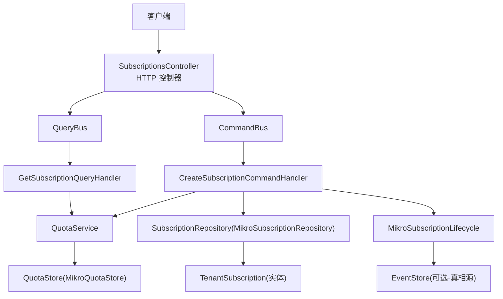
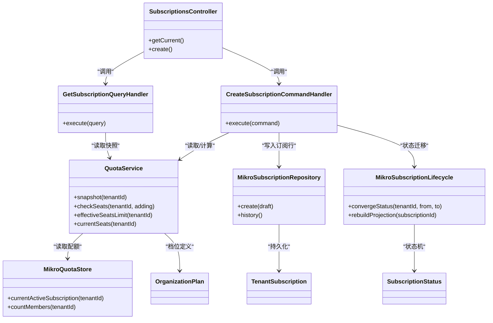
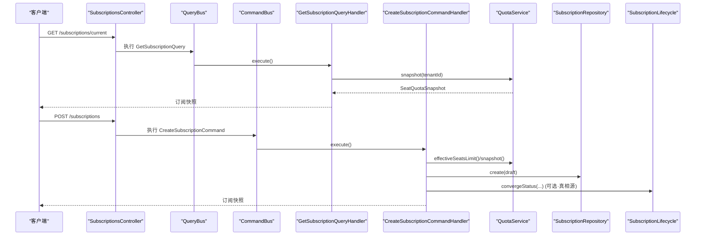
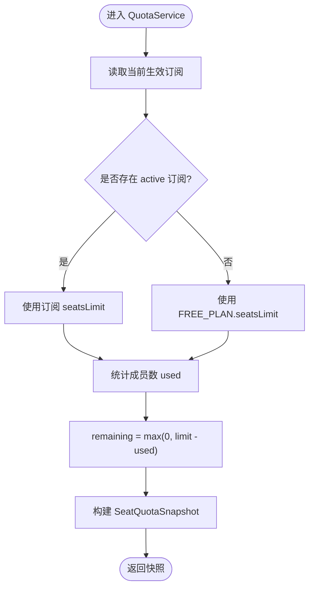
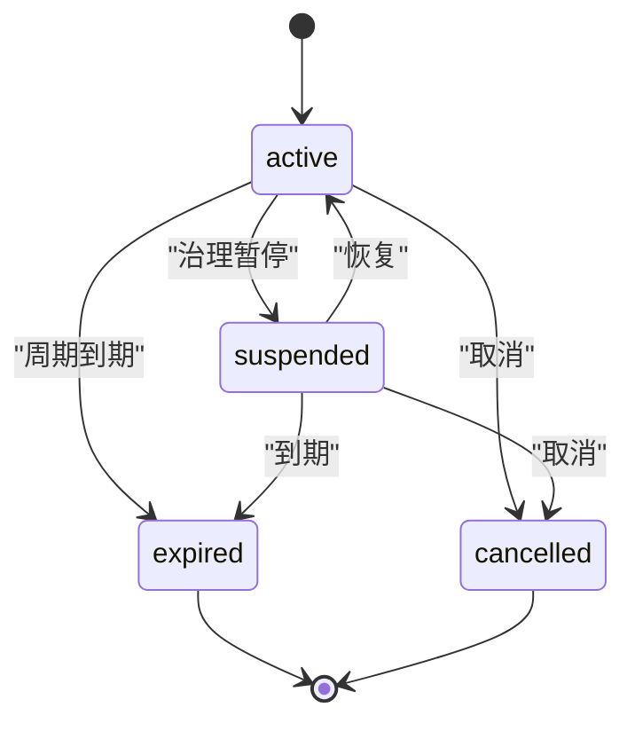
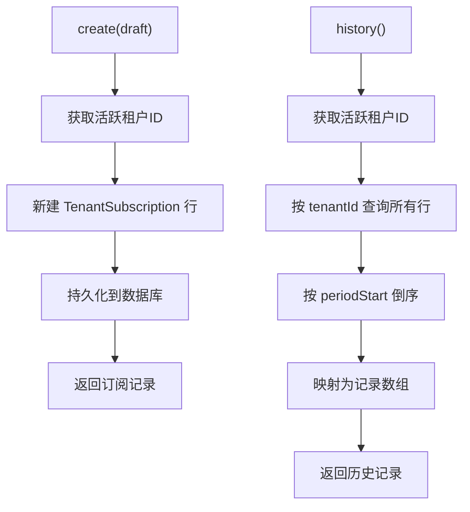
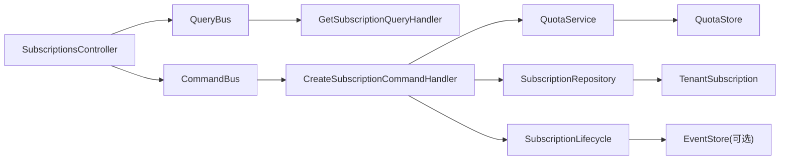

# 订阅管理 API

<cite>
**本文引用的文件**   
- [apps/api/src/modules/subscriptions/api/subscriptions.controller.ts](file://apps/api/src/modules/subscriptions/api/subscriptions.controller.ts)
- [apps/api/src/modules/subscriptions/api/response/subscription.response.ts](file://apps/api/src/modules/subscriptions/api/response/subscription.response.ts)
- [libs/core/src/modules/subscriptions/application/commands/create-subscription.command-handler.ts](file://libs/core/src/modules/subscriptions/application/commands/handlers/create-subscription.command-handler.ts)
- [libs/core/src/modules/subscriptions/application/queries/get-current-subscription.query-handler.ts](file://libs/core/src/modules/subscriptions/application/queries/handlers/get-current-subscription.query-handler.ts)
- [libs/core/src/modules/subscriptions/quota/quota.service.ts](file://libs/core/src/modules/subscriptions/quota/quota.service.ts)
- [libs/core/src/modules/subscriptions/quota/organization-plans.ts](file://libs/core/src/modules/subscriptions/quota/organization-plans.ts)
- [libs/core/src/modules/subscriptions/domain/subscription-lifecycle.ts](file://libs/core/src/modules/subscriptions/domain/subscription-lifecycle.ts)
- [libs/core/src/modules/subscriptions/domain/events/subscription-status-transitioned.event.ts](file://libs/core/src/modules/subscriptions/domain/events/subscription-status-transitioned.event.ts)
- [apps/api/src/modules/subscriptions/infrastructure/mikro-subscription.lifecycle.ts](file://apps/api/src/modules/subscriptions/infrastructure/mikro-subscription.lifecycle.ts)
- [apps/api/src/modules/subscriptions/infrastructure/repositories/mikro-subscription.repository.ts](file://apps/api/src/modules/subscriptions/infrastructure/repositories/mikro-subscription.repository.ts)
- [apps/api/src/modules/subscriptions/infrastructure/entities/tenant-subscription.entity.ts](file://apps/api/src/modules/subscriptions/infrastructure/entities/tenant-subscription.entity.ts)
- [apps/api/src/modules/subscriptions/infrastructure/mikro-quota.store.ts](file://apps/api/src/modules/subscriptions/infrastructure/mikro-quota.store.ts)
</cite>

## 目录
1. [简介](#简介)
2. [项目结构](#项目结构)
3. [核心组件](#核心组件)
4. [架构总览](#架构总览)
5. [详细组件分析](#详细组件分析)
6. [依赖关系分析](#依赖关系分析)
7. [性能与扩展性](#性能与扩展性)
8. [故障排查指南](#故障排查指南)
9. [结论](#结论)
10. [附录：API 契约与数据模型](#附录api-契约与数据模型)

## 简介
本文件面向“订阅管理模块”的 API 与实现，覆盖以下目标：
- 订阅计划管理接口：创建、修改（改档）、启用/禁用（状态迁移）等。
- 订阅生命周期管理：试用期间、付费期间、宽限期、到期、暂停、取消等状态转换。
- 配额管理系统：资源配额设置、使用量统计、超限处理。
- 计费周期与账单：计费周期字段、历史订阅查询；账单明细与发票能力在现有代码中未直接暴露，本文给出边界说明与扩展建议。
- 订阅分析、报表与合规检查：基于现有快照、历史与事件流的可扩展能力说明。

当前仓库已实现的 HTTP 入口集中在订阅控制器，业务逻辑通过 CQRS 命令/查询处理器、配额服务、仓储与生命周期收敛器协作完成。

## 项目结构
订阅模块位于 `apps/api/src/modules/subscriptions`，核心分层如下：
- API 层：HTTP 控制器与响应契约。
- 应用层（core）：命令/查询处理器、配额服务、计划定义、生命周期状态机。
- 基础设施层：MikroORM 实体、仓储、配额存储、生命周期投影与事件流真相源适配。

图表来源
- [apps/api/src/modules/subscriptions/api/subscriptions.controller.ts:42-90](file://apps/api/src/modules/subscriptions/api/subscriptions.controller.ts#L42-L90)
- [libs/core/src/modules/subscriptions/application/queries/handlers/get-current-subscription.query-handler.ts:17-34](file://libs/core/src/modules/subscriptions/application/queries/handlers/get-current-subscription.query-handler.ts#L17-L34)
- [libs/core/src/modules/subscriptions/application/commands/handlers/create-subscription.command-handler.ts:59-84](file://libs/core/src/modules/subscriptions/application/commands/handlers/create-subscription.command-handler.ts#L59-L84)
- [apps/api/src/modules/subscriptions/infrastructure/mikro-quota.store.ts:26-45](file://apps/api/src/modules/subscriptions/infrastructure/mikro-quota.store.ts#L26-L45)
- [apps/api/src/modules/subscriptions/infrastructure/repositories/mikro-subscription.repository.ts:29-78](file://apps/api/src/modules/subscriptions/infrastructure/repositories/mikro-subscription.repository.ts#L29-L78)
- [apps/api/src/modules/subscriptions/infrastructure/mikro-subscription.lifecycle.ts:45-134](file://apps/api/src/modules/subscriptions/infrastructure/mikro-subscription.lifecycle.ts#L45-L134)

章节来源
- [apps/api/src/modules/subscriptions/api/subscriptions.controller.ts:19-40](file://apps/api/src/modules/subscriptions/api/subscriptions.controller.ts#L19-L40)

## 核心组件
- SubscriptionsController：提供两个 HTTP 端点，读取当前订阅快照与创建/升级订阅。
- GetSubscriptionQueryHandler：读侧处理器，调用 QuotaService 组装当前订阅视图。
- CreateSubscriptionCommandHandler：写侧处理器，创建支付供应商客户、追加订阅行并返回快照。
- QuotaService：配额裁决与快照装配的核心服务。
- MikroQuotaStore：从数据库读取生效订阅与成员用量。
- MikroSubscriptionRepository：订阅行 CRUD 与历史查询。
- MikroSubscriptionLifecycle：订阅状态迁移与投影收敛（支持事件流真相源）。
- TenantSubscription 实体：订阅表结构与索引。

章节来源
- [apps/api/src/modules/subscriptions/api/subscriptions.controller.ts:42-90](file://apps/api/src/modules/subscriptions/api/subscriptions.controller.ts#L42-L90)
- [libs/core/src/modules/subscriptions/application/queries/handlers/get-current-subscription.query-handler.ts:17-34](file://libs/core/src/modules/subscriptions/application/queries/handlers/get-current-subscription.query-handler.ts#L17-L34)
- [libs/core/src/modules/subscriptions/application/commands/handlers/create-subscription.command-handler.ts:59-84](file://libs/core/src/modules/subscriptions/application/commands/handlers/create-subscription.command-handler.ts#L59-L84)
- [libs/core/src/modules/subscriptions/quota/quota.service.ts:20-130](file://libs/core/src/modules/subscriptions/quota/quota.service.ts#L20-L130)
- [apps/api/src/modules/subscriptions/infrastructure/mikro-quota.store.ts:26-80](file://apps/api/src/modules/subscriptions/infrastructure/mikro-quota.store.ts#L26-L80)
- [apps/api/src/modules/subscriptions/infrastructure/repositories/mikro-subscription.repository.ts:29-88](file://apps/api/src/modules/subscriptions/infrastructure/repositories/mikro-subscription.repository.ts#L29-L88)
- [apps/api/src/modules/subscriptions/infrastructure/mikro-subscription.lifecycle.ts:45-157](file://apps/api/src/modules/subscriptions/infrastructure/mikro-subscription.lifecycle.ts#L45-L157)
- [apps/api/src/modules/subscriptions/infrastructure/entities/tenant-subscription.entity.ts:19-66](file://apps/api/src/modules/subscriptions/infrastructure/entities/tenant-subscription.entity.ts#L19-L66)

## 架构总览
订阅管理采用 CQRS + 领域事件驱动的分层架构：
- 控制层仅做鉴权、参数校验与路由转发。
- 应用层封装用例（命令/查询），组合领域服务与端口。
- 基础设施层实现持久化、配额读取与生命周期投影。
- 订阅状态机以纯函数迁移表约束合法转换，并通过事件流进行真相源收敛（可开关）。

图表来源
- [apps/api/src/modules/subscriptions/api/subscriptions.controller.ts:42-90](file://apps/api/src/modules/subscriptions/api/subscriptions.controller.ts#L42-L90)
- [libs/core/src/modules/subscriptions/application/queries/handlers/get-current-subscription.query-handler.ts:17-34](file://libs/core/src/modules/subscriptions/application/queries/handlers/get-current-subscription.query-handler.ts#L17-L34)
- [libs/core/src/modules/subscriptions/application/commands/handlers/create-subscription.command-handler.ts:59-84](file://libs/core/src/modules/subscriptions/application/commands/handlers/create-subscription.command-handler.ts#L59-L84)
- [libs/core/src/modules/subscriptions/quota/quota.service.ts:20-130](file://libs/core/src/modules/subscriptions/quota/quota.service.ts#L20-L130)
- [apps/api/src/modules/subscriptions/infrastructure/mikro-quota.store.ts:26-80](file://apps/api/src/modules/subscriptions/infrastructure/mikro-quota.store.ts#L26-L80)
- [apps/api/src/modules/subscriptions/infrastructure/repositories/mikro-subscription.repository.ts:29-88](file://apps/api/src/modules/subscriptions/infrastructure/repositories/mikro-subscription.repository.ts#L29-L88)
- [apps/api/src/modules/subscriptions/infrastructure/mikro-subscription.lifecycle.ts:45-157](file://apps/api/src/modules/subscriptions/infrastructure/mikro-subscription.lifecycle.ts#L45-L157)
- [libs/core/src/modules/subscriptions/quota/organization-plans.ts:12-80](file://libs/core/src/modules/subscriptions/quota/organization-plans.ts#L12-L80)
- [libs/core/src/modules/subscriptions/domain/subscription-lifecycle.ts:18-69](file://libs/core/src/modules/subscriptions/domain/subscription-lifecycle.ts#L18-L69)

## 详细组件分析

### 订阅管理 API（控制器）
- GET /subscriptions/current：读取当前组织的有效订阅快照（套餐、席位配额、用量、支付客户映射）。
  - 鉴权：租户隔离守卫。
  - 输出：订阅视图（含 hasSubscription、plan、seatsLimit、used、remaining、providerCustomerId）。
- POST /subscriptions：开通或升级订阅（创建支付供应商客户并落席位/存储/API 配额）。
  - 鉴权：租户隔离守卫 + 授权守卫（需具备组织更新权限）。
  - 输入：plan、customerEmail、seatsLimit、storageQuota、apiQuota。
  - 输出：更新后的订阅视图。

图表来源
- [apps/api/src/modules/subscriptions/api/subscriptions.controller.ts:42-90](file://apps/api/src/modules/subscriptions/api/subscriptions.controller.ts#L42-L90)
- [libs/core/src/modules/subscriptions/application/queries/handlers/get-current-subscription.query-handler.ts:17-34](file://libs/core/src/modules/subscriptions/application/queries/handlers/get-current-subscription.query-handler.ts#L17-L34)
- [libs/core/src/modules/subscriptions/application/commands/handlers/create-subscription.command-handler.ts:59-84](file://libs/core/src/modules/subscriptions/application/commands/handlers/create-subscription.command-handler.ts#L59-L84)

章节来源
- [apps/api/src/modules/subscriptions/api/subscriptions.controller.ts:42-90](file://apps/api/src/modules/subscriptions/api/subscriptions.controller.ts#L42-L90)
- [apps/api/src/modules/subscriptions/api/response/subscription.response.ts:13-41](file://apps/api/src/modules/subscriptions/api/response/subscription.response.ts#L13-L41)

### 订阅计划与配额
- 计划定义：包含 plan、seatsLimit、storageQuota、apiQuota；未知 plan 回落免费档 FREE_PLAN。
- 配额服务：
  - currentSubscription：读取最新 active 订阅。
  - effectiveSeatsLimit：有 active 订阅则取 seatsLimit，否则回落到 FREE_PLAN。
  - currentSeats：按租户成员数计数。
  - checkSeats：used + adding <= limit 判定是否允许新增。
  - snapshot：组装 hasSubscription、plan、seatsLimit、used、remaining、providerCustomerId。
- 配额存储：
  - currentActiveSubscription：按 tenantId 与 status=active 取最新一行。
  - countMembers：按 tenantId 统计成员数量（SSOT：tenant_membership）。

图表来源
- [libs/core/src/modules/subscriptions/quota/quota.service.ts:62-130](file://libs/core/src/modules/subscriptions/quota/quota.service.ts#L62-L130)
- [libs/core/src/modules/subscriptions/quota/organization-plans.ts:52-80](file://libs/core/src/modules/subscriptions/quota/organization-plans.ts#L52-L80)
- [apps/api/src/modules/subscriptions/infrastructure/mikro-quota.store.ts:30-62](file://apps/api/src/modules/subscriptions/infrastructure/mikro-quota.store.ts#L30-L62)

章节来源
- [libs/core/src/modules/subscriptions/quota/organization-plans.ts:12-80](file://libs/core/src/modules/subscriptions/quota/organization-plans.ts#L12-L80)
- [libs/core/src/modules/subscriptions/quota/quota.service.ts:20-130](file://libs/core/src/modules/subscriptions/quota/quota.service.ts#L20-L130)
- [apps/api/src/modules/subscriptions/infrastructure/mikro-quota.store.ts:26-80](file://apps/api/src/modules/subscriptions/infrastructure/mikro-quota.store.ts#L26-L80)

### 订阅生命周期与状态机
- 状态集合：active、suspended、expired、cancelled。
- 合法迁移：
  - active → suspended/expired/cancelled
  - suspended → active/expired/cancelled
  - expired/cancelled 为终态，不接受任何迁移。
- 生命周期收敛器：
  - 原路径：根据 from 态查找最新行并置 to 态。
  - 真相源路径（可选）：加载事件流 → fold 重放 → canTransition 校验 → 发布耐久事件 → 投影回写 status。
  - 诊断面：rebuildProjection 从事件流重建投影。

图表来源
- [libs/core/src/modules/subscriptions/domain/subscription-lifecycle.ts:18-69](file://libs/core/src/modules/subscriptions/domain/subscription-lifecycle.ts#L18-L69)
- [apps/api/src/modules/subscriptions/infrastructure/mikro-subscription.lifecycle.ts:69-134](file://apps/api/src/modules/subscriptions/infrastructure/mikro-subscription.lifecycle.ts#L69-L134)

章节来源
- [libs/core/src/modules/subscriptions/domain/subscription-lifecycle.ts:18-69](file://libs/core/src/modules/subscriptions/domain/subscription-lifecycle.ts#L18-L69)
- [apps/api/src/modules/subscriptions/infrastructure/mikro-subscription.lifecycle.ts:25-157](file://apps/api/src/modules/subscriptions/infrastructure/mikro-subscription.lifecycle.ts#L25-L157)
- [libs/core/src/modules/subscriptions/domain/events/subscription-status-transitioned.event.ts:5-19](file://libs/core/src/modules/subscriptions/domain/events/subscription-status-transitioned.event.ts#L5-L19)

### 订阅仓储与历史
- 创建订阅：插入一条新的订阅行，初始状态为 active，携带 plan、seatsLimit、storageQuota、apiQuota、periodStart、periodEnd、provider 信息等。
- 历史查询：按 tenantId 过滤并按 periodStart 倒序返回历史订阅记录。

图表来源
- [apps/api/src/modules/subscriptions/infrastructure/repositories/mikro-subscription.repository.ts:56-88](file://apps/api/src/modules/subscriptions/infrastructure/repositories/mikro-subscription.repository.ts#L56-L88)

章节来源
- [apps/api/src/modules/subscriptions/infrastructure/repositories/mikro-subscription.repository.ts:29-88](file://apps/api/src/modules/subscriptions/infrastructure/repositories/mikro-subscription.repository.ts#L29-L88)
- [apps/api/src/modules/subscriptions/infrastructure/entities/tenant-subscription.entity.ts:19-66](file://apps/api/src/modules/subscriptions/infrastructure/entities/tenant-subscription.entity.ts#L19-L66)

### 订阅变更历史、账单明细与发票管理
- 订阅变更历史：可通过仓储 history 接口获取订阅历史（按 periodStart 倒序）。
- 账单明细与发票：当前仓库未暴露相关 HTTP 接口；如需扩展，可在控制器新增查询端点，结合事件流与外部支付网关回调进行聚合。

章节来源
- [apps/api/src/modules/subscriptions/infrastructure/repositories/mikro-subscription.repository.ts:80-88](file://apps/api/src/modules/subscriptions/infrastructure/repositories/mikro-subscription.repository.ts#L80-L88)

### 订阅分析与报表生成、合规性检查
- 订阅分析：可利用 QuotaService.snapshot 与 history 接口汇总各租户的 plan、seatsLimit、used、remaining 等指标。
- 报表生成：可基于事件流（如状态迁移事件）与订阅历史生成趋势报表。
- 合规性检查：可结合 canTransition 与生命周期投影一致性校验，确保状态机一致性与审计轨迹完整。

[本节为概念性说明，不直接分析具体文件]

## 依赖关系分析
- 控制器依赖 CQRS 总线与守卫（租户隔离、授权）。
- 应用层依赖配额服务与领域端口（订阅仓储、生命周期、支付客户 provisioner）。
- 基础设施层依赖 ORM、租户隔离服务与事件存储（可选）。

图表来源
- [apps/api/src/modules/subscriptions/api/subscriptions.controller.ts:42-90](file://apps/api/src/modules/subscriptions/api/subscriptions.controller.ts#L42-L90)
- [libs/core/src/modules/subscriptions/application/queries/handlers/get-current-subscription.query-handler.ts:17-34](file://libs/core/src/modules/subscriptions/application/queries/handlers/get-current-subscription.query-handler.ts#L17-L34)
- [libs/core/src/modules/subscriptions/application/commands/handlers/create-subscription.command-handler.ts:59-84](file://libs/core/src/modules/subscriptions/application/commands/handlers/create-subscription.command-handler.ts#L59-L84)
- [apps/api/src/modules/subscriptions/infrastructure/mikro-subscription.lifecycle.ts:45-134](file://apps/api/src/modules/subscriptions/infrastructure/mikro-subscription.lifecycle.ts#L45-L134)

章节来源
- [apps/api/src/modules/subscriptions/api/subscriptions.controller.ts:42-90](file://apps/api/src/modules/subscriptions/api/subscriptions.controller.ts#L42-L90)
- [libs/core/src/modules/subscriptions/application/commands/handlers/create-subscription.command-handler.ts:59-84](file://libs/core/src/modules/subscriptions/application/commands/handlers/create-subscription.command-handler.ts#L59-L84)

## 性能与扩展性
- 配额读取：currentActiveSubscription 与 countMembers 均使用独立 em 实例，避免共享上下文带来的并发问题。
- 订阅历史：按 periodStart 倒序排序，适合时间线浏览；如需分页，建议在仓储层增加分页参数。
- 事件流真相源：convergeStatus 在开启真相源时进行乐观锁 append 与投影回写，保证状态机一致性与幂等性。
- 扩展建议：
  - 新增账单与发票接口：在控制器新增查询端点，聚合支付网关回调与订阅历史。
  - 配额维度扩展：storageQuota/apiQuota 目前为占位维度，可在 QuotaService 中扩展对应限额与超限策略。
  - 报表与分析：基于事件流与订阅历史构建离线报表任务，定期导出分析结果。

[本节为通用指导，不直接分析具体文件]

## 故障排查指南
- 无活动租户上下文：仓储与配额存储依赖 ALS 解析租户 ID；若无活跃租户将 fail-closed 抛出错误。
- 状态迁移失败：当 from 态不存在或迁移不合法时，convergeStatus 返回 false；若开启真相源且 eventStore 未装配，将抛错。
- 配额超限：checkSeats 返回 ok=false 表示新增成员将超出 seatsLimit；需在业务层拒绝或提示扩容。
- 快照不一致：若事件流与投影不一致，可使用 rebuildProjection 重建投影。

章节来源
- [apps/api/src/modules/subscriptions/infrastructure/repositories/mikro-subscription.repository.ts:56-78](file://apps/api/src/modules/subscriptions/infrastructure/repositories/mikro-subscription.repository.ts#L56-L78)
- [apps/api/src/modules/subscriptions/infrastructure/mikro-subscription.lifecycle.ts:89-134](file://apps/api/src/modules/subscriptions/infrastructure/mikro-subscription.lifecycle.ts#L89-L134)
- [libs/core/src/modules/subscriptions/quota/quota.service.ts:100-130](file://libs/core/src/modules/subscriptions/quota/quota.service.ts#L100-L130)

## 结论
当前订阅管理模块提供了清晰的 HTTP 入口、完整的配额裁决与快照装配、以及稳健的生命周期状态机与投影机制。对于账单明细、发票管理与高级分析报表，可在现有架构基础上扩展控制器与服务层，复用事件流与订阅历史数据。

[本节为总结性内容，不直接分析具体文件]

## 附录：API 契约与数据模型

### HTTP 接口定义
- GET /subscriptions/current
  - 鉴权：租户隔离守卫。
  - 响应：SubscriptionResponse（hasSubscription、plan、seatsLimit、used、remaining、providerCustomerId）。
- POST /subscriptions
  - 鉴权：租户隔离守卫 + 授权守卫（组织更新权限）。
  - 请求体：plan、customerEmail、seatsLimit、storageQuota、apiQuota。
  - 响应：SubscriptionResponse。

章节来源
- [apps/api/src/modules/subscriptions/api/subscriptions.controller.ts:42-90](file://apps/api/src/modules/subscriptions/api/subscriptions.controller.ts#L42-L90)
- [apps/api/src/modules/subscriptions/api/response/subscription.response.ts:13-41](file://apps/api/src/modules/subscriptions/api/response/subscription.response.ts#L13-L41)

### 数据模型
- TenantSubscription 实体字段：id、tenantId、plan、status、seatsLimit、storageQuota、apiQuota、periodStart、periodEnd、provider、providerCustomerId、providerSubscriptionId、createdAt、updatedAt。
- 索引：tenant_subscription_tenant_status_idx、tenant_subscription_tenant_period_idx。

章节来源
- [apps/api/src/modules/subscriptions/infrastructure/entities/tenant-subscription.entity.ts:19-66](file://apps/api/src/modules/subscriptions/infrastructure/entities/tenant-subscription.entity.ts#L19-L66)