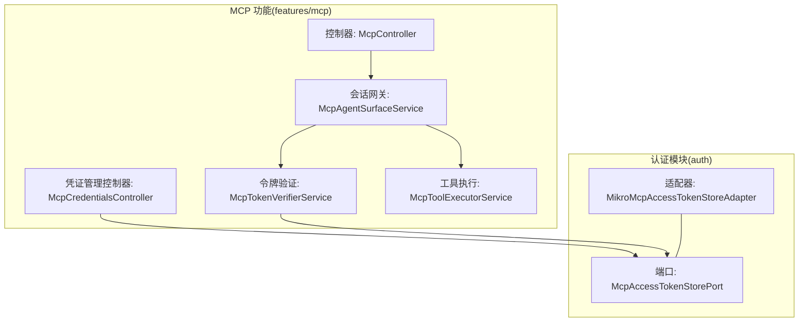
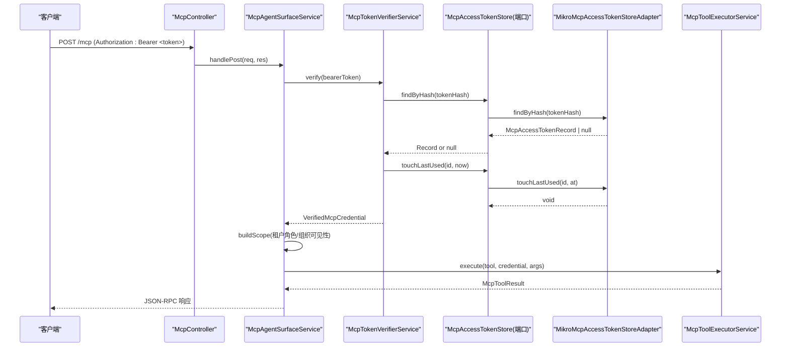
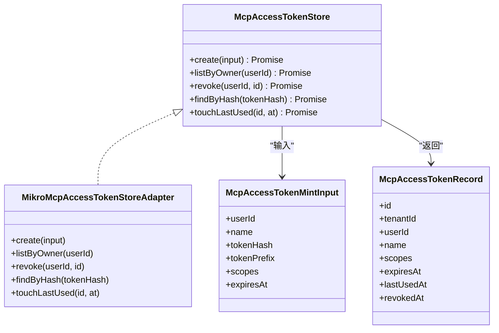
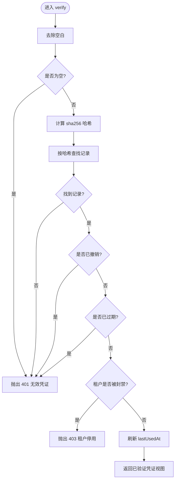
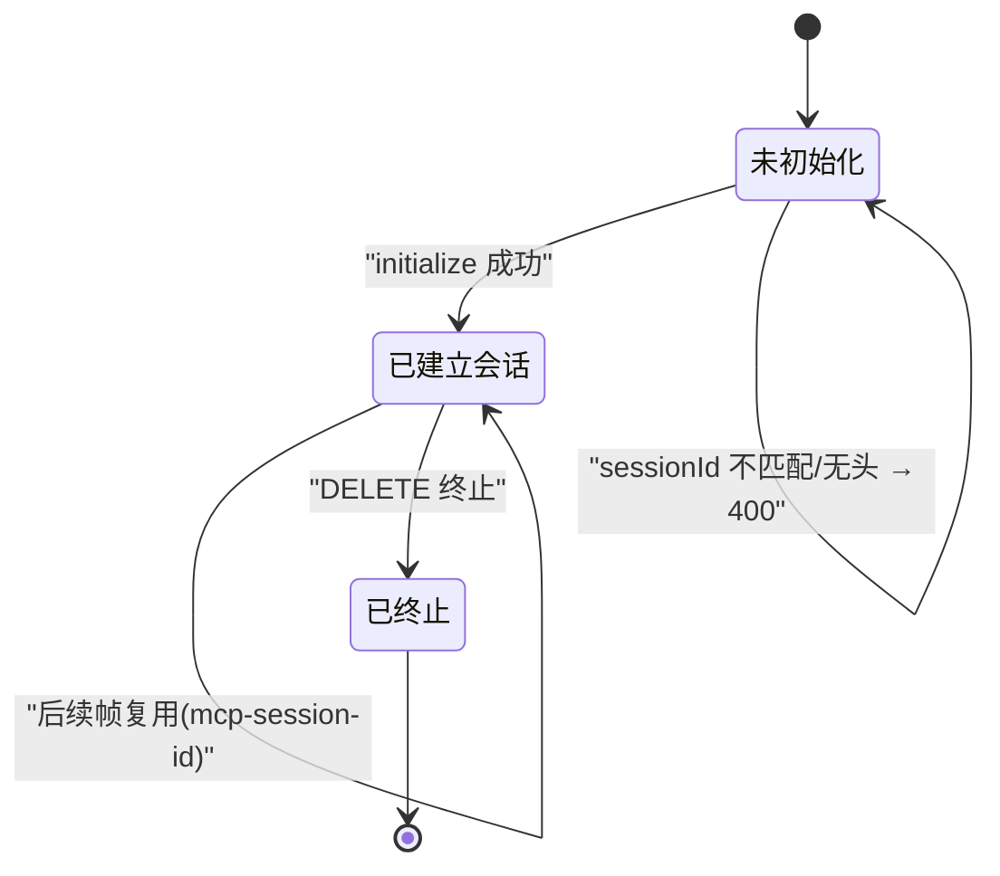
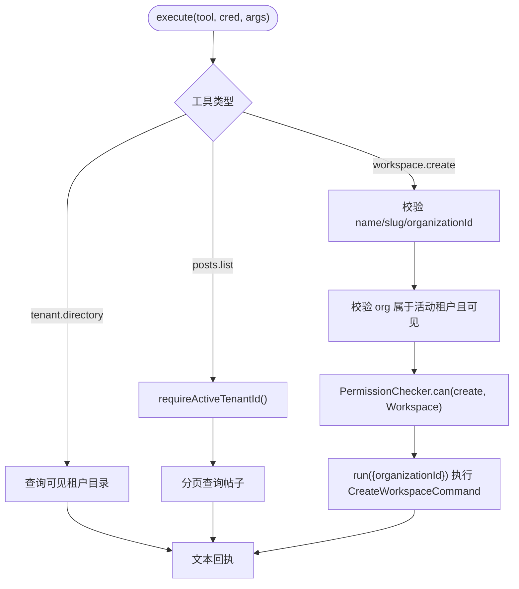
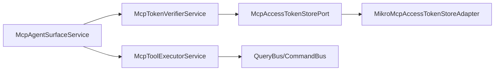
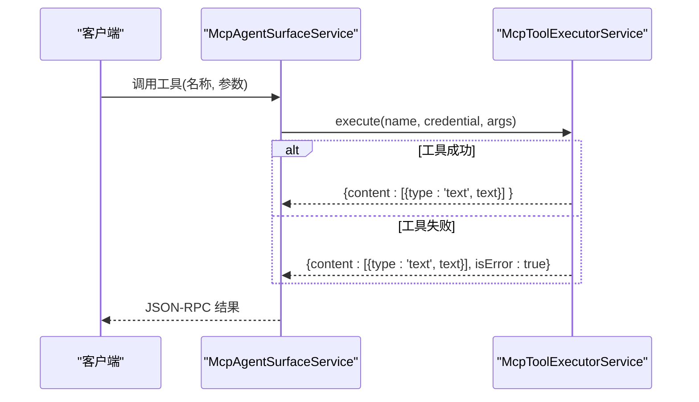

# MCP 访问令牌

<cite>
**本文引用的文件**   
- [mcp-access-token-store.adapter.ts](file://apps/api/src/modules/auth/infrastructure/mcp-access-token-store.adapter.ts)
- [mcp-access-token-store.port.ts](file://apps/api/src/modules/auth/application/ports/mcp-access-token-store.port.ts)
- [mcp-token-verifier.service.ts](file://apps/api/src/features/mcp/application/mcp-token-verifier.service.ts)
- [mcp-agent-surface.service.ts](file://apps/api/src/features/mcp/application/mcp-agent-surface.service.ts)
- [mcp-tool-executor.service.ts](file://apps/api/src/features/mcp/application/mcp-tool-executor.service.ts)
- [mcp.controller.ts](file://apps/api/src/features/mcp/api/mcp.controller.ts)
- [mcp-credentials.controller.ts](file://apps/api/src/features/mcp/api/mcp-credentials.controller.ts)
</cite>

## 目录
1. [简介](#简介)
2. [项目结构](#项目结构)
3. [核心组件](#核心组件)
4. [架构总览](#架构总览)
5. [详细组件分析](#详细组件分析)
6. [依赖关系分析](#依赖关系分析)
7. [性能与容量特性](#性能与容量特性)
8. [使用示例与安全最佳实践](#使用示例与安全最佳实践)
9. [MCP 工具调用集成指南](#mcp-工具调用集成指南)
10. [故障排查](#故障排查)
11. [结论](#结论)

## 简介
本文件系统化说明 MCP（Model Context Protocol）访问令牌的生成、验证与管理机制，覆盖以下关键主题：
- 令牌存储端口 McpAccessTokenStorePort 的设计模式与适配器实现。
- 令牌验证服务 McpTokenVerifierService 的校验流程：哈希匹配、撤销与过期检查、租户封禁判定、lastUsedAt 更新。
- 令牌与用户会话的关联关系及生命周期管理（进程内会话表、LRU 逐出、闲置回收）。
- 安全策略：最小权限原则、deny-by-default、防探测错误码、租户隔离与属主校验。
- MCP 工具调用的集成路径与错误处理方案。

## 项目结构
MCP 相关代码分布在两个模块域：
- auth 模块：定义并实现 MCP 访问令牌的持久化端口与适配器，负责凭证的铸造、列表、撤销与按哈希查找。
- features/mcp 模块：暴露消费面 API、会话网关、令牌验证与工具执行器。

图表来源
- [mcp-access-token-store.port.ts:1-78](file://apps/api/src/modules/auth/application/ports/mcp-access-token-store.port.ts#L1-L78)
- [mcp-access-token-store.adapter.ts:1-102](file://apps/api/src/modules/auth/infrastructure/mcp-access-token-store.adapter.ts#L1-L102)
- [mcp.controller.ts:1-44](file://apps/api/src/features/mcp/api/mcp.controller.ts#L1-L44)
- [mcp-credentials.controller.ts:1-99](file://apps/api/src/features/mcp/api/mcp-credentials.controller.ts#L1-L99)
- [mcp-agent-surface.service.ts:1-384](file://apps/api/src/features/mcp/application/mcp-agent-surface.service.ts#L1-L384)
- [mcp-token-verifier.service.ts:1-81](file://apps/api/src/features/mcp/application/mcp-token-verifier.service.ts#L1-L81)
- [mcp-tool-executor.service.ts:1-167](file://apps/api/src/features/mcp/application/mcp-tool-executor.service.ts#L1-L167)

章节来源
- [mcp-access-token-store.port.ts:1-78](file://apps/api/src/modules/auth/application/ports/mcp-access-token-store.port.ts#L1-L78)
- [mcp-access-token-store.adapter.ts:1-102](file://apps/api/src/modules/auth/infrastructure/mcp-access-token-store.adapter.ts#L1-L102)
- [mcp.controller.ts:1-44](file://apps/api/src/features/mcp/api/mcp.controller.ts#L1-L44)
- [mcp-credentials.controller.ts:1-99](file://apps/api/src/features/mcp/api/mcp-credentials.controller.ts#L1-L99)
- [mcp-agent-surface.service.ts:1-384](file://apps/api/src/features/mcp/application/mcp-agent-surface.service.ts#L1-L384)
- [mcp-token-verifier.service.ts:1-81](file://apps/api/src/features/mcp/application/mcp-token-verifier.service.ts#L1-L81)
- [mcp-tool-executor.service.ts:1-167](file://apps/api/src/features/mcp/application/mcp-tool-executor.service.ts#L1-L167)

## 核心组件
- 端口 McpAccessTokenStorePort：定义凭证的铸造、列表、撤销、按哈希查找与 lastUsedAt 更新的接口契约，明确“明文 token 不入形”“tenantId 由可信 ALS fail-closed 盖章”等约束。
- 适配器 MikroMcpAccessTokenStoreAdapter：基于 MikroORM 的实现，采用 fork() 隔离 em、租户上下文 fail-closed、软撤销幂等、消费面全租单行查等策略。
- 验证器 McpTokenVerifierService：对 Bearer Token 进行 sha256 哈希匹配、撤销与过期检查、租户封禁判定，成功后刷 lastUsedAt。
- 会话网关 McpAgentSurfaceService：Bearer 鉴权、租户角色解析、ALS 绑定、JSON-RPC 会话建立与复用、工具注册与执行调度。
- 工具执行器 McpToolExecutorService：将 MCP 工具名映射到既有 CQRS 查询/命令，并在写操作前做组织归属与权限校验。
- 控制器层：
  - McpController：暴露 /mcp 消费面 POST/DELETE。
  - McpCredentialsController：暴露 /api/v1/mcp/credentials 的铸造、列表、撤销。

章节来源
- [mcp-access-token-store.port.ts:1-78](file://apps/api/src/modules/auth/application/ports/mcp-access-token-store.port.ts#L1-L78)
- [mcp-access-token-store.adapter.ts:1-102](file://apps/api/src/modules/auth/infrastructure/mcp-access-token-store.adapter.ts#L1-L102)
- [mcp-token-verifier.service.ts:1-81](file://apps/api/src/features/mcp/application/mcp-token-verifier.service.ts#L1-L81)
- [mcp-agent-surface.service.ts:1-384](file://apps/api/src/features/mcp/application/mcp-agent-surface.service.ts#L1-L384)
- [mcp-tool-executor.service.ts:1-167](file://apps/api/src/features/mcp/application/mcp-tool-executor.service.ts#L1-L167)
- [mcp.controller.ts:1-44](file://apps/api/src/features/mcp/api/mcp.controller.ts#L1-L44)
- [mcp-credentials.controller.ts:1-99](file://apps/api/src/features/mcp/api/mcp-credentials.controller.ts#L1-L99)

## 架构总览
下图展示从 HTTP 请求到工具执行的完整链路，以及凭证在认证与 MCP 消费面的流转。

图表来源
- [mcp.controller.ts:24-42](file://apps/api/src/features/mcp/api/mcp.controller.ts#L24-L42)
- [mcp-agent-surface.service.ts:120-142](file://apps/api/src/features/mcp/application/mcp-agent-surface.service.ts#L120-L142)
- [mcp-token-verifier.service.ts:40-67](file://apps/api/src/features/mcp/application/mcp-token-verifier.service.ts#L40-L67)
- [mcp-access-token-store.adapter.ts:76-100](file://apps/api/src/modules/auth/infrastructure/mcp-access-token-store.adapter.ts#L76-L100)
- [mcp-tool-executor.service.ts:67-127](file://apps/api/src/features/mcp/application/mcp-tool-executor.service.ts#L67-L127)

## 详细组件分析

### 令牌存储端口与适配器
- 设计要点
  - 端口位于 application 层，作为 auth 属主的受控读写入口；features/mcp 仅通过 DI token 注入，避免跨模块直连实体。
  - 所有写操作（create/revoke/touchLastUsed）均通过 MikroOrmService.fork() 获取独立 EntityManager，避免共享状态。
  - tenantId 由可信 ALS requireActiveTenantId() 注入，禁止 body 或调用侧伪造。
  - 消费面 findByHash 走 scoped:false 全租单行查，唯一索引命中后以行内 tenantId 作为安全边界。
  - revoke 为软删除（revokedAt），重复撤销幂等成功；listByOwner 同时限定 tenantId 与 userId，防止跨租户枚举。

图表来源
- [mcp-access-token-store.port.ts:10-77](file://apps/api/src/modules/auth/application/ports/mcp-access-token-store.port.ts#L10-L77)
- [mcp-access-token-store.adapter.ts:22-100](file://apps/api/src/modules/auth/infrastructure/mcp-access-token-store.adapter.ts#L22-L100)

章节来源
- [mcp-access-token-store.port.ts:1-78](file://apps/api/src/modules/auth/application/ports/mcp-access-token-store.port.ts#L1-L78)
- [mcp-access-token-store.adapter.ts:1-102](file://apps/api/src/modules/auth/infrastructure/mcp-access-token-store.adapter.ts#L1-L102)

### 令牌验证服务
- 校验流程
  - 空令牌直接拒绝。
  - 计算 sha256 哈希，按哈希查找记录。
  - 若记录不存在、已撤销或已过期，统一返回 401（防探测）。
  - 若租户被封禁，返回 403。
  - 校验通过后刷 lastUsedAt（失败不阻断主流程）。
  - 返回 VerifiedMcpCredential（含 tenantId、userId、scopes 等）。

图表来源
- [mcp-token-verifier.service.ts:40-67](file://apps/api/src/features/mcp/application/mcp-token-verifier.service.ts#L40-L67)

章节来源
- [mcp-token-verifier.service.ts:1-81](file://apps/api/src/features/mcp/application/mcp-token-verifier.service.ts#L1-L81)

### 会话网关与令牌生命周期
- 每请求重验：Bearer Token 经 verifier.verify 校验，失败直接落 401/403。
- 租户作用域构建：解析租户角色与组织可见性，合成 TenantIsolationScope 并通过 run 绑定 ALS。
- 会话管理：
  - initialize 首次 POST 创建 StreamableHTTPServerTransport 与 McpServer，并按 scopes 注册工具。
  - 后续 POST 通过 mcp-session-id 复用会话；他租 sessionId 一律视为无会话（400）。
  - DELETE 终止会话，同样需 bearer 校验且 sessionId 必须属于当前租户。
  - 内存会话表具备 LRU 逐出与闲置 TTL 回收，避免无界增长。

图表来源
- [mcp-agent-surface.service.ts:120-207](file://apps/api/src/features/mcp/application/mcp-agent-surface.service.ts#L120-L207)
- [mcp-agent-surface.service.ts:293-332](file://apps/api/src/features/mcp/application/mcp-agent-surface.service.ts#L293-L332)

章节来源
- [mcp-agent-surface.service.ts:1-384](file://apps/api/src/features/mcp/application/mcp-agent-surface.service.ts#L1-L384)

### 工具执行与权限对齐
- 读工具：
  - tenant.directory：按凭证 userId 列出可见租户及其组织。
  - posts.list：要求活动租户（fail-closed），分页游标查询。
- 写工具：
  - workspace.create：先校验 organizationId 属于活动租户且用户可见；再经 PermissionChecker 校验 create Workspace 权限；最后通过嵌套 ALS 补 organizationId 二级轴后派 Command。
- scope 可见性：server 注册时已通过 selectToolNames 过滤不可见工具，此处为第二道闸。

图表来源
- [mcp-tool-executor.service.ts:67-127](file://apps/api/src/features/mcp/application/mcp-tool-executor.service.ts#L67-L127)

章节来源
- [mcp-tool-executor.service.ts:1-167](file://apps/api/src/features/mcp/application/mcp-tool-executor.service.ts#L1-L167)

## 依赖关系分析
- 耦合与内聚
  - 端口与适配器解耦：features/mcp 仅依赖端口，auth 内部实现细节被封装。
  - 验证器依赖租户状态服务，确保封禁联动单源。
  - 会话网关依赖令牌验证、租户范围解析与工具执行器，职责清晰。
- 外部依赖
  - MikroORM：用于凭证持久化。
  - Model Context Protocol SDK：提供 McpServer 与 StreamableHTTPServerTransport。
  - NestJS CQRS：QueryBus/CommandBus 驱动工具逻辑。

图表来源
- [mcp-access-token-store.port.ts:1-78](file://apps/api/src/modules/auth/application/ports/mcp-access-token-store.port.ts#L1-L78)
- [mcp-token-verifier.service.ts:1-81](file://apps/api/src/features/mcp/application/mcp-token-verifier.service.ts#L1-L81)
- [mcp-agent-surface.service.ts:1-384](file://apps/api/src/features/mcp/application/mcp-agent-surface.service.ts#L1-L384)
- [mcp-tool-executor.service.ts:1-167](file://apps/api/src/features/mcp/application/mcp-tool-executor.service.ts#L1-L167)

章节来源
- [mcp-access-token-store.port.ts:1-78](file://apps/api/src/modules/auth/application/ports/mcp-access-token-store.port.ts#L1-L78)
- [mcp-token-verifier.service.ts:1-81](file://apps/api/src/features/mcp/application/mcp-token-verifier.service.ts#L1-L81)
- [mcp-agent-surface.service.ts:1-384](file://apps/api/src/features/mcp/application/mcp-agent-surface.service.ts#L1-L384)
- [mcp-tool-executor.service.ts:1-167](file://apps/api/src/features/mcp/application/mcp-tool-executor.service.ts#L1-L167)

## 性能与容量特性
- 验证成本：每次 verify 包含 2 次 DB 往返（findByHash 读 + touchLastUsed 窄写）+ 租户封禁判据读；换取撤销/封禁即时生效。
- 会话容量：进程内 Map 维护会话，最大并发会话上限与闲置 TTL 控制，超限时按 LRU 逐出。
- 写放大：高频工具调用会频繁更新 lastUsedAt；如需优化可考虑节流写入或只读缓存，但需在评审后实施。

章节来源
- [mcp-token-verifier.service.ts:14-32](file://apps/api/src/features/mcp/application/mcp-token-verifier.service.ts#L14-L32)
- [mcp-agent-surface.service.ts:96-103](file://apps/api/src/features/mcp/application/mcp-agent-surface.service.ts#L96-L103)
- [mcp-agent-surface.service.ts:293-332](file://apps/api/src/features/mcp/application/mcp-agent-surface.service.ts#L293-L332)

## 使用示例与安全最佳实践
- 生成令牌
  - 通过 /api/v1/mcp/credentials 铸造接口，服务端一次性回显明文 token，随后不再保存明文。
  - 建议设置较短 expiresAt，并为不同用途分配最小必要 scopes。
- 使用令牌
  - 在 Authorization 头携带 Bearer <token>，调用 /mcp 端点。
  - 首次 POST 建立会话，后续请求附带 mcp-session-id 复用连接。
- 安全最佳实践
  - 最小权限原则：仅授予工具所需的 scopes，默认 deny-by-default。
  - 防探测：无效/撤销/过期统一 401，避免泄露存在性。
  - 租户隔离：所有写操作 requireActiveTenantId()，组织归属二次校验。
  - 令牌轮换：定期吊销旧令牌并签发新令牌，缩短有效期。
  - 审计与监控：关注 401/403 异常与 lastUsedAt 活跃度，识别异常调用。

章节来源
- [mcp-credentials.controller.ts:15-31](file://apps/api/src/features/mcp/api/mcp-credentials.controller.ts#L15-L31)
- [mcp-controller.ts:24-42](file://apps/api/src/features/mcp/api/mcp.controller.ts#L24-L42)
- [mcp-token-verifier.service.ts:14-32](file://apps/api/src/features/mcp/application/mcp-token-verifier.service.ts#L14-L32)
- [mcp-tool-executor.service.ts:34-49](file://apps/api/src/features/mcp/application/mcp-tool-executor.service.ts#L34-L49)

## MCP 工具调用集成指南
- 工具清单与可见性
  - tenant.directory：列出凭证所有者可见的租户与组织。
  - posts.list：在活动租户内分页查询帖子。
  - workspace.create：在活动租户的组织下创建工作区。
- 参数与限制
  - posts.list：limit 缺省 20，硬上限 100；cursor 透传。
  - workspace.create：必填 name、slug、organizationId；organizationId 必须在活动租户且用户可见。
- 错误处理
  - 工具执行异常折成 isError=true 的文本回执，不向协议层裸抛异常对象。
  - 非 HttpException 的工具异常记录日志并返回通用失败文本。

图表来源
- [mcp-agent-surface.service.ts:237-254](file://apps/api/src/features/mcp/application/mcp-agent-surface.service.ts#L237-L254)
- [mcp-tool-executor.service.ts:67-127](file://apps/api/src/features/mcp/application/mcp-tool-executor.service.ts#L67-L127)

章节来源
- [mcp-agent-surface.service.ts:223-254](file://apps/api/src/features/mcp/application/mcp-agent-surface.service.ts#L223-L254)
- [mcp-tool-executor.service.ts:1-167](file://apps/api/src/features/mcp/application/mcp-tool-executor.service.ts#L1-L167)

## 故障排查
- 常见错误码与含义
  - 401 MCP_CREDENTIAL_INVALID：令牌为空、哈希未命中、已撤销或已过期。
  - 403 MCP_TENANT_SUSPENDED：租户被封禁。
  - 400 No valid MCP session：sessionId 缺失或不匹配（非 initialize 请求）。
  - 404 No valid MCP session：DELETE 终止会话时找不到有效会话。
  - 403 ISOLATION_NO_ACTIVE_CONTEXT：无法解析租户成员资格或角色。
  - 403 ISOLATION_TENANT_SCOPE_MISMATCH：组织不在活动租户范围内。
  - 403 AUTHZ_PERMISSION_DENIED：缺少所需权限。
- 定位步骤
  - 确认 Authorization 头格式正确且令牌未被撤销或过期。
  - 检查 mcp-session-id 是否与首次 initialize 返回一致。
  - 查看租户状态与服务端日志，确认租户是否被封禁。
  - 核对工具参数是否符合 schema 与业务约束（如 limit 范围、必填字段）。
  - 审查权限配置与组织可见性，确保 organizationId 属于活动租户且用户可见。

章节来源
- [mcp-token-verifier.service.ts:40-79](file://apps/api/src/features/mcp/application/mcp-token-verifier.service.ts#L40-L79)
- [mcp-agent-surface.service.ts:144-168](file://apps/api/src/features/mcp/application/mcp-agent-surface.service.ts#L144-L168)
- [mcp-agent-surface.service.ts:170-207](file://apps/api/src/features/mcp/application/mcp-agent-surface.service.ts#L170-L207)
- [mcp-tool-executor.service.ts:88-127](file://apps/api/src/features/mcp/application/mcp-tool-executor.service.ts#L88-L127)

## 结论
本方案通过端口/适配器分离、fail-closed 租户隔离、deny-by-default 工具可见性与三态合一的错误码策略，构建了安全的 MCP 访问令牌体系。验证链路与会话网关保证令牌与租户上下文的一致性，工具执行器复用既有 CQRS 能力并严格对齐权限语义。建议在上线后持续观察验证与写放大的性能指标，按需引入节流或缓存优化，并严格执行最小权限与令牌轮换策略。