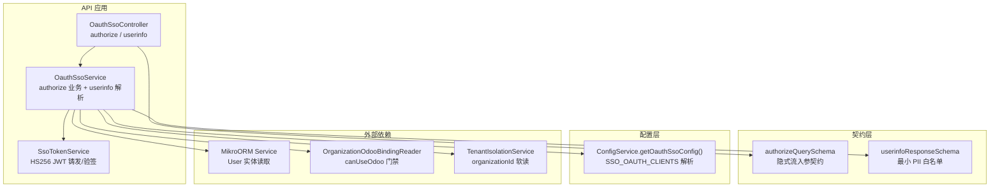
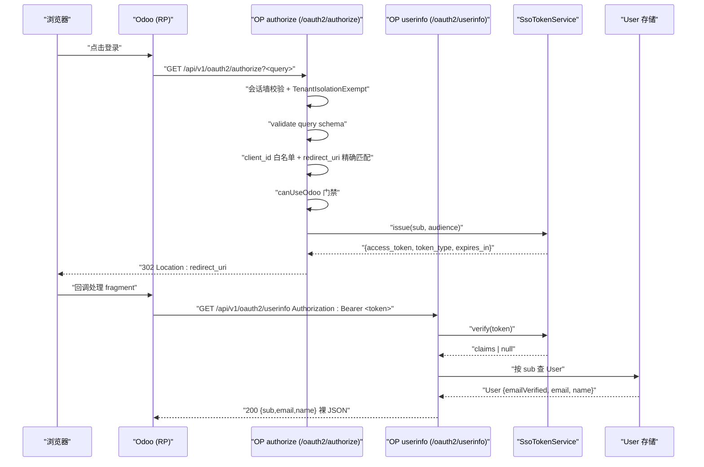
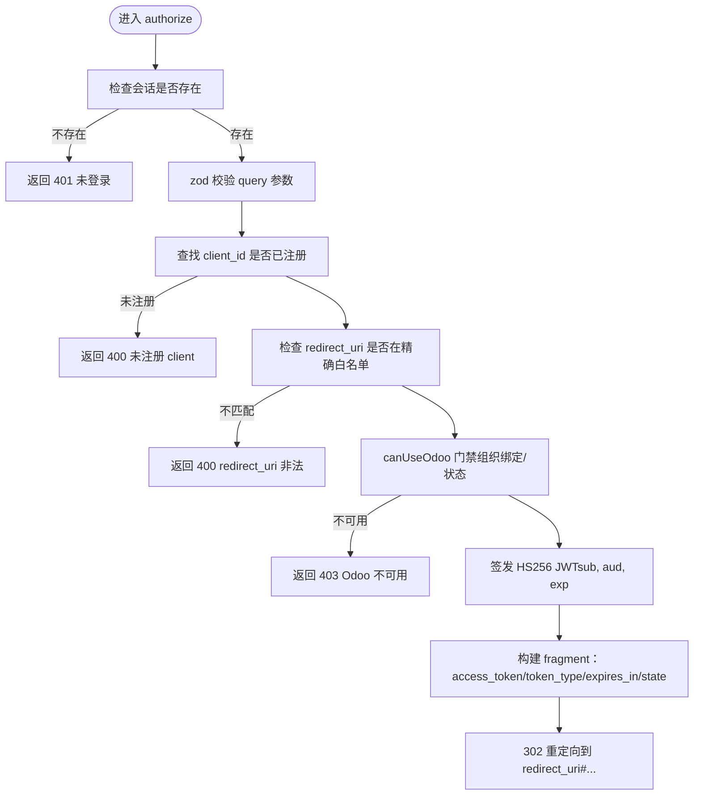
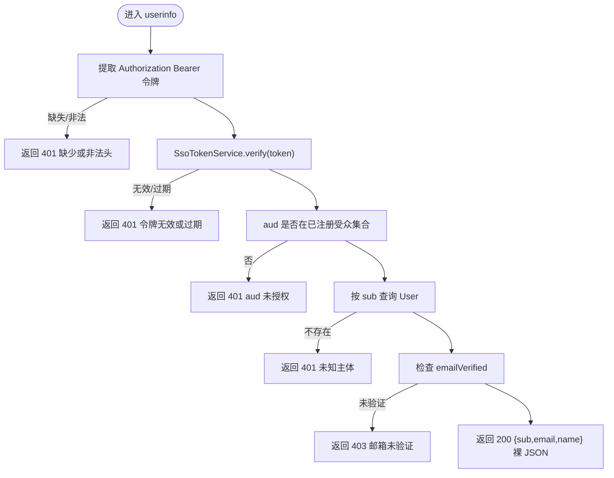
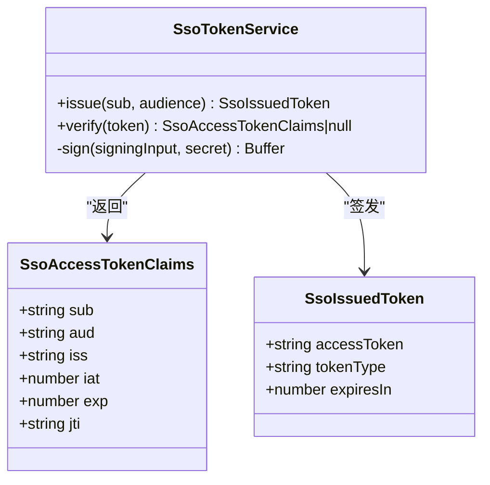
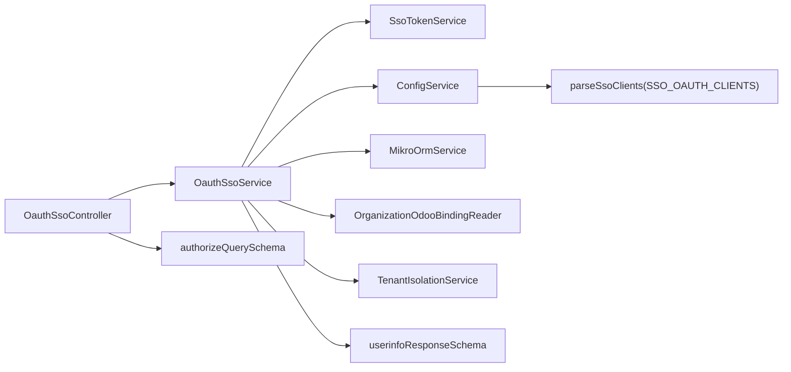

# OAuth2/SSO 集成

<cite>
**本文引用的文件**   
- [apps/api/src/modules/auth/api/oauth-sso.controller.ts](file://apps/api/src/modules/auth/api/oauth-sso.controller.ts)
- [apps/api/src/modules/auth/infrastructure/oauth-sso.service.ts](file://apps/api/src/modules/auth/infrastructure/oauth-sso.service.ts)
- [apps/api/src/modules/auth/infrastructure/sso-token.service.ts](file://apps/api/src/modules/auth/infrastructure/sso-token.service.ts)
- [libs/contracts/src/request/oauth-sso.ts](file://libs/contracts/src/request/oauth-sso.ts)
- [libs/contracts/src/response/oauth-sso.ts](file://libs/contracts/src/response/oauth-sso.ts)
- [apps/api/src/config/envs/sso-clients.ts](file://apps/api/src/config/envs/sso-clients.ts)
- [apps/api/src/modules/auth/oauth-sso.e2e.test.ts](file://apps/api/src/modules/auth/oauth-sso.e2e.test.ts)
- [apps/api/src/modules/auth/infrastructure/oauth-sso.service.test.ts](file://apps/api/src/modules/auth/infrastructure/oauth-sso.service.test.ts)
</cite>

## 目录
1. [引言](#引言)
2. [项目结构](#项目结构)
3. [核心组件](#核心组件)
4. [架构总览](#架构总览)
5. [详细组件分析](#详细组件分析)
6. [依赖关系分析](#依赖关系分析)
7. [性能与令牌 TTL](#性能与令牌-ttl)
8. [配置与安全建议](#配置与安全建议)
9. [与 Odoo auth_oauth 的集成细节](#与-odoo-auth_oauth-的集成细节)
10. [故障排除指南](#故障排除指南)
11. [结论](#结论)

## 引言
本仓库在本端以 NestJS API 充当 Odoo 的 OIDC OP，实现隐式流授权流程与 userinfo 端点。其目标是：
- 作为 Odoo `auth_oauth` 的后端 OP，接收隐式流授权请求并返回带 fragment 的访问令牌。
- 提供 userinfo 端点，供 Odoo 服务端通过 Bearer 令牌拉取用户声明。
- 通过 client 白名单、redirect_uri 精确匹配、audience 校验与会话门禁，保证安全接入。
- 与现有租户隔离、组织绑定、Odoo 可用性检查等系统能力对齐，避免“审批≠可入”的安全漏洞。

## 项目结构
OAuth2/SSO 相关代码集中在认证模块中，采用控制器薄、服务承载业务逻辑的分层方式；协议契约定义在共享 contracts 包中；client 注册表通过环境变量解析。

图表来源
- [apps/api/src/modules/auth/api/oauth-sso.controller.ts:24-88](file://apps/api/src/modules/auth/api/oauth-sso.controller.ts#L24-L88)
- [apps/api/src/modules/auth/infrastructure/oauth-sso.service.ts:33-116](file://apps/api/src/modules/auth/infrastructure/oauth-sso.service.ts#L33-L116)
- [apps/api/src/modules/auth/infrastructure/sso-token.service.ts:52-105](file://apps/api/src/modules/auth/infrastructure/sso-token.service.ts#L52-L105)
- [libs/contracts/src/request/oauth-sso.ts:25-43](file://libs/contracts/src/request/oauth-sso.ts#L25-L43)
- [libs/contracts/src/response/oauth-sso.ts:15-20](file://libs/contracts/src/response/oauth-sso.ts#L15-L20)
- [apps/api/src/config/envs/sso-clients.ts:11-42](file://apps/api/src/config/envs/sso-clients.ts#L11-L42)

章节来源
- [apps/api/src/modules/auth/api/oauth-sso.controller.ts:10-23](file://apps/api/src/modules/auth/api/oauth-sso.controller.ts#L10-L23)
- [apps/api/src/modules/auth/infrastructure/oauth-sso.service.ts:22-32](file://apps/api/src/modules/auth/infrastructure/oauth-sso.service.ts#L22-L32)

## 核心组件
- OauthSsoController：暴露 `/api/v1/oauth2/authorize` 与 `/api/v1/oauth2/userinfo` 两个端点。
- OauthSsoService：承载 authorize 的业务校验（client 白名单、redirect_uri 精确匹配、Odoo 可用性）以及 userinfo 的 Bearer 令牌验证与 aud 校验。
- SsoTokenService：基于 HS256 的紧凑 JWS 访问令牌铸发与验签，TTL 极短。
- 契约层：authorizeQuerySchema 与 userinfoResponseSchema 分别约束入参与出参。
- 配置层：parseSsoClients 从环境变量解析 client 注册表，fail-closed 默认不放行任何客户端。

章节来源
- [apps/api/src/modules/auth/api/oauth-sso.controller.ts:24-88](file://apps/api/src/modules/auth/api/oauth-sso.controller.ts#L24-L88)
- [apps/api/src/modules/auth/infrastructure/oauth-sso.service.ts:33-116](file://apps/api/src/modules/auth/infrastructure/oauth-sso.service.ts#L33-L116)
- [apps/api/src/modules/auth/infrastructure/sso-token.service.ts:52-105](file://apps/api/src/modules/auth/infrastructure/sso-token.service.ts#L52-L105)
- [libs/contracts/src/request/oauth-sso.ts:25-43](file://libs/contracts/src/request/oauth-sso.ts#L25-L43)
- [libs/contracts/src/response/oauth-sso.ts:15-20](file://libs/contracts/src/response/oauth-sso.ts#L15-L20)
- [apps/api/src/config/envs/sso-clients.ts:11-42](file://apps/api/src/config/envs/sso-clients.ts#L11-L42)

## 架构总览
下图展示 Odoo 作为 RP 与本端 OP 的交互流程：浏览器发起授权链接到 authorize，OP 校验会话与 client 白名单后返回 302 重定向，fragment 携带 access_token；随后 Odoo 服务端用该 token 调用 userinfo 获取用户信息。

图表来源
- [apps/api/src/modules/auth/api/oauth-sso.controller.ts:35-62](file://apps/api/src/modules/auth/api/oauth-sso.controller.ts#L35-L62)
- [apps/api/src/modules/auth/infrastructure/oauth-sso.service.ts:52-90](file://apps/api/src/modules/auth/infrastructure/oauth-sso.service.ts#L52-L90)
- [apps/api/src/modules/auth/infrastructure/sso-token.service.ts:56-77](file://apps/api/src/modules/auth/infrastructure/sso-token.service.ts#L56-L77)
- [apps/api/src/modules/auth/api/oauth-sso.controller.ts:74-87](file://apps/api/src/modules/auth/api/oauth-sso.controller.ts#L74-L87)
- [apps/api/src/modules/auth/infrastructure/oauth-sso.service.ts:99-116](file://apps/api/src/modules/auth/infrastructure/oauth-sso.service.ts#L99-L116)

## 详细组件分析

### authorize 端点
- 路由：`GET /api/v1/oauth2/authorize`
- 协议：仅支持隐式流（`response_type=token`），由 zod 契约强制。
- 会话门禁：默认受全局 SessionGuard 保护，未登录返回 401。
- 租户隔离豁免：使用 `@TenantIsolationExempt()`，因为 SSO 是跨租户 OP，无活跃租户上下文时不应被租户墙误杀。
- 参数校验：
  - `client_id`：必须存在且命中已注册 client。
  - `redirect_uri`：必须与 client 注册的 redirectUris 精确匹配（非前缀）。
  - `response_type`：仅允许字面量 `token`。
  - `scope`：空格分隔，元素须属于 `openid profile email`。
  - `state`：可选，透传到 fragment。
- 业务校验：
  - 若 client 未注册或 redirect_uri 不在白名单，抛出 400。
  - 通过 `canUseOdoo` 判断当前活跃租户是否具备 Odoo 可用状态；否则抛出 403。
- 令牌生成与重定向：
  - 调用 SsoTokenService 签发超短 TTL 的 HS256 JWT，包含 `sub`、`aud`、`exp` 等 claims。
  - 将 `access_token`、`token_type=Bearer`、`expires_in` 拼接到 redirect_uri 的 fragment；若原 redirect_uri 已有 `#`，则以 `&` 续接。
  - 返回 302 重定向。

图表来源
- [apps/api/src/modules/auth/api/oauth-sso.controller.ts:35-62](file://apps/api/src/modules/auth/api/oauth-sso.controller.ts#L35-L62)
- [apps/api/src/modules/auth/infrastructure/oauth-sso.service.ts:52-90](file://apps/api/src/modules/auth/infrastructure/oauth-sso.service.ts#L52-L90)
- [libs/contracts/src/request/oauth-sso.ts:25-43](file://libs/contracts/src/request/oauth-sso.ts#L25-L43)

章节来源
- [apps/api/src/modules/auth/api/oauth-sso.controller.ts:35-62](file://apps/api/src/modules/auth/api/oauth-sso.controller.ts#L35-L62)
- [apps/api/src/modules/auth/infrastructure/oauth-sso.service.ts:52-90](file://apps/api/src/modules/auth/infrastructure/oauth-sso.service.ts#L52-L90)
- [libs/contracts/src/request/oauth-sso.ts:25-43](file://libs/contracts/src/request/oauth-sso.ts#L25-L43)
- [apps/api/src/modules/auth/oauth-sso.e2e.test.ts:123-203](file://apps/api/src/modules/auth/oauth-sso.e2e.test.ts#L123-L203)
- [apps/api/src/modules/auth/infrastructure/oauth-sso.service.test.ts:75-152](file://apps/api/src/modules/auth/infrastructure/oauth-sso.service.test.ts#L75-L152)

### userinfo 端点
- 路由：`GET /api/v1/oauth2/userinfo`
- 鉴权：`@Public()` 旁路会话墙，但自带 Bearer 令牌验签与 aud 校验。
- 请求头：要求 `Authorization: Bearer <token>`。
- 校验流程：
  - 提取 Bearer 令牌，缺失或格式错误返回 401。
  - 验签并解析 claims，失败或过期返回 401。
  - 强制 aud 校验：claims.aud 必须在已注册 client 的 audience 集合中，否则返回 401。
  - 根据 claims.sub 查询 User 实体，主体不存在返回 401。
  - 邮箱未验证返回 403。
- 响应：返回裸 JSON `{sub, email, name}`，不被全局 TransformInterceptor 包裹为 `{data,...}`。

图表来源
- [apps/api/src/modules/auth/api/oauth-sso.controller.ts:74-87](file://apps/api/src/modules/auth/api/oauth-sso.controller.ts#L74-L87)
- [apps/api/src/modules/auth/infrastructure/oauth-sso.service.ts:99-116](file://apps/api/src/modules/auth/infrastructure/oauth-sso.service.ts#L99-L116)
- [apps/api/src/modules/auth/infrastructure/sso-token.service.ts:84-100](file://apps/api/src/modules/auth/infrastructure/sso-token.service.ts#L84-L100)

章节来源
- [apps/api/src/modules/auth/api/oauth-sso.controller.ts:64-87](file://apps/api/src/modules/auth/api/oauth-sso.controller.ts#L64-L87)
- [apps/api/src/modules/auth/infrastructure/oauth-sso.service.ts:92-116](file://apps/api/src/modules/auth/infrastructure/oauth-sso.service.ts#L92-L116)
- [apps/api/src/modules/auth/oauth-sso.e2e.test.ts:205-238](file://apps/api/src/modules/auth/oauth-sso.e2e.test.ts#L205-L238)
- [apps/api/src/modules/auth/infrastructure/oauth-sso.service.test.ts:154-201](file://apps/api/src/modules/auth/infrastructure/oauth-sso.service.test.ts#L154-L201)

### 令牌服务（SsoTokenService）
- 算法：HS256 紧凑 JWS，使用 node:crypto HMAC-SHA256，避免引入 jose/jsonwebtoken。
- 密钥：复用站内 JWT 对称密钥（config.auth.jwt.secret）。
- 载荷：包含 `sub`、`aud`、`iss`、`iat`、`exp`、`jti`。
- TTL：固定 120 秒，降低隐式流令牌的暴露风险。
- 验签：严格三段式结构、HMAC 比对、exp 过期检查；aud 归属由调用方策略判定。

图表来源
- [apps/api/src/modules/auth/infrastructure/sso-token.service.ts:10-37](file://apps/api/src/modules/auth/infrastructure/sso-token.service.ts#L10-L37)
- [apps/api/src/modules/auth/infrastructure/sso-token.service.ts:56-105](file://apps/api/src/modules/auth/infrastructure/sso-token.service.ts#L56-L105)

章节来源
- [apps/api/src/modules/auth/infrastructure/sso-token.service.ts:42-105](file://apps/api/src/modules/auth/infrastructure/sso-token.service.ts#L42-L105)

## 依赖关系分析
- 控制器依赖服务：OauthSsoController 注入 OauthSsoService。
- 服务依赖：
  - ConfigService：读取 SSO client 注册表。
  - SsoTokenService：签发与验签访问令牌。
  - MikroOrmService：读取 User 实体。
  - OrganizationOdooBindingReader + canUseOdoo：决定当前组织是否可使用 Odoo。
  - TenantIsolationService：软读 organizationId，用于跨租户 OP 场景。
- 契约层：authorizeQuerySchema 与 userinfoResponseSchema 被控制器与服务引用。
- 配置层：parseSsoClients 解析环境变量 SSO_OAUTH_CLIENTS，fail-closed 默认空数组。

图表来源
- [apps/api/src/modules/auth/api/oauth-sso.controller.ts:24-88](file://apps/api/src/modules/auth/api/oauth-sso.controller.ts#L24-L88)
- [apps/api/src/modules/auth/infrastructure/oauth-sso.service.ts:33-116](file://apps/api/src/modules/auth/infrastructure/oauth-sso.service.ts#L33-L116)
- [apps/api/src/modules/auth/infrastructure/sso-token.service.ts:52-105](file://apps/api/src/modules/auth/infrastructure/sso-token.service.ts#L52-L105)
- [libs/contracts/src/request/oauth-sso.ts:25-43](file://libs/contracts/src/request/oauth-sso.ts#L25-L43)
- [libs/contracts/src/response/oauth-sso.ts:15-20](file://libs/contracts/src/response/oauth-sso.ts#L15-L20)
- [apps/api/src/config/envs/sso-clients.ts:11-42](file://apps/api/src/config/envs/sso-clients.ts#L11-L42)

章节来源
- [apps/api/src/modules/auth/api/oauth-sso.controller.ts:24-88](file://apps/api/src/modules/auth/api/oauth-sso.controller.ts#L24-L88)
- [apps/api/src/modules/auth/infrastructure/oauth-sso.service.ts:33-116](file://apps/api/src/modules/auth/infrastructure/oauth-sso.service.ts#L33-L116)
- [apps/api/src/config/envs/sso-clients.ts:11-42](file://apps/api/src/config/envs/sso-clients.ts#L11-L42)

## 性能与令牌 TTL
- 令牌 TTL：固定 120 秒，适用于隐式流紧随 userinfo 拉取的短期场景，减少泄露窗口。
- 验签开销：HS256 HMAC 计算轻量，适合高频 userinfo 调用。
- 数据库读取：userinfo 每次从 User 表实时读取权威值，避免 claims 漂移；可通过缓存策略优化热点用户。
- 重定向拼接：fragment 拼接简单字符串操作，复杂度低。

[本节为通用性能讨论，不直接分析具体文件]

## 配置与安全建议
- Client 注册表：
  - 环境变量：`SSO_OAUTH_CLIENTS`，JSON 数组，每项含 `clientId`、`redirectUris`、`audience`。
  - 未配置或为空 → 空数组，authorize 一律拒绝（fail-closed）。
  - 配置非法 → boot 期抛错（fail-loud），便于快速发现配置问题。
- redirect_uri 管理：
  - 精确匹配，禁止前缀匹配，防止子路径绕过攻击。
  - 若 redirect_uri 已含 `#`，则以 `&` 续接 fragment。
- audience 校验：
  - 签发时将 client.audience 写入 JWT `aud`。
  - userinfo 强制校验 `aud` ∈ 已注册受众集合，防 confused-deputy。
- 会话与租户：
  - authorize 默认需登录会话；userinfo 旁路会话墙但自带 Bearer 校验。
  - authorize 使用 `@TenantIsolationExempt()`，并通过 `canUseOdoo` 做组织级门禁。

章节来源
- [apps/api/src/config/envs/sso-clients.ts:11-42](file://apps/api/src/config/envs/sso-clients.ts#L11-L42)
- [apps/api/src/modules/auth/infrastructure/oauth-sso.service.ts:52-90](file://apps/api/src/modules/auth/infrastructure/oauth-sso.service.ts#L52-L90)
- [apps/api/src/modules/auth/infrastructure/oauth-sso.service.ts:99-116](file://apps/api/src/modules/auth/infrastructure/oauth-sso.service.ts#L99-L116)

## 与 Odoo auth_oauth 的集成细节
- 协议兼容：
  - 仅支持隐式流（`response_type=token`），与 Odoo CE `auth_oauth` 行为一致。
  - authorize 返回 fragment 中的 `access_token`、`token_type=Bearer`、`expires_in`。
  - userinfo 返回裸 JSON `{sub, email, name}`，不被 API envelope 包裹。
- 数据映射：
  - `sub`：平台 user id，Odoo 侧三选一（`sub`/`id`/`user_id`）取 subject。
  - `email`：用作 Odoo login 字段，必须已验证。
  - `name`：显示名。
- 安全补位：
  - 补充 Odoo CE 缺少的 audience 校验，防止混淆代理攻击。
  - 通过 `canUseOdoo` 确保只有 ready 的组织可入 Odoo，避免“审批≠可入”。

章节来源
- [libs/contracts/src/request/oauth-sso.ts:12-21](file://libs/contracts/src/request/oauth-sso.ts#L12-L21)
- [libs/contracts/src/response/oauth-sso.ts:3-11](file://libs/contracts/src/response/oauth-sso.ts#L3-L11)
- [apps/api/src/modules/auth/infrastructure/oauth-sso.service.ts:62-79](file://apps/api/src/modules/auth/infrastructure/oauth-sso.service.ts#L62-L79)
- [apps/api/src/modules/auth/infrastructure/oauth-sso.service.ts:104-109](file://apps/api/src/modules/auth/infrastructure/oauth-sso.service.ts#L104-L109)

## 故障排除指南
常见问题与定位要点：
- authorize 返回 401：
  - 原因：无有效会话。
  - 排查：确认浏览器 Cookie 与 BA 会话正常；检查 SessionGuard 是否生效。
- authorize 返回 400：
  - 原因：client_id 未注册或 redirect_uri 不在精确白名单；response_type 非 token；scope 越界。
  - 排查：核对 SSO_OAUTH_CLIENTS 配置；确认 redirect_uri 完全一致；检查 scope 词表。
- authorize 返回 403：
  - 原因：当前组织不可用 Odoo（未绑定、provisioning、suspended、无活跃租户）。
  - 排查：检查组织绑定状态与 canUseOdoo 条件；确认 activeOrganizationId 设置。
- userinfo 返回 401：
  - 原因：Authorization 头缺失或格式错误；令牌验签失败或过期；aud 不在已注册受众集合；主体不存在。
  - 排查：确认 Odoo 服务端正确传递 `Authorization: Bearer <token>`；检查令牌来源与 aud 配置。
- userinfo 返回 403：
  - 原因：用户邮箱未验证。
  - 排查：检查 User.emailVerified 状态。
- userinfo 返回非裸 JSON：
  - 原因：被全局 TransformInterceptor 包裹。
  - 排查：确认 controller 使用 `@Res().send(obj)` 直发裸 JSON。

章节来源
- [apps/api/src/modules/auth/oauth-sso.e2e.test.ts:123-238](file://apps/api/src/modules/auth/oauth-sso.e2e.test.ts#L123-L238)
- [apps/api/src/modules/auth/infrastructure/oauth-sso.service.test.ts:75-201](file://apps/api/src/modules/auth/infrastructure/oauth-sso.service.test.ts#L75-L201)

## 结论
本实现以简洁安全的隐式流 OP 对接 Odoo `auth_oauth`，通过严格的参数契约、client 白名单、redirect_uri 精确匹配、audience 校验与组织可用性门禁，保障 SSO 集成的安全性与稳定性。userinfo 端点返回最小 PII 的裸 JSON，满足 Odoo 消费需求。部署时应谨慎配置 SSO_OAUTH_CLIENTS，并确保 redirect_uri 与 audience 准确无误，同时关注组织绑定状态与用户邮箱验证情况，以避免常见集成问题。