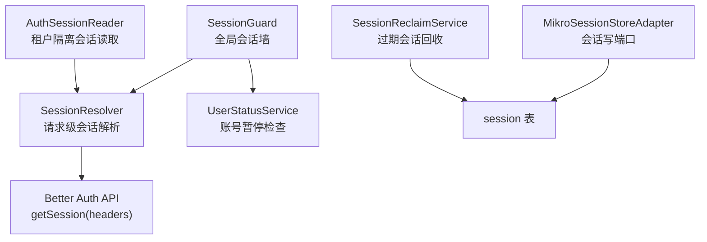
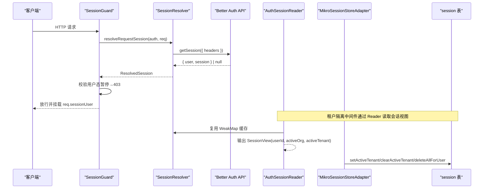
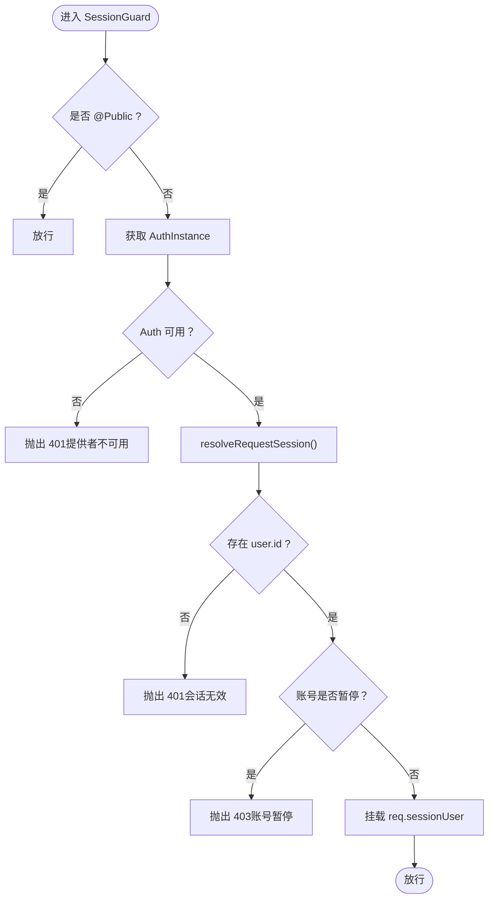
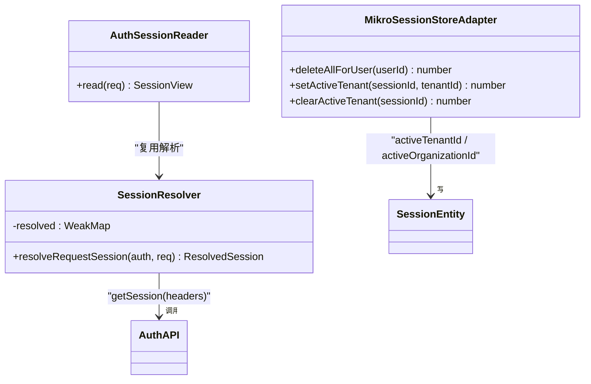
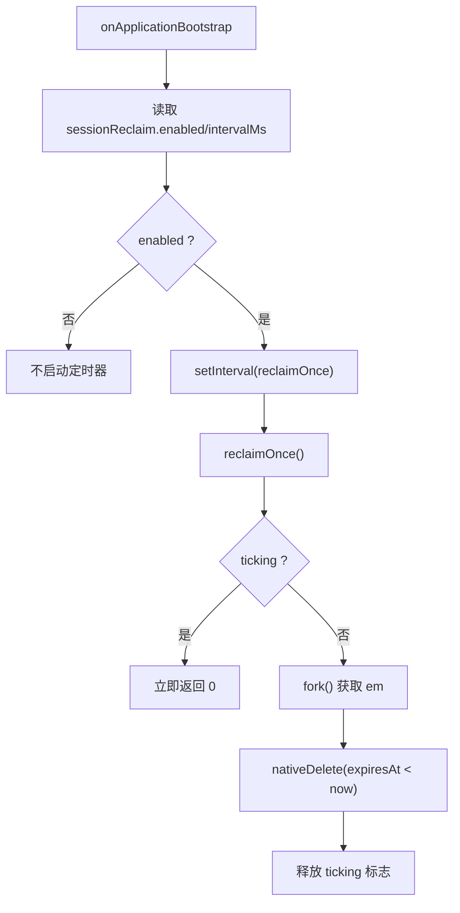
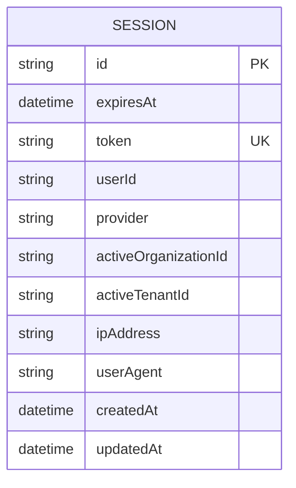
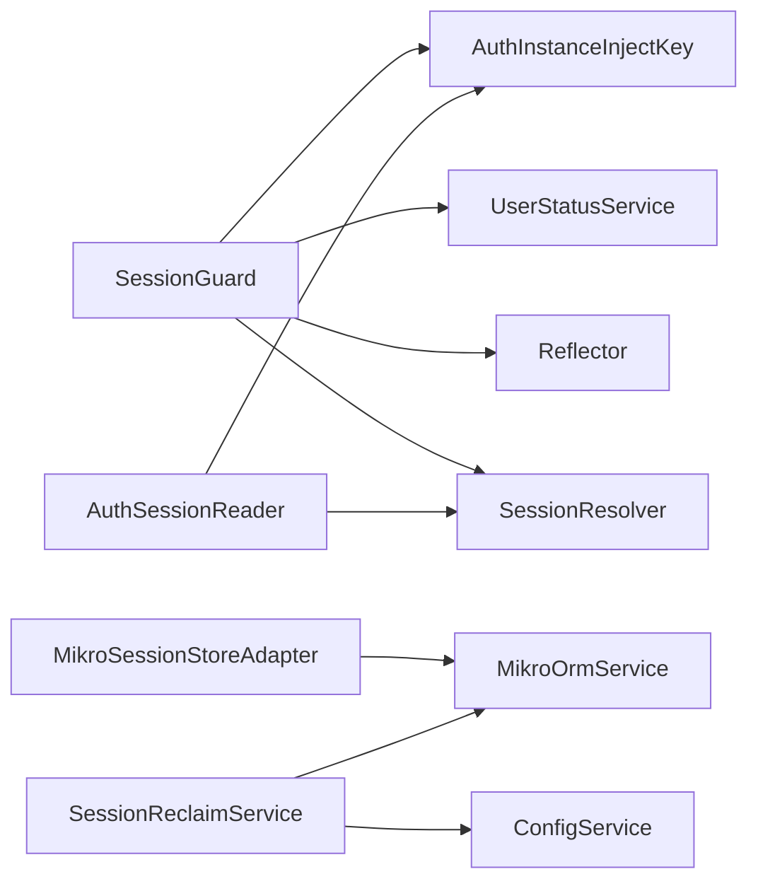

# 会话管理

<cite>
**本文引用的文件**   
- [session.guard.ts](file://apps/api/src/modules/auth/api/guards/session.guard.ts)
- [session-resolver.ts](file://apps/api/src/modules/auth/infrastructure/session-resolver.ts)
- [auth-session.reader.ts](file://apps/api/src/tenant-isolation/infrastructure/auth-session.reader.ts)
- [session-store.adapter.ts](file://apps/api/src/modules/auth/infrastructure/session-store.adapter.ts)
- [session-reclaim.service.ts](file://apps/api/src/modules/auth/infrastructure/session-reclaim.service.ts)
- [ba-identity.entities.ts](file://apps/api/src/modules/auth/infrastructure/entities/ba-identity.entities.ts)
- [config.service.ts](file://apps/api/src/config/config.service.ts)
- [default.ts](file://apps/api/src/config/envs/default.ts)
- [mikro-migrations.json](file://apps/api/src/database/mikro/migration/migrations/mikro-migrations.json)
- [Migration20261020150833.ts](file://apps/api/src/database/mikro/migration/migrations/Migration20261020150833.ts)
- [session-store.port.ts](file://apps/api/src/modules/auth/domain/ports/session-store.port.ts)
- [auth.interface.ts](file://apps/api/src/modules/auth/auth.interface.ts)
- [auth.module.ts](file://apps/api/src/modules/auth/auth.module.ts)
</cite>

## 目录
1. [简介](#简介)
2. [项目结构](#项目结构)
3. [核心组件](#核心组件)
4. [架构总览](#架构总览)
5. [详细组件分析](#详细组件分析)
6. [依赖关系分析](#依赖关系分析)
7. [性能与容量规划](#性能与容量规划)
8. [故障排查与调试](#故障排查与调试)
9. [结论](#结论)
10. [附录：配置项与安全属性](#附录配置项与安全属性)

## 简介
本文件面向“会话管理”子系统，系统性说明以下能力：
- SessionGuard 的会话验证、用户上下文注入与权限检查流程。
- SessionResolver（请求级会话解析器）的多租户会话隔离与会话状态管理。
- SessionReclaimService 的过期会话回收机制，以及并发安全与幂等性。
- 会话存储策略、过期时间与 Cookie 安全属性的配置来源。
- 会话生命周期最佳实践与性能优化建议。
- 常见错误与调试方法。

## 项目结构
会话相关代码分布在认证域与租户隔离层之间，采用“守卫解析 + 中间件读取 + 端口写访问”的分层设计：
- 守卫层：SessionGuard 负责全局会话墙、鉴权失败处理与用户上下文挂载。
- 解析层：SessionResolver 统一解析 Better Auth 会话，并在单次请求内缓存结果。
- 租户隔离层：AuthSessionReader 将会话视图暴露给租户隔离中间件，提供活动组织与活动租户信息。
- 存储层：MikroSessionStoreAdapter 通过 AUTH_SESSION_STORE 端口对 session 表进行受控写入。
- 周期任务：SessionReclaimService 定期清理过期会话行。

**图表来源**
- [session.guard.ts:52-117](file://apps/api/src/modules/auth/api/guards/session.guard.ts#L52-L117)
- [session-resolver.ts:11-35](file://apps/api/src/modules/auth/infrastructure/session-resolver.ts#L11-L35)
- [auth-session.reader.ts:44-78](file://apps/api/src/tenant-isolation/infrastructure/auth-session.reader.ts#L44-L78)
- [session-store.adapter.ts:14-46](file://apps/api/src/modules/auth/infrastructure/session-store.adapter.ts#L14-L46)
- [session-reclaim.service.ts:27-74](file://apps/api/src/modules/auth/infrastructure/session-reclaim.service.ts#L27-L74)

**章节来源**
- [session.guard.ts:52-117](file://apps/api/src/modules/auth/api/guards/session.guard.ts#L52-L117)
- [session-resolver.ts:11-35](file://apps/api/src/modules/auth/infrastructure/session-resolver.ts#L11-L35)
- [auth-session.reader.ts:44-78](file://apps/api/src/tenant-isolation/infrastructure/auth-session.reader.ts#L44-L78)
- [session-store.adapter.ts:14-46](file://apps/api/src/modules/auth/infrastructure/session-store.adapter.ts#L14-L46)
- [session-reclaim.service.ts:27-74](file://apps/api/src/modules/auth/infrastructure/session-reclaim.service.ts#L27-L74)

## 核心组件
- SessionGuard：全局 APP_GUARD，deny-by-default 会话墙；旁路 @Public 路由；校验会话有效性并注入 req.sessionUser；对已暂停账号返回 403。
- SessionResolver：单请求内唯一解析点，WeakMap 缓存会话结果，避免重复调用 getSession。
- AuthSessionReader：为租户隔离中间件提供轻量 SessionView（userId、activeOrganizationId、activeTenantId），并对无 cookie、旁路路径、认证面路径做廉价短路。
- MikroSessionStoreAdapter：AUTH_SESSION_STORE 端口的实现，提供删除用户全部会话、设置/清除活动租户位的能力，使用 ALS 感知的 em fork 保证事务一致性。
- SessionReclaimService：按 intervalMs 定时删除 expiresAt < now 的会话行，支持 enabled 开关与防重入。

**章节来源**
- [session.guard.ts:17-117](file://apps/api/src/modules/auth/api/guards/session.guard.ts#L17-L117)
- [session-resolver.ts:1-35](file://apps/api/src/modules/auth/infrastructure/session-resolver.ts#L1-L35)
- [auth-session.reader.ts:15-78](file://apps/api/src/tenant-isolation/infrastructure/auth-session.reader.ts#L15-L78)
- [session-store.adapter.ts:6-46](file://apps/api/src/modules/auth/infrastructure/session-store.adapter.ts#L6-L46)
- [session-reclaim.service.ts:12-74](file://apps/api/src/modules/auth/infrastructure/session-reclaim.service.ts#L12-L74)

## 架构总览
下图展示一次典型请求从进入 Nest 到会话解析、租户上下文提取、权限检查与数据访问的全链路。

**图表来源**
- [session.guard.ts:81-117](file://apps/api/src/modules/auth/api/guards/session.guard.ts#L81-L117)
- [session-resolver.ts:25-35](file://apps/api/src/modules/auth/infrastructure/session-resolver.ts#L25-L35)
- [auth-session.reader.ts:48-78](file://apps/api/src/tenant-isolation/infrastructure/auth-session.reader.ts#L48-L78)
- [session-store.adapter.ts:18-46](file://apps/api/src/modules/auth/infrastructure/session-store.adapter.ts#L18-L46)

## 详细组件分析

### SessionGuard：会话验证、上下文注入与权限检查
- 职责
  - 作为全局守卫，默认拒绝未登录访问（deny-by-default）。
  - 通过 Reflector 识别 @Public 路由并旁路会话墙。
  - 调用 SessionResolver 解析会话，若缺失或非法则抛出 401。
  - 调用 UserStatusService 检查账号是否被暂停，若是则抛出 403。
  - 成功后在请求上挂载 SessionUser（id、email、sessionId）。
- 关键行为
  - 当 AuthInstance 尚未初始化时，直接抛 401。
  - sessionId 来自已验签会话主键，供后续租级激活写点定位会话行。

**图表来源**
- [session.guard.ts:81-117](file://apps/api/src/modules/auth/api/guards/session.guard.ts#L81-L117)

**章节来源**
- [session.guard.ts:17-117](file://apps/api/src/modules/auth/api/guards/session.guard.ts#L17-L117)

### SessionResolver：多租户会话隔离与会话状态管理
- 设计要点
  - 单一解析入口，避免同一请求多次调用 getSession。
  - 使用 WeakMap 按请求对象缓存解析结果，跨守卫与中间件复用。
  - 不决定允许/拒绝，仅返回原始会话结果或 null。
- 多租户关联
  - 会话中携带 activeOrganizationId 与 activeTenantId（服务端 additionalField），由 AuthSessionReader 抽取为 SessionView 供租户隔离中间件使用。
  - 活动租户位由 MikroSessionStoreAdapter 受控写入，确保成员资格校验后更新。

**图表来源**
- [session-resolver.ts:11-35](file://apps/api/src/modules/auth/infrastructure/session-resolver.ts#L11-L35)
- [auth-session.reader.ts:44-78](file://apps/api/src/tenant-isolation/infrastructure/auth-session.reader.ts#L44-L78)
- [session-store.adapter.ts:14-46](file://apps/api/src/modules/auth/infrastructure/session-store.adapter.ts#L14-L46)
- [ba-identity.entities.ts:87-107](file://apps/api/src/modules/auth/infrastructure/entities/ba-identity.entities.ts#L87-L107)

**章节来源**
- [session-resolver.ts:1-35](file://apps/api/src/modules/auth/infrastructure/session-resolver.ts#L1-L35)
- [auth-session.reader.ts:15-78](file://apps/api/src/tenant-isolation/infrastructure/auth-session.reader.ts#L15-L78)
- [session-store.adapter.ts:6-46](file://apps/api/src/modules/auth/infrastructure/session-store.adapter.ts#L6-L46)
- [ba-identity.entities.ts:87-107](file://apps/api/src/modules/auth/infrastructure/entities/ba-identity.entities.ts#L87-L107)

### SessionReclaimService：过期会话回收与并发安全
- 功能
  - 根据配置开启定时器，周期性执行 nativeDelete(Session, { expiresAt < now })。
  - 支持 enabled 开关与 intervalMs 间隔；模块销毁时清理定时器。
  - reclaimOnce() 对外暴露，供测试/e2e 确定性驱动；内部防重入。
- 并发与幂等
  - 多实例并发各跑一次删除，结果一致；无需 SKIP LOCKED。
  - 单语句删净过期行，适合模板/参考应用规模；海量场景可改为分批删除。

**图表来源**
- [session-reclaim.service.ts:39-74](file://apps/api/src/modules/auth/infrastructure/session-reclaim.service.ts#L39-L74)

**章节来源**
- [session-reclaim.service.ts:12-74](file://apps/api/src/modules/auth/infrastructure/session-reclaim.service.ts#L12-L74)

### 会话存储策略与实体模型
- 实体字段
  - Session 包含 id、expiresAt、token、userId、provider、activeOrganizationId、activeTenantId、ipAddress、userAgent、createdAt、updatedAt。
  - activeTenantId 为服务端 additionalField，客户端不可写，用于活动租户解绑与激活。
- 索引与约束
  - session_expires_at_idx：加速过期回收。
  - session_token_idx：唯一约束 token，避免全表扫描并保障完整性。
- 写端口
  - AUTH_SESSION_STORE 定义 deleteAllForUser、setActiveTenant、clearActiveTenant，作为 auth 上下文对 session 表的受控写入口。

**图表来源**
- [ba-identity.entities.ts:87-107](file://apps/api/src/modules/auth/infrastructure/entities/ba-identity.entities.ts#L87-L107)
- [Migration20261020150833.ts:4-19](file://apps/api/src/database/mikro/migration/migrations/Migration20261020150833.ts#L4-L19)
- [mikro-migrations.json:2176-2228](file://apps/api/src/database/mikro/migration/migrations/mikro-migrations.json#L2176-L2228)
- [session-store.port.ts:1-42](file://apps/api/src/modules/auth/domain/ports/session-store.port.ts#L1-L42)

**章节来源**
- [ba-identity.entities.ts:87-107](file://apps/api/src/modules/auth/infrastructure/entities/ba-identity.entities.ts#L87-L107)
- [Migration20261020150833.ts:4-19](file://apps/api/src/database/mikro/migration/migrations/Migration20261020150833.ts#L4-L19)
- [mikro-migrations.json:2176-2228](file://apps/api/src/database/mikro/migration/migrations/mikro-migrations.json#L2176-L2228)
- [session-store.port.ts:1-42](file://apps/api/src/modules/auth/domain/ports/session-store.port.ts#L1-L42)

## 依赖关系分析
- SessionGuard 依赖
  - AuthInstanceInjectKey：延迟获取 Better Auth 实例。
  - UserStatusService：账号暂停检查。
  - Reflector：读取 @Public 元数据。
  - SessionResolver：统一会话解析。
- AuthSessionReader 依赖
  - AuthInstanceInjectKey：获取 Auth 实例。
  - SessionResolver：复用会话解析。
- MikroSessionStoreAdapter 依赖
  - MikroOrmService：ALS 感知的事务 em fork。
- SessionReclaimService 依赖
  - ConfigService：读取 sessionReclaim 配置。
  - MikroOrmService：执行原生删除。

**图表来源**
- [session.guard.ts:65-71](file://apps/api/src/modules/auth/api/guards/session.guard.ts#L65-L71)
- [auth-session.reader.ts:44-46](file://apps/api/src/tenant-isolation/infrastructure/auth-session.reader.ts#L44-L46)
- [session-store.adapter.ts:14-16](file://apps/api/src/modules/auth/infrastructure/session-store.adapter.ts#L14-L16)
- [session-reclaim.service.ts:33-37](file://apps/api/src/modules/auth/infrastructure/session-reclaim.service.ts#L33-L37)

**章节来源**
- [session.guard.ts:65-71](file://apps/api/src/modules/auth/api/guards/session.guard.ts#L65-L71)
- [auth-session.reader.ts:44-46](file://apps/api/src/tenant-isolation/infrastructure/auth-session.reader.ts#L44-L46)
- [session-store.adapter.ts:14-16](file://apps/api/src/modules/auth/infrastructure/session-store.adapter.ts#L14-L16)
- [session-reclaim.service.ts:33-37](file://apps/api/src/modules/auth/infrastructure/session-reclaim.service.ts#L33-L37)

## 性能与容量规划
- 会话解析去重
  - 通过 WeakMap 在单次请求内缓存会话解析结果，避免多次调用后端会话存储。
- 数据库索引
  - session_expires_at_idx 加速过期回收；session_token_idx 唯一约束避免全表扫描。
- 批量与限流
  - 当前回收为单语句删除；如会话量极大，可考虑分批删除（例如基于 ctid 子查询 LIMIT）。
- 配置门控
  - sessionReclaim.enabled 缺省关闭，避免不必要的数据库访问，保持 DB-free 装配不变量。
- 租户隔离短路
  - AuthSessionReader 在无 cookie、认证面路径或旁路路径时直接返回 null，减少会话解析开销。

[本节为通用指导，不直接分析具体文件]

## 故障排查与调试
- 常见问题
  - 401 未登录或会话无效：检查请求头是否携带有效 cookie；确认 SessionGuard 未被 @Public 旁路；确认 AuthInstance 已初始化。
  - 403 账号暂停：检查 UserStatusService.isBlocked 判定逻辑；确认 suspend-user 流程正确触发会话删除。
  - 活动租户不一致：检查 setActiveTenant/clearActiveTenant 调用顺序，确保选租与选 org 互斥，避免双激活位共存。
  - 过期会话堆积：确认 SESSION_RECLAIM_ENABLED=true 且 intervalMs 合理；检查索引是否存在。
- 调试建议
  - 在 SessionGuard 与 SessionResolver 处增加日志，记录解析结果与缓存命中情况。
  - 使用 SessionReclaimService.reclaimOnce() 手动触发回收，观察删除行数。
  - 核对迁移是否创建 session_expires_at_idx 与 session_token_idx。

**章节来源**
- [session.guard.ts:81-117](file://apps/api/src/modules/auth/api/guards/session.guard.ts#L81-L117)
- [session-reclaim.service.ts:39-74](file://apps/api/src/modules/auth/infrastructure/session-reclaim.service.ts#L39-L74)
- [Migration20261020150833.ts:4-19](file://apps/api/src/database/mikro/migration/migrations/Migration20261020150833.ts#L4-L19)

## 结论
本会话管理体系以 SessionGuard 为全局入口，结合 SessionResolver 的统一解析与缓存、AuthSessionReader 的轻量会话视图、AUTH_SESSION_STORE 的受控写端口，以及 SessionReclaimService 的周期回收，形成高内聚、低耦合、可扩展的会话治理方案。通过合理的索引、配置门控与短路策略，系统在安全性与性能之间取得平衡，并为多租户隔离与并发登录冲突提供了坚实基础。

[本节为总结性内容，不直接分析具体文件]

## 附录：配置项与安全属性
- 会话回收配置
  - sessionReclaim.enabled：布尔值，控制是否启用周期回收。
  - sessionReclaim.intervalMs：回收间隔毫秒数。
- OAuth Cookie 安全属性
  - OAUTH_COOKIE_NAME：Cookie 名称。
  - OAUTH_COOKIE_MAX_AGE：最大存活时间（秒）。
  - OAUTH_COOKIE_SECURE：是否启用 Secure 标志。
- 注入与装配
  - AuthModule 导出 SessionGuard 与 AUTH_SESSION_STORE，并将 SessionReclaimService 注册为全局模块的一部分。
  - AuthInstance 通过 InjectAuthInstance 接口提供 get/set 访问。

**章节来源**
- [default.ts:78-83](file://apps/api/src/config/envs/default.ts#L78-L83)
- [default.ts:108-114](file://apps/api/src/config/envs/default.ts#L108-L114)
- [config.service.ts:68-70](file://apps/api/src/config/config.service.ts#L68-L70)
- [auth.module.ts:59-82](file://apps/api/src/modules/auth/auth.module.ts#L59-L82)
- [auth.interface.ts:1-8](file://apps/api/src/modules/auth/auth.interface.ts#L1-L8)