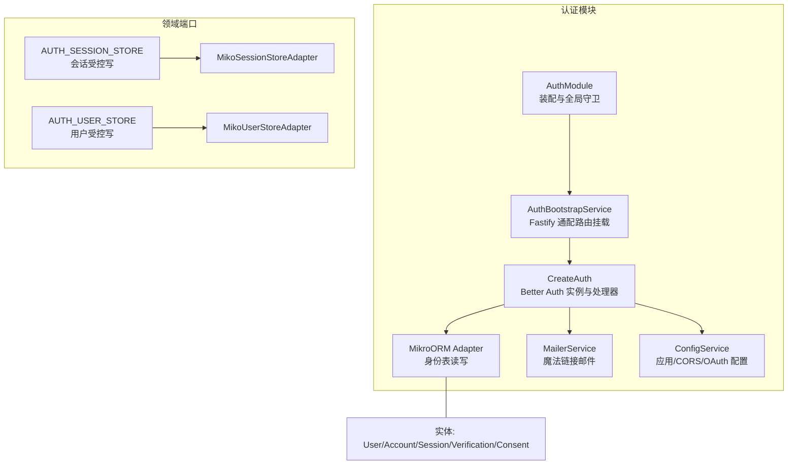
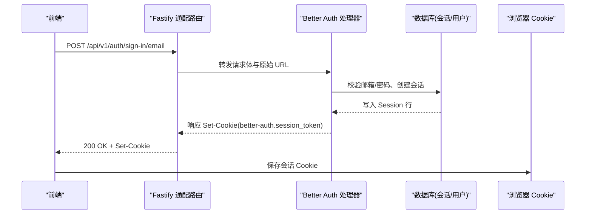
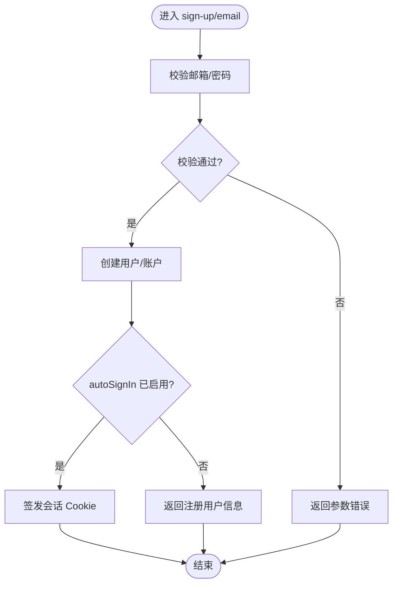
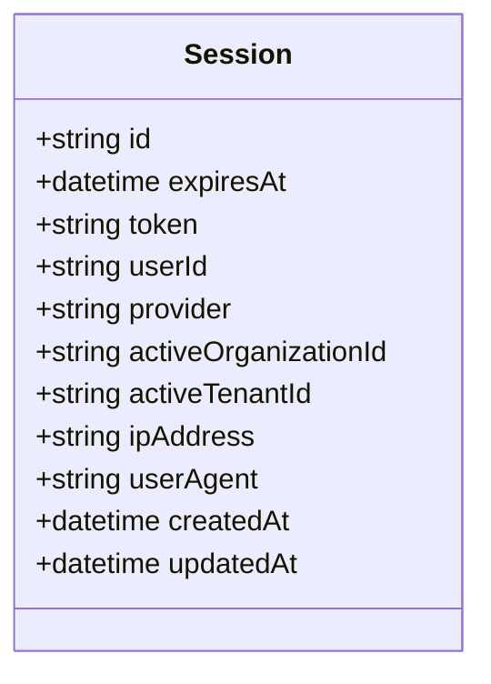
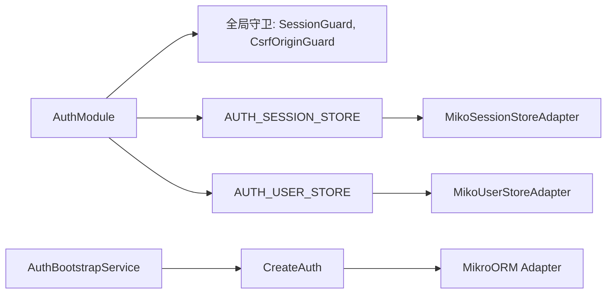

# 本地认证接口

<cite>
**本文引用的文件**   
- [auth.module.ts](file://apps/api/src/modules/auth/auth.module.ts)
- [auth.implement.ts](file://apps/api/src/modules/auth/infrastructure/auth.implement.ts)
- [auth.bootstrap.ts](file://apps/api/src/modules/auth/infrastructure/auth.bootstrap.ts)
- [session-store.adapter.ts](file://apps/api/src/modules/auth/infrastructure/session-store.adapter.ts)
- [user-store.adapter.ts](file://apps/api/src/modules/auth/infrastructure/user-store.adapter.ts)
- [ba-identity.entities.ts](file://apps/api/src/modules/auth/infrastructure/entities/ba-identity.entities.ts)
- [oauth-sso.e2e.test.ts](file://apps/api/src/modules/auth/oauth-sso.e2e.test.ts)
</cite>

## 目录
1. [简介](#简介)
2. [项目结构](#项目结构)
3. [核心组件](#核心组件)
4. [架构总览](#架构总览)
5. [详细组件分析](#详细组件分析)
6. [依赖关系分析](#依赖关系分析)
7. [性能与容量特性](#性能与容量特性)
8. [故障排查指南](#故障排查指南)
9. [结论](#结论)

## 简介
本文件面向“本地认证”能力，聚焦邮箱+密码注册、登录、登出、密码重置等核心流程的对外 API 端点、参数校验规则、会话存储机制、令牌生成策略、安全最佳实践、错误码与调试方法。系统基于 Better Auth 构建认证内核，并通过 NestJS + Fastify 暴露原生 HTTP 面；同时提供服务端编排门面（如 signUpEmail/signInEmail）供内部流程调用。

需要特别说明：
- 生产环境默认关闭邮箱+密码登录面；测试/开发环境开启以驱动真实注册与登录。
- 会话采用 Better Auth 签名的 session cookie，并持久化到数据库 session 表。
- 限流、CSRF、可信代理 IP 解析等安全能力在模块层统一装配。

## 项目结构
认证相关代码集中在 apps/api/src/modules/auth 下，分层清晰：
- api/guards：全局会话守卫、CSRF Origin 守卫
- infrastructure：Better Auth 初始化、HTTP 面接线、实体与适配器
- domain/ports：领域端口（会话/用户写入口）
- auth.module.ts：模块装配、全局守卫、端口绑定

图表来源
- [auth.module.ts:22-83](file://apps/api/src/modules/auth/auth.module.ts#L22-L83)
- [auth.bootstrap.ts:34-82](file://apps/api/src/modules/auth/infrastructure/auth.bootstrap.ts#L34-L82)
- [auth.implement.ts:101-302](file://apps/api/src/modules/auth/infrastructure/auth.implement.ts#L101-L302)
- [ba-identity.entities.ts:31-146](file://apps/api/src/modules/auth/infrastructure/entities/ba-identity.entities.ts#L31-L146)

章节来源
- [auth.module.ts:22-83](file://apps/api/src/modules/auth/auth.module.ts#L22-L83)
- [auth.bootstrap.ts:34-82](file://apps/api/src/modules/auth/infrastructure/auth.bootstrap.ts#L34-L82)

## 核心组件
- Better Auth 内核：负责邮箱+密码、社交 OAuth、Magic Link、组织插件、限流、Cookie 属性等。
- HTTP 面：通过 Fastify 实例级通配路由将 /api/v1/auth/** 转发至 Better Auth 处理器。
- 会话存储：Better Auth 会话持久化到 session 表，支持 provider、activeOrganizationId、activeTenantId、ipAddress、userAgent 等字段。
- 用户存储：user 表由 auth 域拥有，PIPL 硬删与状态更新经 AUTH_USER_STORE 端口。
- 治理写入口：AUTH_SESSION_STORE 提供删除用户全部会话、设置/清除活动租户等受控写。

章节来源
- [auth.implement.ts:101-302](file://apps/api/src/modules/auth/infrastructure/auth.implement.ts#L101-L302)
- [session-store.adapter.ts:14-46](file://apps/api/src/modules/auth/infrastructure/session-store.adapter.ts#L14-L46)
- [user-store.adapter.ts:14-41](file://apps/api/src/modules/auth/infrastructure/user-store.adapter.ts#L14-L41)
- [ba-identity.entities.ts:31-146](file://apps/api/src/modules/auth/infrastructure/entities/ba-identity.entities.ts#L31-L146)

## 架构总览
下图展示一次“邮箱+密码登录”的关键调用链：前端请求 → Fastify 通配路由 → Better Auth 处理器 → 会话签发 → 返回 Set-Cookie。

图表来源
- [auth.bootstrap.ts:46-82](file://apps/api/src/modules/auth/infrastructure/auth.bootstrap.ts#L46-L82)
- [auth.implement.ts:304-346](file://apps/api/src/modules/auth/infrastructure/auth.implement.ts#L304-L346)
- [oauth-sso.e2e.test.ts:94-121](file://apps/api/src/modules/auth/oauth-sso.e2e.test.ts#L94-L121)

## 详细组件分析

### 1) 注册与登录（邮箱+密码）
- 端点
  - 注册：POST /api/v1/auth/sign-up/email
  - 登录：POST /api/v1/auth/sign-in/email
- 启用策略
  - emailAndPassword.enabled 在非生产环境为 true；生产环境默认关闭。
- 参数校验
  - 邮箱格式：由 Better Auth 内置校验。
  - 密码强度：minPasswordLength=8（最小长度）。
- 自动登录
  - autoSignIn=true，成功登录后直接签发会话 Cookie。
- 典型请求/响应
  - 注册成功：返回用户标识（例如 user.id），并可能附带会话 Cookie。
  - 登录成功：返回用户信息或会话上下文，Set-Cookie 包含 better-auth.session_token。
  - 失败场景：参数不合法、账号不存在、密码错误等，返回标准错误体（具体消息由 Better Auth 返回）。

图表来源
- [auth.implement.ts:266-273](file://apps/api/src/modules/auth/infrastructure/auth.implement.ts#L266-L273)
- [oauth-sso.e2e.test.ts:94-121](file://apps/api/src/modules/auth/oauth-sso.e2e.test.ts#L94-L121)

章节来源
- [auth.implement.ts:266-273](file://apps/api/src/modules/auth/infrastructure/auth.implement.ts#L266-L273)
- [oauth-sso.e2e.test.ts:94-121](file://apps/api/src/modules/auth/oauth-sso.e2e.test.ts#L94-L121)

### 2) 登出
- 说明
  - 文档未给出显式登出端点实现；通常由客户端丢弃会话 Cookie 或由后端使会话失效。
- 建议
  - 若需服务端主动失效，可调用会话删除能力（见“会话存储机制”）。

[本节为概念性说明，不直接分析具体文件]

### 3) 密码重置（魔法链接）
- 端点
  - 触发重置：POST /api/v1/auth/forgot-password（由 magicLink 插件提供）
  - 验证链接：GET /api/v1/auth/magic-link?token=...（由 magicLink 插件提供）
- 行为
  - disableSignUp=true：仅存量用户可用，不开放陌生邮箱注册。
  - expiresIn=300：一次性链接有效期 5 分钟。
  - 发信：使用 MailerService；开发环境控制台打印链接，生产环境严格走 SMTP。
- 安全要点
  - 链接一次性且短时效；生产环境要求 APP_URL 正确，否则回退 origin 可能导致链接不可用。

章节来源
- [auth.implement.ts:38-60](file://apps/api/src/modules/auth/infrastructure/auth.implement.ts#L38-L60)
- [auth.implement.ts:243-248](file://apps/api/src/modules/auth/infrastructure/auth.implement.ts#L243-L248)

### 4) 会话存储机制
- 存储位置
  - Better Auth 会话持久化到 session 表，包含 id、expiresAt、token、userId、provider、activeOrganizationId、activeTenantId、ipAddress、userAgent 等。
- 会话生命周期
  - 登录成功后签发 signed session cookie（better-auth.session_token）。
  - 每次请求携带 Cookie，服务端校验签名并加载会话。
- 租级激活位
  - activeTenantId 为服务端 additionalField（input:false），仅允许服务端“设活动租户”端点写入。
  - 切换活动组织时，会清空 activeTenantId，避免与 activeOrganizationId 混态。

图表来源
- [ba-identity.entities.ts:87-107](file://apps/api/src/modules/auth/infrastructure/entities/ba-identity.entities.ts#L87-L107)

章节来源
- [ba-identity.entities.ts:87-107](file://apps/api/src/modules/auth/infrastructure/entities/ba-identity.entities.ts#L87-L107)
- [session-store.adapter.ts:23-46](file://apps/api/src/modules/auth/infrastructure/session-store.adapter.ts#L23-L46)

### 5) 令牌生成策略
- 会话令牌
  - Better Auth 签发带签名的 session cookie（better-auth.session_token），用于后续鉴权。
- JWT
  - 配置中注入 secret（jwt.secret），但本地认证主要使用会话 Cookie；JWT 更多用于其他集成场景。
- 社交 OAuth/Magic Link
  - OAuth 回调后关联 provider 信息到会话 metadata；Magic Link 使用一次性 token（verification 表）。

章节来源
- [auth.implement.ts:151-220](file://apps/api/src/modules/auth/infrastructure/auth.implement.ts#L151-L220)
- [auth.implement.ts:274-275](file://apps/api/src/modules/auth/infrastructure/auth.implement.ts#L274-L275)

### 6) 安全最佳实践
- 密码哈希
  - 由 Better Auth 内部处理；密码最小长度 8（非生产）。
- 会话过期
  - 依赖 Better Auth 会话过期策略；可通过环境变量与库默认值控制。
- 防暴力破解
  - rateLimit.enabled=true；登录路径默认限制（库默认 3 次/10s）。
  - CSRF：defaultCookieAttributes.sameSite='lax'；CSRF Origin/Referer 守卫全局生效。
  - 可信代理：AUTH_TRUSTED_PROXIES 影响 req.ip 解析；生产未配置会告警。
- 数据隔离
  - activeTenantId/activeOrganizationId 互斥管理，防止跨租/跨组织越权。

章节来源
- [auth.implement.ts:256-273](file://apps/api/src/modules/auth/infrastructure/auth.implement.ts#L256-L273)
- [auth.module.ts:46-60](file://apps/api/src/modules/auth/auth.module.ts#L46-L60)
- [auth.implement.ts:116-134](file://apps/api/src/modules/auth/infrastructure/auth.implement.ts#L116-L134)

### 7) 错误码与调试
- 常见状态码
  - 400：参数校验失败（邮箱/密码不合法）。
  - 401：未认证或会话无效。
  - 403：CSRF Origin/Referer 校验失败。
  - 429：限流触发。
  - 500：服务器内部错误（handler 捕获异常返回）。
- 调试建议
  - 检查 NODE_ENV 是否误设为 production（导致邮箱+密码面关闭）。
  - 检查 APP_URL 与 CORS_ORIGIN 配置，确保 Magic Link 链接可达。
  - 检查 AUTH_TRUSTED_PROXIES，避免所有请求被归入共享限流桶。
  - 查看日志中的警告：trustedProxies 未配置、APP_URL 未配置等。

章节来源
- [auth.implement.ts:304-346](file://apps/api/src/modules/auth/infrastructure/auth.implement.ts#L304-L346)
- [auth.implement.ts:116-134](file://apps/api/src/modules/auth/infrastructure/auth.implement.ts#L116-L134)

## 依赖关系分析
- 模块装配
  - AuthModule 导出 SessionGuard、CsrfOriginGuard、AUTH_SESSION_STORE、AUTH_USER_STORE、MCP_ACCESS_TOKEN_STORE。
- HTTP 面
  - AuthBootstrapService 在应用启动时将 /api/v1/auth/** 挂载到 Fastify 实例级路由，并转发给 CreateAuth 处理器。
- 领域端口
  - AUTH_SESSION_STORE：删除用户全部会话、设置/清除活动租户。
  - AUTH_USER_STORE：PIPL 硬删用户、更新用户生命周期状态。

图表来源
- [auth.module.ts:22-83](file://apps/api/src/modules/auth/auth.module.ts#L22-L83)
- [auth.bootstrap.ts:34-82](file://apps/api/src/modules/auth/infrastructure/auth.bootstrap.ts#L34-L82)
- [session-store.adapter.ts:14-46](file://apps/api/src/modules/auth/infrastructure/session-store.adapter.ts#L14-L46)
- [user-store.adapter.ts:14-41](file://apps/api/src/modules/auth/infrastructure/user-store.adapter.ts#L14-L41)

章节来源
- [auth.module.ts:22-83](file://apps/api/src/modules/auth/auth.module.ts#L22-L83)
- [auth.bootstrap.ts:34-82](file://apps/api/src/modules/auth/infrastructure/auth.bootstrap.ts#L34-L82)

## 性能与容量特性
- 会话持久化
  - 每次登录/刷新会话会读写 session 表；建议对 session 表建立索引（id、userId、expiresAt）。
- 限流
  - 登录类路径默认限制；生产务必配置 AUTH_TRUSTED_PROXIES，避免共享限流桶导致全站误杀。
- Cookie 属性
  - sameSite=lax；跨源场景按需调整为 none 并叠加 secure。
- 资源清理
  - 会话回收服务（SessionReclaimService）可按配置周期清理过期会话。

[本节为通用指导，不直接分析具体文件]

## 故障排查指南
- 现象：生产环境无法使用邮箱+密码登录
  - 原因：emailAndPassword.enabled 在生产为 false。
  - 处理：确认产品决策后再开启；或在非生产环境调试。
- 现象：Magic Link 邮件链接不可点击
  - 原因：APP_URL 未配置或回退 origin 为内网地址。
  - 处理：设置 canonical 公网 URL，并确保 CORS_ORIGIN 加入 trustedOrigins。
- 现象：全局限流误杀
  - 原因：AUTH_TRUSTED_PROXIES 未配置。
  - 处理：按反向代理网段 CIDR 配置，逗号分隔。
- 现象：会话状态不一致（活动租户/组织混态）
  - 原因：切换活动组织未清 activeTenantId。
  - 处理：通过 AUTH_SESSION_STORE.clearActiveTenant 清理。

章节来源
- [auth.implement.ts:266-273](file://apps/api/src/modules/auth/infrastructure/auth.implement.ts#L266-L273)
- [auth.implement.ts:116-134](file://apps/api/src/modules/auth/infrastructure/auth.implement.ts#L116-L134)
- [session-store.adapter.ts:23-46](file://apps/api/src/modules/auth/infrastructure/session-store.adapter.ts#L23-L46)

## 结论
本项目以 Better Auth 为核心，结合 NestJS/Fastify 暴露稳定的本地认证 HTTP 面。邮箱+密码注册/登录在测试/开发环境可用，生产默认关闭；Magic Link 提供免密登录通道。会话采用签名 Cookie 并持久化到数据库，配合限流、CSRF、可信代理解析等安全能力，形成纵深防御。治理侧通过 AUTH_SESSION_STORE/AUTH_USER_STORE 端口对身份相关数据进行受控写，保证跨域写一致性与审计可追溯。