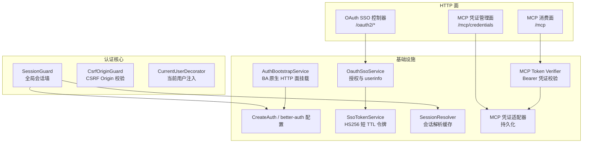
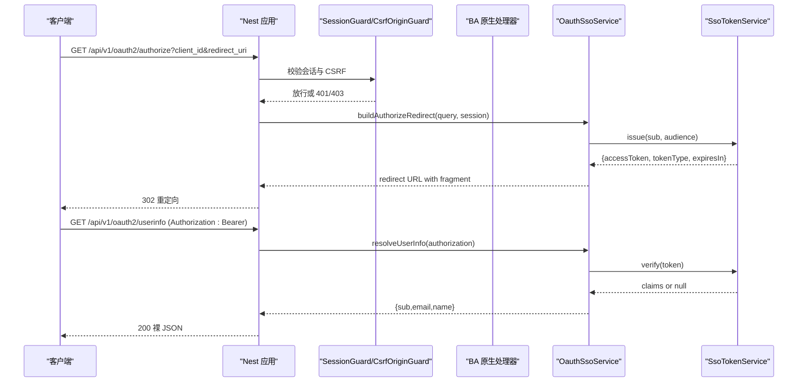
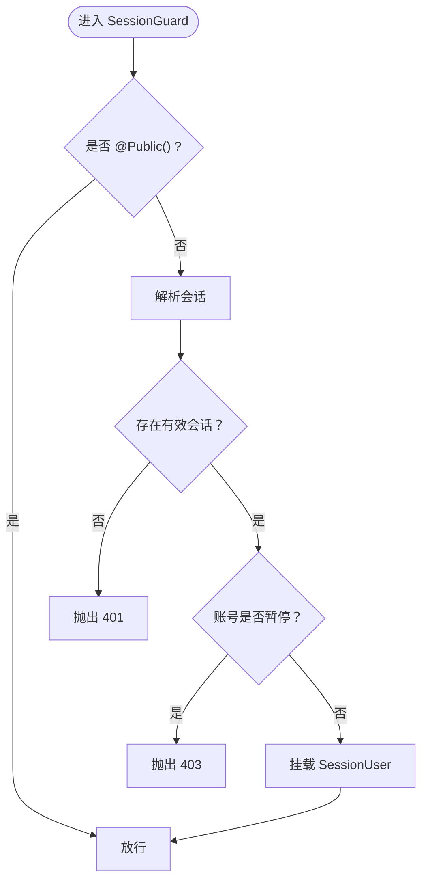
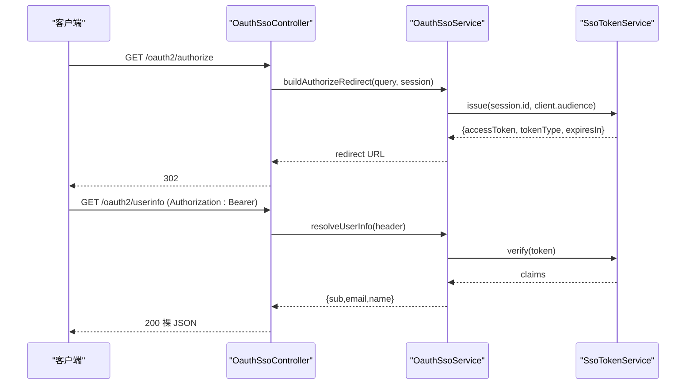
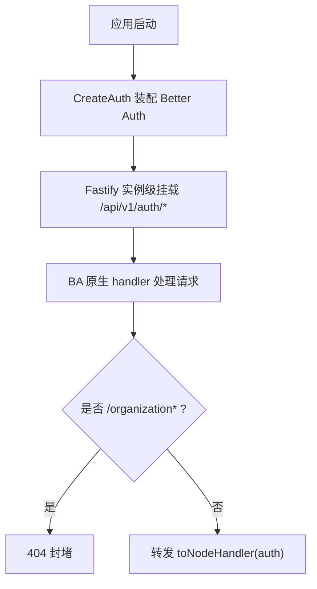
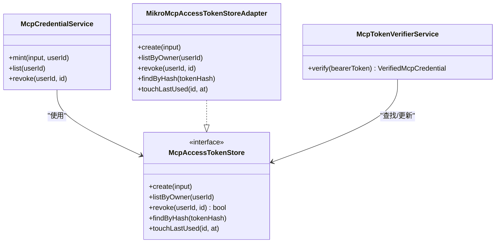
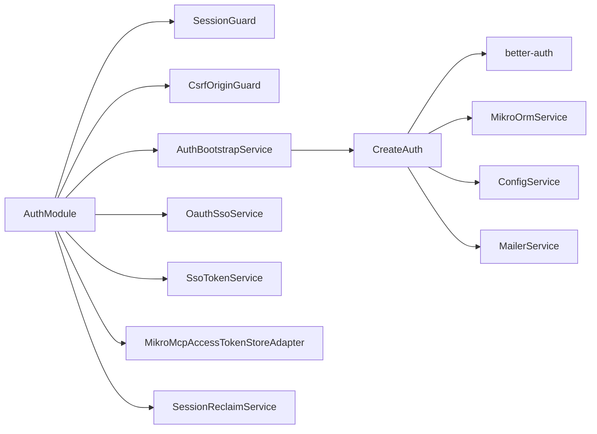

# 认证模块 API

<cite>
**本文引用的文件**   
- [auth.module.ts](file://apps/api/src/modules/auth/auth.module.ts)
- [session.guard.ts](file://apps/api/src/modules/auth/api/guards/session.guard.ts)
- [current-user.decorator.ts](file://apps/api/src/modules/auth/api/decorators/current-user.decorator.ts)
- [oauth-sso.controller.ts](file://apps/api/src/modules/auth/api/oauth-sso.controller.ts)
- [auth.bootstrap.ts](file://apps/api/src/modules/auth/infrastructure/auth.bootstrap.ts)
- [auth.implement.ts](file://apps/api/src/modules/auth/infrastructure/auth.implement.ts)
- [session-resolver.ts](file://apps/api/src/modules/auth/infrastructure/session-resolver.ts)
- [oauth-sso.service.ts](file://apps/api/src/modules/auth/infrastructure/oauth-sso.service.ts)
- [sso-token.service.ts](file://apps/api/src/modules/auth/infrastructure/sso-token.service.ts)
- [mcp-access-token-store.adapter.ts](file://apps/api/src/modules/auth/infrastructure/mcp-access-token-store.adapter.ts)
- [mcp-access-token-store.port.ts](file://apps/api/src/modules/auth/application/ports/mcp-access-token-store.port.ts)
- [mcp-token-verifier.service.ts](file://apps/api/src/features/mcp/application/mcp-token-verifier.service.ts)
- [mcp.controller.ts](file://apps/api/src/features/mcp/api/mcp.controller.ts)
- [mcp-credentials.controller.ts](file://apps/api/src/features/mcp/api/mcp-credentials.controller.ts)
- [Migration20261028131045_add_mcp_access_token.ts](file://apps/api/src/database/mikro/migration/migrations/Migration20261028131045_add_mcp_access_token.ts)
- [auth-http-surface.e2e.test.ts](file://apps/api/src/modules/auth/auth-http-surface.e2e.test.ts)
- [web-auth.ts](file://apps/web/src/lib/auth.ts)
</cite>

## 目录
1. [简介](#简介)
2. [项目结构](#项目结构)
3. [核心组件](#核心组件)
4. [架构总览](#架构总览)
5. [详细组件分析](#详细组件分析)
6. [依赖关系分析](#依赖关系分析)
7. [性能与可扩展性](#性能与可扩展性)
8. [故障排查指南](#故障排查指南)
9. [结论](#结论)
10. [附录：API 端点与安全策略](#附录api-端点与安全策略)

## 简介
本文件为认证模块的完整 API 文档，覆盖本地登录、OAuth2/SSO 集成、会话管理、令牌刷新机制、当前用户装饰器、MCP 访问令牌验证与管理接口，以及安全最佳实践。该模块基于 Better Auth 构建，通过 NestJS 全局守卫实现“默认拒绝”的会话墙，并以租户隔离与 CSRF Origin 校验作为纵深防御。

## 项目结构
认证模块采用分层组织：
- api：控制器、守卫、装饰器等 HTTP 面
- application：领域端口（如 MCP 访问令牌存储）
- domain：领域端口（会话、用户存储）
- infrastructure：Better Auth 装配、SSO 服务、会话解析、令牌原语、MCP 凭证持久化等

图表来源
- [auth.module.ts:22-83](file://apps/api/src/modules/auth/auth.module.ts#L22-L83)
- [oauth-sso.controller.ts:24-88](file://apps/api/src/modules/auth/api/oauth-sso.controller.ts#L24-L88)
- [mcp.controller.ts:19-43](file://apps/api/src/features/mcp/api/mcp.controller.ts#L19-L43)
- [mcp-credentials.controller.ts:57-98](file://apps/api/src/features/mcp/api/mcp-credentials.controller.ts#L57-L98)
- [auth.bootstrap.ts:34-82](file://apps/api/src/modules/auth/infrastructure/auth.bootstrap.ts#L34-L82)
- [auth.implement.ts:101-302](file://apps/api/src/modules/auth/infrastructure/auth.implement.ts#L101-L302)
- [session-resolver.ts:23-35](file://apps/api/src/modules/auth/infrastructure/session-resolver.ts#L23-L35)
- [oauth-sso.service.ts:33-117](file://apps/api/src/modules/auth/infrastructure/oauth-sso.service.ts#L33-L117)
- [sso-token.service.ts:52-106](file://apps/api/src/modules/auth/infrastructure/sso-token.service.ts#L52-L106)
- [mcp-access-token-store.adapter.ts:22-101](file://apps/api/src/modules/auth/infrastructure/mcp-access-token-store.adapter.ts#L22-L101)
- [mcp-token-verifier.service.ts:33-80](file://apps/api/src/features/mcp/application/mcp-token-verifier.service.ts#L33-L80)

章节来源
- [auth.module.ts:22-83](file://apps/api/src/modules/auth/auth.module.ts#L22-L83)

## 核心组件
- SessionGuard：全局会话守卫，默认拒绝未登录请求；对已暂停账号返回 403；成功时向请求挂载 sessionUser。
- CurrentUserDecorator：从请求上下文提取 SessionUser，供控制器使用。
- OAuth SSO Controller：提供 authorize 与 userinfo 两个端点，分别处理隐式流授权与 OIDC userinfo。
- AuthBootstrapService + CreateAuth：装配 Better Auth，注册 social providers、magic-link、organization 插件，并通过 Fastify 实例级通配路由挂载 BA 原生 /api/v1/auth/* 面。
- OauthSsoService：client_id/redirect_uri 白名单校验、Odoo 可用性门禁、签发超短 TTL 访问令牌、构造重定向 fragment。
- SsoTokenService：基于 node:crypto HS256 的紧凑 JWS 令牌铸发与验签。
- SessionResolver：单点解析 Better Auth 会话并 WeakMap 缓存，避免重复读取。
- MCP 凭证相关：MCP_ACCESS_TOKEN_STORE 端口与 MikroORM 适配器、MCP Token Verifier、MCP 消费面与凭证管理面。

章节来源
- [session.guard.ts:17-118](file://apps/api/src/modules/auth/api/guards/session.guard.ts#L17-L118)
- [current-user.decorator.ts:5-16](file://apps/api/src/modules/auth/api/decorators/current-user.decorator.ts#L5-L16)
- [oauth-sso.controller.ts:10-88](file://apps/api/src/modules/auth/api/oauth-sso.controller.ts#L10-L88)
- [auth.bootstrap.ts:26-82](file://apps/api/src/modules/auth/infrastructure/auth.bootstrap.ts#L26-L82)
- [auth.implement.ts:101-302](file://apps/api/src/modules/auth/infrastructure/auth.implement.ts#L101-L302)
- [oauth-sso.service.ts:22-117](file://apps/api/src/modules/auth/infrastructure/oauth-sso.service.ts#L22-L117)
- [sso-token.service.ts:42-106](file://apps/api/src/modules/auth/infrastructure/sso-token.service.ts#L42-L106)
- [session-resolver.ts:11-35](file://apps/api/src/modules/auth/infrastructure/session-resolver.ts#L11-L35)
- [mcp-access-token-store.port.ts:45-70](file://apps/api/src/modules/auth/application/ports/mcp-access-token-store.port.ts#L45-L70)
- [mcp-access-token-store.adapter.ts:13-101](file://apps/api/src/modules/auth/infrastructure/mcp-access-token-store.adapter.ts#L13-L101)
- [mcp-token-verifier.service.ts:33-80](file://apps/api/src/features/mcp/application/mcp-token-verifier.service.ts#L33-L80)

## 架构总览
认证模块以“默认拒绝”的全局会话墙为核心，所有受保护路由均需有效会话；SSO OP 面独立于 BA 原生 HTTP 面，避免被通配路由抢占；MCP 消费面以 Bearer 凭证鉴权，与浏览器会话解耦。

图表来源
- [oauth-sso.controller.ts:35-87](file://apps/api/src/modules/auth/api/oauth-sso.controller.ts#L35-L87)
- [oauth-sso.service.ts:52-116](file://apps/api/src/modules/auth/infrastructure/oauth-sso.service.ts#L52-L116)
- [sso-token.service.ts:57-100](file://apps/api/src/modules/auth/infrastructure/sso-token.service.ts#L57-L100)

## 详细组件分析

### 会话守卫（SessionGuard）与权限检查
- 行为
  - 全局 APP_GUARD，deny-by-default。
  - @Public() 路由旁路。
  - 解析会话失败 → 401。
  - 账号暂停 → 403。
  - 成功后将 SessionUser 挂到 req.sessionUser。
- 数据结构
  - SessionUser：id、email、sessionId（可选）。
  - SessionRequest：headers、sessionUser。
- 与租户/平台守卫的关系
  - 运行在 TenantIsolationGuard、PlatformOperatorGuard 之前，后续守卫叠加。

图表来源
- [session.guard.ts:65-118](file://apps/api/src/modules/auth/api/guards/session.guard.ts#L65-L118)

章节来源
- [session.guard.ts:17-118](file://apps/api/src/modules/auth/api/guards/session.guard.ts#L17-L118)

### 当前用户装饰器（CurrentUserDecorator）
- 作用：从 ExecutionContext 中取 SessionRequest，返回 req.sessionUser。
- 用法：在控制器方法参数上使用 @CurrentUser() user: SessionUser。

章节来源
- [current-user.decorator.ts:5-16](file://apps/api/src/modules/auth/api/decorators/current-user.decorator.ts#L5-L16)

### OAuth2/SSO 集成（authorize 与 userinfo）
- authorize（GET /api/v1/oauth2/authorize）
  - 需要已登录会话（全局会话墙）。
  - 校验 client_id 与 redirect_uri 精确白名单。
  - 校验活跃租户 Odoo 可用性（非 ready → 403）。
  - 签发超短 TTL 访问令牌，302 重定向至 redirect_uri#access_token=…&token_type=Bearer&expires_in=…[&state=…]。
- userinfo（GET /api/v1/oauth2/userinfo）
  - @Public()，绕过会话墙，自带 Authorization: Bearer 校验。
  - 强制 aud 校验，仅允许已注册受众。
  - 实时查询 user 表，邮箱未验证 → 403。
  - 返回裸 JSON {sub, email, name}。

图表来源
- [oauth-sso.controller.ts:35-87](file://apps/api/src/modules/auth/api/oauth-sso.controller.ts#L35-L87)
- [oauth-sso.service.ts:52-116](file://apps/api/src/modules/auth/infrastructure/oauth-sso.service.ts#L52-L116)
- [sso-token.service.ts:57-100](file://apps/api/src/modules/auth/infrastructure/sso-token.service.ts#L57-L100)

章节来源
- [oauth-sso.controller.ts:10-88](file://apps/api/src/modules/auth/api/oauth-sso.controller.ts#L10-L88)
- [oauth-sso.service.ts:22-117](file://apps/api/src/modules/auth/infrastructure/oauth-sso.service.ts#L22-L117)
- [sso-token.service.ts:42-106](file://apps/api/src/modules/auth/infrastructure/sso-token.service.ts#L42-L106)

### BA 原生 HTTP 面与会话管理
- BA 原生端点挂载
  - AuthBootstrapService 在应用启动后创建 Better Auth handler，并以 Fastify 实例级 app.all('/api/v1/auth/*') 挂载。
  - basePath 固定为 /api/v1/auth，与前端约定一致。
- 会话解析
  - SessionGuard 通过 SessionResolver 调用 auth.api.getSession({ headers })，WeakMap 缓存结果，避免重复 IO。
- 登录/注册/登出
  - 前端通过 web/src/lib/auth.ts 调用 /api/v1/auth/sign-in/email、/sign-up/email、/sign-out。
  - e2e 测试验证 /api/v1/auth/sign-up/email 与 /api/v1/auth/sign-in/email 可达，且 /organization/* 内置端点被封堵（404），而 /get-session 正常。

图表来源
- [auth.bootstrap.ts:46-82](file://apps/api/src/modules/auth/infrastructure/auth.bootstrap.ts#L46-L82)
- [auth.implement.ts:304-346](file://apps/api/src/modules/auth/infrastructure/auth.implement.ts#L304-L346)

章节来源
- [auth.bootstrap.ts:26-82](file://apps/api/src/modules/auth/infrastructure/auth.bootstrap.ts#L26-L82)
- [auth.implement.ts:101-346](file://apps/api/src/modules/auth/infrastructure/auth.implement.ts#L101-L346)
- [session-resolver.ts:11-35](file://apps/api/src/modules/auth/infrastructure/session-resolver.ts#L11-L35)
- [auth-http-surface.e2e.test.ts:72-163](file://apps/api/src/modules/auth/auth-http-surface.e2e.test.ts#L72-L163)
- [web-auth.ts:1-92](file://apps/web/src/lib/auth.ts#L1-L92)

### MCP 访问令牌的验证与管理
- 凭证生命周期
  - 铸造：POST /api/v1/mcp/credentials（需会话 + 租户隔离），一次性明文回显 token。
  - 列表：GET /api/v1/mcp/credentials（本人视图，不含可复原明文字段）。
  - 撤销：DELETE /api/v1/mcp/credentials/:id（幂等，不可见即 404）。
- 消费面
  - POST /api/v1/mcp（@Public()，Bearer 凭证校验），由 McpAgentSurfaceService 处理。
  - DELETE /api/v1/mcp（会话终止）。
- 凭证校验
  - McpTokenVerifierService.verify(bearerToken)：哈希查找、过期/撤销/租户状态校验，统一 401 防探测。
- 持久化
  - McpAccessTokenStore 端口 + MikroMcpAccessTokenStoreAdapter 实现，tenantId 来自可信 ALS fail-closed。
  - 数据库迁移新增 mcp_access_token 表及索引。

图表来源
- [mcp-credentials.controller.ts:57-98](file://apps/api/src/features/mcp/api/mcp-credentials.controller.ts#L57-L98)
- [mcp-access-token-store.port.ts:45-70](file://apps/api/src/modules/auth/application/ports/mcp-access-token-store.port.ts#L45-L70)
- [mcp-access-token-store.adapter.ts:22-101](file://apps/api/src/modules/auth/infrastructure/mcp-access-token-store.adapter.ts#L22-L101)
- [mcp-token-verifier.service.ts:33-80](file://apps/api/src/features/mcp/application/mcp-token-verifier.service.ts#L33-L80)

章节来源
- [mcp.controller.ts:19-43](file://apps/api/src/features/mcp/api/mcp.controller.ts#L19-L43)
- [mcp-credentials.controller.ts:15-98](file://apps/api/src/features/mcp/api/mcp-credentials.controller.ts#L15-L98)
- [mcp-access-token-store.port.ts:45-70](file://apps/api/src/modules/auth/application/ports/mcp-access-token-store.port.ts#L45-L70)
- [mcp-access-token-store.adapter.ts:13-101](file://apps/api/src/modules/auth/infrastructure/mcp-access-token-store.adapter.ts#L13-L101)
- [mcp-token-verifier.service.ts:33-80](file://apps/api/src/features/mcp/application/mcp-token-verifier.service.ts#L33-L80)
- [Migration20261028131045_add_mcp_access_token.ts:3-26](file://apps/api/src/database/mikro/migration/migrations/Migration20261028131045_add_mcp_access_token.ts#L3-L26)

## 依赖关系分析
- 模块装配
  - AuthModule.forRoot 注册全局守卫、BA 原生面接线、SSO 服务、MCP 凭证存储端口、会话回收服务等。
- 外部依赖
  - Better Auth：会话、social providers、magic-link、organization 插件。
  - MikroORM：用户/会话/MCP 凭证持久化。
  - ConfigService：JWT secret、CORS、OAuth SSO clients、generic providers。
  - MailerService：magic-link 邮件发送。

图表来源
- [auth.module.ts:22-83](file://apps/api/src/modules/auth/auth.module.ts#L22-L83)
- [auth.bootstrap.ts:34-82](file://apps/api/src/modules/auth/infrastructure/auth.bootstrap.ts#L34-L82)
- [auth.implement.ts:101-302](file://apps/api/src/modules/auth/infrastructure/auth.implement.ts#L101-L302)

章节来源
- [auth.module.ts:22-83](file://apps/api/src/modules/auth/auth.module.ts#L22-L83)

## 性能与可扩展性
- 会话解析缓存：SessionResolver 使用 WeakMap 在同一请求内缓存会话解析结果，避免多次 DB 读取。
- 限流：Better Auth 默认启用 rateLimit；生产环境需配置 AUTH_TRUSTED_PROXIES，否则反向代理场景下可能误杀。
- 通配路由：Fastify 实例级 all('/api/v1/auth/*') 绕开 Nest router/guard/validation，减少额外开销但需自行兜底错误。
- MCP 凭证：按 tokenHash 唯一索引查询，lastUsedAt 异步 touch，避免阻塞主路径。

章节来源
- [session-resolver.ts:11-35](file://apps/api/src/modules/auth/infrastructure/session-resolver.ts#L11-L35)
- [auth.implement.ts:116-124](file://apps/api/src/modules/auth/infrastructure/auth.implement.ts#L116-L124)
- [auth.bootstrap.ts:56-81](file://apps/api/src/modules/auth/infrastructure/auth.bootstrap.ts#L56-L81)
- [mcp-access-token-store.adapter.ts:76-100](file://apps/api/src/modules/auth/infrastructure/mcp-access-token-store.adapter.ts#L76-L100)

## 故障排查指南
- 401 未登录
  - 检查 Cookie 是否正确携带；确认 SessionGuard 未被 @Public() 旁路。
  - 检查 AUTH_TRUSTED_PROXIES 是否配置，避免 IP 识别异常导致限流误杀。
- 403 账号暂停或租户不可用
  - 账号暂停：UserStatusService.isBlocked 返回 true。
  - Odoo 不可用：canUseOdoo 判定失败。
- 404 组织内置端点
  - /organization/* 已被 BA 原生 handler 封堵，应使用我方门面。
- SSO userinfo 401/403
  - 401：Authorization 头缺失/非法或 aud 不符。
  - 403：邮箱未验证。
- MCP 凭证无效
  - 统一 401，不区分未命中/已撤/已过期；检查租户状态与过期时间。

章节来源
- [session.guard.ts:81-118](file://apps/api/src/modules/auth/api/guards/session.guard.ts#L81-L118)
- [oauth-sso.service.ts:52-116](file://apps/api/src/modules/auth/infrastructure/oauth-sso.service.ts#L52-L116)
- [auth.implement.ts:325-330](file://apps/api/src/modules/auth/infrastructure/auth.implement.ts#L325-L330)
- [mcp-token-verifier.service.ts:40-79](file://apps/api/src/features/mcp/application/mcp-token-verifier.service.ts#L40-L79)

## 结论
认证模块通过全局会话墙、CSRF Origin 校验、租户隔离与 MCP Bearer 凭证校验形成多层防护。BA 原生 HTTP 面与 SSO OP 面解耦，既保留 Better Auth 能力，又满足企业级安全要求。MCP 凭证管理遵循最小暴露原则，结合哈希存储与软撤销，兼顾安全与审计。

## 附录：API 端点与安全策略

### 认证相关 RESTful 端点
- BA 原生端点（/api/v1/auth/*）
  - POST /api/v1/auth/sign-up/email
    - 说明：邮箱注册（仅非生产环境启用）。
    - 请求体：{ email, password, name }
    - 响应：200，包含 user 信息；失败返回标准错误信封。
  - POST /api/v1/auth/sign-in/email
    - 说明：邮箱密码登录。
    - 请求体：{ email, password }
    - 响应：200，设置会话 Cookie；失败返回标准错误信封。
  - POST /api/v1/auth/sign-out
    - 说明：登出，清除会话。
    - 请求体：{}
    - 响应：200。
  - GET /api/v1/auth/get-session
    - 说明：获取当前会话。
    - 响应：200，包含 user 与 session。
  - 注意：/organization/* 内置端点被封堵（404），请使用我方门面。

- OAuth2/SSO 端点（/api/v1/oauth2/*）
  - GET /api/v1/oauth2/authorize
    - 说明：隐式流授权，返回 302 重定向。
    - 查询参数：client_id、redirect_uri、response_type=token、scope、state（可选）
    - 响应：302，location = redirect_uri#access_token=...&token_type=Bearer&expires_in=...
    - 错误：400（未注册 client_id 或 redirect_uri 不在白名单）、401（无会话）、403（Odoo 不可用）。
  - GET /api/v1/oauth2/userinfo
    - 说明：OIDC userinfo，返回裸 JSON。
    - 请求头：Authorization: Bearer <token>
    - 响应：200，{ sub, email, name }
    - 错误：401（缺失/非法 token 或 aud 不符）、403（邮箱未验证）。

- MCP 凭证管理端点（/api/v1/mcp/credentials）
  - POST /api/v1/mcp/credentials
    - 说明：铸造凭证，明文一次性回显。
    - 请求体：{ name, scopes, expiresAt }
    - 响应：201，返回 { id, name, scopes, expiresAt, token }（token 仅一次）。
  - GET /api/v1/mcp/credentials
    - 说明：列出本人凭证（不含可复原明文字段）。
    - 响应：200，数组。
  - DELETE /api/v1/mcp/credentials/:id
    - 说明：撤销凭证（幂等）。
    - 响应：204 或 404（不可见）。

- MCP 消费端点（/api/v1/mcp）
  - POST /api/v1/mcp
    - 说明：JSON-RPC 入口，Bearer 凭证校验。
    - 请求头：Authorization: Bearer <token>
    - 响应：根据 JSON-RPC 帧返回。
  - DELETE /api/v1/mcp
    - 说明：会话终止。

### 错误码与语义
- 401 AUTH_SESSION_INVALID：会话缺失或非法。
- 401 AUTH_PROVIDER_UNAVAILABLE：认证实例未初始化。
- 403 AUTH_ACCOUNT_SUSPENDED：账号暂停。
- 400 BAD_REQUEST：client_id 未注册或 redirect_uri 不在白名单。
- 403 ORG_ODOO_BINDING_NOT_READY：活跃租户 Odoo 不可用。
- 401 MCP_CREDENTIAL_INVALID：MCP 凭证无效（未命中/已撤/已过期）。
- 403 MCP_TENANT_SUSPENDED：租户不可用于 MCP 凭证。

### 安全最佳实践
- 密码策略
  - 后端 emailAndPassword.minPasswordLength=8（仅在非生产启用）。
  - 建议在生产侧引入更强策略（复杂度、历史密码、定期轮换）并在产品层落地。
- 会话安全
  - 全局 SessionGuard deny-by-default，仅 @Public() 旁路。
  - SameSite=lax，跨源需配合 CORS_ORIGIN∈trustedOrigins。
  - 生产务必配置 AUTH_TRUSTED_PROXIES，避免共享桶限流误杀。
- 防暴力破解
  - Better Auth rateLimit.enabled=true。
  - 登录类路径默认限制（库默认 3 次/10s）。
  - 建议结合 IP/账号维度限流与验证码/延迟策略。
- SSO 安全
  - client_id/redirect_uri 精确白名单校验。
  - 超短 TTL（120 秒）HS256 令牌，aud 强制校验。
  - userinfo 实时查库，邮箱未验证直接 403。
- MCP 凭证安全
  - 明文 token 仅铸造响应一次性回显。
  - 存储 tokenHash，支持撤销与过期控制。
  - 校验时统一 401，防止枚举探测。

章节来源
- [auth.implement.ts:256-273](file://apps/api/src/modules/auth/infrastructure/auth.implement.ts#L256-L273)
- [auth.implement.ts:258-265](file://apps/api/src/modules/auth/infrastructure/auth.implement.ts#L258-L265)
- [auth.implement.ts:116-124](file://apps/api/src/modules/auth/infrastructure/auth.implement.ts#L116-L124)
- [oauth-sso.service.ts:52-116](file://apps/api/src/modules/auth/infrastructure/oauth-sso.service.ts#L52-L116)
- [sso-token.service.ts:57-100](file://apps/api/src/modules/auth/infrastructure/sso-token.service.ts#L57-L100)
- [mcp-token-verifier.service.ts:40-79](file://apps/api/src/features/mcp/application/mcp-token-verifier.service.ts#L40-L79)