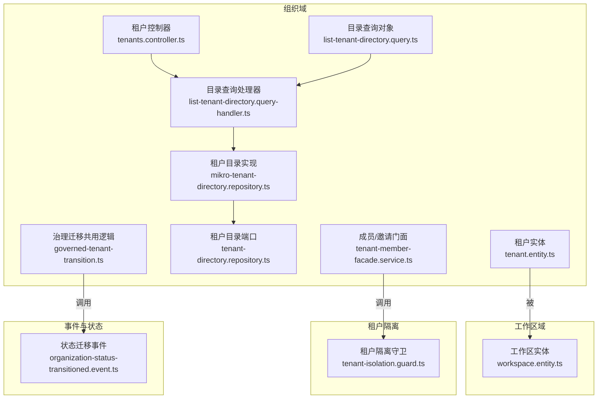
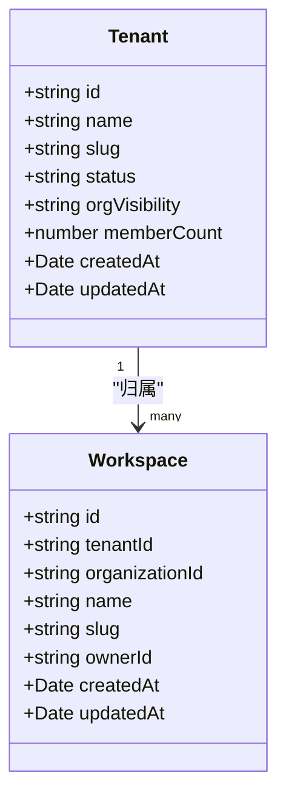
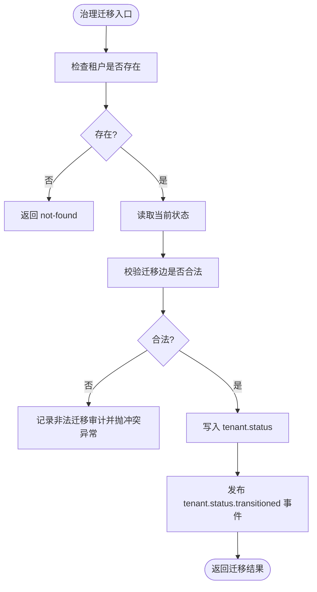
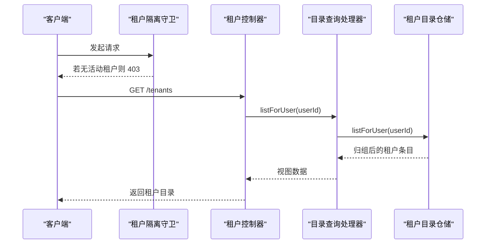
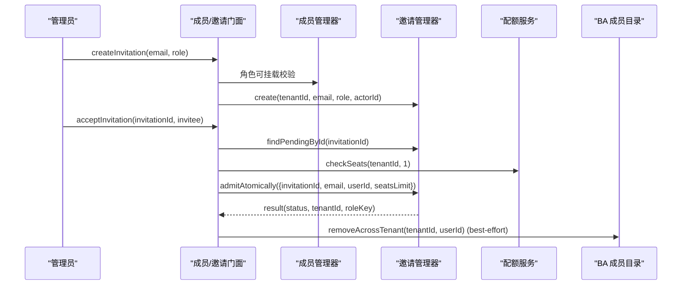
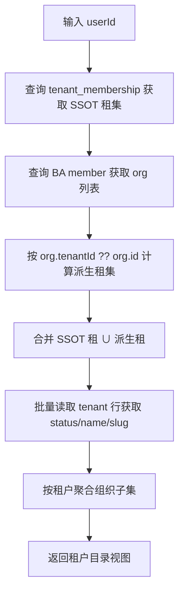
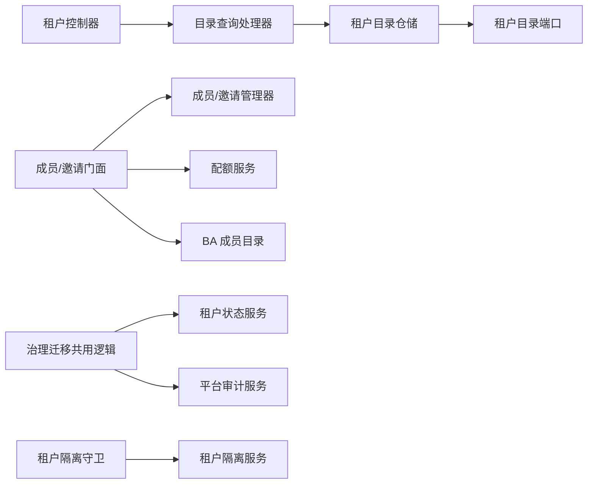

# 多租户系统

<cite>
**本文引用的文件**   
- [apps/api/src/modules/organizations/lifecycle/tenant-status.service.test.ts](file://apps/api/src/modules/organizations/lifecycle/tenant-status.service.test.ts)
- [libs/core/src/modules/organizations/lifecycle/events/organization-status-transitioned.event.ts](file://libs/core/src/modules/organizations/lifecycle/events/organization-status-transitioned.event.ts)
- [apps/api/src/modules/organizations/application/tenant-member-facade.service.ts](file://apps/api/src/modules/organizations/application/tenant-member-facade.service.ts)
- [apps/api/src/modules/organizations/infrastructure/entities/tenant.entity.ts](file://apps/api/src/modules/organizations/infrastructure/entities/tenant.entity.ts)
- [apps/api/src/modules/workspaces/infrastructure/entities/workspace.entity.ts](file://apps/api/src/modules/workspaces/infrastructure/entities/workspace.entity.ts)
- [libs/core/src/tenant-isolation/tenant-isolation.guard.ts](file://libs/core/src/tenant-isolation/tenant-isolation.guard.ts)
- [apps/api/src/modules/organizations/domain/repositories/tenant-directory.repository.ts](file://apps/api/src/modules/organizations/domain/repositories/tenant-directory.repository.ts)
- [apps/api/src/modules/organizations/infrastructure/repositories/mikro-tenant-directory.repository.ts](file://apps/api/src/modules/organizations/infrastructure/repositories/mikro-tenant-directory.repository.ts)
- [apps/api/src/modules/organizations/application/queries/list-tenant-directory.query-handler.ts](file://apps/api/src/modules/organizations/application/queries/list-tenant-directory.query-handler.ts)
- [apps/api/src/modules/organizations/application/queries/list-tenant-directory.query.ts](file://apps/api/src/modules/organizations/application/queries/list-tenant-directory.query.ts)
- [apps/api/src/modules/organizations/api/tenants.controller.ts](file://apps/api/src/modules/organizations/api/tenants.controller.ts)
- [apps/api/src/modules/organizations/application/commands/handlers/governed-tenant-transition.ts](file://apps/api/src/modules/organizations/application/commands/handlers/governed-tenant-transition.ts)
</cite>

## 目录
1. [引言](#引言)
2. [项目结构](#项目结构)
3. [核心组件](#核心组件)
4. [架构总览](#架构总览)
5. [详细组件分析](#详细组件分析)
6. [依赖关系分析](#依赖关系分析)
7. [性能与隔离最佳实践](#性能与隔离最佳实践)
8. [故障排查指南](#故障排查指南)
9. [结论](#结论)

## 引言
本文件面向“多租户系统”的完整实现文档，聚焦以下目标：
- 租户生命周期管理、组织管理与工作区管理的职责边界与数据模型。
- 两级边界（租户→工作区）的设计理念与数据隔离机制。
- 审批制租户状态机、暂停/恢复/软删/硬删等治理操作。
- 租户激活、失权清单、即时失权等安全机制。
- 租户目录、成员邀请、权限继承的实现细节。
- 租户隔离的最佳实践与性能优化建议。

## 项目结构
多租户能力主要分布在以下模块：
- 组织域：租户实体、租户目录、成员与邀请门面、治理命令处理器。
- 工作区域：工作区实体与仓储。
- 租户隔离：全局守卫、上下文解析与过滤。
- 事件与状态：租户状态迁移事件与纯函数状态机。

图表来源
- [apps/api/src/modules/organizations/infrastructure/entities/tenant.entity.ts:1-74](file://apps/api/src/modules/organizations/infrastructure/entities/tenant.entity.ts#L1-L74)
- [apps/api/src/modules/workspaces/infrastructure/entities/workspace.entity.ts:1-56](file://apps/api/src/modules/workspaces/infrastructure/entities/workspace.entity.ts#L1-L56)
- [apps/api/src/modules/organizations/domain/repositories/tenant-directory.repository.ts:1-49](file://apps/api/src/modules/organizations/domain/repositories/tenant-directory.repository.ts#L1-L49)
- [apps/api/src/modules/organizations/infrastructure/repositories/mikro-tenant-directory.repository.ts:1-117](file://apps/api/src/modules/organizations/infrastructure/repositories/mikro-tenant-directory.repository.ts#L1-L117)
- [apps/api/src/modules/organizations/application/queries/list-tenant-directory.query-handler.ts:1-35](file://apps/api/src/modules/organizations/application/queries/list-tenant-directory.query-handler.ts#L1-L35)
- [apps/api/src/modules/organizations/application/queries/list-tenant-directory.query.ts:1-16](file://apps/api/src/modules/organizations/application/queries/list-tenant-directory.query.ts#L1-L16)
- [apps/api/src/modules/organizations/api/tenants.controller.ts:50-66](file://apps/api/src/modules/organizations/api/tenants.controller.ts#L50-L66)
- [apps/api/src/modules/organizations/application/tenant-member-facade.service.ts:1-264](file://apps/api/src/modules/organizations/application/tenant-member-facade.service.ts#L1-L264)
- [apps/api/src/modules/organizations/application/commands/handlers/governed-tenant-transition.ts:1-81](file://apps/api/src/modules/organizations/application/commands/handlers/governed-tenant-transition.ts#L1-L81)
- [libs/core/src/tenant-isolation/tenant-isolation.guard.ts:14-31](file://libs/core/src/tenant-isolation/tenant-isolation.guard.ts#L14-L31)
- [libs/core/src/modules/organizations/lifecycle/events/organization-status-transitioned.event.ts:21-53](file://libs/core/src/modules/organizations/lifecycle/events/organization-status-transitioned.event.ts#L21-L53)

章节来源
- [apps/api/src/modules/organizations/infrastructure/entities/tenant.entity.ts:1-74](file://apps/api/src/modules/organizations/infrastructure/entities/tenant.entity.ts#L1-L74)
- [apps/api/src/modules/workspaces/infrastructure/entities/workspace.entity.ts:1-56](file://apps/api/src/modules/workspaces/infrastructure/entities/workspace.entity.ts#L1-L56)

## 核心组件
- 租户实体与治理态：`tenant` 表承载租户身份、名称、slug、治理状态 `status`、跨组织可见性策略 `orgVisibility`、成员数物化计数 `memberCount` 等；值域受 CHECK 约束，保证合法状态与可见性策略。
- 工作区实体与工作区归属：`workspace` 通过 `tenantId` 归属租户，并通过 `organizationId` 归属组织；支持按组织+属主索引与唯一键（组织内 slug）。
- 租户目录：以用户维度聚合其可切换的租户集合，并在每个租户下展示其可见的组织集合；读面绕过租户作用域过滤器，但可见性仍由成员资格收敛。
- 成员与邀请门面：统一编排租级成员与邀请的生命周期，包含角色挂载校验、席位限额检查、接受邀请原子化流程、退租与移除成员的双轴同步。
- 治理迁移共用逻辑：封装 suspend/resume 等治理动作的状态迁移、审计记录与非法迁移错误处理。
- 租户隔离守卫：全局 fail-closed 闸门，要求请求绑定活动租户；提供豁免注解用于无租户场景。

章节来源
- [apps/api/src/modules/organizations/infrastructure/entities/tenant.entity.ts:1-74](file://apps/api/src/modules/organizations/infrastructure/entities/tenant.entity.ts#L1-L74)
- [apps/api/src/modules/workspaces/infrastructure/entities/workspace.entity.ts:1-56](file://apps/api/src/modules/workspaces/infrastructure/entities/workspace.entity.ts#L1-L56)
- [apps/api/src/modules/organizations/domain/repositories/tenant-directory.repository.ts:1-49](file://apps/api/src/modules/organizations/domain/repositories/tenant-directory.repository.ts#L1-L49)
- [apps/api/src/modules/organizations/infrastructure/repositories/mikro-tenant-directory.repository.ts:1-117](file://apps/api/src/modules/organizations/infrastructure/repositories/mikro-tenant-directory.repository.ts#L1-L117)
- [apps/api/src/modules/organizations/application/tenant-member-facade.service.ts:1-264](file://apps/api/src/modules/organizations/application/tenant-member-facade.service.ts#L1-L264)
- [apps/api/src/modules/organizations/application/commands/handlers/governed-tenant-transition.ts:1-81](file://apps/api/src/modules/organizations/application/commands/handlers/governed-tenant-transition.ts#L1-L81)
- [libs/core/src/tenant-isolation/tenant-isolation.guard.ts:14-31](file://libs/core/src/tenant-isolation/tenant-isolation.guard.ts#L14-L31)

## 架构总览
多租户系统的两层边界设计如下：
- 第一层：租户（Tenant）作为计费与治理边界，承载准入态、成员配额、跨组织可见性等。
- 第二层：工作区（Workspace）作为业务数据分组边界，归属于组织并归属租户。

图表来源
- [apps/api/src/modules/organizations/infrastructure/entities/tenant.entity.ts:34-61](file://apps/api/src/modules/organizations/infrastructure/entities/tenant.entity.ts#L34-L61)
- [apps/api/src/modules/workspaces/infrastructure/entities/workspace.entity.ts:16-39](file://apps/api/src/modules/workspaces/infrastructure/entities/workspace.entity.ts#L16-L39)

## 详细组件分析

### 租户生命周期与治理状态机
- 状态值域与合法性：`tenant.status` 使用单源枚举，数据库 CHECK 约束确保仅允许合法值。
- 迁移规则：纯函数状态机定义允许的迁移边，禁止从终态 `deleted` 再迁移；未记录状态在 deny-list 口径下视为 active。
- 权威读写点：`TenantStatusService.transition` 是治理换轴后的权威写入点，写回 `tenant.status` 并产出领域事件；发布失败 loud（不吞错），读侧 fail-closed。
- 平台治理动作：suspend/resume 通过共用逻辑 `governedTenantTransition` 执行，非法迁移抛出结构化冲突异常并记录审计；approve/reject 走组织申请用例，不在本函数中。

图表来源
- [apps/api/src/modules/organizations/lifecycle/tenant-status.service.test.ts:44-96](file://apps/api/src/modules/organizations/lifecycle/tenant-status.service.test.ts#L44-L96)
- [apps/api/src/modules/organizations/application/commands/handlers/governed-tenant-transition.ts:56-80](file://apps/api/src/modules/organizations/application/commands/handlers/governed-tenant-transition.ts#L56-L80)
- [libs/core/src/modules/organizations/lifecycle/events/organization-status-transitioned.event.ts:21-53](file://libs/core/src/modules/organizations/lifecycle/events/organization-status-transitioned.event.ts#L21-L53)

章节来源
- [apps/api/src/modules/organizations/lifecycle/tenant-status.service.test.ts:44-96](file://apps/api/src/modules/organizations/lifecycle/tenant-status.service.test.ts#L44-L96)
- [apps/api/src/modules/organizations/application/commands/handlers/governed-tenant-transition.ts:1-81](file://apps/api/src/modules/organizations/application/commands/handlers/governed-tenant-transition.ts#L1-L81)
- [libs/core/src/modules/organizations/lifecycle/events/organization-status-transitioned.event.ts:21-53](file://libs/core/src/modules/organizations/lifecycle/events/organization-status-transitioned.event.ts#L21-L53)

### 两级边界（租户→工作区）与数据隔离
- 租户边界：`tenant.status` 决定准入与治理；`orgVisibility` 控制租内跨组织可见性；`memberCount` 为成员数物化计数，由触发器维护，读 O(1)。
- 工作区边界：`workspace.tenantId` 明确归属租户；`workspace.organizationId` 归属组织；`ownerId` 可选，NULL 表示不属任何人。
- 隔离机制：
  - 全局租户隔离守卫要求请求具备活动租户；无活动租户时拒绝访问。
  - 仓储层集中应用 where 谓词，避免 handler 散落 `where tenant_id`。
  - 目录读面为跨租名册，显式绕过全局过滤，但可见性仍由成员资格收敛。

图表来源
- [libs/core/src/tenant-isolation/tenant-isolation.guard.ts:14-31](file://libs/core/src/tenant-isolation/tenant-isolation.guard.ts#L14-L31)
- [apps/api/src/modules/organizations/api/tenants.controller.ts:50-66](file://apps/api/src/modules/organizations/api/tenants.controller.ts#L50-L66)
- [apps/api/src/modules/organizations/application/queries/list-tenant-directory.query-handler.ts:1-35](file://apps/api/src/modules/organizations/application/queries/list-tenant-directory.query-handler.ts#L1-L35)
- [apps/api/src/modules/organizations/infrastructure/repositories/mikro-tenant-directory.repository.ts:1-117](file://apps/api/src/modules/organizations/infrastructure/repositories/mikro-tenant-directory.repository.ts#L1-L117)

章节来源
- [apps/api/src/modules/organizations/infrastructure/entities/tenant.entity.ts:1-74](file://apps/api/src/modules/organizations/infrastructure/entities/tenant.entity.ts#L1-L74)
- [apps/api/src/modules/workspaces/infrastructure/entities/workspace.entity.ts:1-56](file://apps/api/src/modules/workspaces/infrastructure/entities/workspace.entity.ts#L1-L56)
- [libs/core/src/tenant-isolation/tenant-isolation.guard.ts:14-31](file://libs/core/src/tenant-isolation/tenant-isolation.guard.ts#L14-L31)
- [apps/api/src/modules/organizations/infrastructure/repositories/mikro-tenant-directory.repository.ts:1-117](file://apps/api/src/modules/organizations/infrastructure/repositories/mikro-tenant-directory.repository.ts#L1-L117)

### 成员管理与邀请流程
- 成员管理门面统一编排：
  - 列出成员、更新角色、移除成员、自助退租。
  - 角色挂载校验严格 fail-closed；最后属主保护；自移保护。
  - 移除/退租后尝试双轴同步清理 BA member 行（非 SSOT，失败不回滚）。
- 邀请流程：
  - 发邀请前校验角色可挂载；pending 去重。
  - 接受邀请时进行邮箱匹配、席位限额检查、原子化 admit（落成员/角色 + 消费邀请）。
  - 拒邀/取消邀请均按 pending 状态与邮箱匹配。

图表来源
- [apps/api/src/modules/organizations/application/tenant-member-facade.service.ts:176-243](file://apps/api/src/modules/organizations/application/tenant-member-facade.service.ts#L176-L243)
- [apps/api/src/modules/organizations/application/tenant-member-facade.service.ts:100-142](file://apps/api/src/modules/organizations/application/tenant-member-facade.service.ts#L100-L142)

章节来源
- [apps/api/src/modules/organizations/application/tenant-member-facade.service.ts:1-264](file://apps/api/src/modules/organizations/application/tenant-member-facade.service.ts#L1-L264)

### 租户目录与成员可见性
- 目录端口定义租户条目与组织条目，强调用户级可见性而非独立隔离闸。
- 目录实现：
  - 取 `tenant_membership` 作为 SSOT 顶层租集。
  - 取 BA member 的 org 作为二级分组事实。
  - 顶层租集为 SSOT 租 ∪ org 派生租（兼容 expand 段未盖章）。
  - 按租户聚合组织子集；租户行缺失时状态回落 active。
  - 使用 fork(scoped:false) 绕全局过滤，但可见性仍由成员资格收敛。

图表来源
- [apps/api/src/modules/organizations/domain/repositories/tenant-directory.repository.ts:1-49](file://apps/api/src/modules/organizations/domain/repositories/tenant-directory.repository.ts#L1-L49)
- [apps/api/src/modules/organizations/infrastructure/repositories/mikro-tenant-directory.repository.ts:40-115](file://apps/api/src/modules/organizations/infrastructure/repositories/mikro-tenant-directory.repository.ts#L40-L115)

章节来源
- [apps/api/src/modules/organizations/domain/repositories/tenant-directory.repository.ts:1-49](file://apps/api/src/modules/organizations/domain/repositories/tenant-directory.repository.ts#L1-L49)
- [apps/api/src/modules/organizations/infrastructure/repositories/mikro-tenant-directory.repository.ts:1-117](file://apps/api/src/modules/organizations/infrastructure/repositories/mikro-tenant-directory.repository.ts#L1-L117)
- [apps/api/src/modules/organizations/application/queries/list-tenant-directory.query-handler.ts:1-35](file://apps/api/src/modules/organizations/application/queries/list-tenant-directory.query-handler.ts#L1-L35)
- [apps/api/src/modules/organizations/application/queries/list-tenant-directory.query.ts:1-16](file://apps/api/src/modules/organizations/application/queries/list-tenant-directory.query.ts#L1-L16)
- [apps/api/src/modules/organizations/api/tenants.controller.ts:50-66](file://apps/api/src/modules/organizations/api/tenants.controller.ts#L50-L66)

### 工作区管理
- 工作区实体字段包括归属租户、归属组织、名称、slug、可选属主、时间戳。
- 唯一键与索引：组织内 slug 唯一；组织+属主索引加速查询。
- 行级隔离：启用租户隔离过滤器，无活动租户上下文时恒真不筛，但业务查询需 ALS 已绑活动租户。

章节来源
- [apps/api/src/modules/workspaces/infrastructure/entities/workspace.entity.ts:1-56](file://apps/api/src/modules/workspaces/infrastructure/entities/workspace.entity.ts#L1-L56)

## 依赖关系分析
- 组织域内部依赖：
  - 控制器 → 查询处理器 → 目录仓储 → 领域端口。
  - 成员/邀请门面 → 成员/邀请管理器（SSOT）+ 配额服务 + BA 成员目录（best-effort）。
  - 治理迁移共用逻辑 → 租户状态服务 + 平台审计服务。
- 租户隔离依赖：
  - 全局守卫 → 租户隔离服务（ALS 上下文）。
  - 目录仓储实现 → MikroORM（fork scoped:false）。

图表来源
- [apps/api/src/modules/organizations/api/tenants.controller.ts:50-66](file://apps/api/src/modules/organizations/api/tenants.controller.ts#L50-L66)
- [apps/api/src/modules/organizations/application/queries/list-tenant-directory.query-handler.ts:1-35](file://apps/api/src/modules/organizations/application/queries/list-tenant-directory.query-handler.ts#L1-L35)
- [apps/api/src/modules/organizations/infrastructure/repositories/mikro-tenant-directory.repository.ts:1-117](file://apps/api/src/modules/organizations/infrastructure/repositories/mikro-tenant-directory.repository.ts#L1-L117)
- [apps/api/src/modules/organizations/application/tenant-member-facade.service.ts:1-264](file://apps/api/src/modules/organizations/application/tenant-member-facade.service.ts#L1-L264)
- [apps/api/src/modules/organizations/application/commands/handlers/governed-tenant-transition.ts:1-81](file://apps/api/src/modules/organizations/application/commands/handlers/governed-tenant-transition.ts#L1-L81)
- [libs/core/src/tenant-isolation/tenant-isolation.guard.ts:14-31](file://libs/core/src/tenant-isolation/tenant-isolation.guard.ts#L14-L31)

章节来源
- [apps/api/src/modules/organizations/application/tenant-member-facade.service.ts:1-264](file://apps/api/src/modules/organizations/application/tenant-member-facade.service.ts#L1-L264)
- [apps/api/src/modules/organizations/application/commands/handlers/governed-tenant-transition.ts:1-81](file://apps/api/src/modules/organizations/application/commands/handlers/governed-tenant-transition.ts#L1-L81)
- [apps/api/src/modules/organizations/infrastructure/repositories/mikro-tenant-directory.repository.ts:1-117](file://apps/api/src/modules/organizations/infrastructure/repositories/mikro-tenant-directory.repository.ts#L1-L117)
- [libs/core/src/tenant-isolation/tenant-isolation.guard.ts:14-31](file://libs/core/src/tenant-isolation/tenant-isolation.guard.ts#L14-L31)

## 性能与隔离最佳实践
- 成员计数物化：
  - 使用 `tenant.memberCount` 列作为 O(1) 读路径，避免联表计数开销。
  - 通过库级触发器维护该列，覆盖 BA 直写 member 全路径。
- 目录查询优化：
  - 使用 fork(scoped:false) 绕全局过滤，减少不必要的 where 条件。
  - 先取 SSOT 租集，再按 org 派生租并集，避免重复扫描。
- 隔离与权限：
  - 所有租户相关路由默认 requireActiveTenantId；仅在必要时使用豁免注解。
  - 成员/邀请操作通过 manager 的 where{tenantId} 锚定跨租硬地板，避免 handler 散落隔离逻辑。
- 状态机与事件：
  - 迁移写先行、事件发布在后；发布失败 loud，不吞错。
  - 非法迁移立即抛冲突异常并记录审计，便于追踪。

[本节为通用指导，不直接分析具体文件]

## 故障排查指南
- 非法迁移：
  - 现象：409 Conflict，错误码 ORG_ILLEGAL_TRANSITION。
  - 排查：确认当前状态与目标状态是否在允许迁移边；检查终态 deleted 不可再迁移。
  - 参考：治理迁移共用逻辑对非法迁移的处理。
- 成员不存在或最后属主保护：
  - 现象：404 Not Found 或 403 Forbidden。
  - 排查：确认成员是否存在；是否为最后属主；是否尝试自移。
  - 参考：成员/邀请门面中的守卫与错误映射。
- 邀请接受失败：
  - 现象：404 Not Found 或 402 Payment Required。
  - 排查：邀请是否 pending 且未过期；受邀邮箱是否匹配；席位是否超限。
  - 参考：接受邀请的原子化流程与配额检查。
- 目录为空：
  - 现象：租户目录返回空数组。
  - 排查：用户是否属于任何租户；BA member 与 tenant_membership 是否均有记录；租户状态是否有效。
  - 参考：目录实现的并集逻辑与租户状态回退。

章节来源
- [apps/api/src/modules/organizations/application/commands/handlers/governed-tenant-transition.ts:56-80](file://apps/api/src/modules/organizations/application/commands/handlers/governed-tenant-transition.ts#L56-L80)
- [apps/api/src/modules/organizations/application/tenant-member-facade.service.ts:76-142](file://apps/api/src/modules/organizations/application/tenant-member-facade.service.ts#L76-L142)
- [apps/api/src/modules/organizations/application/tenant-member-facade.service.ts:206-243](file://apps/api/src/modules/organizations/application/tenant-member-facade.service.ts#L206-L243)
- [apps/api/src/modules/organizations/infrastructure/repositories/mikro-tenant-directory.repository.ts:40-115](file://apps/api/src/modules/organizations/infrastructure/repositories/mikro-tenant-directory.repository.ts#L40-L115)

## 结论
本多租户系统以租户为治理与计费边界，工作区为业务数据分组边界，通过严格的租户隔离守卫与仓储层 where 谓词实现数据隔离。租户状态机以 `tenant.status` 为权威真相源，配合事件与审计保障治理操作的透明性与可追溯性。成员与邀请流程通过门面服务统一编排，结合配额服务与 BA 双轴同步，确保授权与计费的准确性。租户目录以用户维度聚合可切换租户与组织，兼顾过渡期兼容与未来回填收敛。整体设计遵循 fail-closed、最小权限与可观测性原则，具备良好的扩展性与可维护性。