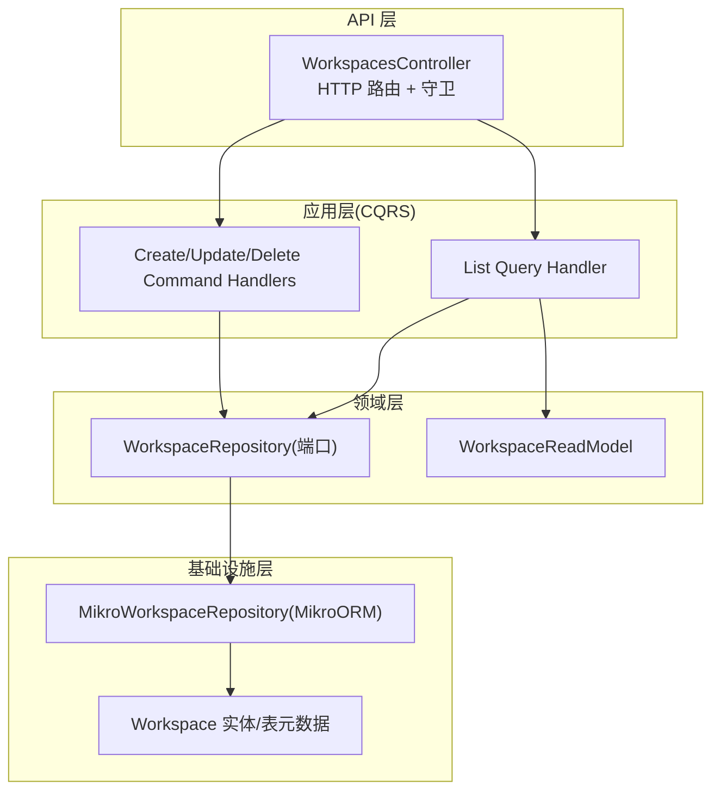
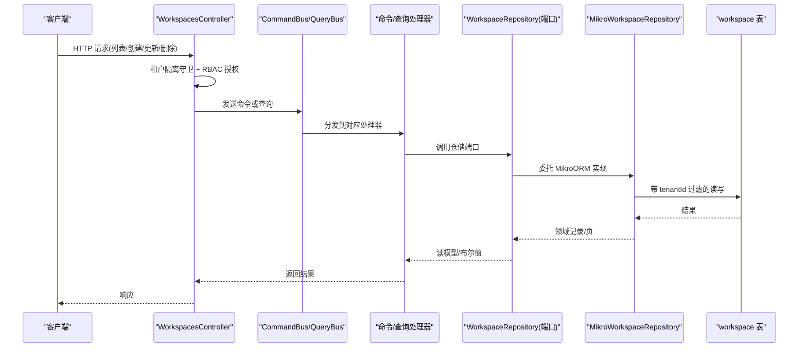
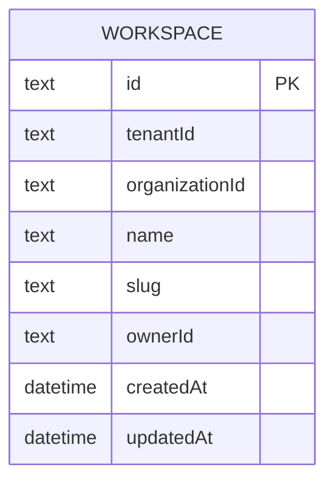
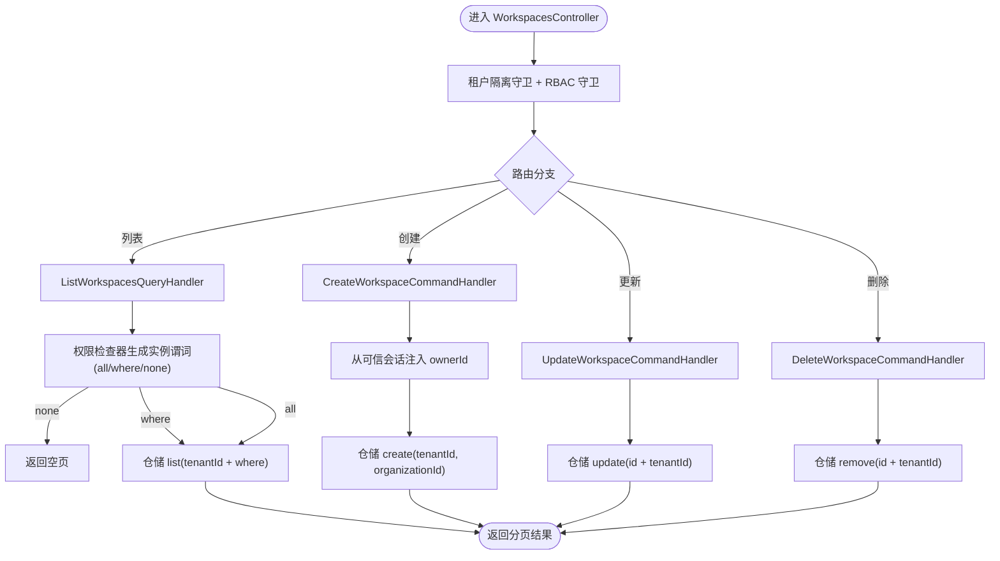
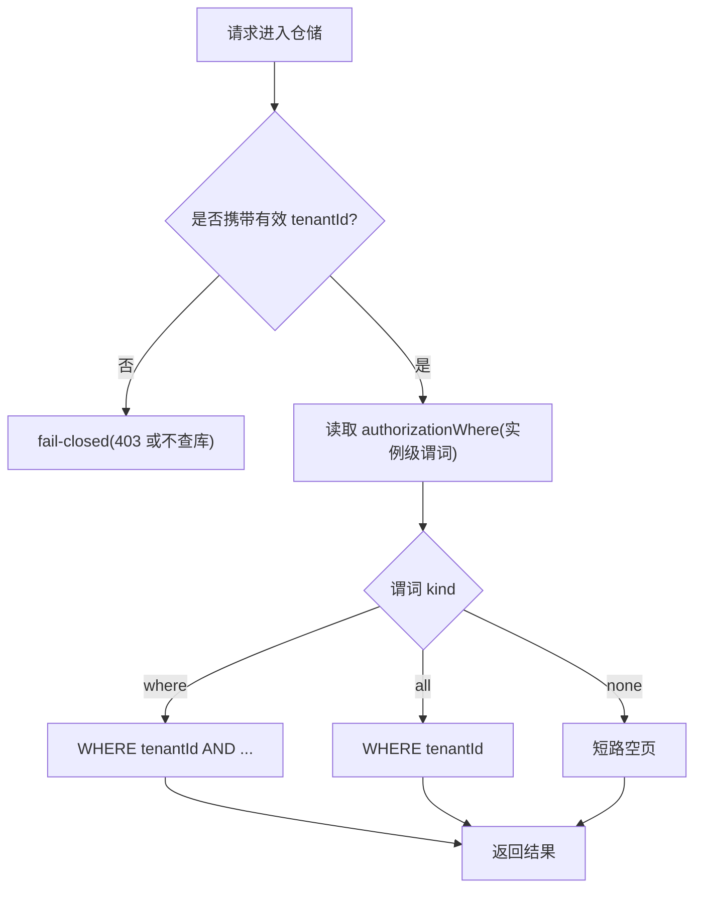
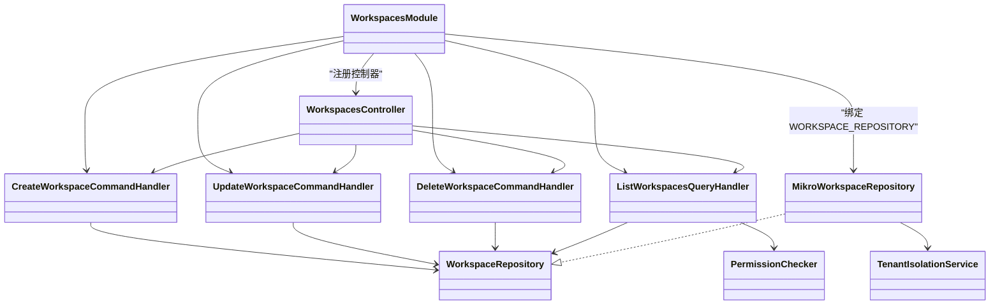

# 工作区管理

<cite>
**本文引用的文件**   
- [workspaces.module.ts](file://apps/api/src/modules/workspaces/workspaces.module.ts)
- [workspaces.controller.ts](file://apps/api/src/modules/workspaces/api/workspaces.controller.ts)
- [workspace.entity.ts](file://apps/api/src/modules/workspaces/infrastructure/entities/workspace.entity.ts)
- [mikro-workspace.repository.ts](file://apps/api/src/modules/workspaces/infrastructure/repositories/mikro-workspace.repository.ts)
- [create-workspace.command-handler.ts](file://libs/core/src/modules/workspaces/application/commands/handlers/create-workspace.command-handler.ts)
- [update-workspace.command-handler.ts](file://libs/core/src/modules/workspaces/application/commands/handlers/update-workspace.command-handler.ts)
- [delete-workspace.command-handler.ts](file://libs/core/src/modules/workspaces/application/commands/handlers/delete-workspace.command-handler.ts)
- [list-workspaces.query-handler.ts](file://libs/core/src/modules/workspaces/application/queries/handlers/list-workspaces.query-handler.ts)
- [workspace.repository.ts](file://libs/core/src/modules/workspaces/domain/repositories/workspace.repository.ts)
- [workspace.read-model.ts](file://libs/core/src/modules/workspaces/application/read-models/workspace.read-model.ts)
- [workspaces.response.ts](file://apps/api/src/modules/workspaces/api/response/workspace.response.ts)
- [workspaces.ts（响应契约）](file://libs/contracts/src/response/workspaces.ts)
- [workspaces.contract.ts](file://libs/api-contract/src/workspaces.contract.ts)
- [system-role-seed.ts](file://apps/api/src/modules/authorization/domain/constants/system-role-seed.ts)
- [org-visibility-isolation.e2e.test.ts](file://apps/api/src/tenant-isolation/org-visibility-isolation.e2e.test.ts)
- [tenant-activation.e2e.test.ts](file://apps/api/src/tenant-isolation/tenant-activation.e2e.test.ts)
- [Migration20261017094221.ts](file://apps/api/src/database/mikro/migration/migrations/Migration20261017094221.ts)
- [subscriptions.ts（订阅视图契约）](file://libs/contracts/src/response/subscriptions.ts)
</cite>

## 目录
1. [简介](#简介)
2. [项目结构](#项目结构)
3. [核心组件](#核心组件)
4. [架构总览](#架构总览)
5. [详细组件分析](#详细组件分析)
6. [依赖关系分析](#依赖关系分析)
7. [性能与可伸缩性](#性能与可伸缩性)
8. [故障排查指南](#故障排查指南)
9. [结论](#结论)
10. [附录：配置项与接口清单](#附录配置项与接口清单)

## 简介
本文件系统性梳理“工作区”在两级边界架构中的位置与作用，围绕租户→组织→工作区的层级关系，说明工作区的创建、配置、查询、更新与删除流程；解释工作区与组织、成员的关系映射，以及工作区级别的权限隔离和数据访问控制机制；给出工作区配置项定义与管理接口；总结最佳实践与性能优化建议；并说明工作区与订阅计费的关联关系。

## 项目结构
工作区功能位于 API 应用模块的 `modules/workspaces` 下，采用 CQRS 分层：控制器负责 HTTP 路由与鉴权守卫，命令/查询处理器处理业务意图，仓储端口定义领域契约，MikroORM 实现数据持久化与租户隔离。

图表来源
- [workspaces.controller.ts:63-151](file://apps/api/src/modules/workspaces/api/workspaces.controller.ts#L63-L151)
- [create-workspace.command-handler.ts:21-41](file://libs/core/src/modules/workspaces/application/commands/handlers/create-workspace.command-handler.ts#L21-L41)
- [update-workspace.command-handler.ts:15-28](file://libs/core/src/modules/workspaces/application/commands/handlers/update-workspace.command-handler.ts#L15-L28)
- [delete-workspace.command-handler.ts:14-27](file://libs/core/src/modules/workspaces/application/commands/handlers/delete-workspace.command-handler.ts#L14-L27)
- [list-workspaces.query-handler.ts:31-63](file://libs/core/src/modules/workspaces/application/queries/handlers/list-workspaces.query-handler.ts#L31-L63)
- [workspace.repository.ts:23-107](file://libs/core/src/modules/workspaces/domain/repositories/workspace.repository.ts#L23-L107)
- [mikro-workspace.repository.ts:34-135](file://apps/api/src/modules/workspaces/infrastructure/repositories/mikro-workspace.repository.ts#L34-L135)
- [workspace.entity.ts:16-55](file://apps/api/src/modules/workspaces/infrastructure/entities/workspace.entity.ts#L16-L55)

章节来源
- [workspaces.module.ts:1-31](file://apps/api/src/modules/workspaces/workspaces.module.ts#L1-L31)

## 核心组件
- 控制器与工作区 HTTP 接口：提供分页列表、创建、更新、删除四个端点，统一通过守卫进行租户隔离与 RBAC 授权。
- CQRS 命令处理器：封装创建工作区、更新工作区、删除工作区的写意图，属主字段从可信会话注入而非请求体。
- CQRS 查询处理器：基于权限检查器生成实例级过滤谓词，结合仓储层的租户隔离完成安全分页查询。
- 仓储端口与实现：定义工作区读写契约；MikroORM 实现强制租户作用域，所有读加 tenantId 过滤，所有写自动盖章 tenantId/organizationId。
- 实体与数据库表：workspace 表包含租户、组织、名称、slug、可选属主、时间戳等列，并提供唯一索引与复合索引以支撑查询与隔离。
- 响应契约与 Swagger 文档：对外暴露 WorkspaceView/Page 类型，保证序列化输出稳定。

章节来源
- [workspaces.controller.ts:63-151](file://apps/api/src/modules/workspaces/api/workspaces.controller.ts#L63-L151)
- [create-workspace.command-handler.ts:21-41](file://libs/core/src/modules/workspaces/application/commands/handlers/create-workspace.command-handler.ts#L21-L41)
- [update-workspace.command-handler.ts:15-28](file://libs/core/src/modules/workspaces/application/commands/handlers/update-workspace.command-handler.ts#L15-L28)
- [delete-workspace.command-handler.ts:14-27](file://libs/core/src/modules/workspaces/application/commands/handlers/delete-workspace.command-handler.ts#L14-L27)
- [list-workspaces.query-handler.ts:31-63](file://libs/core/src/modules/workspaces/application/queries/handlers/list-workspaces.query-handler.ts#L31-L63)
- [workspace.repository.ts:23-107](file://libs/core/src/modules/workspaces/domain/repositories/workspace.repository.ts#L23-L107)
- [mikro-workspace.repository.ts:34-135](file://apps/api/src/modules/workspaces/infrastructure/repositories/mikro-workspace.repository.ts#L34-L135)
- [workspace.entity.ts:16-55](file://apps/api/src/modules/workspaces/infrastructure/entities/workspace.entity.ts#L16-L55)
- [workspaces.response.ts:14-91](file://apps/api/src/modules/workspaces/api/response/workspace.response.ts#L14-L91)
- [workspaces.ts（响应契约）:13-32](file://libs/contracts/src/response/workspaces.ts#L13-L32)

## 架构总览
工作区处于“租户→组织→工作区”的两级边界中：
- 租户维度：所有工作区按 tenantId 强隔离，跨租户不可见、不可改。
- 组织维度：工作区归属 organizationId，同一租户内默认跨组织可见（共享模式），但受 RBAC 实例级条件进一步收窄。
- 成员维度：通过系统角色与自定义 grant 控制对 Workspace 的 create/read/update/delete；同时支持按 ownerId 的实例级可见性。

图表来源
- [workspaces.controller.ts:63-151](file://apps/api/src/modules/workspaces/api/workspaces.controller.ts#L63-L151)
- [list-workspaces.query-handler.ts:31-63](file://libs/core/src/modules/workspaces/application/queries/handlers/list-workspaces.query-handler.ts#L31-L63)
- [create-workspace.command-handler.ts:21-41](file://libs/core/src/modules/workspaces/application/commands/handlers/create-workspace.command-handler.ts#L21-L41)
- [update-workspace.command-handler.ts:15-28](file://libs/core/src/modules/workspaces/application/commands/handlers/update-workspace.command-handler.ts#L15-L28)
- [delete-workspace.command-handler.ts:14-27](file://libs/core/src/modules/workspaces/application/commands/handlers/delete-workspace.command-handler.ts#L14-L27)
- [mikro-workspace.repository.ts:34-135](file://apps/api/src/modules/workspaces/infrastructure/repositories/mikro-workspace.repository.ts#L34-L135)

## 详细组件分析

### 工作区数据模型与表结构
- 关键字段：id、tenantId、organizationId、name、slug、ownerId、createdAt、updatedAt。
- 约束与索引：
  - 唯一约束：(organizationId, slug)。
  - 复合索引：(organizationId, ownerId) 用于实例级可见性查询。
- 行级隔离：启用租户隔离过滤器，无活动 tenantId 时不筛（平台治理面豁免）。

图表来源
- [workspace.entity.ts:16-55](file://apps/api/src/modules/workspaces/infrastructure/entities/workspace.entity.ts#L16-L55)
- [Migration20261017094221.ts:6-16](file://apps/api/src/database/mikro/migration/migrations/Migration20261017094221.ts#L6-L16)

章节来源
- [workspace.entity.ts:16-55](file://apps/api/src/modules/workspaces/infrastructure/entities/workspace.entity.ts#L16-L55)
- [Migration20261017094221.ts:6-16](file://apps/api/src/database/mikro/migration/migrations/Migration20261017094221.ts#L6-L16)

### 工作区 CRUD 流程与权限控制
- 列表：RBAC 授权 read，实例级谓词由权限检查器生成，可能为 all/where/none；none 直接短路空页，where 下推至仓储，all 则仅依赖租户隔离。
- 创建：仅 owner/admin 可创建；ownerId 从可信会话注入，不在请求体中出现，避免伪造。
- 更新/删除：仅 owner/admin 可操作；仓储以 id+tenantId 定位，跨租户命中 0 行，天然防越权。

图表来源
- [workspaces.controller.ts:63-151](file://apps/api/src/modules/workspaces/api/workspaces.controller.ts#L63-L151)
- [list-workspaces.query-handler.ts:31-63](file://libs/core/src/modules/workspaces/application/queries/handlers/list-workspaces.query-handler.ts#L31-L63)
- [create-workspace.command-handler.ts:21-41](file://libs/core/src/modules/workspaces/application/commands/handlers/create-workspace.command-handler.ts#L21-L41)
- [update-workspace.command-handler.ts:15-28](file://libs/core/src/modules/workspaces/application/commands/handlers/update-workspace.command-handler.ts#L15-L28)
- [delete-workspace.command-handler.ts:14-27](file://libs/core/src/modules/workspaces/application/commands/handlers/delete-workspace.command-handler.ts#L14-L27)
- [mikro-workspace.repository.ts:61-135](file://apps/api/src/modules/workspaces/infrastructure/repositories/mikro-workspace.repository.ts#L61-L135)

章节来源
- [workspaces.controller.ts:63-151](file://apps/api/src/modules/workspaces/api/workspaces.controller.ts#L63-L151)
- [list-workspaces.query-handler.ts:31-63](file://libs/core/src/modules/workspaces/application/queries/handlers/list-workspaces.query-handler.ts#L31-L63)
- [create-workspace.command-handler.ts:21-41](file://libs/core/src/modules/workspaces/application/commands/handlers/create-workspace.command-handler.ts#L21-L41)
- [update-workspace.command-handler.ts:15-28](file://libs/core/src/modules/workspaces/application/commands/handlers/update-workspace.command-handler.ts#L15-L28)
- [delete-workspace.command-handler.ts:14-27](file://libs/core/src/modules/workspaces/application/commands/handlers/delete-workspace.command-handler.ts#L14-L27)
- [mikro-workspace.repository.ts:61-135](file://apps/api/src/modules/workspaces/infrastructure/repositories/mikro-workspace.repository.ts#L61-L135)

### 工作区与组织、成员的关系映射
- 组织关系：每个工作区属于一个 organizationId；同一租户内默认跨组织可见（共享模式），可通过 RBAC 实例级条件进一步限制。
- 成员关系：系统角色 owner/admin 拥有 Workspace 的 create/read/update/delete；member 仅 read。自定义角色可通过 grant 条件（如 ownerId=userId）实现实例级可见性。

章节来源
- [system-role-seed.ts:48-82](file://apps/api/src/modules/authorization/domain/constants/system-role-seed.ts#L48-L82)
- [workspace-owner-rbac.e2e.test.ts:34-50](file://apps/api/src/modules/workspaces/workspace-owner-rbac.e2e.test.ts#L34-L50)

### 工作区级别的权限隔离与数据访问控制
- 租户隔离：仓储层强制 tenantId 过滤，任何外部租户 id 无法命中；无活动租户上下文时 fail-closed（403 或不触库）。
- 组织可见性：同租跨组织默认互见；当 orgVisibility=isolated 且无活动组织时，读侧 fail-closed 返回空集。
- 实例级可见性：通过 ownerId 列与索引 (organizationId, ownerId)，配合 RBAC 条件 grant 实现“仅本人可见”等策略。

图表来源
- [mikro-workspace.repository.ts:41-85](file://apps/api/src/modules/workspaces/infrastructure/repositories/mikro-workspace.repository.ts#L41-L85)
- [list-workspaces.query-handler.ts:45-63](file://libs/core/src/modules/workspaces/application/queries/handlers/list-workspaces.query-handler.ts#L45-L63)

章节来源
- [org-visibility-isolation.e2e.test.ts:169-237](file://apps/api/src/tenant-isolation/org-visibility-isolation.e2e.test.ts#L169-L237)
- [tenant-activation.e2e.test.ts:208-228](file://apps/api/src/tenant-isolation/tenant-activation.e2e.test.ts#L208-L228)
- [workspace.entity.ts:34-38](file://apps/api/src/modules/workspaces/infrastructure/entities/workspace.entity.ts#L34-L38)

### 工作区配置项定义与管理接口
- 配置项（工作区实体字段）：
  - name：工作区名称。
  - slug：URL 友好的短标识（与 organizationId 唯一）。
  - ownerId：实例属主（可选，NULL 表示不属任何人）。
  - organizationId：所属组织（仓储盖章）。
  - tenantId：所属租户（仓储盖章）。
  - createdAt/updatedAt：时间戳。
- 管理接口（HTTP）：
  - 列表：分页获取当前租户下的工作区。
  - 创建：提交 name/slug，服务端注入 ownerId/organizationId/tenantId。
  - 更新：提交 id/name/slug，服务端校验存在性与租户归属。
  - 删除：提交 id，服务端校验存在性与租户归属。

章节来源
- [workspace.entity.ts:16-55](file://apps/api/src/modules/workspaces/infrastructure/entities/workspace.entity.ts#L16-L55)
- [workspaces.controller.ts:63-151](file://apps/api/src/modules/workspaces/api/workspaces.controller.ts#L63-L151)
- [workspaces.contract.ts:43-58](file://libs/api-contract/src/workspaces.contract.ts#L43-L58)

### 工作区与订阅计费的关联关系
- 订阅计费面向组织维度（座位数、存储配额、API 配额等），工作区作为组织内的资源容器，其数量与使用通常受订阅档位限制。
- 订阅视图契约包含 hasSubscription、plan、seatsLimit、used、remaining、providerCustomerId 等字段，用于前端展示与限额判断。
- 工作区本身不直接绑定订阅字段，但在组织级配额校验逻辑中，工作区数量可作为业务指标参与限额决策（例如限制每组织工作区上限）。

章节来源
- [subscriptions.ts（订阅视图契约）:8-22](file://libs/contracts/src/response/subscriptions.ts#L8-L22)

## 依赖关系分析
- 模块装配：WorkspacesModule 注册 CQRS 处理器与仓储实现，将 WORKSPACE_REPOSITORY 绑定到 MikroWorkspaceRepository。
- 控制器依赖：CommandBus/QueryBus 与两个守卫（TenantIsolationGuard、AuthorizationGuard）。
- 处理器依赖：WORKSPACE_REPOSITORY 端口与 TenantIsolationService（列表处理器还依赖 PERMISSION_CHECKER）。
- 仓储实现依赖：MikroOrmService 与 TenantIsolationService，确保每次 fork 独立 EntityManager。

图表来源
- [workspaces.module.ts:11-27](file://apps/api/src/modules/workspaces/workspaces.module.ts#L11-L27)
- [workspaces.controller.ts:63-151](file://apps/api/src/modules/workspaces/api/workspaces.controller.ts#L63-L151)
- [create-workspace.command-handler.ts:21-41](file://libs/core/src/modules/workspaces/application/commands/handlers/create-workspace.command-handler.ts#L21-L41)
- [update-workspace.command-handler.ts:15-28](file://libs/core/src/modules/workspaces/application/commands/handlers/update-workspace.command-handler.ts#L15-L28)
- [delete-workspace.command-handler.ts:14-27](file://libs/core/src/modules/workspaces/application/commands/handlers/delete-workspace.command-handler.ts#L14-L27)
- [list-workspaces.query-handler.ts:31-63](file://libs/core/src/modules/workspaces/application/queries/handlers/list-workspaces.query-handler.ts#L31-L63)
- [workspace.repository.ts:23-107](file://libs/core/src/modules/workspaces/domain/repositories/workspace.repository.ts#L23-L107)
- [mikro-workspace.repository.ts:34-135](file://apps/api/src/modules/workspaces/infrastructure/repositories/mikro-workspace.repository.ts#L34-L135)

## 性能与可伸缩性
- 分页查询：使用 offset 分页，按 createdAt 升序排序，适合中等规模数据集；若数据量增长，可考虑游标分页或基于时间窗的分片。
- 索引优化：
  - 唯一索引 (organizationId, slug) 保障 URL 友好标识的唯一性。
  - 复合索引 (organizationId, ownerId) 加速实例级可见性过滤。
- 查询谓词下推：RBAC 实例级谓词在 handler 层生成后下推到仓储，减少内存过滤开销。
- 连接复用：仓储每次 fork EntityManager，避免共享状态；在高并发场景需关注连接池大小与超时配置。
- 写入路径：更新时间戳仅在脏字段变更时设置，减少不必要更新。

[本节为通用性能建议，无需具体文件引用]

## 故障排查指南
- 403 未激活租户：确认请求已正确解析出 tenantId；若无活动租户，仓储会 fail-closed 且不查库。
- 404 工作区不存在：更新或删除时，若 id 不属于当前租户或不存在，仓储返回 null/false，控制器抛出 404。
- 列表为空：检查 RBAC 实例级谓词是否为 none；或在 isolated 模式下无活动组织导致 fail-closed。
- 跨租户泄漏：核查仓储是否仍保留 tenantId 过滤；任何移除该谓词的改动都会回归失败。
- 属主可见性问题：确认 ownerId 是否正确注入；受限 grant 下 NULL 属主应不可见。

章节来源
- [mikro-workspace.repository.ts:41-135](file://apps/api/src/modules/workspaces/infrastructure/repositories/mikro-workspace.repository.ts#L41-L135)
- [list-workspaces.query-handler.ts:45-63](file://libs/core/src/modules/workspaces/application/queries/handlers/list-workspaces.query-handler.ts#L45-L63)
- [workspaces.controller.ts:109-151](file://apps/api/src/modules/workspaces/api/workspaces.controller.ts#L109-L151)

## 结论
工作区在两级边界架构中承担组织内资源容器的职责，通过租户强隔离、组织可见性策略与 RBAC 实例级条件，形成多层安全边界。仓储层是唯一卡点，确保跨租户不可见、不可改；处理器层叠加实例级可见性，满足细粒度权限需求。配合合理的索引与分页策略，可在多租户环境下保持良好性能与可伸缩性。订阅计费面向组织维度，工作区数量与使用可纳入配额管理，支撑 SaaS 商业化运营。

## 附录：配置项与接口清单

### 工作区配置项（实体字段）
- id：主键。
- tenantId：所属租户（可空，仓储盖章）。
- organizationId：所属组织（仓储盖章）。
- name：工作区名称。
- slug：URL 友好短标识（与 organizationId 唯一）。
- ownerId：实例属主（可选，NULL 表示不属任何人）。
- createdAt/updatedAt：时间戳。

章节来源
- [workspace.entity.ts:16-55](file://apps/api/src/modules/workspaces/infrastructure/entities/workspace.entity.ts#L16-L55)
- [workspace.repository.ts:23-107](file://libs/core/src/modules/workspaces/domain/repositories/workspace.repository.ts#L23-L107)

### 工作区管理接口（HTTP）
- 列表：分页获取工作区，输入为分页参数，输出为 Page<WorkspaceView>。
- 创建：输入 name/slug，输出 WorkspaceView。
- 更新：输入 id/name/slug，输出 WorkspaceView；未命中返回 404。
- 删除：输入 id，成功返回 204；未命中返回 404。

章节来源
- [workspaces.controller.ts:63-151](file://apps/api/src/modules/workspaces/api/workspaces.controller.ts#L63-L151)
- [workspaces.contract.ts:43-58](file://libs/api-contract/src/workspaces.contract.ts#L43-L58)
- [workspaces.ts（响应契约）:13-32](file://libs/contracts/src/response/workspaces.ts#L13-L32)